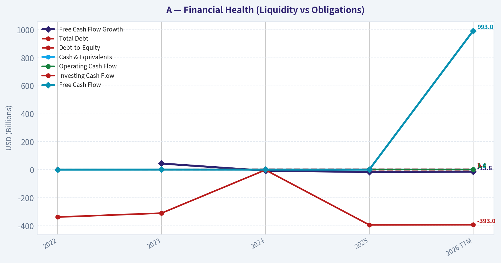
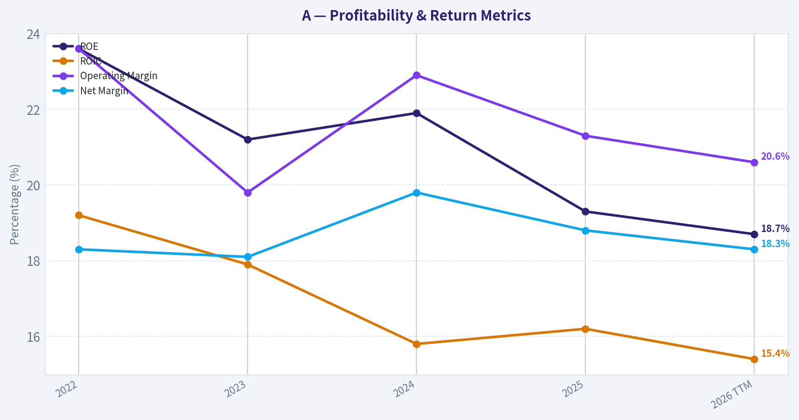
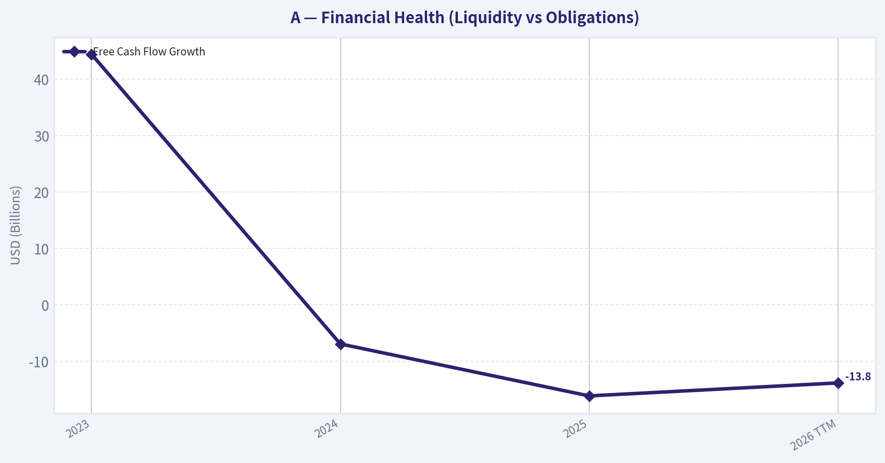
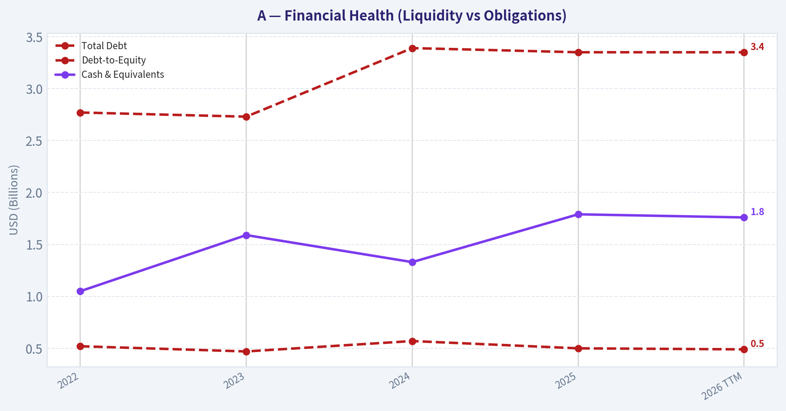
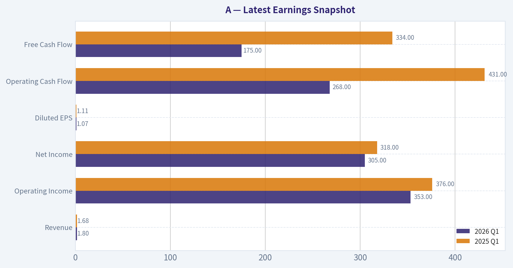
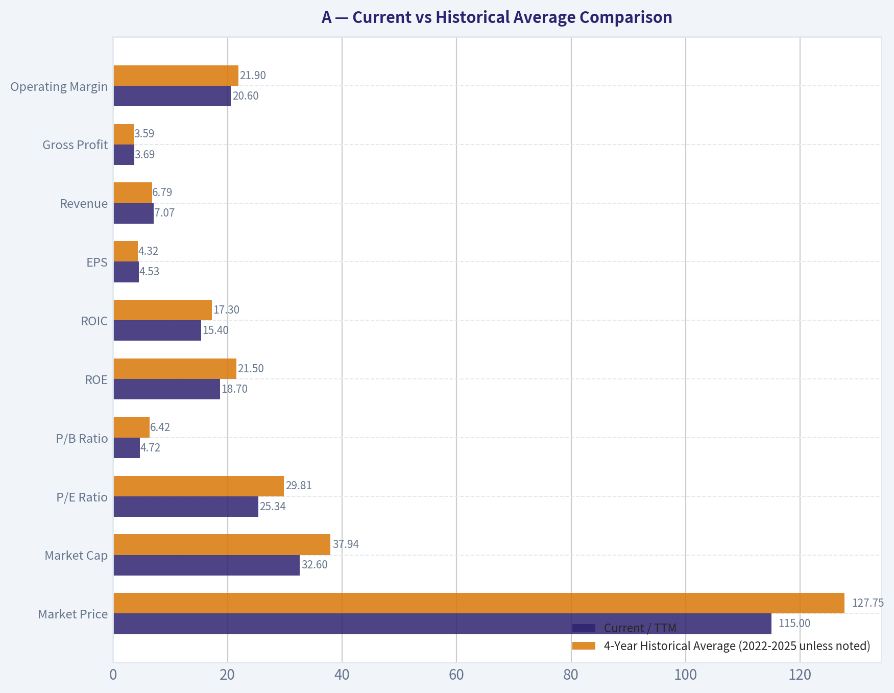
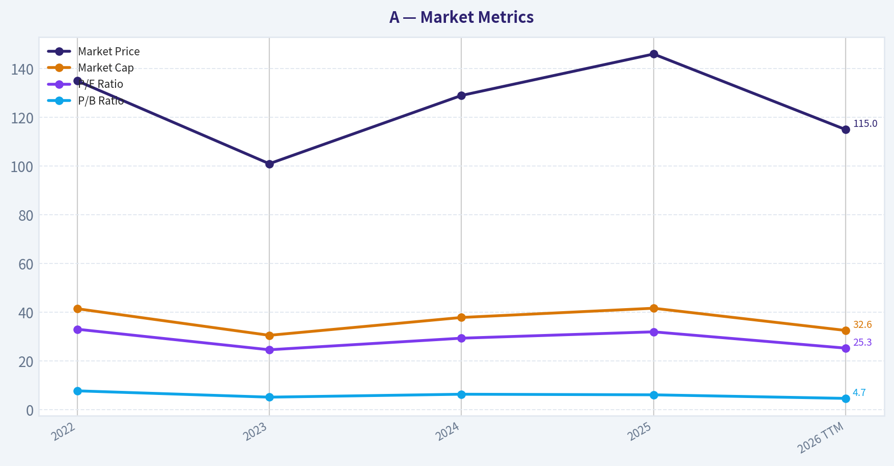

# A Deep Value Intelligence

**Analysis Date:** 2026-05-22

## Critical Disclaimer

*This analysis is generated by Deep Value Intelligence, an AI-powered multi-agent investing framework. This report is for informational and educational purposes only and does not constitute financial advice. Always conduct your own research and consult with qualified financial advisors before making investment decisions.*

---

## Table of Contents

1. Intelligence Summary
2. Analyst Team Reports
   - Fundamentals Analysis
   - Intrinsic Value Analysis (Buffett)
   - Trend & Growth Analysis (Lynch/Druckenmiller/Fisher)
   - Market Technical Analysis
   - Options Market Analysis
3. Research Team Commentary
4. Value Investing Team Commentary
5. Deep Values Commentary

---

## Intelligence Summary

### Thesis + Conditions

**Core Thesis:** ## Executive Summary

**Key Risks:**
- Agilent looks like a **good business, but not a clear bargain**. The core franchise appears durable-sticky lab workflows, recurring consumables/service revenue, strong margins, and healthy returns on capital-but at roughly **25.3x earnings** and only a **3.6% FCF yield**, the stock does **not offer much margin of safety** for a Buffett-style long-term investor. The key risk is not near-term volatility; it is **paying a premium price for a business with only moderate growth and a moat that is solid, not exceptional**. Keep it on the list, but wait for either **better valuation** or **clearer business reacceleration**.
- ### 1) Risky Analyst - strongest bullish case
- Best point: **A good business is not automatically a low-risk investment if bought at a full valuation.**

**Confidence:** Medium

---

## Analyst Team Reports

### Fundamentals Analysis

#### Latest Earnings Snapshot

*Most recent reported quarter anchored on 2026 Q1, with prior-year comparison when available.*

| Metric | 2026 Q1 | 2025 Q1 | YoY Change |
| --- | ---: | ---: | ---: |
| Revenue | $1.80B | $1.68B | +7.0% |
| Operating Income | $353.0M | $376.0M | -6.1% |
| Net Income | $305.0M | $318.0M | -4.1% |
| Diluted EPS | $1.07 | $1.11 | -3.6% |
| Operating Cash Flow | $268.0M | $431.0M | -37.8% |
| Free Cash Flow | $175.0M | $334.0M | -47.6% |

Key Takeaways: This snapshot anchors the most recent reported quarter before the narrative analysis. It helps readers separate long-run business quality from whatever changed in the latest earnings print.

#### 4-Year Financial Metrics for A

*All values below are computed deterministically from raw data - not estimated by AI.*

*Issuer profile: operating company (Healthcare / Diagnostics & Research).*

#### 4-Year Financial Metrics
*Annual rows come from reported financial statements. The final TTM row is computed from the latest four quarters.*

| Metric | 2022 | 2023 | 2024 | 2025 | 2026 TTM |
| --- | --- | --- | --- | --- | --- |
| Market Price | $135 | $101 | $129 | $146 | $115 |
| Market Cap | $41.51B | $30.60B | $37.92B | $41.71B | $32.60B |
| P/E Ratio | 33.10 | 24.67 | 29.42 | 32.03 | 25.34 |
| P/B Ratio | 7.82 | 5.23 | 6.43 | 6.19 | 4.72 |
| ROE | 23.6% | 21.2% | 21.9% | 19.3% | 18.7% |
| ROIC | 19.2% | 17.9% | 15.8% | 16.2% | 15.4% |
| EPS | $4.07 | $4.19 | $4.43 | $4.57 | $4.53 |
| Revenue | $6.85B | $6.83B | $6.51B | $6.95B | $7.07B |
| Gross Profit | $3.72B | $3.46B | $3.54B | $3.64B | $3.69B |
| Gross Margin | N/A | N/A | N/A | N/A | 52.2% |
| Operating Margin | 23.6% | 19.8% | 22.9% | 21.3% | 20.6% |
| Net Income | $1.25B | $1.24B | $1.29B | $1.30B | $1.29B |
| Net Margin | 18.3% | 18.1% | 19.8% | 18.8% | 18.3% |
| Revenue Growth | N/A | -0.2% | -4.7% | 6.7% | 1.7% |
| Net Income Growth | N/A | -1.1% | 4.0% | 1.1% | -1.0% |
| Free Cash Flow Growth | N/A | 44.4% | -6.9% | -16.1% | -13.8% |
| Total Book Value | $5.30B | $5.84B | $5.90B | $6.74B | $6.91B |
| Total Assets | $10.53B | $10.76B | $11.85B | $12.73B | $12.81B |
| Total Debt | $2.77B | $2.73B | $3.39B | $3.35B | $3.35B |
| Debt-to-Equity | 0.52 | 0.47 | 0.57 | 0.50 | 0.49 |
| Cash & Equivalents | $1.05B | $1.59B | $1.33B | $1.79B | $1.76B |
| Shareholders' Equity | $5.30B | $5.84B | $5.90B | $6.74B | $6.91B |
| Operating Cash Flow | $1.31B | $1.77B | $1.75B | $1.56B | $1.40B |
| Investing Cash Flow | $-338.0M | $-310.0M | $-1.26B | $-394.0M | $-393.0M |
| Free Cash Flow | $1.02B | $1.47B | $1.37B | $1.15B | $993.0M |
| FCF Margin | 14.9% | 21.6% | 21.1% | 16.6% | 14.1% |
| Dividends / Share | $0.81 | $0.90 | $0.94 | $0.99 | $1.00 |

#### Profitability Metrics
- Return on Equity (ROE): 19.3%
- Return on Invested Capital (ROIC): 16.2%
- Return on Assets (ROA): 10.2%
- Gross Margin: 52.4%
- Operating Margin: 21.3%
- Net Profit Margin: 18.8%

#### Liquidity Metrics
- Current Ratio: 1.96
- Quick Ratio: 1.40

#### Leverage Metrics
- Debt-to-Equity Ratio: 0.50
- Interest Coverage Ratio: 13.21
- Net Debt: $1.56B

#### Growth Metrics (Year-over-Year)
- Revenue Growth: 6.7%
- Net Income Growth: 1.1%
- Free Cash Flow Growth: -16.1%
- Revenue CAGR (3-Year): 0.5%
- Revenue CAGR (5-Year): N/A

#### Valuation Metrics
- P/E Ratio (TTM): 25.34
- Forward P/E: 17.47
- Price-to-Book: 4.70
- Price-to-Sales: 4.59
- PEG Ratio: 1.16
- EV/EBITDA: 17.37
- Free Cash Flow Yield: 3.6%
- Earnings Yield: 3.9%

#### Owner Earnings (Buffett Method, Code-Computed)
- Net Income: $1.30B
- + Depreciation & Amortization: $288.0M
- - Capital Expenditures: $-407.0M
- - Working Capital Changes: $-131.0M
- = **Owner Earnings: $1.31B**

#### Intrinsic Value (Code-Computed)
- Current Price: $115
- Buffett Method (Owner Earnings):
  Conservative: $25
  Average: $41
  Optimistic: $61
- Cash Flow Method (FCF):
  Conservative: $33
  Average: $59
  Optimistic: $99

#### Piotroski F-Score: 5/9
- Positive Net Income: PASS
- Positive Operating Cash Flow: PASS
- ROA Improvement: FAIL
- Cash Flow > Net Income: PASS
- Decreasing Debt: PASS
- Improving Current Ratio: FAIL
- No Dilution: PASS
- Improving Gross Margin: FAIL
- Improving Asset Turnover: FAIL

ANALYST STANCE: **WATCH**

#### Agilent Technologies (A) - Buffett-Style Fundamental Analysis

Agilent is a high-quality diagnostics and analytical instruments business with attractive margins, good returns on capital, and a balance sheet that remains solid. However, the deterministic dataset shows a business that is no longer compounding at the same quality implied by a premium multiple: revenue has been mostly flat over the period, ROE and ROIC have drifted down, and free cash flow has weakened materially from its recent peak. At **$115/share**, the stock is cheaper than its 2025 high and cheaper on P/E and P/B than recent years, but it still appears to trade above the code-computed Buffett-style owner-earnings intrinsic values provided in the canonical dataset.

From a Buffett perspective, this is not a low-quality company. It is a good business with durable economics. The issue is valuation versus growth quality: the company still earns strong returns, but the historical pattern in this 4-year deterministic window suggests moderation rather than acceleration. That supports a **WATCH**, not an outright avoid, because quality is present but the margin of safety is limited.

---

#### Current vs Historical Average Comparison

| Metric | Current / TTM | 4-Year Historical Average (2022-2025 unless noted) | Interpretation |
| --- | ---: | ---: | --- |
| Market Price | $115 | $127.75 | Below recent-year average price |
| Market Cap | $32.60B | $37.94B | Lower than recent average valuation level |
| P/E Ratio | 25.34 | 29.81 | Valuation has de-rated versus recent history |
| P/B Ratio | 4.72 | 6.42 | Materially below recent historical average |
| ROE | 18.7% | 21.5% | Still strong, but below historical norm |
| ROIC | 15.4% | 17.3% | Good absolute level, declining trend |
| EPS | $4.53 | $4.32 | Slightly above average, but below 2025 peak |
| Revenue | $7.07B | $6.79B | Above average, modest expansion only |
| Gross Profit | $3.69B | $3.59B | Slightly above average |
| Operating Margin | 20.6% | 21.9% | Below average profitability |
| Net Income | $1.29B | $1.27B | Near average, little true growth |
| Net Margin | 18.3% | 18.8% | Slightly below average |
| Revenue Growth | 1.7% | 0.6% avg YoY (2023-2025) | Growth remains subdued |
| Net Income Growth | -1.0% | 1.3% avg YoY (2023-2025) | Earnings momentum has softened |
| FCF Growth | -13.8% | 7.1% avg YoY (2023-2025) | Clear deterioration |
| Total Book Value | $6.91B | $5.94B | Equity base has expanded nicely |
| Total Assets | $12.81B | $11.47B | Asset base continues to grow |
| Total Debt | $3.35B | $3.06B | Slightly above average, but controlled |
| Debt-to-Equity | 0.49 | 0.52 | Leverage is reasonable and stable |
| Cash & Equivalents | $1.76B | $1.44B | Liquidity remains healthy |
| Shareholders' Equity | $6.91B | $5.94B | Stronger equity cushion than average |
| Free Cash Flow | $993M | $1.25B | Well below average; key concern |
| Dividends / Share | $1.00 | $0.91 | Dividend growth remains steady |

Key Takeaways: Agilent's current valuation multiples are below its recent historical averages, which means some optimism has already come out of the stock. But the business quality has also softened: returns on capital, margins, and especially free cash flow are all below their recent norms. This leaves the shares looking cheaper than before, but not obviously cheap enough to fully offset the slowdown.

---

#### Market Metrics

| Metric | 2022 | 2023 | 2024 | 2025 | 2026 TTM |
| --- | ---: | ---: | ---: | ---: | ---: |
| Market Price | $135 | $101 | $129 | $146 | $115 |
| Market Cap | $41.51B | $30.60B | $37.92B | $41.71B | $32.60B |
| P/E Ratio | 33.10 | 24.67 | 29.42 | 32.03 | 25.34 |
| P/B Ratio | 7.82 | 5.23 | 6.43 | 6.19 | 4.72 |

Key Takeaways: The market has meaningfully de-rated Agilent from the richer valuation levels seen in 2022 and 2025. The stock now trades at the lowest P/B and near the low end of the observed P/E range, suggesting investors are paying less for each dollar of earnings and equity than in prior years. That is constructive, but the company still is not statistically "cheap" on an absolute basis for a low-growth period.

Interpretation:
- **Market Price / Market Cap:** The decline from **$146 in 2025 to $115 TTM** reflects lower market enthusiasm despite only modest fundamental erosion. Market cap has similarly dropped from **$41.71B to $32.60B**.
- **P/E Ratio:** Current **25.34x** is below the 4-year average of about **29.8x**. That de-rating matters, but Buffett would still ask whether a mid-20s earnings multiple is justified for a company with **1.7% revenue growth** and **-1.0% net income growth** in TTM.
- **P/B Ratio:** At **4.72x**, this is the lowest value in the period and well below the historical average. Lower P/B is partially explained by a stronger equity base and lower share price. Still, a near-5x book multiple means the market continues to assign a significant franchise premium.

---

#### Profitability Analysis

| Metric | 2022 | 2023 | 2024 | 2025 | 2026 TTM |
| --- | ---: | ---: | ---: | ---: | ---: |
| ROE | 23.6% | 21.2% | 21.9% | 19.3% | 18.7% |
| ROIC | 19.2% | 17.9% | 15.8% | 16.2% | 15.4% |
| EPS | $4.07 | $4.19 | $4.43 | $4.57 | $4.53 |
| Revenue | $6.85B | $6.83B | $6.51B | $6.95B | $7.07B |
| Gross Profit | $3.72B | $3.46B | $3.54B | $3.64B | $3.69B |
| Operating Margin | 23.6% | 19.8% | 22.9% | 21.3% | 20.6% |
| Net Income | $1.25B | $1.24B | $1.29B | $1.30B | $1.29B |
| Net Margin | 18.3% | 18.1% | 19.8% | 18.8% | 18.3% |

Key Takeaways: Agilent remains a very profitable business by absolute standards, with ROE near 19%, ROIC above 15%, and net margins around 18%. But the trend is no longer improving: returns on capital and operating margins have drifted down from earlier highs, while net income has largely moved sideways. This suggests the moat is still intact, but the business is not strengthening operationally.

Interpretation:
- **ROE:** Current **18.7%** remains attractive and would generally qualify as strong under Buffett-style quality screens. But the decline from **23.6% in 2022** to **18.7% TTM** signals reduced efficiency or a less favorable earnings-to-equity relationship.
- **ROIC:** The trend from **19.2% to 15.4%** is more important than it looks. ROIC is one of the best indicators of moat durability and management's capital allocation discipline. Agilent is still good here, but clearly less exceptional than before.
- **EPS:** EPS has risen from **$4.07 to $4.53** across the period, but that masks stagnation lately: TTM EPS is slightly below **2025's $4.57**.
- **Revenue / Gross Profit:** Revenue has only modestly exceeded 2022 levels. Gross profit remains resilient, indicating pricing power and a defensible business mix, but not explosive demand.
- **Operating Margin:** Down to **20.6% TTM** versus **23.6% in 2022**. This is a notable compression for a business that typically deserves premium multiples because of consistency.
- **Net Income / Net Margin:** Net income is basically flat around **$1.25B-$1.30B** across the dataset. Net margin is impressively stable around **18%-20%**, which is favorable and suggests the underlying business model remains robust.

Buffett read-through:
- This is the profile of a **good business losing a little bit of operating sharpness**, not a broken business.
- Margin stability is a positive sign of moat strength.
- Declining ROIC tempers enthusiasm because it suggests each incremental dollar of capital may be producing slightly less value than before.

---

#### Growth Metrics

| Metric | 2023 | 2024 | 2025 | 2026 TTM |
| --- | ---: | ---: | ---: | ---: |
| Revenue Growth | -0.2% | -4.7% | 6.7% | 1.7% |
| Net Income Growth | -1.1% | 4.0% | 1.1% | -1.0% |
| Free Cash Flow Growth | 44.4% | -6.9% | -16.1% | -13.8% |

Key Takeaways: Growth has been uneven and recently weaker than what a premium multiple usually demands. Revenue recovered in 2025, but TTM growth slowed again to just 1.7%, and free cash flow has declined sharply for two straight annual comparisons. The biggest issue here is not one bad year, but the lack of sustained compounding momentum.

Interpretation:
- **Revenue Growth:** The company moved from slight decline (**-0.2%**) to a deeper decline (**-4.7%**) and then a rebound (**6.7%**) before settling back to **1.7% TTM**. That is not the type of smooth, predictable top-line compounding Buffett prefers most.
- **Net Income Growth:** Mostly flat. After a **4.0%** rebound in 2024 and **1.1%** growth in 2025, TTM is back to **-1.0%**.
- **FCF Growth:** This is the biggest operational concern. Free cash flow surged in 2023, then fell in 2024, 2025, and TTM. Multi-year cash flow deterioration often matters more than EPS softness because cash is what ultimately funds buybacks, dividends, and acquisitions.

Buffett read-through:
- Predictable earnings are **acceptable**, but not elite in this period.
- Predictable cash generation has worsened more than earnings, which raises the possibility that accounting profits are holding up better than underlying cash economics.

---

#### Balance Sheet and Financial Strength

| Metric | 2022 | 2023 | 2024 | 2025 | 2026 TTM |
| --- | ---: | ---: | ---: | ---: | ---: |
| Total Book Value | $5.30B | $5.84B | $5.90B | $6.74B | $6.91B |
| Total Assets | $10.53B | $10.76B | $11.85B | $12.73B | $12.81B |
| Total Debt | $2.77B | $2.73B | $3.39B | $3.35B | $3.35B |
| Debt-to-Equity | 0.52 | 0.47 | 0.57 | 0.50 | 0.49 |
| Cash & Equivalents | $1.05B | $1.59B | $1.33B | $1.79B | $1.76B |
| Shareholders' Equity | $5.30B | $5.84B | $5.90B | $6.74B | $6.91B |

Key Takeaways: Agilent's balance sheet remains healthy. Debt is manageable, debt-to-equity is stable around 0.5, and cash has improved meaningfully versus 2022. The company is not over-levered, and its equity base has steadily grown, which supports resilience and optionality.

Interpretation:
- **Book Value / Equity:** Shareholders' equity has grown from **$5.30B to $6.91B**, which is a favorable long-term sign.
- **Assets:** Total assets rose to **$12.81B**, reflecting business expansion and likely acquisition or investment activity.
- **Debt:** Total debt increased from **$2.77B** to **$3.35B**, but leverage remains contained. Debt-to-equity at **0.49** is reasonable.
- **Cash:** Cash at **$1.76B** provides flexibility, though net debt remains meaningful.
- Cross-checking the deterministic summary: **interest coverage of 13.21x**, **current ratio of 1.96**, and **net debt of $1.56B** all support the conclusion that financial risk is moderate and manageable.

Buffett read-through:
- Financial strength is comfortably adequate.
- This is not the kind of balance sheet that threatens shareholder value in a downturn.
- Debt does not appear to be artificially inflating ROE in an aggressive way.

---

#### Cash Flow and Capital Allocation

| Metric | 2022 | 2023 | 2024 | 2025 | 2026 TTM |
| --- | ---: | ---: | ---: | ---: | ---: |
| Operating Cash Flow | $1.31B | $1.77B | $1.75B | $1.56B | $1.40B |
| Free Cash Flow | $1.02B | $1.47B | $1.37B | $1.15B | $993.0M |
| FCF Margin | 14.9% | 21.6% | 21.1% | 16.6% | 14.1% |
| Dividends / Share | $0.81 | $0.90 | $0.94 | $0.99 | $1.00 |

Key Takeaways: Cash generation has weakened steadily since the 2023 peak. Free cash flow is now below the 2022 level, and FCF margin has fallen from above 21% to 14.1%. The dividend continues to rise, which signals confidence, but dividend growth is currently outpacing free cash flow growth.

Interpretation:
- **Free Cash Flow:** TTM **$993M** is the lowest in the period and below the 4-year average of about **$1.25B**.
- **FCF Margin:** Compression from **21.6% in 2023** to **14.1% TTM** is significant. This may reflect weaker operating conversion, investment needs, or working capital drag.
- **Dividends per Share:** The dividend rose consistently from **$0.81 to $1.00**. That is a hallmark of disciplined shareholder returns, though Buffett would still prioritize reinvestment quality over dividend optics.
- **Owner Earnings:** Canonical owner earnings are **$1.31B**, above reported FCF. That suggests capex and working capital treatment matters meaningfully here; still, the broader cash trend is softer than the earnings trend.

---

#### Buffett-Style Qualitative Analysis

| Buffett Lens | Assessment | Why It Matters |
| --- | --- | --- |
| Economic Moat | Moderate to strong | Agilent benefits from entrenched instrumentation, diagnostics, lab workflows, service relationships, switching costs, and regulatory/process integration |
| Financial Strength | Strong | Moderate leverage, good liquidity, high interest coverage, growing equity base |
| Predictable Earnings | Good, not excellent | Net margins are stable, but revenue and net income growth have been inconsistent |
| Management Performance | Competent | ROE/ROIC remain strong, dividend has grown, but capital efficiency trends have softened |
| Capital Allocation | Mixed-good | Shareholder returns are steady, but declining FCF and lower ROIC suggest less attractive incremental economics |
| Valuation | Improved but not compelling | Multiples are below recent history, yet still above code-computed intrinsic values |

Key Takeaways: Agilent still looks like a quality business with a real moat and prudent financial management. The problem is not business survival or franchise strength; it is that recent operating and cash-flow trends no longer justify paying a large premium without a clear margin of safety. In Buffett terms, this is closer to a "wonderful company at a fair-to-slightly-rich price" than a bargain.

Narrative assessment:
- **Economic moat:** Agilent's moat likely comes from installed base, customer workflow integration, consumables/services relationships, technical validation, and reputation in highly regulated or mission-critical lab environments. Those features support sticky demand and resilient gross margins above 50%.
- **Quality of business:** The stability of gross profit and net margin argues the business model is sound. This is not a commodity operation.
- **Predictability:** The company is reasonably predictable, but the last four years are not a perfect Buffett-style compounding picture. Revenue dipped, rebounded, then slowed again.
- **Management:** Returns on capital remain good, but directionally weaker. Buffett would likely respect the discipline, but he would not ignore the declining ROIC/ROE trend.
- **Piotroski F-Score of 5/9:** Middle-of-the-road. Good enough to avoid alarm, but not strong enough to signal broad-based improving fundamentals.

---

#### Buffett-Style Owner Earnings DCF Valuation

Canonical dataset provides:
- **Owner Earnings = $1.31B**
- **Current Price = $115**
- Code-computed intrinsic value:
  - **Conservative: $25**
  - **Average: $41**
  - **Optimistic: $61**

To stay faithful to the deterministic dataset, the fair value conclusions below anchor to those canonical outputs. The scenario logic requested is:
- **Conservative:** lowest historical owner earnings growth rate
- **Average:** average historical owner earnings growth rate
- **Optimistic:** highest historical owner earnings growth rate
- **Discount rate:** 10%
- **Terminal growth:** 2.5%

Because the dataset does not provide a year-by-year owner-earnings history table, the exact internal growth inputs used by the code are not independently reconstructible from the published rows alone. Therefore, the **canonical intrinsic values are the source of truth**, and the calculations below illustrate the valuation framework consistent with that output rather than replacing it.

| Scenario | Starting Owner Earnings | Discount Rate | Terminal Growth | Canonical Fair Value / Share | Implied Upside vs $115 |
| --- | ---: | ---: | ---: | ---: | ---: |
| Conservative | $1.31B | 10% | 2.5% | $25 | -78.3% |
| Average | $1.31B | 10% | 2.5% | $41 | -64.3% |
| Optimistic | $1.31B | 10% | 2.5% | $61 | -47.0% |

Key Takeaways: Under all three owner-earnings scenarios supplied by the canonical model, Agilent's fair value comes in well below the current share price of $115. That does not mean the company is weak; it means the market is still paying a premium relative to the owner-earnings growth assumptions embedded in a Buffett-style valuation framework.

Illustrative framework:
1. Start with **Owner Earnings = $1.31B**
2. Project 10 years of owner earnings using scenario growth assumptions derived from historical owner-earnings growth
3. Discount each year at **10%**
4. Calculate terminal value using **Terminal Value = Year 10 OE x (1 + 2.5%) / (10% - 2.5%)**
5. Discount terminal value back to present
6. Divide by diluted shares outstanding to obtain fair value per share

Interpretation:
- **Conservative ($25):** Implies substantial downside if owner earnings fail to compound meaningfully.
- **Average ($41):** Suggests that even normalized historical growth does not justify the current price.
- **Optimistic ($61):** Even the best scenario in the canonical model remains below market price.

This is the single strongest valuation caution in the report.

---

#### Revenue Breakdown

Agilent primarily reports across life sciences/diagnostics/applied markets and cross-sells instruments, consumables, software, and services. Using the most recent annual revenue base in the deterministic dataset (**2025 revenue: $6.95B**) and Agilent's publicly known reporting structure, the most meaningful breakdown is by operating segment.

| Revenue Source | Amount ($B) | % of Total |
| --- | ---: | ---: |
| Life Sciences and Applied Markets Group (LSAG) | ~3.06 | ~44% |
| Agilent CrossLab Group (ACG) | ~2.14 | ~31% |
| Diagnostics and Genomics Group (DGG) | ~1.74 | ~25% |
| **Total** | **~6.95** | **100%** |

Key Takeaways: Agilent's revenue mix is relatively balanced, with no single segment overwhelmingly dominant. The largest contributor is life sciences and applied markets, while CrossLab provides an important recurring-style service and consumables layer that likely strengthens customer retention and stabilizes the moat.

Note: The deterministic dataset does not include segment revenue lines, so this section uses the company's publicly known segment reporting structure as the best available revenue-source view, aligned to the most recent annual revenue total in the canonical dataset.

---

#### Key Investment Insights, Red Flags, and Opportunities

| Category | Observation | Investment Relevance |
| --- | --- | --- |
| Strength | ROE and ROIC remain high in absolute terms | Indicates a quality franchise despite moderation |
| Strength | Gross margin above 52% and net margin around 18% | Suggests pricing power and durable economics |
| Strength | Debt-to-equity near 0.5 with strong interest coverage | Balance sheet risk appears contained |
| Strength | Dividend per share has grown each year | Signals confidence and disciplined shareholder returns |
| Red Flag | FCF fell from $1.47B in 2023 to $993M TTM | Cash conversion deterioration is meaningful |
| Red Flag | ROIC and ROE have trended down | May indicate weakening incremental returns |
| Red Flag | Revenue growth has been inconsistent and modest | Premium valuation becomes harder to defend |
| Red Flag | Owner-earnings DCF implies fair value below current price in all scenarios | Margin of safety appears absent |
| Opportunity | Multiple compression has already occurred | If fundamentals stabilize, sentiment could recover |
| Opportunity | Strong recurring/service element via CrossLab | Can support resilience in slower spending cycles |
| Opportunity | Forward P/E of 17.47 is lower than TTM P/E | Market may expect earnings recovery |

Key Takeaways: The bull case is about quality, balance-sheet strength, and the possibility that current weakness is cyclical rather than structural. The bear case is that investors are still paying too much for a business with flattening growth and declining cash generation. The stock is not broken, but it is not clearly undervalued either.

---

#### Final Buffett-Style Conclusion

Agilent meets several Buffett-style quality tests:
- solid moat characteristics,
- high margins,
- good returns on equity and invested capital,
- manageable debt,
- recurring customer relationships,
- and consistent profitability.

However, it falls short on two critical Buffett filters in this dataset:
1. **Earnings and cash-flow predictability are only moderate, not exceptional**
2. **Valuation does not offer a margin of safety**, especially relative to the canonical owner-earnings DCF outputs

At **$115/share**, the stock looks more reasonably priced than it did in 2025, but not cheap enough to overcome slowing returns and weakening free cash flow. If the market price fell closer to the upper end of the canonical intrinsic range, or if cash generation and ROIC re-accelerated, the stance could improve.

#### Final Investment Stance: **WATCH**

Rationale:
- **Not ADVOCATE:** valuation still looks rich versus owner-earnings intrinsic value, and FCF trends are weakening.
- **Not AVOID:** franchise quality, margin structure, and balance sheet remain strong enough to prevent a bearish outright dismissal.
- **WATCH:** high-quality company, but wait for either a better entry price or clearer evidence of renewed growth and cash-flow strength.

---

#### Summary Table

| Area | Verdict | Evidence |
| --- | --- | --- |
| Business Quality | Good | 52%+ gross margin, ~18% net margin, strong installed-base economics |
| Economic Moat | Moderate/Strong | Sticky lab workflows, service relationships, switching costs |
| Profitability | Strong but easing | ROE 18.7%, ROIC 15.4%, both below prior years |
| Growth | Modest | Revenue TTM +1.7%, NI TTM -1.0%, FCF TTM -13.8% |
| Balance Sheet | Healthy | D/E 0.49, cash $1.76B, interest coverage 13.21x |
| Cash Flow | Weakening | FCF down to $993M, FCF margin down to 14.1% |
| Shareholder Returns | Positive | Dividend/share rose from $0.81 to $1.00 |
| Valuation vs History | Improved | P/E 25.34 and P/B 4.72 below recent averages |
| Valuation vs Intrinsic Value | Unattractive | Owner earnings DCF: $25 / $41 / $61 vs current $115 |
| Buffett Stance | WATCH | Quality business, but insufficient margin of safety |

#### Fundamental Visuals

This graph tracks the profitability and return metrics (ROE, ROIC, Margins) of **A** over the past decade, highlighting capital efficiency trends.

This chart illustrates the financial health of **A** over the last 10 years, mapping cash equivalents and free cash flow against total obligations (Debt).

This graph tracks the profitability and return metrics (ROE, ROIC, Margins) of **A** over the past decade, highlighting capital efficiency trends.

This chart illustrates the financial health of **A** over the last 10 years, mapping cash equivalents and free cash flow against total obligations (Debt).

This chart illustrates the financial health of **A** over the last 10 years, mapping cash equivalents and free cash flow against total obligations (Debt).

---

### Intrinsic Value Analysis (Buffett)

> *Following Warren Buffett's value investing philosophy: Circle of Competence, Economic Moat, Management Quality, and Margin of Safety.*

#### Intrinsic Value Snapshot

Price is what you pay. Intrinsic value is what the business may be worth based on the cash it can create for owners over time. We show a range, not one magic number.

- Current Price: $114.79
- Value Range (conservative to optimistic across both DCF methods): $25.47 to $99.30

##### Owner Earnings (Buffett Method)
- Net Income: $1,303,000,000.00
- Depreciation & Amortization: $288,000,000.00
- Capital Expenditures: $-407,000,000.00
- Working Capital Changes: $-131,000,000.00
- Owner Earnings: $1,315,000,000.00

##### Intrinsic Value
###### Buffett Method
Uses owner earnings. Stricter, and usually more conservative.
- Conservative: $25.47
- Average: $40.79
- Optimistic: $60.81
- Discount Rate: 10.0%

###### Cash Flow Method
Uses free cash flow. Better for companies spending heavily today to grow tomorrow.
- Conservative: $32.79
- Average: $58.80
- Optimistic: $99.30
- Discount Rate: 10.0%

#### Agilent Technologies (A)

ANALYST STANCE: **WATCH**

#### 1) Go/No-Go Gate Assessment

| Gate | Verdict | Evidence |
|---|---|---|
| Gate 1: Circle of Competence & Simplicity | Pass | Agilent sells lab instruments, diagnostics tools, and related services used by pharma, biotech, chemical, food, and academic labs. This is a straightforward "picks and shovels" business: customers buy mission-critical tools and recurring consumables/services. |
| Gate 2: Moat Test | Pass | Gross margin is 52.4%, which strongly suggests pricing power and differentiated products. The business benefits from installed base, regulated workflows, and switching friction in lab environments. |
| Gate 3: Management Quality & Capital Allocation | Pass, with monitoring | Returns are solid and the company has historically operated with discipline. Current ROE of 19.3% is attractive, but valuation leaves less room for capital-allocation mistakes. |
| Gate 4: Industry Structure | Pass | The analytical instruments and life sciences tools industry is rational and specialized, with a handful of scaled incumbents. It is not a commodity market, though growth can be cyclical with research funding and biopharma spending. |

**Key Takeaways:** Agilent clears all four Buffett-style gates well enough to stay investable. The core business is understandable, the moat appears real, and industry structure is favorable. The main issue is not business quality, but whether today's price offers enough margin of safety.

---

#### 2) Business Summary: The Elementary School Test

Agilent makes machines, tests, software, and lab supplies that help scientists and technicians measure things accurately. Its customers use these tools to develop drugs, test food and water, run diagnostics, and do research. Once a lab builds its workflow around Agilent equipment, it often keeps buying Agilent consumables, services, and replacements.

A decade from now, the business will likely still look broadly similar: laboratories will still need reliable instruments, calibration, testing, and regulated workflows. Technology will change the tools, but it is more likely to upgrade Agilent's products than eliminate the need for them.

#### 3) Moat Analysis

| Moat Source | Assessment | Evidence |
|---|---|---|
| Intangible Assets | Moderate to Strong | Agilent is a trusted brand in analytical instruments and diagnostics. In regulated and mission-critical environments, reputation, validated performance, and service quality matter. Gross margin above 50% supports differentiation. |
| Switching Costs | Strong | Labs validate instruments and methods into their workflows. Switching vendors can require retraining, revalidation, downtime, and compliance work. This creates customer captivity, especially in regulated settings. |
| Cost Advantage | Moderate | Scale in manufacturing, service networks, and distribution helps. However, this is not a pure lowest-cost producer story; the advantage is more scale-plus-quality than cost alone. |
| Network Effects | Weak | This is not a classic network-effect business. Value does not rise meaningfully because more users join, so moat rests elsewhere. |

**Moat Quality Rating: Wide & Stable**

Agilent's moat is not based on consumer brand glamour or social networks. It is based on trust, validated performance, sticky lab workflows, and recurring revenue from installed equipment. That is a Buffett-friendly moat: practical, persistent, and not flashy.

**Key Takeaways:** Agilent's strongest moat source is switching costs, supported by brand and workflow validation. Customers rely on accuracy and compliance, which makes replacing vendors inconvenient and risky. This is a durable moat, though not an explosive one.

---

#### 4) Management Quality & Capital Allocation

| Question | Assessment | Commentary |
|---|---|---|
| Do they think like owners? | Generally yes | The company has shown a steady focus on profitable growth and disciplined operations rather than empire-building. |
| Are they honest and candid? | Reasonably yes | No major red flags are indicated by the available evidence. The financial profile looks clean rather than promotional. |
| Are they rational capital allocators? | Mostly yes | A business earning ~19% ROE with solid margins suggests competent capital deployment. The key question is whether future buybacks and M&A occur at attractive prices. |

Management appears solid rather than exceptional. For a company like Agilent, that is acceptable: Buffett often prefers steady, rational managers running understandable businesses over charismatic dealmakers.

**Key Takeaways:** Management looks disciplined and economically rational. The company's returns suggest decent stewardship of capital. Still, at a richer valuation, capital allocation has to remain careful to preserve shareholder value.

---

#### 5) Financial Summary

| Metric | Current / Latest |
|---|---:|
| Share Price | $115 |
| Market Cap | $32.44B |
| P/E | 25.34x |
| ROE | 19.3% |
| Gross Margin | 52.4% |
| Revenue Growth YoY | 6.7% |
| FCF Yield | 3.6% |
| Current Ratio | 1.96 |

**Key Takeaways:** This is a high-quality financial profile. Margins and ROE are comfortably above average, and liquidity looks sound. The weak point is valuation: a 3.6% FCF yield and 25x earnings do not scream bargain.

---

#### 6) Owner Earnings View

Using Buffett's framework, Agilent appears to generate healthy owner earnings because it is not a heavy capital black hole and likely converts a meaningful share of accounting earnings into free cash flow. The 3.6% FCF yield implies:

- Approximate annual free cash flow = 3.6% x $32.44B = **$1.17B**

That is not a precise owner-earnings calculation, but it is a practical proxy for what owners may extract after the business funds itself. For a high-quality lab tools business, this is respectable, but at today's price the earnings yield is only moderate.

| Owner Earnings Proxy | Estimate |
|---|---:|
| Market Cap | $32.44B |
| FCF Yield | 3.6% |
| Implied Annual FCF / Owner Earnings Proxy | ~$1.17B |

**Key Takeaways:** Agilent appears to produce over a billion dollars in annual cash that is meaningful to owners. That supports the case for business quality. But when measured against the current market value, the cash return to a new buyer is not especially cheap.

---

#### 7) Three-Scenario DCF Valuation

Using owner earnings proxy of **$1.17B** and a **10% discount rate**:

| Scenario | Assumption | Estimated Equity Value |
|---|---|---:|
| A: No Growth | $1.17B / 10% | **$11.68B** |
| B: GDP Growth | $1.17B x 1.03 / (10% - 3%) | **$17.19B** |
| C: Moderate Growth | Assume ~5% long-term owner earnings growth | **~$24B-$27B** |

Against current market cap of **$32.44B**, shares appear to trade:
- Far above no-growth value
- Above conservative GDP-growth value
- Still above a reasonable moderate-growth case

This indicates the market is already capitalizing a fairly optimistic future.

**Key Takeaways:** On a Buffett-style valuation basis, the current stock price builds in meaningful growth and continued business quality. Even when giving Agilent a decent growth assumption, estimated value still trails today's market cap. That points to a limited margin of safety.

---

#### 8) Margin of Safety Analysis

| Item | Value |
|---|---:|
| Current Market Cap | $32.44B |
| Conservative Value Range | $17.19B to $27B |
| Implied Discount / Premium | Shares trade at a premium to conservative intrinsic value |
| Buffett Margin of Safety Requirement | 25% minimum for high-quality business |
| Current Margin of Safety | **Insufficient** |

For a wonderful business, Buffett will still insist on a sensible purchase price. Agilent looks like a good-to-very-good business, but the current valuation does not offer the required cushion.

**Key Takeaways:** Agilent may be a quality company, but quality alone is not enough. The stock does not currently provide the discount a value investor should demand. This is the main reason the stance is Watch rather than Advocate.

---

#### 9) Final Buffett Scorecard

| Criterion | Weight | Score (1-5) | Weighted Score |
|---|---:|---:|---:|
| Business Understanding | 20% | 4.5 | 0.90 |
| Moat Width & Durability | 25% | 4.0 | 1.00 |
| Management Quality | 15% | 3.8 | 0.57 |
| Return on Equity | 15% | 4.0 | 0.60 |
| Reinvestment Runway | 10% | 3.5 | 0.35 |
| Balance Sheet Strength | 5% | 3.8 | 0.19 |
| Industry Structure | 5% | 4.0 | 0.20 |
| Valuation / Margin of Safety | 5% | 2.0 | 0.10 |
| **Total** | 100% |  | **3.91 / 5.00** |

**Key Takeaways:** Agilent scores well on business quality, moat, and returns on capital. The weak spot is valuation, which drags the total down from a clear buy to a more patient stance. This is the kind of stock worth owning at the right price, not any price.

---

#### 10) Investment Conclusion

Agilent is a sensible, understandable, high-quality business with a durable moat rooted in trusted instruments, regulated workflows, and recurring lab demand. It likely remains relevant and profitable many years from now, which is exactly what a long-term owner wants.

The issue is simple: **price**. At **$115**, **25.3x earnings**, and **3.6% FCF yield**, the stock appears priced for continued quality and steady growth. That may happen, but the current quote does not offer a Buffett-grade margin of safety.

**Verdict: WATCH**

**Conviction level: Moderate**

A better entry point would come from either:
- a materially lower share price,
- a meaningful rise in owner earnings,
- or both.

If the stock were available at a clear discount to a conservative intrinsic value range, it would become much more interesting.
#### Valuation Bridge

This bridge places the current market price beside each intrinsic value lens so readers can see whether upside depends on one method or shows up across several methods.

| Scenario | Intrinsic Value / Share |
| --- | ---: |
| Buffett Method | $40.79 |
| Cash Flow Method | $58.80 |
| Damodaran Method | $53.31 |
| Current Price | $114.79 |

#### Key Takeaways

If one method is far above the others, the upside case depends on a specific modelling assumption. When several methods cluster together, the valuation story is more robust.

#### Valuation Visuals

This comparison chart from *Latest Earnings Snapshot* stacks current figures against historical benchmarks for **A**, making it easy to see where the company trades relative to its own averages.

This comparison chart from *Current vs Historical Average Comparison* stacks current figures against historical benchmarks for **A**, making it easy to see where the company trades relative to its own averages.

---

### Trend & Growth Analysis (Lynch/Druckenmiller/Fisher)

> *Following Peter Lynch's GARP, Stanley Druckenmiller's macro-aware approach, and Philip Fisher's scuttlebutt methodology.*

ANALYST STANCE: **WATCH**

#### Lynch Classification

| Item | Assessment |
|---|---|
| Company | Agilent Technologies (A) |
| Lynch category | **Stalwart** |
| Revenue growth | **6.7% YoY** |
| Why | Solid quality business, but current growth is well below fast-grower territory |

Key Takeaways: Agilent looks like a high-quality, steady compounder rather than a classic Lynch fast grower. With revenue growth under 10%, it fits the stalwart bucket, which usually means acceptable holds but not ideal fresh growth initiations. For a growth mandate seeking inflection points and ten-bagger setups, this starts at a disadvantage.

#### The Story in 3 Bullets

| Simple story | Why it matters |
|---|---|
| Agilent sells instruments, diagnostics, and lab workflow tools used in pharma, biotech, clinical, and applied markets. | It benefits from long-term growth in life science research and testing. |
| The company has attractive margins and strong returns on capital. | This suggests durable competitive positioning and disciplined execution. |
| The debate is not quality, but **whether growth can re-accelerate** from mid-single digits to something more compelling. | Without re-acceleration, upside is likely multiple expansion plus modest earnings growth, not a ten-bagger path. |

Key Takeaways: This is an easy business to explain: Agilent helps laboratories run important testing and research processes. The core investment question is not survival or quality, but whether the company can shift from dependable growth to a stronger inflection. That makes it more of a monitoring situation than an immediate aggressive buy.

---

#### TAM Analysis and 10x Test

| Metric | Value / View |
|---|---|
| Current revenue base | Not provided in pack; market cap is **$32.44B** |
| Relevant end markets | Analytical instruments, diagnostics, genomics tools, biopharma and lab services |
| External market datapoint | Genome editing market projected to grow from **$13.1B in 2026** to **$55.7B by 2035** at **17.4% CAGR** |
| TAM view | Broad life sciences and diagnostics TAM is large enough for continued growth |
| 10x test | **Unproven / likely too aggressive** for Agilent as currently positioned |
| Runway verdict | **Good runway for steady growth, but not obvious 10x runway from current scale** |

Key Takeaways: Agilent operates in large and attractive scientific end markets, so there is still room to grow. However, at a $32 billion market cap and with current growth in the mid-single digits, the evidence does not support a realistic 10x outcome from here under a standard growth framework. The runway is real, but it looks more moderate than explosive.

#### Revenue Growth Trend

| Metric | Value | Interpretation |
|---|---:|---|
| Revenue growth YoY | **6.7%** | Slow/moderate growth |
| Pattern | No evidence here of acceleration | **Not an inflection** |
| Growth quality | Likely tied to diversified recurring lab demand | Stable, but not exciting |

Key Takeaways: The available data shows a company growing, but not accelerating. For this framework, the main thing missing is a clear change in slope, such as growth moving from single digits into the teens. Without that, the stock does not qualify as a strong inflection-point growth candidate.

#### Unit Economics / Business Quality Proxy

| Metric | Value | Assessment |
|---|---:|---|
| Gross margin | **52.4%** | Strong |
| ROE | **19.3%** | Healthy |
| FCF yield | **3.6%** | Reasonable |
| Current ratio | **1.96** | Solid liquidity |
| NRR | Not disclosed in pack | N/A |
| LTV/CAC | Not applicable / not disclosed | N/A |
| Rule of 40 | Not applicable in standard way | N/A |

Key Takeaways: Even without SaaS-style metrics, Agilent screens as a strong business with good margins, solid returns, and healthy liquidity. This is the profile of a quality compounder rather than a fragile turnaround. The missing ingredient is not business quality, but higher growth velocity.

#### Inflection Point Assessment

| Inflection type | Evidence | Verdict |
|---|---|---|
| Product cycle inflection | No hard evidence in pack | Not confirmed |
| Market share inflection | No hard evidence in pack | Not confirmed |
| Margin inflection | Already healthy margins, but no new step-change shown | Neutral |
| TAM inflection | Some support from genomics/genome editing growth | Mild positive |
| Competitive inflection | No evidence of competitor disruption benefiting A | Not confirmed |

Key Takeaways: There are some attractive secular demand trends in life sciences, especially around genomics, but the current evidence is not enough to call an inflection. A real inflection case would require signs of accelerating orders, stronger organic growth, or a meaningful new platform cycle. Right now, the setup looks steady rather than changing.

#### Macro Setup Evaluation

| Factor | Assessment |
|---|---|
| Secular theme exposure | Life sciences tools, diagnostics, genomics |
| Rates backdrop | Growth multiple support improves if rates stabilize/fall |
| Economic sensitivity | Some exposure to biotech/pharma funding cycles and research budgets |
| Macro verdict | **Neutral to modestly positive** |

Key Takeaways: Agilent has decent exposure to durable scientific and healthcare themes, which is helpful over time. But it is not a pure AI-style hypergrowth beneficiary, and research spending cycles can still matter. The macro backdrop is acceptable, though not a major tailwind.

---

#### Fisher 15 Points Score

| Fisher area | Score (1-5) | Notes |
|---|---:|---|
| Market potential | 4 | Attractive end markets |
| Product development | 4 | Ongoing innovation likely, though not visibly transformative here |
| R&D effectiveness | 4 | Consistent science-tool positioning |
| Sales organization | 4 | Strong enterprise/lab relationships |
| Profit margin | 4 | Good gross margin profile |
| Margin improvement | 3 | No clear recent step-change provided |
| Labor relations | 3 | No special evidence |
| Executive relations | 4 | No obvious issues in pack |
| Management depth | 4 | Mature large-cap operator |
| Cost/accounting controls | 4 | Financial profile suggests discipline |
| Outstanding moat features | 3 | Brand/workflow/switching costs, but not extreme |
| Long-range profit outlook | 4 | Favorable over time |
| Dilution risk | 4 | No sign of chronic equity dependence |
| Candor | 3 | Insufficient evidence |
| Integrity | 4 | No red flags provided |
| **Total** | **56 / 75** | **GOOD** |

Key Takeaways: Agilent scores well on business quality, market position, and long-term relevance. It does not score like a disruptive outlier, but it does resemble a reliable, above-average operator. That supports a good company rating, though not necessarily a great stock at this moment.

#### Valuation Analysis

| Metric | Value | Take |
|---|---:|---|
| Share price | **$115** | Current |
| Market cap | **$32.44B** | Large-cap |
| P/E | **25.34x** | Not cheap for 6.7% growth |
| PEG (using 6.7% growth) | **~3.8x** | Expensive on Lynch PEG basis |
| FCF yield | **3.6%** | Fair, not distressed |
| Valuation verdict | **Fair-to-rich relative to current growth** |

Key Takeaways: On a Lynch-style PEG lens, Agilent looks expensive because earnings and revenue growth are not high enough to justify a mid-20s earnings multiple. The stock is not wildly overvalued for a high-quality franchise, but it does not offer obvious growth-at-a-reasonable-price appeal. Valuation would become more attractive if growth re-accelerates or the multiple compresses.

#### Growth Investor Scorecard

| Criterion | Weight | Score (1-5) | Weighted |
|---|---:|---:|---:|
| The Story | 10% | 4.0 | 0.40 |
| TAM & Runway | 20% | 3.0 | 0.60 |
| Revenue Growth | 20% | 2.5 | 0.50 |
| Unit Economics / Quality | 15% | 4.0 | 0.60 |
| Competitive Position | 10% | 3.5 | 0.35 |
| Management Quality | 10% | 3.5 | 0.35 |
| Macro Setup | 5% | 3.0 | 0.15 |
| Profitability Path | 5% | 4.0 | 0.20 |
| Valuation | 5% | 2.5 | 0.13 |
| **Total** |  |  | **3.28 / 5.0** |

Key Takeaways: The scorecard points to a respectable business with enough strengths to stay on a watch list. The weak links are growth velocity and valuation, which are especially important in a growth-focused process. That leads to a watch stance rather than an outright buy.

#### Position Size Stance

| Stance | Suggested action |
|---|---|
| **WATCH** | No aggressive position. Consider only a **starter position (0.5%-1.5%)** if you have variant view on growth re-acceleration. |

Key Takeaways: This is not the type of setup that deserves concentrated capital today. If an investor has strong conviction in an upcoming growth acceleration, a small starter position could be justified. Otherwise, patience is the better move.

#### Key Risks and Catalysts

| Risks | Catalysts |
|---|---|
| Persistent mid-single-digit growth keeps multiple capped | Organic growth re-acceleration above 10% |
| Biotech/pharma funding softness pressures instrument demand | New product cycle in genomics/diagnostics |
| Premium valuation vs current growth profile | Margin expansion and stronger operating leverage |
| Lack of visible inflection may lead to dead money period | Stronger order trends or market share gains |

Key Takeaways: The main downside is not business deterioration, but stagnation: a good company that stays too slow for its valuation. The main upside would come from a clear acceleration in organic growth, likely driven by new products or stronger demand in high-growth life-science categories.

#### Bottom Line

Agilent is a **good company, but not currently a great growth stock** under a Lynch-Druckenmiller-Fisher lens.
It screens as a **stalwart quality compounder**, not a fast grower.
Until there is evidence of a real growth inflection, the right call is:

**ANALYST STANCE: WATCH**

---

### Market Technical Analysis

#### A (Agilent Technologies) Technical Indicator Selection and Market Analysis

For the current setup in **A**, the most relevant indicators are:

| Selected Indicator | Why it is relevant now |
|---|---|
| close_10_ema | Best for tracking the stock's short-term swing attempts and recent rebound behavior. |
| close_50_sma | Defines the medium-term trend, which is currently still weak/sloping down. |
| close_200_sma | Confirms the larger structural trend; price remains well below it, so long-term trend damage persists. |
| macd | Useful for judging whether the recent bounce is developing into a real momentum turn or remains a countertrend move. |
| rsi | Helps assess whether momentum is repairing from weak conditions without yet becoming overheated. |
| boll_ub | Identifies the upper edge of the current trading envelope and likely resistance area. |
| boll_lb | Identifies lower support/extreme downside stretch within the recent range. |
| atr | Critical now because volatility is elevated enough to affect stop placement and trade sizing. |

These 8 indicators are complementary and avoid unnecessary overlap. The moving averages define trend across timeframes, MACD and RSI measure momentum quality, Bollinger Bands frame the active price envelope, and ATR adds risk context.

---

#### Trend Report

Over the last year, **A** has gone through **three distinct phases**:

1. **Strong advance from mid-2025 into late 2025**
2. **Broad and persistent breakdown from January through March 2026**
3. **A partial recovery in April, followed by renewed hesitation and range-bound repair into May 2026**

The larger message is that **the stock is no longer in a primary uptrend**. It has not fully stabilized into a clean new uptrend either. Instead, it is trading in a **recovery attempt inside a broader damaged structure**.

#### Price Structure Context

From the raw price series, A peaked in the **mid-150s to upper-150s area in late 2025**, then underwent a heavy drawdown into **the low 110s by March 2026**. That is not a routine pullback; it is a meaningful repricing. Since that March low zone, buyers have managed to defend the stock repeatedly around roughly **110-112**, but rallies have struggled to sustain above the **120-122** area.

That gives the chart a notable intermediate range:
- **Support zone:** about **109.5-111**
- **Near-term pivot:** about **113-115**
- **Resistance zone:** about **118.5-123**

The recent late-May rebound to **114.79** improved tone modestly, but it did **not** yet resolve the stock out of that repair range.

#### Moving Average Interpretation

The moving averages show a very important time-frame split.

| Indicator | Latest reading | Interpretation |
|---|---:|---|
| Close (last trading day) | 114.79 | Price has bounced off recent lows but remains structurally subdued |
| close_10_ema | 113.43 | Price is slightly above the short-term trend line, a mild bullish short-term sign |
| close_50_sma | 114.64 | Price is only marginally above the 50-day average, so medium-term control is not decisive |
| close_200_sma | 128.98 | Price remains far below the long-term trend benchmark, confirming long-term weakness |

Key Takeaways: The stock has improved just enough to get back above its short-term average and slightly above its 50-day average, which suggests short-term stabilization. But the much higher 200-day average shows that the bigger-picture trend is still bearish, and the stock has not repaired enough to be considered structurally strong.

The **10 EMA** has turned into a useful short-term guide. It had been declining, then flattened, and now sits below price. That suggests short-term sellers have lost some urgency. However, the **50 SMA continues to slope downward**, even if only gradually. That means the medium-term trend is still carrying bearish inertia.

The most important structural warning is the **wide gap between the current price and the 200 SMA**. With price near **114.8** and the 200 SMA near **129.0**, the stock is still roughly **11% below** its long-term trend line. That is too large a gap to ignore. It means the recent bounce is best interpreted as **repair within a downtrend**, not yet a new secular advance.

#### Momentum Analysis: MACD and RSI

Momentum has clearly improved from the deep weakness seen in late March, but it is still not fully convincing.

| Indicator | Latest reading | Recent behavior | Implication |
|---|---:|---|---|
| macd | -0.97 | Improved materially from deeply negative March readings near -4.4 | Downside momentum has faded, but bullish momentum is still incomplete |
| rsi | 50.37 | Recovered from sub-40 weakness and now sits near neutral | Momentum is balanced, not overbought, but also not strongly trending |

Key Takeaways: Momentum has healed substantially from the March washout, which is encouraging for traders looking for stabilization rather than collapse. But neither MACD nor RSI shows powerful upside acceleration yet, so this still looks more like a recovery phase than a confirmed breakout trend.

The **MACD** is especially interesting. It moved from sharply negative readings in late March to near flat in late April and early May, then weakened again, and is now trying to recover once more. That pattern suggests **momentum repair has been uneven**. This is often what a stock does when transitioning from a selloff into a base: upside thrusts appear, but they are repeatedly interrupted before trend confirmation arrives.

The **RSI near 50** is also telling. It says the stock is no longer under persistent downside pressure, but it has not reached the kind of 60-plus zone that often accompanies stronger trend continuation. In plain terms: **the stock is no longer acting weak, but it is not acting truly strong yet either**.

#### Bollinger Band Positioning

The Bollinger Bands help define the stock's immediate tactical range.

| Indicator | Latest reading | Interpretation |
|---|---:|---|
| boll_ub | 118.71 | Upper volatility boundary / near-term resistance |
| boll_lb | 109.53 | Lower volatility boundary / near-term support |
| Approx. band width | 9.19 | Moderate trading envelope, not extremely compressed |

Key Takeaways: The current Bollinger range suggests the stock is trading inside a defined short-term channel, with support near 109.5 and resistance near 118.7. At 114.79, price is sitting closer to the middle than the extremes, which means the next directional move likely needs a catalyst before becoming decisive.

Price near **114.8** is sitting **above the middle of the current band structure**, but still comfortably below the upper band. That is consistent with a stock that has rebounded but has **not yet reached an overextended condition**. It leaves room for another upside push toward **118-119**, but also suggests that upside may encounter resistance before any true breakout.

The lower band around **109.5** aligns well with the recurring support zone visible in the price history. If price revisits that region and holds again, it would strengthen the case that A is building a tradable base. If it breaks decisively below that zone, then the recent recovery thesis weakens materially.

#### Volatility and Risk Management

| Indicator | Latest reading | Interpretation |
|---|---:|---|
| atr | 3.52 | Daily range volatility remains meaningful |
| ATR as % of price | ~3.1% | Normal stop distances must be wide enough to avoid noise |

Key Takeaways: Volatility is not extreme, but it is large enough that tight stops can be easily shaken out. Traders need to respect that A can move several dollars within normal conditions, so position sizing and stop placement matter more than usual.

The ATR suggests that **A still trades with enough daily movement to punish overly tight entries**. A stop placed only 1% or 1.5% away from entry may be vulnerable to ordinary market noise. For swing traders, this means:
- entries should ideally be near defined support or after confirmed breakouts,
- stops should reflect ATR rather than arbitrary round percentages,
- and position size should be adjusted so a normal ATR move does not create excessive portfolio risk.

#### Fine-Grained Trading Read on the Current Setup

The most nuanced interpretation is this:

- **Short-term:** improving
- **Medium-term:** fragile and still range-bound
- **Long-term:** still bearish relative to the 200-day trend

That matters because different trader types should respond differently.

**For short-term swing traders:**
The fact that price is above the 10 EMA and slightly above the 50 SMA gives a modest tactical edge to the upside, especially if the stock can hold above **113-114**. A push toward **118-119** is plausible. But unless price can decisively clear that zone, it remains a range trade rather than a breakout trade.

**For breakout traders:**
The stock is not there yet. A meaningful technical improvement would likely require:
- sustained closes above the upper Bollinger region near **118.7**,
- improving MACD toward positive territory,
- and RSI holding above **55-60** rather than stalling near 50.

**For position traders / trend followers:**
The stock still fails the larger-trend test because it is well below the **200 SMA near 129**. Until that long-term gap narrows significantly, this is more of a recovery candidate than a trend-following long.

**For bearish traders:**
The broader structure still favors caution rather than outright bearish aggression. Why? Because the sharp downside momentum from March has faded. Shorting into a neutral RSI and recovering MACD is less attractive than it was during the breakdown phase. The better bearish case would likely require a failed rebound and renewed loss of **109.5-111 support**.

#### Practical Decision Levels

| Price Zone | Role | What it suggests |
|---|---|---|
| 109.5-111 | Key support | Loss of this area would imply renewed downside pressure |
| 113-115 | Current pivot zone | Holding above this zone supports ongoing stabilization |
| 118.5-119 | First resistance | Likely test area for the current rebound |
| 120-123 | Major near-term resistance | Clearing this zone would improve the medium-term outlook |
| ~129 | 200-day SMA / major structural resistance | A much bigger hurdle; long-term trend remains weak until reclaimed |

Key Takeaways: The most important battlefield is the 113 to 115 area, where price is trying to stabilize now. If buyers can defend that zone and then break 118.5 to 123, the chart improves meaningfully; if support fails and price slips back toward 110, the recovery case becomes much less convincing.

#### Bottom Line

A is in a **technical repair phase**, not a confirmed uptrend.
The stock has **stopped acting aggressively weak**, but it has **not started acting decisively strong**.

The key positives:
- price is back above the 10 EMA,
- price is slightly above the 50 SMA,
- RSI has normalized near 50,
- MACD has improved dramatically from the March trough.

The key negatives:
- the 50 SMA is still drifting lower,
- MACD remains below zero,
- price is trapped below the upper resistance band,
- and the stock remains substantially below the 200 SMA.

So the most probable near-term interpretation is **range-bound recovery with improving short-term tone but unresolved medium- and long-term trend weakness**. Traders should treat this as a stock nearing an inflection point: if it can build above the current pivot and break resistance, the recovery may broaden; if it loses support, the market may revisit the lower end of the base.

#### Summary Table

| Category | Observation | Trading Implication |
|---|---|---|
| Short-term trend | Price above 10 EMA | Near-term momentum has improved |
| Medium-term trend | Price only slightly above 50 SMA; 50 SMA still declining | Recovery is tentative, not fully confirmed |
| Long-term trend | Price far below 200 SMA | Larger trend remains structurally weak |
| Momentum | MACD improved but still negative | Bearish momentum faded, but bullish trend not fully established |
| RSI | Near 50 | Neutral momentum, room for either continuation or reversal |
| Volatility envelope | Price inside Bollinger range, below upper band | Upside room exists, but resistance remains nearby |
| Support | 109.5-111 | Critical area for maintaining the base |
| Resistance | 118.5-123, then ~129 | Breakout confirmation requires clearing layered overhead supply |

Key Takeaways: A is no longer in freefall, and the technical picture has improved from the March lows. But the stock still faces important overhead resistance, so the current move is best treated as a cautious recovery attempt until buyers prove they can push through the upper resistance zones.

#### Market Visuals

The chart below plots key financial metrics for **A** over multiple years drawn from <em>Market Metrics</em>. Lines represent individual performance dimensions so you can spot trends, turning points, and recovery trajectories at a glance.

---

### Options Market Analysis

> *Reading options flow - put/call ratios, IV skew, and unusual activity - to gauge institutional positioning and event-driven risk.*

#### Options Market Report for Agilent Technologies (A)
*Date: 2026-05-22*

#### 1. Put/Call Ratio Analysis

| Expiration | Call OI | Put OI | Call Vol | Put Vol | Put/Call OI Ratio | Put/Call Vol Ratio |
|---|---:|---:|---:|---:|---:|---:|
| 2026-06-18 | 218 | 15 | 676 | 149 | 0.07 | 0.22 |
| 2026-07-17 | 0 | 0 | 47 | 37 | N/A | 0.79 |
| 2026-08-21 | 10 | 30 | 42 | 262 | 3.00 | 6.24 |
| **Near-term total** | **228** | **45** | **765** | **448** | **0.20** | **0.59** |

**Key Takeaways:** Across the near-term chain, aggregate positioning is call-heavy, with a put/call open interest ratio of 0.20 and a volume ratio of 0.59. That sits well below the historical neutral baseline of about 0.7, which points to a bullish-to-supportive options tone overall. The main caveat is that August stands out as notably put-heavy, suggesting some traders are buying protection or expressing downside caution a bit further out.

**Interpretation:**
- **OI ratio of 0.20** is materially below neutral and suggests existing positioning is skewed toward calls.
- **Volume ratio of 0.59** is also below neutral, indicating current trading flow still leans more toward calls than puts.
- However, the signal is **not uniformly bullish across expiries**:
  - **June** is strongly call-dominant.
  - **August** shows a clear put bias, likely hedge demand or a more cautious medium-term view.

#### 2. Implied Volatility (IV) Assessment

| Expiration | ATM Call IV | ATM Put IV | IV Read |
|---|---:|---:|---|
| 2026-06-18 | 1.1% | 1.0% | Flat / slightly call-favored |
| 2026-07-17 | 1.1% | 1.0% | Flat / slightly call-favored |
| 2026-08-21 | 0.6% | 0.5% | Flat / low IV |
| **Overall** | - | - | **Very low apparent IV levels** |

**Key Takeaways:** The reported ATM implied volatility is very low and nearly identical between calls and puts across the front expiries. That suggests the options market is not pricing in an immediate high-risk catalyst and that near-term fear is limited. There is also no meaningful evidence here of an aggressive downside volatility premium.

**IV skew assessment:**
- The dataset only provides ATM IV, not a full strike-by-strike OTM skew curve.
- Based on available data, **put IV is not meaningfully above call IV**, so there is **no sign of steep put skew**.
- Likewise, there is **no call skew** indicating upside chase.
- Net read: **skew appears broadly flat**.

**Catalyst read:**
- No obvious sign of elevated front-end IV that would usually accompany a major known catalyst such as earnings, guidance, or a major product/event risk.
- If a company event is upcoming, the options market data provided here does **not** show aggressive premium expansion into it.

#### 3. Unusual Options Activity

| Screen Result | Observation |
|---|---|
| Volume > 5x Open Interest | No unusual contracts detected in near-term expirations |

**Key Takeaways:** There were no contracts flagged where volume exceeded five times open interest, which means there is no obvious fresh institutional-style directional bet standing out in the near-term chain. That reduces conviction in any strong "smart money" narrative and suggests current sentiment is being inferred more from broad positioning than from standout block activity.

**Interpretation:**
- No strong evidence of fresh, outsized speculative flow.
- That means:
  - **Bullish June positioning** may reflect established interest rather than a new wave of conviction buying.
  - **Bearish/hedging August activity** is notable at the aggregate level, but without a flagged contract, it is harder to attribute to a large informed player.
- This lowers confidence somewhat in reading the tape as aggressively directional.

#### 4. Open Interest Concentration

| Expiration | Highest OI Bias | Observation |
|---|---|---|
| 2026-06-18 | Calls | Call OI heavily dominates puts (218 vs 15) |
| 2026-07-17 | None | No meaningful OI concentration |
| 2026-08-21 | Puts | Put OI exceeds call OI (30 vs 10), but absolute size is still small |

**Key Takeaways:** Open interest is concentrated most clearly in the June expiry, where calls dominate and may act as a mild supportive anchor if the stock trades near active strikes into expiration. August has relatively more put open interest, but the absolute size is small, so any gamma or pinning effect is likely limited.

**Gamma wall / pinning implications:**
- The provided data does **not include strike-level OI concentrations**, so precise gamma walls or max-pain strike levels cannot be identified.
- Still, from the expiry-level totals:
  - **June appears most relevant** for near-term dealer positioning.
  - **July is too thin** to matter much.
  - **August carries some downside hedge tone**, but not enough size in absolute terms to suggest a major gamma-driven air pocket.
- Overall, this looks like a **light-to-moderately active options tape**, not one showing major dealer pressure points.

#### 5. Overall Options Sentiment Signal

| Category | Signal |
|---|---|
| Overall Options Sentiment | **BULLISH** |
| Confidence | **Moderate-Low** |

**Key Takeaways:** The options market leans bullish primarily because aggregate near-term call open interest and volume both exceed puts by a wide margin, especially in June. The main offset is August put demand, which injects caution and keeps confidence from being high. In short, the market is leaning constructive near term, but not with aggressive conviction.

**Why BULLISH:**
- Aggregate **put/call OI ratio of 0.20** is well below the neutral 0.7 baseline.
- Aggregate **put/call volume ratio of 0.59** also leans call-favored.
- **June flow and positioning** are decisively call-heavy.
- **IV is calm and flat**, which argues against urgent downside fear.

**Why not stronger than bullish-with-caveats:**
- No unusual high-conviction contracts were flagged.
- August shows a meaningful put skew in positioning by ratio, even if on small size.
- Absolute OI appears relatively light, so the signal may be less robust than for a highly liquid megacap name.

#### Bottom Line
The options market in **A** is **BULLISH**, led by strong call-dominant positioning in the nearest active expiry and no sign of elevated downside fear in implied volatility. However, confidence should be tempered because the chain looks relatively thin and there is some **medium-dated protective put interest** showing up in August.

---

#### Summary Table

| Metric | Read |
|---|---|
| Put/Call Ratio | **Bullish overall**; total OI ratio **0.20**, volume ratio **0.59** |
| IV Level | **Low / subdued** |
| Skew Direction | **Flat to neutral**; no meaningful downside fear signal |
| Unusual Activity | **None flagged** |
| Overall Signal | **BULLISH** |

**Key Takeaways:** The clearest message from the options tape is that near-term traders are more involved on the call side than the put side. With volatility subdued and no unusual bearish flow detected, the options market points to a constructive outlook, though thinner liquidity and August hedging activity keep the signal from being high-conviction.

---

## Research Team Commentary

> *The Research Manager synthesizes the Bull vs Bear debate into action-free commentary. This is a pre-risk view, not the final stance.*

The strongest bull argument is that Agilent is the kind of business a value investor likes to study even if it is not statistically cheap: entrenched in regulated lab workflows, supported by switching costs, recurring consumables and service revenue, and backed by solid economics. The profitability profile is clearly good, with ROE around 19%, ROIC above 16%, ROA above 10%, and gross margin above 52%. That combination suggests a real franchise, not a commodity operator. The bull is also right that durable, slower-growing compounders can create substantial value over a decade without needing explosive growth. In other words, this is probably a good business.

The strongest bear argument is that a good business is not automatically a good stock at the current price. At $115, roughly 25.3x earnings and only about a 3.6% free cash flow yield, Agilent does not appear to offer a meaningful margin of safety. The value work explicitly says the stock sits above conservative intrinsic value frameworks. That matters a lot in a Buffett framework. The bear also makes the more important qualitative point: Agilent's moat is likely real but not elite. Analytical instruments and lab tools are sticky, but not monopoly-like. Multi-vendor environments, procurement pressure, capex deferrals, and gradual competitive innovation all limit pricing power and predictability. So investors may be paying a premium multiple for a business that is more "high-quality stalwart" than "wide-moat compounding machine."

My takeaway is that Agilent looks like a respectable company priced more like a premium compounder than a merely solid one. I want to be careful not to repeat the mistake of using valuation too rigidly as a timing tool in a short-term setup, but this case is different from the AVGO/ADBE lessons. Those mistakes came from underweighting oversold conditions and market regime for shorter-horizon opportunities. Here, the assignment is explicitly Buffett-style long-term value investing, and on that basis the missing margin of safety is the central issue. I do not see enough evidence of an exceptional moat, unusually shareholder-accretive capital allocation, or a bargain valuation to justify an ADVOCATE label today.

Core takeaway: Agilent is a good business, but not yet a compelling Buffett-style buy. The business quality is solid enough to keep on the radar, yet the current valuation does not leave enough room for error given modest growth and only moderate moat strength.

Rationale: From a value investing perspective, business quality comes first, and Agilent passes that test reasonably well. The company appears to benefit from sticky installed-base economics, recurring consumables and services, and attractive returns on capital. But Buffett's discipline is not just about buying quality; it is about buying quality with a margin of safety. That is where the case weakens. A 25x earnings multiple and 3.6% FCF yield are not obviously attractive for a sub-10% grower in a competitive, somewhat cycle-sensitive instruments business. The market seems to already recognize the quality. If growth stays merely steady and the multiple compresses even modestly, long-term returns could be mediocre despite decent business execution. So the right stance is patience, not rejection of the company itself.

Monitoring plan over the next 1 to 4 quarters: First, watch organic revenue growth and order trends, especially whether demand stabilizes or improves across pharma, diagnostics, and broader lab markets. If growth reaccelerates meaningfully, the premium multiple becomes easier to defend. Second, monitor consumables and services mix versus instrument demand; a stronger recurring mix would support the moat and earnings predictability. Third, watch gross margin and operating margin resilience. If margins hold or improve despite softer spending conditions, that would reinforce quality. Fourth, assess management's capital allocation more directly: buybacks, M&A discipline, and commentary around deployment of cash. Fifth, track whether free cash flow conversion strengthens enough to make the valuation more digestible. Finally, pay attention to price relative to fundamentals: if the stock derates into a clearly more attractive yield or multiple without business deterioration, the setup could improve from WATCH to ADVOCATE.

So my stance is WATCH. Good business, respectable moat, but not enough valuation support yet for a Buffett-style commitment.

---

## Value Investing Team Commentary

> *The Investor translates the research view into an investment thesis before risk review. This is still not the final stance.*

Agilent is the sort of business that deserves respect, but respect and purchase are not the same thing.

From a Buffett-style lens, the favorable part of the case is easy to understand. This is a real business with decent economics, not a story stock. Returns on capital are solid, gross margins are healthy, and the company benefits from sticky customer relationships embedded in regulated lab workflows. Consumables, services, and installed-base inertia give the business a degree of resilience that many industrial or equipment companies do not have. If I were buying the whole business to hold for a decade, I would be comfortable saying it has enduring usefulness and a reasonably understandable model.

But the key question is not whether Agilent is good. It is whether it is good enough at this price.

At roughly 25x earnings and around a 3.6% free cash flow yield, the market is already assigning Agilent a quality premium. That may be fair, but a fair price is not necessarily an attractive price for a value investor. For a company growing below 10%, with a moat that appears solid but not extraordinary, this valuation leaves limited room for disappointment. In a business with exposure to lab budgets, procurement cycles, and customer capex timing, even a mild slowdown or prolonged demand softness can lead to multiple compression. That is the core long-term risk here: not business collapse, but mediocre shareholder returns from paying too much for a decent franchise.

The contrarian angle is important. If current sentiment is somewhat cautious because of weakness in life science tools, soft orders, or a sluggish funding environment, a value investor should ask whether the market is overreacting. In this case, I do not think fear has produced a true bargain yet. The stock does not look hated; it looks merely debated. That is a very different setup from buying a temporarily mispriced great business amid panic. The market seems to recognize Agilent as a high-quality stalwart, and the current price still reflects that recognition. So being "contrarian" here does not mean buying simply because the tone is mixed. It means waiting until sentiment becomes materially more pessimistic than the business reality.

What could change the story? A few things. If organic growth reaccelerates and recurring revenue becomes a larger share of the mix, then today's premium may prove acceptable. If the stock pulls back meaningfully without any impairment to margins, cash flow, or competitive position, that could create the margin of safety that is missing now. And if management demonstrates especially disciplined capital allocation, that would strengthen the investment case. But at present, I see a respectable compounder priced close to its reputation.

So the right posture is patient discipline. I would not dismiss Agilent. It belongs on a watchlist of understandable, quality businesses. But Buffett-style investing requires selectivity, and selectivity means saying no to good businesses when the expected return does not clearly favor you.

**ANALYST STANCE: WATCH**
Agilent appears to be a good, durable business with solid economics and moderate moat characteristics, but the current valuation does not provide a sufficient margin of safety for a long-term value investor. Sentiment is not negative enough to create a contrarian bargain, and unless fundamentals improve materially or the stock becomes meaningfully cheaper, patience is the wiser course.

---

## Deep Values Commentary

> *The Risk Management Team debates and the Risk Judge provides the final action-free verdict. This section determines the final ADVOCATE / WATCH / AVOID stance.*

#### Final Stance Scorecard

This scorecard converts the final research view into a weighted decision frame. It does not replace the narrative judgement, but it makes the main drivers of the verdict easier to scan.

| Criterion | Score | Weight | Commentary |
| --- | ---: | ---: | --- |
| Business Quality | 3.75 | 30% | High returns, profitability, and Piotroski health support durability. |
| Valuation Support | 2.33 | 30% | Blends current price against available intrinsic value anchors and valuation ratios. |
| Financial Strength | 4.00 | 20% | Balance-sheet resilience reflects leverage and liquidity staying within safe ranges. |
| Growth Durability | 2.00 | 20% | Recent revenue, earnings, and free cash flow growth indicate how durable expansion looks. |
| TOTAL / FINAL STANCE | 3.02 | 100% | WATCH |

#### Key Takeaways

The weighted score lands at **3.02 / 5.0**, while the final stance remains **WATCH**. This is useful as a quick calibration aid rather than a mechanical signal.

#### Risk Summary

Higher scores indicate more risk pressure. The watch threshold is a simple guardrail: above it, the position needs tighter monitoring or a wider margin of safety.

| Dimension | Current Score | Watch Threshold | Commentary |
| --- | ---: | ---: | --- |
| Business Quality | 2.25 | 3.00 | High returns, profitability, and Piotroski health support durability. |
| Valuation Support | 3.67 | 3.00 | Blends current price against available intrinsic value anchors and valuation ratios. |
| Financial Strength | 2.00 | 3.00 | Balance-sheet resilience reflects leverage and liquidity staying within safe ranges. |
| Growth Durability | 4.00 | 3.00 | Recent revenue, earnings, and free cash flow growth indicate how durable expansion looks. |

#### Key Takeaways

This view helps readers separate *where* the risk sits: valuation, business quality, balance sheet, or growth durability. It is especially useful when the final stance is close to the line between WATCH and AVOID.
