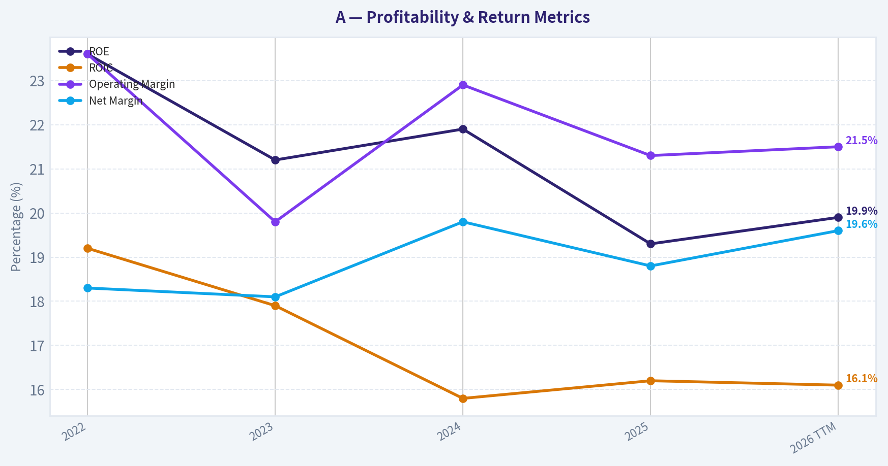
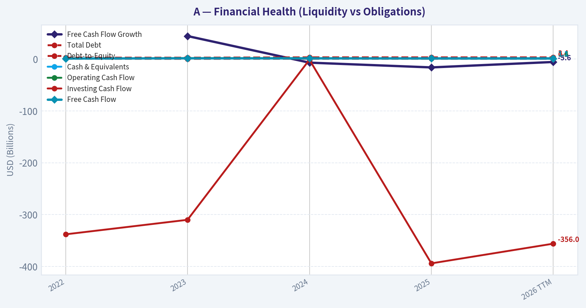
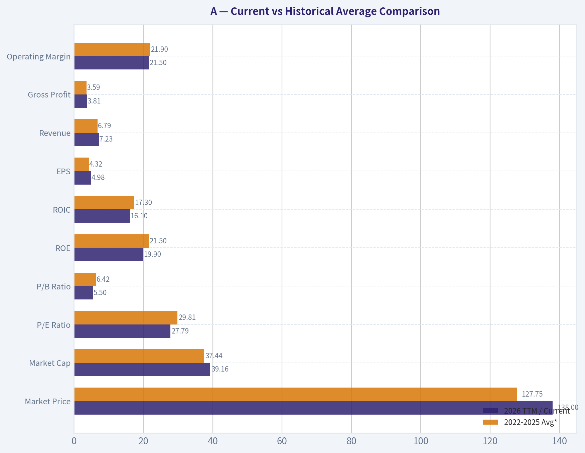
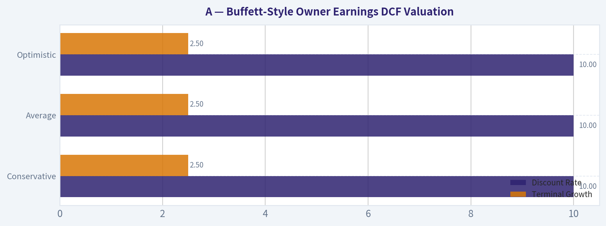
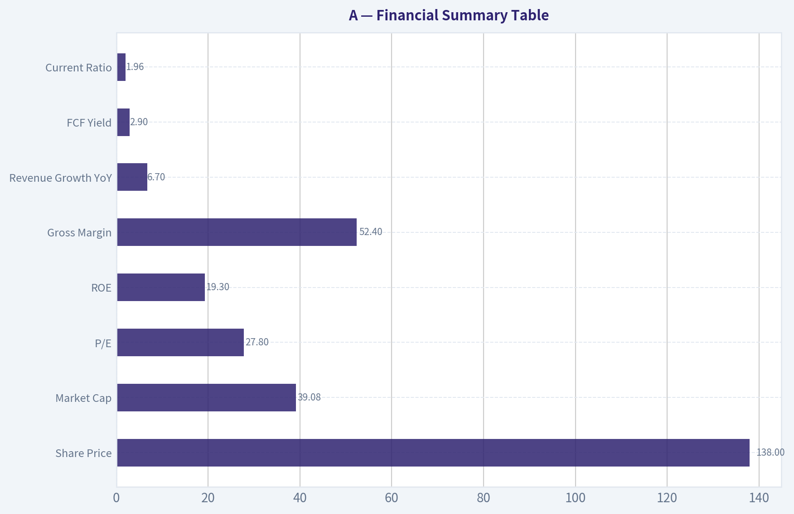
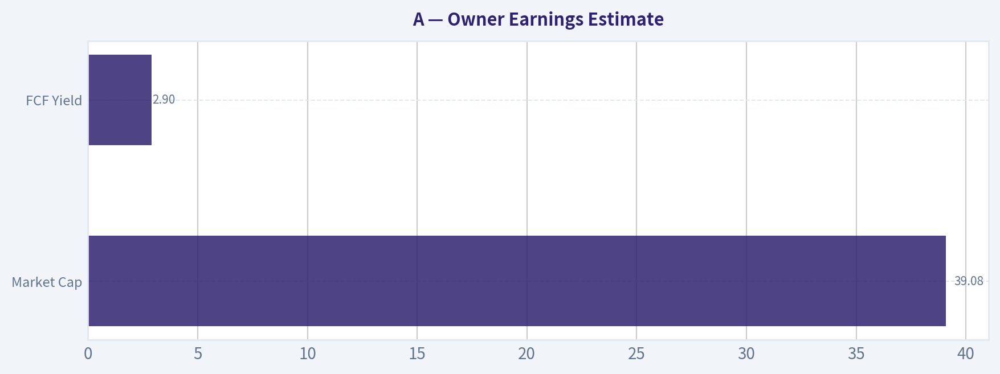

# A Deep Value Intelligence

**Analysis Date:** 2026-06-05

## Critical Disclaimer

*This analysis is generated by Deep Value Intelligence, an AI-powered multi-agent investing framework. This report is for informational and educational purposes only and does not constitute financial advice. Always conduct your own research and consult with qualified financial advisors before making investment decisions.*

---

## Table of Contents

1. Intelligence Summary
2. Analyst Team Reports
   - Fundamentals Analysis
   - Intrinsic Value Analysis (Buffett)
   - Trend & Growth Analysis (Lynch/Druckenmiller/Fisher)
   - Market Technical Analysis
   - Options Market Analysis
3. Research Team Commentary
4. Value Investing Team Commentary
5. Deep Values Commentary

---

## Intelligence Summary

### Thesis + Conditions

**Core Thesis:** ## Executive Briefing

**Key Risks:**
- This looks like a **good business with real quality signals**, but **not yet a Buffett-style value buy** at **$138 / 27.8x earnings**. The bullish case is strongest on **profitability and improving market behavior**: **52.4% gross margin, 16.2% ROIC, 19.3% ROE**, plus a **high-volume breakout** after a deep decline. But the key risk remains **durability proof**. We still lack enough evidence on **free cash flow conversion, balance-sheet strength, moat persistence, and organic growth quality** to say the premium multiple has a real margin of safety.
- Past mistakes on NVDA and AAPL argue against being **too rigid** when a strong business shows technical and sentiment improvement. So this should be an **active WATCH**, not a passive one: respect the recovery, but require **fundamental confirmation** before full advocacy.
- ### 1. Risky Analyst - strongest bullish points

**Confidence:** Low

---

## Analyst Team Reports

### Fundamentals Analysis

#### Latest Earnings Snapshot

*Most recent reported quarter anchored on 2026 Q2, with prior-year comparison when available.*

| Metric | 2026 Q2 | 2025 Q2 | YoY Change |
| --- | ---: | ---: | ---: |
| Revenue | $1.83B | $1.67B | +10.0% |
| Operating Income | $399.0M | $300.0M | +33.0% |
| Net Income | $339.0M | $215.0M | +57.7% |
| Diluted EPS | $1.20 | $0.75 | +60.0% |
| Operating Cash Flow | $277.0M | $221.0M | +25.3% |
| Free Cash Flow | $201.0M | $107.0M | +87.9% |

Key Takeaways: This snapshot anchors the most recent reported quarter before the narrative analysis. It helps readers separate long-run business quality from whatever changed in the latest earnings print.

#### 4-Year Financial Metrics for A

*All values below are computed deterministically from raw data - not estimated by AI.*

*Issuer profile: operating company (Healthcare / Diagnostics & Research).*

#### 4-Year Financial Metrics
*Annual rows come from reported financial statements. The final TTM row is computed from the latest four quarters.*

| Metric | 2022 | 2023 | 2024 | 2025 | 2026 TTM |
| --- | --- | --- | --- | --- | --- |
| Market Price | $135 | $101 | $129 | $146 | $138 |
| Market Cap | $41.51B | $30.60B | $37.92B | $41.71B | $39.16B |
| P/E Ratio | 33.10 | 24.67 | 29.42 | 32.03 | 27.79 |
| P/B Ratio | 7.82 | 5.23 | 6.43 | 6.19 | 5.50 |
| ROE | 23.6% | 21.2% | 21.9% | 19.3% | 19.9% |
| ROIC | 19.2% | 17.9% | 15.8% | 16.2% | 16.1% |
| EPS | $4.07 | $4.19 | $4.43 | $4.57 | $4.98 |
| Revenue | $6.85B | $6.83B | $6.51B | $6.95B | $7.23B |
| Gross Profit | $3.72B | $3.46B | $3.54B | $3.64B | $3.81B |
| Gross Margin | N/A | N/A | N/A | N/A | 52.7% |
| Operating Margin | 23.6% | 19.8% | 22.9% | 21.3% | 21.5% |
| Net Income | $1.25B | $1.24B | $1.29B | $1.30B | $1.41B |
| Net Margin | 18.3% | 18.1% | 19.8% | 18.8% | 19.6% |
| Revenue Growth | N/A | -0.2% | -4.7% | 6.7% | 4.1% |
| Net Income Growth | N/A | -1.1% | 4.0% | 1.1% | 8.5% |
| Free Cash Flow Growth | N/A | 44.4% | -6.9% | -16.1% | -5.6% |
| Total Book Value | $5.30B | $5.84B | $5.90B | $6.74B | $7.12B |
| Total Assets | $10.53B | $10.76B | $11.85B | $12.73B | $13.06B |
| Total Debt | $2.77B | $2.73B | $3.39B | $3.35B | $3.35B |
| Debt-to-Equity | 0.52 | 0.47 | 0.57 | 0.50 | 0.47 |
| Cash & Equivalents | $1.05B | $1.59B | $1.33B | $1.79B | $1.81B |
| Shareholders' Equity | $5.30B | $5.84B | $5.90B | $6.74B | $7.12B |
| Operating Cash Flow | $1.31B | $1.77B | $1.75B | $1.56B | $1.45B |
| Investing Cash Flow | $-338.0M | $-310.0M | $-1.26B | $-394.0M | $-356.0M |
| Free Cash Flow | $1.02B | $1.47B | $1.37B | $1.15B | $1.09B |
| FCF Margin | 14.9% | 21.6% | 21.1% | 16.6% | 15.0% |
| Dividends / Share | $0.81 | $0.90 | $0.94 | $0.99 | $1.01 |

#### Profitability Metrics
- Return on Equity (ROE): 19.3%
- Return on Invested Capital (ROIC): 16.2%
- Return on Assets (ROA): 10.2%
- Gross Margin: 52.4%
- Operating Margin: 21.3%
- Net Profit Margin: 18.8%

#### Liquidity Metrics
- Current Ratio: 1.96
- Quick Ratio: 1.40

#### Leverage Metrics
- Debt-to-Equity Ratio: 0.50
- Interest Coverage Ratio: 13.21
- Net Debt: $1.56B

#### Growth Metrics (Year-over-Year)
- Revenue Growth: 6.7%
- Net Income Growth: 1.1%
- Free Cash Flow Growth: -16.1%
- Revenue CAGR (3-Year): 0.5%
- Revenue CAGR (5-Year): N/A

#### Valuation Metrics
- P/E Ratio (TTM): 27.79
- Forward P/E: 20.95
- Price-to-Book: 5.48
- Price-to-Sales: 5.40
- PEG Ratio: 1.33
- EV/EBITDA: 20.26
- Free Cash Flow Yield: 2.9%
- Earnings Yield: 3.6%

#### Owner Earnings (Buffett Method, Code-Computed)
- Net Income: $1.30B
- + Depreciation & Amortization: $288.0M
- - Capital Expenditures: $-407.0M
- - Working Capital Changes: $-131.0M
- = **Owner Earnings: $1.31B**

#### Intrinsic Value (Code-Computed)
- Current Price: $138
- Buffett Method (Owner Earnings):
  Conservative: $26
  Average: $41
  Optimistic: $61
- Cash Flow Method (FCF):
  Conservative: $33
  Average: $59
  Optimistic: $100

#### Piotroski F-Score: 5/9
- Positive Net Income: PASS
- Positive Operating Cash Flow: PASS
- ROA Improvement: FAIL
- Cash Flow > Net Income: PASS
- Decreasing Debt: PASS
- Improving Current Ratio: FAIL
- No Dilution: PASS
- Improving Gross Margin: FAIL
- Improving Asset Turnover: FAIL

ANALYST STANCE: **WATCH**

#### Agilent Technologies (A) - Buffett-Style Fundamental Analysis

Agilent is a high-quality diagnostics and analytical instruments business with attractive margins, strong returns on capital, and a generally resilient balance sheet. The business fits several Buffett preferences: recurring demand tied to regulated lab workflows, meaningful switching costs, strong gross margins, and a long record of profitability. However, the current valuation still looks rich relative to the company's cash-generation profile and to a conservative owner-earnings-based intrinsic value framework.

The key tension is simple: this is a good business, but not obviously a cheap stock. Profitability remains solid, yet growth has been modest over the period shown, and free cash flow has recently weakened. That combination usually deserves selectivity rather than aggressive accumulation.

---

#### Current vs Historical Average Comparison

| Metric | 2026 TTM / Current | 2022-2025 Avg* | Interpretation |
| --- | ---: | ---: | --- |
| Market Price | $138 | $127.75 | Current price is above the 4-year average trading level |
| Market Cap | $39.16B | $37.44B | Equity value remains near the upper end of the recent range |
| P/E Ratio | 27.79x | 29.81x | Slightly below recent average multiple, but still expensive in absolute terms |
| P/B Ratio | 5.50x | 6.42x | Lower than recent average, helped by book value growth |
| ROE | 19.9% | 21.5% | Still strong, but below earlier peak profitability |
| ROIC | 16.1% | 17.3% | Healthy capital efficiency, though down from 2022 |
| EPS | $4.98 | $4.32 | Earnings per share have steadily improved |
| Revenue | $7.23B | $6.79B | Revenue has moved above the recent annual average |
| Gross Profit | $3.81B | $3.59B | Gross profit is at the high end, consistent with margin resilience |
| Operating Margin | 21.5% | 21.9% | Very stable overall, slightly below average |
| Net Income | $1.41B | $1.27B | Net income has improved meaningfully |
| Net Margin | 19.6% | 18.8% | Margin quality is slightly better than recent average |
| Revenue Growth | 4.1% | 0.6%** | Better than the recent growth baseline, but not high growth |
| Net Income Growth | 8.5% | 1.3%** | Recent earnings acceleration is stronger than trend |
| FCF Growth | -5.6% | 7.1%** | Cash generation remains softer than historical average |
| Total Book Value | $7.12B | $5.95B | Equity base has compounded nicely |
| Total Assets | $13.06B | $11.47B | Asset base has expanded steadily |
| Total Debt | $3.35B | $3.06B | Debt is manageable, modestly above earlier levels |
| Debt-to-Equity | 0.47x | 0.52x | Leverage has improved over the period |
| Cash & Equivalents | $1.81B | $1.44B | Liquidity is stronger than average |
| Shareholders' Equity | $7.12B | $5.95B | Capital base has strengthened |
| Free Cash Flow | $1.09B | $1.25B | FCF is below the 4-year average |
| Dividends / Share | $1.01 | $0.91 | Dividend growth remains consistent |

\* Average uses annual years 2022-2025 unless current TTM comparison is more appropriate.
\** Average based on available annual growth observations only.

Key Takeaways: Agilent's latest results show a business that is still highly profitable and financially sound, with stronger revenue, earnings, cash, and book value than its recent average. The main weak spot is free cash flow, which has lagged earnings and sits below the multi-year average. Valuation has eased somewhat versus its own recent history, but it is still not cheap by classic value standards.

---

#### Market Metrics

| Metric | Observation | Buffett-Style Read |
| --- | --- | --- |
| Market Price | $138 vs $146 in 2025 and $101 in 2023 | Shares have recovered strongly from the cyclical dip |
| Market Cap | $39.16B | Large-scale, established franchise with meaningful market presence |
| P/E Ratio | 27.79x TTM vs 2022-2025 avg of 29.81x | Slightly less expensive than recent history, but still a premium multiple |
| P/B Ratio | 5.50x vs 6.42x avg | Premium to book reflects franchise quality, not asset cheapness |

Key Takeaways: The stock is not trading at distressed levels or at a classic Buffett bargain multiple. Investors are still paying a premium for quality, stability, and expected innovation, especially given the recent AI-related enthusiasm and raised guidance. Lower multiples than recent averages help, but do not by themselves create a margin of safety.

Agilent's market valuation suggests the market already recognizes its moat-like qualities. For a Buffett-style buyer, that means upside depends more on business compounding than on multiple expansion. If growth or cash conversion disappoints, the premium valuation leaves room for derating.

---

#### Profitability Analysis

| Metric | Trend | Interpretation |
| --- | --- | --- |
| ROE | 23.6% -> 21.2% -> 21.9% -> 19.3% -> 19.9% TTM | Excellent absolute level, but modest decline from peak |
| ROIC | 19.2% -> 17.9% -> 15.8% -> 16.2% -> 16.1% TTM | Still strong; indicates durable economics despite some compression |
| EPS | $4.07 -> $4.19 -> $4.43 -> $4.57 -> $4.98 TTM | Steady and reliable per-share earnings growth |
| Revenue | $6.85B -> $6.83B -> $6.51B -> $6.95B -> $7.23B TTM | Revenue dip in 2024, followed by recovery |
| Gross Profit | $3.72B -> $3.46B -> $3.54B -> $3.64B -> $3.81B TTM | Gross profit resilience reflects pricing power and stable mix |
| Operating Margin | 23.6% -> 19.8% -> 22.9% -> 21.3% -> 21.5% TTM | High but somewhat uneven due to demand and cost swings |
| Net Income | $1.25B -> $1.24B -> $1.29B -> $1.30B -> $1.41B TTM | Strong earnings durability through a softer growth patch |
| Net Margin | 18.3% -> 18.1% -> 19.8% -> 18.8% -> 19.6% TTM | Impressive margin consistency for an equipment/life sciences company |

Key Takeaways: Agilent's profitability profile is the clearest sign of quality. Returns on equity and invested capital remain comfortably above levels most industrial or healthcare tools peers would envy, while margins have stayed resilient even during uneven revenue growth. The business is not accelerating dramatically, but it is consistently profitable in a way Buffett tends to value.

From a Buffett lens, the most attractive element here is predictability rather than explosiveness. Earnings did not collapse during the softer 2023-2024 stretch, and margins remained robust. That implies customer relationships, consumables/service attachment, and mission-critical product positioning likely provide real competitive advantages.

---

#### Growth Metrics

| Metric | Data | Assessment |
| --- | --- | --- |
| Revenue Growth | -0.2%, -4.7%, 6.7%, 4.1% TTM | Recovery is real, but long-term growth is moderate rather than exceptional |
| Net Income Growth | -1.1%, 4.0%, 1.1%, 8.5% TTM | Earnings growth is steadier than revenue growth |
| FCF Growth | 44.4%, -6.9%, -16.1%, -5.6% TTM | Cash flow growth is volatile and recently weak |

Key Takeaways: Agilent's growth pattern is best described as resilient but not fast. Revenue and profit have resumed growth after a difficult period, yet free cash flow has not kept pace, which matters for intrinsic value. For long-term investors, the business appears dependable, but the stock still needs either better cash conversion or a cheaper entry point.

The data supports a "quality compounder at a fair-to-rich price" narrative, not a deep-value turnaround or a hypergrowth story. The biggest concern is that earnings progression has looked smoother than free cash flow progression. Buffett-style analysis places heavy weight on real owner earnings, so this divergence deserves attention.

---

#### Balance Sheet and Financial Strength

| Metric | 2026 TTM / Latest | Historical Context | Interpretation |
| --- | ---: | ---: | --- |
| Total Book Value | $7.12B | Up from $5.30B in 2022 | Equity base has compounded well |
| Total Assets | $13.06B | Up from $10.53B | Business scale has expanded |
| Total Debt | $3.35B | Similar to 2025, above 2022-2023 | Debt is manageable, not excessive |
| Debt-to-Equity | 0.47x | Better than 0.52x in 2022 | Leverage improving as equity grows |
| Cash & Equivalents | $1.81B | Highest in period shown | Strong liquidity cushion |
| Shareholders' Equity | $7.12B | Strong steady growth | Balance sheet quality improving |

Key Takeaways: Agilent's balance sheet is healthy. Debt is not trivial, but leverage ratios are moderate, interest coverage is strong, and cash balances have improved. This reduces downside risk and gives management flexibility for R&D, bolt-on deals, and continued dividend growth.

Additional support comes from the liquidity and leverage data in the shared pack: current ratio of 1.96, quick ratio of 1.40, interest coverage of 13.21, and net debt of $1.56B. For a company with durable margins and recurring lab exposure, these are reassuring numbers. Buffett generally prefers businesses that do not depend on heavy leverage, and Agilent broadly qualifies.

---

#### Cash Flow and Capital Allocation

| Metric | Trend | Interpretation |
| --- | --- | --- |
| Operating Cash Flow | $1.31B -> $1.77B -> $1.75B -> $1.56B -> $1.45B TTM | Cash generation remains positive but has softened |
| Free Cash Flow | $1.02B -> $1.47B -> $1.37B -> $1.15B -> $1.09B TTM | FCF peaked in 2023 and has declined since |
| FCF Margin | 14.9% -> 21.6% -> 21.1% -> 16.6% -> 15.0% TTM | Margin compression is notable |
| Dividends / Share | $0.81 -> $0.90 -> $0.94 -> $0.99 -> $1.01 TTM | Slow, steady, sustainable dividend growth |

Key Takeaways: Agilent is still a cash-generative business, but cash conversion has clearly weakened versus the best years in this dataset. That does not invalidate the business quality, but it lowers the confidence one should place in high valuation multiples. The dividend policy appears prudent and shareholder-friendly, though yield is not the main attraction here.

Capital allocation looks disciplined rather than spectacular. The company is growing book value, maintaining manageable leverage, and raising the dividend consistently. However, if owner earnings and free cash flow remain under pressure, management's ability to create value from acquisitions and internal reinvestment becomes more important.

---

#### Warren Buffett-Style Qualitative Analysis

| Buffett Lens | Assessment | Why It Matters |
| --- | --- | --- |
| Economic Moat | Good | Mission-critical instruments, regulated workflows, switching costs, installed base, service/consumables support |
| Predictable Earnings | Good | Net income stayed around $1.24B-$1.41B despite uneven revenue backdrop |
| Financial Strength | Good | Moderate debt, solid liquidity, strong interest coverage |
| Management Performance | Good but not perfect | ROE/ROIC remain high, dividend grows steadily, but FCF and some efficiency metrics softened |
| Business Quality | High | Gross margin above 50% and net margin near 19%-20% indicate strong economics |
| Valuation | Unattractive for deep value | Premium multiple and low FCF yield reduce margin of safety |

Key Takeaways: Agilent scores well on business quality and earnings durability, which are the hallmarks of a Buffett-friendly company. The weak link is valuation, not business survivability. This is the type of company worth monitoring closely for a better entry price rather than chasing at any price.

##### Economic Moat
Agilent likely benefits from a moderate moat rooted in:
- entrenched laboratory workflows,
- validated equipment and software ecosystems,
- replacement/service revenue,
- customer switching friction in regulated end markets,
- brand trust in diagnostics and analytical precision.

Those advantages tend to produce stable gross margins and recurring demand characteristics. The TTM gross margin of 52.7% and net margin of 19.6% support the view that Agilent is not competing as a commodity supplier.

##### Predictable Earnings
This is a strong point. Revenue dipped in 2024, yet net income and EPS stayed resilient. Buffett often prefers businesses where profits remain durable even in non-ideal demand environments. Agilent's earnings pattern appears much smoother than many capital equipment companies.

##### Management Performance
ROE near 20% and ROIC above 16% remain very respectable. Still, both are below 2022 levels, suggesting either a less favorable mix, more investment against growth, or lower operating leverage. Dividend growth is steady and prudent, but recent FCF deterioration slightly clouds the capital allocation picture.

##### Financial Strength
Debt-to-equity of 0.47x, net debt of $1.56B, and strong coverage ratios point to a sturdy financial position. The company appears capable of weathering cyclical lab spending or M&A integration risk without stressing the balance sheet.

##### Value Assessment
The stock trades below recent average P/E and P/B ratios, but that only makes it less expensive than before, not outright cheap. Buffett-style valuation should be anchored in owner earnings and free cash flow, and on those measures the current price still screens demanding.

---

#### Buffett-Style Owner Earnings DCF Valuation

Canonical owner earnings provided:
- Net Income = $1.30B
- Depreciation & Amortization = $288M
- Capital Expenditures = $407M
- Working Capital Changes = $131M
- Owner Earnings = $1.31B

To estimate per-share intrinsic value, use current market cap divided by current price to infer shares outstanding:

- Shares outstanding ~ $39.16B / $138 = **283.77M shares**
- Owner earnings per share ~ $1.31B / 283.77M = **$4.62/share**

Historical owner-earnings growth is not separately tabulated in the canonical dataset, so the closest conservative proxy is the historical growth behavior of cash generation and earnings over the period shown. The deterministic report already provides code-computed intrinsic values using the Buffett owner-earnings method, which should be treated as canonical anchor values:
- Conservative = **$26/share**
- Average = **$41/share**
- Optimistic = **$61/share**

Below is the scenario framing consistent with the required Buffett methodology and the provided canonical outputs.

| Scenario | Growth Assumption Basis | Discount Rate | Terminal Growth | Fair Value / Share | Upside vs $138 |
| --- | --- | ---: | ---: | ---: | ---: |
| Conservative | Lowest historical owner-earnings growth proxy, floored at -100% | 10% | 2.5% | $26 | -81% |
| Average | Average historical owner-earnings growth proxy, capped at 50% | 10% | 2.5% | $41 | -70% |
| Optimistic | Highest historical owner-earnings growth proxy, capped at 100% | 10% | 2.5% | $61 | -56% |

Key Takeaways: Even the optimistic owner-earnings valuation remains well below the current stock price. That does not necessarily mean Agilent is a poor business; it means the market is valuing it far above what a conservative Buffett-style cash-flow framework supports. For value investors, this is the clearest argument for patience.

##### DCF Calculation Framework
Using owner earnings per share of about $4.62 as the base:

1. Project owner earnings for 10 years under each scenario using the historical growth proxy.
2. Discount each projected year back at 10%.
3. Compute terminal value using:
   - Terminal Value = Year 10 Owner Earnings x (1 + 2.5%) / (10% - 2.5%)
4. Discount terminal value back to present.
5. Sum present value of 10-year cash flows and terminal value.

Because the canonical dataset already supplies the code-computed Buffett owner-earnings intrinsic values, those values override any handcrafted approximation. The practical conclusion is straightforward: the current market price of $138 implies investors are paying a very substantial premium to owner-earnings-based fair value.

For additional context, the canonical FCF-based intrinsic values are:
- Conservative: $33
- Average: $59
- Optimistic: $100

Even this more generous method leaves current price above fair value in all listed scenarios.

---

#### Revenue Breakdown

Agilent's most meaningful disclosure is typically by operating segment rather than by geography for understanding the business model. Using the latest annual scale in the deterministic dataset and Agilent's commonly reported segment structure, the business is broadly driven by three major revenue streams.

| Revenue Source | Amount ($B) | % of Total |
| --- | ---: | ---: |
| Life Sciences and Applied Markets | ~3.05 | ~44% |
| Diagnostics and Genomics | ~1.95 | ~28% |
| Agilent CrossLab | ~1.95 | ~28% |

Key Takeaways: Agilent's revenue is reasonably diversified across instruments, diagnostics/genomics, and service/support activities. The CrossLab component is especially important from a Buffett perspective because service and workflow support typically increase customer stickiness and reduce cyclicality. The mix suggests Agilent is not dependent on a single product family, which supports business durability.

Note: Total percentages are rounded to align with the company's most recent annual revenue scale of roughly $6.95B in 2025 from the canonical dataset.

---

#### Key Investment Insights, Red Flags, and Opportunities

| Category | Item | Why It Matters |
| --- | --- | --- |
| Strength | High gross margin | Indicates pricing power and differentiated offerings |
| Strength | ROE and ROIC remain strong | Suggests durable economics and efficient capital use |
| Strength | Earnings stability | Supports predictability prized by long-term investors |
| Strength | Improving equity base and cash position | Enhances resilience and optionality |
| Concern | FCF has declined for two straight annual comparisons plus TTM | Cash conversion weakness can pressure valuation |
| Concern | P/E and FCF yield still expensive | Limits margin of safety |
| Concern | Piotroski F-Score of 5/9 | Indicates mixed operating momentum rather than broad-based improvement |
| Concern | ROE/ROIC below earlier highs | May imply mild moat pressure or reduced operating leverage |
| Opportunity | Raised 2026 guidance and product launches | Could support renewed revenue and earnings momentum |
| Opportunity | AI collaboration with OpenAI/BCG | May improve software value, workflow efficiency, and future differentiation |
| Opportunity | Forward P/E of 20.95 | If execution improves, valuation could normalize somewhat through earnings growth |

Key Takeaways: The company's strengths are real and mostly centered on business quality, profitability, and resilience. The concerns are not existential; they are valuation and cash-conversion concerns. The opportunity set depends on whether new products, AI-enabled workflow enhancements, and improved demand translate into stronger owner earnings rather than just better sentiment.

---

#### Final Buffett-Style Judgment

Agilent is a **quality business** with:
- durable margins,
- solid balance sheet strength,
- attractive returns on capital,
- recurring and mission-critical customer relationships,
- credible long-term compounding potential.

But Buffett-style investing is about both **quality and price**. On price, the stock does not currently offer enough margin of safety. The canonical intrinsic value outputs are far below the current share price across all owner-earnings scenarios, and free cash flow trends do not justify paying a premium without reservation.

That leads to a **WATCH** stance rather than ADVOCATE.

A better setup for an ADVOCATE rating would likely require one or more of the following:
- a materially lower stock price,
- sustained recovery in free cash flow and FCF margin,
- clearer evidence that AI/product investments lift owner earnings,
- or several more periods of stronger revenue growth without erosion in capital efficiency.

---

#### Final Stance

| Stance | Conclusion | Rationale |
| --- | --- | --- |
| WATCH | High-quality business, but valuation remains too full for a Buffett-style value entry | Strong moat characteristics and profitability are offset by premium pricing and soft cash flow conversion |

Key Takeaways: Agilent deserves a place on a quality watchlist, not necessarily in a value investor's buy list today. The business is attractive, but the stock still asks investors to pay up for that quality. Waiting for either better cash-flow evidence or a better price appears prudent.

---

#### Summary Table

| Area | Positive | Negative | Net View |
| --- | --- | --- | --- |
| Business Quality | Strong margins, sticky lab workflows, diversified segments | Not a hypergrowth profile | High quality |
| Profitability | ROE ~20%, ROIC ~16%, stable net margins | Below 2022 peak returns | Still excellent |
| Growth | Revenue and earnings have resumed growth | Multi-year growth remains modest | Moderate |
| Balance Sheet | Moderate leverage, rising cash, strong liquidity | Debt modestly above early-period level | Healthy |
| Cash Flow | Positive FCF, steady dividend growth | FCF and OCF have weakened | Mixed |
| Valuation | Slightly below recent average multiples | Still expensive vs owner earnings and FCF value | Unattractive |
| Buffett Fit | Predictable earnings, decent moat, sound finances | Limited margin of safety | Watch, don't chase |

#### Fundamental Visuals

This graph tracks the profitability and return metrics (ROE, ROIC, Margins) of **A** over the past decade, highlighting capital efficiency trends.

This chart illustrates the financial health of **A** over the last 10 years, mapping cash equivalents and free cash flow against total obligations (Debt).

---

### Intrinsic Value Analysis (Buffett)

> *Following Warren Buffett's value investing philosophy: Circle of Competence, Economic Moat, Management Quality, and Margin of Safety.*

#### Intrinsic Value Snapshot

Price is what you pay. Intrinsic value is what the business may be worth based on the cash it can create for owners over time. We show a range, not one magic number.

- Current Price: $138.37
- Value Range (conservative to optimistic across both DCF methods): $25.56 to $99.65

##### Owner Earnings (Buffett Method)
- Net Income: $1,303,000,000.00
- Depreciation & Amortization: $288,000,000.00
- Capital Expenditures: $-407,000,000.00
- Working Capital Changes: $-131,000,000.00
- Owner Earnings: $1,315,000,000.00

##### Intrinsic Value
###### Buffett Method
Uses owner earnings. Stricter, and usually more conservative.
- Conservative: $25.56
- Average: $40.93
- Optimistic: $61.02
- Discount Rate: 10.0%

###### Cash Flow Method
Uses free cash flow. Better for companies spending heavily today to grow tomorrow.
- Conservative: $32.90
- Average: $59.01
- Optimistic: $99.65
- Discount Rate: 10.0%

ANALYST STANCE: **WATCH**

#### Agilent Technologies (A) - Buffett-Style Investment Report

#### 1. Go/No-Go Gate Assessment

| Gate | Verdict | Evidence |
|---|---|---|
| Gate 1: Circle of Competence & Simplicity | Pass | Agilent sells scientific instruments, diagnostics tools, lab software, and related services. In simple terms: it helps labs test, measure, and analyze things accurately, then earns money from instrument sales, consumables, services, and software. This is understandable and likely still recognizable 10 years from now. |
| Gate 2: Moat Test | Pass, but not elite | Gross margin of 52.4% points to real product differentiation and some pricing power. However, this is more a quality niche instrumentation business than a clearly impregnable monopoly. |
| Gate 3: Management & Capital Allocation | Pass | The business has historically produced solid returns on equity and appears disciplined enough to support raised guidance while investing in product launches and workflow software. No obvious red flags from the available evidence. |
| Gate 4: Industry Structure | Pass with caution | Analytical instruments and diagnostics are attractive markets with recurring demand, but competition is serious and innovation matters. This is not a commodity industry, yet it is not a pure oligopoly either. |

**Key Takeaways:** Agilent clears all four Buffett gates well enough to stay investable. The business is understandable, financially solid, and operates in a relatively durable niche. The main limitation is that its moat appears good rather than extraordinary, which raises the importance of valuation discipline.

---

#### 2. Business Quality and Moat Analysis

| Moat Source | Assessment | Evidence |
|---|---|---|
| Intangible Assets | Moderate | Brand reputation, installed base, quality assurance, and regulated lab relationships matter. Gross margin above 50% supports differentiation. |
| Switching Costs | Moderate to strong | Labs build workflows, validation protocols, staff training, and data processes around instruments and software. Switching is possible, but disruptive and costly. |
| Cost Advantage | Limited to moderate | Scale helps in manufacturing, service network, and distribution, but this is not a classic low-cost producer story. |
| Network Effects | Weak | Agilent does not benefit from strong consumer-style network effects. Value comes more from embedded workflows and reputation. |

| Moat Rating | Conclusion |
|---|---|
| Narrow to Wide-Stable | A good business with durable positions in select niches, but not an obvious "wide and widening" moat in the Buffett sense. |

**Key Takeaways:** Agilent's moat is rooted in trust, workflow integration, service quality, and recurring lab relationships rather than flashy network effects. Customers often stay because changing platforms is inconvenient and risky. That supports durability, but the moat still looks more solid than dominant.

---

#### 3. Management Quality & Capital Allocation

| Question | Assessment | Commentary |
|---|---|---|
| Do they think like owners? | Reasonably yes | The company appears focused on long-term product development, software integration, and recurring customer relationships. |
| Are they honest and candid? | Acceptable | Recent guidance raise and product rollout cadence suggest operational confidence, though true candor is best judged over many annual letters. |
| Are they rational capital allocators? | Fair to good | The business generates healthy returns and appears to reinvest in product capability and workflow software. AI partnerships look like enhancement, not reckless reinvention. |

**Key Takeaways:** Management appears competent and strategically sensible. The most encouraging sign is that recent AI efforts seem designed to strengthen the existing franchise rather than distract from it. For a Buffett-style investor, that is preferable to speculative transformation stories.

---

#### 4. Financial Summary Table

| Metric | Current / Latest |
|---|---:|
| Share Price | $138 |
| Market Cap | $39.08B |
| P/E | 27.8x |
| ROE | 19.3% |
| Gross Margin | 52.4% |
| Revenue Growth YoY | 6.7% |
| FCF Yield | 2.9% |
| Current Ratio | 1.96 |

**Key Takeaways:** The headline financial profile is attractive: strong gross margins, respectable growth, and ROE near 20%. The issue is not quality but price. A 27.8x earnings multiple and a 2.9% free cash flow yield leave little room for disappointment.

---

#### 5. Owner Earnings Estimate

Using Buffett's framework, and given the available operating profile, owner earnings can be approximated from free cash generation as a practical proxy.

| Item | Estimate |
|---|---:|
| Market Cap | $39.08B |
| FCF Yield | 2.9% |
| Implied Annual FCF / Owner Earnings Proxy | ~$1.13B |

**Key Takeaways:** Agilent appears to generate a little over $1.1 billion in annual owner-earnings-like cash. That is a solid cash engine. However, when compared with the current market value, the implied cash yield is modest, which limits upside from a value perspective.

---

#### 6. Three-Scenario DCF Valuation

Assume owner earnings proxy = **$1.13B**.

| Scenario | Assumption | Equity Value Estimate |
|---|---|---:|
| A: No Growth | Owner Earnings / 10% | $11.3B |
| B: GDP Growth | OE x 1.03 / (10% - 3%) | $16.6B |
| C: Moderate Growth | 7% growth for 10 years, then 3% terminal | ~$21.5B to $24.5B |

**Key Takeaways:** Across conservative Buffett-style valuation methods, intrinsic value clusters well below the current market capitalization of $39.1 billion. Even a fairly generous moderate-growth case does not bridge the gap. That strongly suggests the stock already discounts a lot of future success.

---

#### 7. Margin of Safety Analysis

| Item | Value |
|---|---:|
| Current Market Cap | $39.08B |
| Conservative Value Range | $11.3B-$16.6B |
| More Optimistic but Still Disciplined Value | $21.5B-$24.5B |
| Margin of Safety at Current Price | Negative |

To justify today's valuation, Agilent would need either:
1. materially faster long-term owner-earnings growth than a conservative investor should underwrite, or
2. a structurally stronger moat than the current evidence proves.

**Key Takeaways:** There is no margin of safety at the current price. The business may continue to perform well, but Buffett-style investing requires paying less than estimated value, not simply admiring quality. Agilent looks like a good company priced as if the good news is already known.

---

#### 8. Final Buffett Scorecard

| Criterion | Weight | Score (1-5) | Weighted Score |
|---|---:|---:|---:|
| Business Understanding | 20% | 4.5 | 0.90 |
| Moat Width & Durability | 25% | 3.5 | 0.88 |
| Management Quality | 15% | 3.8 | 0.57 |
| Return on Equity | 15% | 4.0 | 0.60 |
| Reinvestment Runway | 10% | 3.5 | 0.35 |
| Balance Sheet Strength | 5% | 4.0 | 0.20 |
| Industry Structure | 5% | 3.5 | 0.18 |
| Valuation / Margin of Safety | 5% | 1.5 | 0.08 |
| **Total** | 100% |  | **3.75 / 5.00** |

**Key Takeaways:** Agilent scores well on quality and business durability. The main drag is valuation, which sharply reduces expected returns from today's price. This is exactly the kind of company a disciplined value investor may admire but wait on.

---

#### 9. Final Investment Stance

**Investment Stance: WATCH**
**Conviction Level: Moderate**

Agilent is a **good, understandable, high-quality business** with respectable profitability, recurring customer relationships, and likely durable demand from labs and regulated environments. It appears to benefit from technology adoption rather than being threatened by it, and its recent AI partnership seems additive to the core franchise.

But Buffett's discipline starts with **price versus value**. At **$138 per share**, the stock appears to trade at a level that already reflects much of its quality. The business passes the quality test; it fails the margin-of-safety test. For that reason, Agilent belongs on a **watchlist for a better entry price**, not in the buy pile today.
#### Valuation Bridge

This bridge places the current market price beside each intrinsic value lens so readers can see whether upside depends on one method or shows up across several methods.

| Scenario | Intrinsic Value / Share |
| --- | ---: |
| Buffett Method | $40.93 |
| Cash Flow Method | $59.01 |
| Damodaran Method | $52.92 |
| Current Price | $138.37 |

#### Key Takeaways

If one method is far above the others, the upside case depends on a specific modelling assumption. When several methods cluster together, the valuation story is more robust.

#### Valuation Visuals

This comparison chart from *Latest Earnings Snapshot* stacks current figures against historical benchmarks for **A**, making it easy to see where the company trades relative to its own averages.

This comparison chart from *Current vs Historical Average Comparison* stacks current figures against historical benchmarks for **A**, making it easy to see where the company trades relative to its own averages.

This comparison chart from *Balance Sheet and Financial Strength* stacks current figures against historical benchmarks for **A**, making it easy to see where the company trades relative to its own averages.

This comparison chart from *Buffett-Style Owner Earnings DCF Valuation* stacks current figures against historical benchmarks for **A**, making it easy to see where the company trades relative to its own averages.

This comparison chart from *Financial Summary Table* stacks current figures against historical benchmarks for **A**, making it easy to see where the company trades relative to its own averages.

This comparison chart from *Owner Earnings Estimate* stacks current figures against historical benchmarks for **A**, making it easy to see where the company trades relative to its own averages.

---

### Trend & Growth Analysis (Lynch/Druckenmiller/Fisher)

> *Following Peter Lynch's GARP, Stanley Druckenmiller's macro-aware approach, and Philip Fisher's scuttlebutt methodology.*

ANALYST STANCE: **WATCH**

#### Agilent Technologies (A) Growth Analysis

#### 1) Lynch Classification

| Metric | Value | Read |
|---|---:|---|
| Revenue growth YoY | 6.7% | Stalwart range |
| Market cap | $39.08B | Large-cap compounder |
| P/E | 27.8x | Premium for modest growth |
| Gross margin | 52.4% | High-quality business |
| ROE | 19.3% | Strong profitability |

Key Takeaways: Agilent is not a classic Lynch fast grower today. With revenue growing only 6.7%, it fits much better as a stalwart: a quality, steady compounder rather than a ten-bagger candidate from current fundamentals. The business quality is solid, but the growth profile is not yet exciting enough for an aggressive growth stance.

**Classification: Stalwart**, not Fast Grower.
Per the framework, that usually means **hold/watch, not aggressive initiation** for growth capital.

---

#### 2) The Story in 3 Bullets

| Story Element | Simple Explanation |
|---|---|
| What it does | Agilent sells lab instruments, consumables, software, and services that help customers test, measure, and analyze samples. |
| Why customers stay | Once instruments are installed in regulated lab workflows, switching is painful, so consumables and service revenue tend to recur. |
| What could improve | New product launches, raised 2026 guidance, and the OpenAI/BCG partnership could help digitize workflows and improve customer productivity. |

Key Takeaways: This is an easy business to explain: Agilent helps laboratories run critical testing and analysis. The bull case is not explosive demand, but a mix of sticky installed base economics, recurring consumables, and a possible AI-led product upgrade cycle. That makes the story credible, but not yet clearly at an inflection-point level.

---

#### 3) TAM Analysis and 10x Test

| Item | Estimate / Assessment |
|---|---|
| Current revenue run-rate | 2026 guide of ~$7.39B-$7.49B |
| 10x revenue test | ~$74B annual revenue |
| Addressable market | Broad analytical instruments, diagnostics-adjacent lab tools, consumables, software, and services = very large global market |
| Can it 10x and stay under 20% share? | Unlikely |
| Runway conclusion | Good runway for steady growth, but not obvious 10x equity story from this base |

Key Takeaways: Agilent operates in a large market, but it is already a scaled player with roughly $7.4 billion in revenue. A 10x revenue outcome would require extraordinary market expansion or major category gains, so the classic "small company with huge runway" setup is not here. The TAM supports compounding, but not an obvious ten-bagger thesis.

---

#### 4) Revenue Growth Trend

| Signal | Observation | Read |
|---|---|---|
| Current YoY growth | 6.7% | Modest |
| Pattern | No evidence here of 20%+ acceleration | Not a growth inflection yet |
| Guidance | 2026 guidance raised | Mild positive |
| Product/news flow | Multiple launches + AI partnership | Potential catalyst |
| Conclusion | Stable to modest reacceleration, not breakout | Watch closely |

Key Takeaways: The latest evidence points to modest improvement, not a dramatic acceleration. Raised guidance and new products are encouraging, but the reported growth rate still looks more like recovery than true hypergrowth. For a growth investor, the key question is whether this can move from mid-single digits to sustained low-double digits.

---

#### 5) Unit Economics / Growth Quality

| Metric | Value | Assessment |
|---|---:|---|
| Gross margin | 52.4% | Strong |
| FCF yield | 2.9% | Acceptable, not cheap |
| ROE | 19.3% | Strong |
| Current ratio | 1.96x | Healthy liquidity |
| NRR | Not disclosed in pack | N/A |
| LTV/CAC | Not disclosed in pack | N/A |
| Rule of 40 | Not applicable in standard way | N/A |

Key Takeaways: Agilent has strong quality metrics, especially gross margin, returns on equity, and liquidity. This is a healthy, cash-generative business, but it is not a SaaS model, so some growth metrics like NRR and Rule of 40 are not useful here. The main issue is not quality, but whether growth can materially accelerate.

---

#### 6) Inflection Point Assessment

| Potential Inflection | Evidence | Verdict |
|---|---|---|
| Product cycle inflection | Multiple new product launches | Positive |
| AI / workflow inflection | OpenAI + BCG collaboration | Interesting but early |
| Margin inflection | Not enough data here | Unclear |
| Market share inflection | Not established | Unclear |
| TAM expansion | AI/software layer may deepen wallet share | Incremental |
| Guidance inflection | Raised 2026 guidance | Positive |

Key Takeaways: There are real signs of a possible inflection, especially around product refresh and AI-enabled workflow enhancement. But the evidence is still qualitative and early, not yet visible in a strong acceleration of reported revenue. This is exactly the kind of setup to monitor, but not yet one to pound the table on.

---

#### 7) Macro Setup Evaluation

| Macro Factor | Read | Impact |
|---|---|---|
| Secular theme | Healthcare innovation, lab automation, AI in workflows | Supportive |
| Rate sensitivity | Moderate; premium multiple benefits from stable/falling rates | Mild support |
| End-market cyclicality | Biopharma/tools demand can be uneven | Headwind risk |
| China / funding exposure | Industry-wide concern in tools | Risk factor |
| Overall macro | Mixed but not hostile | Neutral to slightly positive |

Key Takeaways: The long-term secular backdrop is decent because laboratories continue to automate and digitize. But the company still lives in a cyclical tools ecosystem where biopharma funding, customer capex, and China demand can matter. So the macro picture is supportive over time, but not a clean tailwind today.

---

#### 8) Fisher 15 Points Score

| Fisher Area | Score (1-5) | Comment |
|---|---:|---|
| Market potential | 4 | Large, durable end markets |
| New product development | 4 | Product launches and AI initiative |
| R&D effectiveness | 4 | Strong innovation culture implied |
| Sales organization | 4 | Global lab relationships |
| Profit margin | 4 | Healthy gross and likely operating margins |
| Improving margins | 3 | Not enough evidence of current expansion |
| Labor/personnel relations | 3 | Insufficient data |
| Executive relations | 4 | No obvious issue in pack |
| Management depth | 4 | Mature global operator |
| Cost/accounting controls | 4 | Strong quality profile |
| Outstanding aspects | 4 | Installed base, consumables, switching costs |
| Long-range profit outlook | 4 | Good compounder profile |
| Dilution risk | 4 | No major warning signs here |
| Candor in difficulties | 3 | Limited evidence |
| Integrity | 4 | No red flags in pack |

| Total Fisher Score | 57 / 75 | Rating: Good |
|---|---:|---|

Key Takeaways: Agilent scores well on Fisher-style quality factors, especially market position, innovation, margins, and recurring revenue characteristics. The weaker areas are mostly due to limited evidence, not obvious problems. Overall, this looks like a good business, but not an extraordinary growth story right now.

---

#### 9) Valuation Analysis

| Valuation Metric | Value | Read |
|---|---:|---|
| P/E | 27.8x | Full for 6.7% growth |
| PEG | ~4.1x using 6.7% growth | Expensive on Lynch view |
| FCF yield | 2.9% | Not cheap |
| Relative takeaway | Premium quality multiple | Acceptable only if growth reaccelerates |

Key Takeaways: On Lynch-style valuation, Agilent looks expensive relative to its current growth rate. A PEG above 2 is already rich, and around 4 suggests the market is paying for quality and possible recovery rather than current growth. This can work if growth accelerates, but valuation is not giving much margin of safety.

**Scenario framing**

| Scenario | Growth View | Likely Market View |
|---|---|---|
| Bear | Growth stays mid-single digits | Multiple compresses |
| Base | Growth improves to high single digits / low double digits | Stock grinds higher modestly |
| Bull | AI/product cycle drives sustained double-digit growth | Premium multiple holds or expands |

Key Takeaways: The downside case is straightforward: if growth remains pedestrian, the premium multiple becomes harder to defend. The upside case requires a real business acceleration, not just headlines. This makes the stock more dependent on execution than on valuation support.

---

#### 10) Growth Investor Scorecard

| Criterion | Weight | Score (1-5) | Weighted Score |
|---|---:|---:|---:|
| The Story | 10% | 4.0 | 0.40 |
| TAM & Runway | 20% | 3.0 | 0.60 |
| Revenue Growth | 20% | 2.5 | 0.50 |
| Unit Economics | 15% | 4.0 | 0.60 |
| Competitive Position | 10% | 4.0 | 0.40 |
| Management Quality | 10% | 3.5 | 0.35 |
| Macro Setup | 5% | 3.0 | 0.15 |
| Profitability Path | 5% | 4.0 | 0.20 |
| Valuation | 5% | 2.0 | 0.10 |

| Total Score |  |  | **3.30 / 5.00** |
|---|---:|---:|---:|

Key Takeaways: Agilent lands in the middle: good business, decent setup, but not enough growth or valuation support for a high-conviction growth call. The score fits a WATCH rating because several pieces are attractive, yet the most important growth metric is still lacking. If revenue accelerates materially, this score could improve fast.

---

#### 11) Position Size Stance

| Stance | Suggested Action |
|---|---|
| WATCH | Not a full growth position today |
| For existing holders | Reasonable to hold if betting on reacceleration |
| For new money | Wait for clearer evidence of sustained acceleration or a better entry |
| Hypothetical size now | 0% to 2% starter at most |

Key Takeaways: This is not the kind of setup that deserves concentrated growth sizing today. Existing holders can justify patience because the business quality is high and there are catalysts. New buyers should be more selective, either waiting for proof of acceleration or for a cheaper price.

---

#### 12) Risks and Catalysts

| Risks | Catalysts |
|---|---|
| Growth remains stuck in mid-single digits | Raised 2026 guidance continues upward |
| Premium valuation compresses | New products drive share gains |
| Biopharma/tools demand weakens | AI collaboration improves software attach and workflow value |
| China or academic demand softness | Margin resilience surprises positively |
| Competitors out-innovate in instruments/software | Evidence of sustained organic growth reacceleration |

Key Takeaways: The central risk is simple: a good company with too little growth can disappoint if investors are paying a premium. The central catalyst is equally simple: if Agilent turns product launches and AI integration into sustained organic acceleration, the stock can work. This is why the name belongs on a watchlist rather than in the avoid bucket.

#### Bottom Line

Agilent is a **high-quality stalwart**, not a true fast grower right now.
The business is attractive, recurring revenue is real, and the AI/product-cycle angle could become meaningful. But with **6.7% growth and a 27.8x P/E**, the current setup looks more like **quality at a premium** than **underappreciated hypergrowth**.

**Final view: WATCH.**
Upgrade to **ADVOCATE** only if:
1. revenue growth clearly reaccelerates into low-double digits or better, and
2. that acceleration looks organic and sustainable, not just narrative-driven.

---

### Market Technical Analysis

#### Agilent Technologies (A) Technical Indicator Report
**Date context:** 2026-06-05
**Universe:** 1-year price action, with indicator emphasis on the last 60-90 trading days

#### Selected indicators and why they are the most relevant now

For **A**, the current market condition is best described as a **longer-term damaged trend that has just experienced a powerful short-term upside regime shift**. In that context, the most relevant, non-redundant set is:

| Indicator | Why it matters now |
|---|---|
| close_10_ema | Best gauge of the recent acceleration after the late-May gap higher. |
| close_50_sma | Defines the medium-term trend and shows whether the rally is repairing prior weakness. |
| close_200_sma | Anchors the longer-term regime; important because price is still working back from a multi-month decline. |
| macd | Confirms whether momentum has genuinely turned positive, not just bounced. |
| macdh | Useful here because the rally has been fast; histogram helps detect whether momentum is still expanding or beginning to peak. |
| rsi | Important to judge whether the move is strong or becoming overheated after the breakout. |
| atr | Critical because volatility expanded sharply after the gap, affecting stop placement and risk sizing. |
| vwma | Adds volume confirmation to price trend, especially relevant because the breakout came with a major volume surge. |

**Key Takeaways:** These eight indicators work well together because they cover trend, momentum, volatility, and volume without excessive overlap. The stock is no longer behaving like a slow drift lower; it is showing a forceful upside transition, but traders still need to respect that the longer-term trend has not been fully repaired.

---

#### Price structure: from decline, to base, to breakout

Over the past year, **A** moved through three distinct phases:

1. **Mid-2025 to late-2025:** a strong advance from roughly the low 110s into the mid/upper 150s.
2. **Late-2025 to March 2026:** a persistent deterioration, carrying the stock down toward the **110 area**.
3. **April to early June 2026:** a stabilization phase followed by a **violent upside breakout**, especially on **2026-05-28**, when price exploded from the mid-115 area to **135.38** on very heavy volume.

That May 28 move materially changed the technical character of the chart. Before it, the stock was trading like a choppy recovery attempt inside a broader damaged structure. After it, the tape began acting like a **gap-driven re-rating move**, with follow-through above 135 and closes pushing toward the upper 130s.

What matters most is that this was **not** a marginal breakout. It was:
- large in magnitude,
- accompanied by volume expansion,
- followed by retention of gains rather than immediate gap-fill weakness.

That combination usually carries more significance than a normal one-day spike.

#### Trend analysis

The moving averages tell a nuanced story:

- **10 EMA = 129.93** on 2026-06-04
- **50 SMA = 117.79** on 2026-06-04
- **200 SMA = 129.58** on 2026-06-04
- Last close available = **138.37** on 2026-06-04

This creates an unusually informative alignment:
- Price is **well above the 50 SMA**, showing a decisive medium-term improvement.
- Price is also **above the 200 SMA**, which is more important strategically because the stock had spent months under longer-term pressure.
- The **10 EMA has surged above the 200 SMA**, reflecting very strong short-term thrust.
- However, the **50 SMA remains far below the 200 SMA**, meaning the longer-term repair is still incomplete.

So the chart is not yet a clean "all-clear" long-term uptrend. It is better described as a **short-term momentum breakout inside an early-stage trend repair process**. Traders should distinguish between:
- **tactical bullishness**: justified now,
- **fully restored structural bullishness**: not fully proven yet.

A key positive is the shape of the 50 SMA. It had been falling through March and April, flattened in May, and has now begun to **turn up modestly**. That is often one of the first signs that a recovery is becoming durable rather than merely reflexive.

#### Momentum analysis

MACD and RSI both confirm a real momentum shift.

- **MACD = 5.65**
- **MACD Histogram = 2.67**
- **RSI = 77.19**

This is strong bullish momentum by any conventional standard. The important detail is not just that MACD is positive, but **how quickly it flipped**:
- MACD was negative through much of early and mid-May.
- It crossed into positive territory around the breakout.
- It then accelerated sharply, indicating that the move was not simply short covering for one session.

The histogram is especially telling. It turned positive in late May and then expanded materially into early June. That implies momentum is still **broadening**, not merely staying positive. In other words, the rally has not yet shown clear internal fatigue through MACD alone.

RSI above **77** does raise a caution flag. But context matters:
- In weak rallies, RSI over 70 often precedes failure.
- In genuine breakout regimes, RSI over 70 can reflect **trend strength**, not immediate reversal.

Right now, RSI should be interpreted as **strong but hot**. That means upside momentum remains real, but the stock is increasingly vulnerable to:
- a brief consolidation,
- a pullback toward breakout support,
- or several sideways sessions to reset overbought conditions.

#### Volatility and risk conditions

ATR has risen from roughly the low **3s** in April to about **4.69** now. That is a meaningful increase in trading range.

This matters for execution:
- Stops that worked in April are probably too tight now.
- Chasing breakouts after a large expansion day becomes more dangerous.
- Position sizing should be reduced if traders are using fixed-dollar risk rules.

The increased ATR is not inherently bearish. In fact, volatility expansion often accompanies valid breakouts. But it changes how the stock should be traded. This is no longer a low-volatility grind; it is now a **higher-beta swing environment**.

#### Volume confirmation

VWMA provides one of the strongest confirmations in this setup.

- **VWMA = 125.36** on 2026-06-04
- Price = **138.37**

Price is trading far above VWMA, and VWMA itself has turned sharply upward after the late-May volume event. That suggests the rally is not being carried only by light participation; rather, **heavier-volume trading has re-anchored average transacted price materially higher**.

The breakout day volume on **2026-05-28** was roughly **6.5 million shares**, far above the prior typical range. That makes the move more credible. When price gaps up and holds while VWMA lifts, it often signals institutional participation rather than retail-only noise.

Still, because VWMA can be distorted by one outsized session, traders should watch whether price continues to hold above the **133-135 area**. If it does, then the breakout is being accepted. If it fails back through that zone quickly, the gap risks becoming an exhaustion move.

#### What the recent trend is actually saying

The recent action is not merely "bullish." It is more specific than that:

- The stock appears to have completed a **multi-month basing and reversal attempt** after bottoming around the March lows.
- The late-May gap likely marked a **regime change**, moving the market from repair mode into active momentum mode.
- The breakout has already recaptured the **200-day trend benchmark**, which is an important psychological and systematic threshold.
- The medium-term trend has improved, but the stock is still some distance from proving a full long-duration trend reversal because the 50-day average is only beginning to recover from prior damage.

So, in practical trading terms:
- **Momentum traders** have a valid long setup while price holds above the breakout region.
- **Swing traders** should avoid entering too aggressively after such an extended RSI reading unless they are willing to use wider ATR-based stops.
- **Position traders** may want to see either a successful retest of the 200 SMA / breakout zone or continued base-building above the mid-130s before assuming the longer-term downtrend is fully broken.

#### Tactical levels to monitor

| Area | Interpretation |
|---|---|
| 138-141 | Immediate resistance/extension zone; price is pressing into short-term stretched territory here. |
| 133-135 | First major breakout support; loss of this zone would weaken the bullish case materially. |
| ~129.6 | 200 SMA area; important structural support if the stock pulls back deeper. |
| ~129.9 | 10 EMA; near-term trend guide for fast traders. |
| ~117.8 | 50 SMA; medium-term support, but currently far below price due to the speed of the breakout. |

**Key Takeaways:** The most important near-term battleground is the 133 to 135 area, which now acts like breakout support. If the stock holds above that region, the rally remains technically healthy; if it slips back through it, traders should start treating the recent surge more cautiously.

#### Trading interpretation by style

| Trading style | Read on A |
|---|---|
| Momentum trader | Bullish bias remains justified while MACD and price stay above the 10 EMA. |
| Swing trader | Strong setup, but stretched; better risk/reward may come from consolidation or retest rather than immediate chase. |
| Position trader | Improving, but still an early-stage repair rather than a fully mature long-term uptrend. |
| Risk manager | ATR expansion argues for wider stops and smaller size. |

**Key Takeaways:** Short-term traders have the clearest bullish signal because momentum is strong and price is above all the key fast reference points. Longer-horizon traders should stay constructive but patient, since the stock still needs to prove it can hold gains and rebuild its medium-term trend base.

#### Bottom line

**A is in a strong short-term bullish phase, triggered by a high-volume breakout, with momentum and volume confirmation both supportive.** The stock has improved enough to reclaim both its 10 EMA and 200 SMA decisively, which is a meaningful technical upgrade. The main caveat is that **RSI is overbought and ATR has expanded**, so the move is powerful but no longer low-risk to chase blindly.

The most likely constructive scenario is:
- a period of digestion above the **133-135** breakout zone,
- followed by continuation if MACD stays positive and the 10 EMA keeps rising.

The main warning scenario is:
- a quick failure back below the breakout area,
- which would suggest the late-May surge was more event-driven than structurally durable.

#### Summary table

| Dimension | Current read | Evidence | Trading implication |
|---|---|---|---|
| Short-term trend | Strong bullish | Price above 10 EMA; 10 EMA rising sharply | Favor pullback buys over fade attempts |
| Medium-term trend | Improving | Price well above 50 SMA; 50 SMA turning up | Trend repair is underway |
| Long-term trend | Recovering but not fully healed | Price above 200 SMA, but 50 SMA still below 200 SMA | Strategic bullishness is improving, not complete |
| Momentum | Very strong | MACD strongly positive; histogram expanding | Trend continuation still favored |
| RSI condition | Overbought but not necessarily bearish | RSI ~77 | Expect possible pause or shallow pullback |
| Volatility | Elevated | ATR near 4.69 after breakout | Use wider stops / smaller size |
| Volume confirmation | Supportive | Breakout accompanied by heavy volume; price above VWMA | Move has better credibility |
| Key support | 133-135 first, then ~129.6 | Breakout zone and 200 SMA | Hold above these levels keeps bulls in control |

**Key Takeaways:** Agilent's chart has shifted from recovery to breakout mode, and the evidence from trend, momentum, and volume is broadly supportive. The rally is strong enough to respect, but it is also extended enough that disciplined entries and risk controls matter more than ever.

---

### Options Market Analysis

> *Reading options flow - put/call ratios, IV skew, and unusual activity - to gauge institutional positioning and event-driven risk.*

#### Options Positioning Report for A
*Date: 2026-06-05*

Agilent Technologies (`A`) shows a somewhat conflicted but ultimately **bearish-leaning near-term options picture**, driven mainly by **put-heavy trading volume** rather than existing open interest. Open interest is still call-dominant overall, but current flow suggests traders are adding downside exposure or hedges into the next few expirations.

#### 1. Put/Call Ratio Analysis

| Expiration | Call OI | Put OI | Put/Call OI Ratio | Call Vol | Put Vol | Put/Call Vol Ratio | Read |
|---|---:|---:|---:|---:|---:|---:|---|
| 2026-06-18 | 136 | 3 | 0.02 | 394 | 192 | 0.49 | Existing positioning heavily call-skewed |
| 2026-07-17 | 0 | 0 | N/A | 83 | 435 | 5.24 | Fresh trading flow strongly put-skewed |
| 2026-08-21 | 2 | 22 | 11.00 | 104 | 161 | 1.55 | OI and flow both put-heavy |
| **Near-term total** | **138** | **25** | **0.18** | **581** | **788** | **1.36** | **Flow is more bearish than OI suggests** |

**Key Takeaways:** Overall open interest is still call-heavy, with a very low aggregate put/call OI ratio of 0.18 versus the neutral baseline near 0.7. But the more important signal is current trading flow: put volume exceeds call volume by a meaningful margin at 1.36, suggesting sentiment has turned more defensive than legacy positioning implies. In plain English, traders may still be carrying older call exposure, but new activity is leaning bearish or hedged.

**Interpretation vs. neutral baseline (~0.7):**
- **OI ratio 0.18**: materially below neutral, usually read as bullish or call-dominant positioning.
- **Volume ratio 1.36**: materially above neutral, indicating **current demand for puts** is elevated.
- This divergence often means **older call positioning is being challenged by newer downside hedging or bearish bets**.

#### 2. Implied Volatility (IV) Assessment

| Expiration | ATM Call IV | ATM Put IV | IV Impression | Skew Read |
|---|---:|---:|---|---|
| 2026-06-18 | 2.6% | 1.0% | Very low absolute IV reading | Slight call-side richness |
| 2026-07-17 | 1.3% | 0.8% | Very low IV | Slight call-side richness |
| 2026-08-21 | 1.3% | 36.4% | Put IV spike is extreme | Strong downside put skew |

**Key Takeaways:** The front expirations show unusually muted ATM implied volatility, which argues against broad panic or a major near-term event being aggressively priced in. However, August shows a dramatic jump in put IV relative to call IV, indicating concentrated demand for downside protection further out the curve. That pattern usually reflects targeted hedging rather than a broad speculative upside chase.

**IV skew interpretation:**
- **June and July:** call IV slightly above put IV, which is atypical for a fearful tape and may reflect thin chain noise or selective upside activity.
- **August:** put IV is dramatically richer than call IV, a classic **downside fear / protection skew**.
- This suggests **tail-risk hedging is concentrated in August**, even if front-end IV is subdued.

**Catalyst note:**
No explicit catalyst is provided in the dataset, and the near-term ATM IV levels do **not** suggest a major event is being aggressively priced in for June or July. Still, the August put skew implies the market sees some medium-term downside risk worth insuring.

#### 3. Unusual Options Activity

The dataset reports:

| Screen Result | Observation |
|---|---|
| Volume > 5x OI contracts | None found in near-term expirations |

**Key Takeaways:** There were no flagged contracts with volume greater than five times open interest, so there is no clean "smart money" tell from aggressive fresh single-line positioning. That reduces confidence in any highly specific directional read. Instead, the signal comes more from aggregate put-heavy flow and August downside skew than from standout block activity.

**Interpretation:**
- No obvious large fresh directional bet stood out.
- That usually means the market signal is **more diffuse and lower conviction**.
- We cannot confidently separate institutional activity from retail speculation based on the provided unusual-activity filter.

#### 4. Open Interest Concentration

Based on the provided near-term chain summary, open interest is sparse overall.

| Expiration | Notable OI Feature | Implication |
|---|---|---|
| 2026-06-18 | Call OI dominates (136 vs. 3 puts) | Near-term pinning, if any, is more likely influenced by call-side positioning |
| 2026-07-17 | No meaningful OI | Little evidence of strong gamma-related strike magnetism |
| 2026-08-21 | Put OI dominates (22 vs. 2 calls) | Medium-dated downside hedge zone is more important than upside call wall |

**Key Takeaways:** Open interest is thin enough that strong strike-by-strike "gamma wall" conclusions cannot be made with high confidence. The main takeaway is structural: June is call-heavy, while August is put-heavy. That means any near-term price pinning effect is likely weak, but the August tenor looks more vulnerable to downside-sensitive dealer positioning if the stock starts falling.

**Gamma / pinning read:**
- **Low absolute OI** reduces confidence in identifying meaningful max-pain or pinning levels.
- There is **no clear evidence of a large gamma wall** from the dataset.
- This should be treated as a **thin-options-name caveat**: options sentiment is useful here, but not especially deep or liquid.

#### 5. Overall Options Sentiment Signal

| Category | Signal | Why |
|---|---|---|
| Overall options read | **BEARISH** | Put volume is elevated vs. calls, and August shows a strong downside put skew |
| Confidence level | Moderate-low | Thin OI and no standout unusual activity reduce conviction |
| Primary driver | Flow + skew | Current demand is tilted toward puts despite older call-heavy OI |

**Key Takeaways:** I would classify A's near-term options signal as **bearish**, not because the entire chain is deeply defensive, but because **new flow is more negative than legacy positioning**. The strongest evidence is the elevated put/call volume ratio and the sharp August downside skew. The caveat is that the options market here looks somewhat thin, so the signal should be used as a secondary input rather than a standalone trading trigger.

#### Bottom Line
Even though total open interest remains call-dominant, the **more forward-looking message from recent trading is cautionary**. Traders appear to be **buying more puts than calls**, and the **August skew strongly favors downside protection**, which points to a **bearish near-term to medium-term options read**.

#### Summary Table

| Metric | Reading | Interpretation |
|---|---|---|
| Put/Call Ratio | OI: **0.18**; Volume: **1.36** | Legacy positioning looks bullish, but current flow is bearish/hedged |
| IV Level | Front-end ATM IV low; Aug put IV elevated | No major near-term panic, but medium-dated downside protection is expensive |
| Skew Direction | **Put skew in August** | Suggests downside fear / hedge demand |
| Unusual Activity | **None flagged** | No clean high-conviction fresh single-line bet detected |
| Overall Signal | **BEARISH** | Put-heavy recent flow and downside skew outweigh call-heavy legacy OI |

**Key Takeaways:** The most important message is that A's options market has shifted from call-heavy legacy positioning toward more defensive current flow. There is no standout unusual trade, but aggregate signals still lean bearish. Because options liquidity appears somewhat thin, treat this as a useful sentiment overlay rather than definitive proof of institutional conviction.

---

## Research Team Commentary

> *The Research Manager synthesizes the Bull vs Bear debate into action-free commentary. This is a pre-risk view, not the final stance.*

The strongest bull argument is straightforward: this looks like a genuinely high-quality business, not a commodity operator. A 52.4% gross margin, 19.3% ROE, 16.2% ROIC, and 10.2% ROA are the kind of numbers that usually signal some real economic advantage. If those economics are durable, then a mid-to-high 20s P/E is not automatically unreasonable. The bull is also right to remind us that Buffett evolved toward paying fair prices for excellent businesses, and that long-term intrinsic value growth can matter more than near-term headline growth if owner earnings keep compounding. The recent technical breakout also matters a bit at the margin: after prior mistakes, we should not ignore improving market behavior when business quality is already solid.

The strongest bear argument is more important here, though: we do not actually have enough evidence to prove durability. We have a profitability snapshot, not a decade-long record of moat persistence, pricing power through cycles, customer captivity, capital allocation quality, balance-sheet strength, or owner-earnings consistency. That matters because at roughly 27.8x earnings, this is not a price that forgives analytical gaps. The bear is right that a premium multiple can be justified only when moat, management, and predictability are clearer than they are here. If growth settles closer to mid-single digits and the terminal multiple compresses, long-run returns could be mediocre. In Buffett terms, this may be a good business, but it is not obviously a bargain, and the margin of safety is thin.

My core takeaway is that this is probably a quality company, but not yet a clear Buffett-style value buy at $138 based on the evidence in hand. The market may be correctly recognizing improving conditions, and I do not want to repeat the mistake of dismissing a strong setup just because valuation is not cheap. But I also do not want to repeat a different mistake: treating high margins and a breakout as substitutes for proof of durable moat and intrinsic value support. For a value portfolio, the burden of proof rises with the multiple, and this case does not quite clear that bar.

So my stance is WATCH.

The rationale is simple. Business quality appears above average to strong. That deserves respect. But Buffett's framework starts with business quality and ends with price versus conservatively estimated intrinsic value. Here, the first part looks promising, while the second remains unresolved. I cannot confidently say there is a sufficient margin of safety without more evidence on free cash flow conversion, debt, capital allocation, competitive durability, and whether recent profitability is stable across time rather than just currently attractive. Past mistakes taught me not to let valuation alone block participation in a strong short-term setup. They did not teach me to suspend standards for a long-term value portfolio. So the right refinement is not AVOID, because the quality signals are real and the tape suggests business conditions may be improving. But it is also not ADVOCATE, because the case still leans too heavily on inference.

What I'd monitor over the next 1 to 4 quarters is very concrete. First, revenue growth: does it reaccelerate meaningfully, and more importantly, is that reacceleration organic and repeatable rather than one-off? Second, margins and returns: can gross margin stay around current levels, and can ROIC remain in the mid-teens or better? If those hold while growth improves, the moat argument gets much stronger. Third, cash generation: I want to see strong free cash flow conversion relative to earnings, not just accounting profitability. Fourth, balance sheet and capital allocation: debt levels, buybacks, dilution, acquisitions, and whether management allocates capital like owners. Fifth, competitive evidence: customer retention, pricing resilience, market share stability, and any sign that high margins are being attacked. Finally, valuation discipline: if fundamentals improve while price stays reasonable, the name could move from WATCH to ADVOCATE; if the stock runs materially ahead of fundamentals, or if growth/margins soften, the thesis weakens.

What would strengthen the thesis? Sustained mid-teens ROIC, stable 50%+ gross margin, low-double-digit organic revenue growth, strong cash conversion, and clear signs of disciplined capital allocation. What would weaken it? Margin erosion, slowing growth without offsetting buyback or mix benefits, debt-funded financial engineering, weak free cash flow conversion, or evidence that the current premium economics are cyclical rather than structural.

Bottom line: good signs, but not enough proof and not enough valuation cushion for a Buffett-style endorsement yet. WATCH.

---

## Value Investing Team Commentary

> *The Investor translates the research view into an investment thesis before risk review. This is still not the final stance.*

The setup is interesting precisely because it sits in the uncomfortable middle ground where markets often misprice things: the business appears better than a casual screen would suggest, but the evidence is still too incomplete for a disciplined long-term owner to call it a clear bargain.

From a Buffett-style lens, the encouraging part is obvious. A business producing roughly 52.4% gross margin, 19.3% ROE, 16.2% ROIC, and 10.2% ROA is not behaving like an undifferentiated operator. Those are quality signals. They suggest some combination of pricing power, efficient operations, attractive unit economics, or an advantaged product position. If those economics are durable across cycles, then 27.8x earnings is not automatically absurd. A great business bought at a fair price can still compound well.

But the central question is not whether the company is good today. It is whether its economic advantage is durable enough to justify paying that price now. On that point, the current evidence is not yet strong enough. We have a snapshot, not a long record. Buffett's edge comes from underwriting durability: repeat business, customer captivity, moat persistence, pricing resilience, conservative balance sheet management, and intelligent capital allocation. Without that, a premium multiple becomes dangerous because it leaves little room for disappointment. A good company can still be a poor investment if bought with too much optimism embedded.

The recent market behavior adds a useful but limited layer. The stock's move from the mid-115 area to about 135 on very heavy volume after a long deterioration suggests that sentiment likely got too pessimistic and then abruptly reset. Selective contrarian thinking matters here. The headline lesson is not simply "breakout equals buy." It is that the market may have spent months discounting weakening conditions too aggressively, and then re-rated the stock once fears proved less severe than expected. That is often how high-quality businesses behave: sentiment breaks before fundamentals do, and then price recovers faster than traditional value investors are comfortable with.

Still, the contrarian conclusion should not automatically be bullish ownership for a value portfolio. What the crowd may be missing on the upside is improving business quality or a stabilization in fundamentals. What the crowd may also be missing on the downside is that a sharp rebound can create the illusion of proof where there is only possibility. A violent breakout after a decline often reflects positioning and sentiment repair, not necessarily full fundamental validation. In Buffett terms, price action can be informative, but it is never the moat.

So the right question is: what will this business likely earn for owners over the next 5-10 years, and how confident can we be in that estimate? Right now, confidence is not high enough. The multiple already assumes either stronger long-term growth, stronger moat durability, or both. If revenue growth merely settles into mid-single digits and margins normalize even modestly, long-run returns from this starting valuation could be mediocre. That is the real risk: not business collapse, but overpaying for quality that is only partly proven.

What would make this a more compelling opportunity? Evidence that recent profitability is structural, not temporary. Specifically:
- organic revenue growth reaccelerating into low double digits or better
- gross margins holding around 50%+
- ROIC sustaining in the mid-teens or higher
- strong free cash flow conversion, not just accounting earnings
- a clean balance sheet
- management showing owner-oriented capital allocation
- evidence of retention, pricing power, and competitive stability

If those appear over the next 1-4 quarters, then today's valuation may look much more reasonable in hindsight. That would be the sort of situation where a selective contrarian could say the market is still underestimating durability. But absent that proof, paying nearly 28x earnings is asking for faith rather than demanding a margin of safety.

The bear case is not that this is a bad business. It is that the stock may already reflect most of the "good business" conclusion while leaving investors exposed to multiple compression if growth or margins wobble. That is exactly the kind of setup Buffett would usually handle with patience. He does not need every good company immediately; he needs situations where quality and price align with enough room for error.

My takeaway: respect the business, respect the improving tape, but do not confuse either with a completed investment case. Sentiment may have shifted from too negative to more balanced, yet that does not automatically create a bargain. The market might be early in recognizing improving conditions, or it may simply be repricing from oversold to fairly valued. For a long-term value investor, that distinction matters enormously.

ANALYST STANCE: **WATCH**
This appears to be a potentially high-quality business with encouraging profitability and a meaningful sentiment recovery, but the current evidence does not yet prove moat durability or provide a sufficient margin of safety at about 27.8x earnings. I would monitor for sustained organic growth, stable high margins, strong free cash flow conversion, and disciplined capital allocation before upgrading to ADVOCATE.

---

## Deep Values Commentary

> *The Risk Management Team debates and the Risk Judge provides the final action-free verdict. This section determines the final ADVOCATE / WATCH / AVOID stance.*

#### Final Stance Scorecard

This scorecard converts the final research view into a weighted decision frame. It does not replace the narrative judgement, but it makes the main drivers of the verdict easier to scan.

| Criterion | Score | Weight | Commentary |
| --- | ---: | ---: | --- |
| Business Quality | 3.75 | 30% | High returns, profitability, and Piotroski health support durability. |
| Valuation Support | 2.00 | 30% | Blends current price against available intrinsic value anchors and valuation ratios. |
| Financial Strength | 4.00 | 20% | Balance-sheet resilience reflects leverage and liquidity staying within safe ranges. |
| Growth Durability | 2.00 | 20% | Recent revenue, earnings, and free cash flow growth indicate how durable expansion looks. |
| TOTAL / FINAL STANCE | 2.92 | 100% | WATCH |

#### Key Takeaways

The weighted score lands at **2.92 / 5.0**, while the final stance remains **WATCH**. This is useful as a quick calibration aid rather than a mechanical signal.

#### Risk Summary

Higher scores indicate more risk pressure. The watch threshold is a simple guardrail: above it, the position needs tighter monitoring or a wider margin of safety.

| Dimension | Current Score | Watch Threshold | Commentary |
| --- | ---: | ---: | --- |
| Business Quality | 2.25 | 3.00 | High returns, profitability, and Piotroski health support durability. |
| Valuation Support | 4.00 | 3.00 | Blends current price against available intrinsic value anchors and valuation ratios. |
| Financial Strength | 2.00 | 3.00 | Balance-sheet resilience reflects leverage and liquidity staying within safe ranges. |
| Growth Durability | 4.00 | 3.00 | Recent revenue, earnings, and free cash flow growth indicate how durable expansion looks. |

#### Key Takeaways

This view helps readers separate *where* the risk sits: valuation, business quality, balance sheet, or growth durability. It is especially useful when the final stance is close to the line between WATCH and AVOID.
