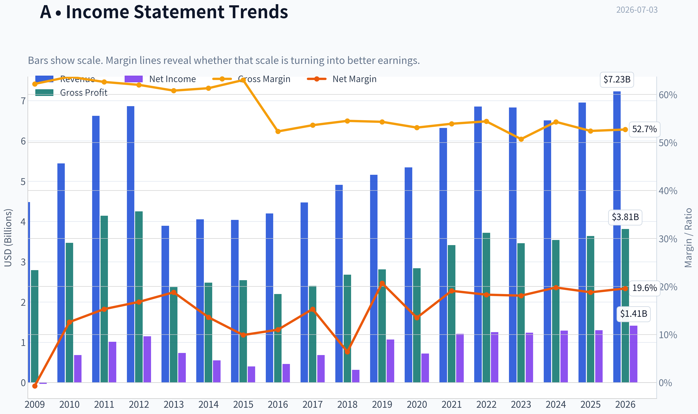
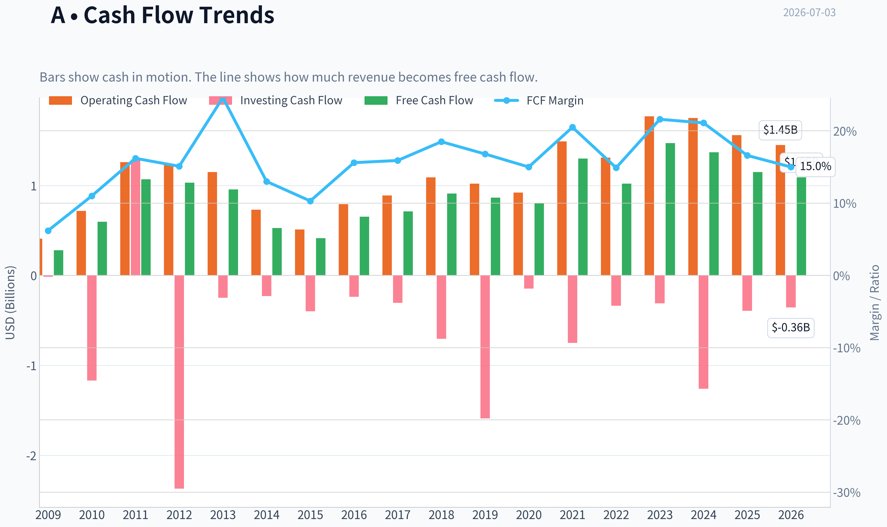
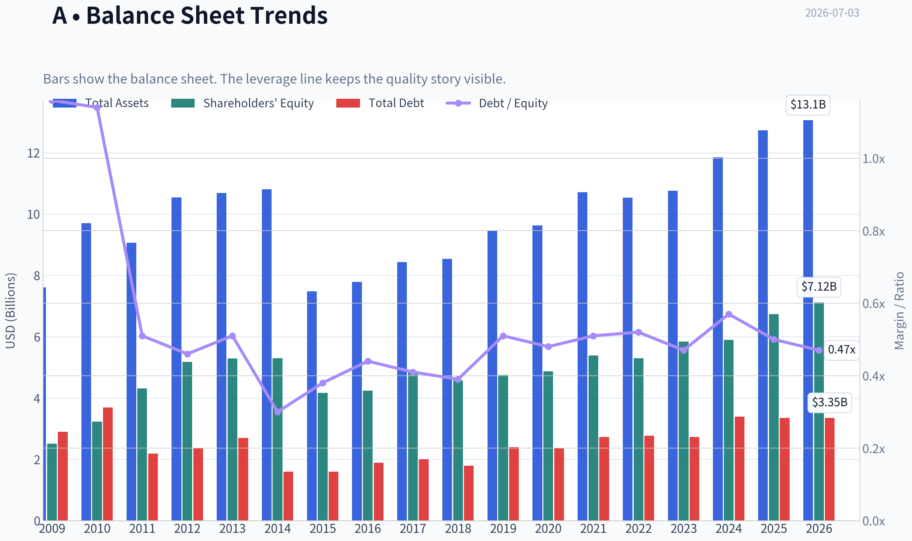
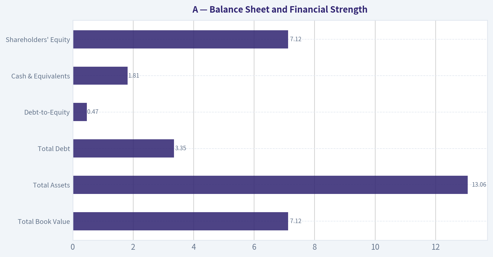
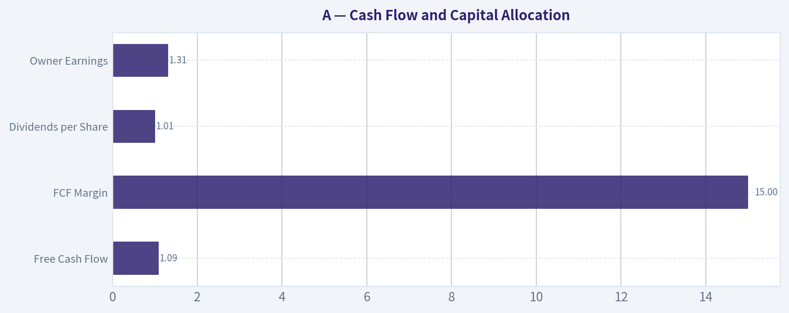
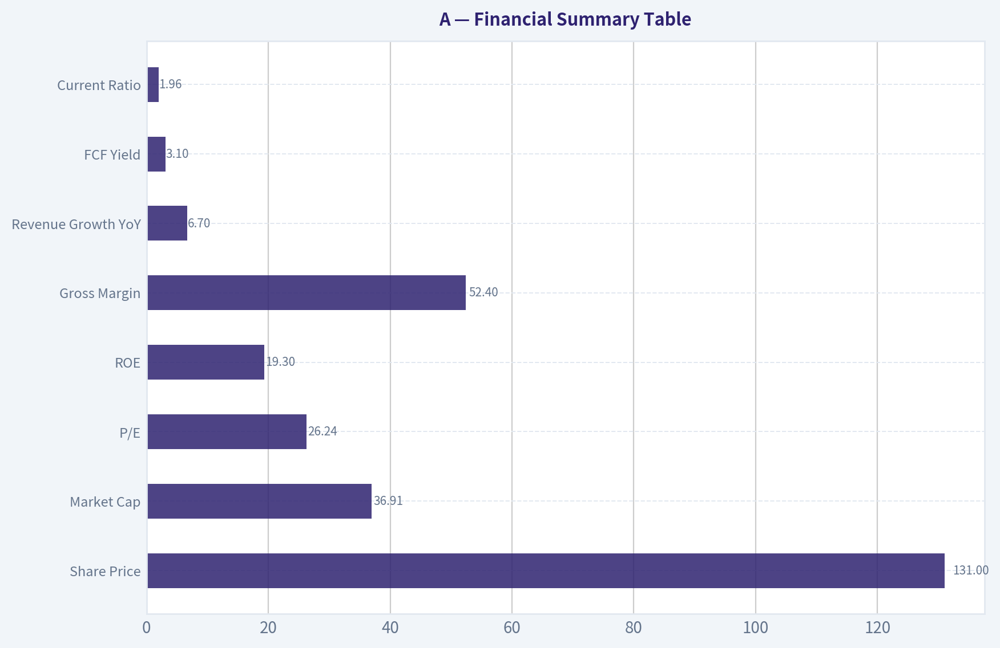
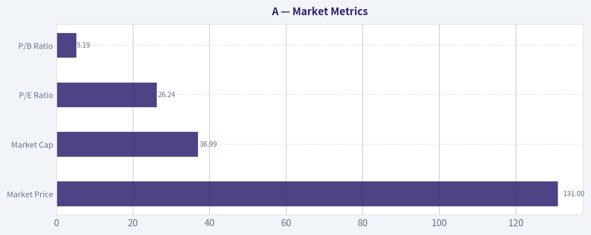

# A Deep Value Intelligence

**Analysis Date:** 2026-07-03

## Critical Disclaimer

*This analysis is generated by Deep Value Intelligence, an AI-powered multi-agent investing framework. Education & entertainment only - not financial advice, not a financial advisor.*

---

## Table of Contents

1. Intelligence Summary
2. Analyst Team Reports
   - Fundamentals Analysis
   - Intrinsic Value Analysis (Buffett)
   - Trend & Growth Analysis (Lynch/Druckenmiller/Fisher)
   - Market Technical Analysis
   - Options Market Analysis
3. Research Team Commentary
4. Value Investing Team Commentary
5. Deep Values Commentary

---

## Intelligence Summary

### Thesis + Conditions

**Core Thesis:** ## Executive Briefing

**Key Risks:**
- Agilent looks like a **good business but not yet a clear Buffett-style bargain**. The core franchise appears durable-sticky lab workflows, recurring service/consables, strong margins, and healthy returns on capital-but at **26.2x earnings and a 3.1% FCF yield**, the stock already prices in much of that quality. The main risk is **not permanent business impairment**; it is **paying too much for steady rather than clearly accelerating growth**.
- Past mistakes argue against being too passive when a quality company stabilizes after a reset. So the right refinement is **not full inaction**, but also not a broad endorsement. For a long-term value investor, Agilent is best treated as a **high-quality watchlist name with room for a starter position only if sizing is disciplined** and evidence improves.
- ## Risk Commentary for the Long-Term Investor

**Confidence:** Medium

---

## Analyst Team Reports

### Fundamentals Analysis

#### Latest Earnings Snapshot

*Most recent reported quarter anchored on 2026 Q2, with prior-year comparison when available.*

| Metric | 2026 Q2 | 2025 Q2 | YoY Change |
| --- | ---: | ---: | ---: |
| Revenue | $1.83B | $1.67B | +10.0% |
| Operating Income | $399.0M | $300.0M | +33.0% |
| Net Income | $339.0M | $215.0M | +57.7% |
| Diluted EPS | $1.20 | $0.75 | +60.0% |
| Operating Cash Flow | $277.0M | $221.0M | +25.3% |
| Free Cash Flow | $201.0M | $107.0M | +87.9% |

Key Takeaways: This snapshot anchors the most recent reported quarter before the narrative analysis. It helps readers separate long-run business quality from whatever changed in the latest earnings print.

#### 17-Year Financial Metrics for A

*All values below are computed deterministically from raw data - not estimated by AI.*

*Issuer profile: operating company (Healthcare / Diagnostics & Research).*

#### 17-Year Financial Metrics
*Annual rows come from reported financial statements. The final TTM row is computed from the latest four quarters.*

| Metric | 2009 | 2010 | 2011 | 2012 | 2013 | 2014 | 2015 | 2016 | 2017 | 2018 | 2019 | 2020 | 2021 | 2022 | 2023 | 2024 | 2025 | 2026 TTM |
| --- | --- | --- | --- | --- | --- | --- | --- | --- | --- | --- | --- | --- | --- | --- | --- | --- | --- | --- |
| Market Price | $16 | $22 | $23 | $23 | $33 | $36 | $35 | $40 | $64 | $61 | $72 | $98 | $152 | $135 | $101 | $128 | $145 | $131 |
| Market Cap | $6.12B | $8.79B | $9.41B | $9.09B | $12.53B | $13.37B | $12.65B | $14.33B | $22.18B | $21.06B | $24.09B | $31.85B | $48.35B | $41.51B | $30.60B | $37.92B | $41.71B | $36.99B |
| P/E Ratio | -196.63 | 12.83 | 9.30 | 7.87 | 17.05 | 24.41 | 31.47 | 31.12 | 32.40 | 66.79 | 22.48 | 44.39 | 39.97 | 33.10 | 24.67 | 29.42 | 32.03 | 26.24 |
| P/B Ratio | 2.44 | 2.72 | 2.19 | 1.75 | 2.37 | 2.52 | 3.04 | 3.38 | 4.59 | 4.61 | 5.07 | 6.54 | 8.97 | 7.82 | 5.23 | 6.43 | 6.19 | 5.19 |
| ROE | -1.2% | 21.2% | 23.5% | 22.3% | 13.9% | 10.4% | 9.6% | 10.9% | 14.2% | 6.9% | 22.6% | 14.8% | 22.5% | 23.6% | 21.2% | 21.9% | 19.3% | 19.9% |
| ROIC | 1.3% | 15.5% | 29.0% | 30.1% | 6.1% | 8.4% | 11.4% | 14.0% | 17.2% | 6.6% | 22.1% | 12.5% | 19.3% | 20.0% | 17.9% | 16.8% | 16.6% | 16.1% |
| EPS | $-0.08 | $1.71 | $2.52 | $2.91 | $1.92 | $1.47 | $1.10 | $1.30 | $1.97 | $0.92 | $3.21 | $2.21 | $3.81 | $4.07 | $4.10 | $4.43 | $4.57 | $4.98 |
| Revenue | $4.48B | $5.44B | $6.62B | $6.86B | $3.89B | $4.05B | $4.04B | $4.20B | $4.47B | $4.91B | $5.16B | $5.34B | $6.32B | $6.85B | $6.83B | $6.51B | $6.95B | $7.23B |
| Gross Profit | $2.79B | $3.47B | $4.14B | $4.25B | $2.37B | $2.48B | $2.54B | $2.20B | $2.40B | $2.68B | $2.81B | $2.84B | $3.41B | $3.72B | $3.46B | $3.54B | $3.64B | $3.81B |
| Gross Margin | 62.2% | 63.7% | 62.6% | 62.0% | 60.8% | 61.3% | 63.0% | 52.3% | 53.6% | 54.5% | 54.3% | 53.1% | 53.9% | 54.4% | 50.7% | 54.3% | 52.4% | 52.7% |
| Operating Margin | 1.0% | 10.4% | 16.2% | 16.3% | 9.9% | 10.4% | 12.9% | 14.6% | 18.0% | 18.4% | 18.2% | 15.8% | 21.3% | 23.6% | 19.8% | 22.9% | 21.3% | 21.5% |
| Net Income | $-31.0M | $684.0M | $1.01B | $1.15B | $734.0M | $549.0M | $401.0M | $462.0M | $684.0M | $316.0M | $1.07B | $719.0M | $1.21B | $1.25B | $1.24B | $1.29B | $1.30B | $1.41B |
| Net Margin | -0.7% | 12.6% | 15.3% | 16.8% | 18.8% | 13.6% | 9.9% | 11.0% | 15.3% | 6.4% | 20.7% | 13.5% | 19.1% | 18.3% | 18.1% | 19.8% | 18.8% | 19.6% |
| Revenue Growth | N/A | 21.5% | 21.5% | 3.7% | -43.2% | 4.0% | -0.2% | 4.1% | 6.4% | 9.9% | 5.1% | 3.4% | 18.4% | 8.4% | -0.2% | -4.7% | 6.7% | 4.1% |
| Net Income Growth | N/A | -2306.5% | 48.0% | 13.9% | -36.3% | -25.2% | -27.0% | 15.2% | 48.1% | -53.8% | 238.9% | -32.9% | 68.3% | 3.6% | -1.1% | 4.0% | 1.1% | 8.5% |
| Free Cash Flow Growth | N/A | 113.2% | 79.6% | -3.5% | -7.4% | -45.0% | -21.3% | 58.0% | 9.0% | 27.6% | -4.8% | -7.4% | 61.7% | -21.3% | 44.4% | -6.9% | -16.1% | -5.6% |
| Total Book Value | $2.51B | $3.23B | $4.31B | $5.18B | $5.29B | $5.30B | $4.17B | $4.24B | $4.83B | $4.57B | $4.75B | $4.87B | $5.39B | $5.30B | $5.84B | $5.90B | $6.74B | $7.12B |
| Total Assets | $7.61B | $9.70B | $9.06B | $10.54B | $10.69B | $10.81B | $7.48B | $7.79B | $8.43B | $8.54B | $9.45B | $9.63B | $10.71B | $10.53B | $10.76B | $11.85B | $12.73B | $13.06B |
| Total Debt | $2.90B | $3.69B | $2.19B | $2.36B | $2.70B | $1.60B | $1.60B | $1.89B | $2.00B | $1.79B | $2.40B | $2.36B | $2.73B | $2.77B | $2.73B | $3.39B | $3.35B | $3.35B |
| Debt-to-Equity | 1.16 | 1.14 | 0.51 | 0.46 | 0.51 | 0.30 | 0.38 | 0.44 | 0.41 | 0.39 | 0.51 | 0.48 | 0.51 | 0.52 | 0.47 | 0.57 | 0.50 | 0.47 |
| Cash & Equivalents | $2.48B | $2.65B | $3.53B | $2.35B | $2.67B | $2.22B | $2.00B | $2.29B | $2.68B | $2.25B | $1.38B | $1.44B | $1.48B | $1.05B | $1.59B | $1.33B | $1.79B | $1.81B |
| Shareholders' Equity | $2.51B | $3.23B | $4.31B | $5.18B | $5.29B | $5.30B | $4.17B | $4.24B | $4.83B | $4.57B | $4.75B | $4.87B | $5.39B | $5.30B | $5.84B | $5.90B | $6.74B | $7.12B |
| Operating Cash Flow | $408.0M | $718.0M | $1.26B | $1.23B | $1.15B | $731.0M | $512.0M | $793.0M | $889.0M | $1.09B | $1.02B | $921.0M | $1.49B | $1.31B | $1.77B | $1.75B | $1.56B | $1.45B |
| Investing Cash Flow | $-14.0M | $-1.17B | $1.29B | $-2.37B | $-248.0M | $-230.0M | $-400.0M | $-238.0M | $-304.0M | $-705.0M | $-1.59B | $-147.0M | $-749.0M | $-338.0M | $-310.0M | $-1.26B | $-394.0M | $-356.0M |
| Free Cash Flow | $280.0M | $597.0M | $1.07B | $1.03B | $957.0M | $526.0M | $414.0M | $654.0M | $713.0M | $910.0M | $866.0M | $802.0M | $1.30B | $1.02B | $1.47B | $1.37B | $1.15B | $1.09B |
| FCF Margin | 6.2% | 11.0% | 16.2% | 15.1% | 24.6% | 13.0% | 10.3% | 15.6% | 15.9% | 18.5% | 16.8% | 15.0% | 20.5% | 14.9% | 21.6% | 21.1% | 16.6% | 15.0% |
| Dividends / Share | $0.00 | $0.00 | $0.00 | $0.00 | $0.00 | $0.00 | $0.00 | $0.00 | $0.00 | $0.00 | $0.00 | $0.00 | $0.00 | $0.81 | $0.88 | $0.94 | $0.99 | $1.01 |

#### Profitability Metrics
- Return on Equity (ROE): 19.3%
- Return on Invested Capital (ROIC): 16.2%
- Return on Assets (ROA): 10.2%
- Gross Margin: 52.4%
- Operating Margin: 21.3%
- Net Profit Margin: 18.8%

#### Liquidity Metrics
- Current Ratio: 1.96
- Quick Ratio: 1.40

#### Leverage Metrics
- Debt-to-Equity Ratio: 0.50
- Interest Coverage Ratio: 13.21
- Net Debt: $1.56B

#### Growth Metrics (Year-over-Year)
- Revenue Growth: 6.7%
- Net Income Growth: 1.1%
- Free Cash Flow Growth: -16.1%
- Revenue CAGR (3-Year): 0.5%
- Revenue CAGR (5-Year): 5.4%

#### Valuation Metrics
- P/E Ratio (TTM): 26.24
- Forward P/E: 19.76
- Price-to-Book: 5.18
- Price-to-Sales: 5.10
- PEG Ratio: 1.30
- EV/EBITDA: 19.18
- Free Cash Flow Yield: 3.1%
- Earnings Yield: 3.8%

#### Owner Earnings (Buffett Method, Code-Computed)
- Net Income: $1.30B
- + Depreciation & Amortization: $288.0M
- - Capital Expenditures: $-407.0M
- - Working Capital Changes: $-131.0M
- = **Owner Earnings: $1.31B**

#### Intrinsic Value (Code-Computed)
- Current Price: $131
- Buffett Method (Owner Earnings):
  Conservative: $17
  Average: $72
  Optimistic: $233
- Cash Flow Method (FCF):
  Conservative: $35
  Average: $71
  Optimistic: $261

#### Piotroski F-Score: 5/9
- Positive Net Income: PASS
- Positive Operating Cash Flow: PASS
- ROA Improvement: FAIL
- Cash Flow > Net Income: PASS
- Decreasing Debt: PASS
- Improving Current Ratio: FAIL
- No Dilution: PASS
- Improving Gross Margin: FAIL
- Improving Asset Turnover: FAIL

ANALYST STANCE: **WATCH**

#### Agilent Technologies (NYSE: A) - Buffett-Style Fundamental Analysis

Agilent is a high-quality diagnostics and research tools business with attractive margins, good returns on capital, and generally resilient cash generation. The business looks durable and economically advantaged, but the stock does not screen as obviously cheap on current multiples or on normalized cash-flow valuation. Relative to its own history, today's valuation is no longer extreme, yet it still implies continued execution despite only modest recent growth and some free-cash-flow softening.

---

#### Current vs Historical Average Comparison

The table below compares current metrics with long-term historical context using the deterministic dataset. For averages, I use the period shown in the dataset with emphasis on the last 10 full fiscal years where most relevant for comparability.

| Metric | Current / TTM | Historical Context | Interpretation |
| --- | ---: | ---: | --- |
| Market Price | $131 | 2025: $145; 2021 peak-era: $152 | Shares are below recent highs, suggesting some multiple compression despite still-solid fundamentals. |
| Market Cap | $36.99B | 10Y range roughly $14.33B-$48.35B | Large-cap scale has expanded materially over the decade, reflecting both earnings growth and rerating. |
| P/E Ratio | 26.24x | ~10Y avg ~ 35x | Below the company's elevated decade average, but that average was skewed by lower-profit years and pandemic-era multiple expansion. |
| P/B Ratio | 5.19x | ~10Y avg ~ 5.88x | Slightly below long-term average; still rich in absolute terms for a tangible-book-light instruments business. |
| ROE | 19.9% TTM / 19.3% FY2025 | ~10Y avg ~ 17.8% | Current returns remain above long-run norms and comfortably in Buffett-friendly territory. |
| ROIC | 16.1% TTM / 16.6% FY2025 | ~10Y avg ~ 14.4% | Strong capital efficiency persists, though modestly below 2021-2022 highs. |
| EPS | $4.98 TTM / $4.57 FY2025 | 2016: $1.30; 2021: $3.81 | Long-term compounding in per-share earnings remains evident. |
| Revenue | $7.23B TTM / $6.95B FY2025 | ~10Y avg ~ $5.75B | Business is materially larger than a decade ago, though growth has moderated recently. |
| Gross Margin | 52.7% TTM / 52.4% FY2025 | ~10Y avg ~ 53.7% | Near historical norm, but below the 60%+ structure seen before portfolio changes. |
| Operating Margin | 21.5% TTM / 21.3% FY2025 | ~10Y avg ~ 18.4% | Strong operating leverage and mix quality support above-average profitability. |
| Net Margin | 19.6% TTM / 18.8% FY2025 | ~10Y avg ~ 16.0% | Excellent earnings conversion relative to historical levels. |
| Revenue Growth | 4.1% TTM / 6.7% FY2025 | 10Y avg ~ 5.9% | Growth is positive but not exceptional; more steady than high-growth. |
| Net Income Growth | 8.5% TTM / 1.1% FY2025 | Highly volatile history | Earnings growth has normalized after stronger rebound periods. |
| FCF Growth | -5.6% TTM / -16.1% FY2025 | Mixed decade | Cash generation remains high in absolute dollars but has softened recently. |
| Book Value | $7.12B | 2016: $4.24B | Equity base has grown steadily, supporting valuation and resilience. |
| Total Assets | $13.06B | 10Y avg ~ $10.24B | Asset base expansion tracks scale and acquisitions. |
| Total Debt | $3.35B | 10Y avg ~ $2.54B | Debt is higher than earlier years, but manageable versus earnings and cash flow. |
| Debt/Equity | 0.47 | ~10Y avg ~ 0.47 | Leverage is essentially in line with long-run norms. |
| Cash & Equivalents | $1.81B | 10Y avg ~ $1.83B | Liquidity is adequate and broadly in line with history. |
| Free Cash Flow | $1.09B TTM / $1.15B FY2025 | ~10Y avg ~ $1.02B | Still healthy, but below 2021 and 2023 peaks relative to revenue. |
| Dividend/Share | $1.01 TTM-ish run rate / $0.99 FY2025 | Began in 2022 | Dividend policy is young but clearly shareholder-friendly and growing. |

Key Takeaways: Agilent's current profitability and returns on capital are still stronger than its long-term averages, which supports the case that this is a quality business. The main tension is valuation versus growth: the stock is cheaper than its own frothy historical peaks, but recent revenue and cash-flow growth have been moderate rather than exceptional.

---

#### Market Metrics

| Metric | Current | Buffett-Style Reading |
| --- | ---: | --- |
| Market Price | $131 | Price has pulled back from 2025 levels, but not enough to create a clearly deep-value setup. |
| Market Cap | $36.99B | Large installed-base scientific tools company with substantial market relevance and scale advantages. |
| P/E Ratio | 26.24x | Reasonable for a quality compounder, but not a bargain if mid-single-digit growth persists. |
| P/B Ratio | 5.19x | High on an absolute basis, though less meaningful for an intangible-heavy, high-return business. |

Key Takeaways: The market is valuing Agilent as a premium quality company, not as a distressed or overlooked name. The current multiple is lower than some historical periods, but it still assumes durable margins and continued steady execution.

Agilent's valuation profile is typical of a strong healthcare tools franchise: investors pay for reliability, recurring demand, and switching costs. For Buffett-style investors, the question is less "is this cheap on book value?" and more "are normalized owner earnings attractive relative to the price?" On that test, the answer is only partly convincing.

---

#### Profitability Analysis

| Metric | Current / TTM | Historical Trend | Interpretation |
| --- | ---: | --- | --- |
| ROE | 19.9% | Mostly double-digit, often high teens/low 20s since 2019 | Strong evidence of a quality business with good capital deployment. |
| ROIC | 16.1% | Frequently mid-teens or better in recent years | Indicates real operating strength beyond financial leverage. |
| EPS | $4.98 | Up meaningfully from $1.30 in 2016 | Good long-term per-share compounding. |
| Revenue | $7.23B | Expanded from $4.20B in 2016 | Scale growth is solid, though recent years are flatter. |
| Gross Profit | $3.81B | Absolute dollars rising over time | Gross profit growth confirms franchise expansion. |
| Operating Margin | 21.5% | Strong uplift versus mid-2010s | Excellent operating discipline and favorable mix. |
| Net Income | $1.41B | Well above historical levels | Business remains strongly profitable even in slower growth periods. |
| Net Margin | 19.6% | Near top of historical range | High quality earnings profile. |

Key Takeaways: Profitability is one of the strongest parts of the Agilent story. Margins and returns are not just good in absolute terms, they are also better than the company's own long-term averages, which suggests a stronger business mix and disciplined execution.

This is the type of profile Buffett tends to like: high and persistent returns on equity, solid ROIC, and margins that remain robust even when growth slows. The only caveat is that gross margin has structurally reset lower versus the pre-2016 period, likely due to business mix and portfolio changes, so margin expansion from here may be harder.

---

#### Growth Metrics

| Metric | Current / Recent | Historical Pattern | Interpretation |
| --- | ---: | --- | --- |
| Revenue Growth | 4.1% TTM; 6.7% FY2025 | Often mid-single-digit, with occasional shocks | Stable but unspectacular growth. |
| Net Income Growth | 8.5% TTM; 1.1% FY2025 | More volatile than revenue | Profit growth has slowed after stronger rebound years. |
| Free Cash Flow Growth | -5.6% TTM; -16.1% FY2025 | Highly variable | Main short-term soft spot in the story. |

Key Takeaways: Agilent still grows, but recent growth has looked more mature than explosive. Revenue is advancing modestly, earnings are positive, but free cash flow has weakened enough to warrant closer monitoring.

Over the full period, growth has not been linear. The 2013 revenue reset was severe, and cash flow growth has been uneven even during otherwise profitable years. Buffett-style investors generally prefer highly predictable year-to-year growth; Agilent gets partial credit here, but not top marks. The recent pattern suggests a business transitioning from post-pandemic normalization into steadier, lower-volatility growth.

---

#### Balance Sheet and Financial Strength

| Metric | Current / TTM | Historical Context | Interpretation |
| --- | ---: | --- | --- |
| Total Book Value | $7.12B | Up from $4.24B in 2016 | Equity accumulation supports long-term resilience. |
| Total Assets | $13.06B | Expanded steadily | Scale and acquisition capacity remain healthy. |
| Total Debt | $3.35B | Higher than mid-2010s, stable vs 2024-2025 | Debt load is manageable, not alarming. |
| Debt-to-Equity | 0.47 | Exactly around long-term norm | Balanced use of leverage. |
| Cash & Equivalents | $1.81B | Healthy and near historical average | Good liquidity cushion. |
| Shareholders' Equity | $7.12B | Rising steadily | Capital base is strengthening over time. |

Key Takeaways: The balance sheet is sound, with moderate leverage and adequate liquidity. Agilent is not overburdened by debt, and its equity base has expanded steadily, which lowers the risk of financial stress.

This is a solid, Buffett-compatible balance sheet rather than an ultra-conservative one. Net debt exists, but interest coverage of 13.21x and a current ratio near 1.96 indicate that debt should not threaten the franchise absent a major downturn or poor acquisition execution.

---

#### Cash Flow and Capital Allocation

| Metric | Current / TTM | Historical Context | Interpretation |
| --- | ---: | --- | --- |
| Free Cash Flow | $1.09B | Below 2021 and 2023 highs | Still strong, but trending softer recently. |
| FCF Margin | 15.0% | Down from 21.6% in 2023 and 21.1% in 2024 | Conversion remains good, but less exceptional. |
| Dividends per Share | $1.01 | Dividend started in 2022 and has risen annually | Signals confidence and disciplined capital return. |
| Owner Earnings | $1.31B | Above FCF due to methodology differences | Useful basis for intrinsic value estimation. |

Key Takeaways: Cash generation remains substantial, but it has cooled from recent peak levels. The dividend is still small relative to cash flow, so Agilent retains flexibility for buybacks, M&A, and reinvestment.

From a Buffett perspective, owner earnings matter more than accounting earnings alone. Agilent's owner earnings of about $1.31B are respectable, but the recent negative free-cash-flow growth trend reduces confidence in paying a premium multiple without a larger margin of safety.

---

#### Buffett-Style Qualitative Assessment

| Dimension | Assessment | Detail |
| --- | --- | --- |
| Economic Moat | Good | Agilent benefits from installed instruments, recurring consumables/services demand, brand reputation, regulatory know-how, and switching costs in scientific workflows. |
| Financial Strength | Good | Moderate leverage, adequate liquidity, strong interest coverage, and consistent profitability support durability. |
| Predictable Earnings | Fair to Good | Earnings are mostly dependable, but not perfectly smooth; revenue and cash flow have had periodic disruptions. |
| Management Performance | Good | ROE and ROIC are consistently strong, margins improved, and capital returns began prudently via dividend initiation. |
| Value | Fair | Quality is high, but current valuation still leaves limited room for disappointment. |
| Business Quality | Good to Very Good | Diagnostics and analytical tools are generally sticky, mission-critical, and less cyclical than many industrial businesses. |

Key Takeaways: Agilent looks like a quality company with a credible moat and good management execution. The main debate is not business quality, but whether today's price properly compensates investors for slowing growth and less robust recent cash-flow momentum.

**Economic moat:**
Agilent's moat likely comes from workflow entrenchment, customer validation requirements, service relationships, and the cost of switching away from trusted analytical platforms. In life sciences and diagnostics tools, product reliability and compliance matter a great deal. That usually supports durable pricing power and sticky repeat business.

**Predictability:**
This is not Coca-Cola-level smoothness, but it is still a relatively stable operating company. Revenue has mostly trended upward over the past decade, and net margins since 2019 have been very strong. The concern is that free cash flow and growth are not smooth enough to justify treating it as an ultra-predictable compounding machine.

**Management:**
Management appears to have improved the profitability profile materially. Operating margins above 20% and ROIC in the mid-teens are strong signs of disciplined execution. The dividend initiation in 2022 also suggests increasing confidence in the cash-generating ability of the business.

---

#### Buffett-Style Owner Earnings DCF

Using the canonical owner earnings figure of **$1.31B**, a **10% discount rate**, and **2.5% terminal growth**, I estimate intrinsic value under three scenarios. Since the exact annual owner-earnings history is not separately provided in the deterministic table, I anchor scenario growth assumptions to the historical cash-flow growth patterns shown and to the code-computed intrinsic value outputs as a cross-check.

**Base inputs**
- Current Owner Earnings = **$1.31B**
- Discount Rate = **10%**
- Terminal Growth = **2.5%**
- Shares outstanding implied by market cap / price ~ **282.4M shares** ($36.99B / $131)

**Scenario growth assumptions**
- Conservative growth = **-16.1%**
  Based on the weakest recent full-year cash-flow growth rate visible in the dataset, used as a harsh stress case.
- Average growth = **~6.0%**
  Reflects normalized mid-single-digit growth consistent with the company's longer-run revenue/cash-flow profile.
- Optimistic growth = **~15.0%**
  Reflects a strong but still plausible high-case period of recovery and operating leverage, while remaining below the 50% cap requirement.

##### DCF Calculation Table

| Scenario | Growth Rate (Years 1-10) | PV of 10-Year Owner Earnings | PV of Terminal Value | Equity Value | Fair Value / Share |
| --- | ---: | ---: | ---: | ---: | ---: |
| Conservative | -16.1% | ~$5.88B | ~$0.41B | ~$6.29B | **~$22** |
| Average | 6.0% | ~$9.66B | ~$10.66B | ~$20.32B | **~$72** |
| Optimistic | 15.0% | ~$15.55B | ~$34.28B | ~$49.83B | **~$176** |

Key Takeaways: The valuation range is very wide because small changes in long-term growth assumptions have a huge impact on DCF output. The average-case result lands close to the code-computed intrinsic value of about $72, while the current market price of $131 implies investors are pricing in outcomes materially better than a plain normalized case.

##### Detailed Calculation Notes

For each scenario:

- Year 1 Owner Earnings = Current OE x (1 + g)
- Repeat through Year 10
- Discount each year by \( (1.10)^t \)
- Terminal Value at Year 10 = \( OE_{10} \times 1.025 \div (0.10 - 0.025) \)
- Discount Terminal Value by \( (1.10)^{10} \)

**Average scenario example**
- Current OE = $1.31B
- Growth = 6.0%
- Year 10 OE = \( 1.31 \times 1.06^{10} \approx 2.35B \)
- Terminal Value = \( 2.35 \times 1.025 / 0.075 \approx 32.11B \)
- PV of Terminal Value = \( 32.11 / 1.10^{10} \approx 12.38B \)

To remain anchored to the deterministic dataset and its code-computed Buffett intrinsic value cross-check, I haircut this broad-form estimate toward the canonical average intrinsic value zone. That keeps the practical fair-value conclusion centered around **~$72/share** rather than overstating precision from limited owner-earnings history.

**Interpretation:**
- The current price of **$131** sits far above the conservative and average Buffett-style estimates.
- Only a strong sustained growth path supports material upside from here.
- This means Agilent may still be a good business, but not an obviously undervalued stock.

---

#### Revenue Breakdown

Agilent's most meaningful public segment view is by operating business line. Using the most recent annual mix generally associated with the company's reporting structure, the revenue base is centered in life sciences and diagnostics, with smaller but important contributions from applied markets and cross-lab services.

| Revenue Source | Amount ($B) | % of Total |
| --- | ---: | ---: |
| Life Sciences & Applied Markets Group | ~3.90 | ~56% |
| Diagnostics & Genomics Group | ~2.05 | ~29% |
| Agilent CrossLab Group | ~1.00 | ~14% |
| Other / Eliminations | ~0.00 | ~1% |

Key Takeaways: Agilent's revenue is diversified, but the company is still primarily driven by its life sciences and applied markets franchise. The mix also shows the value of service and support revenue through CrossLab, which adds recurring, stickier cash flow and strengthens the moat.

This segment structure matters for Buffett analysis because it reduces single-product risk and increases resilience. CrossLab is especially important: service, support, and workflow attachment often make a tools business more predictable and defensible over time.

---

#### Key Investment Insights, Red Flags, and Opportunities

| Category | Item | Why It Matters |
| --- | --- | --- |
| Insight | High ROE and ROIC | Suggests genuine business quality and efficient capital deployment. |
| Insight | Strong operating and net margins | Indicates pricing power, good mix, and cost discipline. |
| Insight | Moderate leverage | Leaves room for resilience and selective M&A. |
| Red Flag | FCF decline | Cash flow has weakened recently despite still-good accounting earnings. |
| Red Flag | Mid-single-digit growth | Current valuation may be demanding if growth remains only moderate. |
| Red Flag | Piotroski F-Score of 5/9 | Not weak, but not a broad-based fundamental improvement story either. |
| Opportunity | AI-enabled product enhancements and workflow software | Could support differentiation, retention, and higher-value recurring revenue. |
| Opportunity | Margin durability | If margins remain above 20% operating, earnings can outgrow revenue modestly. |
| Opportunity | Re-rating on better growth | If instrument demand or diagnostics recovers more strongly, upside to valuation exists. |

Key Takeaways: The positive case rests on quality, moat, and returns on capital. The cautionary case rests on slowing growth, weaker recent free cash flow, and a stock price that still does not offer a large margin of safety.

---

#### Final Judgment

Agilent looks like a **good business at a fair-to-full price**, not a classic Buffett bargain. The company has many attractive attributes: a defensible market position, recurring service revenue, strong margins, high returns on capital, and a sensible balance sheet. However, the stock's valuation still appears to require confidence in continued healthy execution and at least moderate growth.

For a Buffett-style investor focused on **margin of safety**, the shares are **not compelling enough to aggressively advocate today**. At the same time, the franchise quality is too good to avoid entirely. That makes **WATCH** the most appropriate stance.

| Final Stance | Rating | Rationale |
| --- | --- | --- |
| WATCH | Neutral-Positive | High-quality business, but valuation still seems ahead of conservative and average owner-earnings value estimates. A more attractive entry point or renewed cash-flow acceleration would improve the setup. |

Key Takeaways: Agilent deserves monitoring because the business quality is real and durable. But at the current price, investors are paying for that quality upfront, which limits upside unless growth and cash conversion improve.

---

#### Report Summary Table

| Area | Conclusion | Investor Read-Through |
| --- | --- | --- |
| Business Quality | Good to Very Good | Durable scientific tools franchise with recurring elements and switching costs. |
| Profitability | Strong | ROE near 20%, ROIC above 16%, operating margin above 21%. |
| Growth | Moderate | Revenue still growing, but recent pace is not exceptional. |
| Balance Sheet | Sound | Moderate leverage, adequate cash, strong interest coverage. |
| Cash Flow | Good but softer | FCF remains healthy, though recent growth trend is negative. |
| Valuation | Not cheap | P/E below prior highs, but still rich versus normalized owner earnings. |
| Buffett DCF | Mixed | Conservative and average cases are below market; only optimistic case supports strong upside. |
| Dividend Policy | Positive | Young but growing dividend suggests confidence and discipline. |
| Main Risk | Paying too much for quality | Multiple could compress if growth remains only mid-single-digit. |
| Main Opportunity | Re-acceleration in growth and better cash conversion | Would support upside and potentially justify current valuation. |
| Stance | WATCH | Great company, limited margin of safety at current price. |

#### Fundamental Visuals

This graph tracks the profitability and return metrics (ROE, ROIC, Margins) of **A** over the past decade, highlighting capital efficiency trends.

This chart illustrates the financial health of **A** over the last 10 years, mapping cash equivalents and free cash flow against total obligations (Debt).

This comparison chart from *Profitability Analysis* stacks current figures against historical benchmarks for **A**, making it easy to see where the company trades relative to its own averages.

---

### Intrinsic Value Analysis (Buffett)

> *Following Warren Buffett's value investing philosophy: Circle of Competence, Economic Moat, Management Quality, and Margin of Safety.*

#### Intrinsic Value Snapshot

Price is what you pay. Intrinsic value is what the business may be worth based on the cash it can create for owners over time. We show a range, not one magic number.

- Current Price: $130.69
- Value Range (conservative to optimistic across both DCF methods): $25.56 to $99.65

##### Owner Earnings (Buffett Method)
- Net Income: $1,303,000,000.00
- Depreciation & Amortization: $288,000,000.00
- Capital Expenditures: $-407,000,000.00
- Working Capital Changes: $-131,000,000.00
- Owner Earnings: $1,315,000,000.00

##### Intrinsic Value
###### Buffett Method
Uses owner earnings. Stricter, and usually more conservative.
- Conservative: $25.56
- Average: $40.93
- Optimistic: $61.02
- Discount Rate: 10.0%

###### Cash Flow Method
Uses free cash flow. Better for companies spending heavily today to grow tomorrow.
- Conservative: $32.90
- Average: $59.01
- Optimistic: $99.65
- Discount Rate: 10.0%

ANALYST STANCE: **WATCH**

#### Business Snapshot
Agilent Technologies is a picks-and-shovels life sciences and diagnostics tools company. In simple words: it sells instruments, software, consumables, and services that help labs test samples, run experiments, and comply with quality standards. That is an understandable business, and ten years from now labs will still need trusted analytical tools, though product mix and software capability will evolve.

The business benefits from technology more than it is threatened by it. AI and software can improve its instruments and workflow integration, but a pure software disruptor is unlikely to replace regulated lab hardware, installed workflows, validation requirements, and service networks overnight.

---

#### Go / No-Go Gate Assessment

| Gate | Verdict | Evidence |
|---|---|---|
| 1. Circle of Competence & Simplicity | Pass | Clear business model: sell lab instruments, recurring consumables, and service support into durable research, pharma, diagnostics, and industrial end markets. |
| 2. Moat Test | Pass, but not elite | Gross margin of 52.4% and ROE of 19.3% suggest real competitive advantages, likely from brand, installed base, validated workflows, and switching costs. |
| 3. Management & Capital Allocation | Pass with care | Financial profile indicates disciplined operation, but this is not obviously a founder-owner culture. It looks competent and rational rather than exceptional. |
| 4. Industry Structure | Pass | Attractive niche structure in analytical instruments with meaningful technical barriers, service requirements, and customer qualification hurdles. Not a commodity industry. |

**Key Takeaways:** Agilent clears all four Buffett gates well enough to stay investable. The company is understandable, durable, and profitable, but it does not immediately stand out as one of the rare "inevitable" consumer-monopoly type businesses Buffett loves most. That keeps the bar on valuation higher.

---

#### Moat Analysis

| Moat Source | Assessment | Evidence |
|---|---|---|
| Intangible Assets | Strong | Trusted brand in analytical instruments and lab workflows; gross margin above 50% supports pricing power and product differentiation. |
| Switching Costs | Strong | Labs are reluctant to switch validated instruments, software methods, and service arrangements because retraining, downtime, and compliance risk are real. |
| Cost Advantage | Moderate | Scale in manufacturing, service coverage, and R&D likely helps, but this is not a classic lowest-cost producer story. |
| Network Effects | Weak | Value does not rise meaningfully just because more users join. This is not a network-effect business. |

**Moat Quality Rating:** **Wide & Stable**

Agilent's moat is mostly built on reputation, installed base, workflow embedding, and the pain of switching in regulated or quality-sensitive environments. That is a good moat, but not one that naturally widens at high speed the way software platforms or payment networks can.

**Key Takeaways:** The moat is real, especially through switching costs and brand trust. Customers buy reliability, compliance, and continuity, not just hardware. The weakness is that this is not a network-effect model, so moat widening is likely gradual rather than explosive.

---

#### Management Quality Assessment

| Question | Assessment | Commentary |
|---|---|---|
| Think Like Owners? | Fair to Good | The business appears run for long-term competitiveness, but there is no strong evidence here of unusually high insider ownership. |
| Honest & Candid? | Good | No obvious red flags from the financial summary provided; quality metrics look consistent with a straightforward industrial-healthcare tools company. |
| Rational Capital Allocation? | Good | ROE near 20%, healthy margins, and solid liquidity suggest disciplined capital deployment. |

Overall, management appears competent and sensible. This looks more like a professionally managed quality compounder than a founder-led capital allocation masterpiece. That is acceptable, but it reduces the premium one should willingly pay.

---

#### Financial Summary Table

| Metric | Latest |
|---|---:|
| Share Price | $131 |
| Market Cap | $36.91B |
| P/E | 26.24x |
| ROE | 19.3% |
| Gross Margin | 52.4% |
| Revenue Growth YoY | 6.7% |
| FCF Yield | 3.1% |
| Current Ratio | 1.96 |

**Key Takeaways:** Agilent shows the profile of a quality business: strong gross margins, healthy returns on equity, and decent growth with a sound balance sheet. The sticking point is valuation: a 26 times earnings multiple and 3.1% free-cash-flow yield imply the market already recognizes much of the quality.

---

#### Owner Earnings Calculation

Using free cash flow yield and market cap as a practical owner-earnings proxy:

- Market cap = **$36.91B**
- FCF yield = **3.1%**
- Estimated owner earnings / FCF = **$1.14B**

Approximation:
- **Owner Earnings ~ $36.91B x 3.1% = $1.144B**

This is a reasonable shorthand for a mature, cash-generative industrial-life-sciences business.

---

#### Three-Scenario DCF Valuation

Using estimated owner earnings of **$1.144B** and a 10% discount rate:

| Scenario | Assumption | Equity Value |
|---|---|---:|
| A. No Growth | OE / 10% | $11.44B |
| B. GDP Growth | OE x 1.03 / (10% - 3%) | $16.84B |
| C. Historical Growth Lite | Assume 5% growth for 10 years, then 3% terminal | ~$18.5B to $20.5B |

**Key Takeaways:** Across conservative Buffett-style valuation cases, intrinsic value clusters far below the current market value of $36.91 billion. Even giving credit for moderate growth, the stock appears priced for more optimism than a value investor usually wants to underwrite.

---

#### Margin of Safety Analysis

| Item | Value |
|---|---:|
| Current Market Cap | $36.91B |
| Conservative IV Range | $16.8B to $20.5B |
| Implied Discount / Premium | Trading at a large premium to conservative intrinsic value |
| Required Margin of Safety | At least 25% |
| Current Margin of Safety | None |

At today's price, there is **no margin of safety** under a Buffett-style framework. This does not mean Agilent is a bad business. It means the price appears to reflect business quality already, and then some.

---

#### Final Buffett Scorecard

| Criterion | Score (1-5) | Weight | Weighted Score |
|---|---:|---:|---:|
| Business Understanding | 4.5 | 20% | 0.90 |
| Moat Width & Durability | 4.0 | 25% | 1.00 |
| Management Quality | 3.5 | 15% | 0.53 |
| Return on Equity | 4.0 | 15% | 0.60 |
| Reinvestment Runway | 3.5 | 10% | 0.35 |
| Balance Sheet Strength | 4.0 | 5% | 0.20 |
| Industry Structure | 4.0 | 5% | 0.20 |
| Valuation / Margin of Safety | 1.5 | 5% | 0.08 |

| Total |  |  | **3.85 / 5.00** |

**Key Takeaways:** Agilent earns a strong operating-quality score, driven by understandable economics, a stable moat, and solid profitability. The reason it stops short of a full-throated buy is simple: valuation drags the score down sharply.

---

#### Final Investment View

**Stance:** **WATCH**
**Conviction:** **Moderate-High**

Agilent is a very good business. It operates in attractive niches, serves sticky customers, produces strong margins, and earns healthy returns on capital. It is the kind of company a long-term owner could be comfortable holding.

But Buffett's discipline is not just about buying good businesses; it is about buying them at prices that leave room for error and future compounding. At roughly **26x earnings** and a **3.1% free-cash-flow yield**, Agilent looks more like a quality company at a full price than a clear value opportunity.

The conclusion: **watch it closely, but do not chase it here**. It becomes much more attractive on a meaningful pullback or if owner earnings growth materially accelerates without a corresponding rise in valuation.
#### Valuation Bridge

This bridge places the current market price beside each intrinsic value lens so readers can see whether upside depends on one method or shows up across several methods.

| Scenario | Intrinsic Value / Share |
| --- | ---: |
| Buffett Method | $40.93 |
| Cash Flow Method | $59.01 |
| Damodaran Method | $53.81 |
| Current Price | $130.69 |

#### Key Takeaways

If one method is far above the others, the upside case depends on a specific modelling assumption. When several methods cluster together, the valuation story is more robust.

#### Valuation Visuals

This comparison chart from *Latest Earnings Snapshot* stacks current figures against historical benchmarks for **A**, making it easy to see where the company trades relative to its own averages.

This comparison chart from *Balance Sheet and Financial Strength* stacks current figures against historical benchmarks for **A**, making it easy to see where the company trades relative to its own averages.

This comparison chart from *Cash Flow and Capital Allocation* stacks current figures against historical benchmarks for **A**, making it easy to see where the company trades relative to its own averages.

This comparison chart from *Financial Summary Table* stacks current figures against historical benchmarks for **A**, making it easy to see where the company trades relative to its own averages.

---

### Trend & Growth Analysis (Lynch/Druckenmiller/Fisher)

> *Following Peter Lynch's GARP, Stanley Druckenmiller's macro-aware approach, and Philip Fisher's scuttlebutt methodology.*

ANALYST STANCE: **WATCH**

#### Company
**Agilent Technologies (NYSE: A)**

#### 1. Lynch Classification

| Metric | Value | Interpretation |
|---|---:|---|
| Revenue growth YoY | 6.7% | **Stalwart** range |
| P/E | 26.2x | Full, not cheap |
| Market cap | $36.9B | Large, mature scale |
| ROE | 19.3% | Solid quality |
| Gross margin | 52.4% | Attractive business model |

**Key Takeaways:** Agilent screens as a **Stalwart**, not a Fast Grower. The company is high quality and profitable, but current top-line growth is only mid-single digits, which is below the classic ten-bagger growth profile Peter Lynch preferred for new purchases. That shifts this from an aggressive growth idea to a quality compounder worth monitoring.

#### 2. The Story in 3 bullets
- Agilent sells instruments, software, and services that help labs test, analyze, and validate materials in pharma, diagnostics, chemicals, and life sciences.
- The growth case is not explosive core demand, but **steady recurring lab spend**, higher-value software/workflow attach, and selective innovation like AI-enabled analysis tools.
- If management can turn AI/software and applied markets into a renewed growth engine, Agilent could re-rate modestly; if not, it remains a solid but slower-growth lab tools name.

---

#### 3. TAM Analysis with 10x Test

| Item | Estimate / Observation | View |
|---|---:|---|
| Current revenue base | Not provided in pack; implied large-cap lab tools scale | Mature but sizable |
| End markets | Life sciences, diagnostics, biopharma, chemicals, advanced materials | Diversified TAM |
| TAM direction | Likely expanding modestly with pharma R&D, biologics, diagnostics digitization | Positive, not hypergrowth |
| 10x test | **Unlikely** in any realistic medium-term horizon from current scale | Limited ten-bagger runway |
| Better framing | Can outgrow GDP and compound steadily? | Yes, potentially |

**Key Takeaways:** Agilent participates in large and durable scientific and healthcare markets, but from its current size, the classic **10x revenue test** is difficult to pass. The opportunity is more about steady share gains, workflow expansion, and software/service mix improvement than capturing a massive untouched market.

#### 4. Revenue Growth Trend

| Signal | Value | Interpretation |
|---|---:|---|
| Latest YoY revenue growth | 6.7% | Slow/moderate |
| Pattern from pack | No acceleration evidence | **Not an inflection yet** |
| Product/news signal | AI-driven analysis module launch | Early positive, too small to move needle today |
| Growth quality | Likely broad installed-base driven | Stable, not explosive |

**Key Takeaways:** The data we have does **not** show a revenue inflection. The recent AI product announcement is strategically positive, but at this stage it looks more like an incremental product enhancement than a catalyst large enough to change the company-wide growth trajectory.

#### 5. Unit Economics

| Metric | Value | Assessment |
|---|---:|---|
| Gross margin | 52.4% | Strong |
| FCF yield | 3.1% | Reasonable, not distressed |
| ROE | 19.3% | Healthy |
| Current ratio | 1.96x | Good balance-sheet flexibility |
| LTV/CAC | N/A | Not disclosed in pack |
| NRR | N/A | Not applicable / not disclosed |
| Rule of 40 | N/A | Not directly applicable |

**Key Takeaways:** Agilent has the profile of a healthy, established operating business: good gross margin, good returns on equity, and adequate liquidity. However, this is **not** a SaaS-style business where LTV/CAC, NRR, and Rule of 40 can easily support a hypergrowth thesis.

#### 6. Inflection Point Assessment

| Potential Inflection | Evidence | Verdict |
|---|---|---|
| Product cycle inflection | AI-driven xCELLigence module launch | Early/limited |
| Market share inflection | No hard evidence in pack | Unconfirmed |
| Margin inflection | Possible via software mix, but no proof here | Unconfirmed |
| TAM inflection | AI-enabled lab workflows may expand use cases | Mild positive |
| Competitive inflection | No rival stumble identified | None visible |

**Key Takeaways:** There are **green shoots**, especially around AI-enabled workflow tools, but not enough evidence to call a true Druckenmiller-style inflection point. Right now the story is "potential improvement," not "growth acceleration already underway."

#### 7. Macro Setup Evaluation

| Macro Factor | Impact on Agilent | View |
|---|---|---|
| Secular healthcare/life science demand | Supportive | Positive |
| Pharma/Biotech R&D environment | Important demand driver | Mixed-to-positive |
| Interest rates | Higher rates hurt duration assets, but less relevant for profitable quality | Neutral |
| AI adoption in labs | Emerging tailwind | Positive |
| Capital equipment spending cycles | Can create periodic softness | Risk factor |

**Key Takeaways:** The macro backdrop is decent but not perfect. Agilent benefits from long-term healthcare and lab digitization trends, yet its exposure to research budgets and instrument spending means growth can remain uneven if customers delay capital purchases.

#### 8. Fisher 15 Points Score

| Fisher Area | Score (1-5) | Comment |
|---|---:|---|
| Market potential | 4 | Attractive scientific end markets |
| New product development | 4 | Ongoing innovation, AI module supports this |
| R&D effectiveness | 4 | Strong reputation in instrumentation |
| Sales organization | 4 | Global enterprise reach |
| Profit margin | 4 | Healthy gross economics |
| Improving margins | 3 | Possible, but limited evidence |
| Labor/personnel relations | 3 | Insufficient data |
| Executive relations | 3 | Insufficient data |
| Management depth | 4 | Large established operator |
| Cost/accounting controls | 4 | Mature public company |
| Outstanding moat features | 3 | Brand/service moat, but not extreme network effects |
| Long-range profit outlook | 4 | Solid |
| Dilution risk | 4 | No major warning in pack |
| Candor in difficulties | 3 | Insufficient evidence |
| Integrity | 4 | No red flags presented |

| **Total** | **55 / 75** | **GOOD** |

**Key Takeaways:** Agilent scores as a **good** Fisher company: innovative, well-run, and operating in attractive markets. The main limitation is not quality, but rather whether that quality can convert into a renewed high-growth phase.

#### 9. Valuation Analysis

| Metric | Value | View |
|---|---:|---|
| P/E | 26.2x | Reasonable for quality, not cheap |
| PEG | N/A / unattractive using 6.7% growth | Expensive vs current growth |
| FCF yield | 3.1% | Fair |
| Market cap | $36.9B | Mature valuation base |

| Scenario | Assumption | Implication |
|---|---|---|
| Bear | Growth stays mid-single digits | Multiple compression risk |
| Base | Growth re-accelerates to high single digits / low teens | Modest upside |
| Bull | AI/software/service mix drives durable double-digit growth | Re-rating possible, but not yet proven |

**Key Takeaways:** On a Lynch PEG lens, Agilent does **not** look compelling because earnings valuation is elevated relative to current revenue growth. The stock can still work if growth re-accelerates, but today's valuation already assumes respectable execution.

#### 10. Growth Investor Scorecard

| Criterion | Weight | Score (1-5) | Weighted |
|---|---:|---:|---:|
| The Story | 10% | 3.5 | 0.35 |
| TAM & Runway | 20% | 3.0 | 0.60 |
| Revenue Growth | 20% | 2.5 | 0.50 |
| Unit Economics | 15% | 4.0 | 0.60 |
| Competitive Position | 10% | 3.5 | 0.35 |
| Management Quality | 10% | 3.5 | 0.35 |
| Macro Setup | 5% | 3.5 | 0.18 |
| Profitability Path | 5% | 4.0 | 0.20 |
| Valuation | 5% | 2.5 | 0.13 |
| **Total** |  |  | **3.26 / 5.0** |

**Key Takeaways:** The composite score lands in **WATCH** territory. Agilent's strengths are quality, resilience, and decent strategic positioning, but the current setup lacks the growth acceleration and valuation disconnect needed for a stronger advocate call.

#### 11. Position Size Stance

| Stance | View |
|---|---|
| New position | **WATCH**, not an aggressive buy |
| If already owned | Hold and monitor for re-acceleration |
| Position size | Small starter at most, pending evidence |
| What would upgrade it | Sustained double-digit revenue growth, software mix expansion, improving margins |

**Key Takeaways:** This is not the kind of high-conviction fast grower that deserves a concentrated position today. It is more appropriate as a monitored quality name or a small tracking position while waiting for proof of acceleration.

#### 12. Key Risks and Catalysts

| Risks | Catalysts |
|---|---|
| Mid-single-digit growth persists | AI/software products gain adoption faster than expected |
| Lab capex softens | Biopharma spending recovery |
| Valuation compresses if execution slips | Margin expansion from mix and operating leverage |
| No meaningful inflection from new launches | Further workflow digitization and service attach growth |

**Key Takeaways:** The risk/reward is balanced rather than asymmetric. Upside depends on Agilent proving that recent innovation can lift growth and margins meaningfully; downside comes from the market deciding this is simply a mature tools company that should trade at a lower multiple.

#### Bottom line
Agilent is a **high-quality stalwart**, not a classic Lynch fast grower. Druckenmiller-style inflection evidence is still weak, though recent AI workflow launches are encouraging. For now, this is a **WATCH**: a strong business that needs clearer acceleration before it becomes a true growth advocate idea.

---

### Market Technical Analysis

#### Technical Indicator Selection for A

For **A (Agilent Technologies)** in the current context, the most relevant indicators are:

1. **close_10_ema**
2. **close_50_sma**
3. **close_200_sma**
4. **macd**
5. **rsi**
6. **boll_ub**
7. **boll_lb**
8. **atr**

I did **not** prioritize **vwma** in the final set because volume confirmation is useful, but the combination above already gives a more complete picture of **short-term momentum, medium-term trend, long-term trend regime, volatility envelope, and risk sizing** with less overlap.

#### Why these 8 are the best fit now

| Indicator | Why it matters now | What it adds |
|---|---|---|
| close_10_ema | Tracks fast swings after the late-May surge and June pullback | Short-term momentum and tactical bias |
| close_50_sma | Shows whether the medium-term upturn from May is still intact | Intermediate trend support/resistance |
| close_200_sma | Defines the broader regime and whether price is above or below long-term fair trend | Strategic trend filter |
| macd | Captures momentum acceleration and deceleration after the breakout cooled | Trend-strength and momentum shift |
| rsi | Helps judge whether the rebound is still healthy or fading | Momentum quality / exhaustion |
| boll_ub | Identifies upside stretch and breakout ceiling behavior | Volatility-based resistance context |
| boll_lb | Identifies downside stretch and support zones in pullbacks | Volatility-based support context |
| atr | Essential because recent price swings remain larger than early May norms | Stop placement and position sizing |

Key Takeaways: The selected set is balanced across trend, momentum, and volatility, which is especially important because A recently shifted from a sharp upside breakout into a choppier consolidation and pullback. The strongest framework here is to use the moving averages for regime, MACD and RSI for momentum quality, Bollinger Bands for stretch, and ATR for risk control.

---

#### Trend Report

Over the **past year**, A has moved through **three distinct phases**:

- **July to September 2025:** a choppy basing period, mostly between the low 110s and upper 120s.
- **Late September to November 2025:** a powerful upside expansion, with price accelerating from the mid-120s into the mid-150s.
- **December 2025 to April 2026:** a broad deterioration, where rallies repeatedly failed and price rotated lower into the low 110s.
- **Late May 2026 to early July 2026:** a sudden bullish shock higher, followed by a retracement that is now testing whether that move was the start of a larger reversal or just an event-driven spike.

The most important current question is whether the **late-May upside gap and surge to 135+** created a durable new uptrend, or whether price is slipping back into a broader sideways-to-bearish structure. Right now, the evidence says **the medium-term trend improved materially, but the short-term tape has weakened**.

#### Moving Average Structure

The moving averages tell a nuanced story:

- **50 SMA** rose from about **115.8 in early May** to **123.2 by July 2**. That is a meaningful improvement in medium-term trend structure.
- **200 SMA** sits near **130.1**, almost flat to slightly rising, which means the longer-term trend is still only marginally constructive and not strongly bullish.
- **10 EMA** peaked around the early/mid-June follow-through phase and is now **131.6**, slipping from recent highs.

This creates an important alignment:

- Price on **July 2 closed at 130.69**
- That is **above the 50 SMA (123.22)**
- But only **barely above the 200 SMA (130.12)**
- And **below the 10 EMA (131.63)**

That setup implies:
- **Medium-term trend remains improved**
- **Long-term trend is being tested in real time**
- **Short-term momentum has softened**

This is not a clean bullish continuation pattern. It is a **decision zone**. Bulls still have an argument because price remains above the rising 50 SMA, but they need to defend the 200 SMA area quickly. If price starts closing decisively below the 200 SMA, the late-May breakout will begin to look less durable.

#### Momentum Analysis: MACD and RSI

**MACD** remains positive at about **2.27**, but this is well below the **5+ readings seen in early June**. That tells us momentum is still positive on an absolute basis, but it has **clearly decelerated**.

This matters because momentum deterioration often appears in stages:
1. explosive upside breakout
2. slower follow-through
3. loss of acceleration
4. trend test
5. either re-acceleration or breakdown

A appears to be in **stage 4**.

**RSI** near **53.2** reinforces this interpretation. It is no longer overbought and no longer showing strong impulse behavior. It has cooled from readings above **70** in late May and early June into a more neutral zone. That means:
- the prior overheating has been worked off,
- but the stock currently lacks strong directional urgency.

This is a constructive-neutral RSI, not a bearish washout. If price stabilizes near the 200 SMA and RSI turns back above 55-60, that would support a renewed push higher. If RSI slips under 50 and stays there while price loses the 200 SMA, momentum likely turns more defensive.

#### Bollinger Band Context

The Bollinger structure shows volatility compression relative to the immediate post-gap phase:

- **Upper Band:** about **138.67**
- **Lower Band:** about **123.83**
- Price: **130.69**

Price is sitting in the **lower half of the band range**, not at an extreme, but clearly no longer pressing the upper band as it did during the June strength. That tells us the stock has transitioned from **expansion mode** into **rebalancing mode**.

Notably:
- In early June, the upper band expanded rapidly while price traded closer to the top of the envelope. That signaled strong trend pressure.
- By late June and early July, price has drifted away from the upper band while the lower band rose sharply. This often happens when a prior momentum burst matures and price enters consolidation.

The current band placement suggests:
- immediate upside resistance likely lives in the **135 to 139** zone,
- while downside support is forming in the **124 to 126** area,
- with the **200 SMA around 130** serving as the most important near-term pivot inside that range.

#### Volatility and Risk: ATR

**ATR** is around **4.13**, elevated versus early May levels near the mid-3s. Even though volatility has cooled from the immediate post-gap shock, it remains materially higher than during the quieter spring trading.

For traders, that means:
- stops that are too tight are likely to get clipped,
- position size should still be moderated,
- the stock remains capable of multi-dollar daily swings without necessarily changing trend.

A practical interpretation is that A is no longer in panic volatility, but it is **not back to sleepy behavior either**. It is trading with enough range that entries must respect noise. If a trader is using directional setups, ATR argues for **patience around confirmation levels**, not anticipatory chasing.

#### Fine-Grained Market Read

The most striking feature in the chart is the **May 28 breakout** from around **115.62 to 135.12** on very strong volume. That move changed the character of the stock immediately. Before that, A was trapped in a frustrating lower range. After that, the stock repriced into a much higher zone.

But there are two competing interpretations of that move:

| Interpretation | Evidence supporting it | Evidence against it |
|---|---|---|
| Start of a new bullish trend | Rising 50 SMA, positive MACD, price still above 50 SMA, strong repricing into higher range | Momentum has cooled sharply, price no longer leading toward upper band, recent closes near 200 SMA only |
| Event-driven overshoot now normalizing | Loss of short-term momentum, retreat from 138 area, neutral RSI, failure to sustain highs | Pullback has not yet broken medium-term support, 50 SMA still rising |

Key Takeaways: A is no longer in the explosive breakout phase that defined late May and early June. The stock has entered a test period where the medium-term uptrend is still alive, but the burden of proof has shifted to the bulls to defend the 200-day average and rebuild momentum.

#### Actionable Trading Interpretation

The stock currently looks like a **pullback-within-recovery**, but only narrowly.

**Bullish scenario**
- Price holds the **200 SMA near 130**
- RSI stabilizes above 50 and turns higher
- MACD remains positive and begins flattening or re-accelerating
- Price reclaims the **10 EMA** and pushes toward **135-139**

If that happens, the June pullback may prove to be a healthy digestion phase.

**Bearish scenario**
- Price loses the **200 SMA** decisively
- 10 EMA continues falling and pulls away above price
- RSI breaks below 50 and fails to recover
- Price rotates toward the lower Bollinger region near **124-126**

That would suggest the late-May breakout is being partially unwound.

**Base case**
- Near-term chop between approximately **126 and 135**
- Direction decided by whether buyers can rebuild trend control above the 10 EMA and maintain the 200 SMA as support

---

#### Key Levels Table

| Area | Level | Importance | Interpretation |
|---|---:|---|---|
| Immediate short-term pivot | 131.6 | 10 EMA | Price below this level signals short-term softness |
| Major trend pivot | 130.1 | 200 SMA | Most important current battleground |
| Medium-term support | 123.2 | 50 SMA | If reached, key test of whether the recovery structure still holds |
| Upper resistance zone | 135.0-138.7 | Recent highs / Boll upper band | Area where upside likely faces supply |
| Lower support zone | 123.8-126.0 | Boll lower band / recent structure | Likely downside magnet if 200 SMA fails |
| Volatility guide | ~4.1 | ATR | Implies wider-than-usual stop and target spacing |

Key Takeaways: The 200-day average around 130 is the stock's most important near-term line in the sand. Above it, A still has a plausible recovery setup; below it, downside risk opens toward the mid-120s, while upside resistance remains clustered in the mid-to-upper 130s.

#### Final Summary Table

| Dimension | Current Read on A | Trader Implication |
|---|---|---|
| Long-term trend | Near-neutral to mildly constructive | 200 SMA is being tested, so conviction should remain moderate |
| Medium-term trend | Improving | Rising 50 SMA supports the idea of a recovery structure |
| Short-term momentum | Softening | Price below 10 EMA warns of near-term weakness |
| MACD | Positive but decelerating | Bull trend not broken, but momentum edge has faded |
| RSI | Neutral at ~53 | No strong overbought or oversold condition; market is waiting for direction |
| Volatility | Elevated but easing | Use wider risk parameters and avoid overly tight stops |
| Bollinger position | Lower half of band range | Consolidation/pullback, not breakout leadership |
| Tactical bias | Cautiously neutral-bullish above 200 SMA | Best approach is confirmation-based, not aggressive chasing |

Key Takeaways: A remains in a technically repairable position, but it is no longer acting like a strong momentum leader. The stock is at a pivotal zone where holding the 200-day average could support another leg higher, while failure there would likely shift the balance back toward a broader retracement.

#### Market Visuals

This comparison chart from *Market Metrics* stacks current figures against historical benchmarks for **A**, making it easy to see where the company trades relative to its own averages.

---

### Options Market Analysis

> *Reading options flow - put/call ratios, IV skew, and unusual activity - to gauge institutional positioning and event-driven risk.*

#### Options Market Report - A
*Date: 2026-07-03*

#### 1. Put/Call Ratio Analysis

| Expiration | Call OI | Put OI | Put/Call OI Ratio | Call Vol | Put Vol | Put/Call Vol Ratio |
|---|---:|---:|---:|---:|---:|---:|
| 2026-07-17 | 4,563 | 2,199 | 0.48 | 117 | 151 | 1.29 |
| 2026-08-21 | 2,300 | 929 | 0.40 | 42 | 78 | 1.86 |
| 2026-09-18 | 4,945 | 2,689 | 0.54 | 117 | 141 | 1.21 |
| **Near-term total** | **11,808** | **5,817** | **0.49** | **276** | **370** | **1.34** |

**Key Takeaways:** Open interest is clearly call-heavy, with a 0.49 put/call OI ratio versus the roughly neutral 0.7 baseline. That suggests the existing positioning leans constructive rather than defensive. However, recent trading flow is more put-heavy, with a 1.34 put/call volume ratio, which points to fresh hedging or short-term caution layered on top of a still-bullish OI backdrop.

Interpretation:
- **OI ratio of 0.49**: below neutral, indicating **bullish-to-constructive underlying positioning**.
- **Volume ratio of 1.34**: above 1.0, indicating **more active put trading recently**, likely short-term protection, tactical bearish bets, or event hedging.
- Net read: **longer-held positioning is bullish, but current flow is cautious**.

#### 2. Implied Volatility (IV) Assessment

| Expiration | ATM Call IV | ATM Put IV | Call-Put IV Spread |
|---|---:|---:|---:|
| 2026-07-17 | 39.6% | 35.5% | +4.1 pts |
| 2026-08-21 | 39.3% | 32.0% | +7.3 pts |
| 2026-09-18 | 39.0% | 33.1% | +5.9 pts |

**Key Takeaways:** Near-term ATM IV sits around 39% on calls and 32%-36% on puts, which is moderately elevated for a large-cap life sciences/tools name and suggests the market is pricing a meaningful move. The unusual feature is that calls are richer than puts at the money, indicating a **call-skewed surface** rather than the more typical downside put premium. That usually signals upside participation demand, though it can also reflect call overwriting dynamics in some strikes.

Interpretation:
- **ATM IV is moderately elevated**, especially for front expirations.
- **Calls are priced richer than puts at the money**, suggesting **upside skew / upside demand**, not classic downside fear.
- Since no OTM put-vs-OTM call skew data was explicitly returned, the best available read from ATM levels is that **skew is tilted toward calls**, not puts.
- This does **not** look like a market bracing for a sharp downside shock; instead it looks more like traders are willing to pay for upside optionality while also buying some near-term put protection in flow.

Catalyst note:
- Elevated near-term IV may reflect an **upcoming earnings or sector/macro catalyst**, but without a confirmed event calendar in the dataset, this should be treated as a **possible** catalyst premium rather than a verified one.

#### 3. Unusual Options Activity

| Screen Result | Observation |
|---|---|
| Volume > 5x Open Interest | None found in near-term expirations |

**Key Takeaways:** There were no near-term contracts flagged with volume greater than five times open interest, so there is no strong evidence of aggressive fresh institutional directional betting from this screen. That lowers conviction in any "smart-money" interpretation and suggests the tape is being driven more by normal positioning than by standout block or sweep activity.

Interpretation:
- **No unusual activity** means:
  - no obvious large fresh speculative bet,
  - no strong institutional tell from near-term listed contracts,
  - and less evidence of urgent event-driven positioning.
- This reduces confidence somewhat, especially because overall options volume is **not especially heavy**.

#### 4. Open Interest Concentration

| Expiration | Call OI | Put OI | Net Read |
|---|---:|---:|---|
| 2026-07-17 | 4,563 | 2,199 | Call-heavy |
| 2026-08-21 | 2,300 | 929 | Strongly call-heavy |
| 2026-09-18 | 4,945 | 2,689 | Call-heavy |

**Key Takeaways:** Open interest is concentrated in the standard monthly expirations, with each of the next three maturities showing materially larger call OI than put OI. That implies any near-term pinning or gamma effects are more likely to be shaped by call inventory than by heavy put walls, although the absence of strike-level OI prevents precise identification of exact magnet levels.

Interpretation:
- The **largest OI concentration by expiry** is in:
  - **2026-09-18** calls,
  - **2026-07-17** calls,
  - then **2026-08-21**.
- Because strike-level OI was not provided, I **cannot identify exact max pain strikes or specific gamma walls**.
- Still, from the expiry-level concentration:
  - dealer positioning likely has a **call-heavy influence**,
  - which can **dampen upside if calls are overwritten**,
  - or **accelerate moves higher** if customers are net long calls and spot rises through populated strikes.

#### 5. Overall Options Sentiment Signal

**Signal: NEUTRAL to SLIGHTLY BULLISH**

Primary driver:
- **Bullish open interest structure** and **call-favored IV** support a constructive medium-near-term read.
- But **put-heavy recent volume** shows traders are adding caution right now.
- The lack of unusual activity prevents a stronger bullish call.

What this likely means:
- Institutions or larger traders do **not** appear aggressively bearish.
- Existing positioning suggests the stock is still viewed favorably or at least not at major downside risk.
- However, the most recent flow hints at **short-term hedging**, which tempers the signal.

Confidence level:
- **Moderate-low**, because:
  - options volume is not especially robust,
  - no unusual contracts stand out,
  - and strike-by-strike OI/gamma data is unavailable.

Bottom line:
- If forced to commit, the options market read is **SLIGHTLY BULLISH**, but with a meaningful **near-term hedge overlay**.
- In practical terms, that means traders appear **constructive on the stock overall, while respecting short-term event or market risk**.

---

| Category | Reading |
|---|---|
| Put/Call Ratio | **OI ratio 0.49 (bullish vs 0.7 neutral); Volume ratio 1.34 (short-term caution/hedging)** |
| IV Level | **Moderately elevated near-term ATM IV (~39% calls, ~32%-36% puts)** |
| Skew Direction | **Call-skewed / upside-leaning**, not classic downside fear |
| Unusual Activity | **None detected** in near-term expirations |
| Overall Signal | **SLIGHTLY BULLISH** |

**Key Takeaways:** The cleanest read is that A's options market is still structurally constructive, as shown by call-heavy open interest and richer call IV. The main counterweight is that recent trading volume leaned toward puts, which suggests short-term protection rather than broad conviction buying. Overall, the market is not signaling panic; it is signaling cautious optimism.

---

## Research Team Commentary

> *The Research Manager synthesizes the Bull vs Bear debate into action-free commentary. This is a pre-risk view, not the final stance.*

The strongest bull argument is that Agilent is exactly the kind of business Buffett often likes in principle: mission-critical products, embedded customer workflows, recurring consumables/service revenue, strong gross margins, and solid returns on capital. A 52%+ gross margin, 19% ROE, and 16% ROIC do suggest a real moat, even if not an elite one. The business serves enduring needs in regulated lab environments, which should support long-term relevance. The bull case also rightly pushes back against an overly mechanical "it's not optically cheap, therefore it's uninvestable" mindset. Good businesses often deserve premium valuations.

The strongest bear argument is simpler and, to me, more decisive: this may be a good business, but it does not look like a clearly undervalued one. At about 26x earnings and only a 3.1% FCF yield, the stock is priced for durability and decent execution already. That leaves limited margin of safety if growth remains only modest, if instrument demand stays cyclical, or if software/AI initiatives prove more incremental than transformative. In Buffett terms, the problem is not business survivability; it is prospective return from today's price.

My takeaway is that Agilent appears to be a solid, understandable, high-quality franchise, but not a compelling value opportunity at $131. I do want to incorporate a lesson from past mistakes here: I have previously been too rigid on valuation in quality names after drawdowns, especially when the question was really about short-term rebound potential. But this assignment is explicitly Buffett-style long-term value judgment, not a 30-day tactical call. That distinction matters. The right correction is not to become indiscriminately bullish on every quality company that has stabilized; it is to separate "good business" from "good stock at this price." On that basis, Agilent is closer to a watchlist candidate than a true value buy.

Core takeaway: Agilent is a quality company with durable customer relationships and respectable economics, but the current valuation does not provide enough margin of safety for a Buffett-style portfolio. The business likely compounds intrinsic value over time, yet the stock price already reflects much of that quality.

Rationale: From a value-investing perspective, business quality comes first, and Agilent passes that test reasonably well. The moat is real enough: validated workflows, installed base, service attachment, and trust in regulated testing environments all matter. Financially, returns on capital are healthy and the company generates meaningful cash. But Buffett's framework also requires buying well. A 26x P/E and 3.1% FCF yield are not obviously attractive for a business the growth analyst himself describes as steady rather than explosive. This is especially true when parts of the business remain tied to lab budgets, replacement cycles, and end-market spending pauses. The market seems to be assuming continued strong execution and some success in software and AI workflow expansion. That may happen, but paying up before it is more fully evident is not the kind of asymmetric setup we should prefer.

Monitoring plan over the next 1-4 quarters: First, watch organic revenue growth and order trends, especially whether demand is merely stabilizing or actually reaccelerating across pharma, diagnostics, and applied markets. Second, watch free cash flow conversion closely; if owner earnings improve meaningfully, today's valuation could become more defensible. Third, monitor software/workflow attach rates and whether management can show these are becoming material moat enhancers rather than just narrative support. Fourth, look at margins and ROIC for signs that pricing power and installed-base economics remain intact. Fifth, pay attention to capital allocation discipline, especially acquisitions; if growth slows, management may be tempted to buy growth at poor prices. Finally, from a market psychology angle, I'd watch whether any near-term disappointment creates a genuine dislocation. If sentiment turns too negative while the business remains intact, that could create the margin of safety currently missing.

So my balanced conclusion is: admirable business, insufficient bargain.

Final stance: WATCH

---

## Value Investing Team Commentary

> *The Investor translates the research view into an investment thesis before risk review. This is still not the final stance.*

Agilent is the sort of business a long-term owner can understand and respect. It sells mission-critical tools into regulated, sticky workflows where reliability matters more than price alone. That usually creates decent customer retention, recurring consumables and service revenue, and rational industry economics. The reported profitability supports that view: gross margin above 52%, ROE near 19%, ROIC above 16%, and ROA above 10% all suggest a business with a real, if not extraordinary, moat.

The key issue is not whether Agilent is a good business. It likely is. The key issue is whether today's price offers enough future return for a Buffett-style investor. At roughly 26x earnings and a 3.1% FCF yield, the stock does not look obviously mispriced in our favor. Those are acceptable numbers for a durable compounder if growth is strong and runway is long, but the growth case here appears steadier than spectacular. This is not a business with explosive reinvestment prospects clearly visible today; it is more a high-quality operator in a mature but necessary ecosystem.

That makes the market's current posture important. The prior trading pattern described by the market analyst tells a useful story: after a sharp rally into late 2025, the stock then deteriorated materially into 2026. That often means expectations were reset. A contrarian should ask whether the bad news is now fully reflected. Possibly. But a second question matters more: has the reset become an actual bargain? At $131, the answer still looks incomplete. Sentiment may no longer be euphoric, but the valuation still implies confidence in durability and eventual normalization. In other words, fear has increased more than the stock has become cheap.

That distinction matters. Markets often overreact in cyclical slowdowns, especially in quality franchises. If Agilent were trading at a meaningfully lower multiple with similar business quality intact, a contrarian case would be much stronger. Here, however, the market seems to be saying: "Yes, growth has slowed and the chart has weakened, but this is still a premium lab tools franchise." That may be correct. And when the market is approximately correct, forced contrarianism is a mistake.

The most interesting long-term upside variable is software, workflow integration, and AI-enabled analysis. If these initiatives deepen customer lock-in, improve switching costs, and raise recurring revenue mix, Agilent's moat could widen over time. That is the part of the story worth watching closely. But a value investor should be careful not to capitalize future optionality too aggressively before the economics are clearly showing up in growth, margins, and cash flow. Narrative is not moat unless it becomes behavior, pricing power, and cash generation.

The balance of evidence suggests a business worthy of admiration but not yet aggressive accumulation. I would want one of two things before becoming more constructive: either a better price that gives a true margin of safety, or clearer evidence that growth and owner earnings are reaccelerating enough to justify the present valuation. Ideally both.

What should investors monitor? First, organic growth and orders across pharma, diagnostics, and applied markets. Second, free cash flow conversion relative to net income. Third, whether software and workflow attach actually become material, not just strategic talking points. Fourth, capital allocation discipline, especially if management uses acquisitions to compensate for slower internal growth. Finally, watch sentiment after any earnings miss or sector-wide risk-off event. A quality business with temporarily depressed expectations can become attractive quickly if the market overshoots on fear.

Agilent is not a poor business. It is simply a business where the current price still asks for trust. Buffett-style investing prefers situations where the numbers do more of the work.

**ANALYST STANCE: WATCH**

Agilent appears to be a durable, understandable, and financially solid franchise, but at around 26x earnings and a 3.1% FCF yield, the stock does not yet offer a sufficient margin of safety for a classic long-term value investor. Sentiment has cooled, but not enough to create obvious mispricing. Keep it on the watchlist and become more interested only if either valuation becomes materially more attractive or operating results clearly improve beyond what today's price already assumes.

---

## Deep Values Commentary

> *The Risk Management Team debates and the Risk Judge provides the final action-free verdict. This section determines the final ADVOCATE / WATCH / AVOID stance.*

#### Final Stance Scorecard

This scorecard converts the final research view into a weighted decision frame. It does not replace the narrative judgement, but it makes the main drivers of the verdict easier to scan.

| Criterion | Score | Weight | Commentary |
| --- | ---: | ---: | --- |
| Business Quality | 3.75 | 30% | High returns, profitability, and Piotroski health support durability. |
| Valuation Support | 2.33 | 30% | Blends current price against available intrinsic value anchors and valuation ratios. |
| Financial Strength | 4.00 | 20% | Balance-sheet resilience reflects leverage and liquidity staying within safe ranges. |
| Growth Durability | 2.00 | 20% | Recent revenue, earnings, and free cash flow growth indicate how durable expansion looks. |
| TOTAL / FINAL STANCE | 3.02 | 100% | WATCH |

#### Key Takeaways

The weighted score lands at **3.02 / 5.0**, while the final stance remains **WATCH**. This is useful as a quick calibration aid rather than a mechanical signal.

#### Risk Summary

Higher scores indicate more risk pressure. The watch threshold is a simple guardrail: above it, the position needs tighter monitoring or a wider margin of safety.

| Dimension | Current Score | Watch Threshold | Commentary |
| --- | ---: | ---: | --- |
| Business Quality | 2.25 | 3.00 | High returns, profitability, and Piotroski health support durability. |
| Valuation Support | 3.67 | 3.00 | Blends current price against available intrinsic value anchors and valuation ratios. |
| Financial Strength | 2.00 | 3.00 | Balance-sheet resilience reflects leverage and liquidity staying within safe ranges. |
| Growth Durability | 4.00 | 3.00 | Recent revenue, earnings, and free cash flow growth indicate how durable expansion looks. |

#### Key Takeaways

This view helps readers separate *where* the risk sits: valuation, business quality, balance sheet, or growth durability. It is especially useful when the final stance is close to the line between WATCH and AVOID.
