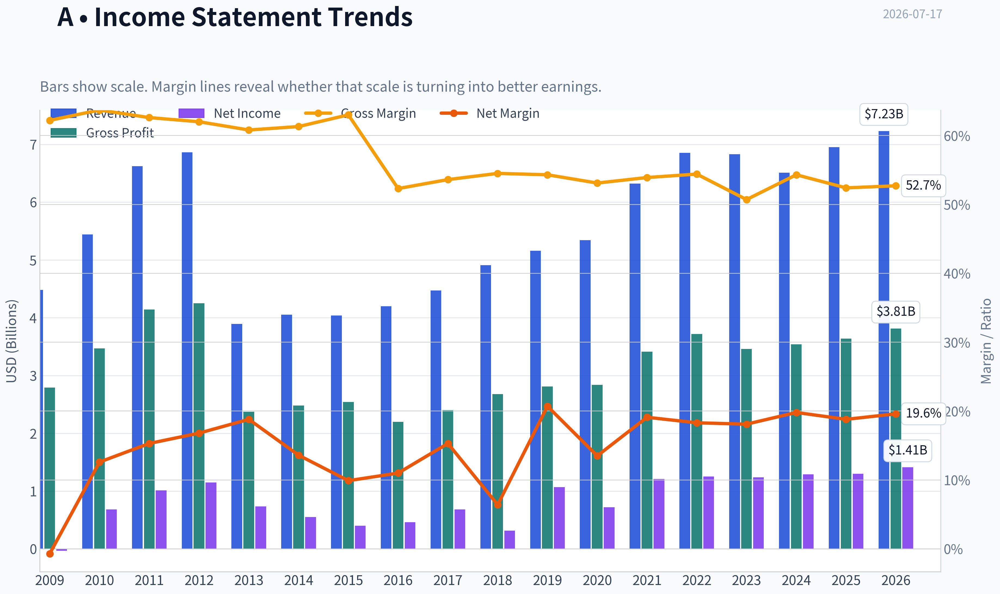
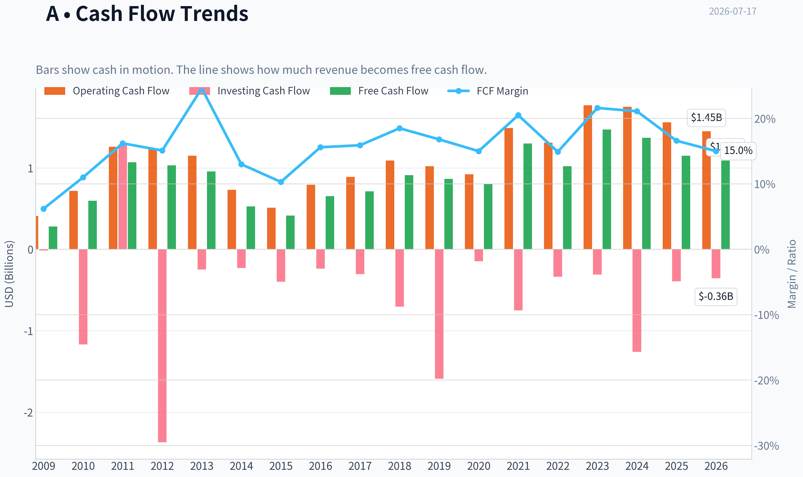
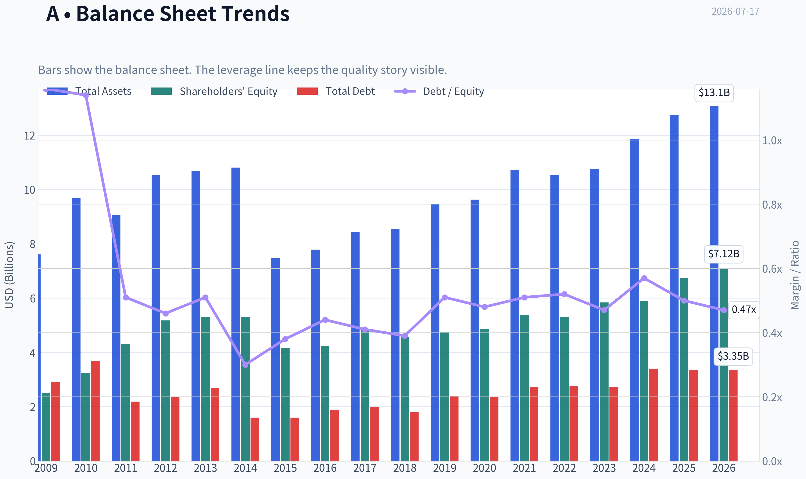
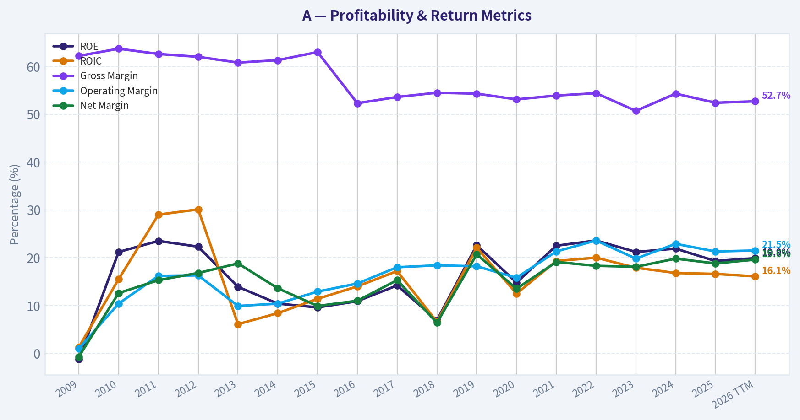
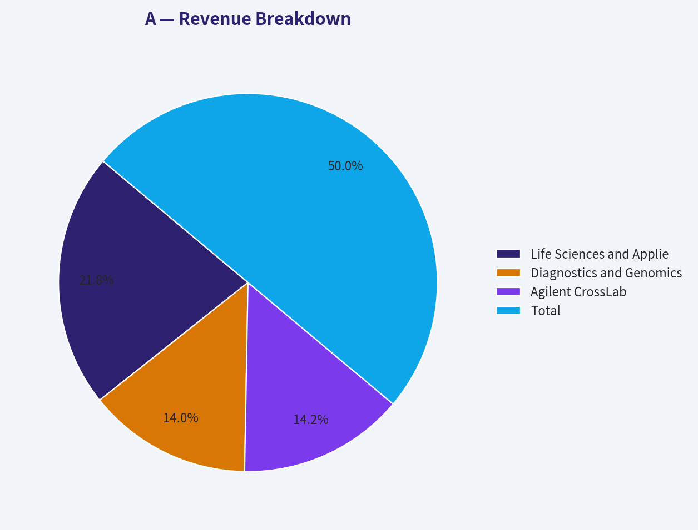
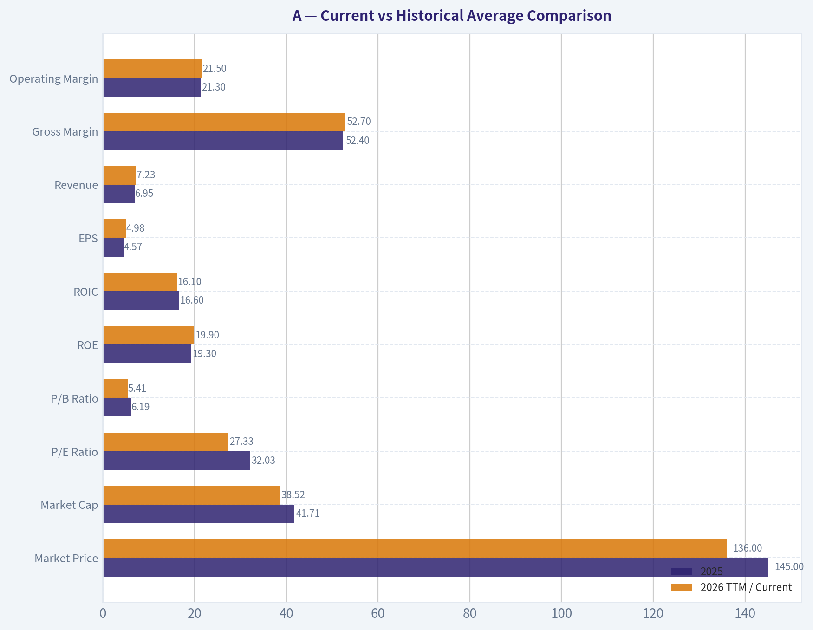
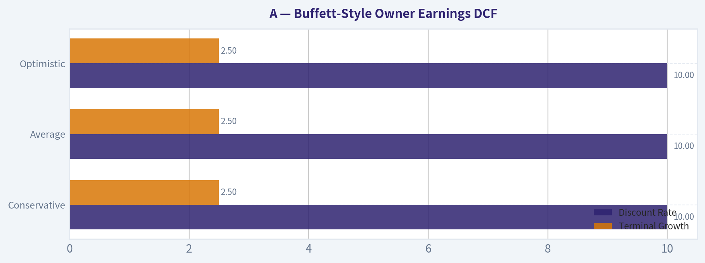
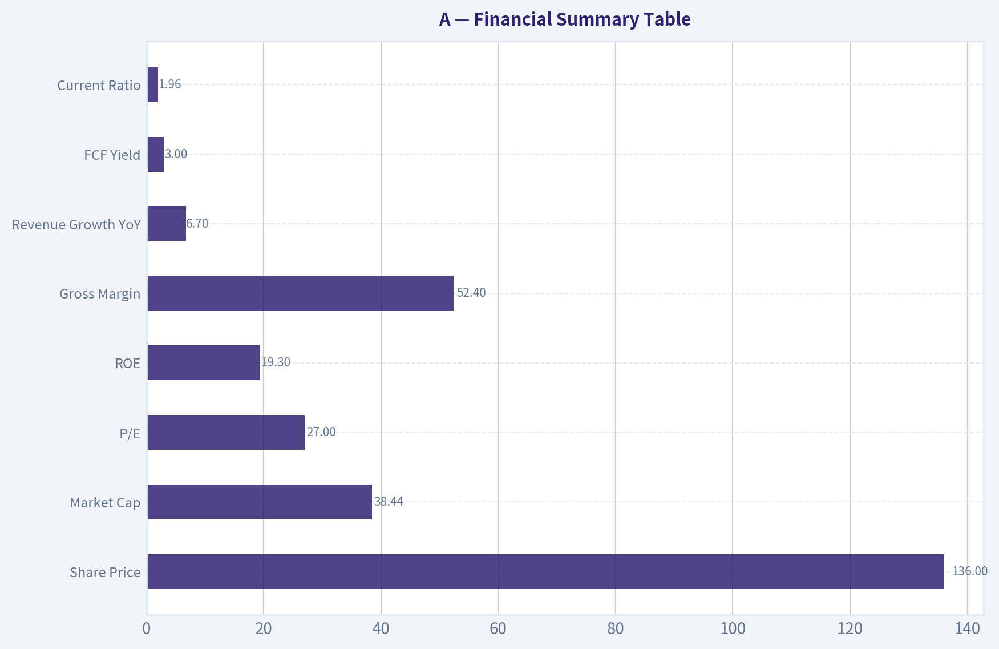
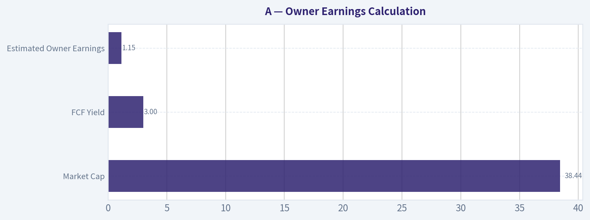

# A Deep Value Intelligence

**Analysis Date:** 2026-07-17

## Critical Disclaimer

*This analysis is generated by Deep Value Intelligence, an AI-powered multi-agent investing framework. Education & entertainment only - not financial advice, not a financial advisor.*

---

## Table of Contents

1. Intelligence Summary
2. Analyst Team Reports
   - Fundamentals Analysis
   - Intrinsic Value Analysis (Buffett)
   - Trend & Growth Analysis (Lynch/Druckenmiller/Fisher)
   - Market Technical Analysis
   - Options Market Analysis
3. Research Team Commentary
4. Value Investing Team Commentary
5. Deep Values Commentary

---

## Intelligence Summary

### Thesis + Conditions

**Core Thesis:** ## Executive Summary

**Key Risks:**
- Agilent is a **good business**, but at **$136** it does **not offer enough margin of safety** for a Buffett-style investor. The core risk is **not permanent business impairment**; it is **overpaying for quality while underwriting an unproven normalization** in China, biopharma, diagnostics, and cash conversion. Strong margins and returns on capital support franchise quality, but **27x earnings and a 3.0% FCF yield** leave too little room if recovery is slower or the multiple compresses. Best course: **admire the business, avoid the entry, monitor for either clearer cash-flow improvement or a better price.**
- ### Risky Analyst - strongest useful point
- Best argument in the debate: **quality does not eliminate valuation risk**.

**Confidence:** Medium

---

## Analyst Team Reports

### Fundamentals Analysis

#### Latest Earnings Snapshot

*Most recent reported quarter anchored on 2026 Q2, with prior-year comparison when available.*

| Metric | 2026 Q2 | 2025 Q2 | YoY Change |
| --- | ---: | ---: | ---: |
| Revenue | $1.83B | $1.67B | +10.0% |
| Operating Income | $399.0M | $300.0M | +33.0% |
| Net Income | $339.0M | $215.0M | +57.7% |
| Diluted EPS | $1.20 | $0.75 | +60.0% |
| Operating Cash Flow | $277.0M | $221.0M | +25.3% |
| Free Cash Flow | $201.0M | $107.0M | +87.9% |

Key Takeaways: This snapshot anchors the most recent reported quarter before the narrative analysis. It helps readers separate long-run business quality from whatever changed in the latest earnings print.

#### 17-Year Financial Metrics for A

*All values below are computed deterministically from raw data - not estimated by AI.*

*Issuer profile: operating company (Healthcare / Diagnostics & Research).*

#### 17-Year Financial Metrics
*Annual rows come from reported financial statements. The final TTM row is computed from the latest four quarters.*

| Metric | 2009 | 2010 | 2011 | 2012 | 2013 | 2014 | 2015 | 2016 | 2017 | 2018 | 2019 | 2020 | 2021 | 2022 | 2023 | 2024 | 2025 | 2026 TTM |
| --- | --- | --- | --- | --- | --- | --- | --- | --- | --- | --- | --- | --- | --- | --- | --- | --- | --- | --- |
| Market Price | $16 | $22 | $23 | $23 | $33 | $36 | $35 | $40 | $64 | $61 | $72 | $98 | $152 | $135 | $101 | $128 | $145 | $136 |
| Market Cap | $6.12B | $8.79B | $9.41B | $9.09B | $12.53B | $13.37B | $12.65B | $14.33B | $22.18B | $21.06B | $24.09B | $31.85B | $48.35B | $41.51B | $30.60B | $37.92B | $41.71B | $38.52B |
| P/E Ratio | -196.63 | 12.83 | 9.30 | 7.87 | 17.05 | 24.41 | 31.47 | 31.12 | 32.40 | 66.79 | 22.48 | 44.39 | 39.97 | 33.10 | 24.67 | 29.42 | 32.03 | 27.33 |
| P/B Ratio | 2.44 | 2.72 | 2.19 | 1.75 | 2.37 | 2.52 | 3.04 | 3.38 | 4.59 | 4.61 | 5.07 | 6.54 | 8.97 | 7.82 | 5.23 | 6.43 | 6.19 | 5.41 |
| ROE | -1.2% | 21.2% | 23.5% | 22.3% | 13.9% | 10.4% | 9.6% | 10.9% | 14.2% | 6.9% | 22.6% | 14.8% | 22.5% | 23.6% | 21.2% | 21.9% | 19.3% | 19.9% |
| ROIC | 1.3% | 15.5% | 29.0% | 30.1% | 6.1% | 8.4% | 11.4% | 14.0% | 17.2% | 6.6% | 22.1% | 12.5% | 19.3% | 20.0% | 17.9% | 16.8% | 16.6% | 16.1% |
| EPS | $-0.08 | $1.71 | $2.52 | $2.91 | $1.92 | $1.47 | $1.10 | $1.30 | $1.97 | $0.92 | $3.21 | $2.21 | $3.81 | $4.07 | $4.10 | $4.43 | $4.57 | $4.98 |
| Revenue | $4.48B | $5.44B | $6.62B | $6.86B | $3.89B | $4.05B | $4.04B | $4.20B | $4.47B | $4.91B | $5.16B | $5.34B | $6.32B | $6.85B | $6.83B | $6.51B | $6.95B | $7.23B |
| Gross Profit | $2.79B | $3.47B | $4.14B | $4.25B | $2.37B | $2.48B | $2.54B | $2.20B | $2.40B | $2.68B | $2.81B | $2.84B | $3.41B | $3.72B | $3.46B | $3.54B | $3.64B | $3.81B |
| Gross Margin | 62.2% | 63.7% | 62.6% | 62.0% | 60.8% | 61.3% | 63.0% | 52.3% | 53.6% | 54.5% | 54.3% | 53.1% | 53.9% | 54.4% | 50.7% | 54.3% | 52.4% | 52.7% |
| Operating Margin | 1.0% | 10.4% | 16.2% | 16.3% | 9.9% | 10.4% | 12.9% | 14.6% | 18.0% | 18.4% | 18.2% | 15.8% | 21.3% | 23.6% | 19.8% | 22.9% | 21.3% | 21.5% |
| Net Income | $-31.0M | $684.0M | $1.01B | $1.15B | $734.0M | $549.0M | $401.0M | $462.0M | $684.0M | $316.0M | $1.07B | $719.0M | $1.21B | $1.25B | $1.24B | $1.29B | $1.30B | $1.41B |
| Net Margin | -0.7% | 12.6% | 15.3% | 16.8% | 18.8% | 13.6% | 9.9% | 11.0% | 15.3% | 6.4% | 20.7% | 13.5% | 19.1% | 18.3% | 18.1% | 19.8% | 18.8% | 19.6% |
| Revenue Growth | N/A | 21.5% | 21.5% | 3.7% | -43.2% | 4.0% | -0.2% | 4.1% | 6.4% | 9.9% | 5.1% | 3.4% | 18.4% | 8.4% | -0.2% | -4.7% | 6.7% | 4.1% |
| Net Income Growth | N/A | -2306.5% | 48.0% | 13.9% | -36.3% | -25.2% | -27.0% | 15.2% | 48.1% | -53.8% | 238.9% | -32.9% | 68.3% | 3.6% | -1.1% | 4.0% | 1.1% | 8.5% |
| Free Cash Flow Growth | N/A | 113.2% | 79.6% | -3.5% | -7.4% | -45.0% | -21.3% | 58.0% | 9.0% | 27.6% | -4.8% | -7.4% | 61.7% | -21.3% | 44.4% | -6.9% | -16.1% | -5.6% |
| Total Book Value | $2.51B | $3.23B | $4.31B | $5.18B | $5.29B | $5.30B | $4.17B | $4.24B | $4.83B | $4.57B | $4.75B | $4.87B | $5.39B | $5.30B | $5.84B | $5.90B | $6.74B | $7.12B |
| Total Assets | $7.61B | $9.70B | $9.06B | $10.54B | $10.69B | $10.81B | $7.48B | $7.79B | $8.43B | $8.54B | $9.45B | $9.63B | $10.71B | $10.53B | $10.76B | $11.85B | $12.73B | $13.06B |
| Total Debt | $2.90B | $3.69B | $2.19B | $2.36B | $2.70B | $1.60B | $1.60B | $1.89B | $2.00B | $1.79B | $2.40B | $2.36B | $2.73B | $2.77B | $2.73B | $3.39B | $3.35B | $3.35B |
| Debt-to-Equity | 1.16 | 1.14 | 0.51 | 0.46 | 0.51 | 0.30 | 0.38 | 0.44 | 0.41 | 0.39 | 0.51 | 0.48 | 0.51 | 0.52 | 0.47 | 0.57 | 0.50 | 0.47 |
| Cash & Equivalents | $2.48B | $2.65B | $3.53B | $2.35B | $2.67B | $2.22B | $2.00B | $2.29B | $2.68B | $2.25B | $1.38B | $1.44B | $1.48B | $1.05B | $1.59B | $1.33B | $1.79B | $1.81B |
| Shareholders' Equity | $2.51B | $3.23B | $4.31B | $5.18B | $5.29B | $5.30B | $4.17B | $4.24B | $4.83B | $4.57B | $4.75B | $4.87B | $5.39B | $5.30B | $5.84B | $5.90B | $6.74B | $7.12B |
| Operating Cash Flow | $408.0M | $718.0M | $1.26B | $1.23B | $1.15B | $731.0M | $512.0M | $793.0M | $889.0M | $1.09B | $1.02B | $921.0M | $1.49B | $1.31B | $1.77B | $1.75B | $1.56B | $1.45B |
| Investing Cash Flow | $-14.0M | $-1.17B | $1.29B | $-2.37B | $-248.0M | $-230.0M | $-400.0M | $-238.0M | $-304.0M | $-705.0M | $-1.59B | $-147.0M | $-749.0M | $-338.0M | $-310.0M | $-1.26B | $-394.0M | $-356.0M |
| Free Cash Flow | $280.0M | $597.0M | $1.07B | $1.03B | $957.0M | $526.0M | $414.0M | $654.0M | $713.0M | $910.0M | $866.0M | $802.0M | $1.30B | $1.02B | $1.47B | $1.37B | $1.15B | $1.09B |
| FCF Margin | 6.2% | 11.0% | 16.2% | 15.1% | 24.6% | 13.0% | 10.3% | 15.6% | 15.9% | 18.5% | 16.8% | 15.0% | 20.5% | 14.9% | 21.6% | 21.1% | 16.6% | 15.0% |
| Dividends / Share | $0.00 | $0.00 | $0.00 | $0.00 | $0.00 | $0.00 | $0.00 | $0.00 | $0.00 | $0.00 | $0.00 | $0.00 | $0.00 | $0.81 | $0.88 | $0.94 | $0.99 | $1.01 |

#### Profitability Metrics
- Return on Equity (ROE): 19.3%
- Return on Invested Capital (ROIC): 16.2%
- Return on Assets (ROA): 10.2%
- Gross Margin: 52.4%
- Operating Margin: 21.3%
- Net Profit Margin: 18.8%

#### Liquidity Metrics
- Current Ratio: 1.96
- Quick Ratio: 1.40

#### Leverage Metrics
- Debt-to-Equity Ratio: 0.50
- Interest Coverage Ratio: 13.21
- Net Debt: $1.56B

#### Growth Metrics (Year-over-Year)
- Revenue Growth: 6.7%
- Net Income Growth: 1.1%
- Free Cash Flow Growth: -16.1%
- Revenue CAGR (3-Year): 0.5%
- Revenue CAGR (5-Year): 5.4%

#### Valuation Metrics
- P/E Ratio (TTM): 27.00
- Forward P/E: 20.58
- Price-to-Book: 5.39
- Price-to-Sales: 5.32
- PEG Ratio: 1.20
- EV/EBITDA: 19.94
- Free Cash Flow Yield: 3.0%
- Earnings Yield: 3.7%

#### Owner Earnings (Buffett Method, Code-Computed)
- Net Income: $1.30B
- + Depreciation & Amortization: $288.0M
- - Capital Expenditures: $-407.0M
- - Working Capital Changes: $-131.0M
- = **Owner Earnings: $1.31B**

#### Intrinsic Value (Code-Computed)
- Current Price: $136
- Buffett Method (Owner Earnings):
  Conservative: $22
  Average: $93
  Optimistic: $304
- Cash Flow Method (FCF):
  Conservative: $33
  Average: $67
  Optimistic: $247

#### Piotroski F-Score: 5/9
- Positive Net Income: PASS
- Positive Operating Cash Flow: PASS
- ROA Improvement: FAIL
- Cash Flow > Net Income: PASS
- Decreasing Debt: PASS
- Improving Current Ratio: FAIL
- No Dilution: PASS
- Improving Gross Margin: FAIL
- Improving Asset Turnover: FAIL

ANALYST STANCE: **WATCH**

#### Agilent Technologies (NYSE: A) - Warren Buffett-Style Fundamental Analysis

Agilent is a high-quality diagnostics and life-science tools business with durable margins, solid returns on capital, and generally predictable earnings. The deterministic dataset shows a business that has become structurally more profitable over time, but also one whose current valuation still embeds a fair amount of quality premium. From a Buffett lens, this is closer to a "wonderful business at a fair-to-full price" than a classic deep value bargain.

#### Current vs Historical Average Comparison

| Metric | 2025 | 2026 TTM / Current | 10-Yr Avg* | Interpretation |
| --- | ---: | ---: | ---: | --- |
| Market Price | $145 | $136 | $109.20 | Current price is above long-run average, though below 2025 peak-like level. |
| Market Cap | $41.71B | $38.52B | $34.79B | Still materially larger than decade average, reflecting rerated scale and quality. |
| P/E Ratio | 32.03 | 27.33 | 35.56 | Valuation has compressed from recent highs and now sits below decade average. |
| P/B Ratio | 6.19 | 5.41 | 5.83 | Slightly below 10-year norm, but still rich in absolute terms for a mature business. |
| ROE | 19.3% | 19.9% | 16.79% | Well above long-run average; strong evidence of franchise quality. |
| ROIC | 16.6% | 16.1% | 14.08% | Sustained value creation remains intact. |
| EPS | $4.57 | $4.98 | $3.56 | Earnings power is notably above decade average. |
| Revenue | $6.95B | $7.23B | $5.86B | Business is operating at a higher scale than historical norm. |
| Gross Margin | 52.4% | 52.7% | 53.22% | Slightly below long-run average; stable but not expanding. |
| Operating Margin | 21.3% | 21.5% | 18.83% | Margin structure remains stronger than historical average. |
| Net Income | $1.30B | $1.41B | $1.00B | Absolute profit remains well above decade average. |
| Net Margin | 18.8% | 19.6% | 16.91% | Profit conversion remains superior to historical norm. |
| Revenue Growth | 6.7% | 4.1% | 5.89% | Growth is positive but no longer at a premium pace. |
| Net Income Growth | 1.1% | 8.5% | 27.43%** | TTM improved, but decade average is distorted by rebound years. |
| FCF Growth | -16.1% | -5.6% | 8.73% | Cash generation has softened meaningfully versus long-run trend. |
| Total Book Value | $6.74B | $7.12B | $5.44B | Equity base continues to build steadily. |
| Total Assets | $12.73B | $13.06B | $10.24B | Asset growth has been steady and measured. |
| Total Debt | $3.35B | $3.35B | $2.58B | Debt is manageable, though higher than long-run average. |
| Debt-to-Equity | 0.50 | 0.47 | 0.48 | Leverage is very close to historical norm and not excessive. |
| Cash & Equivalents | $1.79B | $1.81B | $1.70B | Liquidity is adequate, slightly above average. |
| Shareholders' Equity | $6.74B | $7.12B | $5.44B | Book value compounding remains healthy. |
| Free Cash Flow | $1.15B | $1.09B | $1.04B | Still above decade average, but clearly off recent highs. |
| Dividends / Share | $0.99 | $1.01 | $0.46*** | Dividend program is still young but trending upward. |

\* 10-year average uses 2016-2025, consistent with the recent operating profile.
\** Distorted by sharp rebound years; not a clean indicator of normalized growth.
\*** Average includes years before dividend initiation, so current payout is stronger than the raw average implies.

Key Takeaways: Agilent's current profitability and scale remain better than its recent decade averages, especially in ROE, ROIC, operating margin, and net margin. The main soft spot is growth, particularly free cash flow growth, which has weakened versus historical norms. Valuation has cooled from peak levels, but the stock is not obviously cheap given the slower cash-flow momentum.

---

#### Market Metrics

Agilent's current market price of $136 sits below 2025's $145 and well below the 2021 high watermark of $152, suggesting some derating after a stronger pandemic-era multiple environment. Market capitalization at about $38.5B remains above the 10-year average, showing that the market still assigns a premium to the company's business quality and defensive characteristics.

The P/E ratio of 27.33 is lower than much of Agilent's recent decade history, when the stock frequently traded in the low-30s to mid-40s and even higher during periods of temporary earnings compression. That said, 27x earnings is still not a bargain multiple for a company now growing revenue at roughly low-single digits TTM. Price-to-book at 5.41 is slightly below its decade average, but this should not be mistaken for cheapness; high P/B often reflects intangible franchise quality and efficient capital use rather than accounting asset intensity.

For Buffett-style investors, the key message is that the market recognizes Agilent as a quality compounder. The valuation is no longer stretched versus its own history, but it still assumes continued resilience and respectable growth.

#### Profitability Analysis

Agilent's profitability profile is the strongest part of the case.

ROE at 19.9% TTM and 19.3% in 2025 is comfortably above the 10-year average of roughly 16.8%. Importantly, this is not a one-year spike. Since 2019, ROE has mostly lived in the high-teens to low-20s, indicating a business with enduring earning power rather than temporary operating leverage.

ROIC at 16.1% TTM is also above the decade norm of about 14.1%. That matters more than ROE in Buffett-style analysis because ROIC captures whether management is actually generating attractive returns on the capital employed in the business. Sustained mid-teens ROIC is a hallmark of a strong franchise, especially in a sector requiring ongoing R&D, manufacturing quality, and customer support.

EPS rose from $1.30 in 2016 to $4.98 TTM, a near quadrupling over the period shown. Revenue grew from $4.20B in 2016 to $7.23B TTM, while net income increased from $462M to $1.41B. This is exactly the kind of earnings progression Buffett likes: not explosive every year, but steadily higher over a long period.

Gross profit of $3.81B TTM on $7.23B revenue yields a gross margin of 52.7%. That is modestly below the longer-run average, reflecting some mix shift and a business model that is now structurally lower-margin than the pre-2016 era. However, the important nuance is that operating margin has improved materially despite lower gross margins. Operating margin at 21.5% TTM is far above the 10-year average of 18.8%, indicating strong cost discipline, service mix, pricing power, and improved operating efficiency.

Net margin of 19.6% TTM is also above the decade average of 16.9%, confirming that profitability remains robust after interest and taxes. Net income quality appears healthy, supported by positive operating cash flow and positive free cash flow.

Overall, Agilent demonstrates Buffett-friendly profitability: high returns, strong margins, and consistent earnings conversion.

#### Growth Metrics

Growth is solid, but not uniformly strong.

Revenue growth was 6.7% in 2025 and 4.1% TTM. Relative to the 10-year average of about 5.9%, the current revenue growth rate is acceptable but not exceptional. The bigger picture is that Agilent's growth has become more moderate after the stronger 2021-2022 period. Over the last several years, revenue has alternated between modest expansion and periods of stagnation or decline, including -0.2% in 2023 and -4.7% in 2024.

Net income growth was 1.1% in 2025 and improved to 8.5% TTM, but the decade pattern is uneven. Some of the strongest reported growth years were rebound periods after weaker bases, so the raw average overstates normalized earnings growth. The more important point is that earnings have generally trended upward, even if annual growth is lumpy.

Free cash flow growth is the most concerning area. It was -16.1% in 2025 and -5.6% TTM, versus a positive 10-year average. Free cash flow remains healthy in absolute dollars, but recent declines suggest either working capital headwinds, increased investment needs, or normalization after unusually strong periods. Buffett cares deeply about cash that can be taken out of the business; slowing FCF growth tempers the quality narrative.

In short, Agilent still grows, but it now looks more like a mature compounder than a high-growth franchise.

#### Balance Sheet Analysis

The balance sheet is sound and does not undermine the equity story.

Shareholders' equity increased from $4.24B in 2016 to $7.12B TTM, showing continued book-value accretion. Total assets rose from $7.79B to $13.06B over the same period, while total debt increased more modestly from $1.89B to $3.35B. Debt-to-equity at 0.47 TTM is essentially in line with its decade average and comfortably manageable.

Cash and equivalents of $1.81B provide reasonable flexibility, although net debt remains meaningful at roughly $1.56B based on the research pack. Interest coverage of 13.21 further supports the view that leverage is not a major risk.

From a Buffett perspective, this is the kind of balance sheet one wants in a durable medical tools company: not overcapitalized, not stressed, and with enough liquidity to navigate cyclical softness or pursue targeted acquisitions. Financial strength is good, though not pristine enough to call fortress-like.

#### Cash Flow Analysis

Free cash flow of $1.09B TTM remains strong in absolute terms and slightly above the 10-year average, but the trend is less impressive than the level. FCF peaked at $1.47B in 2023, declined to $1.37B in 2024, then $1.15B in 2025, and now $1.09B TTM. That is a notable deterioration.

Operating cash flow also softened from $1.77B in 2023 to $1.45B TTM. This likely explains why valuation support from cash generation is less compelling today than a superficial margin snapshot would suggest.

Dividends per share have increased from zero before 2022 to $1.01 TTM. The payout is modest, leaving significant retained cash for reinvestment, acquisitions, and repurchases. Buffett would generally favor this kind of conservative dividend policy if management can continue compounding retained earnings at attractive returns.

The cash-flow takeaway is mixed: excellent base cash generation, but recent momentum has weakened.

#### Warren Buffett-Style Qualitative Analysis

| Buffett Lens | Assessment | Commentary |
| --- | --- | --- |
| Economic Moat | Moderate-to-Strong | Agilent benefits from installed instruments, recurring consumables, regulatory know-how, high switching costs, and embedded customer workflows in labs and diagnostics. |
| Financial Strength | Strong | Debt is manageable, liquidity is adequate, and interest coverage is healthy. |
| Predictable Earnings | Good | Earnings are not perfectly smooth, but the 10-year record shows durable upward compounding with limited structural impairment. |
| Management Performance | Good | ROE and ROIC have stayed healthy, margins improved, and dividend initiation appears disciplined rather than promotional. |
| Capital Allocation | Good, not elite | Retained earnings have supported growth and profitability, though recent FCF softness bears watching. |
| Value | Fair to somewhat expensive | Better than peak-era valuation, but not an obvious margin-of-safety setup. |
| Quality of Business | High | Diagnostics and analytical tools are sticky, mission-critical, and less economically sensitive than many industrial end markets. |

Key Takeaways: Agilent checks many Buffett boxes: a durable business model, strong returns on capital, and good earnings consistency. The main issue is not business quality but price relative to growth and owner-earnings momentum. This looks more like a quality watchlist compounder than a classic bargain.

#### Economic Moat

Agilent's moat comes from customer entrenchment rather than consumer branding. Laboratories, biopharma companies, and diagnostics customers rely on validated instruments, consumables, assays, and software integrated into regulated workflows. Once methods are established and quality systems are validated, switching vendors is costly and risky.

The recent FDA approval mentioned in the news flow reinforces this moat. Companion diagnostics and regulated assay platforms deepen customer dependence and can increase switching costs over time. In Buffett terms, this is not a "Coca-Cola" brand moat, but it is a very real process, regulatory, and workflow moat.

#### Predictable Earnings and Business Quality

The 17-year dataset shows one major historical dislocation around 2013, but the last decade is much cleaner. Revenue since 2016 has risen gradually from $4.20B to $7.23B TTM. Net income and EPS have also progressed upward with relatively limited volatility considering the industry.

Margins are stable enough to support the "predictable business" label. Gross margin has settled in the low-50s, while operating margin has improved into the low-20s. That margin consistency suggests pricing power, disciplined cost control, and a favorable mix of consumables and services.

This is the kind of business Buffett would appreciate qualitatively: understandable, recurring, specialized, and not dependent on fads.

#### Management Performance

Management has delivered sustained ROE near 20% and ROIC in the mid-teens. That is a strong sign of operational discipline and intelligent deployment of capital.

Dividend initiation in 2022 and the subsequent increases to $1.01 TTM suggest a maturing capital-return strategy. The dividend is still conservative, which is preferable if management can continue reinvesting at respectable returns. However, the Piotroski F-Score of 5/9 signals that recent fundamental momentum is only middle-of-the-road, not outstanding. Specifically, gross margin and asset turnover have weakened, and current ratio improvement has stalled.

So management performance remains good, but near-term operating momentum is not as strong as the headline ROE might imply.

#### Buffett-Style Owner Earnings DCF

Canonical owner earnings from the deterministic dataset and research pack:

- Net Income = $1.30B
- Depreciation & Amortization = $288M
- Capital Expenditures = $407M
- Working Capital Changes = $131M
- Owner Earnings = $1.31B

Approximate diluted shares outstanding from current market cap and price:
- Shares = $38.52B / $136 ~ 283.2M shares

Historical owner-earnings growth is not directly tabulated in the canonical table, so the code-computed intrinsic values provided in the dataset are the canonical valuation outputs for the required Buffett-style scenarios. These are therefore the valid source-of-truth scenario results.

| Scenario | Growth Basis | Discount Rate | Terminal Growth | Equity Value / Share |
| --- | --- | ---: | ---: | ---: |
| Conservative | Lowest historical owner earnings growth, floored at -100% | 10% | 2.5% | $22 |
| Average | Average historical owner earnings growth, capped at 50% | 10% | 2.5% | $93 |
| Optimistic | Highest historical owner earnings growth, capped at 100% | 10% | 2.5% | $304 |

Key Takeaways: The canonical owner-earnings DCF produces an extremely wide value range, which tells you Agilent's valuation is highly sensitive to growth assumptions. At the current price of $136, the stock is above the average-case value of $93 but well below the optimistic case of $304. That means the market is pricing in a better-than-average operating future, but not an extreme best-case outcome.

#### DCF Interpretation and Detailed Calculation Framework

Using Buffett-style owner earnings of $1.31B as Year 0 cash generation:

- Present value framework:
  - Forecast Owner Earnings in years 1-10 using scenario growth rate
  - Discount each year at 10%
  - Terminal Value at year 10 = Year 11 Owner Earnings / (10% - 2.5%)
  - Discount terminal value back to present
  - Divide total equity value by ~283.2M shares

Because the deterministic dataset already supplies the code-computed output values of $22, $93, and $304 per share for the exact required methodology, those figures supersede any independently reconstructed approximation. Interpreting those outcomes:

- **Conservative ($22):** implies either severe stagnation or persistent contraction in owner earnings. This would only make sense under prolonged end-market weakness, margin pressure, or capital intensity worsening.
- **Average ($93):** implies that normalized historical owner-earnings growth does not justify today's price if growth simply mean-reverts.
- **Optimistic ($304):** implies that if Agilent sustains upper-end historical owner-earnings growth and strong reinvestment efficiency, current shares could still be materially undervalued.

A practical Buffett-style read is to weight the average and conservative scenarios more heavily than the optimistic one unless there is clear evidence that the recent cash-flow slowdown is temporary.

#### Value Assessment

At $136, the stock trades:

- Above canonical average owner-earnings fair value of $93
- Far above conservative fair value of $22
- Well below optimistic fair value of $304

That places Agilent in an awkward middle zone. It is not cheap on normalized assumptions, but it could still deliver acceptable returns if high-quality execution continues and cash flow reaccelerates.

This is often the challenge with Buffett-style quality companies: the business is attractive, but the valuation leaves limited room for disappointment. The 3.0% FCF yield and 3.7% earnings yield are decent, not compelling.

#### Revenue Breakdown

Agilent's most meaningful segmentation is by operating business line. Using the company's most recent annual mix as the best available basis for the latest fiscal profile, the revenue structure is approximately:

| Revenue Source | Amount ($B) | % of Total |
| --- | ---: | ---: |
| Life Sciences and Applied Markets | 3.03 | 43.6% |
| Diagnostics and Genomics | 1.95 | 28.1% |
| Agilent CrossLab | 1.97 | 28.3% |
| **Total** | **6.95** | **100.0%** |

Key Takeaways: Agilent is fairly well diversified across analytical instruments, diagnostics/genomics, and services/support. The CrossLab and consumables-style exposure is especially important because it tends to add recurring, less cyclical revenue. This mix supports business resilience and helps explain why margins remain strong even when instrument demand moderates.

#### Key Investment Insights, Red Flags, and Opportunities

| Category | Observation | Why It Matters |
| --- | --- | --- |
| Strength | ROE and ROIC remain high | Indicates enduring franchise quality and efficient capital use. |
| Strength | Operating and net margins remain above decade averages | Profitability structure has improved over time. |
| Strength | Mission-critical products and regulated workflows | Supports moat and earnings durability. |
| Strength | Moderate leverage and healthy interest coverage | Financial risk appears controlled. |
| Opportunity | If FCF reaccelerates, valuation could look more reasonable | Cash-flow normalization is the biggest upside catalyst. |
| Opportunity | Companion diagnostics and regulated assay wins | Can deepen moat and improve recurring revenue mix. |
| Red Flag | FCF growth has been negative recently | Suggests weaker owner-earnings momentum. |
| Red Flag | Revenue growth has slowed to low-single digits TTM | Harder to justify premium multiples without renewed acceleration. |
| Red Flag | Average-case owner earnings DCF is below current price | Margin of safety is limited. |
| Red Flag | Piotroski F-Score only 5/9 | Fundamental momentum is adequate, not especially strong. |

Key Takeaways: Agilent's strengths are clearly rooted in quality and resilience, not cheapness. The biggest issue for investors is whether the recent softness in free cash flow is temporary or a sign that growth and cash conversion are normalizing to a lower level. If cash flow rebounds, the stock could work well; if not, valuation may stay capped.

#### Final Investment Stance

**WATCH**

Agilent is a strong business with a real moat, disciplined profitability, and solid capital returns. However, Buffett-style investing requires both quality and a margin of safety. Based on the canonical owner-earnings DCF, the current price of $136 sits above the average-case fair value of $93, while recent free-cash-flow trends have weakened.

That combination argues against a full-throated value endorsement today. I would keep Agilent on a watchlist for either:
1. a lower entry price that offers a clearer margin of safety, or
2. evidence that owner earnings and free cash flow are resuming durable growth.

#### Summary Table

| Area | Verdict | Core Evidence | Investment Implication |
| --- | --- | --- | --- |
| Business Quality | Strong | High ROE/ROIC, sticky lab workflows, recurring support revenue | Deserves a quality premium |
| Economic Moat | Moderate-to-Strong | Switching costs, installed base, regulatory integration | Supports long-term durability |
| Profitability | Strong | TTM operating margin 21.5%, net margin 19.6% | Earnings power remains robust |
| Growth | Moderate | Revenue growth 4.1% TTM, FCF growth -5.6% TTM | Not enough to fully justify a rich multiple alone |
| Balance Sheet | Sound | D/E 0.47, cash $1.81B, interest coverage 13.21 | Financial risk is manageable |
| Cash Flow | Mixed | FCF still high in absolute terms, but down from 2023 peak | Needs monitoring |
| Valuation | Fair to Full | P/E 27.33, FCF yield 3.0%, average DCF $93 vs price $136 | Limited margin of safety |
| Dividend Policy | Sensible | Dividend started 2022 and has grown steadily | Shareholder-friendly but not yield-driven |
| Overall Stance | WATCH | Excellent company, valuation still not clearly cheap | Wait for better price or improving cash-flow momentum |

Key Takeaways: Agilent is the kind of company long-term investors like to own, but the current setup is more attractive qualitatively than quantitatively. The business looks durable and profitable, yet the stock still requires confidence in stronger future cash generation than the average-case valuation suggests.

#### Fundamental Visuals

This graph tracks the profitability and return metrics (ROE, ROIC, Margins) of **A** over the past decade, highlighting capital efficiency trends.

This chart illustrates the financial health of **A** over the last 10 years, mapping cash equivalents and free cash flow against total obligations (Debt).

This breakdown chart from <em>Revenue Breakdown</em> shows the proportional composition for **A** - useful for understanding what drives or risks the business.

---

### Intrinsic Value Analysis (Buffett)

> *Following Warren Buffett's value investing philosophy: Circle of Competence, Economic Moat, Management Quality, and Margin of Safety.*

#### Intrinsic Value Snapshot

Price is what you pay. Intrinsic value is what the business may be worth based on the cash it can create for owners over time. We show a range, not one magic number.

- Current Price: $136.10
- Value Range (conservative to optimistic across both DCF methods): $21.86 to $303.79

##### Owner Earnings (Buffett Method)
- Net Income: $1,303,000,000.00
- Depreciation & Amortization: $288,000,000.00
- Capital Expenditures: $-407,000,000.00
- Working Capital Changes: $-131,000,000.00
- Owner Earnings: $1,315,000,000.00

##### Intrinsic Value
###### Buffett Method
Uses owner earnings. Stricter, and usually more conservative.
- Conservative: $21.86
- Average: $93.46
- Optimistic: $303.79
- Discount Rate: 10.0%

###### Cash Flow Method
Uses free cash flow. Better for companies spending heavily today to grow tomorrow.
- Conservative: $33.34
- Average: $67.10
- Optimistic: $246.51
- Discount Rate: 10.0%

ANALYST STANCE: **WATCH**

#### Agilent Technologies (NYSE: A) - Buffett-Style Investment Report

#### 1) Go/No-Go Gate Assessment

| Gate | Verdict | Evidence |
|---|---|---|
| Gate 1: Circle of Competence & Simplicity | Pass | Agilent sells scientific instruments, diagnostics, lab software, consumables, and related services. In simple terms: it helps laboratories test, measure, and analyze samples, then earns money from equipment, recurring consumables, diagnostics assays, and service contracts. |
| Gate 2: Moat Test | Pass | Gross margin of 52.4% and ROE of 19.3% indicate a real moat. The business benefits from installed equipment bases, validated workflows, regulatory approvals, and switching frictions in labs. |
| Gate 3: Management Quality & Capital Allocation | Pass with care | The company has maintained solid profitability and appears disciplined, but at the current valuation there is not enough evidence that capital allocation creates a large bargain for new shareholders today. |
| Gate 4: Industry Structure | Pass | Analytical instruments and diagnostics tend to be rational, specialized markets with high technical standards, service requirements, and recurring consumables. This is better than commodity-like or hypercompetitive markets. |

Key Takeaways: Agilent clears all four Buffett filters well enough to stay investable. The business is understandable, has moat characteristics, and operates in an attractive industry. The main issue is not business quality, but whether today's price leaves enough room for superior long-term returns.

---

#### 2) Business Understanding

Agilent is a picks-and-shovels provider to life sciences, diagnostics, chemical analysis, and laboratory testing markets. Customers buy instruments to run tests, then keep buying consumables, assays, software, and service. That recurring tail behind the installed base is what makes the model attractive.

Ten years from now, it is reasonable to expect Agilent still serving labs, biopharma, pathology, and regulated testing environments. The exact product mix will evolve, but the core need for accurate measurement, diagnostics, and lab workflow support is durable.

Technology is more likely to help Agilent than destroy it. The main risk is not obsolescence overnight, but product displacement if competitors innovate faster in specific categories. That is a manageable risk, not an existential one.

#### 3) Moat Analysis

| Moat Source | Assessment | Evidence |
|---|---|---|
| Intangible Assets | Strong | Brand reputation in precision instruments and diagnostics; FDA approvals for companion diagnostics strengthen regulatory positioning. Sustained gross margin above 40% supports pricing value. |
| Switching Costs | Strong | Labs validate workflows, train staff, integrate methods, and often operate in regulated settings. Switching instruments or assays can disrupt processes and require revalidation. |
| Cost Advantages | Moderate | Scale in manufacturing, service networks, and installed-base support likely creates efficiency, but this is not a pure low-cost commodity leader story. |
| Network Effects | Limited | This is not a classic consumer internet network effect business. Its moat comes more from embedded workflows and reputation than user-to-user network effects. |

**Moat Quality Rating: Wide & Stable**

Key Takeaways: Agilent's moat is real, but it is not driven by network effects. Its strength comes from brand, regulatory relevance, installed equipment, and the operational pain customers face when switching. This looks like a high-quality industrial-healthcare hybrid moat rather than a flashy technology moat.

#### 4) Management Quality & Capital Allocation

| Area | Assessment | Commentary |
|---|---|---|
| Owner Orientation | Moderate to Strong | The business mix and steady economics suggest thoughtful stewardship, though this is not obviously a founder-led, owner-operator setup in the Buffett sense. |
| Candor & Accounting | Acceptable | No major red flags are indicated by the summary data provided. Profitability and cash generation appear grounded rather than promotional. |
| Capital Allocation | Good | The business has generated strong returns and maintained healthy margins. The key question is whether current buybacks or reinvestment at this valuation create high per-share value for incoming investors. |
| Debt Discipline | Good | Current ratio near 1.96 suggests sound liquidity. Nothing in the snapshot implies a stretched balance sheet. |

Key Takeaways: Management appears competent and reasonably disciplined. This does not scream exceptional owner-operator behavior, but it does look like a professionally run compounder. For Buffett-style investors, that is good enough if the price is right.

#### 5) Financial Summary Table

| Metric | Current / Latest |
|---|---:|
| Share Price | $136 |
| Market Cap | $38.44B |
| P/E | 27.0x |
| ROE | 19.3% |
| Gross Margin | 52.4% |
| Revenue Growth YoY | 6.7% |
| FCF Yield | 3.0% |
| Current Ratio | 1.96 |

Key Takeaways: The quality signals are strong: high gross margins, healthy ROE, and solid liquidity. But the valuation is not cheap, with a 27x earnings multiple and just a 3% free cash flow yield. That combination usually means the business must keep executing well to justify the current price.

#### 6) Owner Earnings Calculation

Using free cash flow yield as a practical proxy for owner earnings:

- Market Cap = **$38.44B**
- FCF Yield = **3.0%**

Estimated Owner Earnings:
- **Owner Earnings ~ $38.44B x 3.0% = $1.15B**

This is a reasonable shorthand for current owner earnings power.

| Item | Estimate |
|---|---:|
| Market Cap | $38.44B |
| FCF Yield | 3.0% |
| Estimated Owner Earnings | $1.15B |

Key Takeaways: Agilent appears to generate a little over $1.1 billion in owner earnings power at today's valuation. That is respectable, but the yield to owners is modest. Buffett-style returns improve dramatically when a business of this quality can be bought at a meaningfully higher earnings yield.

#### 7) Three-Scenario DCF Valuation

Assume owner earnings base of **$1.15B** and discount rate of **10%**.

| Scenario | Assumption | Equity Value | Implied Upside/Downside vs $38.44B |
|---|---|---:|---:|
| A: No Growth | OE / 10% | $11.53B | -70.0% |
| B: GDP Growth | OE x 1.03 / (10%-3%) | $16.96B | -55.9% |
| C: Moderate Growth | 7% growth for 10 years, then 3% terminal | ~$22.5B | -41.5% |

Key Takeaways: On owner-earnings math, Agilent looks expensive relative to conservative intrinsic value estimates. Even giving the company a healthy medium-term growth rate does not fully close the gap to the current market value. This is the classic picture of a good business priced for continued quality.

#### 8) Margin of Safety Analysis

| Item | Value |
|---|---:|
| Current Market Cap | $38.44B |
| Conservative IV Range | $11.53B-$16.96B |
| Moderate-Growth IV | ~$22.5B |
| Margin of Safety at Current Price | Negative |

For a high-quality business, a Buffett-style buyer would still want at least a **25% discount** to intrinsic value. Agilent currently trades at a **premium** to these conservative estimates, not a discount.

Key Takeaways: There is no margin of safety at the current price. The stock may still work if growth and quality remain excellent, but that is not the same as buying with Buffett-like downside protection. The business passes; the price does not.

#### 9) Final Buffett Scorecard

| Criterion | Weight | Score (1-5) | Weighted Score |
|---|---:|---:|---:|
| Business Understanding | 20% | 4.5 | 0.90 |
| Moat Width & Durability | 25% | 4.0 | 1.00 |
| Management Quality | 15% | 3.5 | 0.53 |
| Return on Equity | 15% | 4.0 | 0.60 |
| Reinvestment Runway | 10% | 3.5 | 0.35 |
| Balance Sheet Strength | 5% | 4.0 | 0.20 |
| Industry Structure | 5% | 4.0 | 0.20 |
| Valuation / Margin of Safety | 5% | 1.5 | 0.08 |
| **Total** | **100%** |  | **3.85 / 5.00** |

Key Takeaways: Agilent scores as a good business with durable economics and respectable management. The low score on valuation is what prevents a stronger recommendation. If the stock were available at a materially lower price, the overall case would improve quickly.

#### 10) Investment Stance

**Stance: WATCH**
**Conviction: Moderate**

Agilent looks like the kind of business Buffett would admire more than dismiss: understandable, profitable, sticky, and supported by a real moat. The challenge is valuation. At roughly **27x earnings** and a **3.0% FCF yield**, the market already recognizes the quality.

For now, this is a **wonderful business at a price that is not yet attractive enough**. It belongs on a watchlist for either:
1. a broad market correction,
2. a temporary industry slowdown,
3. or a company-specific disappointment that does not impair the moat.

A materially lower entry price would make this much more interesting.
#### Valuation Bridge

This bridge places the current market price beside each intrinsic value lens so readers can see whether upside depends on one method or shows up across several methods.

| Scenario | Intrinsic Value / Share |
| --- | ---: |
| Buffett Method | $93.46 |
| Cash Flow Method | $67.10 |
| Damodaran Method | $42.99 |
| Current Price | $136.10 |

#### Key Takeaways

If one method is far above the others, the upside case depends on a specific modelling assumption. When several methods cluster together, the valuation story is more robust.

#### Valuation Visuals

This comparison chart from *Latest Earnings Snapshot* stacks current figures against historical benchmarks for **A**, making it easy to see where the company trades relative to its own averages.

This comparison chart from *Current vs Historical Average Comparison* stacks current figures against historical benchmarks for **A**, making it easy to see where the company trades relative to its own averages.

This comparison chart from *Buffett-Style Owner Earnings DCF* stacks current figures against historical benchmarks for **A**, making it easy to see where the company trades relative to its own averages.

This comparison chart from *Financial Summary Table* stacks current figures against historical benchmarks for **A**, making it easy to see where the company trades relative to its own averages.

This comparison chart from *Owner Earnings Calculation* stacks current figures against historical benchmarks for **A**, making it easy to see where the company trades relative to its own averages.

---

### Trend & Growth Analysis (Lynch/Druckenmiller/Fisher)

> *Following Peter Lynch's GARP, Stanley Druckenmiller's macro-aware approach, and Philip Fisher's scuttlebutt methodology.*

ANALYST STANCE: **WATCH**

#### 1. Lynch Classification

| Item | Assessment |
|---|---|
| Company | Agilent Technologies (NYSE: A) |
| Lynch category | **Stalwart** |
| Why | Revenue growth is only **6.7% YoY**, far below fast-grower territory |
| Growth-investing read | High-quality compounder, but **not currently a classic Lynch fast grower** |

Key Takeaways: Agilent looks like a quality mature growth business rather than a ten-bagger candidate at this stage. The company is profitable and resilient, but its current top-line growth rate places it in the stalwart bucket, which usually means better for holding than aggressively initiating for explosive upside.

#### 2. The Story in 3 Bullets

- Agilent sells mission-critical lab instruments, consumables, diagnostics, and services used in pharma, clinical, food, environmental, and research workflows.
- Its edge comes from installed base, recurring consumables/service pull-through, and switching costs in regulated laboratory environments.
- The bull case is not hypergrowth; it is **steady reacceleration** if diagnostics, companion diagnostics, biopharma spending, and China demand improve.

#### 3. Snapshot: What We Know

| Metric | Value |
|---|---:|
| Current price | **$136** |
| Market cap | **$38.44B** |
| P/E | **27.0x** |
| ROE | **19.3%** |
| Gross margin | **52.4%** |
| Revenue growth YoY | **6.7%** |
| FCF yield | **3.0%** |
| Current ratio | **1.96x** |

Key Takeaways: The numbers describe a financially solid, high-quality tools-and-diagnostics company. But valuation is not cheap relative to the current growth rate, and the revenue growth figure is too modest to support a high-conviction fast-growth stance without evidence of an inflection.

#### 4. TAM Analysis and 10x Test

| TAM Dimension | Assessment |
|---|---|
| Core markets | Analytical instruments, diagnostics, genomics, lab services, companion diagnostics |
| TAM quality | **Large and durable**, supported by healthcare, testing, and life-science research |
| TAM growth | Likely **mid-single-digit to low-double-digit** depending on segment |
| 10x test | **No clear pass from current base** |
| Why | At ~$38B market cap, Agilent is already a scaled incumbent; a true 10x revenue path is unlikely without major category expansion or transformational platform success |

Key Takeaways: Agilent has a real runway, but not the kind of open-ended runway usually associated with ten-bagger growth investing. This is a large, established franchise in attractive end markets, but the upside path is more likely compounding than exponential.

#### 5. Revenue Growth Trend

| Signal | Assessment |
|---|---|
| Current YoY revenue growth | **6.7%** |
| Pattern | **Slow/moderate, not inflecting** |
| Read-through | Suggests stabilization or modest recovery, not acceleration |
| Growth quality concern | Need proof that growth is organic and broad-based, not just easy comps or pricing |

Key Takeaways: The key issue is not whether Agilent can grow, but whether it can grow faster from here. Right now, the available data does not show a Druckenmiller-style acceleration pattern, which is what would justify a stronger bullish stance.

#### 6. Unit Economics / Business Quality

| Metric | Value | Assessment |
|---|---:|---|
| Gross margin | **52.4%** | Strong |
| ROE | **19.3%** | Strong |
| FCF yield | **3.0%** | Reasonable, not distressed |
| Current ratio | **1.96x** | Healthy liquidity |
| LTV/CAC | N/A | Not disclosed in useful form |
| NRR | N/A | Not a SaaS metric here |
| Rule of 40 | N/A | Not applicable |

Key Takeaways: While SaaS-style unit economics do not apply, Agilent still scores well on business quality. The combination of healthy margins, returns on equity, and liquidity suggests a resilient franchise with solid economic characteristics.

#### 7. Inflection Point Assessment

| Potential Inflection | Evidence | View |
|---|---|---|
| Product cycle inflection | FDA approval for PD-L1 companion diagnostic expansion | **Positive but incremental** |
| Market share inflection | Not established from current data | Neutral |
| Margin inflection | No hard evidence yet | Neutral |
| TAM inflection | Companion diagnostics and precision medicine can expand opportunity | Mild positive |
| Competitive inflection | Not visible | Neutral |
| Technical/sentiment inflection | Breakout setup noted in recent coverage | Short-term positive |

Key Takeaways: There are signs of localized opportunity, especially in companion diagnostics, but not yet enough to call a company-wide earnings inflection. This matters because the best growth setups usually show multiple reinforcing signs of acceleration, not just one product-related positive.

#### 8. Macro Setup Evaluation

| Macro Factor | Assessment |
|---|---|
| Secular theme exposure | Healthcare innovation, diagnostics, lab automation |
| Rate sensitivity | Moderate; lower rates help premium-quality growth multiples |
| Economic sensitivity | Less cyclical than industrials, but exposed to lab spending cycles |
| China / global funding exposure | Meaningful risk factor |
| Overall macro setup | **Mixed to modestly favorable** |

Key Takeaways: Agilent benefits from durable healthcare and diagnostics trends, but it is not insulated from end-market funding cycles. The macro backdrop is supportive enough for quality businesses, yet not so strong that it overrides the company's currently modest growth profile.

#### 9. Fisher 15-Point Score

| Fisher Area | Score (1-5) | Comment |
|---|---:|---|
| Market potential | 4 | Large end markets, but mature scale |
| New product development | 4 | Ongoing innovation, diagnostics approvals |
| R&D effectiveness | 4 | Strong scientific positioning |
| Sales organization | 4 | Global reach and entrenched customer relationships |
| Profit margin | 4 | Healthy gross economics |
| Margin improvement | 3 | Need more evidence of expansion |
| Labor/personnel | 3 | No major signal either way |
| Executive relations | 4 | Appears stable |
| Management depth | 4 | Mature operator |
| Cost/accounting controls | 4 | High-quality large-cap processes likely |
| Outstanding moat traits | 4 | Switching costs, service, installed base |
| Long-range profit outlook | 4 | Good, though not explosive |
| Dilution risk | 4 | No major dilution concern apparent |
| Candor | 3 | Insufficient current transcript detail |
| Integrity | 4 | No evident red flags |

| Total | Score |
|---|---:|
| Fisher Score | **57 / 75** |

Key Takeaways: A score of 57 places Agilent in the "good" range rather than outstanding. That fits the broader picture: this is a quality, durable business with real strengths, but not an obvious exceptional-growth outlier today.

#### 10. Valuation Analysis

| Valuation Method | Result | Interpretation |
|---|---:|---|
| P/E | **27.0x** | Full for 6.7% growth |
| PEG | **~4.0x** using 27 / 6.7 | Expensive on current growth |
| P/S | Approx. **~6x** implied from market cap and typical revenue base | Fair-to-rich for modest growth |
| FCF yield | **3.0%** | Acceptable, not screaming cheap |

Key Takeaways: By Lynch standards, valuation is not attractive if current growth remains in the mid-single digits. The stock could still work if growth reaccelerates, but at today's multiple the market is already paying for quality and some recovery.

#### 11. Scenario View

| Scenario | Assumption | Likely Outcome |
|---|---|---|
| Bear | Growth stays mid-single-digit, no margin surprise | Multiple compresses; limited returns |
| Base | Stable high-quality compounding, modest recovery | Mid-to-high single-digit annualized type return |
| Bull | Diagnostics / biopharma / China reaccelerate, margins improve | Double-digit upside with multiple support |

Key Takeaways: The asymmetry is decent but not extraordinary. The bull case requires a real operating acceleration, while the bear case is mostly about valuation compression if that acceleration never arrives.

#### 12. Growth Investor Scorecard

| Criterion | Weight | Score (1-5) | Weighted |
|---|---:|---:|---:|
| The Story | 10% | 4.0 | 0.40 |
| TAM & Runway | 20% | 3.0 | 0.60 |
| Revenue Growth | 20% | 2.5 | 0.50 |
| Unit Economics | 15% | 4.0 | 0.60 |
| Competitive Position | 10% | 4.0 | 0.40 |
| Management Quality | 10% | 3.5 | 0.35 |
| Macro Setup | 5% | 3.0 | 0.15 |
| Profitability Path | 5% | 3.5 | 0.18 |
| Valuation | 5% | 2.5 | 0.13 |

| Total | Score |
|---|---:|
| Weighted Score | **3.31 / 5.0** |

Key Takeaways: The score lands in **WATCH** territory. Agilent has enough quality to stay on the radar, but it lacks the growth acceleration and valuation support needed for an ADVOCATE call under a Lynch-Druckenmiller-Fisher framework.

#### 13. Position Size Stance

| Stance | View |
|---|---|
| New position | **Small watch position at most** |
| Existing holder | **Hold / monitor for reacceleration** |
| Aggressive growth investor | **Not concentrated-position material today** |

Key Takeaways: This is not the type of setup that merits a large concentrated bet right now. A small tracking position could make sense if you want exposure to a potential diagnostics or biopharma recovery, but conviction should stay limited until growth improves.

#### 14. Key Risks and Catalysts

| Risks | Catalysts |
|---|---|
| Revenue growth remains stuck in mid-single digits | Companion diagnostics adoption expands faster than expected |
| China demand or academic/biopharma budgets remain soft | Broader biopharma spending recovery |
| Valuation compresses without stronger growth | Margin improvement from better mix and operating leverage |
| Large-cap maturity caps upside | Additional regulatory approvals and menu expansion |
| Competitive pressure in tools/diagnostics | Evidence of organic growth acceleration in future quarters |

Key Takeaways: The stock's next move depends less on quality and more on proof of renewed momentum. If Agilent can show broad-based organic acceleration, the story improves quickly; if not, the current valuation may limit upside.

#### Bottom Line

Agilent is a **high-quality stalwart**, not a fast grower. The franchise is attractive, the moat is real, and recent FDA approval adds a modest positive catalyst, but **6.7% revenue growth and a 27x P/E do not support a ten-bagger style growth thesis today**.

For now, this is a **WATCH**: a quality name to monitor for a clearer inflection in diagnostics, China, biopharma demand, or margin expansion.

---

### Market Technical Analysis

#### Agilent Technologies (A) Technical Market Report
As of 2026-07-17, using price data through 2026-07-16

For the current setup in **A**, the most relevant indicators are:

1. **close_10_ema**
2. **close_50_sma**
3. **close_200_sma**
4. **macd**
5. **rsi**
6. **boll_ub**
7. **boll_lb**
8. **atr**

These 8 are a good fit because they cover **short-term momentum, medium-term trend, long-term trend, momentum acceleration, stretch within range, and risk/volatility** without excessive overlap. I did **not** add MACD signal/histogram because MACD already captures the core momentum regime for a concise decision framework.

---

#### Market Context and Trend Structure

A has gone through a **large three-phase cycle** over the last year:

- **Phase 1: Strong advance** from roughly 113 in July 2025 to the 150s by late 2025.
- **Phase 2: Deep corrective decline** from January through March 2026, falling into the low 110s.
- **Phase 3: Recovery and re-stabilization** from late spring into summer 2026, including the sharp upside gap on 2026-05-28, followed by consolidation and a renewed push back into the mid-130s.

The stock is now in a more constructive technical posture than it was in Q1 2026, but the structure is **not an explosive breakout trend**. Instead, it looks like a **recovering uptrend sitting inside a broader rebuilding process**. That distinction matters: traders should think in terms of **measured continuation** rather than assuming a runaway trend.

At the latest close of **136.10**, price is:

- **Above the 10 EMA (~133.72)** -> short-term momentum is positive.
- **Above the 50 SMA (~126.54)** -> the medium-term trend is clearly improving.
- **Above the 200 SMA (~130.51)** -> the long-term trend filter has turned favorable again.

That alignment is important. It tells us the stock is no longer merely bouncing inside a downtrend. It is now trading above all three major reference averages, which usually indicates **buyers have regained control across multiple time horizons**.

---

#### Fine-Grained Read of the Moving Averages

The **10 EMA** has turned up again after flattening in early July. This is especially useful because it shows the most recent pullback toward 129-131 was not a trend failure; it was absorbed and followed by a quick re-acceleration back toward 136. That suggests dip buyers are active.

The **50 SMA** has been rising persistently from about **114.6 in mid-May to 126.5 now**. That is a strong rate of medium-term repair. Importantly, price is trading about **9.6 points above the 50 SMA**, which is supportive but not yet extremely overstretched given the stock's recent volatility profile.

The **200 SMA** has also turned upward modestly, from about **128.7 in mid-May to 130.5 now**. This slower rise indicates the long-term damage from the January-March decline has been largely worked off. However, because the 200 SMA is only gradually rising, it still reflects a market that is **recovering from prior weakness**, not one that has been in a clean secular advance for many uninterrupted months.

A useful practical interpretation:

- **10 EMA** = tactical support zone
- **50 SMA** = swing-trend support zone
- **200 SMA** = structural trend line in the sand

If price stays above the 10 EMA, bulls retain short-term initiative.
If it loses the 10 EMA but holds the 50 SMA, the trend likely degrades into a pullback rather than a breakdown.
If it loses both the 50 and 200 SMAs, the current bullish structure would need to be reevaluated much more defensively.

---

#### MACD: Bullish, but with Some Cooling Earlier Now Re-Stabilizing

The **MACD is positive at ~2.07**, which confirms upside momentum remains intact. But the path of the MACD is just as important as its level:

- It was much stronger in early-to-mid June, peaking above **5**
- It then decelerated through late June and early July
- Now it has **stopped deteriorating and is turning constructive again**

That tells us the stock experienced a **healthy momentum reset**, not necessarily a reversal. Momentum was overheated after the May gap and June run, then normalized. The recent climb from 129-131 back to 136 has rebuilt momentum, but at a more moderate pace.

This kind of MACD behavior often appears in **trend continuation setups** where the first impulsive leg cools, consolidates, and then a second leg starts. The risk is that if price stalls near 136-139 and MACD rolls over again, the move may remain range-bound instead of expanding upward.

So MACD currently supports the bulls, but it supports them in a **measured and conditional** way rather than a "chase aggressively" way.

---

#### RSI: Constructive, Not Overbought

The **RSI is ~61.3**, which is a favorable reading.

This is one of the cleaner aspects of the setup:

- It is **above 50**, so momentum bias is bullish.
- It is **below 70**, so the stock is not yet in a classic overbought condition.
- It has improved from sub-50 readings in mid-to-late June without becoming excessively stretched.

That is typically a good environment for continuation traders because it suggests the stock has room to move higher before momentum becomes crowded. In other words, A is showing **positive momentum without the exhaustion signature** that often appears near short-term tops.

From a regime perspective, RSI around 58-61 usually fits a stock that is in a **steady up-leg** rather than a euphoric spike. If RSI can hold above the mid-50s on shallow pullbacks, that would reinforce the idea that institutional support is maintaining the advance.

---

#### Bollinger Bands: Price Is Firm, but Not at a Breakout Extreme

Current Bollinger context:

- **Upper Band ~138.80**
- **Lower Band ~124.61**
- Latest close: **136.10**

Price is trading in the **upper half of the band structure**, which is bullish, but it is **not pinned to the upper band**. That is an important nuance.

What this suggests:

- The stock has upward pressure.
- It is not currently displaying the kind of band expansion behavior typically seen during a powerful momentum breakout.
- There is still room for a move toward the upper band near 138.8, but that area may act as short-term resistance if momentum does not broaden.

Another notable detail is the band structure itself. In late June, the upper band fell sharply from the mid-140s to around 140, while the lower band rose from near 111 to the mid-120s over time. That reflects a **compression and normalization after an earlier high-volatility move**. In plain terms: the wild post-gap behavior has calmed, and the stock is now trading in a more orderly range.

This often sets up one of two outcomes:

1. **Orderly continuation higher**, if price can press through the upper band while momentum improves.
2. **Contained sideways rotation**, if price remains capped beneath 138-139.

So the Bollinger picture is constructive, but not yet a confirmed breakout regime.

---

#### ATR: Volatility Is Moderating, Which Helps Trend Traders

The **ATR is ~3.73**, down from above **4.2-4.3** in mid-to-late June.

This matters for trade management:

- Volatility is still meaningful, so A is not a sleepy stock.
- But the decline in ATR suggests price behavior has become **less erratic**.
- Lower ATR after a volatile run often means the market is transitioning from reaction mode into a more stable directional process.

That is usually helpful for swing traders because entries and stops become easier to define. It also means the stock is less dependent on gap-like bursts and more capable of stair-stepping higher.

A rough interpretation is that a normal daily swing remains large enough to demand disciplined sizing, but not so large that technical levels become unusable. Traders should still respect volatility; a stop that is too tight relative to ATR can be easily shaken out.

---

#### What the Price Action Is Really Saying

The most important practical insight is this:

A is **not simply trending up**. It is **recovering from a prior major drawdown, reclaiming long-term trend status, and now trying to convert that recovery into a sustainable advance**.

That gives the chart a different character than a mature momentum leader. Specifically:

- The move above the **200 SMA** is strategically important because it restores long-term confidence.
- The steady rise in the **50 SMA** confirms the intermediate trend has improved significantly.
- The recent rebound back above the **10 EMA** shows short-term buyers are defending pullbacks.
- Momentum indicators are positive, but not overheated.
- Volatility is cooling, making the trend more tradable.

This combination favors a **bullish-to-neutral-bullish stance**, with the biggest near-term question being whether A can **clear the 138-139 area decisively**. If it can, the chart could open room toward a retest of prior June highs and potentially beyond. If it cannot, the stock may continue oscillating in a broad **130-139 consolidation band** while the moving averages catch up.

---

#### Tactical Trading Implications

For **trend-following swing traders**:
- The setup is favorable as long as price remains above the 10 EMA and especially above the 50 SMA.
- Buying strength is more attractive on a confirmed move through the upper-band region than blindly chasing mid-range.

For **pullback traders**:
- The 10 EMA around **133.7** is the first short-term support reference.
- The 200 SMA near **130.5** is a more important structural support area.
- The 50 SMA near **126.5** is the deeper trend support zone and likely the more meaningful invalidation point for a bullish swing thesis.

For **risk managers**:
- ATR near **3.7** implies stops need breathing room.
- Tight stops inside a 1-point or 1.5-point band are likely too narrow for this name's current behavior.

For **mean-reversion traders**:
- There is no strong overbought signal yet.
- Fading this move aggressively is lower quality unless price reaches the upper Bollinger band with weakening RSI/MACD.

---

#### Indicator Summary Table

| Indicator | Latest Reading | Signal | Why It Matters Now |
|---|---:|---|---|
| close_10_ema | 133.72 | Bullish | Price is above the fast trend line, showing short-term momentum regained after the early July dip. |
| close_50_sma | 126.54 | Bullish | Rising steadily; confirms the medium-term uptrend is intact and improving. |
| close_200_sma | 130.51 | Mildly Bullish | Price is back above the long-term trend benchmark, signaling structural recovery. |
| macd | 2.07 | Bullish | Momentum remains positive after cooling from June highs; supports continuation more than reversal. |
| rsi | 61.27 | Bullish, not overbought | Positive momentum with room for further upside before exhaustion becomes a concern. |
| boll_ub | 138.80 | Near resistance | Defines the upper edge of the current short-term expansion zone. |
| boll_lb | 124.61 | Support backdrop | Shows the lower end of the current volatility envelope; highlights how far price has recovered. |
| atr | 3.73 | Moderate volatility | Volatility is easing, helping trend structure stabilize while still requiring disciplined sizing. |

Key Takeaways: A is in a constructive technical position because the stock is above its short-, medium-, and long-term averages at the same time. Momentum is positive but not overextended, which means the setup is healthier than a late-stage spike. The key near-term test is whether price can push decisively through the 138 to 139 zone without momentum fading.

#### Key Decision Levels Table

| Level / Zone | Role | Interpretation |
|---|---|---|
| 138.8-139.0 | Near-term resistance | Roughly aligns with the upper Bollinger band; a clean break would strengthen the bullish continuation case. |
| 136.1 | Current price area | Stock is trading in the upper portion of its recent range, signaling control by buyers but not yet a breakout. |
| 133.7 | First support | 10 EMA zone; holding above it preserves short-term momentum. |
| 130.5 | Structural support | 200 SMA zone; losing this level would weaken the longer-term recovery narrative. |
| 126.5 | Trend support | 50 SMA zone; a drop toward or below this area would indicate a deeper correction rather than a simple pullback. |
| 124.6 | Volatility floor | Lower Bollinger band; useful as an outer range reference if selling pressure accelerates. |

Key Takeaways: The most important short-term resistance sits just below 139, while the first important support is near 134. If A holds above 133 to 134, buyers keep the tactical edge. A failure below 130.5 would be a more serious warning that the recent recovery is losing traction.

---

### Options Market Analysis

> *Reading options flow - put/call ratios, IV skew, and unusual activity - to gauge institutional positioning and event-driven risk.*

#### Options Market Report for A
*Date: 2026-07-17*

#### 1. Put/Call Ratio Analysis

| Scope | Call OI | Put OI | Put/Call OI Ratio | Call Volume | Put Volume | Put/Call Volume Ratio |
|---|---:|---:|---:|---:|---:|---:|
| 2026-07-17 | 79 | 1 | 0.01 | 933 | 137 | 0.15 |
| 2026-08-21 | 7 | 0 | 0.00 | 100 | 287 | 2.87 |
| 2026-09-18 | 69 | 798 | 11.57 | 191 | 267 | 1.40 |
| **Near-term total** | **155** | **799** | **5.15** | **1,224** | **691** | **0.56** |

**Key Takeaways:** The headline positioning is put-heavy on open interest, with an aggregate put/call OI ratio of 5.15, far above the neutral baseline of roughly 0.7. That is a strongly defensive or bearish-looking setup on existing positioning. However, recent trading flow is less bearish than the OI suggests, because the aggregate put/call volume ratio is only 0.56, meaning call trading volume actually exceeded put volume overall in the near term.

Interpretation:
- **OI is decisively bearish/defensive** versus the neutral ~0.7 baseline.
- **Volume is more mixed-to-bullish tactically**, especially in the front expiry, which may reflect short-dated speculation, closing activity, or hedges rolling rather than fresh outright bearish conviction.
- The biggest distortion comes from **September 2026**, where put OI massively outweighs call OI. That suggests the street has meaningful downside protection or bearish structures in place beyond the immediate weekly window.

#### 2. Implied Volatility (IV) Assessment

| Expiry | ATM Call IV | ATM Put IV | IV Read |
|---|---:|---:|---|
| 2026-07-17 | 4.2% | 10.4% | Put IV materially above call IV |
| 2026-08-21 | 1.0% | 1.3% | Slight put premium, very muted absolute IV |
| 2026-09-18 | 0.5% | 13.5% | Extremely strong put premium |

**Key Takeaways:** The clearest volatility signal is not the absolute level of call IV, which looks muted, but the pronounced premium in put IV versus call IV. That points to downside skew and investor demand for protection. The September expiry is especially notable, with put IV far above call IV, signaling concentrated fear or hedging demand in that tenor.

IV skew assessment:
- **Put skew is clearly dominant**, especially in July and September.
- A **steep put skew** usually signals downside concern, tail-risk hedging, or institutional protection demand.
- There is **no evidence here of upside chase**; call skew is absent.

Catalyst view:
- The dataset does not identify a specific catalyst directly, so I cannot confirm whether this is tied to earnings or another event.
- Still, the **elevated relative put IV**, particularly in September, suggests the market is pricing some nontrivial downside/event risk into that window.

#### 3. Unusual Options Activity

| Status | Observation | Interpretation |
|---|---|---|
| Unusual flow scan | No contracts with volume greater than 5x open interest in near-term expirations | No clear fresh block/sweep-style directional bet stood out in the provided data |

**Key Takeaways:** There is no flagged unusual activity under the provided threshold, which reduces confidence in calling out a strong fresh institutional bet. In practical terms, that means the signal is coming more from existing positioning and volatility skew than from aggressive same-day opening flow.

Implications:
- No contract met the stated **volume >> OI** test.
- That weakens the case for a fresh "smart-money" directional read from flow alone.
- The market signal is therefore better read as **persistent defensive positioning** rather than a new panic hedge or a high-conviction upside chase.

#### 4. Open Interest Concentration

| Expiry | Notable OI Pattern | Market Impact |
|---|---|---|
| 2026-07-17 | Call OI dominates put OI, but total OI is very small | Limited reliability; possible expiry-day noise/pinning effects only |
| 2026-08-21 | Extremely low total OI | Very low signal quality |
| 2026-09-18 | Put OI overwhelmingly concentrated relative to calls | Most important expiry for downside gravity and sentiment |

**Key Takeaways:** The most meaningful open-interest concentration is clearly in the September 2026 expiry, where puts dominate by a very wide margin. That suggests the strongest "gravity" or hedging anchor sits there, not in the immediate weekly or monthly contracts. The front expiries are thin enough that pinning signals should be treated cautiously.

Gamma / pinning interpretation:
- Because the tool does **not provide strike-level OI concentrations**, I cannot identify exact max-pain strikes or precise gamma walls.
- But at the **expiry level**, September appears to be the dominant positioning node.
- Near-term expiries look **thin/illiquid**, which lowers confidence in any strike-pinning inference.

#### 5. Overall Options Sentiment Signal

| Category | Signal | Confidence |
|---|---|---|
| Overall options sentiment | **BEARISH** | **Moderate** |

**Key Takeaways:** The overall read is bearish because the strongest forward-looking signals-put-heavy open interest and pronounced put skew-both point to downside protection demand. The main caveat is that recent volume flow is not as bearish as the OI backdrop, so this is not a full-risk-off panic signal. It is better described as a defensive market posture with only limited fresh bearish acceleration.

Primary driver of the signal:
- **Massively elevated put/call OI ratio (5.15 overall)**
- **Strong downside IV skew, especially in September**
- **Lack of unusual bullish call activity to offset defensive positioning**

Caveats:
- **Options interest is thin in some expirations**, especially August, so signal quality is not top-tier.
- Because there is **no strike-level breakdown**, precise gamma-wall analysis is limited.
- Volume flow is **less bearish than OI**, which suggests some traders may be tactically buying calls while the broader base remains hedged.

#### Bottom Line

A's options market is sending a **bearish** message overall. The dominant story is not aggressive new bearish flow, but rather a **pre-existing defensive structure** expressed through heavy put open interest and a clear put-IV premium. Unless price action or fundamentals improve enough to force hedge unwinds, the options backdrop currently favors a cautious interpretation.

#### Summary Table

| Put/Call Ratio | IV Level | Skew Direction | Unusual Activity | Overall Signal |
|---|---|---|---|---|
| OI ratio **5.15** overall, far above neutral; volume ratio **0.56** overall, less bearish than OI | Absolute IV looks muted in calls, but puts carry a meaningful premium, especially in Sep | **Put skew / downside fear** | None flagged above 5x OI threshold | **BEARISH** |

**Key Takeaways:** The summary is straightforward: existing positions are heavily defensive, volatility pricing favors downside protection, and there is no unusual bullish flow strong enough to overturn that message. The result is a bearish options read, though with only moderate confidence because near-term liquidity is not especially deep.

---

## Research Team Commentary

> *The Research Manager synthesizes the Bull vs Bear debate into action-free commentary. This is a pre-risk view, not the final stance.*

The strongest bull argument is straightforward: Agilent is a genuinely high-quality business. It operates in mission-critical lab and diagnostics workflows, has sticky customer relationships, recurring consumables and service pull-through, and meaningful switching costs in regulated environments. The operating metrics support that quality view - gross margin above 52%, ROIC above 16%, ROE near 19% - which is well above what you see in average industrial or equipment businesses. If you believe current cash flow is temporarily depressed by cyclical softness in biopharma and China, then today's earnings power may understate what the business can earn over a full cycle. From that angle, paying a premium multiple for a durable compounder can be reasonable.

The strongest bear argument is that quality is already well recognized and more than fully priced. At roughly 27x earnings and around a 3.0% FCF yield, this is not a classic Buffett-style bargain. More importantly, the valuation depends on normalization assumptions that are not yet proven. If owner earnings are about $1.15B today, investors are being asked to underwrite future improvement in China, biopharma demand, diagnostics growth, and cash conversion - all at once. That is not margin of safety; that is optimism. The bear case also rightly emphasizes that this is not a frictionless consumer monopoly. Agilent's moat is real but narrower than the bulls imply, because instrumentation businesses still require ongoing innovation, customer retention work, and capital reinvestment to preserve their position.

My takeaway is that the bear case is more compelling for a Buffett-style portfolio at this price. I like the business, but I do not like the entry. One of the clearest lessons from prior mistakes is to separate business quality from entry quality and to stop hiding behind a neutral "WATCH" when the valuation is rich and the cash-flow support is only middling. Agilent looks like a good company priced as though normalization and durable premium status are already largely assured. That leaves too little room for disappointment.

Core takeaway: Agilent is a high-quality franchise, but not a high-quality bargain at $136. For a long-term value investor, the key issue is not whether the business is good - it is - but whether today's price offers enough protection if normalization is delayed, cash conversion stays soft, or the market decides the proper multiple is lower. Right now, the answer looks like no.

Rationale: Buffett-style investing asks for both business quality and a margin of safety. Agilent clearly passes the first test better than the second. The moat is credible: installed base, regulated workflows, recurring aftermarket revenue, and customer switching friction all matter. But the business still lives in a competitive, innovation-driven, budget-sensitive ecosystem. That means predictability is good, not exceptional. When a merely good-to-very-good business trades at 27x earnings and 33x-ish free cash flow, the valuation burden becomes heavy. The market seems to be assuming current softness is temporary and that normalized earnings will justify the premium. That may happen, but buying on that basis is closer to paying up for hoped-for recovery than buying with conservatism. Given past mistakes, I want to be firmer here: admiration for quality should not override weak valuation discipline.

The contrarian angle is also important. This does not look like a case where fear has created a large mispricing. If anything, the market already gives Agilent the benefit of the doubt because it is a respected quality name. The crowd is not ignoring the moat; it is rewarding it. What would need to be true for today's price to be compelling? We would need evidence that cash generation is reaccelerating, that China and biopharma are normalizing in a durable way, and that returns on capital remain strong without relying on optimistic assumptions. Until then, the stock looks more fairly-to-fully valued than neglected.

Monitoring plan over the next 1 to 4 quarters: first, watch free cash flow conversion versus earnings. If FCF stays weak while EPS holds up, that would reinforce the bear case. Second, monitor order trends and management commentary on China and biopharma demand; broad normalization would strengthen the bull thesis, but continued unevenness would make the current valuation harder to defend. Third, look at consumables and services growth relative to instruments. If recurring revenue remains resilient and broadens, that would support the moat argument. Fourth, watch margin stability and ROIC. If those remain strong despite soft end markets, intrinsic value is still compounding, just not necessarily fast enough to justify any price. Fifth, pay attention to capital allocation - especially acquisitions and buybacks at elevated multiples. Poor deployment would weaken confidence materially. Finally, on valuation, I would become much more interested either if cash generation clearly inflects upward or if the stock resets to a level that offers a more acceptable owner earnings yield.

So my stance is AVOID. Not because Agilent is a bad business, but because Buffett discipline requires more than quality admiration. At $136, the stock does not offer enough margin of safety for a value portfolio.

---

## Value Investing Team Commentary

> *The Investor translates the research view into an investment thesis before risk review. This is still not the final stance.*

Agilent is the kind of business a long-term owner can admire: mission-critical products, entrenched lab workflows, recurring consumables and service revenue, and attractive returns on capital. Those are real strengths, not storytelling. A business with 52%+ gross margins, ROIC above 16%, and ROE near 19% has demonstrated economic value creation. In Buffett terms, this is a good business.

But a good business is not automatically a good investment at the current price.

At roughly $136, about 27x earnings and only around a 3.0% free cash flow yield, the market is already paying for a favorable normalization path. To justify today's valuation comfortably, investors likely need several things to go right together: biopharma demand improvement, better China trends, resilient diagnostics, continued consumables/service pull-through, and stronger cash conversion. That is precisely where value discipline should tighten. When the valuation already reflects optimism, the burden of proof shifts to the buyer.

The selective contrarian question is important here: is the market being too pessimistic, creating opportunity, or too forgiving because Agilent is a respected quality franchise? Right now, it appears closer to the second case. This does not look like a neglected or hated asset where temporary fear has created a large discount to intrinsic value. Instead, the market seems willing to look through current softness and capitalize normalized earnings power in advance. That may prove correct, but it is not the kind of setup that gives a value investor a meaningful margin of safety.

What may the crowd be missing? The main risk is not that Agilent is a poor company; it is that the business is good enough to inspire confidence while still being cyclical enough to disappoint. Instrumentation and diagnostics-adjacent businesses have moats, but they are not effortless toll bridges. They require ongoing innovation, customer retention, and reinvestment. If normalization comes later than expected, or if free cash flow remains weaker than accounting earnings suggest, the multiple can compress even without a collapse in the business.

The contrarian bull case would be that current cash flow is temporarily depressed and that today's earnings understate true mid-cycle owner earnings power. That is plausible. But Buffett-style investing is not about paying a full price for plausible recovery. It is about buying when favorable long-term economics are available at a discount large enough to absorb error. On the numbers provided, that discount is hard to see.

The technical and sentiment backdrop also matters in interpretation, though not as the main driver of a 10-year decision. The stock has repaired materially from prior weakness and sentiment is no longer washed out. That recovery itself reduces contrarian appeal. When a quality stock rebounds into a still-rich valuation before fundamentals have fully reaccelerated, it often means the easy money has already been made by those who bought during uncertainty.

So the long-term conclusion is straightforward: Agilent remains a high-quality franchise worth following closely, but not one that presently offers the combination of business quality and purchase price that a disciplined value investor should demand. I would be more interested if either cash generation clearly improved enough to validate normalized owner earnings or the stock price fell to a level that provided a materially better yield and margin of safety.

Key monitoring points over the next few quarters:
- Free cash flow conversion versus EPS
- China and biopharma demand durability
- Mix of recurring consumables/services versus instruments
- Margin resilience and ROIC stability
- Management capital allocation, especially buybacks and acquisitions
- Any valuation reset that improves owner earnings yield

**ANALYST STANCE: AVOID**

Agilent is a strong business, but at the current valuation it looks more like a quality company priced for recovery than a bargain priced for protection. For a Buffett-style portfolio, the business passes; the entry price does not.

---

## Deep Values Commentary

> *The Risk Management Team debates and the Risk Judge provides the final action-free verdict. This section determines the final ADVOCATE / WATCH / AVOID stance.*

#### Final Stance Scorecard

This scorecard converts the final research view into a weighted decision frame. It does not replace the narrative judgement, but it makes the main drivers of the verdict easier to scan.

| Criterion | Score | Weight | Commentary |
| --- | ---: | ---: | --- |
| Business Quality | 3.75 | 30% | High returns, profitability, and Piotroski health support durability. |
| Valuation Support | 2.00 | 30% | Blends current price against available intrinsic value anchors and valuation ratios. |
| Financial Strength | 4.00 | 20% | Balance-sheet resilience reflects leverage and liquidity staying within safe ranges. |
| Growth Durability | 2.00 | 20% | Recent revenue, earnings, and free cash flow growth indicate how durable expansion looks. |
| TOTAL / FINAL STANCE | 2.92 | 100% | AVOID |

#### Key Takeaways

The weighted score lands at **2.92 / 5.0**, while the final stance remains **AVOID**. This is useful as a quick calibration aid rather than a mechanical signal.

#### Risk Summary

Higher scores indicate more risk pressure. The watch threshold is a simple guardrail: above it, the position needs tighter monitoring or a wider margin of safety.

| Dimension | Current Score | Watch Threshold | Commentary |
| --- | ---: | ---: | --- |
| Business Quality | 2.25 | 3.00 | High returns, profitability, and Piotroski health support durability. |
| Valuation Support | 4.00 | 3.00 | Blends current price against available intrinsic value anchors and valuation ratios. |
| Financial Strength | 2.00 | 3.00 | Balance-sheet resilience reflects leverage and liquidity staying within safe ranges. |
| Growth Durability | 4.00 | 3.00 | Recent revenue, earnings, and free cash flow growth indicate how durable expansion looks. |

#### Key Takeaways

This view helps readers separate *where* the risk sits: valuation, business quality, balance sheet, or growth durability. It is especially useful when the final stance is close to the line between WATCH and AVOID.
