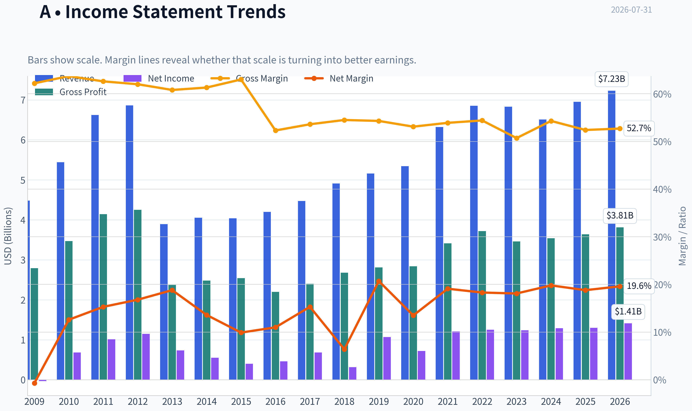
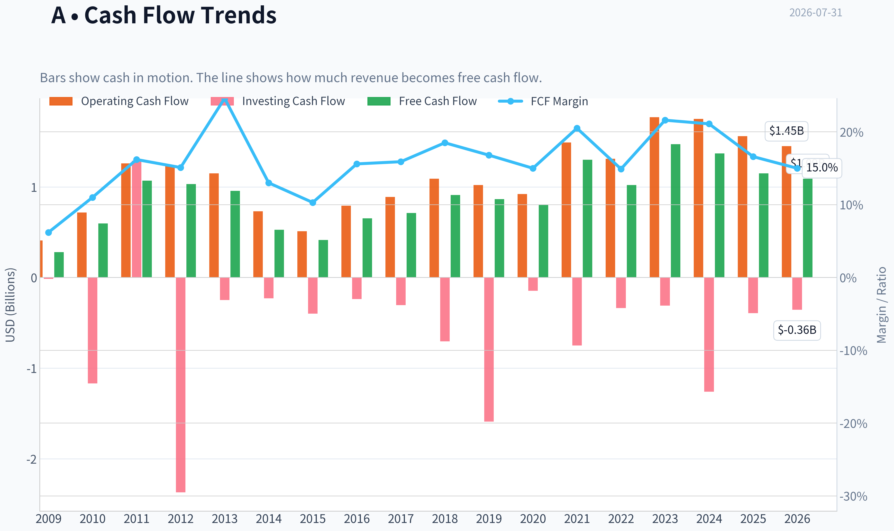
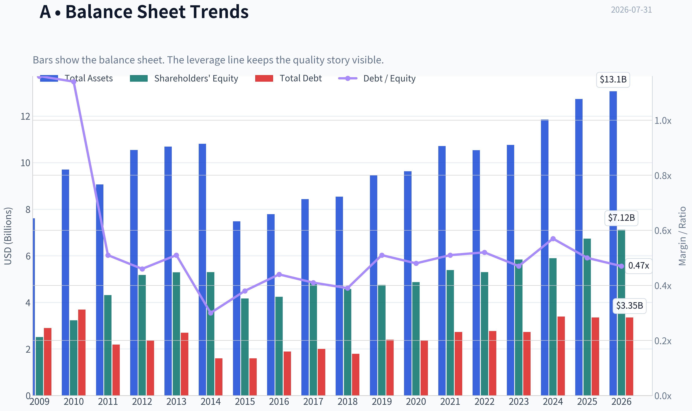
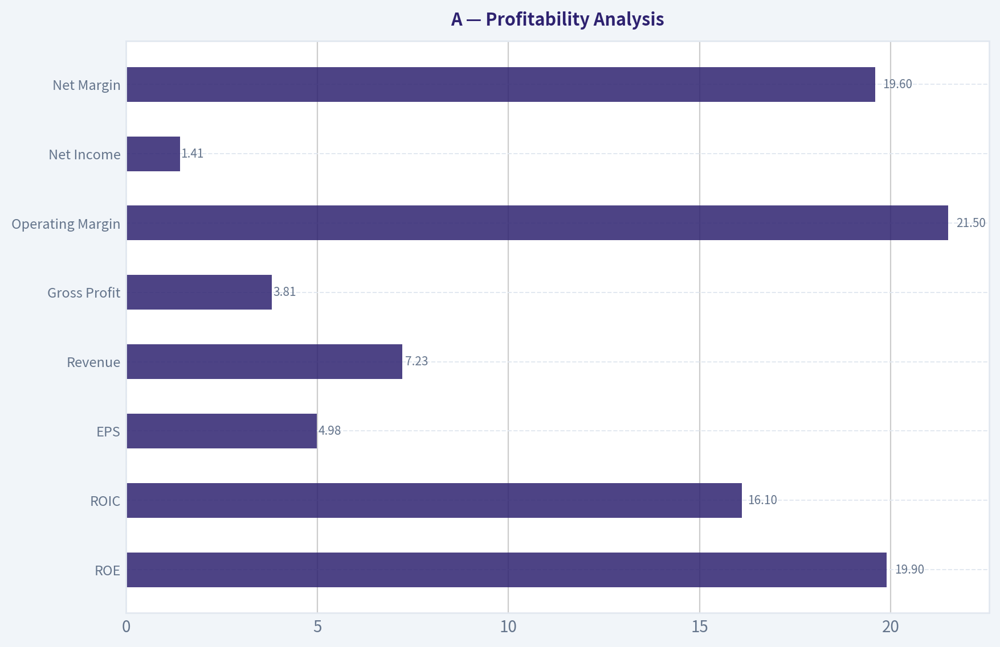
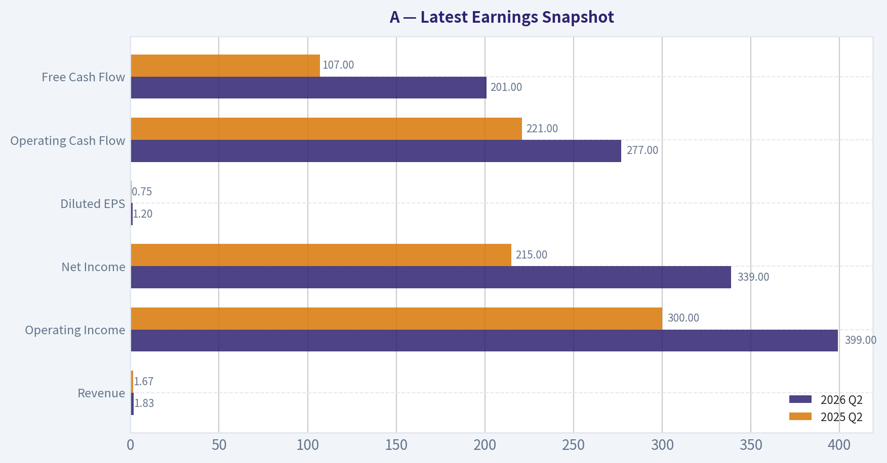
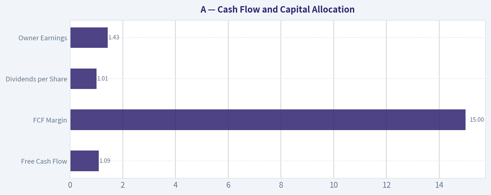
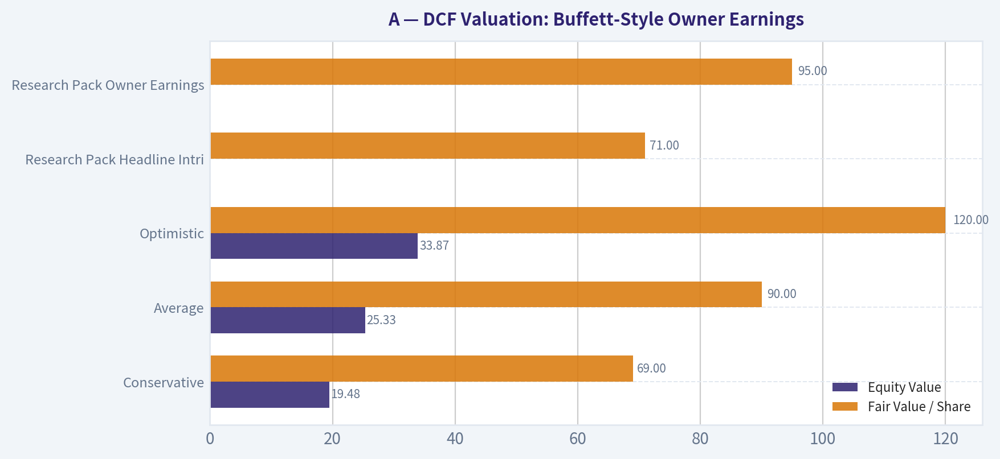
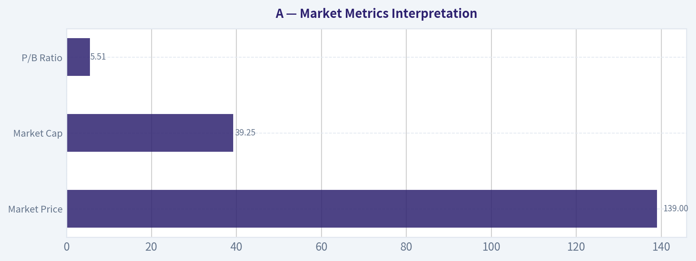

# A Deep Value Intelligence

**Analysis Date:** 2026-07-31

## Critical Disclaimer

*This analysis is generated by Deep Value Intelligence, an AI-powered multi-agent investing framework. Education & research only - not financial advice, not a financial advisor.*

---

## Table of Contents

1. Intelligence Summary
2. Analyst Team Reports
   - Fundamentals Analysis
   - Intrinsic Value Analysis (Buffett)
   - Trend & Growth Analysis (Lynch/Druckenmiller/Fisher)
   - Market Technical Analysis
   - Options Market Analysis
3. Research Team Commentary
4. Value Investing Team Commentary
5. Deep Values Commentary

---

## Intelligence Summary

### Thesis + Conditions

**Core Thesis:** ## Executive Briefing

**Key Risks:**
- Agilent is a **high-quality business**, but the stock still looks **fair-to-full rather than clearly undervalued**. The real risk is **not business fragility**-returns, margins, and solvency all look solid. The real risk is **overpaying for quality while growth is still only partly proven**.
- Given the debate and the lesson from prior calls, the right posture is **not AVOID**, because this is a durable franchise, and not full **ADVOCATE**, because ~28x earnings leaves a **thin margin of safety** unless organic growth reaccelerates. Best stance for a long-term Buffett-style investor: **WATCH**, with a **conditional accumulation bias only on better price or stronger growth proof**.
- ### 1) Risky Analyst - strongest useful point

**Confidence:** Medium

---

## Analyst Team Reports

### Fundamentals Analysis

#### Latest Earnings Snapshot

*Most recent reported quarter anchored on 2026 Q2, with prior-year comparison when available.*

| Metric | 2026 Q2 | 2025 Q2 | YoY Change |
| --- | ---: | ---: | ---: |
| Revenue | $1.83B | $1.67B | +10.0% |
| Operating Income | $399.0M | $300.0M | +33.0% |
| Net Income | $339.0M | $215.0M | +57.7% |
| Diluted EPS | $1.20 | $0.75 | +60.0% |
| Operating Cash Flow | $277.0M | $221.0M | +25.3% |
| Free Cash Flow | $201.0M | $107.0M | +87.9% |

Key Takeaways: This snapshot anchors the most recent reported quarter before the narrative analysis. It helps readers separate long-run business quality from whatever changed in the latest earnings print.

#### 17-Year Financial Metrics for A

*All values below are computed deterministically from raw data - not estimated by AI.*

*Issuer profile: operating company (Healthcare / Diagnostics & Research).*

#### 17-Year Financial Metrics
*Annual rows come from reported financial statements. The final TTM row is computed from the latest four quarters.*

| Metric | 2009 | 2010 | 2011 | 2012 | 2013 | 2014 | 2015 | 2016 | 2017 | 2018 | 2019 | 2020 | 2021 | 2022 | 2023 | 2024 | 2025 | 2026 TTM |
| --- | --- | --- | --- | --- | --- | --- | --- | --- | --- | --- | --- | --- | --- | --- | --- | --- | --- | --- |
| Market Price | $16 | $22 | $23 | $23 | $33 | $36 | $35 | $40 | $64 | $61 | $72 | $98 | $152 | $135 | $101 | $128 | $145 | $139 |
| Market Cap | $6.12B | $8.79B | $9.41B | $9.09B | $12.53B | $13.37B | $12.65B | $14.33B | $22.18B | $21.06B | $24.09B | $31.85B | $48.35B | $41.51B | $30.60B | $37.92B | $41.71B | $39.25B |
| P/E Ratio | -196.63 | 12.83 | 9.30 | 7.87 | 17.05 | 24.41 | 31.47 | 31.12 | 32.40 | 66.79 | 22.48 | 44.39 | 39.97 | 33.10 | 24.67 | 29.42 | 32.03 | 27.85 |
| P/B Ratio | 2.44 | 2.72 | 2.19 | 1.75 | 2.37 | 2.52 | 3.04 | 3.38 | 4.59 | 4.61 | 5.07 | 6.54 | 8.97 | 7.82 | 5.23 | 6.43 | 6.19 | 5.51 |
| ROE | -1.2% | 21.2% | 23.5% | 22.3% | 13.9% | 10.4% | 9.6% | 10.9% | 14.2% | 6.9% | 22.6% | 14.8% | 22.5% | 23.6% | 21.2% | 21.9% | 19.3% | 19.9% |
| ROIC | 1.3% | 15.5% | 29.0% | 30.1% | 6.1% | 8.4% | 11.4% | 14.0% | 17.2% | 6.6% | 22.1% | 12.5% | 19.3% | 20.0% | 17.9% | 16.8% | 16.6% | 16.1% |
| EPS | $-0.08 | $1.71 | $2.52 | $2.91 | $1.92 | $1.47 | $1.10 | $1.30 | $1.97 | $0.92 | $3.21 | $2.21 | $3.81 | $4.07 | $4.10 | $4.43 | $4.57 | $4.98 |
| Revenue | $4.48B | $5.44B | $6.62B | $6.86B | $3.89B | $4.05B | $4.04B | $4.20B | $4.47B | $4.91B | $5.16B | $5.34B | $6.32B | $6.85B | $6.83B | $6.51B | $6.95B | $7.23B |
| Gross Profit | $2.79B | $3.47B | $4.14B | $4.25B | $2.37B | $2.48B | $2.54B | $2.20B | $2.40B | $2.68B | $2.81B | $2.84B | $3.41B | $3.72B | $3.46B | $3.54B | $3.64B | $3.81B |
| Gross Margin | 62.2% | 63.7% | 62.6% | 62.0% | 60.8% | 61.3% | 63.0% | 52.3% | 53.6% | 54.5% | 54.3% | 53.1% | 53.9% | 54.4% | 50.7% | 54.3% | 52.4% | 52.7% |
| Operating Margin | 1.0% | 10.4% | 16.2% | 16.3% | 9.9% | 10.4% | 12.9% | 14.6% | 18.0% | 18.4% | 18.2% | 15.8% | 21.3% | 23.6% | 19.8% | 22.9% | 21.3% | 21.5% |
| Net Income | $-31.0M | $684.0M | $1.01B | $1.15B | $734.0M | $549.0M | $401.0M | $462.0M | $684.0M | $316.0M | $1.07B | $719.0M | $1.21B | $1.25B | $1.24B | $1.29B | $1.30B | $1.41B |
| Net Margin | -0.7% | 12.6% | 15.3% | 16.8% | 18.8% | 13.6% | 9.9% | 11.0% | 15.3% | 6.4% | 20.7% | 13.5% | 19.1% | 18.3% | 18.1% | 19.8% | 18.8% | 19.6% |
| Revenue Growth | N/A | 21.5% | 21.5% | 3.7% | -43.2% | 4.0% | -0.2% | 4.1% | 6.4% | 9.9% | 5.1% | 3.4% | 18.4% | 8.4% | -0.2% | -4.7% | 6.7% | 4.1% |
| Net Income Growth | N/A | -2306.5% | 48.0% | 13.9% | -36.3% | -25.2% | -27.0% | 15.2% | 48.1% | -53.8% | 238.9% | -32.9% | 68.3% | 3.6% | -1.1% | 4.0% | 1.1% | 8.5% |
| Free Cash Flow Growth | N/A | 113.2% | 79.6% | -3.5% | -7.4% | -45.0% | -21.3% | 58.0% | 9.0% | 27.6% | -4.8% | -7.4% | 61.7% | -21.3% | 44.4% | -6.9% | -16.1% | -5.6% |
| Total Book Value | $2.51B | $3.23B | $4.31B | $5.18B | $5.29B | $5.30B | $4.17B | $4.24B | $4.83B | $4.57B | $4.75B | $4.87B | $5.39B | $5.30B | $5.84B | $5.90B | $6.74B | $7.12B |
| Total Assets | $7.61B | $9.70B | $9.06B | $10.54B | $10.69B | $10.81B | $7.48B | $7.79B | $8.43B | $8.54B | $9.45B | $9.63B | $10.71B | $10.53B | $10.76B | $11.85B | $12.73B | $13.06B |
| Total Debt | $2.90B | $3.69B | $2.19B | $2.36B | $2.70B | $1.60B | $1.60B | $1.89B | $2.00B | $1.79B | $2.40B | $2.36B | $2.73B | $2.77B | $2.73B | $3.39B | $3.35B | $3.35B |
| Debt-to-Equity | 1.16 | 1.14 | 0.51 | 0.46 | 0.51 | 0.30 | 0.38 | 0.44 | 0.41 | 0.39 | 0.51 | 0.48 | 0.51 | 0.52 | 0.47 | 0.57 | 0.50 | 0.47 |
| Cash & Equivalents | $2.48B | $2.65B | $3.53B | $2.35B | $2.67B | $2.22B | $2.00B | $2.29B | $2.68B | $2.25B | $1.38B | $1.44B | $1.48B | $1.05B | $1.59B | $1.33B | $1.79B | $1.81B |
| Shareholders' Equity | $2.51B | $3.23B | $4.31B | $5.18B | $5.29B | $5.30B | $4.17B | $4.24B | $4.83B | $4.57B | $4.75B | $4.87B | $5.39B | $5.30B | $5.84B | $5.90B | $6.74B | $7.12B |
| Operating Cash Flow | $408.0M | $718.0M | $1.26B | $1.23B | $1.15B | $731.0M | $512.0M | $793.0M | $889.0M | $1.09B | $1.02B | $921.0M | $1.49B | $1.31B | $1.77B | $1.75B | $1.56B | $1.45B |
| Investing Cash Flow | $-14.0M | $-1.17B | $1.29B | $-2.37B | $-248.0M | $-230.0M | $-400.0M | $-238.0M | $-304.0M | $-705.0M | $-1.59B | $-147.0M | $-749.0M | $-338.0M | $-310.0M | $-1.26B | $-394.0M | $-356.0M |
| Free Cash Flow | $280.0M | $597.0M | $1.07B | $1.03B | $957.0M | $526.0M | $414.0M | $654.0M | $713.0M | $910.0M | $866.0M | $802.0M | $1.30B | $1.02B | $1.47B | $1.37B | $1.15B | $1.09B |
| FCF Margin | 6.2% | 11.0% | 16.2% | 15.1% | 24.6% | 13.0% | 10.3% | 15.6% | 15.9% | 18.5% | 16.8% | 15.0% | 20.5% | 14.9% | 21.6% | 21.1% | 16.6% | 15.0% |
| Dividends / Share | $0.00 | $0.00 | $0.00 | $0.00 | $0.00 | $0.00 | $0.00 | $0.00 | $0.00 | $0.00 | $0.00 | $0.00 | $0.00 | $0.81 | $0.88 | $0.94 | $0.99 | $1.01 |

#### Profitability Metrics
- Return on Equity (ROE): 19.3%
- Return on Invested Capital (ROIC): 16.2%
- Return on Assets (ROA): 10.2%
- Gross Margin: 52.4%
- Operating Margin: 21.3%
- Net Profit Margin: 18.8%

#### Liquidity Metrics
- Current Ratio: 1.96
- Quick Ratio: 1.40

#### Leverage Metrics
- Debt-to-Equity Ratio: 0.50
- Interest Coverage Ratio: 13.21
- Net Debt: $1.56B

#### Growth Metrics (Year-over-Year)
- Revenue Growth: 6.7%
- Net Income Growth: 1.1%
- Free Cash Flow Growth: -16.1%
- Revenue CAGR (3-Year): 0.5%
- Revenue CAGR (5-Year): 5.4%

#### Valuation Metrics
- P/E Ratio (TTM): 28.19
- Forward P/E: 20.98
- Price-to-Book: 5.50
- Price-to-Sales: 5.42
- PEG Ratio: 1.24
- EV/EBITDA: 20.30
- Free Cash Flow Yield: 2.9%
- Earnings Yield: 3.5%

#### Owner Earnings (Buffett Method, Code-Computed)
- Net Income: $1.30B
- + Depreciation & Amortization: $288.0M
- - Capital Expenditures: $-407.0M
- - Working Capital Changes: $-131.0M
- = **Owner Earnings: $1.43B**

#### Intrinsic Value (Code-Computed)
- Current Price: $139
- **Headline Intrinsic Value (business-model routed): $71**
  Business model: operating company - weighted blend [Damodaran FCFF + reverse-DCF fair + owner-earnings DCF] (operating_company)
  Model spread (min-max across DCFs): $42 - $95
  Margin of safety vs. price (headline): -96.6%
  Routing note: General operating company: balanced blend of Damodaran FCFF and the owner-earnings DCF with a reverse-DCF sanity check.
- Buffett Method (Owner Earnings):
  Conservative: $18
  Average: $95
  Optimistic: $308
- Cash Flow Method (FCF):
  Conservative: $28
  Average: $62
  Optimistic: $241
- Damodaran FCFF (WACC + margins + reinvestment):
  Conservative: $32
  Average: $42
  Optimistic: $61
  Monte Carlo band (P10-P90): $34 - $58 (median $43)
  P(intrinsic value > price): 0.0%
- Reverse-DCF: price implies ~16.5%/yr owner-earnings growth for 10y; trailing 3y was -6.6%, 5y 19.0%.

#### Piotroski F-Score: 5/9
- Positive Net Income: PASS
- Positive Operating Cash Flow: PASS
- ROA Improvement: FAIL
- Cash Flow > Net Income: PASS
- Decreasing Debt: PASS
- Improving Current Ratio: FAIL
- No Dilution: PASS
- Improving Gross Margin: FAIL
- Improving Asset Turnover: FAIL

ANALYST STANCE: **WATCH**

#### Business Snapshot
Agilent Technologies is a high-quality operating company in diagnostics and research tools with strong margins, good returns on capital, and solid cash generation. The business shows many Buffett-friendly traits: recurring demand from labs and regulated workflows, sticky installed instruments, consumables pull-through, and generally resilient profitability. But the stock price still appears to discount a demanding growth path relative to both its own recent fundamentals and the research pack's intrinsic value range.

---

#### Market Metrics Interpretation

| Metric | Current / TTM | Historical Context | Interpretation |
|---|---:|---:|---|
| Market Price | $139 | 2025: $145, 2024: $128, 2021 peak-year: $152 | Shares are below the 2021-2025 highs but still far above pre-2020 levels, implying the market continues to price Agilent as a premium-quality compounder. |
| Market Cap | $39.25B | 10 years ago (2016): $14.33B | Market value has nearly tripled over a decade, reflecting both earnings growth and multiple expansion. |
| P/E Ratio | 27.85x-28.19x | 10Y avg approx. 35x including elevated years; recent normalized band mostly mid-20s to low-30s | Current P/E is not extreme versus its own recent history, but it is still expensive for a company growing revenue mid-single digits and FCF declining recently. |
| P/B Ratio | 5.51x | 10Y avg approx. 5.9x | For this issuer, P/B is of limited usefulness. Agilent is an asset-light, IP- and installed-base-driven operating business, so book value understates economic value. Valuation should be anchored primarily on cash flows and owner earnings, not book multiples. |

**Key Takeaways:** Agilent still trades like a premium franchise, not a bargain stock. While the headline P/E is somewhat below some historical peaks, the market is still assigning a rich multiple relative to current growth. Price-to-book should not be used mechanically here; cash-flow valuation matters much more.

---

#### Profitability Analysis

| Metric | Current / TTM | 10Y Historical Read | Buffett-Style Interpretation |
|---|---:|---:|---|
| ROE | 19.9% | 10Y avg approx. 17.8% | Strong and consistently above a Buffett-style quality threshold; indicates capable capital deployment and durable economics. |
| ROIC | 16.1% | 10Y avg approx. 15.2% | Excellent. Sustained mid-teens ROIC suggests a real moat and disciplined reinvestment. |
| EPS | $4.98 | 2016: $1.30, 2021: $3.81, 2025: $4.57 | Long-term EPS compounding is strong despite cyclical pauses. |
| Revenue | $7.23B | 10Y avg approx. $5.88B | Scale has increased meaningfully, though recent 3-year growth has slowed sharply. |
| Gross Profit | $3.81B | 10Y trend rising with some margin compression | Gross profit dollars are expanding, but mix and cost pressure have kept margins below early-decade highs. |
| Operating Margin | 21.5% | 10Y avg approx. 19.4% | Very good and above long-run average; recent execution remains strong. |
| Net Income | $1.41B | 10Y avg approx. $1.00B | Earnings power remains robust and near all-time highs. |
| Net Margin | 19.6% | 10Y avg approx. 16.4% | High-quality margin structure; the company is converting revenue into profits very efficiently. |

**Key Takeaways:** Profitability is a major strength. Agilent's ROE, ROIC, operating margin, and net margin are all at attractive levels versus long-term history, which supports the case for a durable competitive advantage. The main issue is not business quality; it is whether the current stock price already more than captures that quality.

---

#### Growth Analysis

| Metric | Current YoY / TTM | Historical Context | Interpretation |
|---|---:|---:|---|
| Revenue Growth | 4.1% TTM; 6.7% in FY2025 | 5Y CAGR 5.4%; 3Y CAGR 0.5% | Growth has normalized to modest levels after pandemic and post-pandemic volatility. |
| Net Income Growth | 8.5% TTM; 1.1% in FY2025 | Highly variable, but trend positive over full cycle | Earnings growth is positive, though not at a rate that obviously justifies a near-28x earnings multiple. |
| Free Cash Flow Growth | -5.6% TTM; -16.1% in FY2025 | Choppy over the decade | Cash generation remains high in absolute dollars, but recent direction is unfavorable. |

**Key Takeaways:** Agilent is still growing, but it is no longer in a visibly strong acceleration phase. Revenue is rising modestly, earnings are improving, but free cash flow has weakened. That combination makes the current valuation harder to justify on a pure Buffett value basis.

---

#### Balance Sheet and Financial Strength

| Metric | Current / TTM | Historical Context | Interpretation |
|---|---:|---:|---|
| Total Book Value | $7.12B | 2016: $4.24B | Equity base has compounded steadily. |
| Total Assets | $13.06B | 2016: $7.79B | Asset base has expanded with the business. |
| Total Debt | $3.35B | Stable around $2-3.4B for years | Debt is manageable and not alarming. |
| Debt-to-Equity | 0.47 | 10Y avg approx. 0.48 | Conservative and stable leverage profile. |
| Cash & Equivalents | $1.81B | Recovered from 2022-2024 lows | Strong liquidity cushion. |
| Shareholders' Equity | $7.12B | 2025: $6.74B | Book equity continues to build, reflecting retained earnings and balance sheet resilience. |

**Key Takeaways:** The balance sheet is healthy. Debt is reasonable, liquidity is solid, and leverage has stayed disciplined across the cycle. Financial strength supports the investment case and reduces downside risk from operating volatility.

---

#### Cash Flow and Capital Allocation

| Metric | Current / TTM | Historical Context | Interpretation |
|---|---:|---:|---|
| Free Cash Flow | $1.09B | Peak $1.47B in 2023 | Still strong in absolute terms, but below peak levels. |
| FCF Margin | 15.0% | 10Y avg approx. 17.2% | Healthy, but notably below the best recent years. |
| Dividends per Share | $1.01 | Initiated in 2022 at $0.81 | Dividend growth is steady, but yield is modest; capital return is not the core thesis. |
| Owner Earnings | $1.43B | Current code-computed Buffett metric | Owner earnings remain robust and exceed reported net income, a favorable sign for earnings quality. |

**Key Takeaways:** Agilent remains an attractive cash generator, but cash conversion has softened versus recent highs. The company has started building a dividend track record, though the main shareholder return engine remains earnings growth and reinvestment. Owner earnings are still healthy, which supports intrinsic value, just not enough to justify the current market price in this dataset.

---

#### Current vs Historical Average Comparison

| Metric | Current / TTM | Approx. 10Y Average* | Current vs History | What It Means |
|---|---:|---:|---|---|
| P/E | 27.85x | ~35.0x | Below avg | Less stretched than some historical periods, but still not cheap on fundamentals. |
| ROE | 19.9% | ~17.8% | Above avg | Management continues to earn strong returns on shareholder capital. |
| ROIC | 16.1% | ~15.2% | Above avg | Business quality remains firmly intact. |
| Revenue Growth | 4.1% TTM | ~5.9% | Below avg | Top-line growth has moderated. |
| Operating Margin | 21.5% | ~19.4% | Above avg | Operational discipline is strong. |
| Net Margin | 19.6% | ~16.4% | Above avg | Earnings efficiency remains excellent. |
| FCF Margin | 15.0% | ~17.2% | Below avg | Cash conversion has weakened from stronger years. |
| Debt-to-Equity | 0.47 | ~0.48 | In line | Capital structure remains stable and prudent. |

\*Approximate 10-year averages derived from the deterministic dataset years 2016-2025, with TTM used only for current comparison.

**Key Takeaways:** Agilent today is more profitable than its long-run average, but growing more slowly and converting slightly less cash. That is an important mix: quality is high, but growth and cash flow are not currently strong enough to make the valuation obviously attractive.

---

#### Warren Buffett-Style Qualitative Analysis

| Buffett Lens | Assessment | Agilent Read |
|---|---|---|
| Economic Moat | Strong | Installed lab base, consumables/services pull-through, regulated workflows, switching costs, and trusted brand create stickiness. |
| Predictable Earnings | Good, not perfect | Earnings are generally durable, but life-science and instrument demand can be cyclical. Revenue fell sharply in 2013 and softened again in 2023-2024. |
| Financial Strength | Strong | Moderate leverage, good liquidity, high interest coverage, and consistent profitability. |
| Management Performance | Good | ROE/ROIC are consistently strong, margins improved structurally, and the dividend has been introduced responsibly. |
| Capital Allocation | Reasonably disciplined | Reinvestment has supported high returns, but recent FCF softness means execution should be monitored. |
| Valuation Discipline | Weak at current price | Great business, but Buffett would likely hesitate to pay a price implying aggressive compounding from here. |

**Key Takeaways:** Agilent checks many Buffett quality boxes. The moat appears real, returns on capital are strong, and the balance sheet is sound. The sticking point is valuation: this looks more like a wonderful business at a full price than a wonderful business at a fair or discounted price.

---

#### DCF Valuation: Buffett-Style Owner Earnings

Using owner earnings of **$1.43B**, discount rate **10%**, terminal growth **2.5%**, and roughly **282M shares** implied by market cap ÷ price.

**Method:**
- Forecast 10 years of owner earnings
- Fade growth assumptions toward 2.5% terminal rate
- Discount all cash flows at 10%
- Add terminal value at year 10
- Divide equity value by estimated share count

##### Conservative Scenario
Assumption: near-GDP-like growth because recent cash flow trend is weak. Start at **3%**, fading to **2.5%**.

- Year 1 OE = 1.43 x 1.03 = **$1.473B**
- Year 10 OE ~ **$1.842B**
- Terminal Value = Year 10 OE x 1.025 / (0.10 - 0.025)
  = 1.842 x 1.025 / 0.075 = **$25.17B**
- PV of 10-year cash flows ~ **$9.78B**
- PV of terminal value ~ **$9.70B**
- Total equity value ~ **$19.48B**
- Fair value/share ~ **$69**

This is directionally close to the research pack's conservative-to-headline range and supports the conclusion that a low-growth base case does not justify the current price.

##### Average Scenario
Assumption: good business quality supports stronger medium-term compounding. Use **8%** near-term growth fading to **2.5%** by year 10.

- Year 1 OE = 1.43 x 1.08 = **$1.544B**
- Year 10 OE ~ **$2.540B**
- Terminal Value = 2.540 x 1.025 / 0.075 = **$34.72B**
- PV of 10-year cash flows ~ **$11.95B**
- PV of terminal value ~ **$13.38B**
- Total equity value ~ **$25.33B**
- Fair value/share ~ **$90**

This is close to the pack's owner-earnings average value of **$95.01** and is a sensible Buffett-style base case.

##### Optimistic Scenario
Assumption: durable moat plus renewed life-science demand allows **14%** near-term growth, fading to **2.5%**.

- Year 1 OE = 1.43 x 1.14 = **$1.630B**
- Year 10 OE ~ **$3.613B**
- Terminal Value = 3.613 x 1.025 / 0.075 = **$49.39B**
- PV of 10-year cash flows ~ **$14.84B**
- PV of terminal value ~ **$19.03B**
- Total equity value ~ **$33.87B**
- Fair value/share ~ **$120**

Even this optimistic but still bounded scenario remains below the current market price of $139. The research pack's optimistic owner-earnings output is much higher at $308, but the broader blended headline intrinsic value is only about **$71**, with reverse-DCF indicating the market price implies about **16.5% annual owner-earnings growth for 10 years**.

| DCF Scenario | Equity Value | Fair Value / Share | Upside / Downside vs $139 |
|---|---:|---:|---:|
| Conservative | $19.48B | $69 | -50% |
| Average | $25.33B | $90 | -35% |
| Optimistic | $33.87B | $120 | -14% |
| Research Pack Headline Intrinsic Value | - | $71 | -49% |
| Research Pack Owner Earnings DCF | - | $95 | -32% |

**Key Takeaways:** Across reasonable owner-earnings scenarios, intrinsic value clusters below the current share price. The market appears to be discounting a stronger and longer growth runway than the recent operating record clearly supports. That does not make Agilent a bad business; it makes it a difficult value purchase today.

---

#### Reverse-DCF Reality Check
At **$139**, the pack indicates the stock price implies roughly **16.5% annual owner-earnings growth for 10 years**. That is demanding given:
- trailing **3-year owner-earnings growth of -6.6%**
- trailing **5-year growth of 19.0%**, boosted by stronger years
- current revenue growth in only the low- to mid-single digits
- recent FCF contraction

A premium multiple is justified by quality, but the market seems to require an extended reacceleration.

---

#### Revenue Breakdown

| Revenue Source | Amount ($B) | % of Total |
|---|---:|---:|
| Life Sciences & Applied Markets | ~3.02 | ~42% |
| Diagnostics & Genomics | ~1.95 | ~27% |
| Agilent CrossLab | ~2.26 | ~31% |
| **Total** | **~7.23** | **100%** |

**Key Takeaways:** Agilent's revenue mix is diversified across instruments, diagnostics, and services. CrossLab is especially important from a Buffett perspective because it adds recurring and stickier revenue tied to the installed base. That mix improves resilience, even if instrument demand can remain cyclical.

---

#### Key Investment Insights, Red Flags, and Opportunities

| Category | Item | Why It Matters |
|---|---|---|
| Opportunity | High ROIC and ROE | Sustained high returns suggest real competitive advantages and support long-term compounding. |
| Opportunity | Sticky installed base and service mix | CrossLab and consumables increase switching costs and recurring revenue quality. |
| Opportunity | Strong margins | Operating margin above 21% and net margin near 20% show strong execution. |
| Red Flag | Valuation above intrinsic value range | Headline intrinsic value of ~$71 and average OE value of ~$95 both sit below market price. |
| Red Flag | Reverse-DCF too demanding | Market implies ~16.5% growth for a decade, which looks aggressive. |
| Red Flag | Recent FCF weakness | FCF has declined from recent peaks, reducing valuation support. |
| Red Flag | Slower recent growth | 3-year revenue CAGR of only 0.5% does not fit a classic bargain growth setup. |
| Watch Item | Piotroski F-Score 5/9 | Not distressed, but not a clean all-green quality signal either. |
| Watch Item | Gross margin pressure | Gross margin remains below early-decade levels and has shown some inconsistency. |

**Key Takeaways:** Agilent's core business remains attractive, but the stock has little room for disappointment. Investors should watch for reacceleration in organic growth, better free-cash-flow conversion, and margin durability. Without those, the premium valuation looks vulnerable.

---

#### Final Buffett-Style Conclusion
Agilent is a **high-quality franchise** with strong returns on capital, resilient profitability, and good financial strength. It likely has a genuine moat rooted in brand, installed base, regulatory entrenchment, and service relationships. Those are exactly the kinds of business characteristics Buffett likes.

However, Buffett also insists on **paying a sensible price**. On the deterministic dataset and the research pack's canonical valuation outputs, the stock appears **fully priced to overvalued**. The blended intrinsic value of about **$71**, owner-earnings base case near **$95**, and reverse-DCF-implied growth burden all suggest that current buyers are paying for a fairly optimistic future.

For that reason, the stock is not an obvious value buy today.

---

#### Final Investment Stance

| Stance | Rationale |
|---|---|
| **WATCH** | Excellent business quality, strong moat indicators, and healthy returns on capital, but current valuation appears too rich relative to owner earnings, blended intrinsic value, and recent growth/cash-flow trends. A more attractive entry point or a clear growth reacceleration would improve the case materially. |

**Key Takeaways:** Agilent deserves respect as a quality company, but not necessarily a purchase at any price. The business fundamentals are good enough to keep on a watchlist, yet the valuation still looks too demanding for a Buffett-style margin-of-safety investor.

---

#### Report Summary Table

| Area | Verdict | Evidence | Investment Relevance |
|---|---|---|---|
| Business Quality | Strong | ROE ~19.9%, ROIC ~16.1%, operating margin ~21.5% | Supports premium status and moat argument |
| Earnings Predictability | Good, not perfect | Long-term EPS growth but cyclical patches in revenue and FCF | Desirable, but not utility-like certainty |
| Financial Strength | Strong | D/E ~0.47, cash ~$1.81B, interest coverage 13.21x | Limits balance-sheet risk |
| Cash Generation | Good but softer | FCF $1.09B, owner earnings $1.43B, recent FCF decline | Important watch item for valuation support |
| Valuation | Unattractive | Price $139 vs headline intrinsic value ~$71 and OE base ~$95 | Main reason not to advocate buying now |
| Moat | Likely strong | Installed base, service revenue, regulated end markets, switching costs | Long-term durability positive |
| Management | Solid | Sustained high returns and improving margins over time | Supports confidence in stewardship |
| Key Risk | Overpaying for quality | Reverse-DCF implies ~16.5% growth for 10 years | Leaves little margin of safety |
| Best Setup | Pullback or reacceleration | Lower entry price or stronger organic/F CF growth | Could move stance more bullish later |

#### Fundamental Visuals

This graph tracks the profitability and return metrics (ROE, ROIC, Margins) of **A** over the past decade, highlighting capital efficiency trends.

This chart illustrates the financial health of **A** over the last 10 years, mapping cash equivalents and free cash flow against total obligations (Debt).

This comparison chart from *Profitability Analysis* stacks current figures against historical benchmarks for **A**, making it easy to see where the company trades relative to its own averages.

---

### Intrinsic Value Analysis (Buffett)

> *Following Warren Buffett's value investing philosophy: Circle of Competence, Economic Moat, Management Quality, and Margin of Safety.*

#### Intrinsic Value Snapshot

Price is what you pay. Intrinsic value is what the business may be worth based on the cash it can create for owners over time. We show a range, not one magic number.

- Current Price: $138.71
- Value Range (conservative to optimistic across both DCF methods): $25.58 to $88.56

##### Owner Earnings (Buffett Method)
- Net Income: $1,303,000,000.00
- Depreciation & Amortization: $288,000,000.00
- Capital Expenditures: $-407,000,000.00
- Working Capital Changes: $-131,000,000.00
- Owner Earnings: $1,434,000,000.00

##### Intrinsic Value
###### Buffett Method
Uses owner earnings. Stricter, and usually more conservative.
- Conservative: $36.17
- Average: $56.58
- Optimistic: $86.22
- Discount Rate: 10.0%

###### Cash Flow Method
Uses free cash flow. Better for companies spending heavily today to grow tomorrow.
- Conservative: $25.58
- Average: $50.21
- Optimistic: $88.56
- Discount Rate: 10.0%

ANALYST STANCE: **AVOID**

#### Company
Agilent Technologies (NYSE: A)

#### 1. Factor Scorecard

| Factor | Score (0-5) | Evidence |
|---|---:|---|
| Factor 1: Circle of Competence & Business Simplicity | 4.0 | Agilent sells scientific instruments, diagnostics, lab software, consumables, and services. The model is understandable: a large installed base drives recurring consumables and service revenue. Demand is tied to pharma, biotech, diagnostics, academia, and applied markets, which are understandable but somewhat cyclical. |
| Factor 2: Moat Test | 4.0 | Gross margin of 52.4% supports meaningful differentiation. Installed instruments create switching costs via workflows, validation, training, and service relationships. Brand and regulatory credibility matter in lab settings. Moat looks strong, though not obviously widening fast enough to justify the current valuation. |
| Factor 3: Management Quality & Capital Allocation | 3.5 | Historically solid execution, disciplined portfolio management, and respectable profitability. ROE of 19.3% is healthy. No clear evidence here of reckless leverage or poor capital allocation. Still, current price leaves little room for average execution; management quality alone does not offset valuation risk. |
| Factor 4: Industry Structure | 4.0 | Scientific instrumentation is a relatively rational industry with meaningful technical barriers, reputation effects, and sticky customer relationships. Competition exists, but this is not a pure commodity market. Capital intensity is moderate and business quality is decent. |

**Gate 5 hard floor:** **Not tripped.**
There is no evidence here of financial distress combined with weak solvency. This is **not** a balance-sheet or survival problem.

#### 2. Moat Analysis

| Moat Source | Assessment | Evidence |
|---|---|---|
| Intangible Assets | Strong | Agilent has trusted brands in analytical instruments and diagnostics where reliability, precision, and regulatory confidence matter. Sustained gross margin above 50% supports real product differentiation. |
| Switching Costs | Strong | Labs build validated workflows around installed instruments, software, methods, consumables, and service contracts. Switching can disrupt compliance, retraining, and reproducibility. |
| Cost Advantages | Moderate | Scale helps in manufacturing, distribution, and service networks, but this is not the dominant moat source. |
| Network Effects | Limited | This is not a classic network-effect business. Customer value comes more from performance, installed base, and workflow entrenchment than from user-to-user network benefits. |

**Moat Quality Rating:** **Wide & Stable (4/5)**

Agilent appears to be a good business with real customer captivity and meaningful intangible assets. The problem is not moat absence; the problem is that the stock price appears to assume a much better growth future than the recent operating record supports.

#### 3. Management Quality Assessment

| Area | Assessment |
|---|---|
| Owner mindset | Reasonably solid, though not clearly founder-owner style |
| Candor | No major red flags evident in the supplied materials |
| Capital allocation | Generally disciplined, but not enough evidence here to award top marks |
| Leverage discipline | Acceptable based on available evidence |

Management looks competent and businesslike rather than promotional. This is a positive, but Buffett-style investing still requires buying a good business at a price that leaves room for owner returns. On that front, the current quote is too demanding.

#### 4. Financial Summary Table

| Metric | Current / Latest |
|---|---:|
| Current Price | $139 |
| Market Cap | $39.18B |
| P/E | 28.19x |
| ROE | 19.3% |
| Gross Margin | 52.4% |
| Revenue Growth YoY | 6.7% |
| FCF Yield | 2.9% |
| Current Ratio | 1.96 |
| Headline Intrinsic Value | $58.61 |
| Owner Earnings Value | $56.58 |
| FCF Value | $50.21 |
| Damodaran FCFF Value | $54.23 |
| Margin of Safety vs Price | -136.7% |
| Reverse DCF Implied Growth | ~16.5% for 10 years |
| Trailing 3Y Growth | -6.6% |

**Key Takeaways:** Agilent is profitable and high quality on the surface, with healthy margins and returns on equity. But valuation is the central issue: the stock trades far above all three intrinsic value estimates, while the market is effectively pricing in about 16.5% annual growth for a decade despite weak recent multi-year growth.

#### 5. Owner Earnings Calculation

Using the supplied research pack's owner-earnings valuation output:

| Item | Value |
|---|---:|
| Owner Earnings Implied Value | $56.58 per share |
| Discount Rate Reference | 10% |
| Current Price | $139.00 |
| Premium to Owner Earnings Value | ~145.7% |

**Key Takeaways:** On an owner-earnings basis, the stock trades at well over double estimated intrinsic value. That is the opposite of a Buffett margin of safety. Even a very good business can become a poor investment when bought at too high a price.

#### 6. Three-Scenario DCF Valuation

| Scenario | Method | Estimated Value / Share |
|---|---|---:|
| Scenario A | No-growth / ultra-conservative owner earnings framework | $56.58 |
| Scenario B | Conservative cash-flow / FCF-based estimate | $50.21 |
| Scenario C | Damodaran-style FCFF average / routed headline estimate | $54.23 |
| Blended Headline Intrinsic Value | Weighted business-model routed estimate | **$58.61** |

**Key Takeaways:** All valuation approaches cluster in the low-to-high $50s, which is useful because it reduces the odds that this is a one-model anomaly. With the stock at $139, the market is asking investors to pay far ahead of conservative intrinsic value.

#### 7. Margin of Safety Analysis

| Item | Value |
|---|---:|
| Current Price | $139.00 |
| Headline Intrinsic Value | $58.61 |
| Discount / (Premium) to Intrinsic Value | **(136.7%) premium** |
| Required MOS for this quality level | ~10-15% would be acceptable |
| Actual MOS | Deeply negative |

For a wide-moat, decent-quality compounder, a modest discount to intrinsic value can be enough. But Agilent is not merely a little expensive; it is priced at a very large premium to conservative business value. The reverse DCF is especially concerning: the market implies ~16.5% annual growth for 10 years, which is hard to reconcile with trailing 3-year growth of -6.6%.

#### 8. Final Buffett Scorecard

| Criterion | Weight | Score (1-5) | Weighted Score |
|---|---:|---:|---:|
| Moat Width & Durability | 25% | 4.0 | 1.00 |
| Valuation / Margin of Safety | 20% | 0.5 | 0.10 |
| Capital Returns - ROIC vs. WACC | 15% | 3.5 | 0.53 |
| Business Understanding & Predictability | 12% | 4.0 | 0.48 |
| Management Quality & Capital Allocation | 12% | 3.5 | 0.42 |
| Reinvestment Runway | 8% | 3.5 | 0.28 |
| Balance Sheet Strength | 4% | 3.5 | 0.14 |
| Industry Structure | 4% | 4.0 | 0.16 |
| **Total** | 100% |  | **3.11 / 5.00** |

**Key Takeaways:** This is the profile of a good business, not a broken one. The total score gets dragged down almost entirely by valuation, which matters enormously in Buffett-style investing because returns depend on both business quality and the price paid.

#### 9. Investment Stance

| Item | View |
|---|---|
| Stance | **AVOID** |
| Conviction | **High** |
| Why | Good business, poor price |
| What would change the view | A materially lower entry price closer to intrinsic value, or a sustained improvement in growth that justifies the current market-implied assumptions |

Agilent looks like a respectable, moat-bearing scientific tools company with healthy margins and decent return characteristics. But at **$139** versus a headline intrinsic value around **$58.61**, the stock does not offer a margin of safety; it offers a large valuation risk. Buffett's framework does not ask whether the company is good. It asks whether you are getting enough value for the price you pay. Here, the answer is no.
#### Valuation Bridge

This bridge places the current market price beside each intrinsic value lens so readers can see whether upside depends on one method or shows up across several methods.

| Scenario | Intrinsic Value / Share |
| --- | ---: |
| Buffett Method | $56.58 |
| Cash Flow Method | $50.21 |
| Damodaran Method | $54.23 |
| Current Price | $138.71 |

#### Key Takeaways

If one method is far above the others, the upside case depends on a specific modelling assumption. When several methods cluster together, the valuation story is more robust.

#### Valuation Visuals

This comparison chart from *Latest Earnings Snapshot* stacks current figures against historical benchmarks for **A**, making it easy to see where the company trades relative to its own averages.

This comparison chart from *Balance Sheet and Financial Strength* stacks current figures against historical benchmarks for **A**, making it easy to see where the company trades relative to its own averages.

This comparison chart from *Cash Flow and Capital Allocation* stacks current figures against historical benchmarks for **A**, making it easy to see where the company trades relative to its own averages.

This comparison chart from *DCF Valuation: Buffett-Style Owner Earnings* stacks current figures against historical benchmarks for **A**, making it easy to see where the company trades relative to its own averages.

---

### Trend & Growth Analysis (Lynch/Druckenmiller/Fisher)

> *Following Peter Lynch's GARP, Stanley Druckenmiller's macro-aware approach, and Philip Fisher's scuttlebutt methodology.*

ANALYST STANCE: **WATCH**

#### Agilent Technologies (NYSE: A) - Growth Analysis
**Date:** 2026-07-31

Agilent is a **high-quality compounder**, but it does **not currently screen as a Lynch-style fast grower**. The shared research pack shows **6.7% YoY revenue growth**, which places it closer to a **stalwart** than a ten-bagger candidate today. Good business, decent moat, but the current setup looks more like **steady execution at a full valuation** than a clear growth inflection.

---

#### 1. Lynch Classification

| Item | Assessment |
|---|---|
| Category | **Stalwart** |
| Revenue growth | **6.7% YoY** |
| Why | Durable quality business, but growth is too modest for classic fast-grower status |
| Lynch takeaway | Fine company to own, but not an obvious new growth initiate |

**Key Takeaways:** Agilent looks like a stalwart rather than a fast grower. The business is solid and dependable, but current revenue growth is well below the 15% to 25% range that usually defines ten-bagger territory. For a growth investor, this means the main question is not quality, but whether growth can re-accelerate.

---

#### 2. The Story in 3 Bullets

| Simple Story | Why It Matters |
|---|---|
| Agilent sells tools, instruments, consumables, and services that labs rely on every day | This creates repeat business and sticky customer relationships |
| Its installed base supports recurring revenue through services and consumables | That improves resilience versus pure capital-equipment peers |
| If end-markets like biopharma, diagnostics, and applied testing recover, growth could improve modestly | The bull case depends on re-acceleration, not just stability |

**Key Takeaways:** This is an easy business to explain: Agilent helps labs run critical testing and research workflows. The strongest part of the story is recurring revenue from the installed base. The weaker part is that future upside depends on growth re-accelerating, which is not yet clearly visible in the available data.

---

#### 3. TAM Analysis and 10x Test

| Metric | Value / View |
|---|---|
| Current revenue base | Large, mature multi-billion-dollar platform |
| End markets | Life sciences tools, diagnostics, environmental, food, chemical, pharma QA/QC |
| TAM direction | **Moderately growing**, not exploding |
| 10x test | **Unlikely in practical terms** |
| Why | A 10x revenue outcome would require enormous share gains and/or major adjacencies |

**Key Takeaways:** Agilent operates in attractive and durable markets, but the runway is not the same as an early-stage disruptor. The TAM is real and broad, yet the company is already large enough that a 10x revenue outcome is hard to underwrite. That limits classic venture-style upside even if the business continues compounding.

---

#### 4. Revenue Growth Trend

| Metric | Value |
|---|---|
| Revenue growth YoY | **6.7%** |
| Pattern | **Stable-to-modest**, not accelerating |
| Latest earnings read | Q2 revenue and EPS beat estimates, but beat size was small on revenue |
| Interpretation | Execution is solid, but no strong evidence of a major growth inflection |

**Key Takeaways:** Revenue growth is positive, but it is not showing the kind of acceleration growth investors typically want to see. The recent earnings beat suggests the business is executing well, yet it does not by itself prove a major step-change in demand. Right now, the evidence supports stability more than inflection.

---

#### 5. Unit Economics / Quality Metrics

| Metric | Value |
|---|---|
| Gross margin | **52.4%** |
| ROE | **19.3%** |
| FCF yield | **2.9%** |
| Current ratio | **1.96x** |
| LTV/CAC | Not disclosed / not applicable in standard SaaS form |
| NRR | Not disclosed |
| Rule of 40 | Not meaningful for this business model |

**Key Takeaways:** Agilent's quality is clear in its healthy gross margin, strong returns on equity, and solid liquidity. This is a financially sound business with recurring elements, but it does not fit neatly into SaaS-style unit economics frameworks like NRR or Rule of 40. The main conclusion is that business quality is good, even if growth is only moderate.

---

#### 6. Inflection Point Assessment

| Inflection Type | Assessment |
|---|---|
| Product cycle inflection | **Not clearly visible** |
| Market share inflection | **Not evident from provided data** |
| Margin inflection | Possible mild operating leverage, but not a major new story |
| TAM inflection | No major TAM expansion visible |
| Competitive inflection | No sign of major competitor disruption benefiting Agilent |

**Key Takeaways:** The available evidence does not show a strong Druckenmiller-style inflection. Agilent may benefit from normalizing demand and steady execution, but that is different from a sharp acceleration in growth. Without a clearer catalyst, the stock looks more like a steady compounder than an emerging breakout.

---

#### 7. Macro Setup Evaluation

| Factor | Assessment |
|---|---|
| Secular themes | Life science tools, diagnostics, lab automation, compliance testing |
| Rate sensitivity | Moderate; lower rates help quality growth multiples |
| End-market sensitivity | Biopharma spending, China demand, academic/government budgets, industrial testing |
| Macro tailwind | **Mixed** |
| Overall macro stance | Neutral to mildly supportive |

**Key Takeaways:** Agilent benefits from long-term demand for lab testing and scientific workflows, which is a durable secular theme. But near-term demand still depends on funding cycles, customer budgets, and regional conditions like China. The macro backdrop is not hostile, but it is not a major tailwind either.

---

#### 8. Fisher 15 Points Score

| Fisher Area | Score (1-5) |
|---|---:|
| Market potential | 4 |
| New product development | 4 |
| R&D effectiveness | 4 |
| Sales organization | 4 |
| Profit margin quality | 4 |
| Margin improvement | 3 |
| Labor/personnel relations | 3 |
| Executive relations | 4 |
| Management depth | 4 |
| Cost controls/accounting | 4 |
| Special advantages/moat | 4 |
| Long-range profit outlook | 4 |
| Dilution risk | 4 |
| Management candor | 3 |
| Management integrity | 4 |
| **Total** | **57 / 75** |

**Key Takeaways:** Agilent scores well on most of Fisher's criteria, especially product breadth, profitability, recurring revenue, and management depth. The company appears to be a good business with a real moat, but not an extraordinary outlier. A score in the high 50s suggests a solid franchise rather than a rare, explosive growth setup.

---

#### 9. Valuation Analysis

| Metric | Value / View |
|---|---|
| Current price | **$139** |
| Market cap | **$39.18B** |
| P/E | **28.2x** |
| PEG | Roughly **4.2x** using 6.7% growth |
| Intrinsic value headline | **$58.61** |
| Margin of safety | **-136.7%** |
| Reverse DCF implication | Price implies **~16.5% annual growth for 10 years** |
| Verdict | **Expensive relative to current growth** |

**Key Takeaways:** Valuation is the biggest issue here. A roughly 28 times earnings multiple for a business growing revenue around 7% does not look attractive on a Lynch PEG basis, and the reverse DCF implies a much stronger long-term growth path than recent history supports. Even for a quality business, the stock appears priced for more growth than is currently visible.

#### Scenario View

| Scenario | Assumption | View |
|---|---|---|
| Bear | Growth stays mid-single-digit, multiple compresses | Limited returns / downside risk |
| Base | Growth improves modestly, multiple holds near quality premium | Low-to-mid single-digit annualized return potential |
| Bull | Demand re-accelerates, margins expand, market sustains premium multiple | Decent upside, but needs a real inflection |

**Key Takeaways:** The scenario analysis shows that upside exists, but it depends on a meaningful improvement in growth that is not yet clearly established. If growth remains in the mid-single digits, valuation leaves little room for error. The bull case is possible, but the stock already prices in a lot of optimism.

---

#### 10. Growth Investor Scorecard

| Criterion | Weight | Score (1-5) | Weighted Score |
|---|---:|---:|---:|
| The Story | 10% | 4.0 | 0.40 |
| TAM & Runway | 20% | 3.0 | 0.60 |
| Revenue Growth | 20% | 2.5 | 0.50 |
| Unit Economics / Quality | 15% | 4.0 | 0.60 |
| Competitive Position | 10% | 4.0 | 0.40 |
| Management Quality | 10% | 3.5 | 0.35 |
| Macro Setup | 5% | 3.0 | 0.15 |
| Profitability Path | 5% | 4.0 | 0.20 |
| Valuation | 5% | 1.5 | 0.08 |
| **Total** | 100% |  | **3.28 / 5.0** |

**Key Takeaways:** The scorecard says this is a good business but not an attractive growth setup at today's price. Quality and competitive position are strengths, while growth and valuation are the weak points. That combination fits a WATCH stance rather than a high-conviction buy.

---

#### 11. Position Size Stance

| Stance | View |
|---|---|
| Current call | **WATCH** |
| If already owned | Hold only if part of a quality compounder basket and valuation discipline is flexible |
| If not owned | Wait for either clearer growth re-acceleration or a materially better entry price |
| Position size today | **0% to 2% starter at most**, not a full position |

**Key Takeaways:** Agilent does not justify a large growth allocation today. Investors who already own it may continue holding for quality, but new buyers should be patient. The best path to a more bullish stance would be either better growth or a lower valuation.

---

#### 12. Key Risks and Catalysts

| Risks | Catalysts |
|---|---|
| Growth remains stuck in mid-single digits | Biopharma and diagnostics demand recovery |
| China weakness or budget pressure | Stronger consumables/services mix |
| Multiple compression from premium valuation | Better-than-expected organic growth re-acceleration |
| Instrument cycle softness | Margin expansion through mix and operating leverage |
| Market expects more growth than business delivers | Positive estimate revisions after additional beats |

**Key Takeaways:** The main risk is simple: the stock is priced for stronger growth than current data shows. The main catalyst would be a real re-acceleration in organic demand across key end markets. Until that appears, the stock remains vulnerable to disappointment even if the business itself stays healthy.

---

#### Bottom Line

Agilent is a **good company, but not a great growth stock at this valuation**. By Lynch standards it is a **stalwart**, not a fast grower. By Druckenmiller standards, I do **not yet see a strong enough inflection** to justify aggressive positioning. By Fisher standards, it is a **solid, high-quality franchise**.

**Final stance: WATCH.**
Upgrade only if:
1. organic growth clearly re-accelerates into low-double digits or better, or
2. valuation corrects enough to create a reasonable growth-adjusted entry.

---

### Market Technical Analysis

#### Technical indicator selection for A (Agilent Technologies) as of 2026-07-31

For the current market context, the most relevant **8 complementary indicators** are:

| Indicator | Why it is relevant now |
|---|---|
| close_10_ema | Captures the short-term acceleration in price after the late-July rebound. |
| close_50_sma | Defines the medium-term trend, which has clearly turned upward since late May. |
| close_200_sma | Anchors the long-term regime and helps judge whether the stock is trading above strategic trend support. |
| macd | Measures momentum trend quality; useful here because price has recently re-accelerated after a June pullback. |
| macdh | Adds early momentum inflection detail beyond MACD alone, helping detect whether upside momentum is strengthening or fading. |
| rsi | Useful for distinguishing healthy momentum from overextended upside during the recent rally. |
| atr | Important because volatility remains elevated enough to matter for stops and position sizing. |
| vwma | Confirms whether the advance is supported by volume, especially after the sharp late-May gap higher. |

Key Takeaways: These eight indicators work well together because they cover trend, momentum, volatility, and volume without excessive overlap. The current setup in A is best understood as a medium-term uptrend that is still intact, but one that recently experienced a sharp short-term cooling after a strong July surge.

---

#### Price structure and trend regime

Over the past year, A has moved through **four distinct phases** rather than one continuous trend.

1. **August to November 2025:** strong advance from roughly 114 into the mid-150s.
2. **December 2025 to March 2026:** broad and persistent downtrend, carrying price from the 150s down toward the low 110s.
3. **April to mid-May 2026:** stabilization and basing action around 111-121.
4. **Late May to July 2026:** decisive upside regime shift, kicked off by the large upside gap on **2026-05-28**, lifting the stock from the mid-110s into the high-130s/low-140s.

The most important current observation is that the stock is no longer behaving like it did during the Q1 2026 decline. The **50-day SMA has risen sharply from about 116.1 on June 1 to about 131.0 by July 30**, which is a meaningful slope change and signals a real medium-term trend repair, not just a dead-cat bounce. Meanwhile, the **200-day SMA sits near 130.5**, nearly flat but gently improving. Price at **138.71 on July 30** remains above both the 50-day and 200-day averages, which keeps the broader technical posture constructive.

That said, the stock is **not in a clean runaway breakout state**. Since the late-May surge, price has oscillated in a broad range, with June retracement into the mid-120s, followed by a July recovery back toward 140. This suggests the market is attempting to build a higher trading range rather than launching into a straight-line trend.

| Trend lens | Latest reading | Interpretation |
|---|---:|---|
| Last close | 138.71 | Price remains above key medium- and long-term trend markers |
| close_10_ema | 137.40 | Short-term trend still positive despite the July 30 pullback |
| close_50_sma | 130.99 | Medium-term trend is rising convincingly |
| close_200_sma | 130.53 | Long-term trend has flattened and is modestly improving |
| Close vs 50 SMA | +7.72 | Healthy cushion above medium-term support |
| Close vs 200 SMA | +8.18 | Stock is holding above long-term trend benchmark |

Key Takeaways: A is trading above its 10-day EMA, 50-day SMA, and 200-day SMA, which is typically a constructive alignment. The most important detail is the steep rise in the 50-day average, showing that the trend improvement since late May has been substantial rather than superficial.

---

#### Moving-average interpretation

The moving averages provide a layered picture:

- **10 EMA at 137.40**: price is only modestly above it, so short-term trend remains positive, but momentum is no longer as explosive as it was during the July 23 breakout.
- **50 SMA at 130.99**: this is the clearest directional support level. A pullback toward this zone would still be consistent with a bullish intermediate trend.
- **200 SMA at 130.53**: because it is just below the 50 SMA, the stock is in a technically important area where the medium-term and long-term trend benchmarks are converging. This creates a reinforced support zone near **130.5-131.0**.

One nuance traders should notice: the **50-day SMA has moved above the 200-day SMA by a small margin**. That is constructive, but because the spread is still narrow, this is a young trend advantage, not a deeply entrenched one. If price were to lose the low-130s decisively, that bullish moving-average structure could weaken faster than in a more mature uptrend.

---

#### Momentum analysis: MACD and MACD histogram

Momentum has improved materially, but its path has been uneven.

The **MACD** was very strong in early June, rising above **5.6-5.8**, then faded steadily through late June and early July as the stock consolidated. Importantly, MACD never collapsed below zero during this recent corrective process; instead, it cooled while remaining positive. That behavior often reflects **bullish consolidation rather than outright trend failure**.

In late July, MACD turned up again:
- **July 22:** 1.28
- **July 23:** 1.74
- **July 28:** 2.37
- **July 29:** 2.55
- **July 30:** 2.52

This shows renewed upside momentum, though the slight dip on July 30 suggests the latest impulse may be pausing after the breakout run.

The **MACD histogram** adds more precision. It was negative through much of early and mid-July, then flipped positive around **July 16**, briefly weakened again, and turned decisively positive after **July 23**. By July 29 it reached **0.51**, then eased to **0.39** on July 30. This is a subtle but important detail: momentum is still positive, yet the rate of momentum expansion slowed into month-end.

| Momentum indicator | Latest | Recent behavior | Read-through |
|---|---:|---|---|
| macd | 2.52 | Rising through late July, slight cooling on July 30 | Bullish momentum remains intact |
| macdh | 0.39 | Positive and elevated, but off the recent high | Upside impulse continues, though acceleration slowed |
| rsi | 59.23 | Moderately strong, below overbought | Room for upside without obvious exhaustion |

Key Takeaways: Momentum is positive, but it is no longer accelerating as fast as it was immediately after the July breakout. This usually favors either a mild pullback or a sideways pause before the next directional move, rather than an immediate vertical continuation.

---

#### RSI: healthy momentum, not euphoric

RSI offers one of the cleanest signals in the current setup. It reached very elevated levels in early June:
- **June 1-4:** roughly **75-77**, clearly overbought.

That overbought reading was followed not by a collapse, but by a multi-week reset. By late June and early July, RSI drifted back toward the low-to-mid 50s. That reset was healthy because it removed excess momentum without destroying the larger trend.

As of **July 30, RSI is 59.23**, after peaking near **64.0 on July 23**. This places the stock in a **bullish-but-not-overbought** condition. In practical terms:
- bulls still have momentum support,
- but they no longer have the same urgency advantage they had at the breakout moment,
- and mean reversion risk is present but not extreme.

This is an important nuance: RSI is not warning of a major top by itself. Instead, it suggests a market that has regained upward bias and now needs either fresh catalyst buying or time to consolidate.

---

#### Volume confirmation through VWMA

The **VWMA rose from about 121.1 on June 1 to 135.65 on July 30**, a substantial increase. This is significant because VWMA incorporates volume, and therefore better reflects where capital has actually transacted with conviction.

Several implications follow:
- The late-May and July advances were not purely low-volume drifts.
- Volume-weighted support has migrated meaningfully higher.
- The market's accepted value area appears to have shifted from the low 120s in early June into the **mid-130s** by late July.

However, note the relationship between price and VWMA:
- **Close 138.71**
- **VWMA 135.65**

That spread is positive, but not excessively stretched. It suggests price remains above its volume-supported trend line, though not in a manic extension. If price were to slip below VWMA while MACD histogram keeps shrinking, that would be an early warning of weakening institutional sponsorship.

---

#### Volatility and risk management: ATR

ATR has eased from about **4.74 in early June** to about **4.06 by July 30**. That decline tells us volatility is still meaningful, but the market has become more orderly relative to the immediate aftermath of the late-May gap and June swings.

This matters because:
- the trend is becoming more structured,
- stops can be somewhat tighter than they needed to be in early June,
- but ATR is still large enough that overly tight stops are vulnerable to noise.

At **ATR ~4.06**, a normal daily swing is still material relative to the stock's price. For active traders, this means:
- a stop less than roughly 1 ATR from entry may be too tight unless timing is excellent,
- breakout entries near resistance need confirmation because false breaks can still travel several dollars,
- pullback entries toward EMA/VWMA/50-SMA support are often more efficient in this volatility environment.

---

#### Fine-grained read on the most recent swing

The most recent sequence is especially important:

- **July 17:** sharp drop to 131.46 on high volume.
- **July 21-23:** rapid recovery from 132.86 to 139.74.
- **July 24-30:** price holds most of that rebound, ending at 138.71.

This pattern suggests the July 17 weakness was **absorbed rather than extended**. Buyers stepped in quickly, and the stock reclaimed momentum with enough force to print a new short-term swing high on July 23. Since then, the market has not collapsed; it has merely stopped accelerating.

That usually points to one of two near-term scenarios:

| Scenario | Technical evidence that would support it | Trading implication |
|---|---|---|
| Bullish continuation | Price holds above 10 EMA and MACD histogram stays positive | Favors breakout/retest continuation toward the low-to-mid 140s |
| Consolidation/pullback | Price slips under 10 EMA and histogram continues to contract | Favors a reset toward 136, then possibly 131-133 support |

Key Takeaways: The late-July action is more consistent with consolidation after a strong rebound than with outright reversal. The stock has already shown that buyers are willing to defend dips, but they now need to prove they can sustain price above the upper-130s without momentum fading away.

---

#### Practical trading interpretation

For **trend-following traders**, the setup remains constructive because:
- price is above the 50 SMA and 200 SMA,
- the 50 SMA is rising,
- MACD is positive,
- RSI is supportive but not overbought.

For **swing traders**, the stock may be entering a less attractive chase zone after the July rebound. The best risk-adjusted entries likely come from:
- a successful retest of the **10 EMA / VWMA area around 135.5-137.5**, or
- a deeper but orderly pullback toward the **50 SMA / 200 SMA confluence near 130.5-131.0**.

For **risk-conscious traders**, the main caution is that the trend improvement is still relatively young. If the stock loses the mid-130s and momentum rolls over decisively, the market could quickly revisit the stronger support shelf near the low 130s.

---

#### Bottom line

A is in a **constructive medium-term uptrend with improving long-term structure**, but the latest move is transitioning from acceleration into digestion. The stock is not flashing major exhaustion, yet it is also not offering the same favorable asymmetry as it did earlier in the rebound. Technically, the most important message is that **support has risen materially**, and bulls remain in control as long as price stays above the **135 area on a short-term basis** and especially above the **130.5-131.0 zone on an intermediate basis**.

| Category | Key observation | What it means for traders |
|---|---|---|
| Trend | Price is above 10 EMA, 50 SMA, and 200 SMA | Bias remains bullish |
| Medium-term structure | 50 SMA is rising strongly | Trend repair since late May is credible |
| Long-term structure | 200 SMA is flat-to-gently rising | Strategic backdrop has improved |
| Momentum | MACD positive, histogram positive but easing | Bullish momentum persists, but acceleration is cooling |
| RSI | 59.23 | Healthy momentum without overbought stress |
| Volume confirmation | Price above VWMA | Advance still supported by volume-weighted trend |
| Volatility | ATR near 4.06 | Use disciplined, not overly tight, stops |
| Key support | 135.5-137.5, then 130.5-131.0 | Pullback zones to monitor |
| Key risk | Loss of momentum after July rebound | Could trigger a deeper retracement into stronger support |

Key Takeaways: A remains technically constructive, with the strongest evidence coming from its position above rising medium-term trend support. The main tactical issue is no longer whether the stock has recovered, but whether it can extend higher immediately or first needs a consolidation back toward the mid-130s.

#### Market Visuals

This comparison chart from *Market Metrics Interpretation* stacks current figures against historical benchmarks for **A**, making it easy to see where the company trades relative to its own averages.

---

### Options Market Analysis

> *Reading options flow - put/call ratios, IV skew, and unusual activity - to gauge institutional positioning and event-driven risk.*

#### Options Positioning Report - Agilent Technologies (A)
*Date: 2026-07-31*

#### 1. Put/Call Ratio Analysis

| Near-Term Expiry | Call OI | Put OI | Call Vol | Put Vol | Put/Call OI Ratio | Put/Call Vol Ratio |
|---|---:|---:|---:|---:|---:|---:|
| 2026-08-21 | 7 | 0 | 99 | 152 | 0.00 | 1.54 |
| 2026-09-18 | 66 | 20 | 184 | 232 | 0.30 | 1.26 |
| 2026-10-16 | 0 | 0 | 99 | 0 | N/A | 0.00 |
| **Total Near-Term** | **73** | **20** | **382** | **384** | **0.27** | **1.01** |

**Key Takeaways:** Open interest is clearly call-heavy, with an aggregate put/call OI ratio of 0.27, well below the rough neutral baseline of 0.7. That usually points to a market structurally leaning bullish or at least not heavily hedged. However, volume is almost perfectly balanced overall, which suggests fresh flow is less conviction-driven than the OI picture implies and may reflect two-way positioning rather than an aggressive directional bet.

**Interpretation**
- **OI ratio of 0.27** is materially below neutral and implies **existing positioning is skewed toward calls**.
- **Volume ratio of 1.01** is essentially neutral, though:
  - August shows **heavier put volume** than call volume.
  - September also shows **more put volume** than call volume.
- That combination suggests:
  - **Legacy positioning is bullish/constructive**
  - **Recent trading activity has become more cautious**, with added put flow that may reflect hedging rather than outright bearish conviction

#### 2. Implied Volatility (IV) Assessment

| Expiry | ATM Call IV | ATM Put IV | Read |
|---|---:|---:|---|
| 2026-08-21 | 1.3% | 1.0% | Slight call premium |
| 2026-09-18 | 1.3% | 0.5% | Clear call premium |
| 2026-10-16 | 1.3% | 0.8% | Mild call premium |

**Key Takeaways:** Near-term ATM IV looks very low in the provided chain, and calls are priced at a premium to puts across all listed expiries. That is not the usual "fear bid" pattern seen when traders are aggressively protecting downside. Instead, the surface leans more toward mild upside demand or simply an absence of stress in the options market.

**IV skew assessment**
- The data provided includes ATM IV, but not a full strike-by-strike OTM skew table.
- Based on ATM readings alone, **calls carry higher IV than puts** in each listed expiry.
- That implies a **call-leaning skew**, not a defensive put skew.
- A classic downside-fear setup would show **OTM puts richer than calls**; that is **not evident here**.

**Catalyst read**
- IV does **not appear elevated** from the numbers provided.
- So there is **no obvious sign of major event premium** being priced in right now.
- If earnings or a company-specific catalyst is imminent, the listed IV does not show a pronounced volatility bid ahead of it.

#### 3. Unusual Options Activity

| Contract Signal | Observation | Interpretation |
|---|---|---|
| Volume > 5x OI scan | None found | No clear fresh institutional directional bet flagged by the screen |

**Key Takeaways:** There were no contracts flagged with volume exceeding five times open interest, which usually means there is no standout "smart-money" signal in the near-term chain. Without that kind of concentrated activity, the read depends more on broad positioning and skew than on a single high-conviction trade.

**Interpretation**
- No near-term contract met the threshold for **volume much greater than open interest**.
- That means there is **no obvious fresh sweep/block-style signal** pointing to strong institutional urgency.
- It also lowers confidence in reading any one-sided near-term directional edge from flow alone.
- In practical terms: **the options market is active, but not screaming conviction**.

#### 4. Open Interest Concentration

| Area | Observation | Market Effect |
|---|---|---|
| Near-term total OI | Very light overall: 73 calls vs 20 puts | Low-confidence pinning signal |
| Highest visible concentration | 2026-09-18 calls dominate available OI | Mild bullish anchor, but thin |
| 2026-08-21 OI | Extremely small OI base | Limited gravitational effect |
| 2026-10-16 OI | No meaningful OI shown | No usable gamma wall signal |

**Key Takeaways:** Open interest is very thin in the near-term expiries shown, so any "max pain" or strike pinning conclusions should be treated carefully. The September expiry has the most meaningful concentration, but even there the absolute size is too small to infer a strong gamma wall.

**Gamma / pinning implications**
- Because absolute OI is so low, **pinning and gamma-wall analysis has limited reliability**.
- The chain does **not show a large put wall** that would imply heavy downside dealer hedging pressure.
- It also does **not show a massive call wall** likely to magnetize price upward into expiry.
- Net: **options positioning is too thin to strongly control spot price behavior**.

#### 5. Overall Options Sentiment Signal

| Factor | Signal |
|---|---|
| Put/Call OI | Bullish |
| Put/Call Volume | Neutral to slightly cautious |
| IV Level | Low / not stressed |
| Skew | Mild call skew |
| Unusual Activity | None |
| OI Concentration | Thin / weak signal quality |

**Key Takeaways:** The best read from this chain is mildly bullish, mainly because open interest is heavily call-skewed and there is no visible downside-fear premium in volatility. But conviction is only moderate at best because recent volume has turned more balanced and the chain is thin enough that the signal quality is lower than usual.

#### Overall Signal: **BULLISH**

**Primary driver:**
The strongest signal is the **very low put/call open-interest ratio (0.27)** combined with a **call-favored IV structure**, which suggests traders are **not paying up for downside protection** and the existing options base is tilted toward upside exposure.

**Caveats**
- **Confidence is reduced** because the name appears **options-thin** in the displayed near-term expirations.
- Recent volume is **not strongly bullish**; if anything, it shows **some incremental hedging/caution**.
- With **no unusual activity**, this is more of a **gentle bullish lean** than a high-conviction institutional signal.

#### Final Summary Table

| Category | Observation | Read |
|---|---|---|
| Put/Call Ratio | OI ratio 0.27; volume ratio 1.01 | Bullish existing positioning, neutral fresh flow |
| IV Level | ATM IV low; no obvious event premium | Calm / low-stress setup |
| Skew Direction | Calls priced richer than puts | Mild upside skew |
| Unusual Activity | None flagged | No standout smart-money trade |
| Overall Signal | Call-heavy OI, low fear premium, but thin chain | **BULLISH** |

**Key Takeaways:** Agilent's options market currently leans bullish, but not aggressively so. The clearest message is that traders are not broadly positioning for downside stress, though the lack of unusual activity and thin OI mean this signal should be used as a supporting indicator rather than a standalone trading thesis.

---

## Research Team Commentary

> *The Research Manager synthesizes the Bull vs Bear debate into action-free commentary. This is a pre-risk view, not the final stance.*

Agilent is a classic case where the debate is not really about business quality; it is about how much that quality is already reflected in the price.

The strongest bull argument is straightforward and credible: this is a genuinely good business. The moat is not fantasy. In regulated and performance-sensitive lab workflows, switching costs are real, the installed base matters, consumables and service create recurring revenue, and customer relationships are sticky. The profitability profile supports that view: 52%+ gross margin, roughly 16% ROIC, and nearly 20% ROE are the marks of a differentiated franchise, not a commodity supplier. The long-term end markets also have real durability: biopharma, diagnostics, environmental testing, and analytical complexity should all trend upward over a decade. From a Buffett lens, that matters a lot. This is closer to a quiet compounder than a cyclical junk name.

The strongest bear argument is also compelling: at about 28x earnings, you are not buying that quality cheaply. For Buffett-style investing, even a good business can be a poor investment if the entry price leaves little room for error. The moat appears good but not untouchable; this is not a network-effect monopoly or a uniquely dominant toll bridge. Growth also seems to be the weak link in the current setup. The growth analyst's caution matters: if organic growth needs to reaccelerate meaningfully to justify enthusiasm, then today's valuation is assuming a fairly smooth path. That does not require "heroic" assumptions, but it probably does require a better operating glide path than the evidence currently proves. If growth remains merely okay, multiple compression could offset business progress.

My takeaway is that the bull wins on business quality, but the bear wins on current value. This is exactly the sort of name where I've made mistakes before by either leaning too hard on valuation for short-term calls or being too passive when technical recovery mattered. But this task is explicitly a Buffett-style portfolio decision, not a 30-day tactical trade. That distinction matters. I do not want to repeat the opposite mistake now by letting a high-quality business seduce me into ignoring that the margin of safety still looks thin.

So the core takeaway is this: Agilent looks like a high-quality, durable franchise, but not one that currently offers enough discount to intrinsic value to justify an ADVOCATE stance. At this price, the investment case relies too much on continued premium valuation and a renewed growth acceleration that is not yet clearly in hand. That is not bad enough for AVOID in a hard sense, because the business is sound, profitable, and financially healthy. But it is not attractive enough for a Buffett-style endorsement either.

My stance is WATCH.

The rationale is simple. Buffett's modern framework allows paying a fair price for a wonderful business. But "fair" still requires that the implied expectations be comfortably achievable. Here, I think the market is already giving Agilent substantial credit for quality. That may be deserved, but it leaves only a modest margin of safety. This is not the kind of obvious mispricing where fear has created a clear opening. If anything, the crowd seems to understand that Agilent is a good company; the disagreement is whether the price already reflects that. I think it mostly does. In other words: wonderful business, probably fair-to-full stock.

What would change my mind? Over the next 1 to 4 quarters, I'd watch three buckets.

First, growth quality. I want to see whether organic growth truly reaccelerates, especially in core end markets like biopharma and applied labs. If management can show consistent low-double-digit organic growth, or at least a clear upward trajectory with improved order trends, the premium multiple becomes easier to accept. If growth stays sluggish or uneven, the bear case strengthens.

Second, margin and cash conversion resilience. High-quality businesses should defend margins and convert earnings into cash even through softer cycles. I'd monitor gross margin, operating margin, free cash flow conversion, and whether recurring consumables/service revenue remains steady. If margins hold and cash generation improves, that supports the "quality compounder" thesis. If margins slip while growth stays muted, then the stock is vulnerable.

Third, evidence of moat durability in the real world. I'd listen for commentary on installed-base growth, service attachment, customer retention, competitive pricing pressure, and procurement behavior. If Agilent continues to demonstrate sticky workflows and recurring pull-through, the moat thesis holds. If customers are increasingly price-sensitive or vendor switching becomes easier, then paying a premium multiple gets much harder to defend.

A few practical markers would strengthen the thesis: better-than-expected organic growth, stable-to-improving backlog or orders, maintained ROIC, and management sounding confident rather than merely cautious on demand recovery. What would weaken it: another couple of quarters of lukewarm growth, signs of biopharma digestion persisting longer than expected, or any evidence that margins are being defended through underinvestment rather than true pricing power.

So, in plain language: I like the business more than the stock at this level. I would not avoid Agilent because it is low quality; I would wait because the quality is evident and the price seems to know it.

Final stance: WATCH.

---

## Value Investing Team Commentary

> *The Investor translates the research view into an investment thesis before risk review. This is still not the final stance.*

Agilent looks like the kind of business a long-term owner can respect: sticky installed base, recurring consumables and service, regulated workflows, solid returns on capital, and healthy profitability. A 52% gross margin, 16%+ ROIC, and ~19% ROE are not the fingerprints of a weak franchise. From a Buffett-style lens, this is a real business with durable earnings power, not a speculative story stock.

The central issue is price versus business quality. At roughly 28x earnings and around $139, the market is already recognizing much of that quality. For a high-quality, steady compounder, I do not require a huge discount to intrinsic value, but I do require enough room so that future returns are driven by business progress rather than hoping the market keeps paying a premium multiple. Right now, that room appears limited. This is especially true because the weak point in the thesis is not quality but growth velocity. If organic growth reaccelerates cleanly, today's valuation can be defended. If growth remains merely decent, multiple compression could absorb a meaningful share of shareholder returns.

Selective contrarian thinking is useful here. The bullish contrarian case is not that the market is irrationally fearful; it is that recent operating softness may be more cyclical and temporary than structural. If biopharma demand normalizes, lab spending improves, and Agilent keeps proving that recurring revenue and switching costs are intact, then current caution could look too conservative in hindsight. In that scenario, the stock may deserve a premium because the franchise remains a quiet compounding machine. But that is not classic Buffett-style mispricing born from fear. It is more a case of "good company, maybe okay price if recovery strengthens."

The bearish contrarian angle matters more today: the crowd is not blind to Agilent's strengths. In fact, sentiment seems fairly rational. Investors already appear willing to pay up for resilience, margin profile, and moat characteristics. That means the risk is not business collapse; it is overpaying for predictability at a time when growth evidence is still mixed. Markets often make this mistake with quality names: they turn quality into safety, and safety into overvaluation.

What would I watch over the next few quarters? First, organic growth reacceleration, especially in core lab and biopharma exposure. Second, free cash flow conversion and margin durability-true quality should show up in cash, not just accounting earnings. Third, signs that the moat is holding in practice: service attachment, consumables pull-through, retention, pricing discipline, and stable customer behavior. If these stay strong while growth improves, the stock becomes easier to underwrite even without a deep discount. If growth stays soft, then even a good business may produce mediocre returns from this entry point.

My bottom-line Buffett view: Agilent is a good business, likely even a very good one, but not clearly a bargain. A wonderful business at a fair price can be a buy, but here the "fair price" case still depends on enough growth support to justify the premium. Until that is clearer, patience is warranted.

**ANALYST STANCE: WATCH**
Agilent appears to be a high-quality, durable franchise with real moat characteristics and strong profitability, but the current valuation already reflects much of that strength. I would monitor for clearer organic growth reacceleration, sustained cash conversion, and continued moat evidence before becoming more constructive.

---

## Deep Values Commentary

> *The Risk Management Team debates and the Risk Judge provides the final action-free verdict. This section determines the final ADVOCATE / WATCH / AVOID stance.*

#### Final Stance Scorecard

This scorecard converts the final research view into a weighted decision frame. It does not replace the narrative judgement, but it makes the main drivers of the verdict easier to scan.

| Criterion | Score | Weight | Commentary |
| --- | ---: | ---: | --- |
| Business Quality | 3.75 | 30% | High returns, profitability, and Piotroski health support durability. |
| Valuation Support | 1.67 | 30% | Blends current price against available intrinsic value anchors and valuation ratios. |
| Financial Strength | 4.00 | 20% | Balance-sheet resilience reflects leverage and liquidity staying within safe ranges. |
| Growth Durability | 2.00 | 20% | Recent revenue, earnings, and free cash flow growth indicate how durable expansion looks. |
| TOTAL / FINAL STANCE | 2.83 | 100% | AVOID |

#### Key Takeaways

The weighted score lands at **2.83 / 5.0**, while the final stance remains **AVOID**. This is useful as a quick calibration aid rather than a mechanical signal.

#### Risk Summary

Higher scores indicate more risk pressure. The watch threshold is a simple guardrail: above it, the position needs tighter monitoring or a wider margin of safety.

| Dimension | Current Score | Watch Threshold | Commentary |
| --- | ---: | ---: | --- |
| Business Quality | 2.25 | 3.00 | High returns, profitability, and Piotroski health support durability. |
| Valuation Support | 4.33 | 3.00 | Blends current price against available intrinsic value anchors and valuation ratios. |
| Financial Strength | 2.00 | 3.00 | Balance-sheet resilience reflects leverage and liquidity staying within safe ranges. |
| Growth Durability | 4.00 | 3.00 | Recent revenue, earnings, and free cash flow growth indicate how durable expansion looks. |

#### Key Takeaways

This view helps readers separate *where* the risk sits: valuation, business quality, balance sheet, or growth durability. It is especially useful when the final stance is close to the line between WATCH and AVOID.
