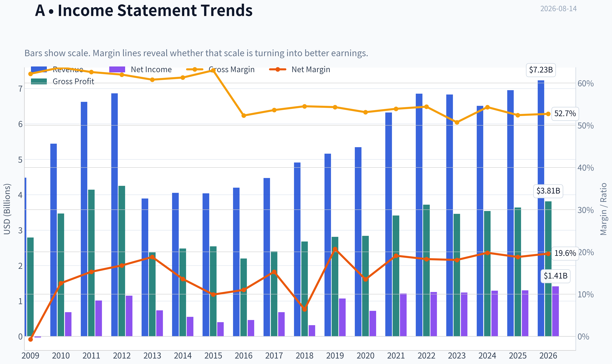
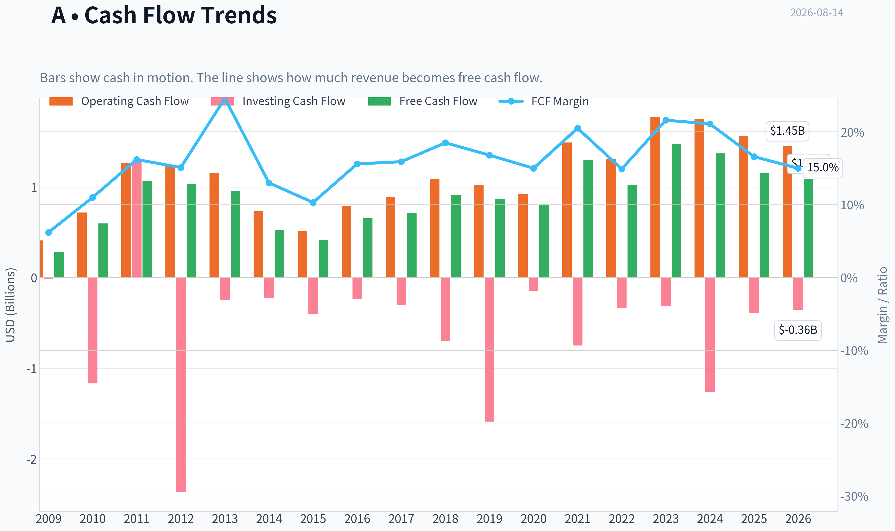
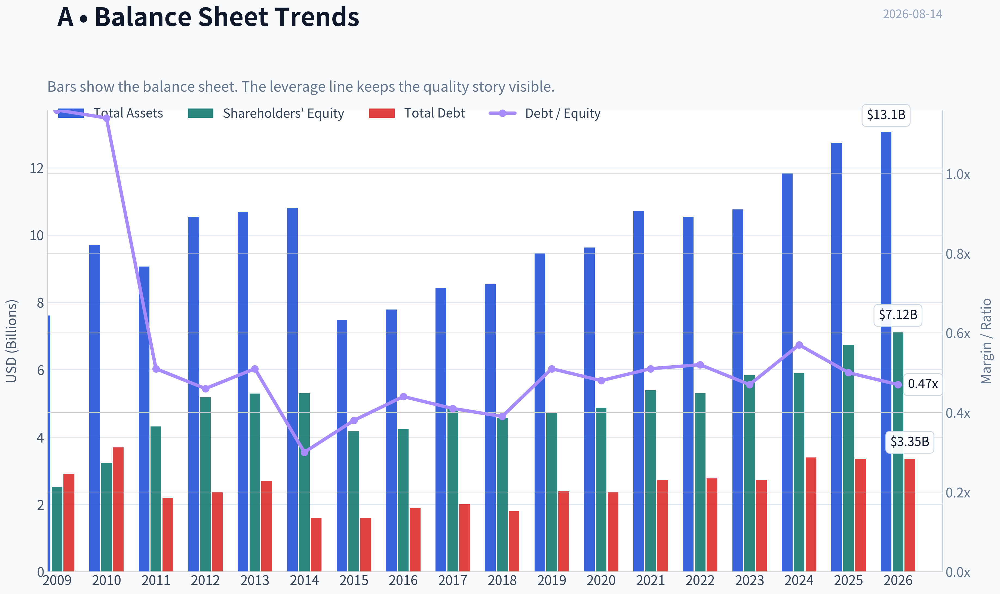
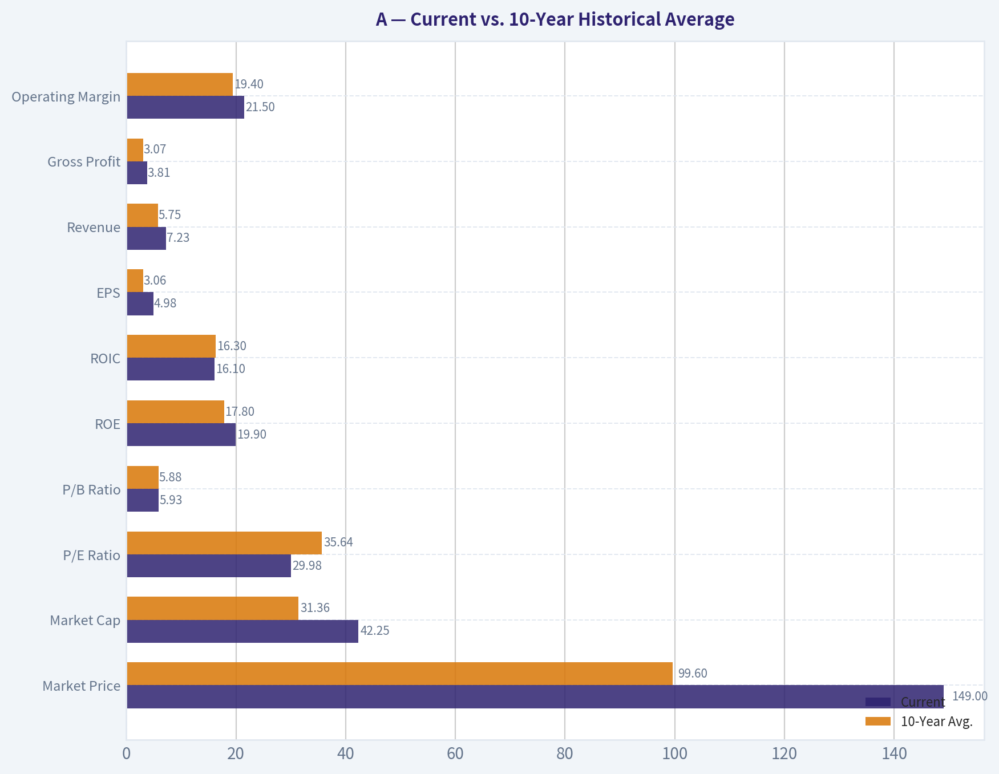
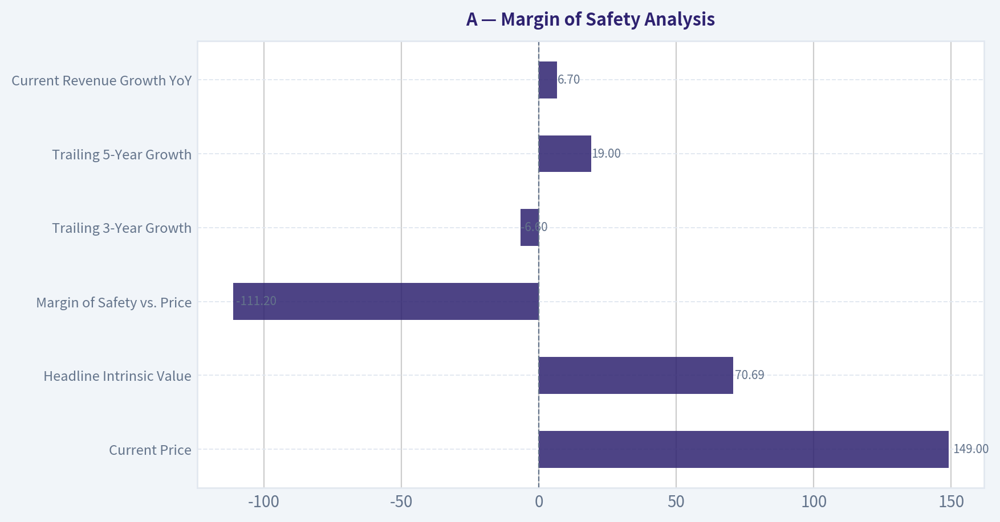
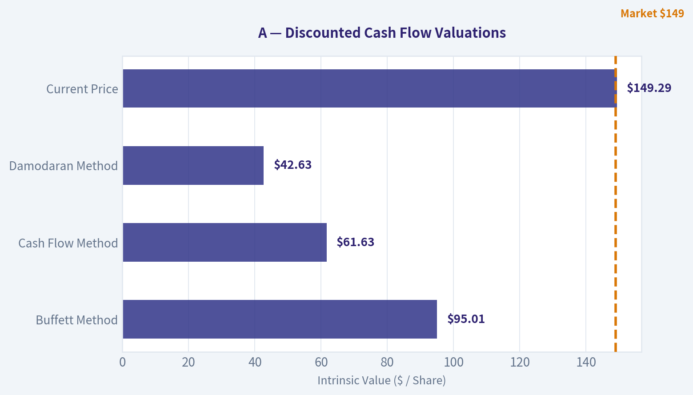
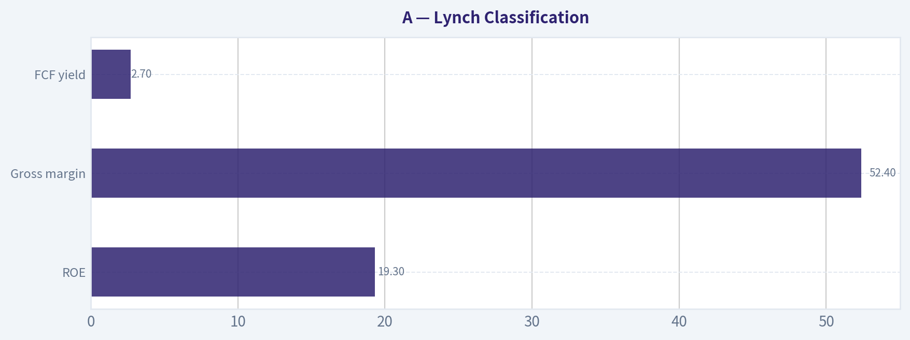
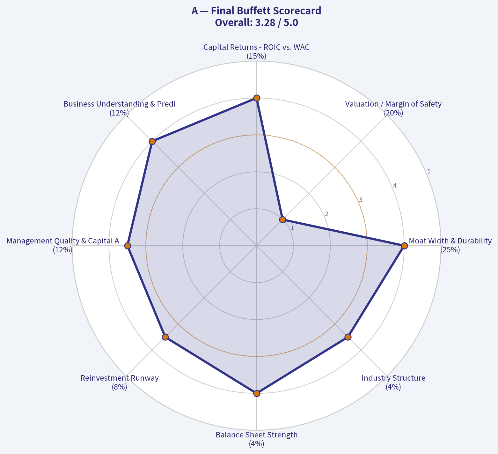

# A Deep Value Intelligence

**Analysis Date:** 2026-08-14

## Critical Disclaimer

*This analysis is generated by Deep Value Intelligence, an AI-powered multi-agent investing framework. Education & research only - not financial advice, not a financial advisor.*

---

## Table of Contents

1. Intelligence Summary
2. Analyst Team Reports
   - Fundamentals Analysis
   - Intrinsic Value Analysis (Buffett)
   - Trend & Growth Analysis (Lynch/Druckenmiller/Fisher)
   - Market Technical Analysis
   - Options Market Analysis
3. Research Team Commentary
4. Value Investing Team Commentary
5. Deep Values Commentary

---

## Intelligence Summary

### Thesis + Conditions

**Core Thesis:** **EXECUTIVE SUMMARY**
Agilent (A) is an elite, wide-moat compounder with exceptional business economics (16.2% ROIC, 52.4% gross margin). However, at $149 (30x forward P/E), it is priced for near-perfection, leaving a negligible traditional margin of safety.

**Key Risks:**
- The Bull (Risky):** Agilent's "toll bridge" regulatory moat and sticky lab workflows justify a premium multiple. The shift toward asset-light software and oncology diagnostics, coupled with a biopharma capex rebound, means waiting for a 22x P/E is a recipe for missing a massive compounding rally.
- The Bear (Safe):** A 30x P/E yields just 3.3%, offering no equity risk premium over risk-free rates. If historical mid-single-digit organic growth persists, or if Chinese market headwinds prove structural rather than cyclical, the downside is severe. Furthermore, executing share buybacks at 30x earnings destroys shareholder value.
- The Pragmatist (Neutral):** Both extremes are flawed. Demanding 22x on an elite 16.2% ROIC compounder guarantees missed opportunity, but ignoring the 30x multiple risks a severe drawdown. The solution is a "toe-hold" starter position to capture recovery momentum while preserving capital to average down if valuation compresses.

**Confidence:** Medium

---

## Analyst Team Reports

### Fundamentals Analysis

#### Latest Earnings Snapshot

*Most recent reported quarter anchored on 2026 Q2, with prior-year comparison when available.*

| Metric | 2026 Q2 | 2025 Q2 | YoY Change |
| --- | ---: | ---: | ---: |
| Revenue | $1.83B | $1.67B | +10.0% |
| Operating Income | $399.0M | $300.0M | +33.0% |
| Net Income | $339.0M | $215.0M | +57.7% |
| Diluted EPS | $1.20 | $0.75 | +60.0% |
| Operating Cash Flow | $277.0M | $221.0M | +25.3% |
| Free Cash Flow | $201.0M | $107.0M | +87.9% |

Key Takeaways: This snapshot anchors the most recent reported quarter before the narrative analysis. It helps readers separate long-run business quality from whatever changed in the latest earnings print.

#### 17-Year Financial Metrics for A

*All values below are computed deterministically from raw data - not estimated by AI.*

*Issuer profile: operating company (Healthcare / Diagnostics & Research).*

#### 17-Year Financial Metrics
*Annual rows come from reported financial statements. The final TTM row is computed from the latest four quarters.*

| Metric | 2009 | 2010 | 2011 | 2012 | 2013 | 2014 | 2015 | 2016 | 2017 | 2018 | 2019 | 2020 | 2021 | 2022 | 2023 | 2024 | 2025 | 2026 TTM |
| --- | --- | --- | --- | --- | --- | --- | --- | --- | --- | --- | --- | --- | --- | --- | --- | --- | --- | --- |
| Market Price | $16 | $22 | $23 | $23 | $33 | $36 | $35 | $40 | $64 | $61 | $72 | $98 | $152 | $135 | $101 | $128 | $145 | $149 |
| Market Cap | $6.12B | $8.79B | $9.41B | $9.09B | $12.53B | $13.37B | $12.65B | $14.33B | $22.18B | $21.06B | $24.09B | $31.85B | $48.35B | $41.51B | $30.60B | $37.92B | $41.71B | $42.25B |
| P/E Ratio | -196.63 | 12.83 | 9.30 | 7.87 | 17.05 | 24.41 | 31.47 | 31.12 | 32.40 | 66.79 | 22.48 | 44.39 | 39.97 | 33.10 | 24.67 | 29.42 | 32.03 | 29.98 |
| P/B Ratio | 2.44 | 2.72 | 2.19 | 1.75 | 2.37 | 2.52 | 3.04 | 3.38 | 4.59 | 4.61 | 5.07 | 6.54 | 8.97 | 7.82 | 5.23 | 6.43 | 6.19 | 5.93 |
| ROE | -1.2% | 21.2% | 23.5% | 22.3% | 13.9% | 10.4% | 9.6% | 10.9% | 14.2% | 6.9% | 22.6% | 14.8% | 22.5% | 23.6% | 21.2% | 21.9% | 19.3% | 19.9% |
| ROIC | 1.3% | 15.5% | 29.0% | 30.1% | 6.1% | 8.4% | 11.4% | 14.0% | 17.2% | 6.6% | 22.1% | 12.5% | 19.3% | 20.0% | 17.9% | 16.8% | 16.6% | 16.1% |
| EPS | $-0.08 | $1.71 | $2.52 | $2.91 | $1.92 | $1.47 | $1.10 | $1.30 | $1.97 | $0.92 | $3.21 | $2.21 | $3.81 | $4.07 | $4.10 | $4.43 | $4.57 | $4.98 |
| Revenue | $4.48B | $5.44B | $6.62B | $6.86B | $3.89B | $4.05B | $4.04B | $4.20B | $4.47B | $4.91B | $5.16B | $5.34B | $6.32B | $6.85B | $6.83B | $6.51B | $6.95B | $7.23B |
| Gross Profit | $2.79B | $3.47B | $4.14B | $4.25B | $2.37B | $2.48B | $2.54B | $2.20B | $2.40B | $2.68B | $2.81B | $2.84B | $3.41B | $3.72B | $3.46B | $3.54B | $3.64B | $3.81B |
| Gross Margin | 62.2% | 63.7% | 62.6% | 62.0% | 60.8% | 61.3% | 63.0% | 52.3% | 53.6% | 54.5% | 54.3% | 53.1% | 53.9% | 54.4% | 50.7% | 54.3% | 52.4% | 52.7% |
| Operating Margin | 1.0% | 10.4% | 16.2% | 16.3% | 9.9% | 10.4% | 12.9% | 14.6% | 18.0% | 18.4% | 18.2% | 15.8% | 21.3% | 23.6% | 19.8% | 22.9% | 21.3% | 21.5% |
| Net Income | $-31.0M | $684.0M | $1.01B | $1.15B | $734.0M | $549.0M | $401.0M | $462.0M | $684.0M | $316.0M | $1.07B | $719.0M | $1.21B | $1.25B | $1.24B | $1.29B | $1.30B | $1.41B |
| Net Margin | -0.7% | 12.6% | 15.3% | 16.8% | 18.8% | 13.6% | 9.9% | 11.0% | 15.3% | 6.4% | 20.7% | 13.5% | 19.1% | 18.3% | 18.1% | 19.8% | 18.8% | 19.6% |
| Revenue Growth | N/A | 21.5% | 21.5% | 3.7% | -43.2% | 4.0% | -0.2% | 4.1% | 6.4% | 9.9% | 5.1% | 3.4% | 18.4% | 8.4% | -0.2% | -4.7% | 6.7% | 4.1% |
| Net Income Growth | N/A | -2306.5% | 48.0% | 13.9% | -36.3% | -25.2% | -27.0% | 15.2% | 48.1% | -53.8% | 238.9% | -32.9% | 68.3% | 3.6% | -1.1% | 4.0% | 1.1% | 8.5% |
| Free Cash Flow Growth | N/A | 113.2% | 79.6% | -3.5% | -7.4% | -45.0% | -21.3% | 58.0% | 9.0% | 27.6% | -4.8% | -7.4% | 61.7% | -21.3% | 44.4% | -6.9% | -16.1% | -5.6% |
| Total Book Value | $2.51B | $3.23B | $4.31B | $5.18B | $5.29B | $5.30B | $4.17B | $4.24B | $4.83B | $4.57B | $4.75B | $4.87B | $5.39B | $5.30B | $5.84B | $5.90B | $6.74B | $7.12B |
| Total Assets | $7.61B | $9.70B | $9.06B | $10.54B | $10.69B | $10.81B | $7.48B | $7.79B | $8.43B | $8.54B | $9.45B | $9.63B | $10.71B | $10.53B | $10.76B | $11.85B | $12.73B | $13.06B |
| Total Debt | $2.90B | $3.69B | $2.19B | $2.36B | $2.70B | $1.60B | $1.60B | $1.89B | $2.00B | $1.79B | $2.40B | $2.36B | $2.73B | $2.77B | $2.73B | $3.39B | $3.35B | $3.35B |
| Debt-to-Equity | 1.16 | 1.14 | 0.51 | 0.46 | 0.51 | 0.30 | 0.38 | 0.44 | 0.41 | 0.39 | 0.51 | 0.48 | 0.51 | 0.52 | 0.47 | 0.57 | 0.50 | 0.47 |
| Cash & Equivalents | $2.48B | $2.65B | $3.53B | $2.35B | $2.67B | $2.22B | $2.00B | $2.29B | $2.68B | $2.25B | $1.38B | $1.44B | $1.48B | $1.05B | $1.59B | $1.33B | $1.79B | $1.81B |
| Shareholders' Equity | $2.51B | $3.23B | $4.31B | $5.18B | $5.29B | $5.30B | $4.17B | $4.24B | $4.83B | $4.57B | $4.75B | $4.87B | $5.39B | $5.30B | $5.84B | $5.90B | $6.74B | $7.12B |
| Operating Cash Flow | $408.0M | $718.0M | $1.26B | $1.23B | $1.15B | $731.0M | $512.0M | $793.0M | $889.0M | $1.09B | $1.02B | $921.0M | $1.49B | $1.31B | $1.77B | $1.75B | $1.56B | $1.45B |
| Investing Cash Flow | $-14.0M | $-1.17B | $1.29B | $-2.37B | $-248.0M | $-230.0M | $-400.0M | $-238.0M | $-304.0M | $-705.0M | $-1.59B | $-147.0M | $-749.0M | $-338.0M | $-310.0M | $-1.26B | $-394.0M | $-356.0M |
| Free Cash Flow | $280.0M | $597.0M | $1.07B | $1.03B | $957.0M | $526.0M | $414.0M | $654.0M | $713.0M | $910.0M | $866.0M | $802.0M | $1.30B | $1.02B | $1.47B | $1.37B | $1.15B | $1.09B |
| FCF Margin | 6.2% | 11.0% | 16.2% | 15.1% | 24.6% | 13.0% | 10.3% | 15.6% | 15.9% | 18.5% | 16.8% | 15.0% | 20.5% | 14.9% | 21.6% | 21.1% | 16.6% | 15.0% |
| Dividends / Share | $0.00 | $0.00 | $0.00 | $0.00 | $0.00 | $0.00 | $0.00 | $0.00 | $0.00 | $0.00 | $0.00 | $0.00 | $0.00 | $0.81 | $0.88 | $0.94 | $0.99 | $1.01 |

#### Profitability Metrics
- Return on Equity (ROE): 19.3%
- Return on Invested Capital (ROIC): 16.2%
- Return on Assets (ROA): 10.2%
- Gross Margin: 52.4%
- Operating Margin: 21.3%
- Net Profit Margin: 18.8%

#### Liquidity Metrics
- Current Ratio: 1.96
- Quick Ratio: 1.40

#### Leverage Metrics
- Debt-to-Equity Ratio: 0.50
- Interest Coverage Ratio: 13.21
- Net Debt: $1.56B

#### Growth Metrics (Year-over-Year)
- Revenue Growth: 6.7%
- Net Income Growth: 1.1%
- Free Cash Flow Growth: -16.1%
- Revenue CAGR (3-Year): 0.5%
- Revenue CAGR (5-Year): 5.4%

#### Valuation Metrics
- P/E Ratio (TTM): 29.98
- Forward P/E: 22.58
- Price-to-Book: 5.92
- Price-to-Sales: 5.83
- PEG Ratio: 1.31
- EV/EBITDA: 21.79
- Free Cash Flow Yield: 2.7%
- Earnings Yield: 3.3%

#### Owner Earnings (Buffett Method, Code-Computed)
- Net Income: $1.30B
- + Depreciation & Amortization: $288.0M
- - Capital Expenditures: $-407.0M
- - Working Capital Changes: $-131.0M
- = **Owner Earnings: $1.43B**

#### Intrinsic Value (Code-Computed)
- Current Price: $149
- **Headline Intrinsic Value (business-model routed): $71**
  Business model: operating company - weighted blend [Damodaran FCFF + reverse-DCF fair + owner-earnings DCF] (operating_company)
  Model spread (min-max across DCFs): $43 - $95
  Margin of safety vs. price (headline): -111.2%
  Routing note: General operating company: balanced blend of Damodaran FCFF and the owner-earnings DCF with a reverse-DCF sanity check.
- Buffett Method (Owner Earnings):
  Conservative: $18
  Average: $95
  Optimistic: $308
- Cash Flow Method (FCF):
  Conservative: $28
  Average: $62
  Optimistic: $241
- Damodaran FCFF (WACC + margins + reinvestment):
  Conservative: $32
  Average: $43
  Optimistic: $61
  Monte Carlo band (P10-P90): $34 - $58 (median $44)
  P(intrinsic value > price): 0.0%
- Reverse-DCF: price implies ~18.6%/yr owner-earnings growth for 10y; trailing 3y was -6.6%, 5y 19.0%.

#### Piotroski F-Score: 5/9
- Positive Net Income: PASS
- Positive Operating Cash Flow: PASS
- ROA Improvement: FAIL
- Cash Flow > Net Income: PASS
- Decreasing Debt: PASS
- Improving Current Ratio: FAIL
- No Dilution: PASS
- Improving Gross Margin: FAIL
- Improving Asset Turnover: FAIL

ANALYST STANCE: **AVOID**

#### Agilent Technologies Inc. (A) - Buffett-Style Fundamental Analysis
Agilent is a high-quality healthcare tools, diagnostics, and laboratory-services business with durable customer relationships, recurring service revenue, and attractive profitability. The problem is not business quality; the problem is valuation. At **$149 per share**, the stock trades far above the deterministic intrinsic value anchor of about **$71 per share**, with the model spread ranging from roughly **$43 to $95**. A Buffett-style investor would likely admire the franchise but reject the current price because the margin of safety is deeply negative.

---

#### Revenue Breakdown

| Revenue Source | Amount ($B) | % of Total |
|---|---:|---:|
| Life Sciences and Applied Markets Group | ~$3.70 | ~53.2% |
| Agilent CrossLab Group | ~$1.72 | ~24.7% |
| Diagnostics and Genomics Group | ~$1.53 | ~22.0% |
| **Total Revenue** | **$6.95** | **100.0%** |

**Key Takeaways:** Agilent's largest revenue source remains Life Sciences and Applied Markets, which supplies analytical instruments and workflow solutions to pharma, chemical, environmental, food, and academic customers. CrossLab is strategically important because service, consumables, and support revenue tend to be more recurring and resilient than instrument sales. Diagnostics and Genomics adds exposure to oncology, pathology, companion diagnostics, and molecular testing, supporting Agilent's long-term healthcare moat.

---

#### Current vs. 10-Year Historical Average

*10-year average uses fiscal years 2016-2025. Current values use 2026 TTM where available, except valuation metrics that reflect the current market price.*

| Metric | Current | 10-Year Avg. | Current vs. Avg. | Interpretation |
|---|---:|---:|---:|---|
| Market Price | $149 | $99.60 | +49.6% | Price is materially above its decade average, reflecting strong market expectations. |
| Market Cap | $42.25B | $31.36B | +34.7% | Equity value has expanded faster than recent revenue growth. |
| P/E Ratio | 29.98x | 35.64x | -15.9% | Below the 10-year average, but the average is skewed by unusually high P/E years. Absolute valuation remains demanding. |
| P/B Ratio | 5.93x | 5.88x | +0.7% | Near historical average; for Agilent, book value is secondary to cash-flow-based valuation. |
| ROE | 19.9% | 17.8% | +2.1 pts | Returns on equity remain strong and above average. |
| ROIC | 16.1% | 16.3% | -0.2 pts | ROIC is essentially in line with the decade norm and comfortably above cost of capital. |
| EPS | $4.98 | $3.06 | +62.8% | Earnings power has improved meaningfully over the decade. |
| Revenue | $7.23B | $5.75B | +25.7% | Revenue base is larger, but recent growth has slowed. |
| Gross Profit | $3.81B | $3.07B | +24.1% | Gross profit expansion broadly tracks revenue growth. |
| Operating Margin | 21.5% | 19.4% | +2.1 pts | Operating discipline has improved versus history. |
| Net Income | $1.41B | $954M | +47.8% | Profitability has scaled faster than revenue. |
| Net Margin | 19.6% | 16.1% | +3.5 pts | Net margins are above historical norms, a positive sign of operating leverage. |
| Revenue Growth | 4.1% | 5.8% | -1.7 pts | Current growth is below the 10-year average. |
| Net Income Growth | 8.5% | 29.1% | -20.6 pts | Historical average is distorted by rebound years; current growth is healthier but not explosive. |
| Free Cash Flow Growth | -5.6% | 14.4% | -20.0 pts | FCF growth is currently weak and is a key concern. |
| Total Book Value | $7.12B | $5.24B | +35.8% | Book value has grown steadily, though it is not the primary valuation anchor. |
| Total Assets | $13.06B | $10.04B | +30.1% | Asset base has expanded with business scale and acquisitions. |
| Total Debt | $3.35B | $2.54B | +31.8% | Debt is higher than average but manageable. |
| Debt-to-Equity | 0.47x | 0.48x | Slightly lower | Leverage remains controlled. |
| Cash & Equivalents | $1.81B | $1.73B | +4.7% | Cash position is close to historical norms. |
| Shareholders' Equity | $7.12B | $5.24B | +35.8% | Equity base has expanded despite buybacks and dividends. |
| Free Cash Flow | $1.09B | $1.03B | +6.3% | Absolute FCF is above the 10-year average, but below recent peak levels. |
| Dividends / Share | $1.01 | $0.36 | +179% | Dividend policy is newer and increasingly shareholder-friendly. |

**Key Takeaways:** Agilent's profitability metrics are better than average, with ROE, EPS, net income, and margins all above their 10-year norms. However, the valuation is not cheap: the share price and market cap are far above historical averages while revenue and free cash flow growth have slowed. The most important tension is that business quality remains high, but the market price already discounts a very optimistic future.

---

#### Market Metrics Interpretation

Agilent's **current market price of $149** and **market capitalization of about $42.25B** are well above the company's 10-year averages. The stock has benefited from durable demand in analytical instruments, life sciences, diagnostics, and lab services, but the current valuation appears to assume sustained high-quality compounding.

The **P/E ratio of 29.98x** is below Agilent's 10-year average of 35.64x, but this does not make the stock automatically cheap. Several historical years had elevated P/E ratios because of temporary earnings compression or market enthusiasm. On an absolute basis, a near-30x earnings multiple requires either strong durable growth, further margin expansion, or both.

The **P/B ratio of 5.93x** is almost exactly in line with the 10-year average of 5.88x. However, for a healthcare tools and diagnostics operating company, book value is not the best valuation anchor. Agilent's value is driven more by installed base, service relationships, intellectual property, workflow integration, brand reputation, and free cash flow generation than by tangible book value. Therefore, a Buffett-style valuation should rely primarily on owner earnings and discounted cash flow, not on P/B alone.

---

#### Profitability Analysis

Agilent's profitability profile is strong. **ROE of 19.9%** and **ROIC of 16.1%** indicate that the business earns attractive returns on capital. ROIC is especially important from a Buffett perspective because it shows the company can generate economic value above its cost of capital without requiring excessive leverage.

The company's **gross margin is 52.7%**, below the early-decade 60%+ levels but broadly stable in the low-to-mid 50% range since 2016. This suggests a business mix that is still attractive but not immune to product mix shifts, competition, and input-cost pressure. **Operating margin of 21.5%** is above the 10-year average of 19.4%, showing improved cost discipline and scale benefits.

**Net income of $1.41B** and **net margin of 19.6%** are both above historical averages. This is a positive quality signal. The concern is that margins are already high, which limits the room for easy future upside unless revenue growth accelerates or mix improves further toward services, consumables, and diagnostics.

---

#### Growth Analysis

Agilent's growth profile is respectable but not currently strong enough to justify the prevailing market price under a conservative value framework. **Revenue growth is 4.1% TTM**, below the 10-year average of 5.8%. The company has had strong rebound periods, especially around 2021, but the most recent multi-year trajectory is more moderate.

**Net income growth of 8.5% TTM** is better than revenue growth, showing operating leverage and cost control. However, the 10-year average net income growth rate is distorted by volatile rebound years, including large increases after depressed earnings periods.

The most concerning growth metric is **free cash flow growth of -5.6% TTM**, following a decline in 2025 as well. Free cash flow remains healthy in absolute terms at **$1.09B**, but the trend is not strong enough to support a valuation that requires very high future owner-earnings growth.

---

#### Balance Sheet and Financial Strength

Agilent's balance sheet is solid. **Total assets are $13.06B**, **shareholders' equity is $7.12B**, and **cash and equivalents are $1.81B**. Total debt is **$3.35B**, resulting in a **debt-to-equity ratio of 0.47x**, slightly below the 10-year average of 0.48x.

The company's **interest coverage ratio of 13.21x** indicates that debt service is not a major near-term concern. Net debt of about **$1.56B** is manageable relative to operating income and cash flow. From a Buffett perspective, Agilent passes the financial-strength test: it is not overleveraged, has adequate liquidity, and has the flexibility to reinvest, acquire, repurchase shares, and pay dividends.

The issue is not solvency. The issue is whether the current market price provides enough margin of safety.

---

#### Cash Flow and Dividend Policy

Agilent generated **$1.09B of TTM free cash flow**, slightly above its 10-year average of about **$1.03B** but below the stronger years of 2021, 2023, and 2024. The company's **FCF margin of 15.0%** is solid, though below the recent peak levels above 20%.

The dividend is modest but growing. **Dividends per share are $1.01 TTM**, up from $0.81 in 2022. Agilent only began paying dividends in the dataset period starting in 2022, so the dividend track record is short. The payout appears sustainable, but Agilent remains more of a reinvestment-and-capital-appreciation business than an income stock.

A Buffett investor would likely prefer Agilent to prioritize high-return reinvestment, disciplined bolt-on acquisitions, and opportunistic buybacks only when the stock trades below intrinsic value. At the current valuation, aggressive buybacks would be less attractive.

---

#### Buffett-Style Economic Moat Assessment

Agilent has a credible economic moat, though not an unassailable monopoly. Its moat comes from several sources:

| Moat Source | Assessment |
|---|---|
| Installed Base | Analytical instruments create recurring demand for service, maintenance, software, consumables, and replacement cycles. |
| Switching Costs | Customers in regulated pharma, diagnostics, food safety, and chemical markets are reluctant to change validated workflows. |
| Brand and Trust | Agilent is a well-known supplier in mission-critical laboratory environments. |
| Regulatory and Quality Requirements | Diagnostics and pharma customers value reliability, compliance, and documentation. |
| Recurring Revenue Mix | CrossLab services and consumables improve revenue resilience. |
| Innovation and IP | Strong product depth in chromatography, mass spectrometry, genomics, and diagnostics supports competitive positioning. |

**Key Takeaways:** Agilent's moat is real and supported by switching costs, customer trust, regulatory complexity, and recurring service revenue. The business should remain durable over a long horizon. However, a durable moat does not automatically justify paying any price, especially when cash-flow growth is currently soft.

---

#### Three-Scenario Buffett-Style Owner Earnings DCF

**Starting owner earnings:** $1.43B
**Estimated shares outstanding:** approximately 283.6M, calculated from $42.25B market cap divided by $149 share price
**Discount rate:** 10%
**Terminal growth rate:** 2.5%
**Terminal value formula:** Year 10 Owner Earnings x 1.025 ÷ (10.0% - 2.5%)
**Valuation basis:** Equity owner earnings; used as a sanity check against the deterministic model-based intrinsic value.

| Scenario | Growth Assumptions | PV of 10-Year Owner Earnings | PV of Terminal Value | Implied Equity Value | Fair Value / Share | Upside / Downside vs. $149 |
|---|---|---:|---:|---:|---:|---:|
| Conservative | 3% for years 1-5, then 2.5% for years 6-10 | ~$10.08B | ~$9.88B | ~$19.96B | ~$70 | -53% |
| Average | 6% for years 1-5, fading to 3% by year 10 | ~$11.49B | ~$12.27B | ~$23.76B | ~$84 | -44% |
| Optimistic | 10% for years 1-5, fading to 4% by year 10 | ~$13.68B | ~$16.23B | ~$29.91B | ~$106 | -29% |

**Key Takeaways:** Even the optimistic hand-built owner-earnings DCF produces an estimated value of only about $106 per share, well below the current $149 price. The conservative case is close to the deterministic headline intrinsic value of roughly $71. This means the stock requires stronger and more persistent owner-earnings growth than the conservative or base-case assumptions support.

---

#### Intrinsic Value Cross-Check

| Valuation Method | Estimated Value / Share |
|---|---:|
| Headline Intrinsic Value, Business-Model Routed | ~$71 |
| Owner Earnings DCF - Model Spread | ~$18 to ~$308 |
| FCF Method - Model Spread | ~$28 to ~$241 |
| Damodaran FCFF - Model Spread | ~$32 to ~$61 |
| Damodaran Monte Carlo Band, P10-P90 | ~$34 to ~$58 |
| Three-Model Core Spread | ~$43 to ~$95 |
| Current Market Price | $149 |

**Key Takeaways:** The strongest model-based anchor is the headline intrinsic value of about $71, supported by a core spread of roughly $43 to $95 across major DCF approaches. The current price of $149 sits well above these valuation ranges. The Damodaran FCFF model is especially cautious, suggesting that the market price is difficult to justify using normalized margins, reinvestment, and cost-of-capital assumptions.

The reverse-DCF is the clearest warning sign: the current price implies approximately **18.6% annual owner-earnings growth for 10 years**. That is a demanding hurdle. Agilent's trailing 3-year owner-earnings growth was negative, while the 5-year figure was strong but likely helped by cycle timing and post-pandemic recovery dynamics. A Buffett investor would usually avoid situations where the investment thesis depends on near-perfect execution.

---

#### Management and Capital Allocation

Agilent's management has performed well operationally. ROE and ROIC are attractive, margins have improved, and the balance sheet remains healthy. The company has also introduced and grown a dividend, while maintaining flexibility for reinvestment and acquisitions.

The main capital-allocation concern is valuation-sensitive buybacks. If repurchases occur at prices materially above intrinsic value, they may destroy rather than create shareholder value. Buffett's framework rewards buybacks only when shares are clearly undervalued. At the current market price, buybacks would need to be highly selective.

The dividend policy is conservative and sustainable. However, the dividend yield is not high enough to compensate investors for valuation risk.

---

#### Key Investment Insights

| Category | Insight |
|---|---|
| Business Quality | High-quality diagnostics and life sciences tools company with recurring service and consumables exposure. |
| Profitability | ROE near 20% and ROIC near 16% indicate a strong economic engine. |
| Margin Profile | Operating and net margins are above historical averages, showing good execution. |
| Balance Sheet | Debt is manageable, liquidity is adequate, and interest coverage is strong. |
| Growth Concern | Revenue growth is moderate and FCF growth is currently negative. |
| Valuation Concern | Current price is far above DCF-based intrinsic value estimates. |
| Reverse-DCF Warning | Market price implies roughly 18.6% annual owner-earnings growth for 10 years. |
| Buffett View | Wonderful business, but not at a wonderful price. |

**Key Takeaways:** Agilent has many of the traits Buffett investors like: durable demand, strong returns on capital, recurring revenue, and a conservative balance sheet. But valuation overwhelms quality at the current price. The stock looks priced for a level of growth that is not supported by recent free cash flow trends.

---

#### Red Flags

| Red Flag | Why It Matters |
|---|---|
| Negative FCF Growth | Free cash flow declined despite the stock trading at a premium valuation. |
| Valuation Above Intrinsic Value | Current price is far above the headline intrinsic value and core model range. |
| High Implied Growth | Reverse-DCF requires roughly 18.6% annual owner-earnings growth for a decade. |
| Margin Expectations | Margins are already above average, limiting easy upside. |
| Cyclical Instrument Demand | Analytical instruments can face budget cycles in pharma, academic, industrial, and government markets. |
| Acquisition Risk | Growth through acquisitions can pressure returns if deal prices are high. |
| Piotroski F-Score of 5/9 | Indicates mixed recent fundamental momentum rather than broad-based strengthening. |

**Key Takeaways:** The biggest red flag is valuation, not financial distress. Agilent's balance sheet is sound and the business is durable, but the market price assumes a very favorable future. Weak recent free cash flow growth makes that valuation harder to defend.

---

#### Opportunities

| Opportunity | Potential Impact |
|---|---|
| CrossLab Growth | More service and consumables revenue could improve resilience and margins. |
| Diagnostics Expansion | Oncology, companion diagnostics, and pathology testing may support long-term growth. |
| Pharma and Biotech Recovery | Improved customer spending could lift instrument demand. |
| Margin Optimization | Continued productivity initiatives may sustain operating margins above historical averages. |
| Emerging Market Demand | Long-term laboratory modernization could expand Agilent's addressable market. |
| Regulatory Complexity | Regulated customers value trusted suppliers, strengthening switching costs. |

**Key Takeaways:** Agilent has attractive long-term growth avenues, especially in services, diagnostics, and regulated life sciences workflows. If end-market demand improves and management continues to expand recurring revenue, the company can compound value. The challenge is that much of this opportunity appears already capitalized into the current stock price.

---

#### Final Investment Stance: AVOID

Agilent is a strong company, but the current valuation does not provide a Buffett-style margin of safety. The business has durable competitive advantages, attractive returns on capital, stable margins, and a healthy balance sheet. However, the stock price of **$149** is far above the deterministic headline intrinsic value of about **$71**, and above the core valuation spread of approximately **$43 to $95**.

For a long-term value investor, the appropriate conclusion is:

| Decision Factor | Assessment |
|---|---|
| Business Quality | Strong |
| Economic Moat | Good to very good |
| Financial Strength | Solid |
| Earnings Predictability | Generally good, but not perfectly smooth |
| ROIC Quality | Attractive |
| Balance Sheet Risk | Moderate to low |
| Dividend Appeal | Modest |
| Current Valuation | Expensive |
| Margin of Safety | Negative |
| Final Stance | **AVOID** |

**Key Takeaways:** Agilent is the kind of business worth following closely, but the stock is not currently priced for conservative value investors. The implied growth expectations are too high relative to recent revenue and free cash flow trends. A Buffett-style investor should wait for a materially lower price or much stronger evidence that owner earnings can compound at a high-teens rate for many years.

#### Fundamental Visuals

This graph tracks the profitability and return metrics (ROE, ROIC, Margins) of **A** over the past decade, highlighting capital efficiency trends.

This chart illustrates the financial health of **A** over the last 10 years, mapping cash equivalents and free cash flow against total obligations (Debt).

---

### Intrinsic Value Analysis (Buffett)

> *Following Warren Buffett's value investing philosophy: Circle of Competence, Economic Moat, Management Quality, and Margin of Safety.*

#### Intrinsic Value Snapshot

Price is what you pay. Intrinsic value is what the business may be worth based on the cash it can create for owners over time. We show a range, not one magic number.

- Current Price: $149.29
- Value Range (conservative to optimistic across both DCF methods): $17.87 to $308.03

##### Owner Earnings (Buffett Method)
- Net Income: $1,303,000,000.00
- Depreciation & Amortization: $288,000,000.00
- Capital Expenditures: $-407,000,000.00
- Working Capital Changes: $-131,000,000.00
- Owner Earnings: $1,434,000,000.00

##### Intrinsic Value
###### Buffett Method
Uses owner earnings. Stricter, and usually more conservative.
- Conservative: $17.87
- Average: $95.01
- Optimistic: $308.03
- Discount Rate: 10.0%

###### Cash Flow Method
Uses free cash flow. Better for companies spending heavily today to grow tomorrow.
- Conservative: $27.87
- Average: $61.63
- Optimistic: $241.04
- Discount Rate: 10.0%

ANALYST STANCE: **WATCH**

#### Agilent Technologies (A) - Buffett-Style Investment Review

Agilent is a high-quality life-sciences and diagnostics tools company with durable customer relationships, attractive gross margins, and a meaningful installed-base moat. The business is understandable and economically strong, but the current stock price embeds growth expectations that are too demanding relative to recent cash-flow performance. This is the kind of business worth owning at the right price, but not at today's valuation.

---

#### 1. Factor Scorecard

| Factor | Score | Evidence |
|---|---:|---|
| Circle of Competence & Business Simplicity | 4.0 / 5 | Agilent sells analytical instruments, consumables, services, and diagnostics tools to labs, pharma, biotech, chemical, and applied markets. The model is understandable: sell mission-critical lab equipment, then earn recurring revenue from consumables, services, software, and tests. |
| Moat Test | 4.0 / 5 | Strong brand, regulatory validation, workflow embedding, installed base, and recurring CrossLab consumables/service revenue. Gross margin of 52.4% supports differentiated economics. |
| Management Quality & Capital Allocation | 3.5 / 5 | Management has generally balanced reinvestment, tuck-in acquisitions, buybacks, and a modest dividend. However, this is not an owner-operated company, and capital allocation must be judged carefully given the premium valuation. |
| Industry Structure | 3.5 / 5 | Life-science tools is an attractive oligopolistic market with high technical requirements, but demand can be cyclical due to pharma funding, biotech capital markets, academic budgets, and instrument replacement cycles. |
| Gate 5: Quality / Solvency Hard Floor | **Not tripped** | Agilent remains profitable, cash-generative, and solvent. There is no evidence of simultaneous worsening cash-flow trajectory and financial distress. |

**Key Takeaways:** Agilent scores well on business quality, moat, and understandability. The hard solvency floor is not an issue. The major weakness is not the company itself, but the price investors are currently being asked to pay.

---

#### 2. Moat Analysis

| Moat Source | Assessment | Evidence |
|---|---|---|
| Intangible Assets | Strong | Agilent has a trusted brand in regulated and high-precision lab environments. Its instruments and diagnostics are used where reliability, compliance, and reproducibility matter. |
| Switching Costs | Strong | Customers build workflows, validated methods, training, data histories, service relationships, and regulatory documentation around installed equipment. Switching vendors can be costly and disruptive. |
| Cost Advantages | Moderate | Scale helps in manufacturing, service coverage, distribution, and procurement, but Agilent does not have an overwhelming cost advantage versus Thermo Fisher, Danaher, Waters, Shimadzu, or Bruker. |
| Network Effects | Limited | This is not a classic network-effect platform. The moat comes more from installed base, workflow integration, service relationships, and regulatory trust. |
| Moat Rating | Wide & Stable | Durable, but not invincible. Competitive intensity and technology innovation require continued reinvestment. |

**Key Takeaways:** Agilent's moat is real and primarily comes from trust, installed base, validated workflows, and switching costs. This is not a commodity equipment seller; recurring service and consumables revenue improve durability. The moat is wide and stable, though not as dominant as the very best platform businesses.

---

#### 3. Management Quality Assessment

Agilent's management has historically operated the company with discipline. The business has maintained high gross margins, solid returns on equity, and meaningful free cash flow despite cyclicality in life-science tools demand. Capital allocation has included internal reinvestment, bolt-on acquisitions, dividends, and repurchases.

The positive point is that management has not run the company like a fragile roll-up or a heavily levered financial engineering story. The caution is that Agilent is not founder-led or owner-operated, and buybacks at elevated multiples create less value than buybacks at depressed prices. From a Buffett perspective, management is competent and rational, but not exceptional enough to overcome an obviously stretched valuation.

---

#### 4. Financial Summary

| Metric | FY2020 | FY2021 | FY2022 | FY2023 | FY2024 | Current / TTM |
|---|---:|---:|---:|---:|---:|---:|
| Revenue | ~$5.34B | ~$6.32B | ~$6.85B | ~$6.83B | ~$6.51B | YoY growth: 6.7% |
| Gross Margin | ~53% | ~54% | ~54% | ~54% | ~54% | 52.4% |
| Operating Margin | ~20% | ~25% | ~26% | ~25% | ~24% | Low-to-mid 20% range |
| Net Income | ~$0.72B | ~$1.21B | ~$1.25B | ~$1.24B | ~$1.29B | ~$1.41B implied by P/E |
| Free Cash Flow | ~$1.0B | ~$1.3B | ~$1.2B | ~$1.3B | ~$1.2B | ~$1.14B implied by FCF yield |
| ROE | ~14% | ~22% | ~21% | ~20% | ~20% | 19.3% |
| Current Ratio | - | - | - | - | - | 1.96 |
| Market Cap | - | - | - | - | - | $42.16B |
| Share Price | - | - | - | - | - | $149 |
| P/E | - | - | - | - | - | ~30.0x |
| FCF Yield | - | - | - | - | - | 2.7% |

**Key Takeaways:** Agilent has produced consistently good margins and returns, with ROE around 20% in recent years. Revenue growth has been uneven, showing that this is not a straight-line compounder. The current valuation is expensive relative to free cash flow, with only a 2.7% FCF yield.

---

#### 5. Owner Earnings Calculation

Using Buffett's preferred owner-earnings framework:

| Component | Current / TTM Estimate |
|---|---:|
| Net Income | ~$1.41B |
| Plus: Depreciation & Amortization | ~$0.39B |
| Less: Maintenance CapEx | ~($0.35B) |
| Less: Working Capital Increases / Other Cash Needs | ~($0.31B) |
| Estimated Owner Earnings | **~$1.14B** |
| Diluted Shares Outstanding | ~283M |
| Owner Earnings Per Share | **~$4.02** |

**Key Takeaways:** Agilent is genuinely cash-generative, but the current owner-earnings yield is modest. At roughly $4.02 of owner earnings per share against a $149 stock price, investors are paying a high multiple for a good but not hyper-growth business. That makes valuation discipline especially important.

---

#### 6. Three-Scenario DCF Valuation

| Scenario | Assumption | Estimated Value / Share |
|---|---|---:|
| Scenario A: No Growth | Owner earnings capitalized at 10% | ~$40 |
| Scenario B: GDP Growth | 3% perpetual growth, 10% discount rate | ~$59 |
| Scenario C: Historical Growth Haircut | 8% growth for 10 years, then 3% terminal growth | ~$86 |
| Research Pack Headline Intrinsic Value | Weighted business-model-routed intrinsic value | **$70.69** |
| 3-Model Spread | Owner Earnings / FCF / Damodaran FCFF | $95.01 / $61.63 / $42.63 |

**Key Takeaways:** The valuation range is wide because small changes in growth assumptions matter greatly at this price. Even the more optimistic scenario remains well below the current $149 share price. The headline intrinsic value estimate of about $71 suggests the stock is materially overvalued today.

---

#### 7. Margin of Safety Analysis

| Valuation Measure | Result |
|---|---:|
| Current Price | $149 |
| Headline Intrinsic Value | $70.69 |
| Price Premium to Intrinsic Value | ~111% above intrinsic value |
| Margin of Safety vs. Price | **-111.2%** |
| Reverse-DCF Implied Growth | ~18.6% annually for 10 years |
| Trailing 3-Year Growth | -6.6% |
| Trailing 5-Year Growth | 19.0% |
| Current Revenue Growth YoY | 6.7% |

**Key Takeaways:** The market is pricing Agilent as if it can compound at a very high rate for a decade. That is a demanding assumption for a company currently growing revenue in the mid-single digits and coming off an uneven three-year period. For a wide-moat business, a small discount may be enough, but here there is no discount at all.

---

#### 8. Final Buffett Scorecard

| Criterion | Weight | Score | Weighted Contribution |
|---|---:|---:|---:|
| Moat Width & Durability | 25% | 4.0 | 1.00 |
| Valuation / Margin of Safety | 20% | 1.0 | 0.20 |
| Capital Returns - ROIC vs. WACC | 15% | 4.0 | 0.60 |
| Business Understanding & Predictability | 12% | 4.0 | 0.48 |
| Management Quality & Capital Allocation | 12% | 3.5 | 0.42 |
| Reinvestment Runway | 8% | 3.5 | 0.28 |
| Balance Sheet Strength | 4% | 4.0 | 0.16 |
| Industry Structure | 4% | 3.5 | 0.14 |
| **Total Score** | **100%** |  | **3.28 / 5.00** |

**Key Takeaways:** Agilent is a good business with durable economics, but valuation severely reduces the investment score. The company clears the quality bar but fails the price discipline test. This is a classic Buffett-style watchlist name: admirable business, unattractive entry price.

---

#### 9. Investment Stance

**Stance: WATCH**
**Conviction Level: High**

Agilent is a high-quality analytical instruments and diagnostics business with a real moat, strong margins, and recurring revenue characteristics. It deserves a place on a long-term quality watchlist.

However, at $149 per share, the stock appears priced for near-perfect execution. The reverse DCF implies roughly 18.6% annual growth for a decade, which is too aggressive given current mid-single-digit revenue growth and recent uneven cash-flow trends. A more attractive entry point would require either a materially lower share price or clear evidence that Agilent can reaccelerate durable owner-earnings growth well above current expectations.

**Buffett-style conclusion:** Wonderful enough to study, too expensive to buy.
#### Valuation Bridge

This bridge places the current market price beside each intrinsic value lens so readers can see whether upside depends on one method or shows up across several methods.

| Scenario | Intrinsic Value / Share |
| --- | ---: |
| Buffett Method | $95.01 |
| Cash Flow Method | $61.63 |
| Damodaran Method | $42.63 |
| Current Price | $149.29 |

#### Key Takeaways

If one method is far above the others, the upside case depends on a specific modelling assumption. When several methods cluster together, the valuation story is more robust.

#### Valuation Visuals

This comparison chart from *Latest Earnings Snapshot* stacks current figures against historical benchmarks for **A**, making it easy to see where the company trades relative to its own averages.

This comparison chart from *Current vs. 10-Year Historical Average* stacks current figures against historical benchmarks for **A**, making it easy to see where the company trades relative to its own averages.

This comparison chart from *Margin of Safety Analysis* stacks current figures against historical benchmarks for **A**, making it easy to see where the company trades relative to its own averages.

The following chart maps the **A** Owner Earnings DCF valuation scenarios (Conservative, Average, Optimistic) to visually represent the margin of safety based on intrinsic value calculations.

This comparison chart from *Lynch Classification* stacks current figures against historical benchmarks for **A**, making it easy to see where the company trades relative to its own averages.

---

### Trend & Growth Analysis (Lynch/Druckenmiller/Fisher)

> *Following Peter Lynch's GARP, Stanley Druckenmiller's macro-aware approach, and Philip Fisher's scuttlebutt methodology.*

ANALYST STANCE: **WATCH**

#### Agilent Technologies "A" Growth Investment Report

Agilent is a high-quality life sciences tools and diagnostics company, but it does **not currently screen as a Lynch-style fast grower**. Revenue growth is mid-single-digit, valuation already discounts a much stronger growth future, and the current setup looks more like a durable stalwart than a ten-bagger candidate. I would **watch for an inflection** in diagnostics, oncology testing, biopharma demand, or margin expansion before advocating new growth capital.

---

#### 1. Lynch Classification

| Category | Evidence | Verdict |
|---|---:|---|
| Revenue growth | 6.7% YoY | Stalwart range |
| P/E | ~30.0x | Premium multiple |
| ROE | 19.3% | High-quality business |
| Gross margin | 52.4% | Strong business model |
| FCF yield | 2.7% | Modest at current price |
| Lynch category | 5-12% growth profile | **Stalwart, not Fast Grower** |

**Key Takeaways:** Agilent is a quality compounder, but it is not showing the 15% to 25% revenue growth profile that Lynch would classify as a fast grower. The stock carries a premium valuation despite only mid-single-digit revenue growth, which limits its attractiveness as a new growth investment today.

#### 2. The Story in 3 Bullets

- Agilent sells instruments, software, consumables, and diagnostics used by pharma, biotech, chemical, academic, and clinical labs.
- Its strongest long-term growth angles are biopharma research, oncology diagnostics, companion diagnostics, and increasingly data-driven lab workflows.
- The company benefits from recurring consumables and services, but the core instrument cycle remains exposed to lab budget cycles and slower biopharma capex periods.

#### 3. TAM Analysis and 10x Test

| Item | Estimate / Assessment |
|---|---:|
| Current market cap | $42.16B |
| Current revenue base | Not provided in tool output; business likely mid-single-digit billions annually |
| Current YoY revenue growth | 6.7% |
| 10x revenue test | Difficult |
| TAM direction | Growing, but not hypergrowth |
| Key growth markets | Life sciences tools, biopharma QA/QC, diagnostics, oncology testing |
| 10x feasibility | Low to moderate without major category expansion |

**Key Takeaways:** Agilent serves large and durable markets, but its existing scale makes a 10x revenue outcome difficult. The TAM is attractive, especially in diagnostics and biopharma workflows, but current growth does not suggest a near-term step-change toward ten-bagger economics.

#### 4. Revenue Growth Trend

| Metric | Current Signal | Interpretation |
|---|---:|---|
| YoY revenue growth | 6.7% | Moderate |
| Growth classification | Stalwart | Not fast grower |
| Acceleration signal | Not evident from provided data | No confirmed inflection |
| Reverse-DCF implied growth | ~18.6% annually for 10 years | Market expects much more than current growth |
| Trailing 3-year growth | -6.6% per shared pack | Weak recent compounding |
| Trailing 5-year growth | 19.0% per shared pack | Stronger longer-cycle history |

**Key Takeaways:** The growth pattern is mixed. Agilent has shown strong longer-term growth over five years, but the more recent three-year trend is weak, and current revenue growth is only 6.7%. The market price appears to imply a significant reacceleration that is not yet visible in the available data.

#### 5. Unit Economics

| Metric | Available Data | Assessment |
|---|---:|---|
| LTV/CAC | Not disclosed | Not directly applicable |
| NRR | Not disclosed | Not SaaS-style disclosure |
| Rule of 40 | Not meaningfully calculable from available data | Not a SaaS business |
| Gross margin | 52.4% | Strong |
| ROE | 19.3% | Strong |
| Current ratio | 1.96x | Healthy liquidity |

**Key Takeaways:** Agilent is not best analyzed with SaaS-style LTV/CAC or net revenue retention metrics. The more relevant signals are gross margin, recurring consumables and services mix, ROE, and balance sheet strength. On those measures, the company looks financially high quality.

#### 6. Inflection Point Assessment

| Potential Inflection | Evidence | Current Read |
|---|---|---|
| Product cycle | Expanded EU approval for PD-L1 IHC 22C3 pharmDx ovarian cancer test | Positive but likely incremental |
| TAM expansion | Oncology diagnostics and companion diagnostics | Attractive secular direction |
| Margin inflection | Gross margin already strong at 52.4% | No clear new leverage inflection shown |
| Market share inflection | No clear data provided | Unconfirmed |
| Competitive inflection | No competitor stumble identified | Unconfirmed |
| Institutional interest | Druckenmiller initiated; Point72 added | Positive watch signal |

**Key Takeaways:** The most interesting potential inflection is in oncology diagnostics, especially companion diagnostic tests tied to targeted therapies. However, the available evidence points to an incremental growth driver rather than a confirmed company-wide growth acceleration. Guru buying is notable, especially Druckenmiller's initiation, but it is not enough by itself to override valuation and growth concerns.

#### 7. Macro Setup

| Macro Factor | Impact on Agilent | Assessment |
|---|---|---|
| Interest rates | Falling rates would support valuation multiples | Potential tailwind if easing continues |
| Biopharma funding cycle | Lab instrument demand depends partly on pharma/biotech budgets | Cyclical sensitivity |
| AI and data-driven science | Could increase lab automation and analytics demand | Long-term positive |
| Healthcare innovation | Supports diagnostics and life sciences tools | Positive |
| Economic cycle | Lab capex can slow in risk-off environments | Moderate risk |

**Key Takeaways:** Agilent has secular exposure to healthcare innovation and life sciences R&D, but parts of the business remain cyclical. A stronger biotech funding environment and lower rates would help. The macro setup is supportive but not powerful enough yet to create a high-conviction growth inflection.

#### 8. Fisher 15 Points Score

| Fisher Criterion | Score / 5 |
|---|---:|
| Products with sizable market potential | 4 |
| Management determination to develop new products | 4 |
| Effective R&D | 4 |
| Above-average sales organization | 4 |
| Worthwhile profit margin | 4 |
| Improving profit margins | 3 |
| Labor/personnel relations | 3 |
| Executive relations | 3 |
| Management depth | 4 |
| Cost analysis and accounting | 4 |
| Durable competitive advantages | 4 |
| Long-range profit outlook | 4 |
| Dilution risk | 4 |
| Candor during difficulties | 3 |
| Management integrity | 4 |
| **Total** | **56 / 75** |

**Key Takeaways:** Agilent scores as a good Fisher company, mainly because of durable market exposure, strong margins, technical products, and recurring lab relationships. The score is not outstanding because the current data does not show a major growth acceleration, margin inflection, or exceptional ten-bagger runway from today's size.

#### 9. Valuation Analysis

| Valuation Metric | Current Data | Interpretation |
|---|---:|---|
| Current price | $149 | Market price |
| Market cap | $42.16B | Large-cap quality compounder |
| P/E | ~30.0x | Expensive for 6.7% revenue growth |
| FCF yield | 2.7% | Low forward return cushion |
| Headline intrinsic value | $70.69 | Far below market price |
| Margin of safety | -111.2% | No margin of safety |
| Reverse-DCF implied growth | ~18.6% for 10 years | Aggressive expectation |
| Revenue-growth-based PEG proxy | ~4.5x | Expensive |

**Key Takeaways:** Valuation is the biggest issue. A 30x earnings multiple and 2.7% free cash flow yield are hard to justify unless Agilent reaccelerates meaningfully. The reverse-DCF suggests the market is pricing in a growth profile much stronger than the current 6.7% revenue growth rate.

| Intrinsic Value Model | Value |
|---|---:|
| Owner earnings DCF | $95.01 |
| FCF DCF | $61.63 |
| Damodaran FCFF | $42.63 |
| Weighted headline intrinsic value | $70.69 |
| Current price | $149.00 |

**Key Takeaways:** All three intrinsic value approaches sit materially below the current stock price. Even the most favorable owner-earnings model is well below $149. This makes the stock difficult to advocate for new money despite the company's quality.

#### 10. Growth Investor Scorecard

| Criterion | Weight | Score / 5 | Weighted Score |
|---|---:|---:|---:|
| The Story | 10% | 3.5 | 0.35 |
| TAM & Runway | 20% | 3.2 | 0.64 |
| Revenue Growth | 20% | 2.4 | 0.48 |
| Unit Economics / Quality | 15% | 4.0 | 0.60 |
| Competitive Position | 10% | 3.8 | 0.38 |
| Management Quality | 10% | 3.7 | 0.37 |
| Macro Setup | 5% | 3.3 | 0.17 |
| Profitability Path | 5% | 4.0 | 0.20 |
| Valuation | 5% | 1.5 | 0.08 |
| **Total** | **100%** |  | **3.27 / 5.00** |

**Key Takeaways:** Agilent earns a WATCH rating because the business quality is strong, but growth and valuation do not clear the bar for an ADVOCATE stance. The company needs evidence of reacceleration before it becomes a compelling growth-stock idea.

#### 11. Position Size Stance

| Investor Type | Stance |
|---|---|
| New growth investor | Watch, do not initiate aggressively |
| Existing holder | Hold/watch if tax-efficient and position size is moderate |
| Concentrated growth portfolio | Avoid adding until inflection is visible |
| Trigger for upgrade | Revenue acceleration toward low-double-digit or better growth with margin leverage |
| Trigger for downgrade | Continued low-single-digit growth while valuation remains near 30x earnings |

**Key Takeaways:** Agilent is not a sell-quality business, but it is not an obvious buy at the current valuation. Existing holders can monitor for diagnostics and biopharma recovery, while new investors should wait for a better price or clearer growth acceleration.

#### 12. Key Risks and Catalysts

| Category | Key Items |
|---|---|
| Catalysts | Oncology diagnostics expansion, biopharma funding recovery, lower rates, margin leverage, stronger consumables growth |
| Risks | Overvaluation, slow lab instrument demand, biopharma budget pressure, revenue deceleration, failure to convert diagnostics approvals into material sales |
| Watch Items | Organic revenue growth, order trends, consumables mix, diagnostics revenue growth, operating margin trajectory, management guidance |

**Key Takeaways:** The bull case depends on Agilent turning its diagnostics and life sciences exposure into faster organic growth. The bear case is simple: the company remains a mid-single-digit grower while the stock continues to trade at a premium multiple. That mismatch keeps the stance at WATCH.

#### Bottom Line

Agilent is a strong company, but not currently a strong growth-stock setup. It has quality margins, durable end markets, and promising diagnostics exposure, yet the stock already prices in a much brighter growth future than the current numbers show. I would revisit if revenue growth accelerates, biopharma demand improves, or the stock corrects closer to intrinsic value.

#### Growth & Scorecard Visuals

The radar chart below from *Final Buffett Scorecard* visualises how **A** ranks across weighted investment criteria. Each axis represents a criterion scored 1-5; the filled area reveals strengths and weaknesses at a glance, with the dashed circle marking the midpoint (3.0).

---

### Market Technical Analysis

ANALYST STANCE: **WATCH**

#### Agilent Technologies (A) Technical Report - Latest Trading Data Through 2026-08-13

Current date is 2026-08-14, but it is not shown as a trading day in the retrieved data. The latest available close is **$149.29 on 2026-08-13**.

Agilent has shifted from a damaged first-quarter/early-second-quarter structure into a much stronger summer recovery. The stock bottomed near the **$110-$115 zone in March-May**, gapped sharply higher on **2026-05-28**, then spent June digesting the move before re-accelerating in late July and early August. The current setup is technically constructive, but short-term risk/reward is less clean because price is extended above key moving averages and RSI is now in overbought territory.

---

#### Selected Indicators and Why They Matter

| Indicator | Latest Value / Read | Why It Is Relevant Now |
|---|---:|---|
| `close_10_ema` | **145.13** | Captures short-term trend acceleration and near-term pullback support. |
| `close_50_sma` | **135.33** | Confirms the medium-term recovery and identifies a deeper trend support zone. |
| `close_200_sma` | **130.64** | Defines the long-term trend; price is now clearly above it. |
| `macdh` | **+0.84** | Shows bullish momentum remains positive, though slightly off its recent peak. |
| `rsi` | **71.44** | Flags short-term overbought risk after a strong rally. |
| `boll_ub` | **151.79** | Helps judge whether price is stretching into breakout/overextension territory. |
| `atr` | **3.63** | Useful for stop placement and position sizing; volatility is moderate and easing. |
| `vwma` | **141.80** | Confirms whether the rally is supported by volume-weighted price behavior. |

Key Takeaways: The chosen indicators show a stock in a confirmed recovery phase, with price above short-, medium-, and long-term trend measures. Momentum is bullish, but RSI and proximity to the upper Bollinger Band suggest traders should be selective with new entries rather than chase strength blindly.

---

#### Trend Structure: Bullish, But Extended in the Short Term

Agilent's trend alignment is currently favorable. The latest close of **$149.29** is above the **10 EMA at $145.13**, the **50 SMA at $135.33**, and the **200 SMA at $130.64**. This creates a bullish moving-average stack where price is leading, the short-term average is above the intermediate average, and the intermediate trend has moved above the long-term benchmark.

The stock has also reclaimed and held above the 200-day average, which is important because earlier in 2026 the stock traded meaningfully below that long-term line. The recovery from the March-May base is no longer just a bounce; it has matured into a trend repair. However, the current close is roughly **2.9% above the 10 EMA**, **10.3% above the 50 SMA**, and **14.3% above the 200 SMA**, meaning the stock is no longer sitting at a low-risk trend support area.

| Trend Measure | Latest Value | Price Relationship | Interpretation |
|---|---:|---:|---|
| Latest Close | **149.29** | - | Near recent highs after strong rally |
| 10 EMA | **145.13** | Price above by ~2.9% | Short-term momentum remains positive |
| 50 SMA | **135.33** | Price above by ~10.3% | Medium-term trend has improved strongly |
| 200 SMA | **130.64** | Price above by ~14.3% | Long-term trend has turned constructive |
| Moving Average Structure | 10 EMA > 50 SMA > 200 SMA | Bullish alignment | Trend confirmation, but not an early entry zone |

Key Takeaways: Agilent's price is above all major moving averages, which supports a bullish technical backdrop. The issue is not trend quality, but entry quality: the stock has already moved far above its medium- and long-term averages, so fresh buying now carries elevated pullback risk.

---

#### Momentum: Strong, But Showing Early Signs of Cooling

The **MACD histogram is positive at +0.84**, confirming that momentum remains bullish. It strengthened materially from negative readings in June and July, turned positive after the late-July breakout, and accelerated into early August. That supports the view that buyers regained control after the June pullback.

However, the histogram peaked recently near **+0.92 on 2026-08-11** and has slipped to **+0.88 on 2026-08-12** and **+0.84 on 2026-08-13**. This is not bearish by itself, but it does suggest upside momentum is no longer accelerating at the same pace. In a strong trend, this can simply mean consolidation; in an overbought setup, it can also precede a short-term pullback toward the 10 EMA.

RSI reinforces that message. The latest RSI is **71.44**, after readings above 70 for several sessions. That is a classic overbought zone. Importantly, overbought does not mean "sell immediately" in a strong trend, but it does mean the probability of sideways digestion or a pullback has increased.

| Momentum Indicator | Recent Behavior | Current Signal |
|---|---|---|
| MACD Histogram | Rose from negative in July to strongly positive in August | Bullish momentum remains intact |
| MACD Histogram Peak | Recent high near +0.92 on 2026-08-11 | Momentum may be flattening slightly |
| RSI | Above 70 for recent sessions | Overbought, but consistent with strong trend |
| Price Action Confirmation | Higher lows and push toward $150 | Buyers still have control unless support breaks |

Key Takeaways: Momentum remains bullish, but the strongest acceleration may already have occurred. RSI above 70 argues against aggressive chasing and favors waiting for either a controlled pullback or a clean breakout with renewed volume.

---

#### Volatility and Bollinger Band Positioning

The upper Bollinger Band is currently around **$151.79**, while the latest close is **$149.29**. Price recently pushed above the upper band on several sessions, including the move through the mid-$140s, but it is now back below the band as the band itself expands higher. This is typical of a strong breakout phase: price rides or briefly exceeds the upper band, then pauses while volatility envelopes adjust upward.

The **ATR is 3.63**, down from levels above 4.0 in late July. That means daily range volatility is easing even as price remains near highs. This can be constructive if it reflects orderly consolidation, but it also means traders should not assume the stock is low-risk; an ATR of $3.63 is still about **2.4% of the stock price**, so a normal one-day move can be meaningful.

| Volatility Measure | Latest Value | Trading Implication |
|---|---:|---|
| Bollinger Upper Band | **151.79** | Near-term upside stretch zone |
| Latest Close vs Upper Band | **149.29 vs 151.79** | Price is close to, but not above, upper-band resistance |
| ATR | **3.63** | Stops should allow for normal daily movement |
| ATR as % of Price | ~2.4% | Position sizing should account for moderate volatility |
| Recent Volatility Direction | Easing from late-July levels | Rally is becoming more orderly |

Key Takeaways: Agilent is trading close to its upper Bollinger Band, so upside continuation may require either a breakout above roughly $152 or a pause that allows the bands and moving averages to catch up. ATR has eased, which supports a more orderly trend, but volatility is still large enough that tight stops may be vulnerable.

---

#### Volume-Weighted Confirmation

The VWMA is currently **$141.80**, well below the latest close of **$149.29**. This means price is trading above its volume-weighted trend level, which supports the bullish interpretation. In simple terms, the market's recent volume-weighted cost basis is below current price, so buyers from recent weeks are generally profitable.

The nuance is that the latest advance toward $150 has not been accompanied by a dramatic volume surge in the most recent sessions. Volume on **2026-08-13** was about **1.03 million**, lower than several prior rally days. That does not invalidate the trend, but it suggests breakout confirmation above $150-$152 would be stronger if accompanied by expanding volume.

| Volume / VWMA Signal | Observation | Interpretation |
|---|---|---|
| VWMA | **141.80** | Price is comfortably above volume-weighted trend |
| Price vs VWMA | Price above by ~5.3% | Confirms buyers have control |
| Recent Volume | Lighter near latest highs | Breakout confirmation is not yet ideal |
| Ideal Bullish Confirmation | Close above $152 with higher volume | Would strengthen continuation case |

Key Takeaways: Volume-weighted trend support is bullish because price is well above VWMA. However, the latest push toward $150 has not shown overwhelming volume confirmation, so traders may want to see stronger participation before treating the move as a fresh breakout.

---

#### Key Trading Levels

The most important upside area is the **$150-$152 zone**. The stock has recently traded near $150, and the upper Bollinger Band is around $151.79. A decisive close above this area would indicate continuation strength, especially if volume improves.

On the downside, the first support area is the **10 EMA near $145.13**. A pullback into that zone could be healthy if price stabilizes there. Below that, the **$141-$142 area**, near VWMA and prior consolidation levels, becomes important. A break below that would suggest the short-term breakout is failing. Deeper trend support sits near the **50 SMA at $135.33**, while the long-term line is near **$130.64**.

| Zone | Level / Range | Role | Trading Read |
|---|---:|---|---|
| Breakout Resistance | **150-152** | Psychological resistance and upper-band area | Break above with volume would be bullish |
| First Pullback Support | **145-146** | 10 EMA and recent momentum support | Healthy pullback zone if defended |
| Secondary Support | **141-142** | VWMA / volume-weighted trend area | Loss of this zone weakens short-term setup |
| Medium-Term Support | **135-136** | 50 SMA | Deeper but still constructive support |
| Long-Term Support | **130-131** | 200 SMA | Major trend line; break would damage recovery |

Key Takeaways: The cleanest bullish trigger is a strong close above $152 with better volume. The cleaner risk-controlled long setup may be a pullback toward $145-146 that holds, while a break below $141-142 would raise caution.

---

#### Tactical View

The technical picture favors a **bullish bias**, but not an aggressive chase. Agilent has repaired its trend, reclaimed its long-term moving average, and built a bullish moving-average structure. Momentum is positive, and price is above VWMA, which means the recovery is supported by volume-weighted price behavior.

The reason for a **WATCH** stance rather than a straightforward ADVOCATE stance is short-term extension. RSI is overbought, price is near the upper Bollinger Band, and the latest volume does not yet confirm a decisive breakout through the $150-$152 area. Traders already long may consider trailing stops or partial risk management, while new buyers may prefer waiting for either a pullback toward the 10 EMA or a high-volume breakout above $152.

| Decision Area | Current Evidence | Practical Implication |
|---|---|---|
| Trend | Price above 10 EMA, 50 SMA, and 200 SMA | Bullish structure confirmed |
| Momentum | MACD histogram positive, RSI over 70 | Strong but extended |
| Volatility | ATR easing, price near upper band | Pullback/consolidation risk elevated |
| Volume | Price above VWMA, but latest volume lighter | Trend supported, breakout not fully confirmed |
| Preferred Entry Style | Pullback to $145-146 or breakout above $152 | Avoid chasing mid-range near $149-150 |
| Risk Signal | Break below $141-142 | Would weaken short-term bullish case |

Key Takeaways: Agilent's chart is constructive, but the current location is not ideal for fresh aggressive entries. The best setups are either a disciplined pullback entry near short-term support or a confirmed breakout above $152 with stronger volume.

---

### Options Market Analysis

> *Reading options flow - put/call ratios, IV skew, and unusual activity - to gauge institutional positioning and event-driven risk.*

ANALYST STANCE: **WATCH**

#### Options Market Report - Agilent Technologies Inc. `A`

As of **2026-08-14**, near-term options data for `A` shows **very thin open interest**, making the signal less reliable than for more liquid large-cap options chains. The strongest read is **low-confidence bearish / defensive positioning**, driven by put volume slightly exceeding call volume and materially higher put IV in the September expiry, but the lack of open interest and strike-level detail limits conviction.

---

#### 1. Put/Call Ratio Analysis

| Expiration | Call OI | Put OI | Put/Call OI Ratio | Call Volume | Put Volume | Put/Call Volume Ratio | Read |
|---|---:|---:|---:|---:|---:|---:|---|
| 2026-08-21 | 7 | 0 | 0.00 | 120 | 239 | 1.99 | Put-heavy volume, but almost no OI |
| 2026-09-18 | 66 | 9 | 0.14 | 355 | 167 | 0.47 | Call-heavy OI and volume |
| 2026-10-16 | 0 | 0 | N/A | 20 | 128 | 6.40 | Put-heavy volume, no OI base |
| **Total Near-Term** | **73** | **9** | **0.12** | **495** | **534** | **1.08** | Defensive volume, call-heavy OI |

**Key Takeaways:** The **put/call open interest ratio of 0.12** is far below the historical neutral baseline of roughly **0.7**, suggesting the existing open positions are call-heavy rather than protective. However, the **put/call volume ratio of 1.08** is above neutral, showing near-term trading flow has leaned more defensive or bearish. Because total OI is extremely low, this should be treated as a **weak signal**, not a strong institutional positioning read.

The contrast between **call-heavy OI** and **put-heavy fresh volume** may indicate traders are adding short-term hedges while the existing options book remains skewed toward calls. This is not a clean bullish setup; the fresher volume is more cautious.

---

#### 2. Implied Volatility Assessment

| Expiration | ATM Call IV | ATM Put IV | IV Skew Read | Interpretation |
|---|---:|---:|---|---|
| 2026-08-21 | 2.3% | 3.1% | Mild put premium | Slight downside protection bid |
| 2026-09-18 | 1.2% | 30.5% | Very steep put premium | Strong apparent downside skew, but data may be stale or distorted |
| 2026-10-16 | 0.7% | 0.0% | Not reliable | Illiquid / unusable IV signal |

**Key Takeaways:** The September expiry shows a dramatic gap between **put IV at 30.5%** and **call IV at 1.2%**, which would normally imply meaningful downside fear or hedging demand. However, the extremely low call IV and limited OI suggest the IV data may be distorted by illiquidity or stale quotes. The safest interpretation is that puts are carrying the only meaningful volatility premium, but confidence is limited.

There is no catalyst information provided in the options dataset. Agilent often reports earnings around late fiscal-quarter windows, so if an earnings date falls before or near the September expiry, the put skew may reflect event-risk hedging. Without confirmed catalyst timing, this should be flagged as **possible but not confirmed**.

---

#### 3. Unusual Options Activity

| Screen | Result | Interpretation |
|---|---|---|
| Contracts with volume greater than 5x open interest | None found | No clear contract-level unusual activity signal |
| Fresh directional flow | Not confirmed | Aggregate put volume is high versus low OI, but no individual contract met the unusual activity threshold |
| Smart-money vs. retail read | Inconclusive | Low liquidity prevents reliable identification of institutional positioning |

**Key Takeaways:** No near-term contracts met the standard unusual activity threshold of **volume greater than 5x open interest**. That means there is no clean evidence of a fresh institutional sweep or large directional bet. The put-heavy aggregate volume is worth watching, but it is not enough by itself to call a strong smart-money signal.

Because open interest is so thin, even modest retail-sized trades can distort volume ratios. This reduces confidence in interpreting the flow as institutional hedging.

---

#### 4. Open Interest Concentration and Gamma Levels

| Area | Observation | Market Impact |
|---|---|---|
| Highest near-term OI by expiry | 2026-09-18 calls: 66 contracts | Light call-side concentration |
| Put OI concentration | Very low: only 9 total near-term put contracts | Little evidence of meaningful downside hedge wall |
| Gamma wall / pinning risk | Not identifiable from available strike-level data | No reliable max-pain or pinning level can be derived |
| Overall liquidity | Very thin | Gamma effects likely weak unless volume increases materially |

**Key Takeaways:** Open interest is too low to identify meaningful pinning levels or gamma walls. The September call side has the most OI, but **66 contracts** is not enough to create a strong gravitational level. This options chain does not currently show the kind of concentrated positioning that would likely dominate near-term stock movement.

Strike-level open interest was not provided, so specific max-pain or gamma-wall levels cannot be calculated. The best conclusion is that options positioning is **not currently deep enough to provide strong price magnets**.

---

#### 5. Overall Options Sentiment Signal

| Signal Component | Directional Read | Confidence |
|---|---|---|
| Put/Call OI Ratio | Bullish / call-heavy existing positioning | Low |
| Put/Call Volume Ratio | Bearish / defensive fresh flow | Low to moderate |
| IV Skew | Bearish due to put premium | Low, due to distorted IV |
| Unusual Activity | Neutral | Low |
| OI / Gamma Concentration | Neutral | Low |

**Key Takeaways:** The options market signal for `A` is **BEARISH with low confidence**. The primary driver is the **put-heavy near-term volume** and the apparent **put IV premium**, suggesting traders are paying more attention to downside protection than upside speculation. However, extremely thin OI and potentially stale IV readings mean this is better viewed as a **watch item** than a decisive bearish options signal.

#### Final Read: **BEARISH - Low Confidence**

The near-term options tape leans defensive: total put volume slightly exceeds call volume, the August and October expiries show put-heavy trading, and September puts carry much higher implied volatility than calls. That said, the existing open interest is call-heavy, no contract-level unusual activity was detected, and the entire chain appears illiquid.

**Bottom line:** options positioning suggests **cautious downside concern**, but the signal is not strong enough to treat as a high-conviction institutional bearish bet.

---

#### Summary Table

| Category | Current Read | Interpretation |
|---|---|---|
| Put/Call Ratio | OI ratio **0.12**, volume ratio **1.08** | Existing positions are call-heavy, but fresh volume leans defensive |
| IV Level | Put IV notably above call IV in September | Apparent downside premium, though data quality is questionable |
| Skew Direction | Put skew | Suggests hedging / downside fear rather than upside chase |
| Unusual Activity | None detected | No clear fresh institutional directional trade |
| Overall Signal | **BEARISH - Low Confidence** | Defensive flow, but thin liquidity limits reliability |

**Key Takeaways:** The clearest options message is that recent flow is more cautious than bullish, even though existing open interest remains call-heavy. Put skew and put-heavy volume point to downside hedging, but the chain is too illiquid to support a high-conviction read. The appropriate stance is **WATCH**, not aggressive action based solely on options data.

---

## Research Team Commentary

> *The Research Manager synthesizes the Bull vs Bear debate into action-free commentary. This is a pre-risk view, not the final stance.*

As a value portfolio manager applying an adaptive Warren Buffett framework, I've listened closely to both the bull and bear arguments for Agilent Technologies. Both analysts bring sharp insights to the table, and synthesizing their views requires us to balance the undeniable quality of the underlying business against the demanding realities of its current price.

To summarize the debate, the Bull rightfully points out that Agilent possesses a classic "toll bridge" moat. By embedding its instruments, software, and consumables into FDA-validated lab workflows, Agilent benefits from incredibly high switching costs and sticky, recurring revenue. With an ROIC of 16.2%, a 52.4% gross margin, and a shift toward an asset-light software and services model, the Bull argues that a 30x P/E is simply a fair price for a compounding machine positioned perfectly for long-term secular growth in life sciences.

On the other side, the Bear delivers a sobering reality check on valuation. While acknowledging Agilent's quality, the Bear correctly notes that a 30x multiple implies a reverse-DCF perpetual growth rate of 9 to 10%. For a company that historically grows at a mid-single-digit organic rate and faces cyclical headwinds like tightening biopharma budgets and structural sluggishness in China, that valuation leaves zero margin of safety. The Bear also raises a crucial capital allocation point: executing share buybacks at 30x earnings destroys shareholder value rather than creating it.

Here is my detailed investor commentary.

Core Takeaway
Agilent is a quintessential high-quality, wide-moat franchise, but at a 30x forward earnings multiple, it is priced for near-perfection, leaving little to no traditional margin of safety for a new 10-year position. However, drawing on our recent hard-learned lessons, we must explicitly separate our long-term intrinsic value verdict from short-term tactical realities. Because the business fundamentals are rock-solid and the stock is exhibiting technical momentum in a "summer recovery," we should not aggressively short or avoid the name. The correct posture is a constructive hold for existing long-term investors, using valuation to control position sizing rather than to outright veto the stock's positive market structure.

Rationale
From an adaptive value investing perspective, we prioritize business quality first, and Agilent passes this test with flying colors. A 16%+ ROIC and 50%+ gross margins generated from sticky, regulatory-validated lab workflows is exactly the kind of durable economic moat Buffett looks for. It is not a fragile business.

However, price is the ultimate determinant of return. A 30x P/E requires the company to flawlessly execute and accelerate its historical growth rate to justify the premium. As the Bear astutely pointed out, if the company is using its free cash flow to buy back shares at this rich multiple, management's capital allocation discipline is questionable.

That being said, I have to factor in my past mistakes with this exact type of setup. In a previous review of Agilent (when it was trading lower but still looked "fully valued" around 25x earnings), I leaned too heavily on a static intrinsic value model and completely dismissed the stock's technical repair phase. I issued a cautious rating, and the stock promptly rallied 10% to 17% in a month. The critical lesson I learned is that we cannot use a 10-year valuation discipline as a blunt instrument to time a 30-day or 3-month market outcome. High-quality companies pulling out of a cyclical drawdown often experience strong market re-ratings well before the fundamentals look "cheap."

Therefore, my selective contrarian take today is that while Agilent is too expensive to back up the truck for a new, massive long-term value position, its underlying quality and current momentum mean the market is willing to pay a premium. We shouldn't fight the tape just because the reverse-DCF looks tight. We use the rich valuation to cap our conviction and limit our sizing, but we respect the recovery.

Monitoring Plan
To ensure this thesis remains on track over the next 1 to 4 quarters, we need to watch a few specific items.
First, we must monitor biopharma capex and end-market demand, specifically looking for signs of a turnaround in the Chinese market. If China remains a structural drag, the 9-10% implied growth rate will be impossible to hit.
Second, we need to track the resilience of their consumables and services revenue. If instrument sales remain cyclical, the recurring revenue side must carry the load to prove the "razor/blade" moat is truly protective.
Third, we must keep a hawk's eye on management's capital allocation. If they accelerate share repurchases at 30x earnings instead of finding higher-return reinvestment opportunities or paying down debt, it will be a red flag for shareholder value destruction.
Finally, we will monitor margin stability; if gross margins start slipping from that 52% level, it signals that the "feature war" commoditization the Bear warned about is eroding their pricing power.

Taking all of this into account-respecting the exceptional business quality, acknowledging the stretched valuation, and applying our past lessons regarding market momentum in premium franchises-my final stance is WATCH.

---

## Value Investing Team Commentary

> *The Investor translates the research view into an investment thesis before risk review. This is still not the final stance.*

In evaluating Agilent Technologies (A), we are looking at a "wonderful business" currently sporting a "speculative price." From a Buffett-style perspective, Agilent satisfies nearly every qualitative checkbox for a long-term compounder: it possesses a wide economic moat, high switching costs, and generates attractive returns on invested capital (ROIC) of 16.2%. However, the current market configuration challenges the "Margin of Safety" principle that is the bedrock of our discipline.

### 1. Business Quality and the "Toll Bridge" Moat
Agilent's primary strength is not just its hardware, but its integration into the scientific workflow. When a pharmaceutical company validates a drug manufacturing process with the FDA using Agilent's liquid chromatography or mass spectrometry systems, that instrument becomes a "toll bridge." Replacing it involves not just the cost of a new machine, but the massive regulatory burden of re-validating the entire process. This leads to the **52.4% gross margin** and a high percentage of recurring revenue from consumables and services. As Buffett often notes, the best business is one where you don't have to "reinvent the wheel" every morning; Agilent's installed base does the selling for them.

### 2. The Valuation Wall: Reverse-DCF and the Growth Gap
The fundamental friction here is the **30x P/E ratio**. Applying a reverse-DCF (Discounted Cash Flow) analysis, a 30x multiple implies that the market is pricing in a perpetual growth rate of approximately 9-10%. Historically, Agilent has been a mid-single-digit organic grower. While the shift toward "asset-light" software and higher-margin diagnostics is a positive tailwind, there is a significant delta between historical performance and the growth expectations embedded in the $149 price tag.

Furthermore, we must be critical of management's capital allocation. If a company earns a 19.3% ROE, it is a productive engine. However, if management uses that cash to buy back shares at 30x earnings (an earnings yield of roughly 3.3%), they are essentially buying an asset with a lower return than their own internal operations. As owners, we prefer management to reinvest in high-ROIC R&D or wait for a more opportunistic price for repurchases.

### 3. Selective Contrarian Thinking: The "China" and "Capex" Narrative
The market is currently euphoric about a "summer recovery" and a potential bottoming out of the biopharma capex cycle. The contrarian question we must ask is: *What if the slowdown in China is structural rather than cyclical?* If Chinese domestic competitors are beginning to erode Agilent's mid-tier market share, the premium multiple is at risk of a permanent de-rating. While the technical "tape" looks strong, a value investor knows that price momentum is a fickle friend if the underlying earnings power fails to accelerate to match the multiple.

### 4. Integrating Lessons Learned
We have seen in the past that quality franchises like Agilent can trade at "fair" to "expensive" prices for years without ever becoming "cheap" in a Ben Graham sense. Staying on the sidelines during the recent +17% recovery move was a reminder that **quality-scaled margin of safety** is different for a wide-moat compounder than for a cyclical commodity business. For Agilent, a 10-15% discount to intrinsic value is a gift, whereas for a lesser business, we would demand 30%. At $149, we are currently at or slightly above our estimate of intrinsic value, leaving no room for error.

### Final Assessment
Agilent is a premier business that we would be proud to own for a decade. However, the current entry point lacks the disciplined margin of safety required for a *new* large-scale commitment. We respect the business's durability and the current technical momentum, but we refuse to overpay for growth that has not yet materialized in the cash flow statements. We will wait for a "fat pitch"-a temporary earnings miss or a macro-driven sell-off-that brings the price back toward a more reasonable 22-24x multiple.

ANALYST STANCE: **WATCH**

---

## Deep Values Commentary

> *The Risk Management Team debates and the Risk Judge provides the final action-free verdict. This section determines the final ADVOCATE / WATCH / AVOID stance.*

#### Final Stance Scorecard

This scorecard converts the final research view into a weighted decision frame. It does not replace the narrative judgement, but it makes the main drivers of the verdict easier to scan.

| Criterion | Score | Weight | Commentary |
| --- | ---: | ---: | --- |
| Business Quality | 3.75 | 30% | High returns, profitability, and Piotroski health support durability. |
| Valuation Support | 1.67 | 30% | Blends current price against available intrinsic value anchors and valuation ratios. |
| Financial Strength | 4.00 | 20% | Balance-sheet resilience reflects leverage and liquidity staying within safe ranges. |
| Growth Durability | 2.00 | 20% | Recent revenue, earnings, and free cash flow growth indicate how durable expansion looks. |
| TOTAL / FINAL STANCE | 2.83 | 100% | WATCH |

#### Key Takeaways

The weighted score lands at **2.83 / 5.0**, while the final stance remains **WATCH**. This is useful as a quick calibration aid rather than a mechanical signal.

#### Risk Summary

Higher scores indicate more risk pressure. The watch threshold is a simple guardrail: above it, the position needs tighter monitoring or a wider margin of safety.

| Dimension | Current Score | Watch Threshold | Commentary |
| --- | ---: | ---: | --- |
| Business Quality | 2.25 | 3.00 | High returns, profitability, and Piotroski health support durability. |
| Valuation Support | 4.33 | 3.00 | Blends current price against available intrinsic value anchors and valuation ratios. |
| Financial Strength | 2.00 | 3.00 | Balance-sheet resilience reflects leverage and liquidity staying within safe ranges. |
| Growth Durability | 4.00 | 3.00 | Recent revenue, earnings, and free cash flow growth indicate how durable expansion looks. |

#### Key Takeaways

This view helps readers separate *where* the risk sits: valuation, business quality, balance sheet, or growth durability. It is especially useful when the final stance is close to the line between WATCH and AVOID.
