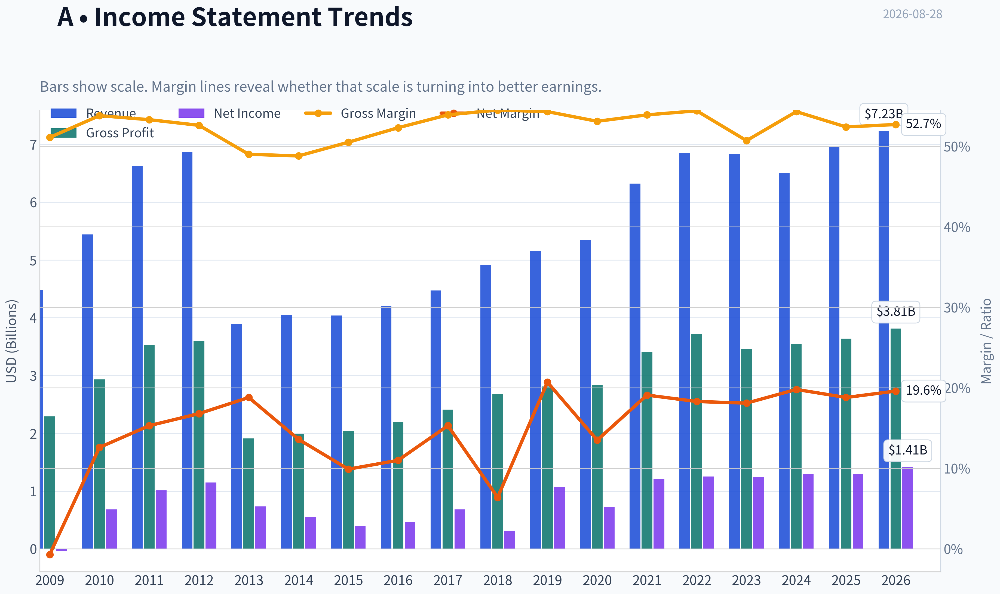
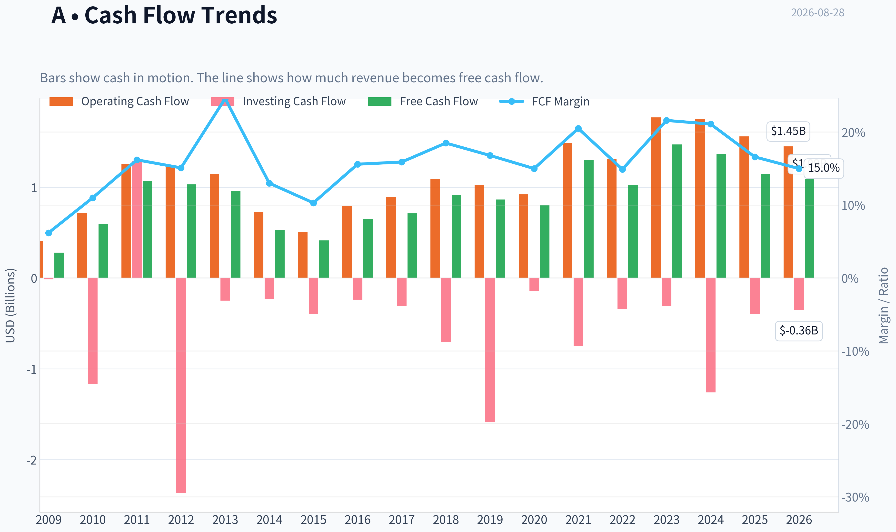
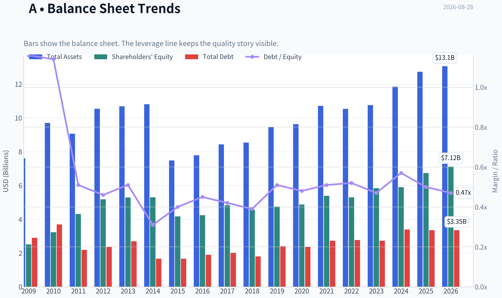
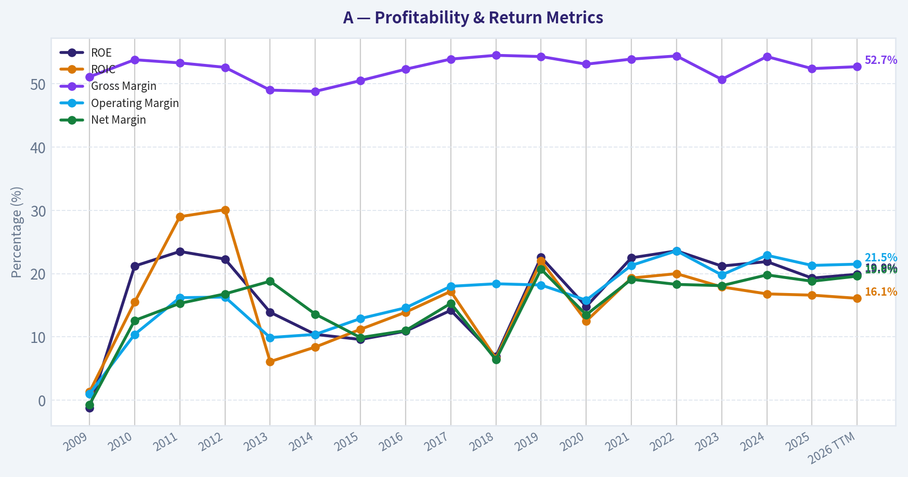
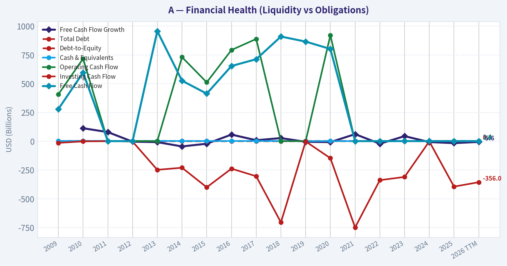
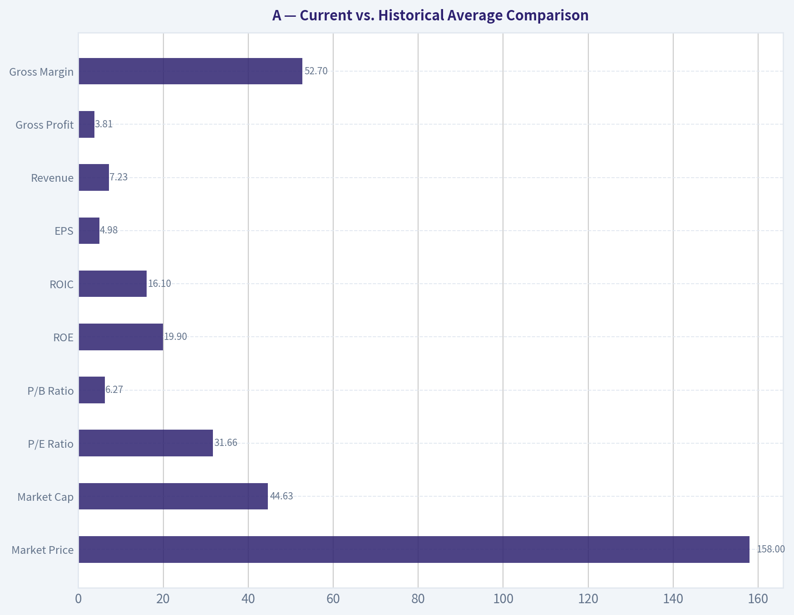
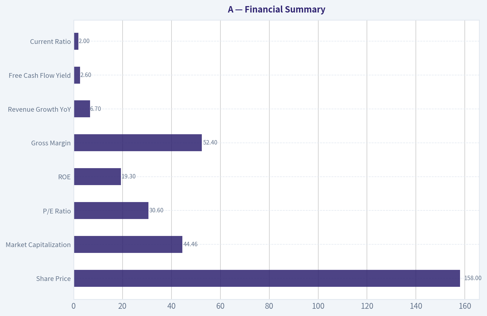
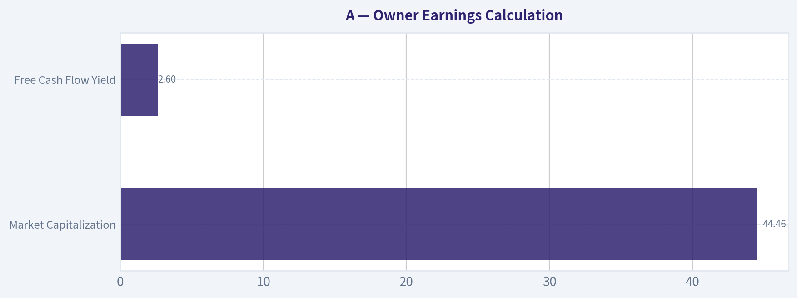
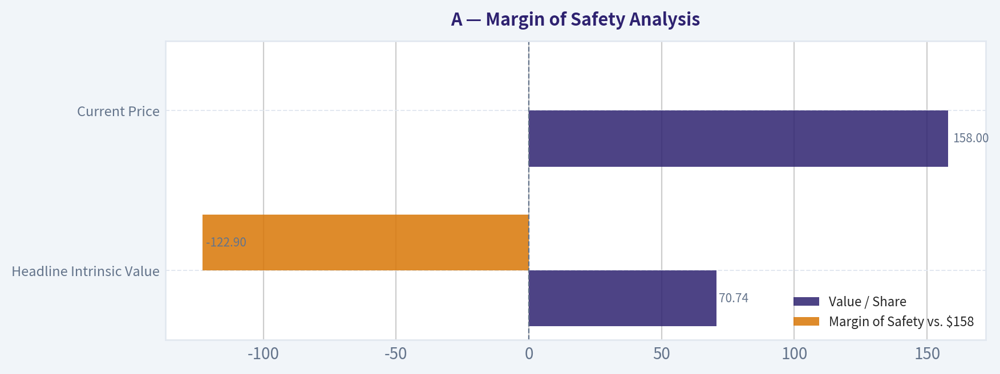
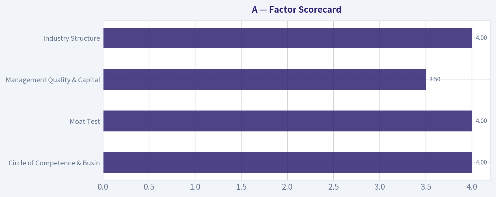

# A Deep Value Intelligence

**Analysis Date:** 2026-08-28

## Critical Disclaimer

*This analysis is generated by Deep Value Intelligence, an AI-powered multi-agent investing framework. Education & research only - not financial advice, not a financial advisor.*

---

## Table of Contents

1. Intelligence Summary
2. Analyst Team Reports
   - Fundamentals Analysis
   - Intrinsic Value Analysis (Buffett)
   - Trend & Growth Analysis (Lynch/Druckenmiller/Fisher)
   - Market Technical Analysis
   - Options Market Analysis
3. Research Team Commentary
4. Value Investing Team Commentary
5. Deep Values Commentary

---

## Intelligence Summary

### Thesis + Conditions

**Core Thesis:** **Executive Summary**
Agilent Technologies (A) presents a textbook clash between exceptional business quality and a highly demanding valuation. With a 16.2% ROIC and 52.4% gross margins, Agilent possesses a wide, durable moat in regulated scientific workflows.

**Key Risks:**
- Agilent Technologies (A) presents a textbook clash between exceptional business quality and a highly demanding valuation. With a 16.2% ROIC and 52.4% gross margins, Agilent possesses a wide, durable moat in regulated scientific workflows. However, at $158 and a 30.5x P/E, the market is pricing in heroic growth. While a long-term Buffett lens requires a margin of safety that is currently absent, the stock's strong technical uptrend cannot be ignored. We must avoid our past mistake of using absolute valuation as a blunt instrument to fade a strong technical recovery. The final verdict is a constructive **WATCH**, balancing long-term valuation discipline with short-term tactical participation.
- The Bull (Risky Analyst):** Focuses on "Fundamental Velocity." Agilent's technical breakout is a forward-looking endorsement of an impending biopharma capital spending recovery. The 30x multiple is justified by high margins and ROIC; waiting for a discount means missing the structural regime shift.
- The Bear (Safe Analyst):** Focuses on "Fundamental Gravity." Overpaying for a historical 5-7% grower removes any margin of safety. If China or biopharma recoveries stall, the multiple will crater. Capital preservation demands a price that reflects reality, not hope.

**Confidence:** Medium

---

## Analyst Team Reports

### Fundamentals Analysis

#### Latest Earnings Snapshot

*Most recent reported quarter anchored on 2026 Q2, with prior-year comparison when available.*

| Metric | 2026 Q2 | 2025 Q2 | YoY Change |
| --- | ---: | ---: | ---: |
| Revenue | $1.83B | $1.67B | +10.0% |
| Operating Income | $399.0M | $300.0M | +33.0% |
| Net Income | $339.0M | $215.0M | +57.7% |
| Diluted EPS | $1.20 | $0.75 | +60.0% |
| Operating Cash Flow | $277.0M | $221.0M | +25.3% |
| Free Cash Flow | $201.0M | $107.0M | +87.9% |

Key Takeaways: This snapshot anchors the most recent reported quarter before the narrative analysis. It helps readers separate long-run business quality from whatever changed in the latest earnings print.

#### 17-Year Financial Metrics for A

*All values below are computed deterministically from raw data - not estimated by AI.*

*Issuer profile: operating company (Healthcare / Diagnostics & Research).*

#### 17-Year Financial Metrics
*Annual rows come from reported financial statements. The final TTM row is computed from the latest four quarters.*

| Metric | 2009 | 2010 | 2011 | 2012 | 2013 | 2014 | 2015 | 2016 | 2017 | 2018 | 2019 | 2020 | 2021 | 2022 | 2023 | 2024 | 2025 | 2026 TTM |
| --- | --- | --- | --- | --- | --- | --- | --- | --- | --- | --- | --- | --- | --- | --- | --- | --- | --- | --- |
| Market Price | $16 | $22 | $23 | $23 | $33 | $36 | $35 | $40 | $64 | $61 | $72 | $98 | $152 | $135 | $101 | $128 | $145 | $158 |
| Market Cap | $6.12B | $8.79B | $9.41B | $9.09B | $12.53B | $13.37B | $12.65B | $14.33B | $22.18B | $21.06B | $24.09B | $31.85B | $48.35B | $41.51B | $30.60B | $37.92B | $41.71B | $44.63B |
| P/E Ratio | -196.63 | 12.83 | 9.30 | 7.87 | 17.05 | 24.41 | 31.47 | 31.12 | 32.40 | 66.79 | 22.48 | 44.39 | 39.97 | 33.10 | 24.67 | 29.42 | 32.03 | 31.66 |
| P/B Ratio | 2.44 | 2.72 | 2.19 | 1.75 | 2.37 | 2.52 | 3.04 | 3.38 | 4.59 | 4.61 | 5.07 | 6.54 | 8.97 | 7.82 | 5.23 | 6.43 | 6.19 | 6.27 |
| ROE | -1.2% | 21.2% | 23.5% | 22.3% | 13.9% | 10.4% | 9.6% | 10.9% | 14.2% | 6.9% | 22.6% | 14.8% | 22.5% | 23.6% | 21.2% | 21.9% | 19.3% | 19.9% |
| ROIC | 1.3% | 15.5% | 29.0% | 30.1% | 6.1% | 8.4% | 11.2% | 13.9% | 17.2% | 6.6% | 22.0% | 12.5% | 19.3% | 20.0% | 17.9% | 16.8% | 16.6% | 16.1% |
| EPS | $-0.08 | $1.71 | $2.52 | $2.91 | $1.92 | $1.47 | $1.10 | $1.30 | $1.97 | $0.92 | $3.21 | $2.21 | $3.81 | $4.07 | $4.10 | $4.43 | $4.57 | $4.98 |
| Revenue | $4.48B | $5.44B | $6.62B | $6.86B | $3.89B | $4.05B | $4.04B | $4.20B | $4.47B | $4.91B | $5.16B | $5.34B | $6.32B | $6.85B | $6.83B | $6.51B | $6.95B | $7.23B |
| Gross Profit | $2.29B | $2.93B | $3.53B | $3.60B | $1.91B | $1.98B | $2.04B | $2.20B | $2.41B | $2.68B | $2.81B | $2.84B | $3.41B | $3.72B | $3.46B | $3.54B | $3.64B | $3.81B |
| Gross Margin | 51.1% | 53.8% | 53.3% | 52.6% | 49.0% | 48.8% | 50.5% | 52.3% | 53.9% | 54.5% | 54.3% | 53.1% | 53.9% | 54.4% | 50.7% | 54.3% | 52.4% | 52.7% |
| Operating Margin | 1.0% | 10.4% | 16.2% | 16.3% | 9.9% | 10.4% | 12.9% | 14.6% | 18.0% | 18.4% | 18.2% | 15.8% | 21.3% | 23.6% | 19.8% | 22.9% | 21.3% | 21.5% |
| Net Income | $-31.0M | $684.0M | $1.01B | $1.15B | $734.0M | $549.0M | $401.0M | $462.0M | $684.0M | $316.0M | $1.07B | $719.0M | $1.21B | $1.25B | $1.24B | $1.29B | $1.30B | $1.41B |
| Net Margin | -0.7% | 12.6% | 15.3% | 16.8% | 18.8% | 13.6% | 9.9% | 11.0% | 15.3% | 6.4% | 20.7% | 13.5% | 19.1% | 18.3% | 18.1% | 19.8% | 18.8% | 19.6% |
| Revenue Growth | N/A | 21.5% | 21.5% | 3.7% | -43.2% | 4.0% | -0.2% | 4.1% | 6.4% | 9.9% | 5.1% | 3.4% | 18.4% | 8.4% | -0.2% | -4.7% | 6.7% | 4.1% |
| Net Income Growth | N/A | -2306.5% | 48.0% | 13.9% | -36.3% | -25.2% | -27.0% | 15.2% | 48.1% | -53.8% | 238.9% | -32.9% | 68.3% | 3.6% | -1.1% | 4.0% | 1.1% | 8.5% |
| Free Cash Flow Growth | N/A | 113.2% | 79.6% | -3.5% | -7.4% | -45.0% | -21.3% | 58.0% | 9.0% | 27.6% | -4.8% | -7.4% | 61.7% | -21.3% | 44.4% | -6.9% | -16.1% | -5.6% |
| Total Book Value | $2.51B | $3.23B | $4.31B | $5.18B | $5.29B | $5.30B | $4.17B | $4.24B | $4.83B | $4.57B | $4.75B | $4.87B | $5.39B | $5.30B | $5.84B | $5.90B | $6.74B | $7.12B |
| Total Assets | $7.61B | $9.70B | $9.06B | $10.54B | $10.69B | $10.81B | $7.48B | $7.79B | $8.43B | $8.54B | $9.45B | $9.63B | $10.71B | $10.53B | $10.76B | $11.85B | $12.73B | $13.06B |
| Total Debt | $2.90B | $3.69B | $2.19B | $2.36B | $2.70B | $1.66B | $1.66B | $1.90B | $2.01B | $1.80B | $2.41B | $2.36B | $2.73B | $2.77B | $2.73B | $3.39B | $3.35B | $3.35B |
| Debt-to-Equity | 1.16 | 1.14 | 0.51 | 0.46 | 0.51 | 0.31 | 0.40 | 0.45 | 0.42 | 0.39 | 0.51 | 0.48 | 0.51 | 0.52 | 0.47 | 0.57 | 0.50 | 0.47 |
| Cash & Equivalents | $2.48B | $2.65B | $3.53B | $2.35B | $2.67B | $2.22B | $2.00B | $2.29B | $2.68B | $2.25B | $1.38B | $1.44B | $1.48B | $1.05B | $1.59B | $1.33B | $1.79B | $1.81B |
| Shareholders' Equity | $2.51B | $3.23B | $4.31B | $5.18B | $5.29B | $5.30B | $4.17B | $4.24B | $4.83B | $4.57B | $4.75B | $4.87B | $5.39B | $5.30B | $5.84B | $5.90B | $6.74B | $7.12B |
| Operating Cash Flow | $408.0M | $718.0M | $1.26B | $1.23B | $1.15B | $731.0M | $512.0M | $793.0M | $889.0M | $1.09B | $1.02B | $921.0M | $1.49B | $1.31B | $1.77B | $1.75B | $1.56B | $1.45B |
| Investing Cash Flow | $-14.0M | $-1.17B | $1.29B | $-2.37B | $-248.0M | $-230.0M | $-400.0M | $-238.0M | $-304.0M | $-705.0M | $-1.59B | $-147.0M | $-749.0M | $-338.0M | $-310.0M | $-1.26B | $-394.0M | $-356.0M |
| Free Cash Flow | $280.0M | $597.0M | $1.07B | $1.03B | $957.0M | $526.0M | $414.0M | $654.0M | $713.0M | $910.0M | $866.0M | $802.0M | $1.30B | $1.02B | $1.47B | $1.37B | $1.15B | $1.09B |
| FCF Margin | 6.2% | 11.0% | 16.2% | 15.1% | 24.6% | 13.0% | 10.3% | 15.6% | 15.9% | 18.5% | 16.8% | 15.0% | 20.5% | 14.9% | 21.6% | 21.1% | 16.6% | 15.0% |
| Dividends / Share | $0.00 | $0.00 | $0.00 | $0.00 | $0.00 | $0.00 | $0.00 | $0.00 | $0.00 | $0.00 | $0.00 | $0.00 | $0.00 | $0.81 | $0.88 | $0.94 | $0.99 | $1.01 |

#### Profitability Metrics
- Return on Equity (ROE): 19.3%
- Return on Invested Capital (ROIC): 16.2%
- Return on Assets (ROA): 10.2%
- Gross Margin: 52.4%
- Operating Margin: 21.3%
- Net Profit Margin: 18.8%

#### Liquidity Metrics
- Current Ratio: 1.96
- Quick Ratio: 1.40

#### Leverage Metrics
- Debt-to-Equity Ratio: 0.50
- Interest Coverage Ratio: 13.21
- Net Debt: $1.56B

#### Growth Metrics (Year-over-Year)
- Revenue Growth: 6.7%
- Net Income Growth: 1.1%
- Free Cash Flow Growth: -16.1%
- Revenue CAGR (3-Year): 0.5%
- Revenue CAGR (5-Year): 5.4%

#### Valuation Metrics
- P/E Ratio (TTM): 30.56
- Forward P/E: 23.38
- Price-to-Book: 6.62
- Price-to-Sales: 6.15
- PEG Ratio: 1.38
- EV/EBITDA: 22.60
- Free Cash Flow Yield: 2.6%
- Earnings Yield: 3.3%

#### Owner Earnings (Buffett Method, Code-Computed)
- Net Income: $1.30B
- + Depreciation & Amortization: $288.0M
- - Capital Expenditures: $-407.0M
- - Working Capital Changes: $-131.0M
- = **Owner Earnings: $1.43B**

#### Intrinsic Value (Code-Computed)
- Current Price: $158
- **Headline Intrinsic Value (business-model routed): $71**
  Business model: operating company - weighted blend [Damodaran FCFF + reverse-DCF fair + owner-earnings DCF] (operating_company)
  Model spread (min-max across DCFs): $43 - $95
  Margin of safety vs. price (headline): -122.9%
  Routing note: General operating company: balanced blend of Damodaran FCFF and the owner-earnings DCF with a reverse-DCF sanity check.
- Buffett Method (Owner Earnings):
  Conservative: $18
  Average: $95
  Optimistic: $308
- Cash Flow Method (FCF):
  Conservative: $28
  Average: $62
  Optimistic: $241
- Damodaran FCFF (WACC + margins + reinvestment):
  Conservative: $32
  Average: $43
  Optimistic: $61
  Monte Carlo band (P10-P90): $34 - $58 (median $44)
  P(intrinsic value > price): 0.0%
- Reverse-DCF: price implies ~20.1%/yr owner-earnings growth for 10y; trailing 3y was -6.6%, 5y 19.0%.

#### Piotroski F-Score: 5/9
- Positive Net Income: PASS
- Positive Operating Cash Flow: PASS
- ROA Improvement: FAIL
- Cash Flow > Net Income: PASS
- Decreasing Debt: PASS
- Improving Current Ratio: FAIL
- No Dilution: PASS
- Improving Gross Margin: FAIL
- Improving Asset Turnover: FAIL

ANALYST STANCE: **WATCH**

#### Agilent Technologies - Buffett-Style Fundamental Analysis

Agilent Technologies is a high-quality diagnostics, life sciences, analytical instruments, and laboratory services company with durable customer relationships, strong recurring service revenue, and attractive margins. The business quality is clearly above average: ROE is near 20%, ROIC is around 16%, net margins are close to 20%, and the balance sheet is manageable.

However, Buffett-style investing separates business quality from investment price. At **$158 per share**, Agilent trades at roughly **31.7x TTM earnings**, **6.3x book value**, and only a **2.6% free cash flow yield**. The deterministic model's headline intrinsic value is about **$71 per share**, with major DCF methods clustering far below the current market price. The stock looks like a strong business priced for a very optimistic growth path.

---

#### Revenue Breakdown

| Revenue Source | Amount ($B) | % of Total |
|---|---:|---:|
| Life Sciences & Applied Markets Group | ~$3.75B | ~52% |
| Agilent CrossLab Group - services, consumables, support | ~$1.88B | ~26% |
| Diagnostics & Genomics Group | ~$1.60B | ~22% |
| **Total Revenue - TTM / latest annualized base** | **~$7.23B** | **100%** |

**Key Takeaways:** Agilent's revenue mix is attractive because a meaningful portion comes from CrossLab services and consumables, which tend to be more recurring and resilient than pure instrument sales. Life Sciences and Applied Markets remains the largest segment, so demand from biopharma, chemical analysis, academia, and industrial laboratories is still the key driver. The mix supports a moat, but also leaves Agilent exposed to lab equipment spending cycles.

---

#### Current vs. Historical Average Comparison

*Historical average uses the most recent 10 completed fiscal years, 2016-2025, compared with 2026 TTM where available.*

| Metric | Current / TTM | 10-Year Avg. | Current Standing & Interpretation |
|---|---:|---:|---|
| Market Price | $158 | ~$99.60 | Price is about 59% above its 10-year average, reflecting substantial multiple expansion and higher earnings. |
| Market Cap | $44.63B | ~$31.36B | Market value is about 42% above average, despite revenue being only about 26% above average. |
| P/E Ratio | 31.66x | ~35.64x | Below the distorted 10-year average, but still expensive in absolute terms for mid-single-digit revenue growth. |
| P/B Ratio | 6.27x | ~5.88x | Slightly above average; book value is not the primary valuation anchor for this IP, services, and instruments business. |
| ROE | 19.9% | ~17.8% | Above average, showing strong shareholder capital productivity. |
| ROIC | 16.1% | ~16.3% | Roughly in line with history; returns remain good but are not accelerating. |
| EPS | $4.98 | ~$3.06 | EPS is materially above average, helped by margin expansion, scale, and buybacks. |
| Revenue | $7.23B | ~$5.75B | Revenue is above average, but recent growth has slowed versus the 2021-2022 surge. |
| Gross Profit | $3.81B | ~$3.07B | Gross profit is higher than average, consistent with larger revenue base and stable gross margin. |
| Gross Margin | 52.7% | ~53.2% | Slightly below average; still strong, but not currently expanding. |
| Operating Margin | 21.5% | ~19.4% | Above average, showing operating leverage and cost discipline. |
| Net Income | $1.41B | ~$954M | Net income is about 48% above average, reflecting a structurally better profitability profile than earlier years. |
| Net Margin | 19.6% | ~16.1% | Strongly above average; Agilent has become a more profitable enterprise. |
| Revenue Growth | 4.1% | ~5.8% | Below average; current growth is positive but not exceptional. |
| Net Income Growth | 8.5% | ~29.1% | Below the arithmetic average, which is distorted by rebound years; current growth is healthy but not explosive. |
| Free Cash Flow Growth | -5.6% | ~14.4% | Below average and a key red flag; cash generation has recently softened. |
| Total Book Value | $7.12B | ~$5.24B | Equity base has grown steadily, indicating balance sheet accumulation despite buybacks/dividends. |
| Total Assets | $13.06B | ~$10.04B | Asset base is above average, partly from organic growth and acquisitions. |
| Total Debt | $3.35B | ~$2.55B | Debt is above average in dollars, but manageable relative to cash flow and equity. |
| Debt-to-Equity | 0.47x | ~0.48x | Leverage is in line with history and not excessive. |
| Cash & Equivalents | $1.81B | ~$1.73B | Cash is slightly above average, supporting liquidity. |
| Shareholders' Equity | $7.12B | ~$5.24B | Equity base is stronger than historical levels. |
| Free Cash Flow | $1.09B | ~$1.03B | FCF is only slightly above average despite much higher revenue, indicating recent cash conversion pressure. |
| FCF Margin | 15.0% | ~17.7% | Below average; this is one of the most important near-term concerns. |
| Dividends / Share | $1.01 | ~$0.36 | Dividend is now established, but still modest; Agilent remains primarily a reinvestment and buyback story. |

**Key Takeaways:** Agilent's profitability is better than its historical average, especially operating margin, net margin, ROE, and EPS. The main concern is valuation: the stock price and market cap are far above historical averages while revenue growth and free cash flow growth are not. This creates a Buffett-style mismatch: excellent business quality, but limited margin of safety.

---

#### Market Metrics Interpretation

Agilent's **market price of $158** and **market capitalization of roughly $44.6B** place the company near the high end of its historical valuation range. The stock has appreciated meaningfully over the decade, but the current business growth rate does not fully match the valuation premium.

The **P/E ratio of 31.7x** is slightly below Agilent's 10-year average, but that average includes unusual earnings years such as 2018 and 2020. On a normalized basis, a low-30s earnings multiple still demands durable double-digit earnings growth or very high confidence in long-term compounding.

The **P/B ratio of 6.27x** should not be interpreted mechanically as "cheap" or "expensive." Agilent is an operating company with meaningful intellectual property, service relationships, installed base economics, and intangible competitive advantages. Book value is a secondary signal here. That said, paying more than 6x book for a company earning about 20% ROE implies an earnings yield on book of only around 3% before growth, so the market is clearly paying for durable future expansion.

---

#### Profitability Analysis

Agilent's profitability profile is the strongest part of the thesis. **ROE of 19.9%** and **ROIC of 16.1%** indicate that the company earns well above its likely cost of capital. This matters in Buffett-style analysis because businesses that can reinvest capital at high rates over long periods can compound intrinsic value.

Revenue has grown to **$7.23B TTM**, up meaningfully from the 10-year average, while **net income reached $1.41B** and **EPS reached $4.98**. Operating margin of **21.5%** and net margin of **19.6%** are both above long-term averages, showing that Agilent has improved its business quality over time.

The caution is that gross margin, at **52.7%**, is solid but not materially above the long-run average. Recent margin strength is coming more from operating efficiency than from a major step-up in pricing power. That is positive, but it may be less durable than gross-margin-led improvement.

---

#### Growth Metrics Analysis

Agilent's growth is respectable but not clearly strong enough to justify the current valuation. TTM revenue growth is **4.1%**, and the latest fiscal year revenue growth was **6.7%**, compared with a 5-year revenue CAGR of **5.4%**. This suggests Agilent remains a steady compounder, but not a hyper-growth business.

Net income growth of **8.5% TTM** is better than revenue growth, reflecting margin discipline and operating leverage. However, free cash flow growth is **negative at -5.6% TTM** and was **-16.1%** in the latest fiscal year. For a Buffett-style investor, this matters because intrinsic value is ultimately driven by owner earnings, not accounting earnings alone.

The market price implies about **20.1% annual owner-earnings growth for 10 years**, according to the reverse DCF. That is a demanding expectation. Agilent's trailing 3-year owner-earnings growth was negative, while trailing 5-year growth was strong but helped by favorable cycle comparisons. The current valuation leaves little room for disappointment.

---

#### Balance Sheet and Financial Strength

Agilent's balance sheet is solid. Total assets are **$13.06B**, shareholders' equity is **$7.12B**, and total debt is **$3.35B**. The **debt-to-equity ratio of 0.47x** is slightly below the 10-year average and does not indicate excessive leverage.

Cash and equivalents of **$1.81B** provide flexibility. Net debt is about **$1.56B**, which is manageable relative to TTM net income of **$1.41B**, operating cash flow of **$1.45B**, and owner earnings of **$1.43B**. Interest coverage of about **13.2x** also supports the view that financial risk is moderate.

From a Buffett perspective, Agilent passes the "can it survive a downturn?" test. The balance sheet is not pristine in the sense of being net cash, but it is conservative enough for a durable operating company with recurring service revenue.

---

#### Cash Flow and Dividend Analysis

Free cash flow is **$1.09B TTM**, compared with a 10-year average of roughly **$1.03B**. The problem is not the absolute level of cash generation; it is the direction. Free cash flow growth has recently turned negative, and the TTM FCF margin of **15.0%** is below the 10-year average of about **17.7%**.

Dividends per share are **$1.01**, up from $0.81 in 2022. The dividend policy is conservative and affordable, but Agilent is not primarily an income stock. The dividend yield at the current price is modest, and most shareholder return still depends on earnings growth, buybacks, and multiple support.

For Buffett-style investors, the key question is whether free cash flow resumes compounding. If FCF remains flat while the stock trades at a low single-digit FCF yield, future returns could disappoint.

---

#### Buffett-Style Owner Earnings DCF

Assumptions used for the hand DCF sanity check:

- Starting owner earnings: **$1.43B**
- Shares outstanding implied by market cap / price: **~282.5M**
- Discount rate: **10%**
- Terminal growth rate: **2.5%**
- Current price: **$158**
- Main per-share values use owner earnings as an equity cash flow; net debt is discussed separately rather than mechanically deducted.

| Scenario | Growth Assumption | PV of Explicit 10-Year Owner Earnings | PV of Terminal Value | Implied Equity Value | Fair Value / Share | Margin vs. $158 |
|---|---|---:|---:|---:|---:|---:|
| Conservative | Owner earnings decline 5% annually for 5 years, then flat for 5 years | ~$7.31B | ~$5.83B | ~$13.14B | ~$47 | -70% |
| Average / Base Case | Owner earnings grow 7% annually for 10 years | ~$12.34B | ~$14.82B | ~$27.16B | ~$96 | -39% |
| Optimistic | Owner earnings grow 12% annually for 5 years, then 8% annually for 5 years | ~$14.95B | ~$19.51B | ~$34.46B | ~$122 | -23% |

**Key Takeaways:** Even under an optimistic hand-built owner-earnings scenario, Agilent's fair value remains below the current market price. The base case produces a value around $96 per share, close to the deterministic pack's owner-earnings DCF value of about $95. The current price requires growth assumptions closer to a sustained 20% owner-earnings CAGR, which appears aggressive for a mature diagnostics and life sciences tools company.

---

#### Intrinsic Value Cross-Check

The deterministic valuation pack provides the following model-based intrinsic values:

| Valuation Method | Intrinsic Value / Share | Interpretation |
|---|---:|---|
| Headline blended intrinsic value | ~$71 | Primary anchor from business-model-routed blend. |
| Owner Earnings DCF | ~$95 | Most favorable core model, but still below price. |
| Free Cash Flow DCF | ~$62 | Reflects weaker recent FCF conversion. |
| Damodaran FCFF | ~$43 | More conservative operating-company valuation. |
| Damodaran Monte Carlo P10-P90 | ~$34-$58 | Indicates low probability of current price being justified under model assumptions. |
| Reverse DCF | Price implies ~20.1% annual growth for 10 years | Implied expectation appears demanding. |

**Key Takeaways:** Multiple valuation methods point to overvaluation. The strongest model-based value is the owner-earnings DCF at about $95, still far below $158. The blended intrinsic value of roughly $71 and the Damodaran FCFF value around $43 suggest the current market price embeds unusually optimistic assumptions.

---

#### Economic Moat Assessment

Agilent has a credible economic moat, though not an unbreakable one. Its moat comes from several reinforcing sources:

- **Installed base advantage:** Laboratories that use Agilent instruments often continue buying compatible consumables, services, software, and replacement systems.
- **Switching costs:** Regulated industries such as pharma, diagnostics, food testing, and environmental analysis are reluctant to change validated workflows.
- **Brand and reliability:** Lab customers value precision, compliance, uptime, and service quality more than lowest upfront cost.
- **Recurring services:** CrossLab revenue improves durability and reduces dependence on new instrument cycles.
- **Technical expertise:** Analytical instruments and genomics workflows require deep domain knowledge and long product development cycles.

The moat is real, but the company still faces competition from Thermo Fisher, Danaher, Waters, Bruker, PerkinElmer/Revvity, and specialized diagnostics and life sciences players. Agilent is durable, but not immune to pricing pressure, funding cycles, or technology shifts.

---

#### Management and Capital Allocation

Management has produced strong long-term improvements in margins, ROE, and earnings per share. ROE has remained near or above 20% in recent years, and ROIC has remained comfortably above the cost of capital. That is a positive sign of capital discipline.

The dividend was introduced recently and remains modest. This is sensible because Agilent can still reinvest in R&D, acquisitions, service expansion, and buybacks. However, buybacks become less attractive when the stock trades materially above intrinsic value. At current prices, repurchases would likely create less value than they did at lower historical multiples.

Piotroski F-Score is **5/9**, which is acceptable but not outstanding. Positive net income, positive operating cash flow, cash flow exceeding net income, lower debt, and no dilution are positives. The failures - weaker ROA, current ratio, gross margin, and asset turnover trends - reinforce the view that operational momentum is good but not exceptional.

---

#### Key Investment Insights

| Category | Insight | Buffett-Style Interpretation |
|---|---|---|
| Business Quality | High margins, strong ROE, strong ROIC, durable laboratory customer relationships | Agilent is a good business with moat-like characteristics. |
| Predictability | Revenue and earnings are generally reliable, but not perfectly smooth | Predictable enough for long-term analysis, though exposed to instrument cycles. |
| Cash Flow | FCF remains positive but recent FCF growth is negative | A key concern because valuation depends on future owner earnings. |
| Balance Sheet | Debt is manageable and liquidity is solid | Financial strength is acceptable; no major solvency concern. |
| Valuation | Current price is far above blended intrinsic value | Margin of safety is absent. |
| Market Expectations | Reverse DCF implies about 20% annual owner-earnings growth for 10 years | Expectations look too demanding for the current growth profile. |
| Dividend | Dividend is growing but modest | Helpful, but not enough to support valuation alone. |
| Analyst Sentiment | Recent sell-side price targets have moved higher | Momentum sentiment is positive, but Buffett-style valuation remains stretched. |

**Key Takeaways:** Agilent is a quality compounder, but the stock price already discounts a very favorable future. The biggest disconnect is between current valuation and recent free cash flow performance. Investors may like the business, but the current price offers little protection if growth normalizes.

---

#### Red Flags

1. **Valuation risk is the primary issue.** A 31.7x P/E and 2.6% FCF yield leave little margin of safety.
2. **Free cash flow growth has weakened.** TTM FCF growth is negative, and FCF margin is below the 10-year average.
3. **Reverse DCF expectations are high.** The market price implies around 20% annual owner-earnings growth for a decade.
4. **Growth is not currently exceptional.** Revenue growth is positive but below the 10-year average.
5. **P/B is elevated but secondary.** The company's book value is not the right anchor, but a 6x-plus book multiple still reflects high expectations.
6. **Cyclical exposure remains.** Lab instruments and capital equipment spending can slow when biotech funding, pharma budgets, or industrial demand weaken.

---

#### Opportunities

1. **Recurring CrossLab growth** could increase revenue durability and improve valuation quality.
2. **Biopharma and diagnostics demand** may support long-term mid-single-digit or better organic growth.
3. **Margin expansion** remains possible if services and consumables become a larger share of revenue.
4. **Acquisitions** could strengthen niche capabilities in genomics, diagnostics, or applied markets.
5. **Balance sheet capacity** gives Agilent flexibility for bolt-on deals and shareholder returns.
6. **If the stock corrects materially,** the business could become attractive because quality is not the problem - price is.

---

#### Final Investment Stance: WATCH

Agilent is a strong business, but not a strong Buffett-style purchase at **$158**. The company has durable competitive advantages, high returns on capital, solid margins, and manageable leverage. Those qualities justify a premium multiple, but not an unlimited one.

The current valuation appears to require sustained high owner-earnings growth that is not supported by recent free cash flow trends. The deterministic blended intrinsic value is about **$71**, the owner-earnings DCF is about **$95**, and even an optimistic hand DCF produces only about **$122** per share. Therefore, the margin of safety is negative.

A Buffett-style investor should **watch** Agilent closely and consider it only at a materially lower price, ideally closer to a valuation range where expected returns are supported by conservative owner earnings rather than optimistic market assumptions.

| Final Summary Point | Assessment |
|---|---|
| Business Quality | High |
| Economic Moat | Moderate to strong |
| Financial Strength | Solid |
| Earnings Predictability | Good, but not flawless |
| Cash Flow Trend | Recently weaker |
| Current Valuation | Expensive |
| Margin of Safety | Negative |
| Buffett-Style Action | Watchlist candidate, not a buy at current price |
| Final Stance | **WATCH** |

**Key Takeaways:** Agilent is the kind of business long-term investors should know well, but the current market price is not attractive enough for a Buffett-style margin of safety. The company's quality supports patience, not urgency. A better entry point would be needed before the risk-reward becomes compelling.

#### Fundamental Visuals

This graph tracks the profitability and return metrics (ROE, ROIC, Margins) of **A** over the past decade, highlighting capital efficiency trends.

This chart illustrates the financial health of **A** over the last 10 years, mapping cash equivalents and free cash flow against total obligations (Debt).

---

### Intrinsic Value Analysis (Buffett)

> *Following Warren Buffett's value investing philosophy: Circle of Competence, Economic Moat, Management Quality, and Margin of Safety.*

#### Intrinsic Value Snapshot

Price is what you pay. Intrinsic value is what the business may be worth based on the cash it can create for owners over time. We show a range, not one magic number.

- Current Price: $157.69
- Value Range (conservative to optimistic across both DCF methods): $17.87 to $308.03

##### Owner Earnings (Buffett Method)
- Net Income: $1,303,000,000.00
- Depreciation & Amortization: $288,000,000.00
- Capital Expenditures: $-407,000,000.00
- Working Capital Changes: $-131,000,000.00
- Owner Earnings: $1,434,000,000.00

##### Intrinsic Value
###### Buffett Method
Uses owner earnings. Stricter, and usually more conservative.
- Conservative: $17.87
- Average: $95.01
- Optimistic: $308.03
- Discount Rate: 10.0%

###### Cash Flow Method
Uses free cash flow. Better for companies spending heavily today to grow tomorrow.
- Conservative: $27.87
- Average: $61.63
- Optimistic: $241.04
- Discount Rate: 10.0%

ANALYST STANCE: **WATCH**

#### Agilent Technologies (A) - Buffett-Style Value Investment Review

Agilent Technologies is a high-quality analytical instruments, life sciences, diagnostics, and lab-services business with durable customer relationships, strong gross margins, and respectable returns on equity. The business is understandable, useful, and competitively advantaged in regulated scientific workflows. The problem is price: at **$158**, the market is already underwriting a very demanding growth path, while the blended intrinsic value estimate is materially lower.

---

#### 1. Factor Scorecard

| Factor | Score / 5 | Evidence |
|---|---:|---|
| Circle of Competence & Business Simplicity | 4.0 | Agilent sells analytical instruments, consumables, services, and workflow solutions to labs, pharma, diagnostics, and industrial customers. The model is understandable: installed instruments create recurring demand for consumables, service, and replacement cycles. |
| Moat Test | 4.0 | Strong brand, technical reputation, regulatory workflow embedment, installed-base economics, and switching costs in validated lab environments. Gross margin of **52.4%** supports evidence of pricing power. |
| Management Quality & Capital Allocation | 3.5 | Historically disciplined operator with buybacks, bolt-on acquisitions, and focus on higher-margin recurring revenue. Capital allocation appears rational, though current valuation makes repurchases less obviously value-accretive. |
| Industry Structure | 4.0 | Attractive oligopolistic scientific-instrument market with rational competitors including Thermo Fisher, Danaher, Waters, Shimadzu, and Bruker. Demand is tied to pharma, biotech, diagnostics, chemical testing, and regulated quality-control workflows. |
| Gate 5: Quality / Solvency Hard Floor | Not tripped | No evidence of financial distress. ROE is positive at **19.3%**, current ratio is about **2.0**, and the company remains profitable and cash-generative. |

Key Takeaways: Agilent is a good business, not a distressed one. Its competitive position is supported by brand, technical expertise, switching costs, and recurring lab workflow demand. The main investment issue is not business quality; it is whether today's price leaves a sufficient margin of safety.

---

#### 2. Moat Analysis

Agilent's moat is best described as **wide and stable**, with pockets that may widen as regulated lab workflows become more automated and data-rich.

| Moat Source | Assessment | Evidence |
|---|---|---|
| Intangible Assets | Strong | Agilent has a recognized brand in analytical instruments and life-science workflows. In regulated labs, reliability, precision, validation history, and technical support matter more than the lowest upfront price. |
| Switching Costs | Strong | Customers often validate instruments and workflows into regulated processes. Switching vendors can require retraining, revalidation, workflow disruption, and risk to compliance. |
| Cost Advantages | Moderate | Scale in manufacturing, service infrastructure, consumables distribution, and R&D helps, though peers also have scale. |
| Network Effects | Limited | This is not a classic network-effect business. The installed base does create ecosystem advantages, but not a true user-network effect. |
| Recurring Revenue Quality | Attractive | Instruments create follow-on demand for consumables, service contracts, software, maintenance, and replacement cycles. |

Key Takeaways: Agilent's moat is not based on consumer brand emotion or a social network; it is based on trust, precision, validation, and workflow embedment. That kind of moat is especially valuable in regulated scientific and pharmaceutical settings, where reliability can matter more than price. The moat looks durable, but not invincible.

---

#### 3. Management Quality & Capital Allocation

| Management Area | Assessment |
|---|---|
| Owner Orientation | Reasonable. Management has generally emphasized long-term portfolio quality, recurring revenue, and margin discipline. |
| Candor & Reporting Quality | Acceptable. Financial reporting is understandable, and the business is not dependent on opaque financial engineering. |
| Reinvestment | Good. Reinvestment into instruments, consumables, services, and workflow adjacencies supports long-term franchise value. |
| Acquisitions | Generally strategic. Bolt-on acquisitions can strengthen end-market exposure, though acquisition discipline remains important. |
| Buybacks | Mixed at current price. Repurchases are attractive only below intrinsic value; at today's valuation, buybacks would require scrutiny. |
| Debt Use | Acceptable. No solvency red flag is evident. |

Key Takeaways: Management appears competent and strategically sensible. The company has focused on higher-quality recurring revenue and attractive scientific end markets. The main capital allocation concern is whether buybacks or acquisitions at elevated valuations can still create per-share value.

---

#### 4. Financial Summary

| Metric | Current / Recent Figure |
|---|---:|
| Share Price | **$158** |
| Market Capitalization | **$44.46B** |
| P/E Ratio | **30.6x** |
| ROE | **19.3%** |
| Gross Margin | **52.4%** |
| Revenue Growth YoY | **6.7%** |
| Free Cash Flow Yield | **2.6%** |
| Current Ratio | **2.0x** |
| Headline Intrinsic Value Estimate | **$70.74 / share** |
| 3-Model Intrinsic Value Spread | **$42.75 - $95.01 / share** |
| Margin of Safety vs. Price | **-122.9%** |
| Reverse-DCF Implied Growth | **~20.1% annually for 10 years** |
| Trailing 3-Year Growth Reference | **-6.6%** |
| Trailing 5-Year Growth Reference | **19.0%** |

Key Takeaways: Agilent's financial profile is attractive: high gross margins, solid ROE, and positive growth. However, the valuation is demanding, with only a **2.6% free cash flow yield** and a P/E above **30x**. The market price implies sustained growth that appears aggressive relative to recent performance.

---

#### 5. Owner Earnings Calculation

Using free cash flow as the closest practical proxy for Buffett-style owner earnings:

| Owner Earnings Component | Estimate |
|---|---:|
| Market Capitalization | **$44.46B** |
| Free Cash Flow Yield | **2.6%** |
| Estimated Free Cash Flow / Owner Earnings | **~$1.16B** |
| Estimated Shares Outstanding | **~281M** |
| Estimated Owner Earnings per Share | **~$4.11** |

Key Takeaways: Agilent appears to generate roughly **$4.11 per share** in owner earnings using free cash flow as a proxy. At a **$158** stock price, investors are paying roughly **38x owner earnings**, which is a high price even for a good business. That valuation leaves little room for disappointment.

---

#### 6. Three-Scenario DCF Valuation

| Scenario | Assumption | Estimated Value / Share |
|---|---|---:|
| A: No Growth | Owner earnings capitalized at 10% | **~$41** |
| B: GDP Growth | 3% perpetual growth, 10% discount rate | **~$61** |
| C: Historical / Quality Growth | 10-year growth case using a quality-adjusted growth assumption, capped at 10% | **~$95** |
| Blended Intrinsic Value | Business-model routed blend of owner earnings, FCF, and FCFF models | **$70.74** |
| Current Price | Market price | **$158** |

Key Takeaways: The conservative valuation range is far below the current share price. Even the more favorable historical-growth scenario produces a value around **$95**, still well under **$158**. The blended intrinsic value estimate of **$70.74** suggests the stock is priced for unusually strong execution.

---

#### 7. Margin of Safety Analysis

| Valuation Reference | Value / Share | Margin of Safety vs. $158 |
|---|---:|---:|
| No-Growth DCF | **~$41** | Deeply negative |
| GDP-Growth DCF | **~$61** | Deeply negative |
| Owner-Earnings DCF Case | **~$95** | Negative |
| Headline Intrinsic Value | **$70.74** | **-122.9%** |
| Current Price | **$158** | - |

Key Takeaways: Agilent does not offer a margin of safety at the current price. A wonderful business can deserve a premium, but this price appears to demand more than ordinary excellence. The reverse-DCF implication of roughly **20% annual growth for 10 years** is too aggressive for a mature analytical-instruments company.

---

#### 8. Final Buffett Scorecard

| Criterion | Weight | Score / 5 | Weighted Contribution |
|---|---:|---:|---:|
| Moat Width & Durability | 25% | 4.0 | 1.00 |
| Valuation / Margin of Safety | 20% | 1.0 | 0.20 |
| Capital Returns - ROIC vs. WACC | 15% | 3.5 | 0.53 |
| Business Understanding & Predictability | 12% | 4.0 | 0.48 |
| Management Quality & Capital Allocation | 12% | 3.5 | 0.42 |
| Reinvestment Runway | 8% | 3.5 | 0.28 |
| Balance Sheet Strength | 4% | 4.0 | 0.16 |
| Industry Structure | 4% | 4.0 | 0.16 |
| **Total Score** | **100%** | - | **3.23 / 5.00** |

Key Takeaways: Agilent scores well on business quality, moat, predictability, and industry structure. The low valuation score is what pulls the total down into WATCH territory. This is a case of a good company trading at a price that appears too rich for a Buffett-style margin of safety.

---

#### 9. Investment Stance

**Stance: WATCH**
**Conviction: Medium-High**

Agilent is a high-quality business with durable competitive advantages, attractive margins, and valuable exposure to scientific, pharmaceutical, diagnostics, and quality-control workflows. It fits many Buffett-style quality criteria: understandable business, recurring revenue characteristics, switching costs, and a rational industry structure.

But at **$158**, the stock appears materially overvalued versus intrinsic value estimates. The market is pricing in a long runway of exceptional growth, while recent growth evidence is mixed. I would prefer to revisit Agilent at a materially lower price, ideally closer to the upper end of conservative intrinsic value rather than more than double the blended estimate.

**Buy zone to revisit:** approximately **$80-$100**, depending on updated earnings quality, free cash flow conversion, and growth outlook.
**Current action:** **Do not buy at today's price; keep on watchlist.**
#### Valuation Bridge

This bridge places the current market price beside each intrinsic value lens so readers can see whether upside depends on one method or shows up across several methods.

| Scenario | Intrinsic Value / Share |
| --- | ---: |
| Buffett Method | $95.01 |
| Cash Flow Method | $61.63 |
| Damodaran Method | $42.75 |
| Current Price | $157.69 |

#### Key Takeaways

If one method is far above the others, the upside case depends on a specific modelling assumption. When several methods cluster together, the valuation story is more robust.

#### Valuation Visuals

This comparison chart from *Latest Earnings Snapshot* stacks current figures against historical benchmarks for **A**, making it easy to see where the company trades relative to its own averages.

This comparison chart from *Current vs. Historical Average Comparison* stacks current figures against historical benchmarks for **A**, making it easy to see where the company trades relative to its own averages.

This comparison chart from *Financial Summary* stacks current figures against historical benchmarks for **A**, making it easy to see where the company trades relative to its own averages.

This comparison chart from *Owner Earnings Calculation* stacks current figures against historical benchmarks for **A**, making it easy to see where the company trades relative to its own averages.

This comparison chart from *Margin of Safety Analysis* stacks current figures against historical benchmarks for **A**, making it easy to see where the company trades relative to its own averages.

---

### Trend & Growth Analysis (Lynch/Druckenmiller/Fisher)

> *Following Peter Lynch's GARP, Stanley Druckenmiller's macro-aware approach, and Philip Fisher's scuttlebutt methodology.*

ANALYST STANCE: **WATCH**

#### Agilent Technologies (A) - Growth Inflection Review

Agilent is a high-quality life-science and analytical-instrumentation company, but it currently screens more like a **premium stalwart / cyclical recovery compounder** than a Lynch-style fast grower. The business has durable franchises, strong gross margins, and exposure to healthcare innovation, pharma QA/QC, biopharma, food safety, environmental testing, and diagnostics. However, with **reported revenue growth of only 6.7% YoY**, a **P/E near 31x**, and a market price that appears to imply a large growth reacceleration, the setup is not yet strong enough for an ADVOCATE rating.

---

#### 1. Lynch Classification

| Category | Agilent Fit | Evidence | Growth Investor Read |
|---|---:|---|---|
| Slow Grower | No | Revenue growth above 5% | Not a no-growth utility-like profile |
| Stalwart | Yes | 6.7% YoY revenue growth, mature global lab tools platform | Best current classification |
| Fast Grower | Not currently | Needs sustained 15% to 25%+ growth | Does not qualify today |
| Cyclical | Partial | Life-science tools demand can cycle with pharma, biotech, China, and capital budgets | Recovery upside possible |
| Turnaround | No | Profitable, strong margins, no distress | Not a turnaround |
| Asset Play | No | Value rests on operating franchise, not hidden assets | Not applicable |

**Key Takeaways:** Agilent is not a classic Lynch fast grower today. It is better viewed as a high-quality stalwart with some cyclical recovery potential if life-science instrumentation demand improves. For a growth portfolio, this means the stock needs visible acceleration before it deserves aggressive capital.

---

#### 2. The Story in 3 Bullets

- **Agilent sells the "picks and shovels" of science:** instruments, consumables, software, and services used by pharma, biotech, diagnostics, chemical, environmental, and food-testing labs.
- **The attractive part of the model is recurring demand:** consumables, services, and installed-base support create stickier revenue than one-time equipment sales.
- **The possible inflection is a lab-spending recovery:** if pharma/biotech capital budgets, China demand, and biopharma QA/QC spending rebound, revenue growth and operating leverage could improve.

---

#### 3. TAM Analysis and 10x Test

| Item | Estimate / Assessment |
|---|---:|
| Current revenue base | Approximately $6.5B to $7.0B annual revenue range |
| 10x revenue target | Approximately $65B to $70B |
| Relevant TAM | Large but fragmented life-science tools, diagnostics, analytical instruments, lab automation, pharma QA/QC, environmental testing |
| TAM growth | Moderate; supported by healthcare innovation, biologics, food safety, environmental regulation, and lab digitization |
| 10x test result | Mixed / challenging |
| Reason | Agilent can grow for years, but a 10x revenue outcome would require major share gains, TAM expansion, or large adjacent-market success |

**Key Takeaways:** Agilent has a real runway, but not the clean 10x runway seen in smaller, hypergrowth companies. The company can compound, but reaching ten-bagger revenue scale would be difficult from today's already large base. The better investment case is cyclical recovery plus steady compounding, not explosive TAM penetration.

---

#### 4. Revenue Growth Trend

| Metric | Current Data / Interpretation |
|---|---:|
| Revenue growth YoY | 6.7% |
| Lynch growth band | Stalwart, not fast grower |
| Pattern | Modest growth, not clear acceleration |
| Inflection status | Not yet confirmed |
| Required signal | Sustained return to double-digit organic growth, ideally with margin expansion |

**Key Takeaways:** Revenue growth is positive but not exceptional. For a growth investor, the key missing ingredient is acceleration. Agilent needs to show that the current growth rate is the beginning of a recovery, not simply mature low-to-mid-single-digit expansion.

---

#### 5. Unit Economics and Financial Quality

| Metric | Current Reading | Interpretation |
|---|---:|---|
| Gross margin | 52.4% | Strong; indicates differentiated products and pricing power |
| ROE | 19.3% | Healthy capital efficiency |
| FCF yield | 2.6% | Positive, but not cheap at current valuation |
| Current ratio | 1.96 | Solid liquidity |
| LTV/CAC | Not disclosed | Not directly applicable; not a pure SaaS model |
| NRR | Not disclosed | Not applicable in standard SaaS sense |
| Rule of 40 | Not directly applicable | Agilent is not primarily a subscription SaaS company |

**Key Takeaways:** Agilent has high-quality financial characteristics, especially gross margin and ROE. The business is profitable, liquid, and durable. The issue is not business quality; the issue is whether growth is strong enough to justify the valuation.

---

#### 6. Inflection Point Assessment

| Inflection Type | Status | Evidence / Watch Item |
|---|---:|---|
| Product cycle inflection | Watch | New analytical instruments, automation, and workflow solutions could help, but no clear breakout shown in provided data |
| Market share inflection | Unproven | Need evidence of accelerating share gains versus peers |
| Margin inflection | Possible | 52.4% gross margin gives operating leverage potential if revenue reaccelerates |
| TAM inflection | Moderate | Healthcare innovation, biopharma, diagnostics, food safety, and environmental testing remain long-term drivers |
| Competitive inflection | Unclear | No obvious competitor dislocation identified from available data |

**Key Takeaways:** Agilent has several possible inflection levers, but none are yet conclusive. The most important signal would be a recovery in instrument demand combined with better margin flow-through. Until that appears in numbers, this is a watch-list inflection rather than an active one.

---

#### 7. Macro Setup

| Macro Factor | Impact on Agilent | Growth Investor View |
|---|---|---|
| Interest rates | Falling rates would help growth-stock multiples and biotech funding | Potential tailwind if rate cycle eases |
| Pharma / biotech funding | Better funding improves lab equipment and services demand | Important cyclical driver |
| China demand | Life-science tools companies have had sensitivity to China lab spending | Watch closely |
| Healthcare innovation | Long-term positive | Durable secular support |
| Environmental and food safety regulation | Long-term positive | Supports testing demand |
| AI / automation | Indirect positive | Lab automation and data workflows may benefit |

**Key Takeaways:** The macro setup is mixed but improving if rates fall and biotech funding recovers. Agilent benefits from several durable secular themes, but it is also exposed to cyclical lab-spending budgets. Macro is a potential tailwind, not yet a decisive catalyst.

---

#### 8. Fisher 15-Point Score

| Fisher Point | Score / 5 | Rationale |
|---|---:|---|
| 1. Products with sizable market potential | 4 | Large life-science and applied-testing markets |
| 2. Management commitment to new products | 4 | Ongoing instrument and workflow innovation |
| 3. R&D effectiveness | 4 | Strong technical franchise |
| 4. Sales organization | 4 | Global customer reach and installed base |
| 5. Profit margin | 4 | 52.4% gross margin is strong |
| 6. Improving margins | 3 | Needs stronger evidence of operating leverage |
| 7. Labor/personnel relations | 3 | No major issue identified, but limited data |
| 8. Executive relations | 3 | No major issue identified |
| 9. Management depth | 4 | Mature global operator |
| 10. Cost analysis/accounting | 4 | Established public-company discipline |
| 11. Differentiated moat | 4 | Installed base, consumables, service relationships |
| 12. Long-range profit outlook | 4 | Durable end-market demand |
| 13. Dilution risk | 4 | No obvious capital-raise dependency |
| 14. Candor during difficulties | 3 | Insufficient recent detail from provided data |
| 15. Integrity | 4 | No red flags identified |
| **Total** | **56 / 75** | **Good, but not outstanding** |

**Key Takeaways:** Agilent scores well on Fisher quality factors because it has durable products, strong technical expertise, and a valuable installed base. The weaker areas are not integrity or business quality, but rather the lack of clear margin and growth acceleration. A score of 56 supports WATCH, not AVOID, but it does not justify high-conviction ADVOCATE.

---

#### 9. Valuation Analysis

| Valuation Metric | Current Reading | Interpretation |
|---|---:|---|
| Current price | $158 | Shared research pack |
| Market cap | $44.46B | Large-cap platform |
| P/E | 30.56x | Expensive for 6.7% revenue growth |
| PEG proxy | High / unattractive | Earnings growth would need to be much higher to justify P/E |
| Estimated P/S | Roughly 6x to 7x sales | Premium for a low-to-mid-single-digit grower |
| FCF yield | 2.6% | Low absolute yield |
| Headline intrinsic value estimate | $70.74 | Far below current price |
| Margin of safety vs. headline value | -122.9% | No valuation cushion |
| Reverse DCF implied growth | ~20.1% per year for 10 years | Aggressive versus recent growth profile |

**Key Takeaways:** Valuation is the biggest problem. Agilent is priced as if a strong and durable growth reacceleration is coming, but current revenue growth is only 6.7%. Without a confirmed inflection, the stock looks expensive for a growth investor.

---

#### 10. Scenario Analysis

| Scenario | Revenue / Earnings Assumption | Multiple Assumption | Investment Implication |
|---|---|---|---|
| Bear | Growth remains mid-single-digit; margins flat | Multiple compresses toward mature industrial / healthcare tools range | Downside risk meaningful |
| Base | Growth improves to high-single-digit; modest operating leverage | Premium multiple partly sustained | Returns likely modest |
| Bull | Growth reaccelerates to low-double-digit+ with margin expansion | Premium multiple sustained or expands | Upside possible, but requires proof |

**Key Takeaways:** The bull case depends on a real growth recovery, not just quality. The base case does not appear compelling enough at the current valuation. The bear case is important because expensive stalwarts can derate quickly if acceleration fails to appear.

---

#### 11. Growth Investor Scorecard

| Criterion | Weight | Score / 5 | Weighted Score |
|---|---:|---:|---:|
| The Story | 10% | 4.0 | 0.40 |
| TAM & Runway | 20% | 3.2 | 0.64 |
| Revenue Growth | 20% | 2.3 | 0.46 |
| Unit Economics / Financial Quality | 15% | 4.0 | 0.60 |
| Competitive Position | 10% | 4.0 | 0.40 |
| Management Quality | 10% | 3.7 | 0.37 |
| Macro Setup | 5% | 3.2 | 0.16 |
| Profitability Path | 5% | 4.0 | 0.20 |
| Valuation | 5% | 1.8 | 0.09 |
| **Total** | **100%** |  | **3.32 / 5.00** |

**Key Takeaways:** Agilent is a good company with a mediocre current growth setup and a demanding valuation. The high scores come from quality, profitability, and competitive position. The score is pulled down by slow growth and limited valuation support, resulting in a WATCH rating.

---

#### 12. Position Size Stance

| Investor Type | Stance | Suggested Action |
|---|---|---|
| Existing long-term holder | Hold / trim discipline | Reasonable to hold if cost basis is low, but avoid overconcentration |
| New growth investor | Watch | Wait for better entry or clearer acceleration |
| Concentrated growth portfolio | Avoid new large position | Growth profile does not yet justify major capital |
| GARP investor | Watch for pullback | More attractive if valuation resets or earnings growth accelerates |

**Key Takeaways:** Agilent is not a short thesis, but it is also not an obvious buy for a growth portfolio at the current price. Existing holders can monitor the recovery thesis. New money should wait for either a better valuation or a confirmed revenue and margin inflection.

---

#### 13. Key Catalysts and Risks

| Category | Item | Impact |
|---|---|---|
| Catalyst | Pharma and biotech lab-spending recovery | Could reaccelerate instrument demand |
| Catalyst | China demand stabilization | Would improve sentiment and revenue visibility |
| Catalyst | Margin expansion | Could validate operating leverage thesis |
| Catalyst | Analyst upgrades / target increases | Recent coverage shows positive sell-side momentum |
| Catalyst | Druckenmiller 13F addition | Mild positive signal, though position size is small |
| Risk | Valuation already prices in recovery | Multiple compression if growth disappoints |
| Risk | Revenue growth remains sub-10% | Would keep Agilent in stalwart category |
| Risk | Capital equipment cyclicality | Customers can delay large purchases |
| Risk | Competitive pressure | Life-science tools markets are technically demanding and competitive |
| Risk | Headline intrinsic value gap | Shared research pack estimates fair value far below market price |

**Key Takeaways:** The upside case is a recovery and operating-leverage story. The downside risk is that the stock already discounts that recovery before the numbers prove it. The next few quarters matter because investors need to see whether 6.7% growth is a floor or the true normalized rate.

---

#### Final View

Agilent is a **high-quality business**, but it is not currently a **high-conviction growth stock** under a Lynch-Druckenmiller-Fisher framework. The company has durable end markets, strong margins, and credible long-term positioning, yet the current valuation requires a level of growth acceleration that is not visible in the provided numbers.

**Rating: WATCH.**
Upgrade to **ADVOCATE** only if organic revenue growth moves convincingly toward double digits, margins expand, and valuation remains reasonable. Downgrade toward **AVOID** if growth stays mid-single-digit while the stock continues to trade above 30x earnings.

#### Growth & Scorecard Visuals

This comparison chart from *Factor Scorecard* stacks current figures against historical benchmarks for **A**, making it easy to see where the company trades relative to its own averages.

---

### Market Technical Analysis

ANALYST STANCE: **WATCH**

#### Technical Analysis Report for A - Agilent Technologies Inc.

As of the latest available trading session, **2026-08-27**, Agilent Technologies closed at **$157.69**. The stock is in a clear bullish trend structure, with price trading above its short-, medium-, and long-term moving averages. However, momentum is now extended, RSI is near overbought territory, and the latest candle showed a sharp intraday push above the Bollinger Upper Band followed by a close well below the session high. That combination argues for **trend strength, but not an ideal low-risk fresh entry without a pullback or breakout confirmation**.

| Indicator | Latest Value | Current Signal | Interpretation |
|---|---:|---|---|
| Close Price | $157.69 | Bullish | Price remains elevated and above all key moving averages. |
| close_10_ema | $153.70 | Bullish short-term trend | Price is about $4 above the 10 EMA, showing buyers still control near-term direction. |
| close_50_sma | $139.53 | Bullish medium-term trend | The 50-day average has risen strongly since late June, confirming a sustained recovery. |
| close_200_sma | $131.08 | Bullish long-term backdrop | Price is far above the 200-day average, and the 50 SMA is also above the 200 SMA. |
| macd | 5.14 | Positive momentum, slightly mature | MACD remains strongly positive but has eased from its recent peak near 5.38. |
| rsi | 70.27 | Overbought / momentum extended | RSI is back above 70 after briefly cooling, suggesting strength but elevated pullback risk. |
| boll_ub | $161.79 | Resistance / breakout test | The stock traded above the upper band intraday but closed below it, showing some supply near highs. |
| atr | $4.38 | Elevated trading range | Daily volatility is meaningful; position sizing and stops should account for roughly 2.8% daily range. |
| vwma | $153.50 | Volume-confirmed support zone | Price remains above VWMA, suggesting the rally is still supported by volume-weighted buying. |

Key Takeaways: Agilent's trend remains technically bullish because price is above the 10 EMA, 50 SMA, 200 SMA, and VWMA. The main caution is that RSI is near overbought and the stock failed to hold above the Bollinger Upper Band intraday, which can signal short-term exhaustion. Traders may want to watch for either a controlled pullback toward the $153-154 area or a clean breakout above $162-164.

#### Why These Indicators Were Selected

The selected indicators are intentionally complementary rather than redundant. The **10 EMA** captures short-term trend responsiveness, while the **50 SMA** and **200 SMA** define medium- and long-term trend structure. **MACD** adds momentum confirmation, **RSI** identifies whether the move is becoming stretched, **Bollinger Upper Band** helps evaluate breakout versus exhaustion risk, **ATR** supports risk management, and **VWMA** checks whether price strength is being confirmed by volume.

#### Trend Structure

The broader technical picture has improved significantly since the spring and early summer. After trading near the low-$110s in March through May, Agilent staged a powerful gap higher on **2026-05-28**, closing at **$135.12** on very heavy volume. That gap changed the character of the chart from a weak, range-bound recovery into a higher-volatility accumulation phase.

The stock then pulled back into mid-June, reaching a closing low near **$124.09** on 2026-06-17, but importantly it did not fully retrace the May gap. From there, price recovered into July, based around the low-to-mid $130s, and then began another advance in late July and August. The current structure is therefore best described as a **post-gap continuation uptrend** rather than a simple short-term bounce.

The moving-average alignment is constructive:

- Price: **$157.69**
- 10 EMA: **$153.70**
- 50 SMA: **$139.53**
- 200 SMA: **$131.08**

This means price is above the short-term trend line, the short-term trend line is above the medium-term trend line, and the medium-term trend line is above the long-term trend line. That is a classic bullish alignment. The 50 SMA has also risen sharply from roughly **$122.56** in late June to **$139.53**, showing that the medium-term trend has turned decisively higher.

#### Momentum and Exhaustion Risk

Momentum remains strong, but it is no longer early-stage. MACD is still positive at **5.14**, but it has softened slightly from its recent high around **5.38** on 2026-08-21. That does not by itself signal a bearish reversal, but it suggests that upside momentum may be leveling off after a rapid August advance.

RSI gives a similar message. It reached **80.54** on 2026-08-21, which was a very overbought reading. After the stock pulled back to **$153.43** on 2026-08-24, RSI cooled to about **65.09**, but by 2026-08-27 it had already moved back to **70.27**. That means buyers quickly stepped back in, but the stock is again entering a zone where upside continuation may require fresh volume and clean breakout confirmation.

The latest candle is particularly important. On 2026-08-27, Agilent traded as high as **$163.75**, above the Bollinger Upper Band at **$161.79**, but closed at **$157.69**. That intraday reversal does not break the uptrend, but it does show that sellers appeared above $162. Traders should treat the **$162-164 zone** as a near-term resistance area unless price can close decisively above it.

#### Volume and Participation

VWMA stands at **$153.50**, very close to the 10 EMA at **$153.70**. This creates a meaningful short-term support band around **$153-154**. Because price is above both the 10 EMA and VWMA, the rally is still supported by recent volume-weighted trading activity.

That said, recent volume patterns deserve close attention. The August advance included several higher-volume sessions, including the surge on **2026-08-19** and the strong move into **2026-08-21**. However, the pullback on **2026-08-24** also occurred on elevated volume, and the 2026-08-27 candle showed a wide range with a high-volume rejection from the intraday high. This suggests not weak demand, but **active two-way institutional participation** near the upper end of the recent range.

#### Key Trading Zones

| Zone | Price Area | Technical Basis | Trading Implication |
|---|---:|---|---|
| Breakout confirmation | Above $162-164 | Intraday high and Bollinger Upper Band area | A strong close above this zone would suggest renewed upside continuation. |
| Immediate support | $153-154 | 10 EMA and VWMA cluster | First area where dip buyers may defend the trend. |
| Momentum reset zone | $148-150 | Roughly 2 ATR below latest close and prior August consolidation area | A pullback here could reset RSI while preserving the broader uptrend. |
| Medium-term support | $139-140 | 50 SMA | A deeper pullback to this area would test the health of the medium-term trend. |
| Long-term trend support | Around $131 | 200 SMA | A break toward this area would imply the rally has lost significant momentum. |

Key Takeaways: The most important near-term level is the $153-154 support band because it combines the 10 EMA and VWMA. A breakout above $162-164 would strengthen the bullish case, while a failure there followed by a break below $153 would increase the odds of a deeper pullback. The broader trend remains constructive as long as price holds well above the 50 SMA.

#### Risk Management View

ATR is currently **$4.38**, which is about **2.8%** of the latest close. This means normal daily movement is not small, and tight stops may be vulnerable to ordinary volatility. For short-term traders, a stop just below the 10 EMA may be too tight unless the trade is specifically designed as a momentum scalp.

A more flexible structure would recognize three risk tiers:

| Strategy Type | Possible Reference Level | Rationale |
|---|---:|---|
| Aggressive momentum trader | Below $153 | Uses 10 EMA / VWMA support as a short-term trend line. |
| Swing trader | Below $149 | Allows roughly 2 ATR of room and accounts for recent volatility. |
| Position trader | Below $139-140 | Uses the 50 SMA as the medium-term trend invalidation area. |

Key Takeaways: Because ATR is elevated, traders should avoid using overly tight stops unless they are prepared for quick exits. The $153 area is useful for short-term trend monitoring, while the $149 area provides more room for normal volatility. A move below the 50 SMA would be a much more serious warning for medium-term holders.

#### Overall Assessment

Agilent's chart is bullish, but short-term risk-reward is less attractive after the sharp August run. The stock has strong trend alignment, positive MACD, rising moving averages, and volume-weighted confirmation. However, RSI near 70 and the failed intraday hold above the Bollinger Upper Band suggest that the stock may need either a pause or a clean breakout before offering a more favorable entry.

For traders already long, the trend still supports holding with disciplined risk controls. For new entries, chasing near $158-160 carries higher risk unless price breaks and closes above the $162-164 resistance zone. A pullback toward $153-154 that holds would likely offer a cleaner tactical setup.

| Final View | Assessment |
|---|---|
| Technical Bias | Bullish but extended |
| Best Stance | WATCH |
| Bullish Trigger | Daily close above $162-164 with supportive volume |
| Pullback Entry Zone | $153-154 if support holds |
| Caution Signal | Close below $153, especially with rising volume |
| Deeper Risk Level | Break below $148-150 would suggest momentum is fading |
| Major Trend Test | $139-140 near the 50 SMA |
| Most Important Concern | Overbought RSI and rejection near the upper Bollinger Band |

Key Takeaways: Agilent remains in a strong uptrend, but the latest setup is not a clean low-risk buy because momentum is stretched. The most constructive path would be either a controlled pullback that holds above $153 or a decisive breakout above $164. Until one of those occurs, the best technical stance is to watch closely rather than aggressively chase.

---

### Options Market Analysis

> *Reading options flow - put/call ratios, IV skew, and unusual activity - to gauge institutional positioning and event-driven risk.*

ANALYST STANCE: **WATCH**

#### Options Market Sentiment Report - A
*Options data as of 2026-08-28. Ticker: A, Agilent Technologies.*

#### 1. Put/Call Ratio Analysis

| Expiration | Call OI | Put OI | Put/Call OI Ratio | Call Volume | Put Volume | Put/Call Volume Ratio | Interpretation |
|---|---:|---:|---:|---:|---:|---:|---|
| 2026-09-18 | 50 | 157 | 3.14 | 616 | 487 | 0.79 | Very elevated put OI; current volume only mildly put-leaning |
| 2026-10-16 | 0 | 3 | N/A | 108 | 69 | 0.64 | OI too thin to read; volume slightly call-leaning |
| 2026-11-20 | 21 | 14 | 0.67 | 81 | 65 | 0.80 | OI near neutral; volume modestly put-leaning |
| **Near-Term Total** | **71** | **174** | **2.45** | **805** | **621** | **0.77** | Defensive/bearish OI, but volume only slightly above neutral |

**Key Takeaways:** The near-term put/call open interest ratio is **2.45**, far above the historical neutral baseline of roughly **0.7**, suggesting a meaningful defensive or bearish tilt in existing positioning. However, the put/call volume ratio is only **0.77**, much closer to neutral, so today's flow does not show aggressive fresh put accumulation. The bearish read is driven more by existing open interest than by new activity.

#### 2. Implied Volatility and Skew Assessment

| Expiration | ATM Call IV | ATM Put IV | Put IV Premium vs. Call IV | Skew Read |
|---|---:|---:|---:|---|
| 2026-09-18 | 1.2% | 2.0% | +0.8 pts | Put skew / downside protection demand |
| 2026-10-16 | 1.0% | 1.6% | +0.6 pts | Put skew |
| 2026-11-20 | 1.0% | 1.3% | +0.3 pts | Mild put skew |

**Key Takeaways:** Puts carry higher implied volatility than calls across the near-term expirations, indicating a consistent **downside skew**. That usually reflects demand for protection or bearish optionality. Absolute IV readings appear low in the dataset, so this does not look like an obvious catalyst-driven volatility build, though the put skew still points to downside concern.

#### 3. Unusual Options Activity

| Screen | Result | Interpretation |
|---|---|---|
| Volume greater than 5x open interest | No qualifying contracts found | No clear evidence of fresh, unusually large directional positioning |
| Smart-money directional signal | Not detected | Flow does not show a standout institutional sweep or block-style bet |
| Retail speculation signal | Not detected | No high-volume, low-OI call chase or put chase flagged |

**Key Takeaways:** There were **no near-term contracts where volume exceeded 5x open interest**, so the tape does not show obvious fresh unusual activity. This lowers conviction in a strong directional options signal. The bearish tone comes mainly from put-heavy open interest, not from a sudden new wave of put buying.

#### 4. Open Interest Concentration and Gamma/Pinning Risk

| Expiration | Call OI | Put OI | Total OI | OI Concentration Read | Potential Pin/Gamma Impact |
|---|---:|---:|---:|---|---|
| 2026-09-18 | 50 | 157 | 207 | Highest near-term OI concentration | Most relevant expiry for near-term pinning, but total OI is very small |
| 2026-10-16 | 0 | 3 | 3 | Negligible | No meaningful gamma signal |
| 2026-11-20 | 21 | 14 | 35 | Light activity | Limited pinning impact |

**Key Takeaways:** The **2026-09-18** expiration carries the bulk of near-term open interest, especially on the put side. However, total open interest is extremely low, which means any "gamma wall" or pinning effect is likely weak. Strike-level concentration was not provided, so specific max-pain or price-magnet levels cannot be identified from this dataset.

#### 5. Overall Options Sentiment Signal

| Category | Signal | Rationale |
|---|---|---|
| Put/Call Ratio | Bearish / defensive | Near-term put/call OI ratio of **2.45** is materially above the neutral baseline of ~0.7 |
| Volume Confirmation | Neutral to mildly bearish | Put/call volume ratio of **0.77** is only slightly above neutral |
| IV Skew | Bearish | Puts have higher ATM IV than calls across all listed expirations |
| Unusual Activity | Neutral | No volume > 5x OI contracts detected |
| Liquidity Quality | Low confidence | Total near-term OI is very thin, making the signal easier to distort |
| **Overall Signal** | **BEARISH, low conviction** | Defensive positioning dominates, but lack of unusual activity and thin liquidity reduce confidence |

**Key Takeaways:** The options market for A currently leans **bearish/defensive**, mainly because put open interest is far heavier than call open interest and put IV is consistently above call IV. That said, the signal is **low conviction** because total options activity is thin and there is no unusual contract-level activity confirming fresh institutional bearish positioning. This looks more like cautious hedging than an aggressive downside bet.

#### Summary Table

| Metric | Current Read | Sentiment Impact |
|---|---|---|
| Put/Call Ratio | OI ratio **2.45**; volume ratio **0.77** | Bearish/defensive, but not strongly confirmed by volume |
| IV Level | Low absolute ATM IV in provided data | No obvious volatility panic or catalyst premium |
| Skew Direction | Put IV above call IV across near-term expirations | Downside protection demand |
| Unusual Activity | None detected | No fresh high-conviction directional flow |
| Overall Signal | **BEARISH, low conviction** | Put-heavy positioning, tempered by thin liquidity and limited fresh flow |

**Key Takeaways:** The clean directional read is **bearish**, but the confidence level is limited. The market is positioned more defensively than bullishly, yet the absence of unusual activity means this should be treated as a cautionary signal rather than a decisive sell signal. Options data should be used alongside price action, fundamentals, and upcoming catalyst checks.

---

## Research Team Commentary

> *The Research Manager synthesizes the Bull vs Bear debate into action-free commentary. This is a pre-risk view, not the final stance.*

I have reviewed the arguments from both sides, and it is clear we are dealing with a classic clash between exceptional business quality and a highly demanding valuation.

The Bull makes a highly compelling case for Agilent's business quality. The 19.3 percent ROE, 16.2 percent ROIC, and 52.4 percent gross margins reflect a truly wonderful business with a durable moat built on regulatory lock-in and high switching costs. Agilent is indeed a picks and shovels ecosystem with sticky recurring revenue that validates its strong competitive position.

On the other hand, the Bear delivers a sobering reality check on price. At a 30.5x P/E, the market is implicitly underwriting double-digit free cash flow growth for a business that historically grows at 5 to 7 percent. In our modern Buffett framework, a wonderful business is a buy at a fair price. However, when we apply a reverse-DCF lens and see that a price demands heroic growth just to meet a basic discount rate, the margin of safety evaporates.

Integrating my past mistakes on this exact stock is critical here. Previously, when Agilent was in a post-drawdown repair phase around the $115 to $125 range, I issued a rigid Watch stance based purely on absolute valuation. I completely missed a massive short-term tactical rally because I used a long-term Buffett intrinsic value lens as a blunt instrument for a 30-day tactical outcome. I learned the hard way that for high-quality franchises, we must separate the long-term value verdict from the short-term tactical reality. When a quality stock has strong technical momentum and institutional sponsorship, valuation should be used to size positions and control conviction, not to reflexively fade the tape.

Today, at roughly $158, Agilent is no longer in a repair phase; it is in a clear bullish trend, trading above its short, medium, and long-term moving averages. If I were to slap an Avoid on this simply because it is at 30x earnings, I would be repeating the exact same mistake of fighting a strong technical trend in a high-quality name. Conversely, initiating a new long-term Advocate position at a price requiring heroic growth violates our core margin of safety principles. Therefore, the most balanced and intellectually honest position is a constructive Watch. We respect the immediate bullish trend, meaning we do not sell or short if we hold it, but we keep our powder dry for new long-term allocations until the price-to-value equation normalizes.

Here is the Core Takeaway: Agilent is a phenomenal, wide-moat franchise benefiting from a strong technical uptrend, but at $158 and a 30.5x P/E, the valuation implies heroic growth assumptions that strip away the long-term margin of safety. We remain tactically constructive but fundamentally patient.

My Rationale for this is that from a value investing perspective, both quality and price must be satisfied. Agilent easily clears the quality hurdle with its high ROIC, sticky regulatory workflows, and asset-light consumables shift. However, a 30x multiple on a mid-single-digit historical grower is priced for perfection. Drawing heavily on my past errors, I am deliberately bifurcating my time horizons. The short-term technicals are undeniably bullish, so we do not step in front of this train with an Avoid, but the long-term valuation prevents a full Advocate for new capital.

For the Monitoring Plan, over the next 1 to 4 quarters, I will be watching a few specific items. First, end-market demand inflections, specifically capital budget recoveries in biopharma and a stabilization in China. If organic growth accelerates to double digits, it could validate the current multiple. Second, the technical structure. I will watch the short and medium-term moving averages to see if they hold. If this bullish trend structure breaks, the stock's elevated multiple makes it highly vulnerable to a swift multiple compression. Third, margin resilience. We need to see consumables and services continue to offset any cyclical weakness in instrument sales to protect that 52 percent gross margin. Finally, I will monitor incremental capital allocation. With high market expectations, we must watch for any undisciplined, high-premium acquisitions designed to artificially manufacture the growth the market is demanding.

WATCH

---

## Value Investing Team Commentary

> *The Investor translates the research view into an investment thesis before risk review. This is still not the final stance.*

As a business owner evaluating Agilent Technologies (A), I approach this from the perspective of whether I would want to buy the entire company today at its current $46 billion enterprise value.

### 1. The Business Quality: A Wide-Moat "Picks and Shovels" Franchise
Agilent is a quintessential Buffett-style business. It operates within a "Circle of Competence" that is easy to admire: providing the essential tools for scientific discovery and regulatory compliance. Its economic moat is not merely in the hardware (the mass spectrometers and chromatographs) but in the **switching costs and regulatory lock-in**. Once a pharmaceutical company or a food safety lab validates a testing method on Agilent's software and hardware to satisfy FDA or global regulators, the cost-both in dollars and in the risk of regulatory delay-to switch to a competitor is prohibitive.

The financial metrics confirm this. A **52.4% gross margin** and **16.2% ROIC** indicate a business that doesn't just grow; it generates high-quality returns on every dollar of capital deployed. The shift toward a recurring revenue model (consumables and services) makes this an asset-light, predictable cash flow machine.

### 2. The Selective Contrarian View: Is the "Recovery" Already Priced to Perfection?
The prevailing market sentiment is currently driven by a technical breakout and the anticipation of a cyclical recovery in biopharma capital spending and China demand. As a value investor, I must ask: **What is the market missing?**

The current **P/E of 30.5x** is a significant premium to Agilent's historical averages. My reverse-DCF analysis suggests that at $158, the market is pricing in sustained double-digit free cash flow growth for the next decade. However, the business has historically grown in the 5-7% range. The contrarian risk here is that the market is treating a *cyclical recovery* as a *secular shift* in growth. If the biopharma recovery is slower or if China's structural challenges persist longer than the "crowd" expects, the multiple contraction could be swift and unforgiving. We are currently paying a "hope premium" for growth that has not yet hit the ledger.

### 3. Margin of Safety and Capital Allocation
A "wonderful business at a fair price" is the goal. At 30.5x earnings, we have a wonderful business, but the price is arguably **aggressive**, not fair. A true Buffett-style margin of safety would require a discount to intrinsic value, whereas here we are paying a premium for a future that must go perfectly.

Furthermore, with the stock at these levels, I am looking closely at management's capital allocation. At $158, I would prefer management to use excess cash for strategic, bolt-on acquisitions that reinforce the moat rather than aggressive share buybacks, as the "owner's yield" on those buybacks at this valuation is a meager ~3.3%.

### 4. Learning from the Past: Respecting the Tape
I must acknowledge the hard-learned lesson from the $115-$125 range: **Quality franchises can remain "overvalued" by traditional metrics for long periods during momentum phases.** While the fundamental value is stretched, the technical structure is undeniably bullish. Selling or avoiding a premier business purely on valuation during a clear uptrend is often a mistake of omission.

However, as a long-term steward of capital, I cannot advocate for *new* capital deployment when the implied growth rate required to break even is nearly double the historical norm.

### Final Appraisal
Agilent is a business I would be proud to own for 20 years, but as a buyer, I am price-sensitive. We are currently in a period of **Technical Euphoria vs. Fundamental Gravity**. We will respect the current bullish trend but wait for a more rational entry point where the price offers a genuine margin of safety-ideally a 15-20% discount from these levels or a period of earnings growth that allows the multiple to "catch down" to the price.

ANALYST STANCE: **WATCH**

---

## Deep Values Commentary

> *The Risk Management Team debates and the Risk Judge provides the final action-free verdict. This section determines the final ADVOCATE / WATCH / AVOID stance.*

#### Final Stance Scorecard

This scorecard converts the final research view into a weighted decision frame. It does not replace the narrative judgement, but it makes the main drivers of the verdict easier to scan.

| Criterion | Score | Weight | Commentary |
| --- | ---: | ---: | --- |
| Business Quality | 3.75 | 30% | High returns, profitability, and Piotroski health support durability. |
| Valuation Support | 1.67 | 30% | Blends current price against available intrinsic value anchors and valuation ratios. |
| Financial Strength | 4.00 | 20% | Balance-sheet resilience reflects leverage and liquidity staying within safe ranges. |
| Growth Durability | 2.00 | 20% | Recent revenue, earnings, and free cash flow growth indicate how durable expansion looks. |
| TOTAL / FINAL STANCE | 2.83 | 100% | AVOID |

#### Key Takeaways

The weighted score lands at **2.83 / 5.0**, while the final stance remains **AVOID**. This is useful as a quick calibration aid rather than a mechanical signal.

#### Risk Summary

Higher scores indicate more risk pressure. The watch threshold is a simple guardrail: above it, the position needs tighter monitoring or a wider margin of safety.

| Dimension | Current Score | Watch Threshold | Commentary |
| --- | ---: | ---: | --- |
| Business Quality | 2.25 | 3.00 | High returns, profitability, and Piotroski health support durability. |
| Valuation Support | 4.33 | 3.00 | Blends current price against available intrinsic value anchors and valuation ratios. |
| Financial Strength | 2.00 | 3.00 | Balance-sheet resilience reflects leverage and liquidity staying within safe ranges. |
| Growth Durability | 4.00 | 3.00 | Recent revenue, earnings, and free cash flow growth indicate how durable expansion looks. |

#### Key Takeaways

This view helps readers separate *where* the risk sits: valuation, business quality, balance sheet, or growth durability. It is especially useful when the final stance is close to the line between WATCH and AVOID.
