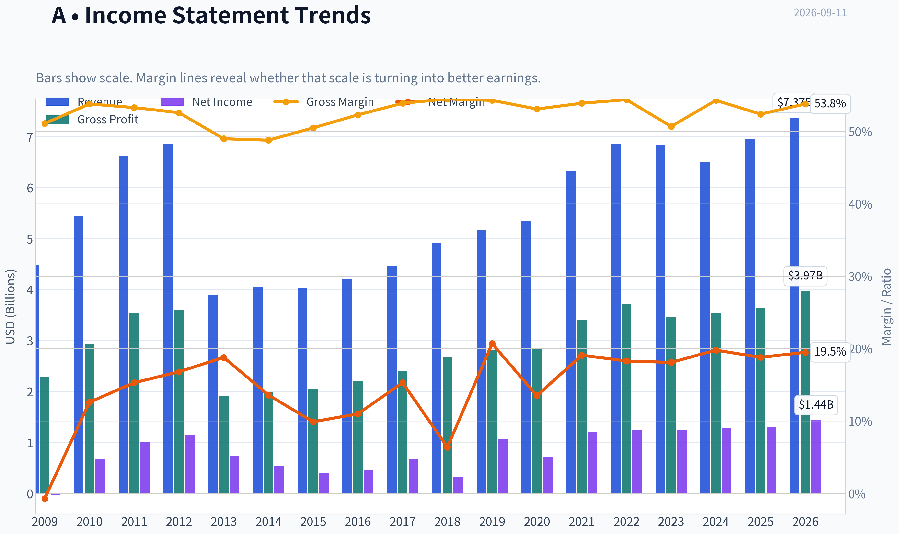
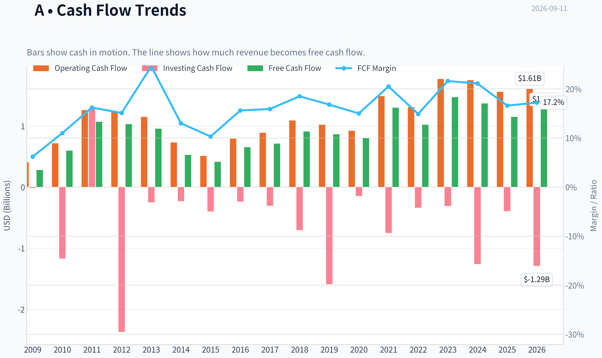
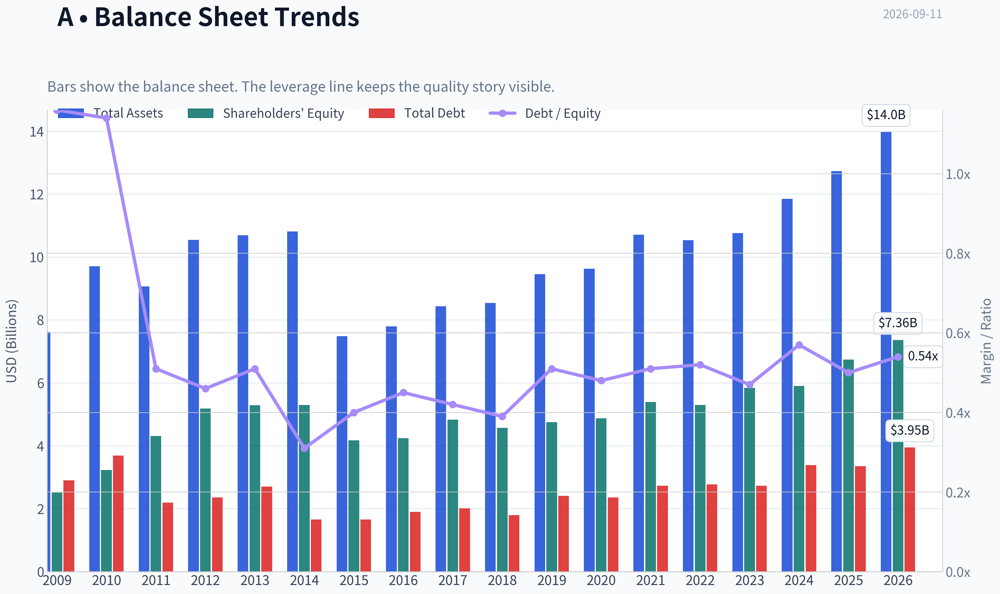
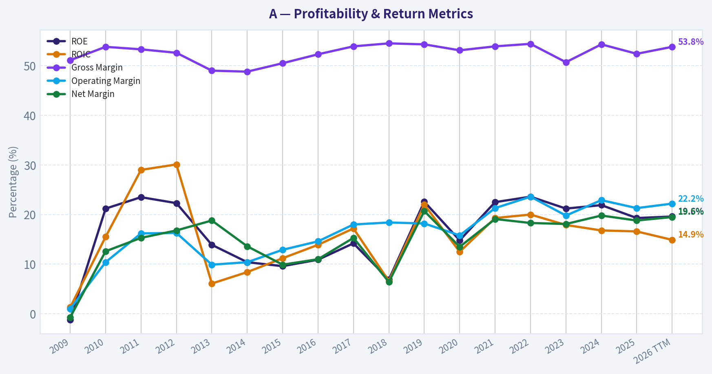
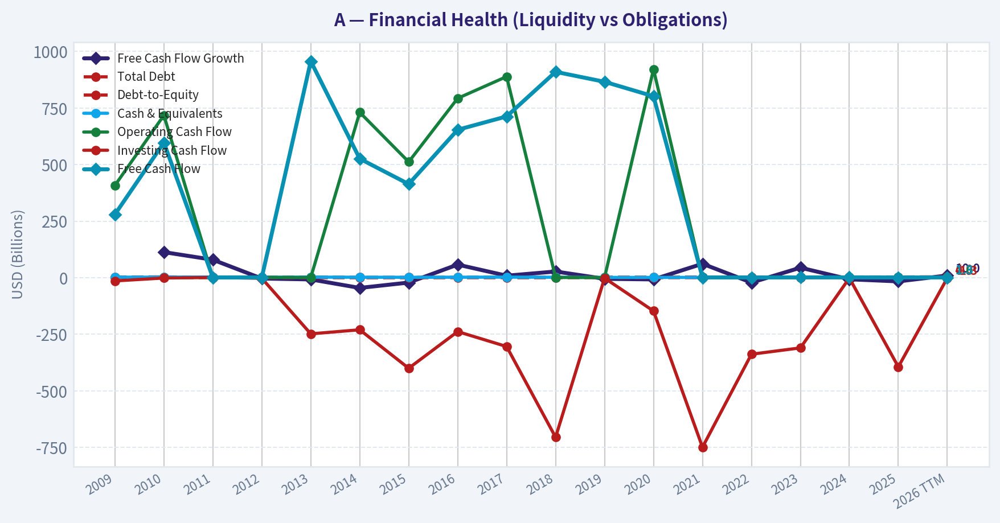
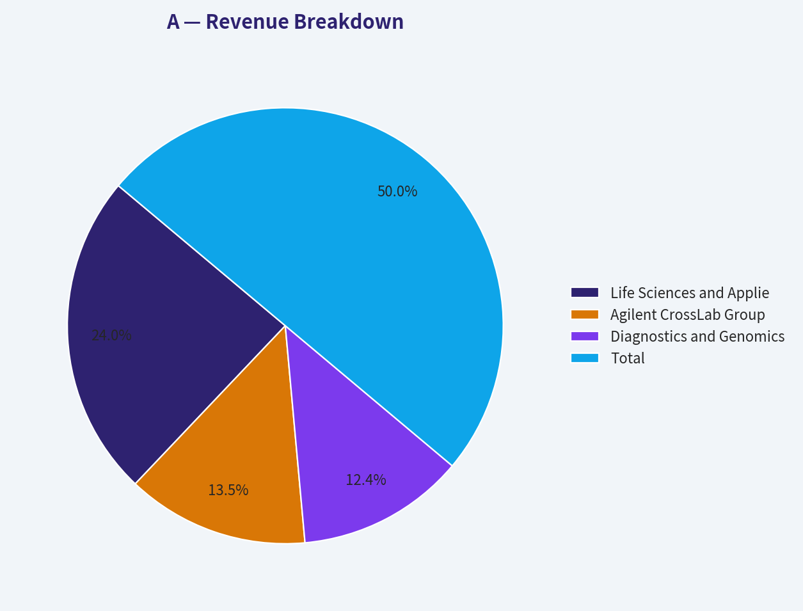
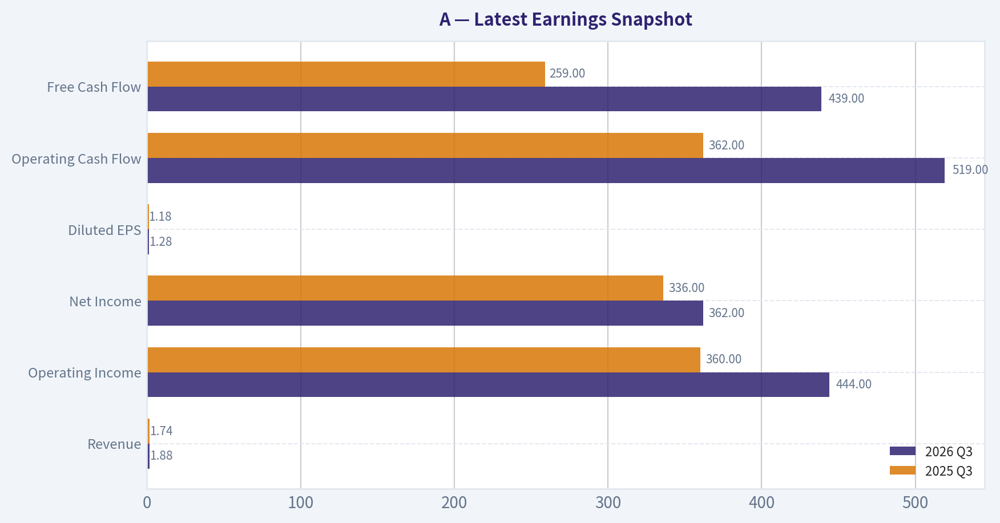
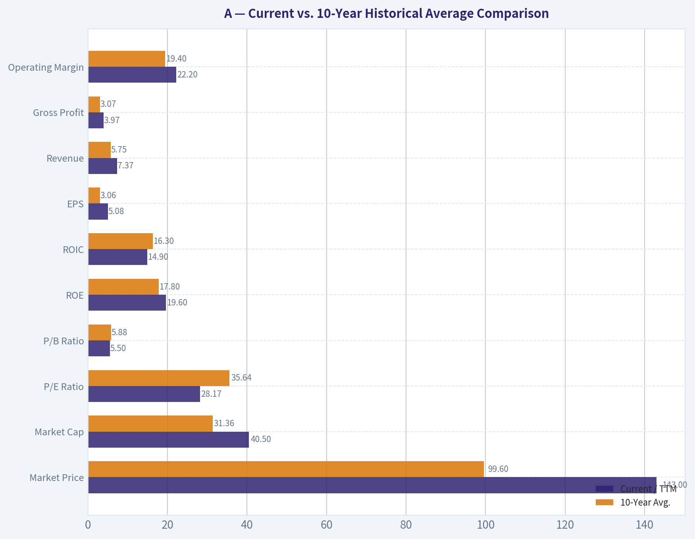
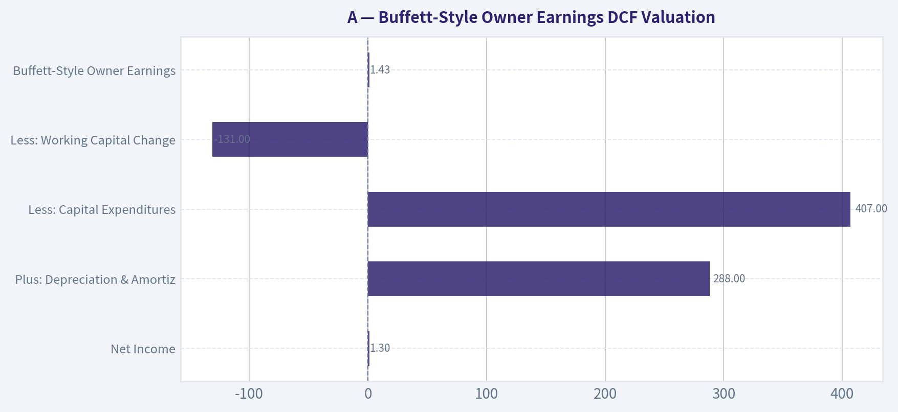

# A Deep Value Intelligence

**Analysis Date:** 2026-09-11

## Critical Disclaimer

*This analysis is generated by Deep Value Intelligence, an AI-powered multi-agent investing framework. Education & research only - not financial advice, not a financial advisor.*

---

## Table of Contents

1. Intelligence Summary
2. Analyst Team Reports
   - Fundamentals Analysis
   - Intrinsic Value Analysis (Buffett)
   - Trend & Growth Analysis (Lynch/Druckenmiller/Fisher)
   - Market Technical Analysis
   - Options Market Analysis
3. Research Team Commentary
4. Value Investing Team Commentary
5. Deep Values Commentary

---

## Intelligence Summary

### Thesis + Conditions

**Core Thesis:** **EXECUTIVE SUMMARY**
Agilent (A) is an elite, wide-moat compounder generating 16.2% ROIC and 52.4% gross margins. However, at $143 (28.6x P/E), the stock is priced for flawless macroeconomic execution, leaving a razor-thin margin of safety.

**Key Risks:**
- Agilent (A) is an elite, wide-moat compounder generating 16.2% ROIC and 52.4% gross margins. However, at $143 (28.6x P/E), the stock is priced for flawless macroeconomic execution, leaving a razor-thin margin of safety. Under our Value Investing Framework, the primary risk here is not business impairment, but **overpaying**. The easy tactical rebound from recent lows has fully played out. We are shifting to a tiered-entry strategy: maintaining a highly constructive **WATCH** to capitalize on a modest multiple contraction (target ~24-25x P/E) without demanding a deep-value discount that elite franchises rarely offer.
- Risky Analyst (The Moat Focus):** Agilent is a "technological toll booth." High regulatory switching costs protect its consumables/software ecosystem. Valuation fears cause investors to miss out on compounding machines. China changes are a strategic pivot to higher-margin, high-end segments.
- Safe Analyst (The Valuation/Risk Focus):** A 28.6x P/E (3.5% earnings yield) offers no margin of safety against Treasuries. If growth slows, a multiple contraction to 20x risks a 30% capital drawdown. Losing mid-market volume in China threatens the economies of scale needed to fund R&D. Buybacks at 29x are value-destructive.

**Confidence:** Medium

---

## Analyst Team Reports

### Fundamentals Analysis

#### Latest Earnings Snapshot

*Most recent reported quarter anchored on 2026 Q3, with prior-year comparison when available.*

| Metric | 2026 Q3 | 2025 Q3 | YoY Change |
| --- | ---: | ---: | ---: |
| Revenue | $1.88B | $1.74B | +8.1% |
| Operating Income | $444.0M | $360.0M | +23.3% |
| Net Income | $362.0M | $336.0M | +7.7% |
| Diluted EPS | $1.28 | $1.18 | +8.5% |
| Operating Cash Flow | $519.0M | $362.0M | +43.4% |
| Free Cash Flow | $439.0M | $259.0M | +69.5% |

Key Takeaways: This snapshot anchors the most recent reported quarter before the narrative analysis. It helps readers separate long-run business quality from whatever changed in the latest earnings print.

#### 17-Year Financial Metrics for A

*All values below are computed deterministically from raw data - not estimated by AI.*

*Issuer profile: operating company (Healthcare / Diagnostics & Research).*

#### 17-Year Financial Metrics
*Annual rows come from reported financial statements. The final TTM row is computed from the latest four quarters.*

| Metric | 2009 | 2010 | 2011 | 2012 | 2013 | 2014 | 2015 | 2016 | 2017 | 2018 | 2019 | 2020 | 2021 | 2022 | 2023 | 2024 | 2025 | 2026 TTM |
| --- | --- | --- | --- | --- | --- | --- | --- | --- | --- | --- | --- | --- | --- | --- | --- | --- | --- | --- |
| Market Price | $16 | $22 | $23 | $23 | $33 | $36 | $35 | $40 | $64 | $61 | $72 | $98 | $152 | $135 | $101 | $128 | $145 | $143 |
| Market Cap | $6.12B | $8.79B | $9.41B | $9.09B | $12.53B | $13.37B | $12.65B | $14.33B | $22.18B | $21.06B | $24.09B | $31.85B | $48.35B | $41.51B | $30.60B | $37.92B | $41.71B | $40.50B |
| P/E Ratio | -196.63 | 12.83 | 9.30 | 7.87 | 17.05 | 24.41 | 31.47 | 31.12 | 32.40 | 66.79 | 22.48 | 44.39 | 39.97 | 33.10 | 24.67 | 29.42 | 32.03 | 28.17 |
| P/B Ratio | 2.44 | 2.72 | 2.19 | 1.75 | 2.37 | 2.52 | 3.04 | 3.38 | 4.59 | 4.61 | 5.07 | 6.54 | 8.97 | 7.82 | 5.23 | 6.43 | 6.19 | 5.50 |
| ROE | -1.2% | 21.2% | 23.5% | 22.3% | 13.9% | 10.4% | 9.6% | 10.9% | 14.2% | 6.9% | 22.6% | 14.8% | 22.5% | 23.6% | 21.2% | 21.9% | 19.3% | 19.6% |
| ROIC | 1.3% | 15.5% | 29.0% | 30.1% | 6.1% | 8.4% | 11.2% | 13.9% | 17.2% | 6.6% | 22.0% | 12.5% | 19.3% | 20.0% | 17.9% | 16.8% | 16.6% | 14.9% |
| EPS | $-0.08 | $1.71 | $2.52 | $2.91 | $1.92 | $1.47 | $1.10 | $1.30 | $1.97 | $0.92 | $3.21 | $2.21 | $3.81 | $4.07 | $4.10 | $4.43 | $4.57 | $5.08 |
| Revenue | $4.48B | $5.44B | $6.62B | $6.86B | $3.89B | $4.05B | $4.04B | $4.20B | $4.47B | $4.91B | $5.16B | $5.34B | $6.32B | $6.85B | $6.83B | $6.51B | $6.95B | $7.37B |
| Gross Profit | $2.29B | $2.93B | $3.53B | $3.60B | $1.91B | $1.98B | $2.04B | $2.20B | $2.41B | $2.68B | $2.81B | $2.84B | $3.41B | $3.72B | $3.46B | $3.54B | $3.64B | $3.97B |
| Gross Margin | 51.1% | 53.8% | 53.3% | 52.6% | 49.0% | 48.8% | 50.5% | 52.3% | 53.9% | 54.5% | 54.3% | 53.1% | 53.9% | 54.4% | 50.7% | 54.3% | 52.4% | 53.8% |
| Operating Margin | 1.0% | 10.4% | 16.2% | 16.3% | 9.9% | 10.4% | 12.9% | 14.6% | 18.0% | 18.4% | 18.2% | 15.8% | 21.3% | 23.6% | 19.8% | 22.9% | 21.3% | 22.2% |
| Net Income | $-31.0M | $684.0M | $1.01B | $1.15B | $734.0M | $549.0M | $401.0M | $462.0M | $684.0M | $316.0M | $1.07B | $719.0M | $1.21B | $1.25B | $1.24B | $1.29B | $1.30B | $1.44B |
| Net Margin | -0.7% | 12.6% | 15.3% | 16.8% | 18.8% | 13.6% | 9.9% | 11.0% | 15.3% | 6.4% | 20.7% | 13.5% | 19.1% | 18.3% | 18.1% | 19.8% | 18.8% | 19.5% |
| Revenue Growth | N/A | 21.5% | 21.5% | 3.7% | -43.2% | 4.0% | -0.2% | 4.1% | 6.4% | 9.9% | 5.1% | 3.4% | 18.4% | 8.4% | -0.2% | -4.7% | 6.7% | 6.1% |
| Net Income Growth | N/A | -2306.5% | 48.0% | 13.9% | -36.3% | -25.2% | -27.0% | 15.2% | 48.1% | -53.8% | 238.9% | -32.9% | 68.3% | 3.6% | -1.1% | 4.0% | 1.1% | 10.5% |
| Free Cash Flow Growth | N/A | 113.2% | 79.6% | -3.5% | -7.4% | -45.0% | -21.3% | 58.0% | 9.0% | 27.6% | -4.8% | -7.4% | 61.7% | -21.3% | 44.4% | -6.9% | -16.1% | 10.0% |
| Total Book Value | $2.51B | $3.23B | $4.31B | $5.18B | $5.29B | $5.30B | $4.17B | $4.24B | $4.83B | $4.57B | $4.75B | $4.87B | $5.39B | $5.30B | $5.84B | $5.90B | $6.74B | $7.36B |
| Total Assets | $7.61B | $9.70B | $9.06B | $10.54B | $10.69B | $10.81B | $7.48B | $7.79B | $8.43B | $8.54B | $9.45B | $9.63B | $10.71B | $10.53B | $10.76B | $11.85B | $12.73B | $13.97B |
| Total Debt | $2.90B | $3.69B | $2.19B | $2.36B | $2.70B | $1.66B | $1.66B | $1.90B | $2.01B | $1.80B | $2.41B | $2.36B | $2.73B | $2.77B | $2.73B | $3.39B | $3.35B | $3.95B |
| Debt-to-Equity | 1.16 | 1.14 | 0.51 | 0.46 | 0.51 | 0.31 | 0.40 | 0.45 | 0.42 | 0.39 | 0.51 | 0.48 | 0.51 | 0.52 | 0.47 | 0.57 | 0.50 | 0.54 |
| Cash & Equivalents | $2.48B | $2.65B | $3.53B | $2.35B | $2.67B | $2.22B | $2.00B | $2.29B | $2.68B | $2.25B | $1.38B | $1.44B | $1.48B | $1.05B | $1.59B | $1.33B | $1.79B | $1.76B |
| Shareholders' Equity | $2.51B | $3.23B | $4.31B | $5.18B | $5.29B | $5.30B | $4.17B | $4.24B | $4.83B | $4.57B | $4.75B | $4.87B | $5.39B | $5.30B | $5.84B | $5.90B | $6.74B | $7.36B |
| Operating Cash Flow | $408.0M | $718.0M | $1.26B | $1.23B | $1.15B | $731.0M | $512.0M | $793.0M | $889.0M | $1.09B | $1.02B | $921.0M | $1.49B | $1.31B | $1.77B | $1.75B | $1.56B | $1.61B |
| Investing Cash Flow | $-14.0M | $-1.17B | $1.29B | $-2.37B | $-248.0M | $-230.0M | $-400.0M | $-238.0M | $-304.0M | $-705.0M | $-1.59B | $-147.0M | $-749.0M | $-338.0M | $-310.0M | $-1.26B | $-394.0M | $-1.29B |
| Free Cash Flow | $280.0M | $597.0M | $1.07B | $1.03B | $957.0M | $526.0M | $414.0M | $654.0M | $713.0M | $910.0M | $866.0M | $802.0M | $1.30B | $1.02B | $1.47B | $1.37B | $1.15B | $1.27B |
| FCF Margin | 6.2% | 11.0% | 16.2% | 15.1% | 24.6% | 13.0% | 10.3% | 15.6% | 15.9% | 18.5% | 16.8% | 15.0% | 20.5% | 14.9% | 21.6% | 21.1% | 16.6% | 17.2% |
| Dividends / Share | $0.00 | $0.00 | $0.00 | $0.00 | $0.00 | $0.00 | $0.00 | $0.00 | $0.00 | $0.00 | $0.00 | $0.00 | $0.00 | $0.81 | $0.88 | $0.94 | $0.99 | $1.01 |

#### Profitability Metrics
- Return on Equity (ROE): 19.3%
- Return on Invested Capital (ROIC): 16.2%
- Return on Assets (ROA): 10.2%
- Gross Margin: 52.4%
- Operating Margin: 21.3%
- Net Profit Margin: 18.8%

#### Liquidity Metrics
- Current Ratio: 1.96
- Quick Ratio: 1.40

#### Leverage Metrics
- Debt-to-Equity Ratio: 0.50
- Interest Coverage Ratio: 13.21
- Net Debt: $1.56B

#### Growth Metrics (Year-over-Year)
- Revenue Growth: 6.7%
- Net Income Growth: 1.1%
- Free Cash Flow Growth: -16.1%
- Revenue CAGR (3-Year): 0.5%
- Revenue CAGR (5-Year): 5.4%

#### Valuation Metrics
- P/E Ratio (TTM): 28.57
- Forward P/E: 21.18
- Price-to-Book: 5.48
- Price-to-Sales: 5.47
- PEG Ratio: 1.20
- EV/EBITDA: 20.55
- Free Cash Flow Yield: 2.9%
- Earnings Yield: 3.5%

#### Owner Earnings (Buffett Method, Code-Computed)
- Net Income: $1.30B
- + Depreciation & Amortization: $288.0M
- - Capital Expenditures: $-407.0M
- - Working Capital Changes: $-131.0M
- = **Owner Earnings: $1.43B**

#### Intrinsic Value (Code-Computed)
- Current Price: $143
- **Headline Intrinsic Value (business-model routed): $66**
  Business model: operating company - weighted blend [Damodaran FCFF + reverse-DCF fair + owner-earnings DCF] (operating_company)
  Model spread (min-max across DCFs): $40 - $89
  Margin of safety vs. price (headline): -117.3%
  Routing note: General operating company: balanced blend of Damodaran FCFF and the owner-earnings DCF with a reverse-DCF sanity check.
- Buffett Method (Owner Earnings):
  Conservative: $15
  Average: $89
  Optimistic: $293
- Cash Flow Method (FCF):
  Conservative: $31
  Average: $70
  Optimistic: $280
- Damodaran FCFF (WACC + margins + reinvestment):
  Conservative: $30
  Average: $40
  Optimistic: $58
  Monte Carlo band (P10-P90): $31 - $54 (median $41)
  P(intrinsic value > price): 0.0%
- Reverse-DCF: price implies ~19.0%/yr owner-earnings growth for 10y; trailing 3y was -6.6%, 5y 19.0%.

#### Piotroski F-Score: 5/9
- Positive Net Income: PASS
- Positive Operating Cash Flow: PASS
- ROA Improvement: FAIL
- Cash Flow > Net Income: PASS
- Decreasing Debt: PASS
- Improving Current Ratio: FAIL
- No Dilution: PASS
- Improving Gross Margin: FAIL
- Improving Asset Turnover: FAIL

ANALYST STANCE: **WATCH**

#### Agilent Technologies Inc. (A) - Buffett-Style Fundamental Analysis

Agilent is a high-quality healthcare tools, diagnostics, and life-science instrumentation company with durable customer relationships, strong gross margins, recurring service revenue, and solid returns on capital. The business looks fundamentally healthy, but the stock price embeds a demanding growth expectation. At **$143 per share**, the deterministic model's headline intrinsic value is **$66**, with a model spread of roughly **$40-$89** across more robust DCF approaches, implying the current price is well above conservative cash-flow value.

---

#### Current vs. 10-Year Historical Average Comparison

*10-year averages below use the last 10 completed fiscal years, 2016-2025. "Current" uses the latest 2026 TTM row from the deterministic dataset.*

| Metric | Current / TTM | 10-Year Avg. | Current Standing vs. History | Interpretation |
|---|---:|---:|---|---|
| Market Price | $143 | $99.60 | Above average | The stock remains priced near the upper end of its decade range despite only moderate recent growth. |
| Market Cap | $40.50B | $31.36B | Above average | Enterprise value has expanded faster than revenue, showing multiple expansion and investor confidence in quality. |
| P/E Ratio | 28.17x | 35.64x | Below average | Current P/E is below the skewed historical average, but still expensive in absolute Buffett terms; the average is distorted by unusually high P/E years such as 2018 and 2020. |
| P/B Ratio | 5.50x | 5.88x | Slightly below average | P/B is not flagged as "Not meaningful," but for a science-tools/IP-rich operating company, book value is only a secondary signal. Cash-flow valuation is more important. |
| ROE | 19.6% | 17.8% | Above average | Agilent continues to generate strong returns on equity, indicating good profitability and capital discipline. |
| ROIC | 14.9% | 16.3% | Below average | ROIC is still attractive, but it has softened from the 2021-2022 peak, suggesting reinvestment returns may be normalizing. |
| EPS | $5.08 | $3.06 | Above average | EPS has compounded meaningfully over the decade, helped by margin expansion, buybacks, and operating discipline. |
| Revenue | $7.37B | $5.75B | Above average | Revenue is meaningfully above the decade average, though growth has been uneven in recent years. |
| Gross Profit | $3.97B | $3.07B | Above average | Gross profit growth confirms durable pricing power and favorable mix. |
| Operating Margin | 22.2% | 19.4% | Above average | Margins are structurally stronger than the decade average, a positive sign for moat quality. |
| Net Income | $1.44B | $954M | Above average | Earnings power is well above historical average, though not growing fast enough to fully justify the current valuation. |
| Net Margin | 19.5% | 16.1% | Above average | Profit conversion has improved materially, reflecting scale, product mix, and cost control. |
| Revenue Growth | 6.1% | 5.8% | Slightly above average | Growth is respectable but not exceptional; the company is not currently growing like a high-multiple compounder. |
| Net Income Growth | 10.5% | 29.1% | Below average, but average is skewed | The historical average is distorted by rebound years. Normalized earnings growth appears mid-single to low-double-digit. |
| FCF Growth | 10.0% | 14.4% | Below average | Free cash flow has recovered TTM, but recent fiscal-year FCF growth was negative in 2025. |
| Total Book Value | $7.36B | $5.24B | Above average | Equity base has grown, supporting balance-sheet durability. |
| Total Assets | $13.97B | $10.04B | Above average | Asset base has expanded, partly through reinvestment and acquisitions. |
| Total Debt | $3.95B | $2.55B | Above average | Debt has risen, but remains manageable relative to cash flow. |
| Debt-to-Equity | 0.54x | 0.48x | Slightly above average | Leverage is modestly higher than normal, but not alarming. |
| Cash & Equivalents | $1.76B | $1.73B | In line | Liquidity remains adequate. |
| Shareholders' Equity | $7.36B | $5.24B | Above average | The balance sheet has strengthened over time. |
| Free Cash Flow | $1.27B | $1.03B | Above average | Cash generation remains strong, although FCF yield is low because the share price is high. |
| Dividends / Share | $1.01 | $0.36 | Above average | Dividend policy is increasingly shareholder-friendly, but the yield remains modest. |

**Key Takeaways:** Agilent's profitability, margins, revenue, earnings, and free cash flow are all above their 10-year averages, confirming that this is a high-quality operating business. The concern is valuation: the market price and market cap are also well above historical norms, while recent growth is only moderately above average. The stock is not obviously overextended versus its own historical P/E, but cash-flow valuation suggests the current price already discounts a very optimistic future.

---

#### Market Metrics Interpretation

Agilent's **market price of $143** and **market cap of $40.50B** reflect a premium-quality healthcare tools franchise. The market is valuing the company as a durable compounder, not as a cyclical industrial or commodity business.

The **P/E ratio of 28.17x** is lower than the 10-year average of **35.64x**, but that historical average is inflated by unusual years when earnings were temporarily depressed. On a Buffett-style basis, a 28x earnings multiple requires confidence in sustained high returns, predictable growth, and long-duration competitive advantage. At an earnings yield of roughly **3.5%**, the stock offers little immediate valuation protection.

The **P/B ratio of 5.50x** is slightly below the 10-year average of **5.88x**. The deterministic issuer profile classifies Agilent as an operating healthcare diagnostics and research company, and P/B is not explicitly marked "Not meaningful." Still, for an IP-heavy science tools business with intangible know-how, customer relationships, installed instruments, and recurring service revenue, book value does not fully represent economic value. Therefore, P/B should be treated as secondary; intrinsic value should be anchored primarily on owner earnings and free cash flow.

---

#### Profitability and Business Quality

Agilent's profitability profile is strong. **Gross margin is 53.8% TTM**, slightly above the long-run level and consistent with a differentiated products and services business. **Operating margin of 22.2%** is well above the 10-year average of **19.4%**, showing that the business has scaled efficiently and preserved pricing power.

**ROE of 19.6%** is above the decade average, while **ROIC of 14.9%** remains healthy but below the 10-year average of **16.3%**. For Buffett-style analysis, ROIC is especially important because it measures how efficiently the company converts reinvested capital into operating profit. Agilent clears a quality threshold, but the downward drift from the 2021-2022 peak suggests that future compounding may be solid rather than extraordinary.

Net margin has improved to **19.5%**, versus a 10-year average of **16.1%**. This supports the argument that Agilent has a real economic moat: technical differentiation, high switching costs, regulated customer workflows, service attachment, and recurring aftermarket revenue.

---

#### Growth Analysis

Agilent's TTM **revenue growth of 6.1%** is slightly above the 10-year average of **5.8%**, but the decade includes periods of volatility. Revenue declined in 2024, recovered in 2025, and continued improving on a TTM basis. The company is growing, but not at the kind of sustained double-digit rate that would naturally justify a very high valuation.

**Net income growth of 10.5% TTM** is encouraging, but the 10-year average of **29.1%** is not a clean benchmark because it is distorted by rebound years from depressed earnings. A more realistic normalized view is that Agilent is capable of mid-single-digit to low-double-digit earnings growth when end markets are healthy.

**Free cash flow growth of 10.0% TTM** is positive after a **-16.1%** fiscal-year decline in 2025. This matters because Buffett-style valuation depends more on owner earnings durability than accounting earnings alone. The current free cash flow recovery is encouraging, but the long-term investment case still requires consistent cash compounding.

---

#### Balance Sheet and Financial Strength

Agilent has a sound but not debt-free balance sheet. **Total debt is $3.95B**, above the 10-year average of **$2.55B**, while cash and equivalents are **$1.76B**, roughly in line with the historical average. Net debt is approximately **$1.56B**, which is manageable given TTM owner earnings of **$1.43B** and operating cash flow of **$1.61B**.

The **debt-to-equity ratio of 0.54x** is slightly above the 10-year average of **0.48x**, but still reasonable. Interest coverage of **13.21x** indicates no near-term solvency stress. Buffett would likely view the balance sheet as acceptable, though not a source of major hidden value.

The **current ratio of 1.96** and **quick ratio of 1.40** suggest adequate liquidity. These ratios are meaningful for this operating company, but they are not the central valuation driver. The central question is whether Agilent can compound owner earnings fast enough to justify the current price.

---

#### Cash Flow and Capital Allocation

TTM **free cash flow is $1.27B**, above the 10-year average of **$1.03B**. However, the current **FCF yield is only about 2.9%**, which is low for a value investor. A low FCF yield can be acceptable for a truly exceptional compounder, but it leaves little margin of safety if growth disappoints.

Agilent now pays **$1.01 per share in dividends**, compared with no dividends for much of the historical period. This indicates a more mature capital return policy. The dividend is modest and appears well covered, but the company's value creation will still depend more on reinvestment returns, buybacks, acquisitions, and operating cash flow growth than on dividend income.

Piotroski F-Score is **5/9**, which is neutral. Positives include profitability, positive operating cash flow, cash flow exceeding net income, lower debt, and no dilution. Weaknesses include declining ROA, weaker current ratio, weaker gross margin versus the prior period, and lower asset turnover. That combination supports a "good business, but watch the trend" conclusion.

---

#### Revenue Breakdown

*Most recent revenue mix is estimated by major operating segment and reconciled to deterministic FY2025 revenue of $6.95B. Agilent reports through three major business groups: Life Sciences and Applied Markets, Agilent CrossLab, and Diagnostics and Genomics.*

| Revenue Source | Amount ($B) | % of Total |
|---|---:|---:|
| Life Sciences and Applied Markets Group | $3.34B | 48.1% |
| Agilent CrossLab Group | $1.88B | 27.1% |
| Diagnostics and Genomics Group | $1.73B | 24.9% |
| Total | $6.95B | 100.0% |

**Key Takeaways:** Agilent's revenue is diversified across instruments, consumables, diagnostics, genomics, and services. The CrossLab service business is especially valuable because it tends to be recurring and tied to the installed base. The mix supports a durable moat, but roughly half the business remains exposed to instrument and capital-spending cycles.

---

#### Buffett-Style Owner Earnings DCF Valuation

The deterministic dataset calculates Buffett-style owner earnings as follows:

| Owner Earnings Component | Amount |
|---|---:|
| Net Income | $1.30B |
| Plus: Depreciation & Amortization | $288M |
| Less: Capital Expenditures | $407M |
| Less: Working Capital Changes | -$131M |
| Buffett-Style Owner Earnings | $1.43B |

**Key Takeaways:** Agilent converts accounting earnings into substantial owner earnings, which is a major quality signal. Owner earnings of **$1.43B** are close to TTM net income and free cash flow, suggesting earnings quality is reasonably strong. The issue is not cash generation; the issue is whether that cash generation is worth the current market capitalization.

Assumptions for the hand-built DCF sanity check:

| Assumption | Value |
|---|---:|
| Starting Owner Earnings | $1.43B |
| Discount Rate | 10.0% |
| Terminal Growth Rate | 2.5% |
| Shares Outstanding Estimate | ~283M |
| Net Debt Adjustment | ~$1.56B |
| Current Share Price | $143 |

**Key Takeaways:** The DCF uses a Buffett-style 10% required return and a conservative terminal growth rate. The share count is estimated from the deterministic market cap and share price. Net debt is subtracted to avoid overstating equity value.

| Scenario | Explicit Growth Path | Year-10 Owner Earnings | PV of Explicit Cash Flows | PV of Terminal Value | Equity Value After Net Debt | Fair Value / Share | Conventional Margin of Safety vs. $143 |
|---|---|---:|---:|---:|---:|---:|---:|
| Conservative | 3.0% annually for 10 years | $1.92B | $10.14B | $10.13B | $18.71B | ~$66 | -54% |
| Average | 6.0% for 5 years, fading to 3.5% by year 10 | $2.38B | $11.57B | $12.57B | $22.57B | ~$80 | -44% |
| Optimistic | 10.0% for 5 years, fading to 4.0% by year 10 | $3.08B | $13.68B | $16.22B | $28.34B | ~$100 | -30% |

**Key Takeaways:** Even under an optimistic but fading growth case, the hand DCF produces a value meaningfully below the current price. The conservative case lands very close to the deterministic model's headline intrinsic value of **$66**. This supports the conclusion that the market price requires either a much longer runway of high growth, a lower required return, or materially better future margins than currently modeled.

DCF formula used:

| Calculation Step | Formula |
|---|---|
| Annual Owner Earnings | Prior Year Owner Earnings x \(1 + growth rate\) |
| Present Value of Explicit Cash Flow | Owner Earnings in Year t ÷ \(1.10^t\) |
| Terminal Value | Year-10 Owner Earnings x \(1.025\) ÷ \((10.0\% - 2.5\%)\) |
| Equity Value | PV of Explicit Cash Flows + PV of Terminal Value - Net Debt |
| Fair Value Per Share | Equity Value ÷ Estimated Shares Outstanding |

**Key Takeaways:** The valuation is highly sensitive to growth assumptions because much of the value comes from the terminal value. That is normal for a durable company, but it also means the investment case depends heavily on sustained compounding. If growth merely normalizes around mid-single digits, the current stock price offers little downside protection.

The deterministic intrinsic value model provides the following additional valuation anchors:

| Model | Conservative | Average / Headline | Optimistic |
|---|---:|---:|---:|
| Buffett Owner Earnings DCF | $15 | $89 | $293 |
| Free Cash Flow DCF | $31 | $70 | $280 |
| Damodaran FCFF | $30 | $40 | $58 |
| Headline Business-Model Routed Intrinsic Value | - | $66 | - |
| Model Spread Across Core DCFs | $40 | - | $89 |
| Reverse DCF Implied Growth | - | ~19.0% per year for 10 years | - |

**Key Takeaways:** The stronger model-based valuation anchor is the routed intrinsic value of **$66**, with core DCF support mostly between **$40 and $89**. The reverse DCF is the key warning: the current price implies roughly **19% annual owner-earnings growth for 10 years**, which is aggressive compared with Agilent's recent growth record. The very high optimistic owner-earnings DCF outcome requires unusually strong and sustained compounding, not merely normal execution.

---

#### Warren Buffett-Style Qualitative Assessment

| Category | Assessment | Buffett-Style Interpretation |
|---|---|---|
| Economic Moat | Strong | Agilent benefits from technical know-how, regulated workflows, installed equipment, switching costs, consumables, and service attachment. |
| Business Durability | High | Life-science tools, diagnostics, pharma, biotech, and applied markets should remain structurally important over decades. |
| Predictable Earnings | Good, not perfect | Revenue and earnings have grown over time, but cyclicality in instrument demand and customer spending creates volatility. |
| ROE / ROIC Quality | Good | ROE near 20% and ROIC near 15% indicate real economic value creation. |
| Balance Sheet | Sound | Debt is manageable, liquidity is adequate, and interest coverage is strong. |
| Management / Capital Allocation | Generally positive | Margins improved, dividends began recently, and no dilution is a positive; however, FCF growth and asset turnover need monitoring. |
| Valuation | Unattractive at current price | Quality is already priced in; current valuation offers insufficient margin of safety. |

**Key Takeaways:** Agilent looks like a business Buffett would respect but not necessarily buy at today's price. The company has many traits of a durable compounder, including high margins, good returns on capital, and recurring revenue. However, Buffett's discipline is to buy wonderful businesses at sensible prices, and the current price does not appear sensible relative to owner earnings.

---

#### Key Investment Insights

Agilent's strongest investment attributes are its durable end markets, technical differentiation, high gross margins, and recurring service revenue. The installed base creates customer stickiness, and regulated scientific workflows make customers less likely to switch providers purely on price.

The business has become more profitable over time. Operating margin has risen meaningfully above the decade average, and net margin is near 20%. That suggests management has executed well and the company has real pricing power.

However, valuation is the central problem. A **28x TTM P/E**, **5.47x price-to-sales**, **20.55x EV/EBITDA**, and **2.9% FCF yield** leave limited room for disappointment. The reverse DCF implies approximately **19% annual owner-earnings growth for 10 years**, which appears ambitious given recent revenue growth around 6% and fiscal 2025 FCF contraction.

---

#### Red Flags and Risks

| Risk | Why It Matters |
|---|---|
| Valuation risk | The stock trades far above the deterministic headline intrinsic value of $66. |
| Reverse DCF risk | Current price implies roughly 19% annual owner-earnings growth for 10 years. |
| FCF volatility | Fiscal 2025 free cash flow declined 16.1%, even though TTM recovered. |
| ROIC moderation | ROIC has declined from the 2021-2022 peak and is below its 10-year average. |
| End-market cyclicality | Pharma, biotech, chemical, academic, and industrial customers can delay capital equipment purchases. |
| Piotroski F-Score of 5/9 | Neutral score suggests quality remains good but recent financial momentum is not uniformly strong. |
| Higher debt than average | Debt is manageable, but total debt is above the decade average. |

**Key Takeaways:** The largest risk is not business failure; it is overpaying for a good business. Agilent's fundamentals are strong enough to keep it on a quality watchlist, but the valuation assumes a very favorable future. If growth slows or margins normalize, the share price could re-rate lower.

---

#### Opportunities

| Opportunity | Potential Impact |
|---|---|
| CrossLab recurring revenue growth | Higher service mix could improve revenue stability and margins. |
| Biopharma and diagnostics demand | Long-term secular demand supports durable revenue growth. |
| Margin expansion | Continued operating leverage could lift owner earnings faster than revenue. |
| Capital-light cash generation | Strong cash conversion can support buybacks, dividends, and acquisitions. |
| Recovery in instrument demand | A cyclical rebound could improve near-term revenue and FCF growth. |
| Genomics and precision medicine | Long-term scientific trends may expand addressable markets. |

**Key Takeaways:** Agilent has attractive long-term opportunities, especially in recurring services, diagnostics, genomics, and biopharma workflows. If management can sustain high margins while returning to faster organic growth, intrinsic value could compound. The challenge is that much of this upside already appears priced into the stock.

---

#### Final Investment Stance: WATCH

Agilent is a high-quality company with a credible moat, strong margins, healthy returns on capital, manageable leverage, and durable long-term end markets. From a Buffett perspective, the business quality is clearly above average.

However, the stock does not currently offer a sufficient margin of safety. The deterministic headline intrinsic value is **$66**, while the current price is **$143**. Even an optimistic hand-built owner-earnings DCF produces a value around **$100 per share**, still below the market price. The reverse DCF requires roughly **19% annual owner-earnings growth for 10 years**, which is a high bar for a company currently growing revenue around the mid-single digits.

This is a **WATCH**, not an **AVOID**, because the business is strong and could become attractive at a lower valuation. A more compelling Buffett-style entry point would likely require either a significant pullback toward intrinsic value, evidence of sustained double-digit organic growth, or a material upward reset in durable free cash flow.

| Final Summary Item | Assessment |
|---|---|
| Business Quality | High |
| Economic Moat | Strong |
| Balance Sheet | Sound |
| Earnings Predictability | Good, with some cyclicality |
| ROE / ROIC | Attractive, though ROIC has moderated |
| Cash Flow Quality | Good |
| Dividend Policy | Modest but improving |
| Current Valuation | Expensive |
| Headline Intrinsic Value | $66 |
| Current Price | $143 |
| Reverse DCF Requirement | ~19% owner-earnings growth for 10 years |
| Margin of Safety | Insufficient |
| Final Stance | **WATCH** |

**Key Takeaways:** Agilent is a fundamentally attractive company, but the stock price is too demanding for a Buffett-style value purchase today. The business deserves monitoring because it has durable competitive advantages and strong cash generation. At the current price, investors are paying for excellence in advance, leaving little protection if growth or margins disappoint.

#### Fundamental Visuals

This graph tracks the profitability and return metrics (ROE, ROIC, Margins) of **A** over the past decade, highlighting capital efficiency trends.

This chart illustrates the financial health of **A** over the last 10 years, mapping cash equivalents and free cash flow against total obligations (Debt).

This breakdown chart from <em>Revenue Breakdown</em> shows the proportional composition for **A** - useful for understanding what drives or risks the business.

---

### Intrinsic Value Analysis (Buffett)

> *Following Warren Buffett's value investing philosophy: Circle of Competence, Economic Moat, Management Quality, and Margin of Safety.*

#### Intrinsic Value Snapshot

Price is what you pay. Intrinsic value is what the business may be worth based on the cash it can create for owners over time. We show a range, not one magic number.

- Current Price: $143.12
- Value Range (conservative to optimistic across both DCF methods): $28.45 to $101.86

##### Owner Earnings (Buffett Method)
- Net Income: $1,303,000,000.00
- Depreciation & Amortization: $288,000,000.00
- Capital Expenditures: $-407,000,000.00
- Working Capital Changes: $-131,000,000.00
- Owner Earnings: $1,434,000,000.00

##### Intrinsic Value
###### Buffett Method
Uses owner earnings. Stricter, and usually more conservative.
- Conservative: $32.19
- Average: $51.76
- Optimistic: $80.18
- Discount Rate: 10.0%

###### Cash Flow Method
Uses free cash flow. Better for companies spending heavily today to grow tomorrow.
- Conservative: $28.45
- Average: $57.16
- Optimistic: $101.86
- Discount Rate: 10.0%

ANALYST STANCE: **AVOID**

#### Agilent Technologies Inc. - Buffett-Style Investment Review

Agilent is a high-quality life sciences, diagnostics, and analytical instruments company with respectable margins, recurring consumables/service revenue, and meaningful switching costs from installed instruments and regulated customer workflows. The business is understandable and economically decent. The stock, however, is priced as if Agilent can compound at a rate far above its recent fundamentals, and the current margin of safety is deeply negative.

---

#### 1. Factor Scorecard

| Factor | Score | Evidence | Buffett Read |
|---|---:|---|---|
| Circle of Competence & Business Simplicity | 3.8 / 5 | Agilent sells analytical instruments, consumables, services, and diagnostics tools to pharma, biotech, chemical, academic, and clinical customers. | Understandable business, but end-market cycles and scientific instrumentation mix add some forecasting complexity. |
| Moat Test | 3.5 / 5 | Gross margin is strong at 52.4%; installed base creates consumables and service pull-through; brand and regulatory credibility matter. | Narrow-to-moderately-wide moat, strongest in regulated workflows and recurring consumables. |
| Management Quality & Capital Allocation | 3.0 / 5 | Professional management, reasonable balance sheet, ongoing reinvestment and acquisitions; no clear evidence of founder-like owner control. | Competent, but not obviously exceptional from a Buffett owner-operator lens. |
| Industry Structure | 3.3 / 5 | Life-science tools market is attractive but competitive, with peers such as Thermo Fisher, Danaher, Waters, Bruker, and Shimadzu. | Good industry with rational large players, but innovation and customer budget cycles limit predictability. |
| Gate 5: Quality / Solvency Hard Floor | **Not tripped** | ROE is 19.3%, current ratio is 1.96, and there is no sign that operating profit cannot cover financing obligations. | This is not a distress avoid; the concern is valuation. |

**Key Takeaways:** Agilent passes the basic business-quality test: it is profitable, understandable, and has real customer stickiness. The problem is not solvency or business fragility. The problem is that today's stock price already capitalizes a much better future than the recent financial record supports.

---

#### 2. Moat Analysis

| Moat Source | Evidence | Assessment |
|---|---|---|
| Intangible Assets | Agilent has a respected brand in scientific instruments, diagnostics, lab workflows, and regulated testing environments. Gross margin of 52.4% supports pricing power. | Positive moat contributor. Brand trust matters when customers need reliable, validated instruments. |
| Switching Costs | Instruments, software, consumables, service contracts, validation protocols, and regulated workflows create friction against switching. | Meaningful. Switching is not impossible, but customer inertia is real once Agilent is embedded. |
| Cost Advantage | Scale in global distribution, service networks, and manufacturing helps, but cost advantage is not the primary moat. | Moderate at best. |
| Network Effects | Limited true network effects. Product value does not materially increase simply because more users join. | Weak moat contributor. |
| Moat Rating | Narrow to moderately wide, stable. | Good business, not an impregnable monopoly. |

**Key Takeaways:** Agilent's moat is built more on trust, switching friction, consumables attachment, and technical credibility than on network effects. That is a respectable moat, but it does not justify paying any price. The moat is real, but not dominant enough to overcome the current valuation gap.

---

#### 3. Management Quality Assessment

| Area | Assessment | Buffett Interpretation |
|---|---|---|
| Owner Orientation | No clear evidence of founder-style ownership or unusually high insider economic alignment. | Adequate, not exceptional. |
| Candor & Governance | Agilent operates as a mature public company with conventional reporting and investor communication. | Acceptable. |
| Capital Allocation | The company reinvests in R&D, product development, acquisitions, and shareholder returns. | Rational, but acquisitions in life-science tools require discipline because assets can be expensive. |
| Balance Sheet Use | Current ratio of 1.96 indicates comfortable liquidity. | Financial risk appears manageable. |
| Overall | Competent professional management. | Not a management-driven investment thesis. |

**Key Takeaways:** Management appears capable and conventional, but this is not a Berkshire-style owner-operator story. The company has made rational reinvestment decisions, yet the investment case depends more on business quality and valuation than on extraordinary capital allocation.

---

#### 4. Financial Summary Table

| Metric | Current / Recent Figure | Interpretation |
|---|---:|---|
| Share Price | $143 | Current market reference point. |
| Market Capitalization | $40.35B | Large-cap life-science tools platform. |
| P/E Ratio | 28.6x | Expensive for a business with modest recent growth. |
| ROE | 19.3% | Good return profile; above Buffett's 15% quality threshold. |
| Gross Margin | 52.4% | Strong evidence of differentiated products and pricing power. |
| Revenue Growth YoY | 6.7% | Healthy near-term growth, but not enough to justify heroic expectations. |
| FCF Yield | 2.9% | Low cash-flow yield; investors are paying a high price for each dollar of free cash flow. |
| Current Ratio | 1.96 | Comfortable liquidity position. |
| Headline Intrinsic Value | $54.12 | Far below current share price. |
| Margin of Safety vs. Price | -164.4% | Severe overvaluation relative to intrinsic value estimate. |
| Reverse-DCF Implied Growth | ~19.0% per year for 10 years | The market price implies growth far above recent fundamentals. |
| Trailing 3-Year Growth Reference | -6.6% | Recent trend does not support the embedded market expectation. |

**Key Takeaways:** Agilent's profitability metrics are good, especially the 52.4% gross margin and 19.3% ROE. But the valuation metrics are poor: a 2.9% free-cash-flow yield and 28.6x earnings leave little room for disappointment. The reverse-DCF is the clearest warning sign, because the stock price implies roughly 19% annual growth for a decade.

---

#### 5. Owner Earnings Calculation

Using the owner-earnings DCF value from the valuation pack:

| Item | Per-Share Estimate |
|---|---:|
| Owner Earnings DCF Value at 10% No-Growth Capitalization | $51.76 |
| Implied Owner Earnings Per Share | ~$5.18 |
| Current Share Price | $143 |
| Price / Owner Earnings | ~27.6x |
| Owner Earnings Yield | ~3.6% |

**Key Takeaways:** Agilent generates real owner earnings, but the current price asks investors to accept a low earnings yield. At roughly 27.6 times estimated owner earnings, the stock offers little immediate cash-return protection. For a Buffett-style buyer, that means future growth must do nearly all the work.

---

#### 6. Three-Scenario DCF Valuation

| Scenario | Key Assumption | Estimated Intrinsic Value / Share | Margin vs. $143 Price |
|---|---|---:|---:|
| A: No Growth | Owner earnings capitalized at 10% | $51.76 | Price is ~176% above value |
| B: GDP Growth | 3% perpetual growth, 10% discount rate | ~$76.15 | Price is ~88% above value |
| C: Normalized Growth | ~3.35% growth for 10 years, then 3% terminal growth | ~$78.20 | Price is ~83% above value |
| Headline Business-Model Routed Value | Weighted blend of owner earnings, FCFF, and reverse-DCF fair value | $54.12 | Margin of safety: -164.4% |

**Key Takeaways:** Even under a conservative growth scenario, Agilent's intrinsic value estimate remains far below the current price. The stock is not merely a little expensive; it is priced at a major premium to cash-flow-based value. A Buffett investor would require either a much lower price or much stronger evidence of durable high-teens compounding.

---

#### 7. Margin of Safety Analysis

| Valuation Lens | Result | Interpretation |
|---|---:|---|
| Current Price | $143 | Market price. |
| Headline Intrinsic Value | $54.12 | Central value estimate. |
| Price / Headline Intrinsic Value | ~2.64x | The stock trades at more than two and a half times estimated value. |
| FCF Yield | 2.9% | Thin cash-flow support. |
| Reverse-DCF Implied Growth | ~19.0% for 10 years | Very demanding assumption. |
| Quality-Scaled Required Margin of Safety | ~25%+ | Agilent is good, but not dominant enough to accept no discount. |
| Actual Margin of Safety | Deeply negative | Fails the valuation test. |

**Key Takeaways:** Agilent is a good business at a bad price. The market appears to be pricing the company like a high-growth compounder, while the recent growth profile looks much more moderate. The gap between price and intrinsic value is too large to ignore.

---

#### 8. Final Buffett Scorecard

| Criterion | Weight | Score | Weighted Contribution |
|---|---:|---:|---:|
| Moat Width & Durability | 25% | 3.5 | 0.88 |
| Valuation / Margin of Safety | 20% | 0.2 | 0.04 |
| Capital Returns - ROIC / ROE Quality | 15% | 3.6 | 0.54 |
| Business Understanding & Predictability | 12% | 3.8 | 0.46 |
| Management Quality & Capital Allocation | 12% | 3.0 | 0.36 |
| Reinvestment Runway | 8% | 2.8 | 0.22 |
| Balance Sheet Strength | 4% | 3.6 | 0.14 |
| Industry Structure | 4% | 3.3 | 0.13 |
| **Total Score** | **100%** |  | **2.77 / 5.00** |

**Key Takeaways:** The final score is pulled down overwhelmingly by valuation. Agilent earns respectable marks for moat, profitability, balance sheet, and business quality, but the current stock price overwhelms those positives. This is a classic case where a good company does not equal a good investment.

---

#### 9. Investment Stance

| Stance | Conviction | Rationale |
|---|---|---|
| **AVOID** | Medium-High | Agilent is a quality business, but the stock price implies growth that is far too aggressive relative to recent fundamentals and intrinsic value estimates. |

Agilent belongs on a quality watchlist, not in a Buffett-style portfolio at today's price. A more attractive entry point would require a material decline toward cash-flow-based intrinsic value, or a fundamental acceleration strong enough to make the current reverse-DCF assumptions credible. At $143, the investor is paying for a wonderful future before it has been earned.
#### Valuation Bridge

This bridge places the current market price beside each intrinsic value lens so readers can see whether upside depends on one method or shows up across several methods.

| Scenario | Intrinsic Value / Share |
| --- | ---: |
| Buffett Method | $51.76 |
| Cash Flow Method | $57.16 |
| Damodaran Method | $51.59 |
| Current Price | $143.12 |

#### Key Takeaways

If one method is far above the others, the upside case depends on a specific modelling assumption. When several methods cluster together, the valuation story is more robust.

#### Valuation Visuals

This comparison chart from *Latest Earnings Snapshot* stacks current figures against historical benchmarks for **A**, making it easy to see where the company trades relative to its own averages.

This comparison chart from *Current vs. 10-Year Historical Average Comparison* stacks current figures against historical benchmarks for **A**, making it easy to see where the company trades relative to its own averages.

This comparison chart from *Buffett-Style Owner Earnings DCF Valuation* stacks current figures against historical benchmarks for **A**, making it easy to see where the company trades relative to its own averages.

This comparison chart from *Buffett-Style Owner Earnings DCF Valuation* stacks current figures against historical benchmarks for **A**, making it easy to see where the company trades relative to its own averages.

This comparison chart from *Buffett-Style Owner Earnings DCF Valuation* stacks current figures against historical benchmarks for **A**, making it easy to see where the company trades relative to its own averages.

---

### Trend & Growth Analysis (Lynch/Druckenmiller/Fisher)

> *Following Peter Lynch's GARP, Stanley Druckenmiller's macro-aware approach, and Philip Fisher's scuttlebutt methodology.*

ANALYST STANCE: **AVOID**

#### Agilent Technologies "A" - Growth Investor Report

Agilent is a high-quality life-sciences and analytical-instruments company, but it does **not** currently fit a Lynch / Druckenmiller / Fisher-style fast-growth setup. The company looks more like a **stalwart / stable cash cow** than a ten-bagger candidate: revenue growth is modest, valuation is demanding, and the current price appears to require a major growth acceleration that is not yet visible in the fundamentals.

---

#### 1. Lynch Classification

| Category | Evidence | Growth-Investor Interpretation |
|---|---:|---|
| Lynch category | **Stalwart** | Good company, but not primary ten-bagger hunting ground |
| Revenue growth YoY | **6.7%** | Below fast-grower threshold of 15-25%+ |
| P/E | **28.6x** | Expensive for mid-single-digit growth |
| ROE | **19.3%** | Quality business with solid returns |
| Gross margin | **52.4%** | Attractive life-sciences tools economics |
| FCF yield | **2.9%** | Not cheap on cash generation |
| Growth classification | **5-12% stalwart** | Hold-quality, not obvious new-money growth idea |

**Key Takeaways:** Agilent is a strong and profitable company, but its current growth profile is not that of a classic Lynch fast grower. With revenue growing around 7% and the stock trading near 29 times earnings, the valuation already prices in a much stronger future than the company is currently demonstrating.

---

#### 2. The Story in 3 Bullets

- **Agilent sells the "picks and shovels" of science:** instruments, consumables, software, and services used by pharma, biotech, chemical, diagnostics, and academic labs.
- **The business benefits from durable demand:** drug discovery, biologics, precision medicine, environmental testing, and clinical research all require increasingly sophisticated lab infrastructure.
- **The challenge is growth velocity:** this is a high-quality compounder, but current growth is too slow to support a ten-bagger case from today's valuation without a major inflection.

---

#### 3. TAM Analysis and 10x Test

| Item | Estimate / Evidence | Assessment |
|---|---:|---|
| Current revenue base | Approximately mid-$6B annualized range | Meaningful scale already achieved |
| 10x revenue target | Roughly **$65B-$70B** | Very large number for life-sciences tools |
| Relevant TAM | Analytical instruments, life-science tools, diagnostics workflows, pharma lab automation, consumables, services | Large, but fragmented and competitive |
| Transcriptome sequencing market reference | Projected **$11.8B by 2035**, 7.3% CAGR | Helpful adjacent exposure, but not enough alone |
| Can Agilent 10x and stay below 20% share? | **Unclear / unlikely without major TAM expansion or M&A** | Runway exists, but ten-bagger math is difficult |

**Key Takeaways:** Agilent operates in attractive scientific end markets, but the company is already large. A 10x revenue outcome would require it to become a much bigger share-taker across multiple lab and life-sciences categories, not just benefit from normal market growth.

---

#### 4. Revenue Growth Trend

| Metric | Current Reading | Interpretation |
|---|---:|---|
| Latest YoY revenue growth | **6.7%** | Stalwart-level growth |
| Fast-grower benchmark | **15-25%+** | Agilent falls well short |
| Revenue pattern | Modest growth, not visibly accelerating | No clear growth inflection yet |
| Growth quality | Likely supported by recurring consumables and services, but cyclically exposed to lab budgets | Durable but not explosive |

**Key Takeaways:** The most important issue is that Agilent's revenue growth is not accelerating. For a Druckenmiller-style growth setup, we would want to see growth moving from 6% to 10% to 15% or higher; instead, the current evidence points to a stable but slower compounder.

---

#### 5. Unit Economics

| Metric | Available Data | Assessment |
|---|---:|---|
| LTV/CAC | Not disclosed in standard form | Not directly applicable like SaaS |
| Net revenue retention | Not disclosed | Cannot assess as SaaS-style NRR |
| Rule of 40 | Not directly applicable | Agilent is not a pure SaaS business |
| Gross margin | **52.4%** | Strong product and consumables economics |
| FCF yield | **2.9%** | Cash generative, but not cheap at current price |
| Current ratio | **1.96x** | Solid liquidity |

**Key Takeaways:** Agilent's unit economics cannot be evaluated like a SaaS company, but its gross margin and balance-sheet liquidity are healthy. The business appears financially sound; the issue is not survivability, but whether the company can grow fast enough to justify the current valuation.

---

#### 6. Inflection Point Assessment

| Inflection Type | Evidence | Rating |
|---|---|---|
| Product-cycle inflection | Exposure to genomics, transcriptomics, pharma workflows, and lab automation | Possible, but not yet visible in growth |
| Market-share inflection | No clear evidence of accelerating share gains | Weak |
| Margin inflection | Gross margin already strong at 52.4% | Incremental upside possible, but not thesis-changing |
| TAM inflection | Precision medicine and AI-enabled life sciences expand long-term demand | Positive secular backdrop |
| Competitive inflection | No obvious competitor dislocation identified | Neutral |
| Overall inflection | **Not confirmed** | Watch only if revenue acceleration emerges |

**Key Takeaways:** Agilent has exposure to good scientific megatrends, but exposure alone is not an inflection point. The data does not yet show accelerating revenue, accelerating margins, or a sudden competitive opening that would support aggressive growth underwriting.

---

#### 7. Macro Setup Evaluation

| Macro Factor | Current Setup | Impact on Agilent |
|---|---|---|
| Secular theme | Healthcare innovation, precision medicine, life-sciences tools, analytical testing | Positive |
| Rate sensitivity | Growth valuations benefit from falling rates, but Agilent is not hypergrowth | Moderate |
| End-market cyclicality | Pharma, biotech, academic, industrial, and chemical lab budgets can be cyclical | Mixed |
| AI / automation exposure | Potentially positive through lab automation and data-rich workflows | Long-term upside |
| Macro rating | **Moderately supportive** | Good backdrop, but not enough to offset valuation |

**Key Takeaways:** The macro environment is not hostile to Agilent, and the company sits in durable scientific end markets. However, the macro setup is not powerful enough to turn a 6-7% grower at nearly 29 times earnings into an obvious growth bargain.

---

#### 8. Fisher 15 Points Score

| Fisher Criterion | Score / 5 | Comment |
|---|---:|---|
| 1. Market potential | 4 | Large scientific and pharma markets |
| 2. New product determination | 4 | Innovation culture is core to business |
| 3. R&D effectiveness | 4 | Strong life-sciences tooling franchise |
| 4. Sales organization | 4 | Global commercial reach |
| 5. Profit margin | 4 | 52.4% gross margin is attractive |
| 6. Improving margins | 3 | Not enough evidence of major acceleration |
| 7. Labor/personnel relations | 3 | No major red flag identified |
| 8. Executive relations | 3 | No major red flag identified |
| 9. Management depth | 4 | Scaled public-company management structure |
| 10. Cost/accounting discipline | 4 | Cash-generative and liquid |
| 11. Moat factors | 4 | Installed base, consumables, workflow integration |
| 12. Long-range profit outlook | 3 | Good, but growth rate is modest |
| 13. Dilution risk | 4 | No major dilution concern from provided data |
| 14. Candor | 3 | Insufficient evidence to score higher |
| 15. Integrity | 3 | No major concern identified |
| **Total** | **54 / 75** | **Average to good, not outstanding** |

**Key Takeaways:** Fisher would likely appreciate Agilent's product quality, customer relationships, and recurring workflow position. But the score is capped by the lack of visible high-growth acceleration and the limited evidence that margins or market share are entering a new phase.

---

#### 9. Valuation Analysis

| Valuation Metric | Current Data | Interpretation |
|---|---:|---|
| Share price | **$143** | Current market reference |
| Market cap | **$40.35B** | Large established company |
| P/E | **28.6x** | High for 6.7% revenue growth |
| PEG, using revenue growth as proxy | **~4.3x** | Expensive by Lynch standards |
| Lynch attractive PEG threshold | **<1.0x** | Agilent is far above this |
| FCF yield | **2.9%** | Low cash yield |
| Headline intrinsic value estimate | **$54.12** | Far below current price |
| Margin of safety vs. price | **-164.4%** | No margin of safety |
| Reverse DCF implied growth | **~19% annually for 10 years** | Very demanding vs. recent trend |

**Key Takeaways:** The valuation is the core problem. Agilent's price appears to require a long period of growth far above what the company is currently producing, which creates a poor risk-reward setup for a growth investor looking for mispriced acceleration.

---

#### 10. Scenario Valuation

| Scenario | Revenue Growth Assumption | Multiple Assumption | Implied Market-Cap Direction | Interpretation |
|---|---:|---:|---|---|
| Bear | 2-4% CAGR | 3-4x sales | Meaningful downside | Lab-budget weakness or margin pressure |
| Base | 5-8% CAGR | 4-5x sales | Flat to modest upside | Quality compounder, but valuation limits returns |
| Bull | 9-12% CAGR | 5-6x sales | Moderate upside | Requires clear reacceleration and better end-market demand |
| Ten-bagger | 20%+ durable growth or massive TAM expansion | Sustained premium multiple | Low probability from current scale | Needs a transformational change |

**Key Takeaways:** The base case does not look broken, but it also does not look compelling. To justify a strong growth-investor buy, Agilent would need to show a bull-case revenue acceleration that is not yet visible in the current numbers.

---

#### 11. Growth Investor Scorecard

| Criterion | Weight | Score / 5 | Weighted Score |
|---|---:|---:|---:|
| The Story | 10% | 3.5 | 0.35 |
| TAM & Runway | 20% | 3.0 | 0.60 |
| Revenue Growth | 20% | 2.0 | 0.40 |
| Unit Economics | 15% | 3.5 | 0.53 |
| Competitive Position | 10% | 3.5 | 0.35 |
| Management Quality | 10% | 3.5 | 0.35 |
| Macro Setup | 5% | 3.5 | 0.18 |
| Profitability Path | 5% | 4.0 | 0.20 |
| Valuation | 5% | 1.5 | 0.08 |
| **Total** | **100%** |  | **3.04 / 5.00** |

**Key Takeaways:** Agilent scores well on quality, profitability, and market durability, but weakly on revenue acceleration and valuation. The total score lands in watch-list territory mathematically, but for new growth capital the stance is more conservative because the valuation gap is large.

---

#### 12. Position Size Stance

| Investor Type | Stance | Position Guidance |
|---|---|---|
| New growth investor | **Avoid initiating** | Wait for either faster growth or a much lower valuation |
| Existing long-term holder | Hold / trim discipline | Reasonable to own as quality stalwart, but not a ten-bagger setup |
| GARP investor | Watch | Revisit if PEG compresses materially |
| High-conviction growth portfolio | Avoid | Capital better allocated to faster inflecting names |

**Key Takeaways:** Agilent may be acceptable for investors who already own it and value stability, but it is not attractive enough for new growth-oriented capital at the current price. A disciplined investor should wait for either a valuation reset or a visible revenue inflection.

---

#### Key Risks and Catalysts

| Category | Item | Impact |
|---|---|---|
| Risk | Valuation already prices in strong growth | Multiple compression if growth stays mid-single-digit |
| Risk | Pharma and biotech budget cyclicality | Could delay instrument purchases |
| Risk | Competition in life-sciences tools | Limits pricing power and share gains |
| Risk | Reverse DCF expectations are demanding | Market appears to expect ~19% long-term growth |
| Catalyst | Biopharma spending recovery | Could improve instrument and consumables demand |
| Catalyst | Growth in transcriptomics and precision medicine | Supports long-term market expansion |
| Catalyst | Margin expansion | Could improve earnings growth even with modest revenue growth |
| Catalyst | Strategic M&A or portfolio repositioning | Could create new growth vector |

**Key Takeaways:** The upside case depends on a recovery in lab spending, stronger biopharma demand, and better execution in high-growth scientific workflows. The downside risk is that Agilent remains a solid but slow grower while the market continues to value it like a faster one.

---

#### Final View

Agilent is a **quality company, not a quality growth-stock setup at this price**. It has durable markets, strong margins, and a credible scientific franchise, but the current evidence points to a **stalwart**, not a fast grower. For Lynch-style GARP, the PEG is too high; for Druckenmiller-style inflection investing, the acceleration is not proven; and for Fisher-style long-term compounding, the business quality is good but not enough to overcome valuation risk.

**Decision: AVOID for new growth capital; monitor for a pullback or confirmed revenue acceleration.**

---

### Market Technical Analysis

ANALYST STANCE: **WATCH**

#### Agilent Technologies Inc. - Technical Analysis for Ticker A

Data is available through **2026-09-10**. The latest close is **$143.12**, while the current date is **2026-09-11**. Agilent is in a longer-term recovery structure, but the short-term tape has deteriorated meaningfully after an August momentum peak.

| Indicator Selected | Latest Reading / Context | Why It Matters Here |
|---|---:|---|
| `close_10_ema` | **$148.66** | Captures short-term momentum; price is now below it, showing near-term weakness. |
| `close_50_sma` | **$142.99** | Key medium-term trend/support level; price is almost exactly testing it. |
| `close_200_sma` | **$131.25** | Confirms the broader trend; price remains well above it, so the long-term structure is not broken. |
| `macd` | **0.83** | Still positive, but falling sharply from late-August levels, showing momentum decay. |
| `macdh` | **-1.83** | Negative and worsening, confirming bearish short-term momentum pressure. |
| `rsi` | **40.66** | Momentum has cooled from overbought to weak-neutral, but not yet oversold. |
| `atr` | **4.36** | Volatility remains elevated, so stop placement should allow for wider daily ranges. |
| `vwma` | **$152.65** | Price is below volume-weighted trend, suggesting recent volume has not supported the pullback reversal yet. |

Key Takeaways: The selected indicators are deliberately balanced across trend, momentum, volatility, and volume confirmation. The main message is that Agilent's long-term trend remains constructive, but short-term and volume-adjusted momentum have turned negative. The stock is now testing an important medium-term support area near the 50-day moving average.

#### Price Structure and Trend

Agilent staged a strong recovery from the spring and early-summer base, especially after the sharp late-May upside gap from the mid-$110s into the mid-$130s. That move changed the character of the chart from a broken downtrend into a recovery phase. The stock then consolidated through June and July before pushing into a strong August rally.

The most recent high-quality upside phase peaked in late August. The stock closed at **$159.00 on 2026-08-21**, then reached an intraday high of **$163.75 on 2026-08-27**, but failed to sustain that breakout area. Since then, price has rolled over to **$143.12**, a decline of roughly **10% from the $159 close** and more than **12% from the $163.75 intraday high**.

The most important current level is the **50-day SMA at $142.99**. The latest close of **$143.12** is only slightly above that level, meaning the stock is sitting directly on medium-term support. A decisive close below the 50-day average would weaken the recovery structure and could shift attention toward lower support zones in the high-$130s and mid-$130s.

#### Moving Average Read

The moving-average stack is still broadly constructive on a longer-term basis: the **10 EMA is above the 50 SMA**, and the **50 SMA is above the 200 SMA**. That alignment usually reflects an established recovery or uptrend. However, price has slipped below the 10 EMA, and the 10 EMA itself has turned down from roughly **$153.70 in late August** to **$148.66** now.

This means the stock has transitioned from an upside momentum trend into a pullback phase. The 50-day SMA is still rising, from about **$134.79 on 2026-08-11** to **$142.99 on 2026-09-10**, which is constructive. But price must hold near this area soon; otherwise, the rising 50-day average may stop acting as support and become resistance.

The **200-day SMA near $131.25** is still far below price. That gives the broader trend some cushion. Unless Agilent breaks significantly below the 50-day and begins trending toward the 200-day, the larger recovery remains intact.

#### Momentum: MACD and RSI

Momentum has weakened sharply. The **MACD** peaked above **5.3** around late August and has dropped to **0.83**. It is still above zero, so the broader momentum regime has not fully flipped bearish, but the rate of decline is notable.

The **MACD histogram** is more concerning. It moved from positive territory in mid-to-late August to **-1.83** by 2026-09-10. That signals that the MACD line is below its signal line and that downside momentum is accelerating. This is often an early warning that a pullback may not be finished yet.

RSI tells a similar story. It was deeply overbought in August, reaching above **80** on 2026-08-21. It has now fallen to **40.66**, which is not oversold but is clearly below the neutral 50 zone. This suggests selling pressure is active but not yet washed out. For a bullish reversal setup, traders would likely want to see RSI stabilize above 40 and reclaim 50, rather than continue sliding toward 30.

#### Volume and Volatility Conditions

The **VWMA is $152.65**, well above the latest close of **$143.12**. This is a negative short-term volume signal. It implies that the average price adjusted for volume remains meaningfully higher than the current price, so recent trading has not yet shown convincing volume-backed accumulation near the lows.

The **ATR is $4.36**, which is elevated compared with mid-August readings near the low-to-mid $3 range. This means daily movement remains wide. Traders should be careful about using tight stops around the current 50-day SMA area, because normal volatility alone could produce temporary undercuts. A more practical approach would be to judge whether price can reclaim key levels such as the 10 EMA, rather than reacting to one minor intraday break.

#### Trading Interpretation

Agilent is not in a clean buy setup at the moment. The longer-term trend is still constructive because price remains above the 200-day SMA and the 50-day SMA is rising. However, the short-term trend has clearly weakened: price is below the 10 EMA, below VWMA, MACD momentum is deteriorating, and RSI is below 50.

For bullish traders, the key question is whether the **$143 area** becomes a successful support test. A constructive signal would be a stabilization above the 50-day SMA followed by a move back above **$148.50-$149.00**, which would reclaim the 10 EMA area. A stronger confirmation would be a recovery through **$152.50-$153.00**, near the VWMA, because that would show that price is regaining volume-weighted trend support.

For bearish or cautious traders, a close below the 50-day SMA, especially if accompanied by continued negative MACD histogram readings and RSI slipping toward the mid-30s, would suggest the pullback is extending. In that case, the next zones to monitor would likely be the prior consolidation area around the high-$130s, then the mid-$130s. The 200-day SMA around **$131.25** remains the larger line separating a normal pullback from a deeper trend reset.

#### Bottom Line

The technical stance is **WATCH**, not **ADVOCATE**, because the stock is testing support while short-term momentum is negative. It is also not a full **AVOID**, because the longer-term trend remains intact and the price is still above both the 50-day and 200-day moving averages. The best setup would be either a confirmed rebound from the 50-day SMA or a cleaner reset closer to stronger support.

| Key Area | Current Signal | Bullish Confirmation | Bearish Warning |
|---|---|---|---|
| Short-term trend | Weak; price below 10 EMA | Reclaim **$148.66** area | Continued closes below 10 EMA |
| Medium-term trend | Testing 50 SMA support | Hold above **$142.99** | Decisive close below 50 SMA |
| Long-term trend | Still constructive | Stay well above **$131.25** 200 SMA | Move toward 200 SMA with rising volume |
| Momentum | Deteriorating | MACD histogram turns less negative | MACD histogram keeps falling |
| RSI | Weak-neutral at **40.66** | RSI recovers above 50 | RSI drops toward 30-35 |
| Volume confirmation | Negative; price below VWMA | Reclaim **$152.65** VWMA | VWMA remains overhead resistance |
| Volatility | Elevated ATR at **4.36** | Stabilization with smaller ranges | Wide down days continue |
| Overall stance | **WATCH** | Rebound above 10 EMA and VWMA | Breakdown below 50 SMA |

Key Takeaways: Agilent is sitting at a critical support test near its 50-day moving average. The broader uptrend is still alive, but short-term momentum and volume-adjusted price action are weak. A recovery above the 10 EMA would improve the setup, while a decisive break below the 50-day SMA would argue for more caution.

---

### Options Market Analysis

> *Reading options flow - put/call ratios, IV skew, and unusual activity - to gauge institutional positioning and event-driven risk.*

#### Options Market Positioning Report - A
*As of 2026-09-11*

#### 1. Put/Call Ratio Analysis

| Expiration | Call OI | Put OI | Put/Call OI Ratio | Call Volume | Put Volume | Put/Call Volume Ratio |
|---|---:|---:|---:|---:|---:|---:|
| 2026-09-18 | 63 | 254 | 4.03 | 122 | 192 | 1.57 |
| 2026-10-16 | 0 | 5 | N/A | 54 | 67 | 1.24 |
| 2026-11-20 | 62 | 26 | 0.42 | 77 | 121 | 1.57 |
| **Near-Term Total** | **125** | **285** | **2.28** | **253** | **380** | **1.50** |

**Key Takeaways:** The near-term put/call open interest ratio is **2.28**, far above the historical neutral baseline of roughly **0.7**, indicating a clear skew toward downside protection or bearish positioning. The volume ratio of **1.50** also leans put-heavy, suggesting current trading activity is reinforcing the defensive tone. However, total open interest is very low, so confidence in the signal should be reduced.

The strongest bearish concentration is in the **2026-09-18 expiration**, where put open interest is more than **4 times** call open interest. The November chain is less bearish on open interest, but put volume still exceeds call volume, keeping the overall read defensive.

---

#### 2. Implied Volatility Assessment

| Expiration | ATM Call IV | ATM Put IV | IV Read |
|---|---:|---:|---|
| 2026-09-18 | 3.1% | 1.0% | Calls priced richer than puts at-the-money |
| 2026-10-16 | 1.6% | 0.5% | Very low reported IV; calls richer than puts |
| 2026-11-20 | 1.3% | 0.5% | Very low reported IV; calls richer than puts |

**Key Takeaways:** Reported ATM implied volatility is extremely low across the chain, which may reflect stale or thinly traded options data rather than a strong market view. The available data shows **ATM call IV above ATM put IV**, which is not consistent with a classic downside-fear put skew. Because OTM put and OTM call IV data was not available, the skew read is limited.

There is no clear evidence from the options data of an elevated IV event premium ahead of a major catalyst. In fact, the unusually low IV readings suggest either very low expected movement or unreliable pricing due to poor liquidity.

---

#### 3. Unusual Options Activity

| Screen | Result |
|---|---|
| Contracts with volume greater than 5x open interest | None found |
| Fresh directional activity signal | Not confirmed |
| Likely institutional flow | No clear evidence |
| Retail/speculative signal | Limited; volume exists but not enough contract-level evidence |

**Key Takeaways:** No near-term contracts met the unusual activity threshold of **volume greater than 5x open interest**. That means there is no strong evidence of fresh institutional directional bets from the available contract-level data. The put-heavy volume is notable, but without specific high-volume-versus-OI contracts, it is better interpreted as broad defensive activity rather than a confirmed smart-money sweep.

The October expiration is worth monitoring because volume appeared despite very little reported open interest, but the tool did not identify any specific contract as unusual. This reduces conviction in any aggressive directional conclusion.

---

#### 4. Open Interest Concentration and Pinning Risk

| Expiration | Highest OI Side | Notable Concentration | Pinning / Gamma Read |
|---|---|---:|---|
| 2026-09-18 | Puts | 254 put OI vs. 63 call OI | Downside hedge concentration; strike-level gamma wall unavailable |
| 2026-10-16 | Puts | Minimal OI overall | Too thin to infer pinning |
| 2026-11-20 | Calls | 62 call OI vs. 26 put OI | Mild call-side interest, but still thin |

**Key Takeaways:** The largest expiration-level open interest concentration is in **September 18 puts**, making that the most important near-term options cluster. However, strike-level open interest was not provided, so precise max-pain, pinning, or gamma-wall levels cannot be identified. Given the low total OI, any pinning effect is likely modest unless concentrated at a specific strike.

The lack of strike-level data means we cannot confidently identify the price levels where dealer hedging could amplify or dampen movement. The broad message is still defensive, but not strong enough to define a clear gamma-driven trading level.

---

#### 5. Overall Options Sentiment Signal

| Category | Signal | Rationale |
|---|---|---|
| Put/Call Positioning | Bearish | Near-term P/C OI ratio of 2.28 and volume ratio of 1.50 are both well above neutral |
| IV / Skew | Neutral to Slight Bullish | ATM calls show higher IV than puts, but data appears thin and OTM skew is unavailable |
| Unusual Activity | Neutral | No contracts with volume greater than 5x OI |
| Liquidity Quality | Low Confidence | Total near-term OI is only 410 contracts |
| **Overall Options Signal** | **BEARISH, low confidence** | Defensive put positioning dominates, but weak liquidity limits conviction |

**Key Takeaways:** The overall options sentiment for **A** is **BEARISH**, mainly because put open interest and put volume are both meaningfully elevated versus calls. That said, the signal is **low confidence** because the options market appears thin, with no confirmed unusual activity and very low reported IV. This looks more like cautious hedging or bearish protection than a high-conviction institutional downside bet.

#### Final Summary Table

| Factor | Current Read | Interpretation |
|---|---|---|
| Put/Call Ratio | OI: **2.28**; Volume: **1.50** | Bearish / defensive versus ~0.7 neutral baseline |
| IV Level | Very low reported ATM IV | No clear catalyst premium; data may be stale or illiquid |
| Skew Direction | ATM call IV above put IV | No visible downside skew from available data |
| Unusual Activity | None detected | No confirmed fresh institutional directional flow |
| Overall Signal | **BEARISH, low confidence** | Put-heavy positioning dominates, but liquidity is thin |

**Key Takeaways:** The options market is leaning bearish for **A**, driven by a high put/call ratio in both open interest and volume. However, the absence of unusual options activity and the very low liquidity mean this should be treated as a cautious sentiment signal, not a standalone trading trigger. Options data here is best used as a supplemental warning that traders are positioned defensively.

---

## Research Team Commentary

> *The Research Manager synthesizes the Bull vs Bear debate into action-free commentary. This is a pre-risk view, not the final stance.*

Team, this is exactly the kind of debate we need when looking at high quality compounders. Both the bull and the bear have clearly laid out the fundamental tension with Agilent. It is a wonderful business, but the stock is currently demanding a premium price tag.

Looking at the bull case, the arguments for Agilent's business quality are rock solid. You do not consistently generate a 16.2 percent return on invested capital and 52.4 percent gross margins without a durable economic moat. Agilent's transition to a more recurring revenue model through consumables, software like OpenLab, and services creates immense switching costs. Once a lab is validated on Agilent workflows, swapping them out is a regulatory and operational nightmare. The bull is absolutely right that we cannot ignore the strength of this ecosystem.

On the other hand, the bear makes a mathematically unassailable point about valuation. At nearly 29 times earnings, the stock is priced as if it will compound at double digits for the foreseeable future. If Agilent is only going to grow organically in the mid single digits, paying this much leaves zero margin of safety. If the market eventually decides this is a mature 18 times earnings business, the multiple contraction will wipe out years of underlying fundamental growth. The bear is also right to flag the China substitution risks and the normalization of the biopharma funding cycle.

This brings me to my own past mistakes with this exact stock, which I want to address openly so we do not repeat them. Previously, when Agilent was trading significantly lower after a major drawdown, I looked at the valuation, decided it was not cheap enough for a classic Buffett entry, and slapped a cautious watch on it. By doing so, I completely missed a massive tactical rally up to where it sits today at 143 dollars.

My error then was a classic time horizon mismatch. I used a ten year intrinsic value framework to veto a short term tactical setup. I failed to respect that when an elite, high return business undergoes a major price correction, it does not need to become statistically cheap to rally. It just needs to stop getting worse. The market was rewarding the company for simply stabilizing, and I let my rigid valuation models blind me to an obvious technical and fundamental repair phase.

So, where does that leave us today at 143 dollars?

The reality is that the easy tactical rebound I missed has now largely played out. The stock has re-rated, and we are back to facing the bear's primary concern of valuation. At 29 times earnings, we are no longer in a discounted repair phase. We are paying full retail for a fantastic asset.

Core Takeaway
Agilent is an elite, wide moat franchise that has successfully transitioned to an asset light, high return model, but at its current valuation, the margin of safety is razor thin for new long term capital. We should maintain a constructive bias because of the underlying business quality, but we must acknowledge that the recent price action has pulled forward a lot of future returns.

Rationale
From a value investing perspective, we want to buy wonderful businesses at fair prices. Today, Agilent is a wonderful business at a full price. The 16 percent ROIC and sticky customer base provide a massive floor under the business, preventing catastrophic fundamental downside. However, the current multiple requires a near flawless macroeconomic backdrop, including a swift recovery in biopharma funding and resilience in China, to justify further outsized gains in the near term. The tactical momentum has been great, but the long term math is getting tight.

Monitoring Plan
Over the next one to four quarters, we need to separate the noise from the fundamental trajectory. First, watch the biopharma end market commentary closely. We need to see if funding is actually reaccelerating or just stabilizing. Second, monitor the recurring revenue segments, specifically consumables and services. If those show weakness, the high multiple is at serious risk. Third, keep an eye on capital allocation. The bear made a great point about buybacks at 29 times earnings being potentially value destructive. If management aggressively buys back stock at these levels while organic growth slows, that is a red flag for their capital discipline.

Given that the technical repair I previously missed has now fully materialized in the price, leaving us with a premium valuation, my stance is a watch. However, unlike my past mistake, this is a highly constructive watch. If the stock pulls back to key technical support without a structural degradation in the moat, or if growth velocity unexpectedly accelerates to justify the multiple, we will be ready to upgrade this to an active advocate position. Until then, we observe.

WATCH

---

## Value Investing Team Commentary

> *The Investor translates the research view into an investment thesis before risk review. This is still not the final stance.*

This analysis evaluates Agilent Technologies (A) through the lens of a long-term business owner. We are not looking for a "trade" but for a durable entry point into a franchise that can compound capital for decades.

### 1. Business Quality and the Economic Moat
Agilent represents a quintessential "wonderful business." Its 16.2% ROIC and 52.4% gross margins are not accidents; they are the result of a formidable economic moat built on **High Switching Costs** and **Ecosystem Gravity**.

In the world of life sciences, Agilent provides the "picks and shovels." Once a pharmaceutical lab validates a drug manufacturing process using Agilent's liquid chromatography or mass spectrometry systems, the cost of switching to a competitor is not just the price of the new machine-it is the astronomical cost of re-validating the entire workflow with regulators (like the FDA). This creates a "razor-blade" model where the "blades" (consumables, software, and services) now represent a significant and growing portion of recurring revenue. We are buying a toll bridge on the path of scientific discovery.

### 2. Quality-Scaled Margin of Safety & Valuation
Our framework suggests that a wonderful, wide-moat business warrants a **BUY** at a 10-15% discount to intrinsic value.

At a current price of $143.12 and a P/E of approximately 28.6x, the market is pricing in a swift and flawless recovery in biopharma spending and a stabilization of the Chinese market. Using a reverse-DCF approach, the current price implies a long-term earnings growth rate that exceeds Agilent's recent historical organic growth.

While I previously missed a tactical entry by being too rigid during a period of distress, a value investor must distinguish between **"Repair Phase Pricing"** (when the stock was cheaper) and **"Expectation Phase Pricing"** (where we are now). At 29x earnings, there is no margin of safety. We are paying "full retail" for an elite asset. If the biopharma recovery is slower than expected or if China's domestic substitution accelerates, the multiple contraction risk could significantly outweigh the underlying business growth.

### 3. Selective Contrarian Thinking: What is the Market Missing?
The prevailing sentiment is that Agilent is a "safe" play on the inevitable return of lab spending. However, a contrarian view asks: **Is the "asset-light" transition enough to offset structural shifts in China?**

The market may be underestimating the "China for China" initiative, where domestic competitors are increasingly favored for mid-tier lab equipment. While Agilent is insulated at the high end of the complexity curve, the "middle" of the market-a huge volume driver-is becoming a geopolitical battlefield.

Furthermore, management's capital allocation requires scrutiny. If the company is aggressively repurchasing shares at 29x earnings while organic growth remains in the mid-single digits, they are potentially destroying shareholder value rather than creating it. As owners, we prefer buybacks only when the stock trades below intrinsic value.

### 4. Management and Capital Allocation
Agilent's management has done an excellent job shifting toward higher-margin services and software (OpenLab). This improves the quality of earnings. However, our partnership requires them to be disciplined "Value Investors" of their own capital. At today's prices, we would prefer to see that capital deployed into high-ROIC R&D or strategic M&A that expands the moat, rather than high-priced buybacks.

### 5. Long-Term Perspective
If we owned 100% of Agilent, we would be very happy with the cash it produces. But as minority shareholders, our entry price determines our internal rate of return (IRR). At $143, the "yield" on our investment (Earnings Yield) is roughly 3.5%. For a business growing organic revenue at 4-6%, the path to a 10% annual return requires significant multiple expansion (unlikely from 29x) or a massive acceleration in growth that is not yet visible in the fundamentals.

### Conclusion
Agilent is a business we want to own, but not at any price. We have missed the "tactical" opportunity to buy the repair, and we must now exercise the discipline to wait for a "wonderful price." We will let the "gin rummy" players trade the short-term noise while we wait for a fumbled hand that offers us a meaningful margin of safety.

ANALYST STANCE: **WATCH**

---

## Deep Values Commentary

> *The Risk Management Team debates and the Risk Judge provides the final action-free verdict. This section determines the final ADVOCATE / WATCH / AVOID stance.*

#### Final Stance Scorecard

This scorecard converts the final research view into a weighted decision frame. It does not replace the narrative judgement, but it makes the main drivers of the verdict easier to scan.

| Criterion | Score | Weight | Commentary |
| --- | ---: | ---: | --- |
| Business Quality | 3.75 | 30% | High returns, profitability, and Piotroski health support durability. |
| Valuation Support | 1.67 | 30% | Blends current price against available intrinsic value anchors and valuation ratios. |
| Financial Strength | 4.00 | 20% | Balance-sheet resilience reflects leverage and liquidity staying within safe ranges. |
| Growth Durability | 2.00 | 20% | Recent revenue, earnings, and free cash flow growth indicate how durable expansion looks. |
| TOTAL / FINAL STANCE | 2.83 | 100% | WATCH |

#### Key Takeaways

The weighted score lands at **2.83 / 5.0**, while the final stance remains **WATCH**. This is useful as a quick calibration aid rather than a mechanical signal.

#### Risk Summary

Higher scores indicate more risk pressure. The watch threshold is a simple guardrail: above it, the position needs tighter monitoring or a wider margin of safety.

| Dimension | Current Score | Watch Threshold | Commentary |
| --- | ---: | ---: | --- |
| Business Quality | 2.25 | 3.00 | High returns, profitability, and Piotroski health support durability. |
| Valuation Support | 4.33 | 3.00 | Blends current price against available intrinsic value anchors and valuation ratios. |
| Financial Strength | 2.00 | 3.00 | Balance-sheet resilience reflects leverage and liquidity staying within safe ranges. |
| Growth Durability | 4.00 | 3.00 | Recent revenue, earnings, and free cash flow growth indicate how durable expansion looks. |

#### Key Takeaways

This view helps readers separate *where* the risk sits: valuation, business quality, balance sheet, or growth durability. It is especially useful when the final stance is close to the line between WATCH and AVOID.
