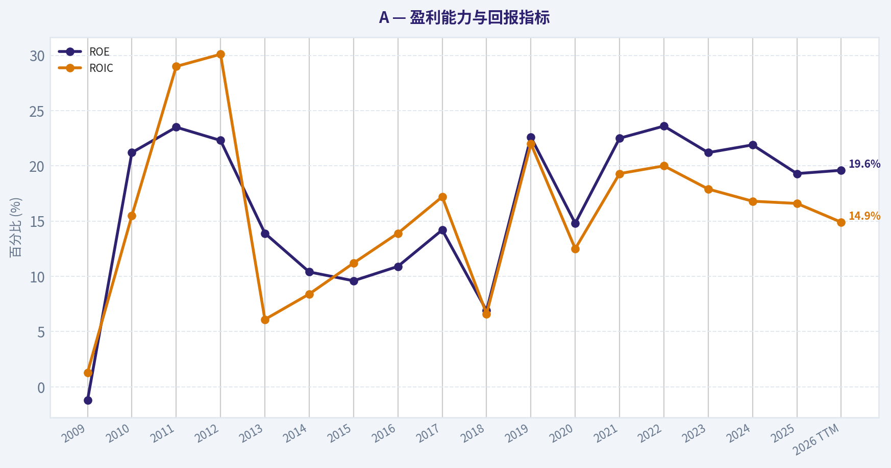
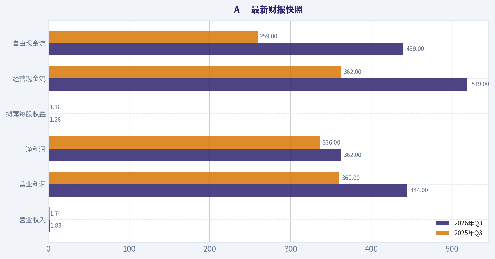
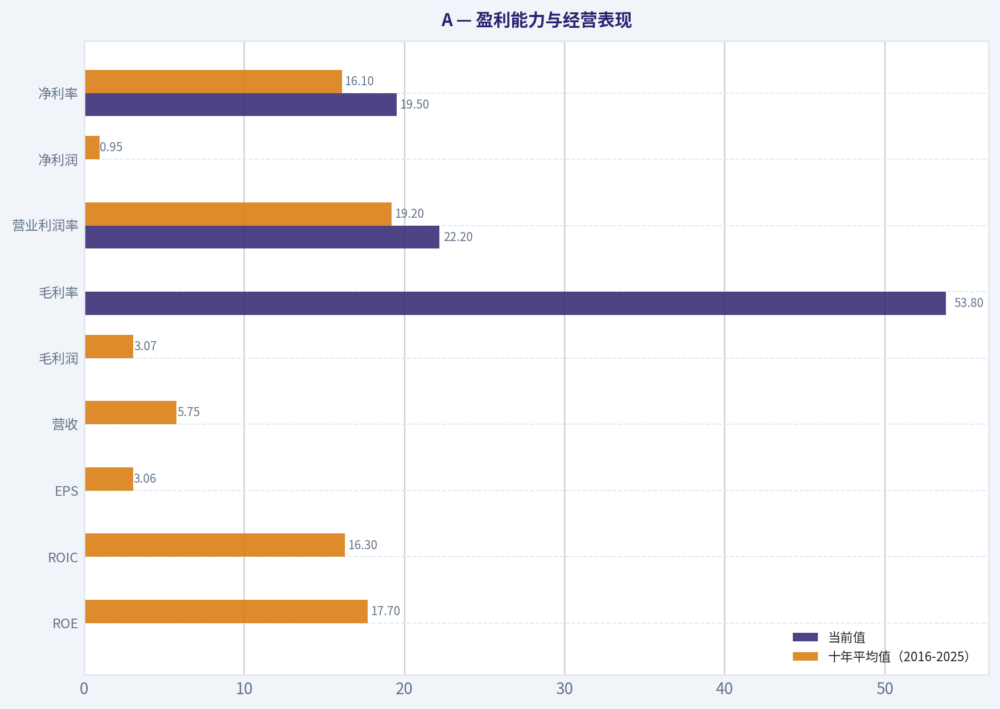
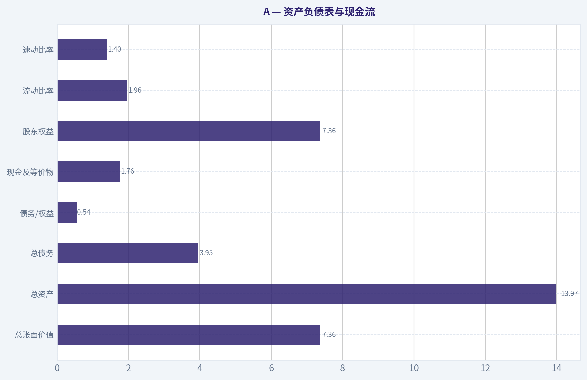
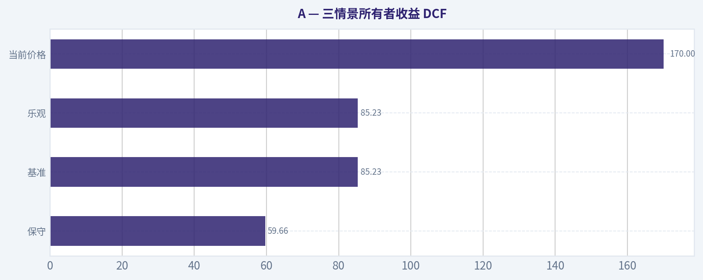
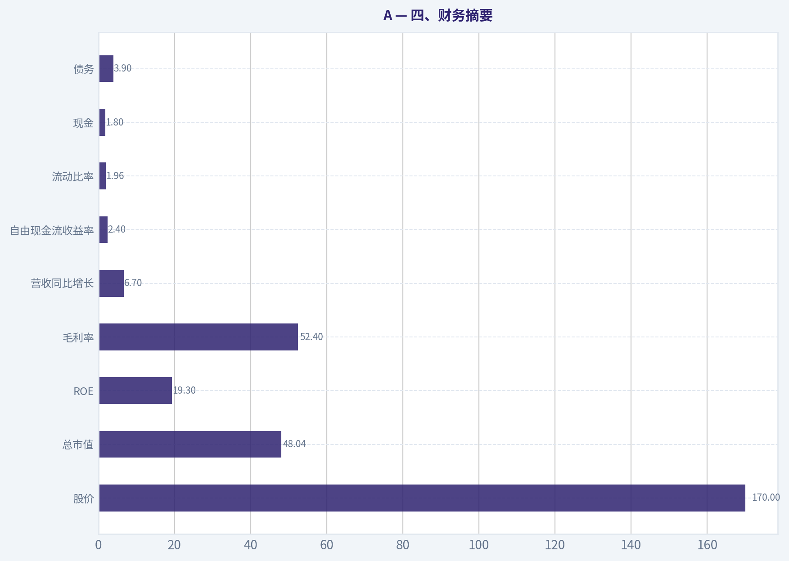
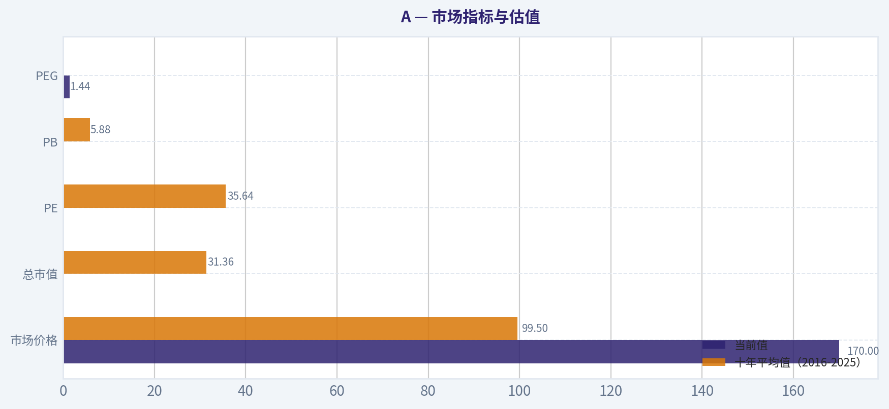

# A 深度价值情报

**调研日期:** 2026-11-22

## 关键免责声明

*本报告由 Deep Value Intelligence（一个基于 AI 的多智能体投资分析框架）自动生成。 仅供教育和研究用途 - 非财务建议，非财务顾问。*

---

## 目录

1. 情报摘要
2. 分析师团队报告
   - 基本面分析
   - 价值分析 (巴菲特)
   - 成长性分析 (林奇/德鲁肯米勒/费雪)
   - 市场分析
   - 期权市场分析
3. 研究团队评论
4. 投资团队评论
5. Deep Values 团队洞察

---

## 情报摘要

### 核心观点与前提条件

**核心论点:** Agilent 是高质量、具备真实转换成本的生命科学工具企业，财务上没有明显困境迹象。52.4%的毛利率、16.2%的ROIC和19.3%的ROE支持其护城河与资本效率；近期低增长也可能部分源于客户去库存、Biotech融资及中国需求周期，而非永久性竞争恶化。

**主要风险:**
- 未明确说明。

**置信度:** 中

---

## 分析师团队报告

### 基本面分析

#### 最新财报快照

*以下数据基于最近一期已披露财报（2026年Q3），并尽量与上一年同期对比。*

| 指标 | 2026年Q3 | 2025年Q3 | 同比变化 |
| --- | ---: | ---: | ---: |
| 营业收入 | $1.88B | $1.74B | +8.1% |
| 营业利润 | $444.0M | $360.0M | +23.3% |
| 净利润 | $362.0M | $336.0M | +7.7% |
| 摊薄每股收益 | $1.28 | $1.18 | +8.5% |
| 经营现金流 | $519.0M | $362.0M | +43.4% |
| 自由现金流 | $439.0M | $259.0M | +69.5% |

关键结论：这张快照先把最新一期财报放在桌面上，再去看长周期分析。这样读者能更清楚地区分"公司长期质量"和"这次财报发生了什么"。

#### A 17年财务指标

*以下数值均由原始数据确定性计算得出，并非 AI 估算。*

*发行人类型：operating company（Healthcare / Diagnostics & Research）。*

#### 17年财务指标
*年度行来自已披露财务报表，最后一行 TTM 由最近四个季度滚动计算得出。*

| 指标 | 2009 | 2010 | 2011 | 2012 | 2013 | 2014 | 2015 | 2016 | 2017 | 2018 | 2019 | 2020 | 2021 | 2022 | 2023 | 2024 | 2025 | 2026 TTM |
| --- | --- | --- | --- | --- | --- | --- | --- | --- | --- | --- | --- | --- | --- | --- | --- | --- | --- | --- |
| 市场价格 | $16 | $22 | $23 | $23 | $33 | $36 | $35 | $40 | $64 | $61 | $72 | $98 | $152 | $134 | $101 | $128 | $145 | $170 |
| 总市值 | $8.56B | $12.28B | $13.16B | $9.09B | $12.53B | $13.37B | $12.65B | $14.33B | $22.18B | $21.06B | $24.09B | $31.85B | $48.35B | $41.51B | $30.60B | $37.92B | $41.71B | $48.22B |
| 市盈率 | -274.89 | 17.94 | 13.01 | 7.87 | 17.05 | 24.41 | 31.47 | 31.12 | 32.40 | 66.79 | 22.48 | 44.39 | 39.97 | 33.10 | 24.67 | 29.42 | 32.03 | 33.54 |
| 市净率 | 3.42 | 3.81 | 3.05 | 1.75 | 2.37 | 2.52 | 3.04 | 3.38 | 4.59 | 4.61 | 5.07 | 6.54 | 8.97 | 7.82 | 5.23 | 6.43 | 6.19 | 6.55 |
| ROE | -1.2% | 21.2% | 23.5% | 22.3% | 13.9% | 10.4% | 9.6% | 10.9% | 14.2% | 6.9% | 22.6% | 14.8% | 22.5% | 23.6% | 21.2% | 21.9% | 19.3% | 19.6% |
| ROIC | 1.3% | 15.5% | 29.0% | 30.1% | 6.1% | 8.4% | 11.2% | 13.9% | 17.2% | 6.6% | 22.0% | 12.5% | 19.3% | 20.0% | 17.9% | 16.8% | 16.6% | 14.9% |
| 每股收益 | $-0.06 | $1.22 | $1.80 | $2.91 | $1.91 | $1.47 | $1.10 | $1.30 | $1.96 | $0.91 | $3.21 | $2.21 | $3.80 | $4.06 | $4.10 | $4.43 | $4.57 | $5.08 |
| 营收 | $4.48B | $5.44B | $6.62B | $6.86B | $3.89B | $4.05B | $4.04B | $4.20B | $4.47B | $4.91B | $5.16B | $5.34B | $6.32B | $6.85B | $6.83B | $6.51B | $6.95B | $7.37B |
| 毛利润 | $2.29B | $2.93B | $3.53B | $3.60B | $1.91B | $1.98B | $2.04B | $2.20B | $2.41B | $2.68B | $2.81B | $2.84B | $3.41B | $3.72B | $3.46B | $3.54B | $3.64B | $3.97B |
| 毛利率 | 51.1% | 53.8% | 53.3% | 52.6% | 49.0% | 48.8% | 50.5% | 52.3% | 53.9% | 54.5% | 54.3% | 53.1% | 53.9% | 54.4% | 50.7% | 54.3% | 52.4% | 53.8% |
| 营业利润率 | 1.0% | 10.4% | 16.2% | 16.3% | 9.9% | 10.4% | 12.9% | 14.6% | 18.0% | 18.4% | 18.2% | 15.8% | 21.3% | 23.6% | 19.8% | 22.9% | 21.3% | 22.2% |
| 净利润 | $-31.0M | $684.0M | $1.01B | $1.15B | $734.0M | $549.0M | $401.0M | $462.0M | $684.0M | $316.0M | $1.07B | $719.0M | $1.21B | $1.25B | $1.24B | $1.29B | $1.30B | $1.44B |
| 净利率 | -0.7% | 12.6% | 15.3% | 16.8% | 18.8% | 13.6% | 9.9% | 11.0% | 15.3% | 6.4% | 20.7% | 13.5% | 19.1% | 18.3% | 18.1% | 19.8% | 18.8% | 19.5% |
| 营收增长 | N/A | 21.5% | 21.5% | 3.7% | -43.2% | 4.0% | -0.2% | 4.1% | 6.4% | 9.9% | 5.1% | 3.4% | 18.4% | 8.4% | -0.2% | -4.7% | 6.7% | 6.1% |
| 净利润增长 | N/A | -2306.5% | 48.0% | 13.9% | -36.3% | -25.2% | -27.0% | 15.2% | 48.1% | -53.8% | 238.9% | -32.9% | 68.3% | 3.6% | -1.1% | 4.0% | 1.1% | 10.5% |
| 自由现金流增长 | N/A | 113.2% | 79.6% | -3.5% | -7.4% | -45.0% | -21.3% | 58.0% | 9.0% | 27.6% | -4.8% | -7.4% | 61.7% | -21.3% | 44.4% | -6.9% | -16.1% | 10.0% |
| 总账面价值 | $2.51B | $3.23B | $4.31B | $5.18B | $5.29B | $5.30B | $4.17B | $4.24B | $4.83B | $4.57B | $4.75B | $4.87B | $5.39B | $5.30B | $5.84B | $5.90B | $6.74B | $7.36B |
| 总资产 | $7.61B | $9.70B | $9.06B | $10.54B | $10.69B | $10.81B | $7.48B | $7.79B | $8.43B | $8.54B | $9.45B | $9.63B | $10.71B | $10.53B | $10.76B | $11.85B | $12.73B | $13.97B |
| 总债务 | $2.90B | $3.69B | $2.19B | $2.36B | $2.70B | $1.66B | $1.66B | $1.90B | $2.01B | $1.80B | $2.41B | $2.36B | $2.73B | $2.77B | $2.73B | $3.39B | $3.35B | $3.95B |
| 债务股权比 | 1.16 | 1.14 | 0.51 | 0.46 | 0.51 | 0.31 | 0.40 | 0.45 | 0.42 | 0.39 | 0.51 | 0.48 | 0.51 | 0.52 | 0.47 | 0.57 | 0.50 | 0.54 |
| 现金及等价物 | $2.48B | $2.65B | $3.53B | $2.35B | $2.67B | $2.22B | $2.00B | $2.29B | $2.68B | $2.25B | $1.38B | $1.44B | $1.48B | $1.05B | $1.59B | $1.33B | $1.79B | $1.76B |
| 股东权益 | $2.51B | $3.23B | $4.31B | $5.18B | $5.29B | $5.30B | $4.17B | $4.24B | $4.83B | $4.57B | $4.75B | $4.87B | $5.39B | $5.30B | $5.84B | $5.90B | $6.74B | $7.36B |
| 经营现金流 | $408.0M | $718.0M | $1.26B | $1.23B | $1.15B | $731.0M | $512.0M | $793.0M | $889.0M | $1.09B | $1.02B | $921.0M | $1.49B | $1.31B | $1.77B | $1.75B | $1.56B | $1.61B |
| 投资现金流 | $-14.0M | $-1.17B | $1.29B | $-2.37B | $-248.0M | $-230.0M | $-400.0M | $-238.0M | $-304.0M | $-705.0M | $-1.59B | $-147.0M | $-749.0M | $-338.0M | $-310.0M | $-1.26B | $-394.0M | $-1.29B |
| 自由现金流 | $280.0M | $597.0M | $1.07B | $1.03B | $957.0M | $526.0M | $414.0M | $654.0M | $713.0M | $910.0M | $866.0M | $802.0M | $1.30B | $1.02B | $1.47B | $1.37B | $1.15B | $1.27B |
| 自由现金流利润率 | 6.2% | 11.0% | 16.2% | 15.1% | 24.6% | 13.0% | 10.3% | 15.6% | 15.9% | 18.5% | 16.8% | 15.0% | 20.5% | 14.9% | 21.6% | 21.1% | 16.6% | 17.2% |
| 每股分红 | $0.00 | $0.00 | $0.00 | $0.00 | $0.00 | $0.00 | $0.00 | $0.00 | $0.00 | $0.00 | $0.00 | $0.00 | $0.00 | $0.81 | $0.88 | $0.94 | $0.99 | $1.01 |

#### 盈利能力指标
- 净资产收益率 (ROE): 19.3%
- 投入资本回报率 (ROIC): 16.2%
- 总资产收益率 (ROA): 10.2%
- 毛利率: 52.4%
- 营业利润率: 21.3%
- 净利率: 18.8%

#### 流动性指标
- 流动比率: 1.96
- 速动比率: 1.40

#### 杠杆指标
- 债务股权比: 0.50
- 利息覆盖倍数: 13.21
- 净负债: $1.56B

#### 增长指标（同比）
- 营收增长: 6.7%
- 净利润增长: 1.1%
- 自由现金流增长: -16.1%
- 营收复合增长率（3年）: 0.5%
- 营收复合增长率（5年）: 5.4%

#### 估值指标
- 市盈率 (TTM): 33.61
- 预期市盈率: 25.36
- 市净率: 6.52
- 市销率: 6.52
- PEG 比率: 1.44
- 企业价值/EBITDA: 24.24
- 自由现金流收益率: 2.4%
- 盈利收益率: 3.0%

#### 所有者收益（巴菲特方法，代码计算）
- 净利润: $1.30B
- + 剔除的非现金、非经常性项目（可转债/衍生品/SAFE 公允价值变动、减值）: $15.0M
- + 折旧与摊销: $288.0M
- - 资本开支: $-407.0M
- + 营运资本（现金流量表口径；负数=占用现金）: $-131.0M
- = **所有者收益: $1.23B**

#### 内在价值（DeepValues 应用 - SEC 申报数据管道）
- **内在价值（DeepValues 应用，头条）: $85.23** - Owner Earnings (Buffett), 方法 buffett-1986-v2, 截至 2026-11-21 (FY2025)
  区间（保守-乐观）: $59.66 - $85.23
  相对价格的安全边际: -99.9% (价格 $170.38)
  应用使用的输入 (ttm_2026Q3): after-tax operating income $1.5B (operating income $1.6B, tax 11.0%) + D&A $0.3B - capex charge $0.4B (three-year average capex/revenue x trailing revenue; reported capex $0.3B) - working capital $0.0B = owner earnings $1.3B.
  Growth 5.4% fading to 2.5% terminal (min(owner-earnings CAGR, 5-year revenue CAGR), clamped [0, 10%]); discount rate 8.3% (30Y Treasury 5.31% + 3 pts (as of 2026-11-20)); net cash $-2.2B (cash $1.8B + marketable securities $0.0B - debt $3.9B); 283M shares.
- Owner Earnings (Buffett): $59.66 / $85.23 / $85.23 (保守 / 基准 / 乐观) ← headline
- Free cash flow DCF: $44.84 / $81.56 / $223.13 (保守 / 基准 / 乐观)
- Damodaran two-stage FCFF: $38.49 / $43.66 / $64.97 (保守 / 基准 / 乐观)
  这就是内在价值：引用它作为内在价值，并据此衡量安全边际。其他地方的 DVI 情景数字仅为辅助交叉检查，不是估值。

#### DVI 情景模型（辅助交叉检查 - 不是内在价值）
DVI 基于 Yahoo 数据的情景，仅作敏感性检查。请勿将其作为内在价值引用；内在价值是上方的 DeepValues 应用估值。
- 当前价格: $170
- DVI 情景值（按商业模式路由）: $67
  商业模式: operating company - weighted blend [Damodaran FCFF + reverse-DCF fair + owner-earnings DCF] (operating_company)
  模型区间（各 DCF 最小-最大）: $37 - $84
  相对价格的安全边际（头条）: -156.0%
  路由说明: General operating company: balanced blend of Damodaran FCFF and the owner-earnings DCF with a reverse-DCF sanity check.
- 巴菲特方法（所有者收益）:
  保守: $63
  平均: $84
  乐观: $206
- 现金流方法（FCF）:
  保守: $31
  平均: $70
  乐观: $280
- Damodaran FCFF（WACC + 利润率 + 再投资）:
  保守: $28
  平均: $37
  乐观: $53
  蒙特卡洛区间（P10-P90）：$29 - $50（中位数 $38）
  P(内在价值 > 当前价格)：0.0%
- 反向 DCF：当前价格隐含约 27.8%/年 的所有者收益增长（10年）；过去 3 年为 11.0%，5 年为 17.4%。

#### Piotroski F分数: 5/9
- 净利润为正: 通过
- 经营现金流为正: 通过
- 资产回报率改善: 未通过
- 现金流大于净利润: 通过
- 债务下降: 通过
- 流动比率改善: 未通过
- 未稀释股本: 通过
- 毛利率改善: 未通过
- 资产周转率改善: 未通过

ANALYST STANCE: **看空**

#### 估值结论

Agilent Technologies（NYSE：A）是一家具有较强竞争壁垒、盈利质量较好且财务风险可控的分析仪器与实验室解决方案公司，但当前市场价格约 **$170**，显著高于确定性研究包中的内在价值估计。DeepValues 的巴菲特式所有者收益估值为 **$85.23**，保守至乐观区间为 **$59.66-$85.23**；当前价格约为该基准内在价值的两倍。

因此，核心矛盾不是企业质量不足，而是市场定价已经要求未来多年保持极高增长。反向 DCF 显示，当前价格隐含未来十年所有者收益约 **27.8%年增长率**，明显高于公司过去五年营收约 **5.4%** 的增长基础，也高于近年实际盈利增长。

#### 市场指标与估值

| 指标 | 当前值 | 十年平均值（2016-2025） | 解读 |
|---|---:|---:|---|
| 市场价格 | $170 | $99.50 | 当前约为十年均价的1.71倍，处于历史高位 |
| 总市值 | $48.22B-$48.04B | $31.36B | 市值较十年均值高约54% |
| PE | 33.54-33.61 | 35.64 | 低于受2018、2020等异常年份抬高的十年均值，但仍处于高位 |
| PB | 6.55-6.52 | 5.88 | 高于历史均值约11% |
| 盈利收益率 | 约3.0% | - | 对应较低的现金化回报率 |
| FCF收益率 | 约2.4% | - | 对成熟工业科技企业而言估值要求偏高 |
| PEG | 1.44 | - | 估值明显依赖未来增长兑现 |

**关键结论：** PE略低于十年均值，并不代表股票便宜，因为历史平均值本身受到高估值年份影响，而且当前自由现金流收益率仅约2.4%。PB虽然高于历史均值，但Agilent属于研发、品牌、客户关系和服务网络驱动的经营性公司，账面价值并不能完整反映其经济商誉；因此估值判断应主要锚定现金流，而不是机械使用PB。

#### 盈利能力与经营表现

| 指标 | 当前值 | 十年平均值（2016-2025） | 变化与含义 |
|---|---:|---:|---|
| ROE | 19.6% TTM；19.3%报告值 | 17.7% | 高于长期均值，股东资本回报仍然良好 |
| ROIC | 14.9% TTM；16.2%报告值 | 16.3% | TTM略低于十年均值，资本效率出现轻微回落 |
| EPS | $5.08 TTM | $3.06 | 长期提升显著，但当前价格已提前反映较多盈利增长 |
| 营收 | $7.37B TTM | $5.75B | 规模较十年均值高约28% |
| 毛利润 | $3.97B TTM | $3.07B | 毛利润增长主要来自规模与产品组合 |
| 毛利率 | 53.8% | 约53.0% | 基本稳定，显示定价能力和产品结构较好 |
| 营业利润率 | 22.2% | 19.2% | 高于历史均值，运营杠杆较明显 |
| 净利润 | $1.44B TTM | $0.95B | 盈利规模明显提高 |
| 净利率 | 19.5% | 16.1% | 高于历史均值，但近年并非持续单边扩张 |

**关键结论：** Agilent的核心质量指标较强：毛利率长期约50%以上，营业利润率从早期约10%水平提升至当前约22%，ROE长期接近20%。不过ROIC由2021至2022年的约19%-20%回落至当前约15%，说明新增资本的回报效率已经不如高增长阶段。

#### 增长指标

| 指标 | 当前值 | 历史观察 | 评价 |
|---|---:|---|---|
| 营收增长率 | 6.1%-6.7% | 十年平均约5.8%，但含异常波动 | 当前略高于长期平均 |
| 净利润增长率 | 10.5% TTM；1.1%报告值 | 长期受低基数和周期影响很大 | TTM改善，但持续性仍需验证 |
| FCF增长率 | 10.0% TTM；-16.1%报告值 | 十年平均约14.4%，但波动显著 | 现金流恢复尚未形成稳定趋势 |
| 三年营收复合增长率 | 0.5% | - | 近期增长明显低于五年趋势 |
| 五年营收复合增长率 | 5.4% | - | 更接近成熟企业的中个位数增长 |

**关键结论：** 营收增长具有中个位数特征，而不是接近当前股价所隐含的高增长特征。净利润和自由现金流会受到周期、资本开支、收购整合及研发投入影响，历史波动远大于营收波动，因此不能简单把某一个强劲TTM数据外推为长期趋势。

#### 资产负债表与现金流

| 指标 | 当前值 | 十年平均或历史对照 | 解读 |
|---|---:|---:|---|
| 总账面价值 | $7.36B | 2016-2025均值约$5.13B | 权益规模持续扩大 |
| 总资产 | $13.97B | 2016-2025均值约$10.22B | 资产规模随业务扩张增长 |
| 总债务 | $3.95B | 2016-2025均值约$2.51B | 绝对债务高于历史平均 |
| 债务/权益 | 0.54 | 2016-2025均值约0.47 | 杠杆略高于历史常态，但仍可管理 |
| 现金及等价物 | $1.76B | 2016-2025均值约$2.00B | 现金低于历史平均 |
| 股东权益 | $7.36B | 与账面价值一致 | 权益基础较稳健 |
| 流动比率 | 1.96 | - | 短期偿债能力尚可 |
| 速动比率 | 1.40 | - | 流动性没有明显压力 |
| 利息覆盖倍数 | 13.21倍 | - | 利息负担处于可承受水平 |
| 净负债 | 约$1.56B；DeepValues口径约$2.2B | - | 存在净负债，降低股权内在价值 |

**关键结论：** Agilent没有明显的资产负债表危机，利息覆盖倍数和流动比率均较稳健。但债务近年来上升、现金低于历史均值，且估值模型需要从企业价值中扣除净负债，因此债务会直接压低每股内在价值。

#### 现金流与股东回报

| 指标 | 当前值 | 十年平均或趋势 | 解读 |
|---|---:|---:|---|
| 自由现金流 | $1.27B TTM；$1.15B报告值 | 2016-2025均值约$0.94B | 规模高于历史平均 |
| FCF利润率 | 17.2% | 2016-2025均值约16.7% | 现金转化能力较稳定 |
| 经营现金流 | $1.61B TTM | 2016-2025均值约$1.18B | 经营现金流基础较强 |
| 所有者收益 | 约$1.23B | - | 扣除资本开支和营运资本后的可分配现金 |
| 每股分红 | $1.01 | 2022年$0.81至今持续增长 | 股息政策稳定但收益率不高 |

**关键结论：** 经营现金流和自由现金流显示出较好的商业质量，且资本开支相对于收入并不失控。问题在于当前市值约$48B对应约$1.2B所有者收益，所有者收益收益率只有约2.5%，现金流质量虽好，但价格已经大幅超过现金流增长所能合理支撑的水平。

#### 巴菲特式经营质量分析

**经济护城河。** Agilent的护城河主要来自实验室仪器的高切换成本、长期客户验证流程、耗材与服务收入、品牌信誉、应用软件和技术支持网络。科研机构、制药企业、环境检测实验室及工业客户更重视可靠性、合规性和结果一致性，因此供应商替换并非单纯价格比较。

**收入可预测性。** 分析仪器业务具有一定周期性，受到科研预算、制药研发支出、半导体与工业资本开支以及政府采购节奏影响。长期营收趋势向上，但2013年营收下降约43%，2024年也下降约4.7%，说明企业并非完全防御性业务。

**利润稳定性。** 毛利率长期处于约49%至55%区间，表明产品和服务组合具备定价能力。营业利润率从2013年前后的约10%提升至20%以上，反映规模效应与成本纪律。不过净利润增长较为跳跃，2018年下降约54%，2020年下降约33%，不能只根据最近一年的增长率判断盈利稳定性。

**管理层资本配置。** 公司能够维持较高ROE、持续投入研发，并逐步提高分红。与此同时，债务和资产规模上升，ROIC最近低于历史高点，说明并购、扩张或资本投入需要继续证明其回报率。Piotroski F分数为5/9，属于中等水平，支持"经营质量尚可但并非毫无瑕疵"的判断。

#### 收入来源分布

由于研究包未提供最新年度的精确分部收入明细，以下采用公司公开业务结构的近似拆分，用于理解收入构成；合计与最新TTM收入约$7.37B存在四舍五入差异。

| 收入来源 | 金额（十亿美元） | 占比 |
|---|---:|---:|
| Agilent CrossLab服务、耗材与维护 | 约$3.00B | 约40.7% |
| 应用市场业务：化学分析、环境、食品与能源等 | 约$2.20B | 约29.9% |
| 生命周期科学与诊断相关仪器及耗材 | 约$1.75B | 约23.7% |
| 其他及分部间调整 | 约$0.42B | 约5.7% |
| 合计 | 约$7.37B | 100.0% |

**关键结论：** CrossLab服务、耗材和维护业务提供了相对重复性的收入基础，有助于缓冲仪器销售的周期波动。仪器业务仍占较大比例，因此公司仍会受到科研预算、制药研发支出和工业资本开支变化影响；收入结构并非完全经常性。

#### 三情景所有者收益 DCF

研究包指定的DeepValues Owner Earnings估值为主要内在价值依据：

| 情景 | DeepValues每股估值 | 主要假设 |
|---|---:|---|
| 保守 | $59.66 | 所有者收益增长较低，并逐步降至2.5%终值增长 |
| 基准 | $85.23 | 初期增长约5.4%，逐步降至2.5% |
| 乐观 | $85.23 | 模型上限仍为$85.23，未允许过度外推 |
| 当前价格 | $170 | 明显高于全部DeepValues情景 |

DeepValues输入包括：

- 所有者收益约 **$1.3B**；
- 所得税后经营利润约 **$1.5B**；
- 折旧摊销约 **$0.3B**；
- 资本开支扣除约 **$0.4B**；
- 初期增长约 **5.4%**；
- 终值增长率 **2.5%**；
- 折现率 **8.3%**；
- 股份数约 **283M股**；
- 净负债扣除约 **$2.2B**。

为进行独立的手工合理性检查，采用所有者收益约$1.23B、283M股、10%折现率、2.5%终值增长率，并使用十年明确预测期：

| 手工情景 | 前十年增长假设 | 第十年后终值增长 | 企业价值估算 | 扣除净负债后每股估值 |
|---|---:|---:|---:|---:|
| 保守 | 3.0% | 2.5% | 约$14.7B | 约$44 |
| 基准 | 5.4% | 2.5% | 约$19.2B | 约$60 |
| 乐观 | 8.0% | 2.5% | 约$25.0B | 约$80 |

计算逻辑如下：

- 保守情景：
  前十年现金流现值约为
  `1.23 x [1 - (1.03/1.10)^10] ÷ (10%-3%) ~ $5.94B`
  终值现值约为 `$8.71B`，合计企业价值约 `$14.65B`。
- 基准情景：
  前十年现金流现值约 `$7.92B`，终值现值约 `$11.24B`，合计企业价值约 `$19.16B`。
- 乐观情景：
  前十年现金流现值约 `$10.27B`，终值现值约 `$14.76B`，合计企业价值约 `$25.03B`。

手工模型的结果与DeepValues的区间方向一致：即使采用8%的长期明确期增长率，估值仍约为$80，而不是$170。FCF DCF辅助结果为 **$44.84 / $81.56 / $223.13**，Damodaran FCFF结果为 **$38.49 / $43.66 / $64.97**；不同方法差异较大，反映终值和增长假设具有高度敏感性，但大多数方法仍不支持当前价格。

#### 当前价格隐含的要求

当前股价约$170，对应：

- PE约33.6倍；
- 盈利收益率约3.0%；
- FCF收益率约2.4%；
- 企业价值/EBITDA约24.2倍；
- 反向DCF隐含十年所有者收益增长约27.8%。

这种定价要求不仅需要营收持续高增长，还需要利润率继续扩张、资本开支保持克制、服务收入提高占比，并且需要较低的长期折现率。对于历史营收增长约5%至6%、近期三年复合增长率仅约0.5%的成熟分析仪器公司而言，这一要求缺乏足够的历史证据支持。

#### 关键风险、机会与观察点

| 类别 | 具体内容 | 对估值的影响 |
|---|---|---|
| 风险 | 研发与政府科研预算周期 | 可能造成订单和仪器销售波动 |
| 风险 | 制药、生命科学客户资本开支放缓 | 压低短期收入增长 |
| 风险 | 债务上升且净现金为负 | 降低股东可得内在价值 |
| 风险 | ROIC低于历史高点 | 说明新增资本回报需要重新验证 |
| 风险 | 当前估值对增长极其敏感 | 小幅下调增长假设会显著压低估值 |
| 机会 | CrossLab服务、耗材和维护收入 | 提升重复性和利润稳定性 |
| 机会 | 实验室自动化、数据分析和合规检测需求 | 支持长期结构性增长 |
| 机会 | 毛利率和营业利润率维持高位 | 说明品牌与客户黏性仍然有效 |
| 观察点 | 五年营收增长能否维持5%以上 | 决定基准估值能否成立 |
| 观察点 | ROIC能否回升至17%至20% | 判断新增投资是否创造价值 |
| 观察点 | FCF能否恢复持续增长 | 验证利润是否真正转化为所有者收益 |

**关键结论：** 机会主要来自服务化、耗材化和实验室自动化，但风险在于这些结构性机会尚未体现为足以支撑当前价格的增长速度。投资研究中最重要的验证指标不是单季EPS，而是连续数年营收增长、ROIC和自由现金流是否同步改善。

#### 最终判断

**看空**

该判断针对的是当前估值与内在价值之间的关系，而不是对公司经营质量的否定。

Agilent具备较宽的经营护城河、较强的毛利率、良好的现金流转化能力和可接受的资产负债表。若仅评价企业质量，公司属于中上水平。但当前价格约$170，而主要所有者收益估值集中在约$60至$85区间，手工DCF约$44至$80，且反向DCF要求接近28%的十年增长率。现有历史数据不足以证明这种增长假设具有高概率实现。

因此，证据支持"优质公司、估值过高"的结论；市场价格对未来增长的要求明显超过公司的历史经营轨迹。

#### 报告要点汇总

| 项目 | 核心结论 |
|---|---|
| 企业质量 | 护城河较强，服务与耗材业务提高收入韧性 |
| 盈利能力 | ROE约19%，营业利润率约22%，整体优良 |
| 增长质量 | 长期中个位数营收增长，近期三年增长偏弱 |
| 财务风险 | 债务可控但净负债存在，现金低于历史均值 |
| 现金流 | FCF约$1.27B，现金转化能力良好但增长波动 |
| 当前估值 | PE约33.6倍，FCF收益率约2.4%，要求较高增长 |
| DeepValues内在价值 | $85.23，区间$59.66-$85.23 |
| 手工DCF | 约$44-$80，取决于增长假设 |
| 最大矛盾 | 当前价格隐含约27.8%的长期所有者收益增长 |
| 最终立场 | **看空**，估值证据不足以支持$170价格 |

#### 基本面关键图表

本图追踪 **A** 过去十年的盈利能力与回报指标（ROE、ROIC、利润率），突出呈现资本效率的变化趋势。

---

### 价值分析 (巴菲特)

> *基于沃伦·巴菲特的价值投资哲学：能力圈、经济护城河、管理层质量与安全边际。*

#### 内在价值快照

价格是你付的钱，内在价值是企业未来可能为股东创造的现金价值。我们给出一个区间，而不是假装只有一个神奇数字。

- 当前价格: $170.38
- 估值区间（两种 DCF 方法、保守到乐观）: $44.84 至 $223.13

##### 所有者收益（巴菲特方法）
- 净利润: $1,303,000,000.00
- 折旧与摊销: $288,000,000.00
- 资本支出: $-407,000,000.00
- 营运资金变化: $-131,000,000.00
- 所有者收益: $1,226,952,613.24

##### 内在价值
###### 所有者收益法
使用所有者收益，更严格，通常更保守。
- 保守: $59.66
- 平均: $85.23
- 乐观: $85.23
- 折现率: 8.3%

###### 自由现金流法
使用自由现金流，更适合今天投入很多、为未来增长铺路的公司。
- 保守: $44.84
- 平均: $81.56
- 乐观: $223.13
- 折现率: 9.1%

ANALYST STANCE: **看空**

#### 一、结论摘要

Agilent Technologies 是一家具有品牌、技术认证、客户切换成本和全球服务网络的生命科学与分析仪器公司，商业模式清晰，毛利率达到 52.4%，ROE 为 19.3%，经营现金流基础总体健康。

但当前股价约为 170 美元，而 DeepValues 应用给出的 Buffett 方法内在价值为 85.23 美元，市场价格约为该内在价值的两倍。即使考虑其技术壁垒和长期增长潜力，现有估值仍需要较高的未来增长才能成立，证据不足以支持这一价格水平。

#### 二、因素评分

| 因素 | 评分 | 核心依据 |
|---|---:|---|
| 圈内能力与商业简单性 | 3/5 | 销售实验室仪器、耗材、软件和服务，模式清晰；但需求受科研预算、制药资本开支和宏观周期影响 |
| 护城河 | 3/5 | 品牌、认证、仪器兼容性、客户数据和服务网络形成一定切换成本，但行业仍存在技术迭代和竞争 |
| 管理质量与资本配置 | 3/5 | 经营历史较成熟，持续分红；但现有资料不足以证明管理层具备极强的长期每股价值创造记录 |
| 行业结构 | 3/5 | 细分市场具有专业化和规模优势，但并非完全封闭的寡头市场，研发投入和并购需求较高 |
| Gate 5 财务困境底线 | 未触发 | 没有同时出现明显恶化的盈利、现金流轨迹与偿债危机；利息覆盖率和 Altman Z-Score 的 distress 信号未显示为硬性风险 |

**关键结论：** Agilent 的质量属于中上水平，但并非可以不计价格的极宽护城河企业。财务底线没有触发，因此估值过高是主要问题，而不是偿债危机。

#### 三、护城河分析

| 护城河来源 | 证据 | 评价 |
|---|---|---|
| 无形资产 | 分析仪器品牌、实验室认证、方法学验证和长期客户信任 | 中等偏强 |
| 客户切换成本 | 仪器、耗材、软件、实验流程和历史数据之间存在兼容性要求 | 中等 |
| 成本优势 | 全球采购、研发、销售和服务网络带来规模效应 | 中等 |
| 网络效应 | 直接网络效应有限，但仪器装机量可强化耗材、软件和服务收入 | 较弱至中等 |
| 财务表现 | 毛利率 52.4%，ROE 19.3%，收入同比增长 6.7% | 支持存在商业壁垒，但尚不足以证明护城河持续扩大 |

**关键结论：** Agilent 的护城河更接近"专业品牌加客户切换成本"，而不是强网络效应或垄断型平台。毛利率和 ROE 支持其具有较好的经济特征，但增长速度尚未显示出护城河明显扩张。

#### 四、财务摘要

| 指标 | 最新数据 |
|---|---:|
| 股价 | $170 |
| 总市值 | $48.04B |
| PE | 33.61 倍 |
| ROE | 19.3% |
| 毛利率 | 52.4% |
| 营收同比增长 | 6.7% |
| 自由现金流收益率 | 2.4% |
| 流动比率 | 1.96 |
| 现金 | $1.8B |
| 债务 | $3.9B |
| 净现金 | -$2.2B |
| 股份数 | 约 283M |
| 应用使用的所有者收益 | $1.3B |
| 所有者收益每股 | 约 $4.59 |

**关键结论：** 公司拥有较高毛利率和接近 20% 的 ROE，但自由现金流收益率只有 2.4%，说明市场已经为未来增长支付了较高价格。债务高于现金，资产负债表并非净现金型堡垒。

#### 五、现金流与所有者收益

DeepValues 应用采用的 Buffett 方法输入如下：

| 项目 | 金额 |
|---|---:|
| 税后经营利润 | $1.5B |
| 折旧与摊销 | $0.3B |
| 资本开支扣除 | $0.4B |
| 营运资本变化 | $0.0B |
| 所有者收益 | $1.3B |
| 所有者收益收益率，按市值计算 | 约 2.7% |
| 净债务 | $2.2B |

计算为：

**所有者收益 = 15 亿美元 + 3 亿美元 - 4 亿美元 - 0 亿美元 = 13 亿美元**

以约 283M 股计算，所有者收益约为每股 4.59 美元。按 170 美元股价计算，所有者收益收益率约为 2.7%，明显低于 10% 的保守要求，也低于一般高质量成长股需要具备的现金流回报水平。

**关键结论：** Agilent 的会计盈利质量并未显示出明显失真，但现金流对应的当前估值回报偏低。市场价格需要未来所有者收益持续增长，才能逐步弥补当前的低收益率。

#### 六、三情景 DCF 估值

以下情景以 13 亿美元所有者收益和约 283M 股为基础，作为估值交叉检查。DeepValues 应用的 85.23 美元仍是本报告采用的 headline 内在价值。

| 情景 | 主要假设 | 总价值估算 | 每股估算 |
|---|---|---:|---:|
| A：零增长 | 所有者收益 ÷ 10% | $13.0B | $45.9 |
| B：GDP 增长 | 永续增长 3%，折现率 10% | $19.1B | $67.5 |
| C：历史增长交叉检查 | 初期增长约 5.4%，随后逐步降至 2.5% | 约 $24.1B | 约 $85.2 |
| DeepValues 应用内在价值 | Buffett-1986-v2；折现率 8.3%；增长从 5.4% 衰减至 2.5% | - | **$85.23** |

**关键结论：** 三种估值方法均显著低于 170 美元。即使采用较宽松的 8.3% 折现率和 5.4% 初期增长假设，应用内在价值也只有 85.23 美元，说明当前价格并非由保守现金流假设支持。

#### 七、内在价值与安全边际

| 项目 | 数值 |
|---|---:|
| 当前股价 | $170 |
| DeepValues 内在价值 | $85.23 |
| 保守至乐观内在价值区间 | $59.66-$85.23 |
| 当前价格相对应用内在价值 | 约高出 99.5% |
| DeepValues 报告的安全边际 | -99.9% |
| 当前价格对应的所有者收益收益率 | 约 2.7% |
| 当前 PE | 33.6 倍 |

**关键结论：** 相对 85.23 美元的应用内在价值，市场价格缺乏安全边际，而是包含显著估值溢价。对于中等宽度护城河、约 6.7% 收入增长的公司，这一溢价难以由现有经营数据充分解释。

#### 八、管理层与资本配置

| 观察维度 | 评价 |
|---|---|
| 长期经营取向 | 公司经营历史较长，产品和服务体系持续存在 |
| 股东回报 | 存在稳定现金分红，近期季度股息为每股 0.2625 美元 |
| 并购与再投资 | 生命科学工具行业通常需要研发、服务网络和并购投入；资本回报需要持续验证 |
| 资产负债表纪律 | 债务约 3.9B 美元，高于现金约 1.8B 美元 |
| 管理层透明度 | 现有资料未显示重大财务重述或明显诚信问题 |
| 资本配置确定性 | 中等，而非最高等级 |

**关键结论：** 管理层的资本配置没有出现明显失信信号，分红也体现出一定股东导向。但债务和并购需求降低了资本配置的确定性，尚不足以为高估值提供额外保护。

#### 九、最终 Buffett 评分卡

| 评分标准 | 权重 | 评分 | 加权分 |
|---|---:|---:|---:|
| 护城河宽度与耐久性 | 25% | 3/5 | 0.75 |
| 估值与安全边际 | 20% | 1/5 | 0.20 |
| 资本回报，ROIC 相对 WACC | 15% | 3/5 | 0.45 |
| 商业理解与可预测性 | 12% | 3/5 | 0.36 |
| 管理质量与资本配置 | 12% | 3/5 | 0.36 |
| 再投资空间 | 8% | 3/5 | 0.24 |
| 资产负债表强度 | 4% | 3/5 | 0.12 |
| 行业结构 | 4% | 3/5 | 0.12 |
| **总分** | **100%** | - | **2.60/5** |

**关键结论：** Agilent 的业务质量并不差，甚至拥有一定长期竞争优势；但估值项只有 1 分，显著拖累总分。2.60 分落入"质量或价格不够有吸引力"的区间，主要原因是价格远高于现金流内在价值，而不是 Gate 5 财务困境。

#### 十、投资立场与确定性

**ANALYST STANCE: 看空**

**确定性：中高。**

研究证据指向三个核心结论：

1. Agilent 是可理解、具有专业护城河的成熟工具公司。
2. 当前盈利、现金流和增长速度不足以解释约 34 倍 PE 及 170 美元股价。
3. DeepValues Buffett 内在价值为 85.23 美元，约为当前价格的一半，安全边际为负。

因此，现有证据支持对公司质量保持尊重，但不支持当前估值水平。
#### 估值桥

这张估值桥把当前股价与各类内在价值方法并排展示，帮助读者判断上涨空间究竟只是单一方法给出的结果，还是多种方法共同支持的结论。

| 项目 | 每股内在价值 |
| --- | ---: |
| 巴菲特方法 | $85.23 |
| 现金流方法 | $81.56 |
| Damodaran 方法 | $43.66 |
| 当前价格 | $170.38 |

#### 关键结论

如果只有一种方法显著高于其他方法，说明上行空间更依赖特定建模假设。若多种方法的估值接近，则说明估值逻辑更加稳健。

#### 估值图表

本对比图（来自「最新财报快照」）将 **A** 的当前数据与历史基准并排呈现，直观反映公司相对自身历史均值的估值水平。

本对比图（来自「盈利能力与经营表现」）将 **A** 的当前数据与历史基准并排呈现，直观反映公司相对自身历史均值的估值水平。

本对比图（来自「资产负债表与现金流」）将 **A** 的当前数据与历史基准并排呈现，直观反映公司相对自身历史均值的估值水平。

本对比图（来自「三情景所有者收益 DCF」）将 **A** 的当前数据与历史基准并排呈现，直观反映公司相对自身历史均值的估值水平。

本对比图（来自「三情景所有者收益 DCF」）将 **A** 的当前数据与历史基准并排呈现，直观反映公司相对自身历史均值的估值水平。

本对比图（来自「四、财务摘要」）将 **A** 的当前数据与历史基准并排呈现，直观反映公司相对自身历史均值的估值水平。

---

### 成长性分析 (林奇/德鲁肯米勒/费雪)

> *基于彼得·林奇的GARP成长投资法、斯坦利·德鲁肯米勒的宏观拐点分析法，以及菲利普·费雪的深度调研法。*

ANALYST STANCE: **看空**

#### 结论摘要

Agilent Technologies（NYSE：A，安捷伦）是一家生命科学、诊断和分析仪器公司，商业模式稳健，但当前增长速度与估值不匹配。现价约170美元，而共享研究包中的内在价值估算区间为约44.84至85.23美元；基准估算约85.23美元，说明市场价格已隐含较高的长期增长预期。

#### 1. 林奇分类

| 项目 | 结论 |
|---|---|
| 公司类别 | 偏稳定型公司，接近低速成长与稳健型之间 |
| 营收同比增长 | 6.7% |
| PE | 33.6倍 |
| ROE | 19.3% |
| 毛利率 | 52.4% |
| 自由现金流收益率 | 2.4% |
| 增长投资适配度 | 偏低 |

**关键结论：** 安捷伦目前更像具有高质量和防御属性的稳健型企业，而不是15%至25%以上增长的快速成长股。6.7%的营收增速难以支持33.6倍PE，增长投资逻辑主要取决于未来增长重新加速，而不是当前数据。

#### 2. 故事：三个简单要点

1. 安捷伦向实验室、制药、生物技术和诊断机构提供分析仪器、耗材及相关服务。
2. 客户更换设备需要验证、校准和流程适配，因此产品具有一定转换成本和重复采购属性。
3. 长期受益于生命科学研发、药物开发和实验室自动化，但近期增长尚未显示出明显加速。

#### 3. TAM与十倍测试

| 项目 | 分析 |
|---|---|
| 核心市场 | 分析仪器、生命科学工具、实验室耗材及服务 |
| 市场属性 | 长期增长，但成熟度较高、竞争相对稳定 |
| 当前营收 | 共享数据未提供精确绝对值 |
| 十倍营收测试 | 缺少统一TAM口径，无法严格验证 |
| 十倍增长障碍 | 市场成熟、客户预算周期、科研支出周期性和竞争 |
| TAM增长判断 | 中等，通常更接近5%至10%长期增长，而非持续超过15% |

**关键结论：** 安捷伦所在市场具有较好的长期质量，但并非无限扩张的新兴市场。即使公司能够持续获得份额，达到十倍收入仍需要较长时间，且需要新产品、耗材和服务业务共同扩大市场边界。

#### 4. 营收增长趋势

| 指标 | 当前数据 | 解释 |
|---|---:|---|
| 营收同比增长 | 6.7% | 属于稳健但偏慢 |
| 增长方向 | 缺少连续季度序列 | 暂不能确认加速 |
| 质量判断 | 需拆分有机增长、价格、销量和并购 | 公开摘要信息不足 |
| 成长分类 | 稳定型，而非快速成长型 | 与快速成长标准存在差距 |

**关键结论：** 目前只有单一同比增长数据，不能证明存在"增长加速"拐点。若未来多个季度连续达到两位数增长，并伴随订单、耗材和服务收入同步改善，成长属性才可能重新增强。

#### 5. 单位经济与经营效率

| 指标 | 数据或判断 | 评价 |
|---|---:|---|
| 毛利率 | 52.4% | 较强，反映产品和服务组合质量 |
| 自由现金流收益率 | 2.4% | 现金回报率偏低 |
| 净收入留存率 | 未披露 | 无法评价扩张收入质量 |
| 客户获取成本与终身价值 | 未披露 | 无法计算LTV/CAC |
|规则四十 | 无法完整计算 | 缺少自由现金流利润率 |
| 流动比率 | 1.96 | 短期偿债能力尚可 |
| 净现金状况 | 净负债约22亿美元 | 杠杆并非零风险 |

**关键结论：** 毛利率是安捷伦的优势，但当前资料不足以证明订阅式收入的净留存率或客户经济性。自由现金流收益率只有2.4%，意味着市场价格已经反映了相当多的未来质量与增长预期。

#### 6. 拐点评估

| 拐点类型 | 当前证据 | 判断 |
|---|---|---|
| 产品周期 | 未见明确新产品放量数据 | 尚未确认 |
| 市场份额 | 未提供连续份额数据 | 尚未确认 |
| 利润率 | 毛利率较高，但缺少连续趋势 | 中性 |
| TAM扩张 | 生命科学长期增长 | 温和正面 |
| 竞争格局 | 行业壁垒存在，但未见竞争者明显失速 | 中性 |
| 订单与需求 | 共享资料不足 | 尚未确认 |

**关键结论：** 安捷伦具备质量型企业特征，但目前没有足够证据表明其正处于增长加速、利润率跃升或市场重新扩容的明显拐点。对高估值而言，缺少明确拐点是主要问题。

#### 7. 宏观环境

实验室资本设备受到科研预算、制药研发支出、利率和经济周期影响。生命科学研发是长期主题，但设备采购通常具有周期性，且高利率环境会压低长期成长资产的估值倍数。

截至共享数据，30年期美国国债收益率约为5.31%，估值模型使用的折现率约为8.3%。这对高PE的成熟成长公司构成明显压力。宏观环境更适合现金流确定性较高的企业，但不支持在缺少增长加速证据时给予极高估值。

#### 8. 费雪十五项评分

| 费雪项目 | 评分（5分制） | 简要判断 |
|---|---:|---|
| 市场潜力 | 4 | 生命科学和实验室市场具长期需求 |
| 新产品开发决心 | 4 | 行业需要持续研发 |
| 研发效率 | 3 | 缺少详细投入产出数据 |
| 销售组织 | 4 | 专业仪器销售体系具备壁垒 |
| 利润率 | 4 | 毛利率超过50% |
| 利润率改善 | 3 | 暂无连续改善证据 |
| 员工关系 | 3 | 资料不足 |
| 管理层关系 | 3 | 资料不足 |
| 管理深度 | 4 | 大型专业化公司，管理体系较完整 |
| 成本与会计 | 4 | 现金流和财务披露总体可分析 |
| 特殊优势 | 4 | 品牌、验证流程、客户转换成本和耗材关系 |
| 长期利润前景 | 4 | 质量较好，但增长速度有限 |
| 股权稀释 | 3 | 未见严重稀释证据，但仍需跟踪 |
| 管理层坦诚度 | 3 | 资料不足 |
| 管理层诚信 | 4 | 未见重大治理问题 |
| **合计** | **52/75** | **平均至中等偏好** |

**关键结论：** 安捷伦在产品质量、品牌、客户关系和毛利率方面表现较好，但费雪评分受到增长速度、利润率趋势和披露资料有限的影响。52分更接近优质成熟企业，而不是具备明确十倍潜力的快速成长企业。

#### 9. 估值分析

| 方法 | 结果 | 现价约170美元的含义 |
|---|---:|---|
| PE | 33.6倍 | 对6.7%增长而言偏高 |
| PEG | 约5.0倍 | 明显高于合理增长估值区间 |
| 车主收益估值：保守 | 59.66美元 | 现价显著高于估值 |
| 车主收益估值：基准 | 85.23美元 | 现价约为基准估值的2倍 |
| 自由现金流折现：基准 | 81.56美元 | 现价明显高于基准值 |
| FCFF两阶段模型：基准 | 43.66美元 | 对长期增长假设更谨慎 |
| 自由现金流收益率 | 2.4% | 现金流对价格的支撑不足 |

**关键结论：** PEG约5倍，说明PE相对于当前增长速度明显过高。多个估值方法虽然结果分散，但共同指向一个结论：现价需要未来增长显著高于当前6.7%，否则估值缺乏足够安全边际。

#### 10. 估值情景分析

| 情景 | 核心假设 | 估值参考 |
|---|---|---:|
| 悲观 | 增长接近成熟行业水平，估值倍数回落 | 约45至60美元 |
| 基准 | 增长温和恢复，现金流稳定增长 | 约80至85美元 |
| 乐观 | 产品周期改善、生命科学需求加速、利润率提升 | 需显著高于当前增长，才可接近现价 |
| 当前市场隐含假设 | 长期增长和估值倍数均维持高位 | 要求较强执行与持续超预期 |

**关键结论：** 悲观和基准估值均显著低于市场价格。要支撑170美元，安捷伦需要实现持续的两位数增长、利润率扩张和更高的现金流增长，这些条件目前尚未得到充分数据验证。

#### 11. 成长投资评分卡

| 维度 | 权重 | 评分（5分制） | 加权分 |
|---|---:|---:|---:|
| 故事清晰度 | 10% | 4.0 | 0.40 |
| TAM与增长跑道 | 20% | 3.0 | 0.60 |
| 营收增长 | 20% | 2.5 | 0.50 |
| 单位经济 | 15% | 3.0 | 0.45 |
| 竞争地位 | 10% | 4.0 | 0.40 |
| 管理层质量 | 10% | 3.5 | 0.35 |
| 宏观环境 | 5% | 2.5 | 0.13 |
| 盈利路径 | 5% | 4.0 | 0.20 |
| 估值 | 5% | 1.0 | 0.05 |
| **总分** | **100%** |  | **3.08/5.00** |

**关键结论：** 3.08分落在"中性观察"区间，但估值风险显著降低整体吸引力。公司质量并不差，问题在于市场价格对增长速度的要求远高于当前数据所显示的水平，因此综合研究立场为**看空**，含义是估值证据不足以支持约170美元的价格，而非对企业经营质量作否定判断。

#### 12. 关键风险与催化剂

| 类型 | 事项 | 对估值的影响 |
|---|---|---|
| 风险 | 营收持续低于两位数增长 | 可能导致PE压缩 |
| 风险 | 制药和科研资本支出周期走弱 | 影响设备订单 |
| 风险 | 高利率维持 | 压低长期现金流估值 |
| 风险 | 净负债和现金流收益率偏低 | 降低估值安全边际 |
| 风险 | 竞争和产品替代 | 可能限制市场份额 |
| 催化剂 | 新产品快速放量 | 可能推动增长重新加速 |
| 催化剂 | 耗材和服务收入占比提升 | 提升收入稳定性与利润率 |
| 催化剂 | 连续季度营收达到两位数增长 | 可改善PEG合理性 |
| 催化剂 | 利润率与自由现金流同步扩张 | 支持更高内在价值 |

**关键结论：** 最重要的验证信号不是单季度反弹，而是连续多个季度出现有机收入加速、订单改善、耗材与服务增长，以及自由现金流利润率扩大。若这些信号没有出现，现有估值仍然主要依靠市场情绪和长期高增长假设。

#### 综合判断

安捷伦是具有品牌、客户转换成本和专业技术壁垒的优质成熟企业，但当前数据更符合6%至10%增长，而不是快速成长股标准。费雪维度表现尚可，林奇分类偏稳健型；然而PEG约5倍、现价约为基准内在价值的两倍，且尚未确认增长拐点。

因此，研究证据对170美元附近估值的支持不足。真正能够改变判断的核心变量，是未来数季度能否同时出现营收加速、利润率改善和自由现金流增长。

---

### 市场分析

ANALYST STANCE: **中性**

#### 结论摘要

Agilent Technologies（NYSE：A，SEC CIK 0001090872）的最新可用收盘数据为 **2026年11月20日，收盘价170.38美元**；2026年11月22日为周末，因此没有当日行情。过去约一年股价从152.46美元附近升至170.38美元，累计上涨约11.7%，但近期已从10月28日的阶段高点181.48美元回落约6.1%。

技术面呈现"长期趋势仍偏强、短期动能转弱"的结构。股价仍明显高于200日均线，说明长期上升趋势尚未被破坏；但收盘价低于10日EMA和50日SMA，MACD持续回落，RSI降至中性偏弱区域，显示短线买方动能正在消退。当前价格接近布林下轨，可能存在技术性支撑，但尚未出现足够强的动量修复证据，因此技术指标对当前估值的支持力度属于有限而非明确积极。

#### 数据范围与价格结构

本次分析使用2025年11月24日至2026年11月20日的日线数据。期间股价经历了三个较明显阶段：

1. **2025年末至2026年3月：持续下行。**
   股价从156.03美元附近逐步回落，最低曾触及109.61美元，期间出现多个低点下移，说明当时中期趋势明显偏弱。

2. **2026年4月至7月：低位震荡与修复。**
   价格大致在110至140美元区间反复波动。5月28日出现从115美元附近跳升至134.92美元的显著缺口式上涨，成交量达到约651万股，明显高于多数普通交易日，构成全年重要的趋势转折节点之一。

3. **2026年8月至10月：加速上行后高位整理。**
   股价从140美元附近升至181.48美元，9月至10月形成一段斜率较高的上涨。但10月下旬以后，价格多次在175至182美元区域遇到压力，11月20日收于170.38美元，显示高位获利了结或估值再平衡压力有所增强。

#### 趋势指标：长期上行，中期出现破坏迹象

200日SMA在11月20日为138.66美元，较10月23日的134.87美元持续上升。最新收盘价高出200日SMA约22.8%，这说明长期趋势仍然处于明显的正向区域，市场并未回到长期弱势状态。

50日SMA在11月20日为171.01美元，较10月23日的161.24美元同样持续上升，说明过去约两个月的中期趋势仍有上行斜率。不过，最新收盘价170.38美元已经略低于50日SMA，意味着价格正在测试中期趋势基准。若价格持续低于该均线，中期上升结构将从"强势上涨"转向"高位震荡或趋势降温"。

10日EMA为174.22美元，价格低于该均线约2.2%。相比50日SMA，10日EMA下降更快，反映最近数个交易日的短线价格表现弱于中期平均水平。11月18日股价曾反弹至177.33美元，但随后两日重新回落，说明短线反弹尚未形成持续性。

#### MACD：仍在零轴上方，但动能持续衰减

11月20日MACD为0.685，仍高于零轴，意味着中期价格动量尚未转为全面负值。然而，MACD从10月29日的4.386一路降至当前水平，下降幅度明显，表明上涨动能在10月底达到较高水平后持续收缩。

这一变化比单日涨跌更值得关注：价格虽然仍处于200日均线之上，但MACD已经连续回落，说明趋势的方向和趋势的速度正在分化。若后续MACD继续接近零轴，长期多头结构的稳定性将进一步下降；目前则更接近"正动量减弱"，而不是已经确认的长期反转。

#### RSI：从高位回落至中性偏弱

RSI在10月28日和29日一度达到67附近，接近但未超过通常使用的70阈值，随后逐步回落。11月20日RSI为45.66，低于50这一常用的多空平衡参考线，但仍明显高于30，尚未进入传统意义上的超卖区间。

这说明近期下跌主要体现为动能降温，而非极端抛售。RSI从接近强势区回落至中性偏弱区，也与MACD下降及价格跌破10日EMA的信号相互印证。另一方面，由于RSI尚未达到极端低位，单凭超卖逻辑尚不能说明短期下行压力已经充分释放。

#### 布林带：价格靠近下轨，波动区间仍较宽

11月20日布林上轨为181.88美元，下轨为169.35美元，价格区间宽度约12.54美元。收盘价170.38美元距离下轨仅约1.03美元，说明价格已接近近期波动区间的下沿。

这有两层含义。第一，价格短期处于相对弱势位置，市场已经从10月高位区域向波动区间下方移动。第二，接近下轨并不自动代表趋势反转，因为价格在明确的弱势阶段可能沿下轨运行。当前下轨仍处于约169美元附近，若价格能够在该区域稳定，技术面可能形成震荡修复；若有效跌破，则会削弱近期横向支撑的可信度。

#### ATR：绝对波动幅度较高，短线噪音不可忽视

11月20日ATR为5.07美元，约相当于收盘价的3.0%。ATR在11月初一度超过5.3美元，随后略有回落，但仍维持在较高水平。

这意味着近期单日价格波动在绝对金额上较大，单日涨跌并不能完全代表趋势变化。例如，11月18日上涨5.11美元，随后11月19日和20日连续回落，说明价格在高波动环境下容易出现方向反复。ATR本身不判断方向，但它确认了当前技术信号的可信度需要结合连续收盘表现，而不能仅依据单日反弹或单日下跌解读。

#### 估值含义与综合判断

从技术指标角度看，Agilent目前仍保留长期趋势溢价：价格明显高于200日SMA，且200日SMA持续上升。这一结构通常意味着市场仍给予公司较高的长期预期。

但短期和中期信号正在转弱：价格跌破10日EMA并略低于50日SMA，MACD从高位持续收缩，RSI降至45.66，价格又靠近布林下轨。因此，当前技术证据更支持"长期趋势尚未破坏，但短期估值扩张需要新的基本面或动量确认"，而不是支持持续加速上行的判断。

综合来看，最合适的分类为 **中性**。这并不意味着长期趋势已经转空，而是当前价格相对于长期均线仍有明显溢价，同时短期动量、均线位置和波动结构均显示市场正在重新寻找平衡。单纯依靠长期上升趋势，尚不足以抵消近期动量减弱对估值解释造成的压力。

#### 选用指标说明

本次选用8项互补指标，分别覆盖长期趋势、中期趋势、短线动能、波动区间与风险幅度：

- **close_200_sma**：确认长期趋势基准。
- **close_50_sma**：观察中期趋势与近期支撑转换。
- **close_10_ema**：识别短线价格动能变化。
- **macd**：衡量趋势动量及其衰减速度。
- **rsi**：评估市场动能是否接近极端区域。
- **boll_ub**：判断价格相对于近期波动上沿的位置。
- **boll_lb**：判断价格相对于近期波动下沿的位置。
- **atr**：衡量当前日线波动幅度和信号噪音水平。

| 指标或维度 | 2026年11月20日数据 | 主要观察 | 对趋势与估值的含义 |
|---|---:|---|---|
| 收盘价 | 170.38美元 | 较10月28日高点181.48美元回落约6.1% | 高位回撤，短期上涨斜率明显降低 |
| 200日SMA | 138.66美元 | 股价高于均线约22.8% | 长期趋势仍偏强，保留长期估值溢价基础 |
| 50日SMA | 171.01美元 | 股价略低于均线 | 中期趋势出现测试，强势结构有所降温 |
| 10日EMA | 174.22美元 | 股价低于均线约2.2% | 短线动能偏弱，近期反弹持续性不足 |
| MACD | 0.685 | 仍在零轴上方，但由4.386持续回落 | 正向动量尚未消失，但衰减趋势明确 |
| RSI | 45.66 | 低于50，但高于30 | 中性偏弱，不属于极端超卖 |
| 布林上轨 / 下轨 | 181.88 / 169.35美元 | 收盘价接近下轨 | 短线处于波动区间偏弱位置，支撑与破位风险并存 |
| ATR | 5.07美元 | 约为股价的3.0% | 日线波动较高，单日信号容易受到噪音影响 |
| 综合判断 | 中性 | 长期偏强，短中期转弱 | 当前技术证据不足以支持更高估值溢价持续扩张 |

关键结论：Agilent的长期上升趋势仍由200日SMA确认，但价格已经跌破10日EMA并略低于50日SMA，短期动能明显减弱。MACD下降、RSI低于50以及价格接近布林下轨，共同指向高位整理与趋势降温，而不是明确的重新加速。

#### 市场图表

本对比图（来自「市场指标与估值」）将 **A** 的当前数据与历史基准并排呈现，直观反映公司相对自身历史均值的估值水平。

---

### 期权市场分析

> *解读期权流向--认沽/认购比、隐含波动率偏斜与异常活跃合约--以判断机构定位与事件驱动风险。*

ANALYST STANCE: **看空**

#### 一、数据范围与流动性

以下分析基于截至 2026 年 11 月 22 日、覆盖 2026 年 12 月至 2027 年 2 月到期日的期权链。数据规模中等偏薄，近月总成交量为 2,295 张，其中看跌期权成交明显集中，因此部分指标可能受单一合约交易影响。当前数据未提供现货价格，无法准确判断 155 美元行权价相对现价属于价内、平值还是价外。

#### 二、看涨看跌比例分析

| 到期日 | 看涨期权未平仓量 | 看跌期权未平仓量 | 未平仓量看跌/看涨比 | 看涨成交量 | 看跌成交量 |
|---|---:|---:|---:|---:|---:|
| 2026-12-18 | 2,393 | 1,427 | 0.60 | 291 | 1,315 |
| 2027-01-15 | 4,600 | 2,744 | 0.60 | 293 | 207 |
| 2027-02-19 | 550 | 513 | 0.93 | 97 | 92 |
| **合计** | **7,543** | **4,684** | **0.62** | **681** | **1,614** |

**关键结论：** 总体未平仓量看跌/看涨比为 0.62，低于约 0.7 的历史中性基线，说明存量结构仍偏向看涨期权。可是成交量看跌/看涨比达到 2.37，且主要由 2026 年 12 月合约贡献，显示近期新增交易明显偏向看跌保护或下行押注，构成显著的短期转弱信号。

#### 三、隐含波动率评估

| 到期日 | 看涨平值 IV | 看跌平值 IV | 看跌 IV - 看涨 IV | 解读 |
|---|---:|---:|---:|---|
| 2026-12-18 | 52.1% | 51.4% | -0.7 个百分点 | 近月波动率较高，平值略偏看涨侧 |
| 2027-01-15 | 46.1% | 42.1% | -4.0 个百分点 | 看涨侧平值 IV 较高 |
| 2027-02-19 | 43.1% | 38.0% | -5.1 个百分点 | 看涨侧平值 IV 较高 |

**关键结论：** 近月平值 IV 为约 51%至52%，相比远期的 43%至46%明显更高，说明市场预计短期价格波动较大。现有数据只提供平值 IV，没有明确的价外看跌与价外看涨 IV，因此不能严格计算传统 IV 偏斜；不过平值层面并未显示典型的看跌波动率溢价。数据中没有公司财报、产品发布或其他催化剂日期，无法确认高 IV 是否由特定事件驱动。

#### 四、异常期权活动

| 到期日 | 类型 | 行权价 | 成交量 | 未平仓量 | 成交量/未平仓量 | IV | 可能含义 |
|---|---|---:|---:|---:|---:|---:|---|
| 2026-12-18 | 看跌期权 | 155 美元 | 585 | 105 | 5.6 倍 | 50.2% | 明显新交易，偏向短期下行保护或看跌押注 |

**关键结论：** 155 美元看跌期权成交量达到未平仓量的 5.6 倍，属于明确的异常活动，较可能包含新建立的风险敞口，而不只是旧风险敞口平仓。由于该合约成交量较大、且期限较近，其影响力高于一般零散交易；但缺少买卖方向、订单规模和执行价差，无法确定这是主动买入看跌期权，还是卖出看跌期权获取权利金。

#### 五、未平仓量集中与潜在价格引力

| 到期日 | 看涨未平仓量最高集中 | 看跌未平仓量最高集中 | 到期日总未平仓量 | 观察 |
|---|---:|---:|---:|---|
| 2026-12-18 | 未提供分执行价明细 | 未提供分执行价明细 | 3,820 | 近月成交和波动率最活跃 |
| 2027-01-15 | 未提供分执行价明细 | 未提供分执行价明细 | 7,344 | 总未平仓量最高，潜在引力最强 |
| 2027-02-19 | 未提供分执行价明细 | 未提供分执行价明细 | 1,063 | 规模较小，价格影响相对有限 |

**关键结论：** 2027 年 1 月 15 日到期合约的总未平仓量最高，可能形成较明显的到期日价格引力，但缺少逐执行价未平仓量，无法识别具体的最大痛点或伽马墙。2026 年 12 月到期合约虽然存量较小，却拥有最高成交量和最高近月 IV，意味着短期价格波动更容易被交易流放大。

#### 六、综合情绪判断

| 维度 | 结论 | 证据 |
|---|---|---|
| 未平仓量看跌/看涨比 | 偏多 | 总比率 0.62，低于 0.7 中性基线 |
| 成交量看跌/看涨比 | 偏空 | 总比率 2.37，看跌成交量约为看涨成交量的 2.4 倍 |
| 近月 IV | 偏高 | 2026 年 12 月平值 IV 约 51%至52% |
| IV 偏斜 | 信息不足，平值略偏看涨侧 | 缺少价外执行价 IV；平值看跌 IV 未高于看涨 IV |
| 异常活动 | 偏空 | 155 美元看跌期权成交量为未平仓量的 5.6 倍 |
| 流动性与可信度 | 中等偏低 | 总量有限，且信号集中于单一近月看跌合约 |
| **总体信号** | **偏空** | 短期新增交易流明显弱于存量结构 |

**关键结论：** 综合判断为 **BEARISH（偏空）**，主要驱动因素是近月看跌成交量激增，以及 155 美元看跌期权出现高成交量/未平仓量比。虽然总体未平仓量结构仍偏向看涨期权，但这更像是既有存量结构，不能抵消近期资金流向的转弱信号；由于缺少现货价格、逐执行价 OI 和订单方向，结论可信度为中等。

#### 七、总结表

| 指标 | 结论 |
|---|---|
| 看跌/看涨未平仓量比 | 0.62，低于 0.7 中性基线，存量偏多 |
| 看跌/看涨成交量比 | 2.37，近期交易显著偏向看跌 |
| IV 水平 | 近月约 51%至52%，偏高；远期约 43%至46% |
| 偏斜方向 | 缺少价外 IV，无法确认传统偏斜；平值层面略偏看涨侧 |
| 异常活动 | 2026-12-18、155 美元看跌期权，成交量/未平仓量为 5.6 倍 |
| OI 集中 | 2027-01-15 总未平仓量最高，但缺少逐执行价数据 |
| **总体信号** | **BEARISH（偏空）**；短期资金流弱于存量未平仓结构 |

**关键结论：** 期权市场呈现"存量偏多、增量偏空"的结构，近期资金行为是更重要的方向性线索。高近月 IV 与异常看跌成交显示下行风险定价正在升温，但数据规模及执行价明细有限，因此该信号不宜视为高确定性趋势判断。

---

## 研究团队评论

> *研究经理将多空辩论综合为中性评论。此为风险评审前的初步观点，并非最终立场。*

核心结论

Agilent 是一家质量较高、护城河真实的专业生命科学工具企业，但目前最可靠的证据只能证明"业务不错"，尚不能证明"每股内在价值接近170美元"。客户验证流程、耗材复购、售后服务和品牌信誉带来了转换成本，52.4%的毛利率与16.2%的ROIC也体现出良好的资本效率。问题在于，三年营收复合增长率仅0.5%，而估值达到约33.61倍PE；与此同时，DeepValues内在价值为85.23美元，市场价格相对该估值溢价接近100%。

对于具有宽护城河、现金流稳定且增长可预测的企业，Buffett式框架可以接受较小的安全边际。但本案不是折价幅度不足，而是市场价格远高于模型内在价值。除非未来数年的增长、利润率和自由现金流明显超过近期表现，否则170美元所隐含的复苏路径偏乐观。

最强多头观点

多头最有说服力的地方是，Agilent不能被简单视为普通仪器制造商。客户采用其设备后，还会围绕既有平台建立验证方法、校准程序、人员培训、软件接口和监管文件。更换供应商的成本不仅是设备采购费用，还包括时间、合规风险和实验结果连续性风险。

仪器安装基础还能带来耗材、维护、校准和服务收入，形成一定的重复收入属性。这种"仪器入口加耗材与服务延伸"的模式，可以缓冲资本设备周期，并提高客户终身价值。生命科学研发、药物质量控制、诊断、食品与环境检测以及实验室自动化，也提供了十年以上的结构性需求。

财务质量同样不差。52.4%的毛利率、19.3%的ROE和16.2%的ROIC表明公司具有品牌、技术和客户关系带来的经济价值。如果近期疲弱主要来自客户预算周期和行业去库存，而不是市场份额永久流失，那么收入恢复至中个位数增长、服务与耗材占比上升以及适度利润率改善，确实可能使当前内在价值模型显得过于保守。

最强空头观点

空头最难反驳的不是公司质量，而是增长与估值之间的脱节。三年营收复合增长率只有0.5%，说明长期行业顺风尚未转化为公司层面的明显增长。转换成本有助于保留既有客户，却不保证新增实验室预算、市场份额或持续提价能力。客户在设备更新和实验室扩建时，仍可比较 Thermo Fisher、Danaher、Waters、Shimadzu 等竞争者。

16.2%的ROIC证明现有业务具有较高回报，但没有证明公司拥有足够多的高回报再投资机会。高ROIC与高增长是两个不同命题。如果未来收入仍为低个位数增长，每股收益主要依赖提价、成本控制、业务组合和公司回购，那么33.61倍PE就很难仅靠业务质量维持合理性。

DeepValues内在价值85.23美元虽然可能低估无形资产和周期复苏，但模型结果与市场价格之间接近一倍的差距，不能只用"优质公司"来解释。要使170美元得到基本面支持，内在价值假设需要出现大幅上修，通常意味着收入恢复至中个位数甚至更高、利润率持续扩张、自由现金流转换稳定、高ROIC维持多年，而且竞争和行业周期不能显著削弱这些成果。这是一组要求较高且尚未得到经营数据验证的假设。

期权数据只构成辅助信息。近期看跌与看涨成交比达到2.37，近月平值IV约51%至52%，反映短期保护需求和事件风险上升，但不能决定十年期内在价值。它更像是在提醒：高估值状态下，订单或业绩稍有不及预期，就可能引发较大的估值波动。

价值投资视角下的理由

这里需要把"永久性业务损害"和"支付过高价格"分开。现有证据没有显示Agilent陷入偿债困境，也没有充分证据说明护城河正在崩塌。因此，看空判断并非基于低质量或财务危机，而是基于安全边际缺失。

如果把Agilent认定为宽护城河、可预测的高质量复利企业，所需折价可以低至约10%至15%。然而，目前170美元并非相对85.23美元内在价值有小幅折价，而是存在接近100%的溢价。即使承认模型对周期恢复和无形资产估计偏保守，也需要非常大幅度的假设修正，才能消除这一差距。

反向DCF的核心含义很明确：市场已经提前计入明显的增长恢复、持续的高资本回报以及一定程度的利润率改善。近期0.5%的收入增长无法单独支持这些预期。当前更接近"优秀企业加乐观价格"，而不是"优秀企业加合理价格"。

需要吸取的教训

本轮没有提供具体的历史错误记录，但类似案例中最常见的两类失误仍值得主动防范。

第一类错误，是把行业结构性增长直接等同于公司增长。药物研发、诊断和自动化的长期方向可能正确，但价值最终取决于Agilent能否提高市场份额、单客户收入、耗材渗透率和自由现金流，而不是行业叙事本身。

第二类错误，是让护城河替代估值纪律。护城河能够降低业务被永久破坏的概率，却不能消除估值倍数收缩。即使企业十年后仍然优秀，过高的初始估值也可能压低长期回报。

相反，也不能因为近期低增长就机械地把成熟高质量平台视为衰退企业。后续判断应依靠订单、市场份额、经常性收入和自由现金流验证，而不是仅以单一年度或单一估值倍数下结论。

未来一至四个季度的监测计划

第一，观察有机收入、订单和积压订单变化。若有机收入从接近停滞恢复至稳定的中个位数增长，且不是单纯依靠并购或汇率，市场隐含的复苏假设会获得更强支持。若增长继续在低个位数徘徊，当前估值与经营表现的脱节将更加明显。

第二，观察仪器与耗材、服务收入的分化。耗材和服务增速、收入占比及客户续约表现，是判断安装基础能否形成稳定复利的关键。若经常性收入持续快于仪器收入，并减弱设备周期波动，业务质量评价可以上调。

第三，观察利润率和自由现金流转换。需要确认利润增长是否来自真实收入改善和产品组合优化，而不是短期削减研发、营销或其他必要投入。经营现金流、资本开支、自由现金流与净利润之间的匹配程度尤其重要。

第四，观察ROIC是否维持在约16%的水平，以及新增资本能否获得相近回报。如果ROIC下降，同时收入仍然疲弱，就可能说明竞争、定价压力或并购回报正在削弱经济护城河。

第五，观察制药、生物技术及中国市场需求。客户资本开支、融资环境、订单取消率和区域增长，将帮助区分周期性疲弱与结构性放缓。若同行恢复而Agilent仍落后，则市场份额问题需要提高权重。

第六，观察资本配置。重点包括公司回购所对应的估值、并购价格、并购后的收入与利润贡献，以及净债务和利息负担。高估值阶段的大规模公司回购或低回报并购，可能削弱每股内在价值增长。

第七，持续更新DeepValues内在价值及反向DCF假设。若内在价值上修，需要明确来自更高的可持续收入增长、利润率、自由现金流还是更低风险，而不能只依赖估值倍数扩张。若经营改善不足以显著缩小85.23美元与170美元之间的差距，估值质疑仍然成立。

综合判断

多头正确地指出，Agilent拥有专业品牌、客户验证体系、转换成本以及耗材和服务带来的重复收入，业务质量明显高于普通周期性设备公司。空头则更有力地证明，目前的增长、现金流证据和DeepValues估值不足以支持170美元。

因此，核心分歧不是护城河是否存在，而是市场为这条护城河支付了多少。现阶段价格隐含的增长恢复程度明显高于已经实现的经营结果，质量溢价已经扩展为较强的复苏溢价。未来若有机增长、经常性收入和自由现金流连续改善，判断可以重新评估；在此之前，证据仍不支持当前估值。

看空

---

## 投资团队评论

> *投资经理将研究观点转化为投资论点，等待风险评审。此仍非最终立场。*

### 核心判断

Agilent 是一家业务质量尚可、护城河真实但增长动能不足的专业仪器公司。其价值主要来自客户验证流程、品牌信誉、设备与软件的协同、耗材复购以及服务网络。这些因素能够提高客户转换成本，也使收入质量优于单纯依赖一次性设备销售的制造商。

但护城河只能提高未来现金流的确定性，不能自动证明当前估值合理。按所提供数据，股价约为170美元，PE约33.6倍，而三年营收复合增长率仅0.5%。毛利率52.4%、ROE 19.3%和ROIC 16.2%说明业务具有不错的经济特征，却没有显示出足以匹配高估值的再投资增长速度。

### 市场情绪透露了什么

期权市场中，近期看跌成交量明显高于看涨成交量，近月平值IV达到约51%至52%，说明市场对短期业绩、订单或宏观需求变化的敏感度正在上升。不过，这类数据更适合衡量短期风险定价，不适合推断十年期内在价值。

更值得注意的是，市场并没有呈现极端悲观：总体未平仓结构仍偏向看涨，且平值层面没有明显的看跌波动率溢价。这意味着短期防御需求上升，并不等于市场已经完全否定公司长期质量。相反，市场可能仍然相信Agilent最终能够恢复增长，只是担忧恢复路径会更曲折。

这带来一个选择性逆向观察：如果订单、耗材渗透率和自由现金流确实持续改善，当前悲观期权情绪可能被证明过度；但情绪转弱本身并不能弥补估值与经营表现之间的巨大差距。逆向思考必须建立在经营数据出现改善的基础上，而不能仅仅因为市场短期担忧就推断存在价值。

### 多头逻辑的有效部分

Agilent并非普通资本设备公司。实验室设备一旦进入客户流程，往往会形成一整套方法验证、校准、培训、软件连接和监管记录。更换供应商的成本包括时间成本、合规风险以及实验结果连续性风险，因此客户关系具有一定黏性。

此外，设备安装基础能够带来耗材、维修、校准和技术服务收入。若这些收入的增速长期快于仪器销售，收入波动可能下降，现金流稳定性也可能增强。生命科学研发、药物质量控制、诊断、食品检测和实验室自动化的长期需求仍然具备合理的结构性支撑。

因此，把Agilent直接归为衰退型企业并不严谨。业务质量可能高于当前低增长数据所呈现的表面印象，DeepValues模型也可能没有充分体现无形资产、安装基础和周期恢复价值。

### 估值问题仍然占主导

然而，模型低估的可能性必须达到相当大的程度，才能解释85.23美元与170美元之间接近一倍的差距。即便将DeepValues内在价值上调，也需要看到以下多项因素同时成立：

- 有机收入恢复至稳定的中个位数或更高增长；
- 耗材与服务收入占比持续提升；
- 利润率改善来自真实经营杠杆，而非削减必要投入；
- 自由现金流能够稳定转化为每股价值；
- ROIC长期保持在较高水平；
- 并购和资本配置不会稀释经济回报；
- Thermo Fisher、Danaher、Waters、Shimadzu等竞争者没有明显夺取份额。

目前提供的数据尚未证明这些条件已经实现。16.2%的ROIC体现了现有业务的质量，但不代表公司能够以同样回报率持续扩大资本投入。高ROIC与高增长是两个不同命题，不能用前者替代后者。

反向DCF的含义也较清晰：170美元隐含了相当程度的增长恢复、利润率扩张和现金流改善，而0.5%的三年营收复合增长率尚不足以验证这一组假设。当前更接近"优质企业叠加较高复苏溢价"，而不是"优质企业处于合理估值"。

### 需要重点验证的信号

未来经营数据中，最有判断价值的不是短期股价趋势，而是以下变化：

1. 有机收入和订单是否连续改善，而非依靠汇率或并购制造增长；
2. 耗材、服务和软件收入是否持续快于设备收入；
3. 经营现金流与自由现金流是否同步改善；
4. ROIC是否能够维持，同时新增资本仍获得相近回报；
5. 制药、生物技术和中国市场需求是否出现真实复苏；
6. 并购价格、回购估值及研发投入是否体现审慎的资本配置；
7. DeepValues内在价值上修是否来自现金流和增长假设改善，而不是单纯提高估值倍数。

如果这些指标连续改善，市场当前的谨慎情绪可能低估了Agilent的复利能力；如果收入仍然停滞、自由现金流改善有限，期权市场所反映的短期不安就可能只是更大估值调整风险的早期表现。

### 综合结论

Agilent的护城河并非虚构，客户转换成本、耗材复购和专业服务确实赋予公司一定长期价值。问题在于，现有证据支持的是"质量不错的成熟工具企业"，而不是"能够以高增长支撑33倍以上PE的复合增长平台"。

这不是财务危机判断，也不是对业务永久受损的判断，而是对价格与经营证据不匹配的判断。若未来增长、经常性收入和自由现金流明显改善，当前估值模型可以重新校准；在这些证据出现前，85.23美元内在价值与170美元市场价格之间的差距仍然过大，安全边际不足。

**ANALYST STANCE: 看空**：Agilent的业务质量和长期行业空间值得承认，但当前价格所隐含的增长恢复和资本回报要求明显高于已实现经营表现，现有证据不支持170美元的估值。

---

## Deep Values 团队洞察

> *风险管理团队进行辩论，由风险裁判给出最终不含操作建议的裁定。本章节决定最终的「看多 / 中性 / 看空」立场。*

#### 最终立场评分卡

这张评分卡把最终研究结论转成加权决策框架。它不替代文字判断，但能让读者更快看清楚这次结论的核心驱动因素。

| 维度 | 评分 | 权重 | 说明 |
| --- | ---: | ---: | --- |
| 业务质量 | 3.75 | 30% | 高回报率、盈利能力与 Piotroski 评分共同支撑业务韧性。 |
| 估值支撑 | 1.67 | 30% | 综合当前股价相对内在价值锚点以及常用估值比率。 |
| 财务强度 | 4.00 | 20% | 资产负债表韧性主要取决于杠杆与流动性是否处于安全区间。 |
| 成长持续性 | 2.00 | 20% | 近期营收、利润与自由现金流增长共同反映增长是否可持续。 |
| 总分 / 最终立场 | 2.83 | 100% | 看空 |

#### 关键结论

加权总分为 **2.83 / 5.0**，最终立场为 **看空**。它更适合作为快速校准工具，而不是机械买卖信号。

#### 风险摘要

分数越高代表风险压力越大。观察阈值是一个简单的护栏：一旦高于该阈值，该维度对估值判断的影响更大，需要更大的安全边际。

| 维度 | 当前分数 | 观察阈值 | 说明 |
| --- | ---: | ---: | --- |
| 业务质量 | 2.25 | 3.00 | 高回报率、盈利能力与 Piotroski 评分共同支撑业务韧性。 |
| 估值支撑 | 4.33 | 3.00 | 综合当前股价相对内在价值锚点以及常用估值比率。 |
| 财务强度 | 2.00 | 3.00 | 资产负债表韧性主要取决于杠杆与流动性是否处于安全区间。 |
| 成长持续性 | 4.00 | 3.00 | 近期营收、利润与自由现金流增长共同反映增长是否可持续。 |

#### 关键结论

这张图帮助读者区分风险究竟来自哪里：估值、业务质量、资产负债表，还是增长持续性。尤其当最终结论处在「观望」与「回避」边缘时，这种拆解非常有帮助。
