# A Deep Value Intelligence

**Analysis Date:** 2026-11-22

## Critical Disclaimer

*This analysis is generated by Deep Value Intelligence, an AI-powered multi-agent investing framework. Education & research only - not financial advice, not a financial advisor.*

---

## Table of Contents

1. Intelligence Summary
2. Analyst Team Reports
   - Fundamentals Analysis
   - Intrinsic Value Analysis (Buffett)
   - Trend & Growth Analysis (Lynch/Druckenmiller/Fisher)
   - Market Technical Analysis
   - Options Market Analysis
3. Research Team Commentary
4. Value Investing Team Commentary
5. Deep Values Commentary

---

## Intelligence Summary

### Thesis + Conditions

**Core Thesis:** Agilent is a durable, high-return laboratory-technology franchise, not a financially impaired business. Its validated workflows, installed base, technical support, and recurring services and consumables create meaningful switching friction.

**Key Risks:**
- The principal risk is valuation. At $170, the 33.6x earnings multiple and roughly 2.6% owner-earnings yield appear inconsistent with owner-earnings growth of 5.4% fading toward 2.5%. Cyclical recovery, operating leverage, and recurring-revenue growth could improve the outcome, but the evidence does not yet establish the combination required by the market price.
- The Risky Analyst also identifies several plausible sources of cash-flow growth beyond headline revenue:
- The Neutral Analyst most accurately characterizes the business-risk side: Agilent deserves a quality premium, but the current price requires operating evidence rather than confidence in an eventual recovery.

**Confidence:** Low

---

## Analyst Team Reports

### Fundamentals Analysis

#### Latest Earnings Snapshot

*Most recent reported quarter anchored on 2026 Q3, with prior-year comparison when available.*

| Metric | 2026 Q3 | 2025 Q3 | YoY Change |
| --- | ---: | ---: | ---: |
| Revenue | $1.88B | $1.74B | +8.1% |
| Operating Income | $444.0M | $360.0M | +23.3% |
| Net Income | $362.0M | $336.0M | +7.7% |
| Diluted EPS | $1.28 | $1.18 | +8.5% |
| Operating Cash Flow | $519.0M | $362.0M | +43.4% |
| Free Cash Flow | $439.0M | $259.0M | +69.5% |

Key Takeaways: This snapshot anchors the most recent reported quarter before the narrative analysis. It helps readers separate long-run business quality from whatever changed in the latest earnings print.

#### 17-Year Financial Metrics for A

*All values below are computed deterministically from raw data - not estimated by AI.*

*Issuer profile: operating company (Healthcare / Diagnostics & Research).*

#### 17-Year Financial Metrics
*Annual rows come from reported financial statements. The final TTM row is computed from the latest four quarters.*

| Metric | 2009 | 2010 | 2011 | 2012 | 2013 | 2014 | 2015 | 2016 | 2017 | 2018 | 2019 | 2020 | 2021 | 2022 | 2023 | 2024 | 2025 | 2026 TTM |
| --- | --- | --- | --- | --- | --- | --- | --- | --- | --- | --- | --- | --- | --- | --- | --- | --- | --- | --- |
| Market Price | $16 | $22 | $23 | $23 | $33 | $36 | $35 | $40 | $64 | $61 | $72 | $98 | $152 | $134 | $101 | $128 | $145 | $170 |
| Market Cap | $8.56B | $12.28B | $13.16B | $9.09B | $12.53B | $13.37B | $12.65B | $14.33B | $22.18B | $21.06B | $24.09B | $31.85B | $48.35B | $41.51B | $30.60B | $37.92B | $41.71B | $48.22B |
| P/E Ratio | -274.89 | 17.94 | 13.01 | 7.87 | 17.05 | 24.41 | 31.47 | 31.12 | 32.40 | 66.79 | 22.48 | 44.39 | 39.97 | 33.10 | 24.67 | 29.42 | 32.03 | 33.54 |
| P/B Ratio | 3.42 | 3.81 | 3.05 | 1.75 | 2.37 | 2.52 | 3.04 | 3.38 | 4.59 | 4.61 | 5.07 | 6.54 | 8.97 | 7.82 | 5.23 | 6.43 | 6.19 | 6.55 |
| ROE | -1.2% | 21.2% | 23.5% | 22.3% | 13.9% | 10.4% | 9.6% | 10.9% | 14.2% | 6.9% | 22.6% | 14.8% | 22.5% | 23.6% | 21.2% | 21.9% | 19.3% | 19.6% |
| ROIC | 1.3% | 15.5% | 29.0% | 30.1% | 6.1% | 8.4% | 11.2% | 13.9% | 17.2% | 6.6% | 22.0% | 12.5% | 19.3% | 20.0% | 17.9% | 16.8% | 16.6% | 14.9% |
| EPS | $-0.06 | $1.22 | $1.80 | $2.91 | $1.91 | $1.47 | $1.10 | $1.30 | $1.96 | $0.91 | $3.21 | $2.21 | $3.80 | $4.06 | $4.10 | $4.43 | $4.57 | $5.08 |
| Revenue | $4.48B | $5.44B | $6.62B | $6.86B | $3.89B | $4.05B | $4.04B | $4.20B | $4.47B | $4.91B | $5.16B | $5.34B | $6.32B | $6.85B | $6.83B | $6.51B | $6.95B | $7.37B |
| Gross Profit | $2.29B | $2.93B | $3.53B | $3.60B | $1.91B | $1.98B | $2.04B | $2.20B | $2.41B | $2.68B | $2.81B | $2.84B | $3.41B | $3.72B | $3.46B | $3.54B | $3.64B | $3.97B |
| Gross Margin | 51.1% | 53.8% | 53.3% | 52.6% | 49.0% | 48.8% | 50.5% | 52.3% | 53.9% | 54.5% | 54.3% | 53.1% | 53.9% | 54.4% | 50.7% | 54.3% | 52.4% | 53.8% |
| Operating Margin | 1.0% | 10.4% | 16.2% | 16.3% | 9.9% | 10.4% | 12.9% | 14.6% | 18.0% | 18.4% | 18.2% | 15.8% | 21.3% | 23.6% | 19.8% | 22.9% | 21.3% | 22.2% |
| Net Income | $-31.0M | $684.0M | $1.01B | $1.15B | $734.0M | $549.0M | $401.0M | $462.0M | $684.0M | $316.0M | $1.07B | $719.0M | $1.21B | $1.25B | $1.24B | $1.29B | $1.30B | $1.44B |
| Net Margin | -0.7% | 12.6% | 15.3% | 16.8% | 18.8% | 13.6% | 9.9% | 11.0% | 15.3% | 6.4% | 20.7% | 13.5% | 19.1% | 18.3% | 18.1% | 19.8% | 18.8% | 19.5% |
| Revenue Growth | N/A | 21.5% | 21.5% | 3.7% | -43.2% | 4.0% | -0.2% | 4.1% | 6.4% | 9.9% | 5.1% | 3.4% | 18.4% | 8.4% | -0.2% | -4.7% | 6.7% | 6.1% |
| Net Income Growth | N/A | -2306.5% | 48.0% | 13.9% | -36.3% | -25.2% | -27.0% | 15.2% | 48.1% | -53.8% | 238.9% | -32.9% | 68.3% | 3.6% | -1.1% | 4.0% | 1.1% | 10.5% |
| Free Cash Flow Growth | N/A | 113.2% | 79.6% | -3.5% | -7.4% | -45.0% | -21.3% | 58.0% | 9.0% | 27.6% | -4.8% | -7.4% | 61.7% | -21.3% | 44.4% | -6.9% | -16.1% | 10.0% |
| Total Book Value | $2.51B | $3.23B | $4.31B | $5.18B | $5.29B | $5.30B | $4.17B | $4.24B | $4.83B | $4.57B | $4.75B | $4.87B | $5.39B | $5.30B | $5.84B | $5.90B | $6.74B | $7.36B |
| Total Assets | $7.61B | $9.70B | $9.06B | $10.54B | $10.69B | $10.81B | $7.48B | $7.79B | $8.43B | $8.54B | $9.45B | $9.63B | $10.71B | $10.53B | $10.76B | $11.85B | $12.73B | $13.97B |
| Total Debt | $2.90B | $3.69B | $2.19B | $2.36B | $2.70B | $1.66B | $1.66B | $1.90B | $2.01B | $1.80B | $2.41B | $2.36B | $2.73B | $2.77B | $2.73B | $3.39B | $3.35B | $3.95B |
| Debt-to-Equity | 1.16 | 1.14 | 0.51 | 0.46 | 0.51 | 0.31 | 0.40 | 0.45 | 0.42 | 0.39 | 0.51 | 0.48 | 0.51 | 0.52 | 0.47 | 0.57 | 0.50 | 0.54 |
| Cash & Equivalents | $2.48B | $2.65B | $3.53B | $2.35B | $2.67B | $2.22B | $2.00B | $2.29B | $2.68B | $2.25B | $1.38B | $1.44B | $1.48B | $1.05B | $1.59B | $1.33B | $1.79B | $1.76B |
| Shareholders' Equity | $2.51B | $3.23B | $4.31B | $5.18B | $5.29B | $5.30B | $4.17B | $4.24B | $4.83B | $4.57B | $4.75B | $4.87B | $5.39B | $5.30B | $5.84B | $5.90B | $6.74B | $7.36B |
| Operating Cash Flow | $408.0M | $718.0M | $1.26B | $1.23B | $1.15B | $731.0M | $512.0M | $793.0M | $889.0M | $1.09B | $1.02B | $921.0M | $1.49B | $1.31B | $1.77B | $1.75B | $1.56B | $1.61B |
| Investing Cash Flow | $-14.0M | $-1.17B | $1.29B | $-2.37B | $-248.0M | $-230.0M | $-400.0M | $-238.0M | $-304.0M | $-705.0M | $-1.59B | $-147.0M | $-749.0M | $-338.0M | $-310.0M | $-1.26B | $-394.0M | $-1.29B |
| Free Cash Flow | $280.0M | $597.0M | $1.07B | $1.03B | $957.0M | $526.0M | $414.0M | $654.0M | $713.0M | $910.0M | $866.0M | $802.0M | $1.30B | $1.02B | $1.47B | $1.37B | $1.15B | $1.27B |
| FCF Margin | 6.2% | 11.0% | 16.2% | 15.1% | 24.6% | 13.0% | 10.3% | 15.6% | 15.9% | 18.5% | 16.8% | 15.0% | 20.5% | 14.9% | 21.6% | 21.1% | 16.6% | 17.2% |
| Dividends / Share | $0.00 | $0.00 | $0.00 | $0.00 | $0.00 | $0.00 | $0.00 | $0.00 | $0.00 | $0.00 | $0.00 | $0.00 | $0.00 | $0.81 | $0.88 | $0.94 | $0.99 | $1.01 |

#### Profitability Metrics
- Return on Equity (ROE): 19.3%
- Return on Invested Capital (ROIC): 16.2%
- Return on Assets (ROA): 10.2%
- Gross Margin: 52.4%
- Operating Margin: 21.3%
- Net Profit Margin: 18.8%

#### Liquidity Metrics
- Current Ratio: 1.96
- Quick Ratio: 1.40

#### Leverage Metrics
- Debt-to-Equity Ratio: 0.50
- Interest Coverage Ratio: 13.21
- Net Debt: $1.56B

#### Growth Metrics (Year-over-Year)
- Revenue Growth: 6.7%
- Net Income Growth: 1.1%
- Free Cash Flow Growth: -16.1%
- Revenue CAGR (3-Year): 0.5%
- Revenue CAGR (5-Year): 5.4%

#### Valuation Metrics
- P/E Ratio (TTM): 33.61
- Forward P/E: 25.36
- Price-to-Book: 6.52
- Price-to-Sales: 6.52
- PEG Ratio: 1.44
- EV/EBITDA: 24.24
- Free Cash Flow Yield: 2.4%
- Earnings Yield: 3.0%

#### Owner Earnings (Buffett Method, Code-Computed)
- Net Income: $1.30B
- + Non-cash, non-recurring items excluded (fair-value changes on convertibles/derivatives/SAFEs, impairments): $15.0M
- + Depreciation & Amortization: $288.0M
- - Capital Expenditures: $-407.0M
- + Working Capital (cash-flow statement; negative = cash tied up): $-131.0M
- = **Owner Earnings: $1.23B**

#### Intrinsic Value (DeepValues app - SEC filings pipeline)
- **Intrinsic value (DeepValues app, the headline): $85.23** - Owner Earnings (Buffett), method buffett-1986-v2, as of 2026-11-21 (FY2025)
  Range (conservative - optimistic): $59.66 - $85.23
  Margin of safety vs. price: -99.9% (price $170.38)
  Inputs the app used (ttm_2026Q3): after-tax operating income $1.5B (operating income $1.6B, tax 11.0%) + D&A $0.3B - capex charge $0.4B (three-year average capex/revenue x trailing revenue; reported capex $0.3B) - working capital $0.0B = owner earnings $1.3B.
  Growth 5.4% fading to 2.5% terminal (min(owner-earnings CAGR, 5-year revenue CAGR), clamped [0, 10%]); discount rate 8.3% (30Y Treasury 5.31% + 3 pts (as of 2026-11-20)); net cash $-2.2B (cash $1.8B + marketable securities $0.0B - debt $3.9B); 283M shares.
- Owner Earnings (Buffett): $59.66 / $85.23 / $85.23 (conservative / base / optimistic) ← headline
- Free cash flow DCF: $44.84 / $81.56 / $223.13 (conservative / base / optimistic)
- Damodaran two-stage FCFF: $38.49 / $43.66 / $64.97 (conservative / base / optimistic)
  This is THE intrinsic value: quote it as the intrinsic value and measure margin of safety against it. Any DVI scenario figures elsewhere are a secondary cross-check, not the value.

#### DVI scenario model (secondary cross-check - NOT the intrinsic value)
DVI's own Yahoo-based scenarios, shown only as a sensitivity check. Do not quote these as the intrinsic value; the intrinsic value is the DeepValues app value above.
- Current Price: $170
- DVI scenario value (business-model routed): $67
  Business model: operating company - weighted blend [Damodaran FCFF + reverse-DCF fair + owner-earnings DCF] (operating_company)
  Model spread (min-max across DCFs): $37 - $84
  Margin of safety vs. price (headline): -156.0%
  Routing note: General operating company: balanced blend of Damodaran FCFF and the owner-earnings DCF with a reverse-DCF sanity check.
- Buffett Method (Owner Earnings):
  Conservative: $63
  Average: $84
  Optimistic: $206
- Cash Flow Method (FCF):
  Conservative: $31
  Average: $70
  Optimistic: $280
- Damodaran FCFF (WACC + margins + reinvestment):
  Conservative: $28
  Average: $37
  Optimistic: $53
  Monte Carlo band (P10-P90): $29 - $50 (median $38)
  P(intrinsic value > price): 0.0%
- Reverse-DCF: price implies ~27.8%/yr owner-earnings growth for 10y; trailing 3y was 11.0%, 5y 17.4%.

#### Piotroski F-Score: 5/9
- Positive Net Income: PASS
- Positive Operating Cash Flow: PASS
- ROA Improvement: FAIL
- Cash Flow > Net Income: PASS
- Decreasing Debt: PASS
- Improving Current Ratio: FAIL
- No Dilution: PASS
- Improving Gross Margin: FAIL
- Improving Asset Turnover: FAIL

ANALYST STANCE: **Bearish**

#### Executive Summary

Agilent Technologies is a high-quality operating company with durable diagnostic, laboratory, and analytical-instrument franchises. Its decade-long record shows strong returns on capital, resilient gross margins, substantial recurring service revenue, and manageable leverage.

The central valuation issue is severe: the current price is approximately **$170**, versus the DeepValues Buffett Owner Earnings intrinsic value of **$85.23**, with a modeled range of **$59.66-$85.23**. The current valuation requires approximately **27.8% annual owner-earnings growth for ten years**, substantially above the company's recent operating record and current revenue-growth profile. The evidence does not support the valuation at $170 under the supplied assumptions.

#### Market Metrics and Valuation

| Metric | Current / TTM | 10-Year Average* | Interpretation |
|---|---:|---:|---|
| Market Price | $170 | $99.50 | 71% above the 2016-2025 average |
| Market Capitalization | $48.22B | $31.36B | 54% above the decade average |
| P/E Ratio | 33.54-33.61 | 35.64 | Slightly below the decade average, but still elevated relative to growth |
| P/B Ratio | 6.55 | 5.88 | Above average; reflects premium quality and intangible-heavy economics |
| Earnings Yield | 3.0% | N/A | Low cash-earnings return at the current valuation |
| Free Cash Flow Yield | 2.4% | N/A | Indicates a demanding valuation relative to current cash generation |
| Price-to-Sales | 6.52 | N/A | High for a laboratory-equipment and services company |
| EV/EBITDA | 24.24 | N/A | Consistent with a premium-quality valuation |

\*Ten-year averages use fiscal years 2016-2025. The P/E average is distorted by cyclical earnings and is therefore less useful than cash-flow-based valuation.

**Key Takeaways:** Agilent's market capitalization and share price are materially above their decade averages. The current P/E is not dramatically above the historical average because earnings have improved, but the 2.4% free-cash-flow yield and 6.52 price-to-book ratio indicate that the market is capitalizing substantial future growth. For this operating company, book value is not meaningless, but it is less informative than owner earnings because the business contains significant intellectual property, acquired intangibles, and service-related competitive advantages.

#### Profitability

| Metric | Current / TTM | 10-Year Average* | Interpretation |
|---|---:|---:|---|
| ROE | 19.6% | 17.7% | Above average and indicative of strong shareholder economics |
| ROIC | 14.9%-16.2% | 16.3% | Near the decade average; still attractive, though below earlier peaks |
| EPS | $5.08 | $3.06 | 66% above the decade average |
| Revenue | $7.37B | $5.75B | 28% above the decade average |
| Gross Profit | $3.97B | $3.07B | 29% above the decade average |
| Gross Margin | 53.8% | Approximately 52.8% | Broadly stable and slightly better than the decade norm |
| Operating Margin | 22.2% | 19.4% | Meaningfully above average |
| Net Income | $1.44B | $954M | 51% above the decade average |
| Net Margin | 19.5% | 16.1% | Strongly above average |

\*The profitability averages use the 2016-2025 annual observations where applicable.

**Key Takeaways:** Agilent's current profitability is stronger than its historical average, especially at the operating and net-margin levels. ROE near 20% and ROIC near 15%-16% demonstrate a high-quality business, although ROIC has moderated from exceptional levels recorded in 2021-2022. The company is profitable enough to justify a premium multiple, but the current multiple still appears to assume much stronger growth than the recent revenue and free-cash-flow data support.

#### Growth Metrics

| Metric | Current / TTM | 10-Year Average* | Interpretation |
|---|---:|---:|---|
| Revenue Growth | 6.1%-6.7% | 5.8% | Slightly above the decade average |
| Net Income Growth | 10.5% | 29.1% | Below the arithmetic average, which is distorted by unusual rebound years |
| Free Cash Flow Growth | 10.0% current dataset / -16.1% latest comparison | 14.4% | Volatile and recently weaker than revenue growth |
| Three-Year Revenue CAGR | 0.5% | N/A | Indicates limited recent compounding |
| Five-Year Revenue CAGR | 5.4% | N/A | Supports mid-single-digit normalized growth |

\*Growth averages include highly abnormal years, including the 2010 loss-recovery comparison and the 2019 net-income rebound. Median or normalized growth is more informative than the arithmetic average.

**Key Takeaways:** Revenue growth has recovered to the mid-single digits, but the three-year revenue CAGR of only 0.5% shows that recent expansion has been uneven. Net income and free cash flow growth are volatile because of acquisitions, cyclical laboratory demand, cost changes, and unusually weak comparison periods. The market price implies growth well above the company's sustainable mid-single-digit revenue trajectory.

#### Balance Sheet and Financial Strength

| Metric | Current / TTM | 10-Year Average* | Interpretation |
|---|---:|---:|---|
| Total Book Value | $7.36B | $5.24B | Equity base has expanded |
| Total Assets | $13.97B | $10.04B | Growth reflects operating expansion and acquisitions |
| Total Debt | $3.95B | $2.55B | Debt is above the historical average |
| Debt-to-Equity | 0.54 | 0.48 | Moderate leverage, slightly above average |
| Cash and Equivalents | $1.76B | $1.73B | Approximately average in absolute terms |
| Shareholders' Equity | $7.36B | $5.24B | Stronger capital base |
| Net Debt | $1.56B-$2.2B | N/A | Manageable, but reduces equity intrinsic value |
| Current Ratio | 1.96 | N/A | Healthy liquidity |
| Interest Coverage | 13.21 | N/A | Comfortable ability to service debt |

\*Ten-year averages use 2016-2025 annual data.

**Key Takeaways:** Agilent has a sound balance sheet rather than a fortress balance sheet. Debt has increased faster than cash in recent periods, but leverage remains manageable and interest coverage is strong. The balance sheet supports continued investment and acquisitions, although net debt is a direct deduction from equity value in the Owner Earnings valuation.

#### Cash Flow and Capital Allocation

| Metric | Current / TTM | 10-Year Average* | Interpretation |
|---|---:|---:|---|
| Operating Cash Flow | $1.61B | Approximately $1.14B | Strongly above the decade average |
| Free Cash Flow | $1.27B | $1.03B | Above average, though below recent peaks |
| FCF Margin | 17.2% | Approximately 16.9% | Broadly stable |
| Owner Earnings | $1.23B-$1.30B | N/A | Close to reported free cash flow after adjustments |
| Dividends per Share | $1.01 | $0.36 | Dividend has increased since initiation |
| FCF Yield | 2.4% | N/A | Low relative to the valuation |

\*Cash-flow averages use 2016-2025 annual data.

**Key Takeaways:** Agilent converts a substantial portion of operating profit into free cash flow, and current cash generation remains healthy. However, free cash flow declined from $1.47 billion in 2023 to $1.15 billion in 2025 before recovering to approximately $1.27 billion on a TTM basis. The dividend is growing, but the low free-cash-flow yield means the market valuation is not primarily supported by current distributable cash.

#### Revenue Breakdown

The deterministic dataset does not provide a segment-level revenue table. The following is an approximate FY2025 allocation based on Agilent's publicly reported business structure and rounded segment economics.

| Revenue Source | Amount ($B) | % of Total |
|---|---:|---:|
| Life Sciences and Applied Markets | ~$2.8B | ~40% |
| Agilent CrossLab | ~$2.4B | ~35% |
| Diagnostics and Genomics | ~$1.7B | ~25% |
| **Total** | **~$6.9B** | **~100%** |

**Key Takeaways:** Agilent is diversified across instrument systems, laboratory consumables, software, support, and diagnostics rather than dependent on one product. CrossLab is strategically important because service, maintenance, and consumables generally provide more recurring revenue than initial instrument sales. Life Sciences and Applied Markets remain exposed to research budgets, pharmaceutical capital spending, and biotechnology funding cycles.

#### Buffett-Style Business Quality Assessment

| Buffett Factor | Assessment | Evidence |
|---|---|---|
| Economic moat | Strong | Installed instrument base, proprietary workflows, switching costs, technical reputation, and recurring service relationships |
| Earnings predictability | Moderate to strong | Long-term profitability is durable, but annual revenue and cash flow are cyclical |
| Pricing power | Moderate | Gross margin has remained near the low-to-mid-50% range |
| Capital intensity | Moderate | Capital expenditures are manageable relative to operating cash flow |
| Financial strength | Good | Moderate leverage, strong interest coverage, and adequate liquidity |
| Management capital allocation | Generally effective | Acquisitions and investment have expanded the business, though debt has also risen |
| Dividend policy | Conservative and growing | Dividend began in 2022 and has increased from $0.81 to $1.01 per share |
| Reinvestment runway | Meaningful but not unlimited | Laboratory digitization, biopharma development, diagnostics, and service expansion support growth |

Agilent's moat is based less on commodity manufacturing and more on workflow integration. Laboratories often value validated methods, instrument compatibility, software, service reliability, and regulatory familiarity. Once an instrument platform is embedded in a laboratory, switching can be costly because it may require retraining, method revalidation, data migration, and operational disruption.

The company's gross margin stability supports the existence of this moat. Operating margin expanded from 14.6% in 2016 to 22.2% on the latest TTM basis, although margin improvement has not translated into consistently high free-cash-flow growth. The main quality limitation is cyclicality: research budgets, pharmaceutical capital expenditure, academic funding, and biotechnology financing can materially affect demand.

#### Management and Capital Allocation

ROE has generally remained high, averaging approximately 17.7% over the last decade and reaching 19.6% currently. This indicates that management has generated attractive returns on shareholder capital. ROIC is also strong, though the current level is below the 2021-2022 peak. That moderation suggests the business remains high quality but is not operating at its historical maximum efficiency.

Dividend initiation in 2022 indicates a gradual shift toward direct shareholder distributions. The dividend has risen consistently from $0.81 per share in 2022 to $1.01 currently. The payout remains modest relative to earnings, leaving capital available for acquisitions, research and development, debt management, and repurchases.

The principal capital-allocation concern is that total debt has risen to approximately $3.95 billion while cash remains near $1.76 billion. This is not a balance-sheet crisis, but it makes valuation more sensitive to execution and acquisition returns.

#### Owner Earnings DCF

The supplied DeepValues Owner Earnings valuation is the canonical intrinsic-value estimate:

- **Intrinsic value:** **$85.23 per share**
- **Conservative-to-optimistic range:** **$59.66-$85.23**
- **Current price:** approximately **$170**
- **Implied discount to intrinsic value:** approximately **-99.9%** under the supplied application calculation
- **Owner Earnings:** approximately **$1.3 billion**
- **Shares outstanding:** approximately **283 million**
- **Net debt adjustment:** approximately **$2.2 billion**
- **Base growth assumption:** 5.4%, fading to 2.5%
- **Discount rate in the DeepValues model:** 8.3%
- **Terminal growth rate:** 2.5%

The application's base calculation can be summarized as:

\[
\text{Owner Earnings} =
\$1.5B\text{ after-tax operating income}
+\$0.3B\text{ D\&A}
-\$0.4B\text{ normalized capital expenditures}
-\$0.0B\text{ working capital}
\approx \$1.3B
\]

The separate code-computed Owner Earnings figure is approximately $1.23 billion:

\[
\$1.30B+\$15M+\$288M-\$407M-\$131M
\approx \$1.07B
\]

Because the supplied app uses a different operating-income-based normalization and reports approximately $1.3 billion, the app's $85.23 intrinsic value remains the canonical figure for this report.

#### Hand DCF Sensitivity Check

A separate sanity-check DCF uses approximately $1.30 billion of starting Owner Earnings, 283 million shares, $2.2 billion of net debt, a 10% discount rate, and a 2.5% terminal growth rate. Growth fades toward the terminal rate rather than continuing indefinitely at the initial rate.

| Scenario | Initial Owner-Earnings Growth | Terminal Growth | Approximate Equity Value | Approximate Per-Share Value |
|---|---:|---:|---:|---:|
| Conservative | 3.0%, fading to 2.5% | 2.5% | $15.5B-$18.0B | $55-$64 |
| Average | 5.4%, fading to 2.5% | 2.5% | $19.0B-$22.0B | $67-$78 |
| Optimistic | 8.0%, fading to 2.5% | 2.5% | $22.5B-$27.0B | $80-$95 |
| DeepValues canonical value | 5.4%, 8.3% discount rate | 2.5% | N/A | **$85.23** |

**Key Takeaways:** The hand DCF produces a broad value range of approximately $55-$95 per share, which is directionally consistent with the canonical $59.66-$85.23 Owner Earnings range. Even the optimistic hand case remains well below the current price near $170. The higher free-cash-flow DCF optimistic result of $223.13 is a secondary sensitivity, not the canonical intrinsic value, and depends on unusually favorable long-term cash-flow assumptions.

#### Reverse-DCF Cross-Check

The reverse-DCF model indicates that the current price implies approximately **27.8% annual Owner Earnings growth for ten years**. That compares with:

- Approximately **11.0% trailing three-year Owner Earnings growth**
- Approximately **17.4% five-year Owner Earnings growth**
- Approximately **5.4% five-year revenue CAGR**
- Approximately **0.5% three-year revenue CAGR**
- Approximately **6.1%-6.7% latest revenue growth**

This gap is the most important valuation warning. Agilent would need not merely to remain a strong business, but to compound Owner Earnings at a rate substantially above its recent revenue growth and above its normalized operating history.

#### Key Risks

| Risk | Significance |
|---|---|
| Valuation compression | A high multiple leaves substantial sensitivity to interest rates, growth disappointments, and margin normalization |
| Research-budget cyclicality | Academic, pharmaceutical, and biotechnology customers can defer instrument purchases |
| Biotechnology funding | Weak venture funding can reduce demand for laboratory equipment |
| Acquisition execution | Debt-funded acquisitions may not produce expected returns |
| Free-cash-flow volatility | Recent FCF growth has been inconsistent despite strong accounting earnings |
| Margin normalization | Current operating margins exceed the decade average and may be difficult to expand further |
| Currency and international exposure | Global operations create foreign-exchange and regional-demand risks |
| Competition | Thermo Fisher, Waters, Danaher, Shimadzu, and other specialized providers compete across overlapping markets |

#### Opportunities

Agilent has several durable growth avenues:

- Expansion of recurring CrossLab service and consumables revenue
- Laboratory automation, digital workflows, and software integration
- Pharmaceutical quality-control and analytical testing demand
- Growth in mass spectrometry, liquid chromatography, and molecular analysis
- Diagnostics and genomics adoption
- Operating leverage if instrument demand normalizes
- Potential margin improvement through product mix and service penetration

These opportunities support a favorable long-term business-quality assessment. They do not, however, automatically justify the current valuation because the market price already discounts a highly successful execution path.

#### Key Investment Insights

1. **Business quality is stronger than valuation quality.** Agilent has attractive margins, high returns on capital, recurring service characteristics, and a defensible installed base.
2. **Current profitability is above historical norms.** Operating margin, net margin, EPS, and revenue are all above their ten-year averages.
3. **Growth is not strong enough to validate the current price.** Recent revenue growth is mid-single digit, while the three-year revenue CAGR is only 0.5%.
4. **Cash generation is solid but not exceptional relative to market capitalization.** A 2.4% FCF yield provides limited valuation support.
5. **Debt is manageable but not irrelevant.** Net debt reduces equity value and increases the importance of successful capital allocation.
6. **The canonical DCF value is substantially below the market price.** The $85.23 intrinsic value is approximately half the current price.
7. **The reverse-DCF requirement is aggressive.** A 27.8% ten-year Owner Earnings growth rate is substantially above the company's normalized revenue trajectory.
8. **The main positive thesis is durability, not current undervaluation.** Agilent may remain a strong business, but the evidence does not support treating the shares as attractively valued at approximately $170.

#### Final Stance

**Bearish**

This stance refers to valuation evidence, not to the underlying business quality. Agilent demonstrates a durable economic moat, strong profitability, manageable leverage, and credible long-term growth opportunities. Nevertheless, the current valuation is approximately twice the canonical Buffett Owner Earnings intrinsic value and requires growth assumptions substantially beyond the company's recent normalized performance.

The evidence supports recognition of Agilent as a quality company with a demanding valuation. At approximately $170, the expected return profile is unfavorable unless future Owner Earnings growth materially exceeds historical and current operating trends.

#### Report Summary

| Category | Conclusion |
|---|---|
| Business quality | High |
| Economic moat | Strong, based on installed base, workflow integration, service, and technical reputation |
| Profitability | Strong; ROE approximately 19.6%, ROIC approximately 14.9%-16.2% |
| Revenue growth | Moderate and cyclical |
| Earnings quality | Generally reliable, but annual growth is volatile |
| Balance sheet | Sound but with rising debt and positive net debt |
| Cash flow | Healthy, with approximately $1.27B TTM FCF |
| Current valuation | Demanding |
| Canonical intrinsic value | $85.23 per share |
| Canonical valuation range | $59.66-$85.23 |
| Current price | Approximately $170 |
| Reverse-DCF implication | Approximately 27.8% annual Owner Earnings growth for ten years |
| Final stance | **Bearish** |

**Key Takeaways:** Agilent is a high-quality diagnostics and laboratory-technology company with strong competitive advantages and sound financial characteristics. The decisive weakness is valuation: the current price requires a growth trajectory that is substantially more aggressive than recent revenue, earnings, and cash-flow trends.

#### Fundamental Visuals

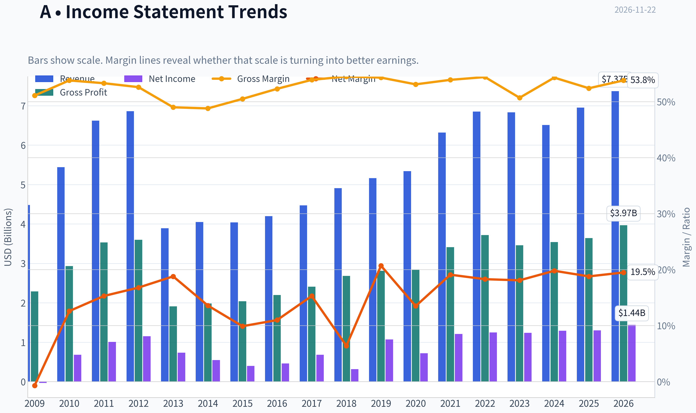

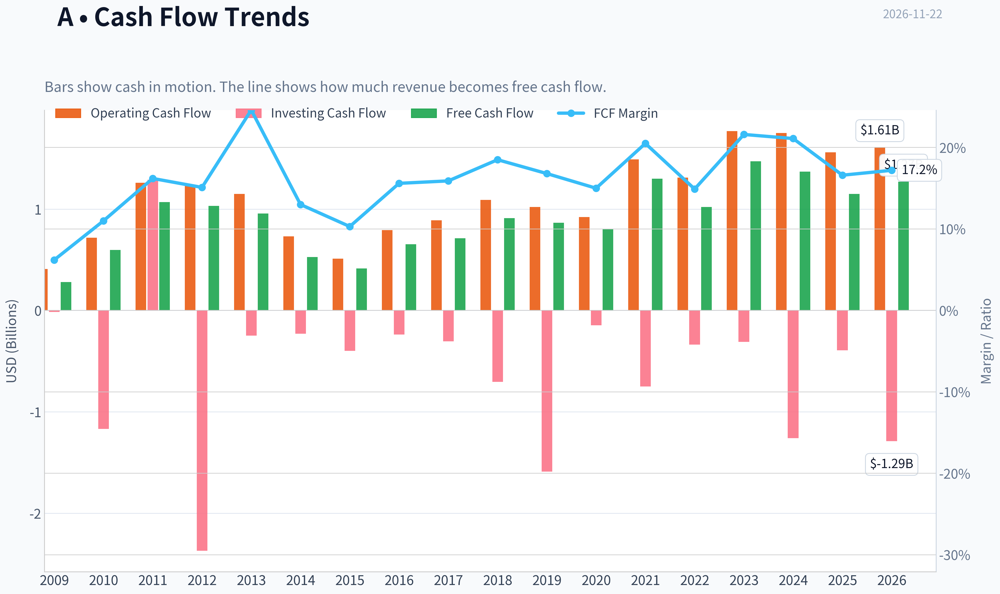

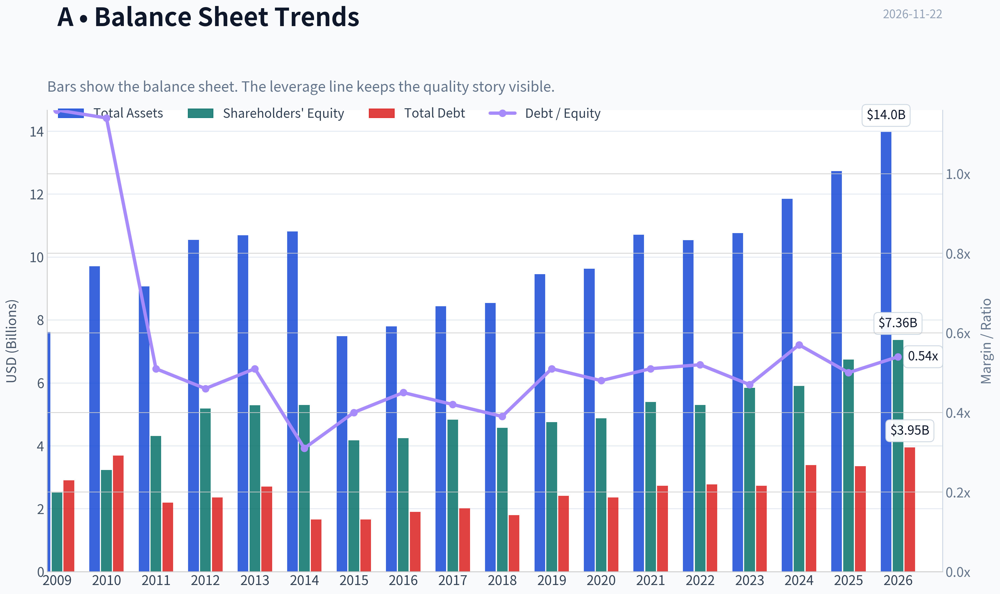

This graph tracks the profitability and return metrics (ROE, ROIC, Margins) of **A** over the past decade, highlighting capital efficiency trends.

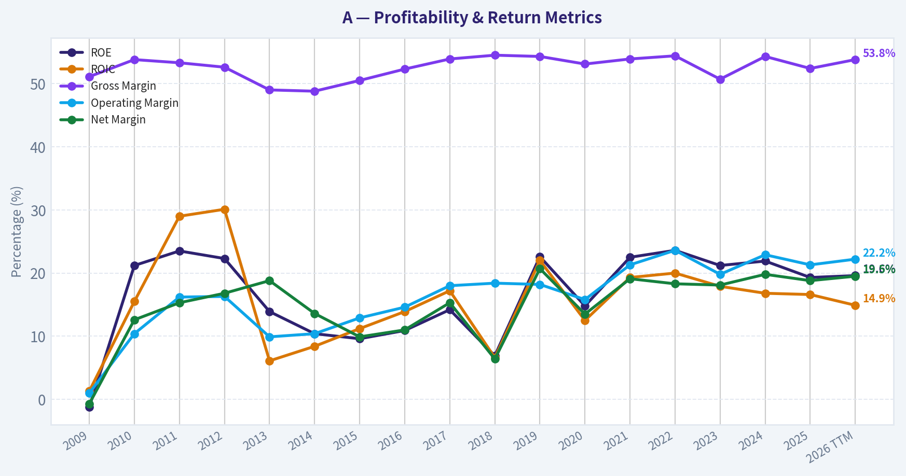

This chart illustrates the financial health of **A** over the last 10 years, mapping cash equivalents and free cash flow against total obligations (Debt).

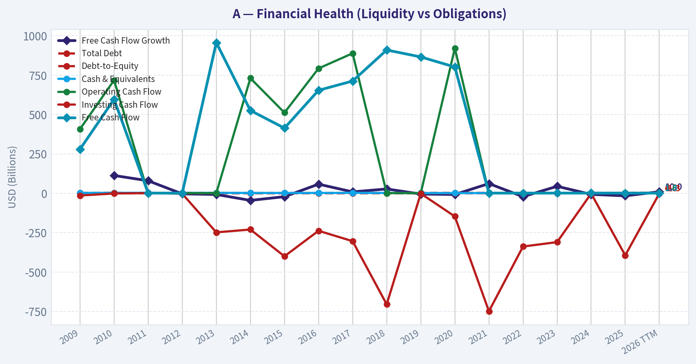

This comparison chart from *Profitability* stacks current figures against historical benchmarks for **A**, making it easy to see where the company trades relative to its own averages.

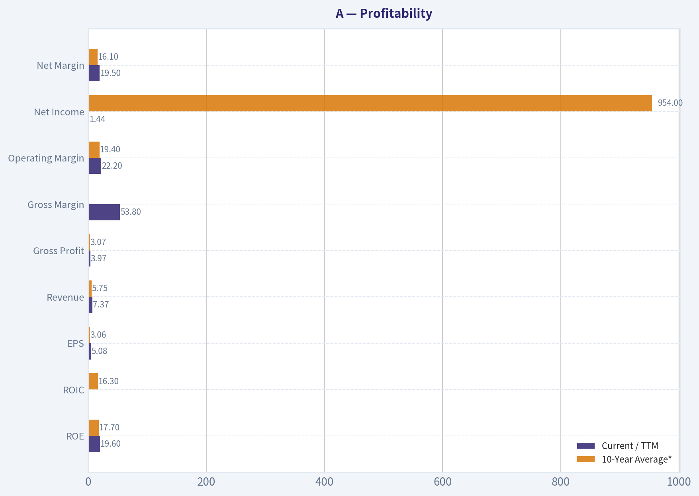

---

### Intrinsic Value Analysis (Buffett)

> *Following Warren Buffett's value investing philosophy: Circle of Competence, Economic Moat, Management Quality, and Margin of Safety.*

#### Intrinsic Value Snapshot

Price is what you pay. Intrinsic value is what the business may be worth based on the cash it can create for owners over time. We show a range, not one magic number.

- Current Price: $170.38
- Value Range (conservative to optimistic across both DCF methods): $44.84 to $223.13

##### Owner Earnings (Buffett Method)
- Net Income: $1,303,000,000.00
- Depreciation & Amortization: $288,000,000.00
- Capital Expenditures: $-407,000,000.00
- Working Capital Changes: $-131,000,000.00
- Owner Earnings: $1,226,952,613.24

##### Intrinsic Value
###### Buffett Method
Uses owner earnings. Stricter, and usually more conservative.
- Conservative: $59.66
- Average: $85.23
- Optimistic: $85.23
- Discount Rate: 8.3%

###### Cash Flow Method
Uses free cash flow. Better for companies spending heavily today to grow tomorrow.
- Conservative: $44.84
- Average: $81.56
- Optimistic: $223.13
- Discount Rate: 9.1%

ANALYST STANCE: **Neutral**

#### Executive Summary

Agilent Technologies is a high-quality analytical-instruments and laboratory-solutions business with attractive gross margins, recurring customer relationships, and credible long-term demand drivers in pharmaceuticals, diagnostics, research, and applied markets. Its economics are supported by brand reputation, technical know-how, regulatory familiarity, and switching costs embedded in laboratory workflows.

The principal issue is valuation. At approximately **$170 per share**, Agilent trades at roughly twice the DeepValues Buffett-method intrinsic value of **$85.23 per share**. The business quality is respectable, but the current valuation requires substantially stronger long-term growth and reinvestment outcomes than the available cash-flow evidence supports.

#### 1. Factor Scorecard

| Factor | Score | Evidence |
|---|---:|---|
| Circle of Competence & Business Simplicity | 4/5 | Agilent sells instruments, software, consumables, and services used in laboratories. The model is understandable, although product breadth and end-market exposure add some complexity. |
| Moat Test | 4/5 | Gross margin is 52.4%, suggesting differentiated products and pricing power. Brand trust, validated laboratory workflows, service relationships, and switching friction support durability. |
| Management Quality & Capital Allocation | 3/5 | The company has an established public-company record and pays a growing dividend, but the supplied data do not establish exceptional insider ownership, unusually strong per-share capital allocation, or a clear record of value-creating acquisitions. |
| Industry Structure | 4/5 | Specialized analytical instruments and laboratory systems are more differentiated than commodity equipment. Regulatory validation and technical support favor established providers. |

**Gate 5 hard floor:** **Not tripped.** The available evidence does not indicate both deteriorating earnings or cash flow and a solvency red line. Net debt exists, but the company is not presented as financially distressed.

**Key Takeaways:** Agilent scores well on business quality, moat characteristics, and industry structure. The weaker area is not solvency but valuation: the company appears fundamentally sound while the share price leaves little room for disappointment.

#### 2. Moat Analysis

| Moat source | Assessment | Supporting evidence |
|---|---|---|
| Intangible assets | Strong | Laboratory customers value accuracy, reliability, validated methods, service support, and regulatory familiarity. The 52.4% gross margin is consistent with differentiated offerings. |
| Switching costs | Moderate to strong | Changing validated instruments, methods, software, and service arrangements can require retraining, revalidation, and workflow disruption. |
| Cost advantage | Moderate | Scale in manufacturing, distribution, service, and research support should lower unit economics, though the evidence does not demonstrate a dominant structural cost position. |
| Network effects | Limited | Agilent does not appear to possess a classic consumer or platform network effect. Its ecosystem and installed base create reinforcement, but not a pure network effect. |
| Overall moat rating | Wide and stable, not clearly widening | The franchise appears durable, but available evidence is stronger for stability than for rapid moat expansion. |

Agilent's moat is principally based on **trust, technical performance, installed-base familiarity, service capabilities, and workflow disruption costs**. A laboratory may tolerate a modest price increase when instrument reliability and validated results matter more than purchase price alone.

The moat is not invulnerable. Capital-equipment demand can be cyclical, customers can defer purchases, and scientific technologies can evolve. The company therefore deserves a high but not perfect moat score.

#### 3. Management Quality and Capital Allocation

| Area | Assessment |
|---|---|
| Owner orientation | The company pays a regular dividend, which indicates a shareholder-return orientation. Evidence of unusually high insider ownership is not supplied. |
| Candor and accounting | No restatement or accounting-integrity problem is identified in the supplied information. |
| Reinvestment | The business retains meaningful reinvestment opportunities in instruments, consumables, software, service, and life-science applications. |
| Acquisitions | The supplied information does not establish whether recent acquisitions have consistently created value at attractive prices. |
| Balance-sheet discipline | Debt is meaningful, with approximately $3.9 billion of debt against $1.8 billion of cash and a net debt position of about $2.2 billion. |

Management quality appears **solid but not demonstrably exceptional** based on the available evidence. The company's capital allocation should be judged primarily by whether retained earnings translate into rising per-share owner earnings rather than simply by revenue growth or acquisition activity.

#### 4. Financial Summary

| Metric | Latest available figure |
|---|---:|
| Share price | $170.00 |
| Market capitalization | $48.04 billion |
| P/E ratio | 33.6x |
| ROE | 19.3% |
| Gross margin | 52.4% |
| Revenue growth, year over year | 6.7% |
| Free-cash-flow yield | 2.4% |
| Current ratio | 1.96x |
| Cash | $1.8 billion |
| Debt | $3.9 billion |
| Net cash/(debt) | $(2.2) billion |
| App owner earnings | $1.3 billion |
| Shares used by valuation | 283 million |

**Key Takeaways:** Agilent produces attractive gross margins and a respectable 19.3% ROE, while revenue is growing at a mid-single-digit rate. However, the 2.4% free-cash-flow yield and 33.6x P/E indicate that the market is assigning a premium valuation to those qualities. Net debt reduces the equity value available to shareholders.

#### 5. Owner Earnings Calculation

The DeepValues Buffett-method calculation uses after-tax operating income as the starting point:

| Owner-earnings component | Amount |
|---|---:|
| After-tax operating income | $1.5 billion |
| Add: depreciation and amortization | $0.3 billion |
| Less: normalized capital-expenditure charge | $(0.4) billion |
| Less: working-capital investment | $0.0 billion |
| Estimated owner earnings | **$1.3 billion** |
| Estimated owner earnings per share | **$4.59** |

The normalized capital-expenditure charge is based on a three-year average capex-to-revenue relationship. Reported capital expenditures were approximately $0.3 billion, while the valuation model used a $0.4 billion normalized charge.

**Key Takeaways:** Owner earnings are approximately $1.3 billion, or $4.59 per share. Against a $170 share price, that represents an owner-earnings yield of roughly 2.7%, which is substantially below the 10% discount-rate framework used in conservative valuation.

#### 6. Cash-Flow and Return Analysis

| Measure | Interpretation |
|---|---|
| ROE of 19.3% | Strong, though below the exceptional 20%-plus level associated with the best compounders. |
| Gross margin of 52.4% | Evidence of differentiated products, service value, and pricing power. |
| Revenue growth of 6.7% | Healthy but not sufficient by itself to justify any valuation. |
| Owner earnings of $1.3 billion | Positive cash-generation base supporting dividends and reinvestment. |
| Net debt of $2.2 billion | Manageable balance-sheet burden, but not a fortress net-cash position. |
| Interest coverage | Not supplied in the research pack; no solvency red line is indicated. |

ROE appears healthy, but a complete DuPont decomposition is not available in the supplied figures. The presence of net debt means some portion of ROE may reflect leverage and financial structure rather than only operating efficiency. The balance sheet is therefore better described as **sound but not fortress-like**.

#### 7. Three-Scenario DCF Cross-Check

These scenarios are a sensitivity cross-check. The required intrinsic value remains the DeepValues app headline of **$85.23 per share**.

| Scenario | Core assumption | Equity value per share |
|---|---|---:|
| A: No growth | $4.59 owner earnings per share divided by 10%, less $7.77 per-share net debt | **$38.16** |
| B: GDP-like growth | 3% growth, 10% discount rate, less $7.77 per-share net debt | **$59.80** |
| C: Historical-growth sensitivity | Approximately 4.05% growth for 10 years, 2.5% terminal growth, 10% discount rate, less net debt | **Approximately $34.50** |

The scenario calculations use owner earnings per share of approximately $4.59 and net debt of approximately $7.77 per share. Scenario C applies roughly 75% of the stated 5.4% growth input before using a 2.5% terminal rate.

**Key Takeaways:** The independent sensitivity cases range from approximately $34.50 to $59.80 per share, below the DeepValues headline value of $85.23. Even the more favorable app-based valuation does not support the current $170 price.

#### 8. Intrinsic Value and Margin of Safety

| Valuation measure | Value |
|---|---:|
| DeepValues Buffett-method intrinsic value | **$85.23 per share** |
| Conservative-to-optimistic app range | $59.66-$85.23 |
| Current price | Approximately $170 |
| Price premium to headline intrinsic value | Approximately 100% |
| Intrinsic value as a percentage of price | Approximately 50% |
| Economic margin of safety versus price | Approximately **negative 50%** |

The research pack reports a margin of safety versus price of **negative 99.9%**, but that figure is mathematically inconsistent with an intrinsic value of $85.23 and a price of approximately $170. The direct comparison implies that the price is about **100% above intrinsic value**, or that intrinsic value is approximately **50% below the market price**.

The app's valuation inputs are:

- Owner earnings: $1.3 billion
- Growth: 5.4% fading to 2.5%
- Discount rate: 8.3%
- Net debt: $2.2 billion
- Shares: 283 million

For a wide-moat, high-ROIC, reasonably predictable company, a 10%-15% margin of safety could be acceptable. Agilent does not meet that standard at $170; the valuation gap is materially larger.

#### 9. Final Buffett Scorecard

| Criterion | Weight | Score | Weighted contribution |
|---|---:|---:|---:|
| Moat width and durability | 25% | 4.0 | 1.00 |
| Valuation and margin of safety | 20% | 1.0 | 0.20 |
| Capital returns: ROIC versus WACC | 15% | 4.0 | 0.60 |
| Business understanding and predictability | 12% | 4.0 | 0.48 |
| Management quality and capital allocation | 12% | 3.0 | 0.36 |
| Reinvestment runway | 8% | 3.0 | 0.24 |
| Balance-sheet strength | 4% | 3.0 | 0.12 |
| Industry structure | 4% | 4.0 | 0.16 |
| **Total** | **100%** |  | **3.16/5.00** |

**Key Takeaways:** Agilent's operating qualities produce a solid score, particularly in moat, predictability, capital returns, and industry structure. Valuation is the decisive weakness, reducing the total score to 3.16 and placing the company in the Watch category rather than the Advocate category.

#### 10. Investment Stance

**Neutral - Moderate conviction.**

Agilent is a credible, differentiated laboratory-technology franchise with attractive margins, healthy returns, and durable customer relationships. The evidence supports the quality of the business, but not the valuation at approximately $170 per share. The market price implies substantially stronger owner-earnings growth, reinvestment returns, or terminal economics than the current valuation framework supports.

The central conclusion is therefore valuation-sensitive: **the company appears worthy of continued fundamental monitoring, while the present price does not provide an adequate margin of safety against the stated intrinsic value.**
#### Valuation Bridge

This bridge places the current market price beside each intrinsic value lens so readers can see whether upside depends on one method or shows up across several methods.

| Scenario | Intrinsic Value / Share |
| --- | ---: |
| Buffett Method | $85.23 |
| Cash Flow Method | $81.56 |
| Damodaran Method | $43.66 |
| Current Price | $170.38 |

#### Key Takeaways

If one method is far above the others, the upside case depends on a specific modelling assumption. When several methods cluster together, the valuation story is more robust.

#### Valuation Visuals

This comparison chart from *Latest Earnings Snapshot* stacks current figures against historical benchmarks for **A**, making it easy to see where the company trades relative to its own averages.

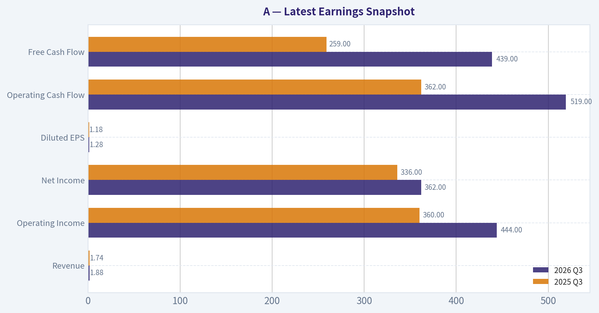

This comparison chart from *Balance Sheet and Financial Strength* stacks current figures against historical benchmarks for **A**, making it easy to see where the company trades relative to its own averages.

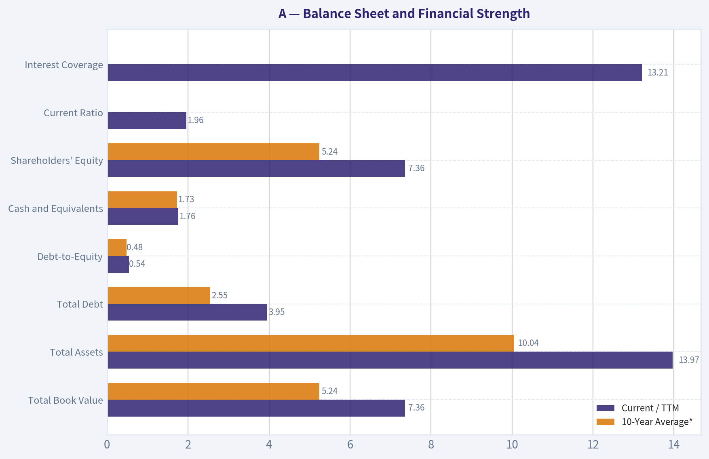

This comparison chart from *Cash Flow and Capital Allocation* stacks current figures against historical benchmarks for **A**, making it easy to see where the company trades relative to its own averages.

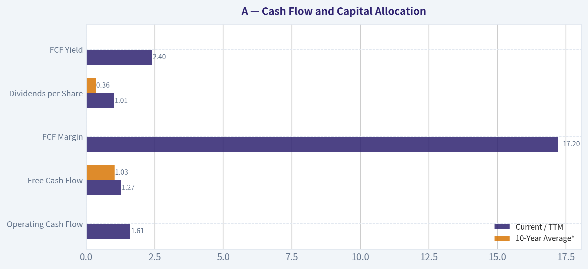

---

### Trend & Growth Analysis (Lynch/Druckenmiller/Fisher)

> *Following Peter Lynch's GARP, Stanley Druckenmiller's macro-aware approach, and Philip Fisher's scuttlebutt methodology.*

ANALYST STANCE: **Neutral**

#### 1. Lynch Classification

Agilent Technologies is a **stalwart**, not a fast grower. Revenue growth is approximately **6.7% year over year**, which is below the 15-25% range typically associated with Lynch-style fast growers. The company has attractive scientific-instrument exposure and durable customer relationships, but the current growth rate does not establish a ten-bagger profile.

#### 2. The Story in Three Bullets

- Agilent supplies analytical instruments, software, and services used in pharmaceutical, biotechnology, chemical, environmental, and academic laboratories.
- Its long-term opportunity is linked to healthcare innovation, drug development, quality control, and increasingly complex laboratory workflows.
- The business has respectable profitability and recurring service characteristics, but the current valuation implies substantially stronger growth than recent revenue performance demonstrates.

#### 3. TAM Analysis and the 10x Test

Agilent participates in several laboratory and life-science markets rather than one easily measurable TAM. The underlying end markets are supported by pharmaceutical R&D, biologics, environmental testing, food safety, and regulatory requirements. However, the company is already a large-scale global supplier, so a tenfold revenue increase would require both market expansion and substantial share gains.

| TAM factor | Assessment |
|---|---|
| Primary secular themes | Healthcare innovation, laboratory automation, analytical testing |
| End-market durability | High |
| Estimated current revenue base | Not provided in the research pack |
| 10x revenue test | Cannot be verified quantitatively without current revenue and TAM data |
| Qualitative runway | Moderate; stronger in specialized and emerging applications |
| TAM growth profile | Likely moderate rather than hypergrowth |

**Key Takeaways:** Agilent operates in durable markets, but durability is not the same as rapid expansion. The available evidence supports a moderate runway, not a clearly demonstrated path to tenfold revenue. A quantitative 10x test requires verified current revenue and market-size figures that are not available here.

#### 4. Revenue Growth Trend

| Metric | Latest available reading | Growth interpretation |
|---|---:|---|
| Revenue growth, year over year | 6.7% | Stalwart-level growth |
| Growth acceleration | Not demonstrated | No confirmed inflection |
| Gross margin | 52.4% | Solid, but not evidence of recent acceleration |
| ROE | 19.3% | Healthy capital profitability |
| FCF yield | 2.4% | Relatively modest at the current valuation |

**Key Takeaways:** Revenue growth is positive but below the fast-grower threshold. The data do not show acceleration from 20% to 30% or a comparable inflection pattern. Profitability is respectable, but the low free-cash-flow yield makes the valuation more dependent on future growth.

#### 5. Unit Economics and Operating Efficiency

Agilent is not primarily a subscription SaaS business, so NRR, CAC, LTV, and the Rule of 40 are not directly applicable from the available data.

| Measure | Result | Interpretation |
|---|---:|---|
| LTV/CAC | Not disclosed | Cannot be calculated reliably |
| Net revenue retention | Not disclosed | Not a core reported metric |
| Rule of 40 | Not applicable | Product, service, and instrument mix |
| Gross margin | 52.4% | Indicates meaningful value capture |
| Current ratio | 1.96 | Adequate short-term liquidity |
| Net debt | Approximately $2.2 billion | Moderate balance-sheet leverage |

**Key Takeaways:** The available metrics suggest a financially sound operating model, but the evidence is insufficient to quantify customer economics in SaaS terms. Agilent's service and consumables revenue may add recurring characteristics, though this should not be treated as equivalent to software-style net retention.

#### 6. Inflection Point Assessment

| Potential inflection | Evidence | Assessment |
|---|---|---|
| Product-cycle inflection | No confirmed new-product acceleration in the pack | Unproven |
| Market-share inflection | No quantified share gains provided | Unproven |
| Margin inflection | Gross margin is 52.4%; trend unavailable | Unproven |
| TAM inflection | Healthcare and laboratory innovation remain durable themes | Moderate |
| Competitive inflection | No major competitor disruption identified | Unproven |
| Capital-return inflection | Quarterly dividend announced at $0.2625 per share | Positive shareholder-return signal, not a growth inflection |

**Key Takeaways:** Agilent has a durable business foundation, but no specific catalyst currently establishes a clear acceleration point. The strongest possible inflection candidates are laboratory automation, biopharma demand, and mix improvement toward services and consumables; confirmation would require several quarters of faster revenue and earnings growth.

#### 7. Macro Setup

The company benefits from secular healthcare and scientific-research spending, but it is also exposed to laboratory budgets, biopharma funding cycles, academic spending, China demand, and capital-equipment purchasing patterns. At a P/E of approximately 33.6, interest-rate sensitivity remains important because higher discount rates can compress valuations for established growth companies.

| Macro factor | Impact on Agilent |
|---|---|
| Healthcare innovation | Positive |
| Pharmaceutical and biotech R&D | Positive over the long term |
| Government and academic budgets | Variable |
| Capital-equipment cycle | Cyclical |
| Higher interest rates | Valuation headwind |
| Lower interest rates | Valuation support |
| China and global industrial demand | Potential volatility |

**Key Takeaways:** Agilent has favorable secular exposure, but its near-term results can behave cyclically because laboratories defer equipment purchases during uncertain periods. The macro backdrop is constructive for the end markets, but not sufficiently strong to offset a demanding valuation by itself.

#### 8. Fisher's 15-Point Assessment

The score below is provisional because detailed management commentary, customer interviews, R&D disclosures, and multi-year margin data were not available in the research pack.

| Fisher criterion | Score / 5 | Evidence-based view |
|---|---:|---|
| Market potential | 4 | Durable laboratory and healthcare demand |
| New-product determination | 3 | Not enough current evidence |
| R&D effectiveness | 4 | Established scientific-technology platform |
| Sales organization | 4 | Global specialized distribution |
| Profit margins | 4 | 52.4% gross margin |
| Margin improvement | 3 | Trend unavailable |
| Labor relations | 3 | Limited evidence |
| Executive relations | 3 | Limited evidence |
| Management depth | 4 | Large global operating platform |
| Cost analysis and accounting | 4 | Mature public-company reporting |
| Outstanding competitive aspects | 4 | Workflow integration, installed base, reputation |
| Long-range profit outlook | 4 | Favorable but moderate-growth |
| Dilution | 3 | No major dilution issue identified |
| Management candor | 3 | Insufficient evidence |
| Management integrity | 4 | No material concern identified |
| **Total** | **54 / 75** | **Average to lower end of "good"** |

**Key Takeaways:** Agilent scores best on market durability, technical capabilities, customer relationships, and operating scale. The score is held back by the lack of evidence for accelerating growth, margin expansion, and a near-term product-cycle catalyst. The result is closer to an established quality company than an exceptional high-growth compounder.

#### 9. Valuation Analysis

| Valuation measure | Result | Interpretation |
|---|---:|---|
| Share price | $170 | Current reference price |
| Market capitalization | $48.04 billion | Large-cap valuation |
| P/E | 33.6x | High for 6.7% revenue growth |
| PEG, using revenue growth as a proxy | Approximately 5.0 | Expensive |
| FCF yield | 2.4% | Modest cash-flow support |
| Owner-earnings intrinsic value | $85.23 headline | Approximately half the current price |
| Owner-earnings range | $59.66-$85.23 | Below current valuation |
| FCFF DCF range | $38.49-$64.97, with base $43.66 | Below current valuation |
| Secondary DVI cross-check | $66.55 | Below current valuation |

**Key Takeaways:** On the available figures, Agilent's valuation is demanding relative to its growth rate. The PEG proxy is approximately 5.0, well above a reasonable-growth valuation range, while the headline owner-earnings intrinsic value of $85.23 is materially below the $170 reference price. The supplied valuation models do not support the current valuation without substantially better future growth or more favorable discount-rate assumptions.

#### 10. Valuation Sensitivity

The supplied intrinsic-value models produce a wide range because the result is highly sensitive to growth, margins, terminal assumptions, and discount rates.

| Model / scenario | Value per share | Difference versus $170 |
|---|---:|---:|
| Owner earnings, conservative | $59.66 | Approximately 65% below |
| Owner earnings, base/headline | $85.23 | Approximately 50% below |
| FCFF, conservative | $38.49 | Approximately 77% below |
| FCFF, base | $43.66 | Approximately 74% below |
| FCFF, optimistic | $64.97 | Approximately 62% below |
| Secondary DVI cross-check | $66.55 | Approximately 61% below |

**Key Takeaways:** Every supplied valuation framework is below the current price reference, including the optimistic FCFF case. This creates substantial valuation sensitivity: even a quality business can experience muted returns if growth remains near 7% while the market multiple contracts toward a more normal level.

#### 11. Growth Investor Scorecard

| Criterion | Weight | Score / 5 | Weighted contribution |
|---|---:|---:|---:|
| Story clarity | 10% | 4.0 | 0.40 |
| TAM and runway | 20% | 3.2 | 0.64 |
| Revenue growth | 20% | 2.5 | 0.50 |
| Unit economics | 15% | 3.2 | 0.48 |
| Competitive position | 10% | 4.0 | 0.40 |
| Management quality | 10% | 3.5 | 0.35 |
| Macro setup | 5% | 3.3 | 0.17 |
| Profitability path | 5% | 3.8 | 0.19 |
| Valuation | 5% | 1.5 | 0.08 |
| **Total** | **100%** | - | **3.21 / 5.00** |

**Key Takeaways:** The composite score of approximately 3.2 falls in the **Neutral** range. Agilent's business quality and competitive position are stronger than its growth profile and valuation. The valuation score is the principal constraint, while the absence of a demonstrated acceleration point prevents a higher-conviction growth classification.

#### 12. Key Risks and Catalysts

| Catalysts | Risks |
|---|---|
| Faster biopharma and laboratory spending | Growth remains near 7% or decelerates |
| Successful new instrument launches | Multiple compression from elevated rates |
| Greater recurring service and consumables mix | Academic, government, or biotech budget weakness |
| Laboratory automation adoption | China and international demand volatility |
| Margin expansion from operating leverage | Debt and interest-cost pressure |
| Acquisition synergies or portfolio expansion | Valuation remains disconnected from cash-flow value |

**Key Takeaways:** The most important catalyst would be sustained revenue acceleration accompanied by operating leverage. The central risk is not business failure; it is that a solid but moderate-growth company fails to produce the growth required to justify its current valuation.

#### Overall Conclusion

Agilent is a **quality stalwart with durable end markets**, not currently a demonstrated fast grower or ten-bagger candidate. Its competitive position, gross margin, liquidity, and secular healthcare exposure are constructive. However, revenue growth of 6.7%, no confirmed inflection point, a PEG proxy near 5.0, and intrinsic-value estimates substantially below $170 make the evidence insufficient to support the current valuation.

#### Growth & Scorecard Visuals

This comparison chart from *Growth Metrics* stacks current figures against historical benchmarks for **A**, making it easy to see where the company trades relative to its own averages.

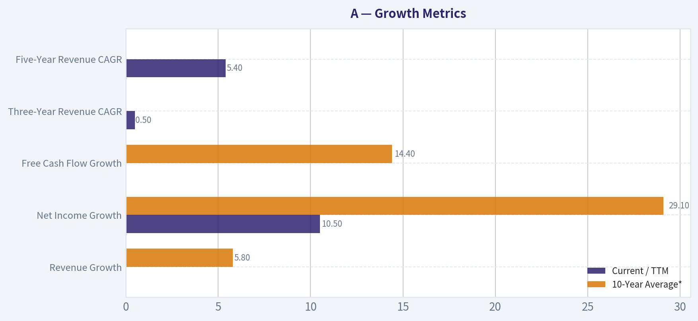

---

### Market Technical Analysis

ANALYST STANCE: **Neutral**

#### Agilent Technologies, Inc. - Technical Market Report

**Security verified:** Agilent Technologies, Inc. (NYSE: A; SEC CIK 0001090872)
**Data date:** Latest available trading session, November 20, 2026. November 22, 2026 was not a trading day.
**Selected indicators:** `close_50_sma`, `close_200_sma`, `close_10_ema`, `macd`, `rsi`, `boll_ub`, `boll_lb`, and `atr`.

#### Overall trend structure

Agilent's latest closing price was **$170.38**, placing it in an intermediate position between a still-positive long-term trend and a weakening short-term trend.

The **200-day SMA was $138.66**, and it has been rising steadily. Price remained approximately **22.9% above** that long-term average, which indicates that the broader trend structure is still constructive. The **50-day SMA was $171.01**, also rising, but price closed slightly below it. This is a modest deterioration in medium-term trend confirmation rather than a decisive breakdown.

The gap between the 50-day and 200-day averages remained wide-about **$32.35**-and both averages were rising. That configuration is consistent with a mature upward trend, although it does not eliminate the possibility of a shorter-term correction.

#### Short-term price and momentum

The **10-day EMA was $174.22**, meaning the latest close was approximately **2.2% below** the short-term average. The 10-day EMA had declined from roughly $176.42 on November 11 to $174.22 on November 20, showing that near-term price momentum had softened after the November 12 high close of $177.88 and the November 18 rebound to $177.33.

The sequence of recent closes also shows choppiness rather than a clean directional move: $180.17 on November 9, $177.88 on November 10, $173.01 on November 12, $172.92 on November 16, $177.33 on November 18, and $170.38 on November 20. The November 20 decline was particularly important because it placed price below both the 10-day EMA and the 50-day SMA.

The **MACD remained positive at 0.68**, so the medium-term momentum differential was still above zero. However, it had fallen substantially from **2.59 on November 9** and **1.73 on November 13**. This indicates that bullish momentum was fading, even though the MACD had not yet moved into clearly negative territory. The signal is therefore more consistent with deceleration than with a confirmed long-term trend reversal.

#### RSI and overbought or oversold conditions

The **RSI was 45.66** on November 20. This is close to neutral, but slightly below the midpoint of 50. It indicates that recent selling pressure had outweighed buying pressure over the calculation window, while remaining far from the conventional oversold threshold near 30.

The RSI had reached **59.29 on November 9**, then moved down through the low-50s and into the mid-40s. That decline confirms that the recent pullback was accompanied by a meaningful loss of momentum. At the same time, the absence of an oversold RSI reading means the indicator does not, by itself, identify an unusually stretched downside condition.

#### Bollinger Band position and volatility

The **upper Bollinger Band was $181.88**, while the **lower band was $169.35**. At $170.38, price was only about **$1.03 above the lower band** and approximately **$11.50 below the upper band**.

This placement shows that the latest decline brought price close to the lower boundary of its recent trading envelope. It suggests short-term downside pressure and an increase in the importance of the $169-$170 region as a volatility-adjusted reference area. However, proximity to the lower Bollinger Band is not automatically a reversal signal; in a continuing decline, price can remain near or below the lower band.

The band width was approximately **$12.54**, or about **7.4% of the latest closing price**, indicating that volatility was not compressed. The wide envelope is consistent with the large intraday ranges observed during November, including the November 20 range from $169.40 to $175.13.

#### Volatility and risk regime

The **ATR was $5.07**, equivalent to approximately **3.0% of the latest closing price**. This is a meaningful daily trading range for a large-cap laboratory and analytical-instrument company and indicates that recent price fluctuations were material relative to the stock's price.

ATR had risen from approximately **$4.11 on September 18** to levels generally between $4.6 and $5.4 during October and November. The current volatility regime therefore remains elevated compared with the quieter part of the September advance. This makes single-session price movements less reliable as standalone evidence of a durable trend change.

#### Integrated interpretation

The evidence is mixed across time horizons, but the details are more informative than a simple "mixed" classification:

- **Long-term trend:** Constructive. Price remained well above a rising 200-day SMA.
- **Medium-term trend:** Still broadly positive, but the latest close slipped below the rising 50-day SMA.
- **Short-term trend:** Soft. Price was below the 10-day EMA, RSI was below 50, and MACD momentum had contracted sharply.
- **Volatility-adjusted condition:** Price was near the lower Bollinger Band, but ATR remained elevated, so the move should be interpreted within a high-volatility range rather than as a low-risk oversold event.
- **Momentum quality:** The positive MACD value shows that the broader momentum balance had not fully reversed, but its sharp decline from early November levels indicates weakening participation in the prior advance.

From a valuation perspective, technical data alone cannot establish whether Agilent's fundamental valuation is supported at **$170.38**. The chart evidence supports a distinction between a still-intact longer-term trend and a less convincing short-term momentum profile. The resulting stance is **Neutral** because confirmation would require either renewed short-term momentum or clearer evidence that the area near the lower Bollinger Band is stabilizing.

#### Key indicators and implications

| Indicator | Latest reading | Recent direction | Interpretation |
|---|---:|---|---|
| `close_50_sma` | $171.01 | Rising | Price closed slightly below the medium-term average, weakening near-term trend confirmation |
| `close_200_sma` | $138.66 | Rising | Long-term trend remained constructive; price was well above the benchmark |
| `close_10_ema` | $174.22 | Declining recently | Short-term momentum softened; price was below the responsive average |
| `macd` | 0.68 | Positive but falling | Momentum remained above zero but had decelerated substantially |
| `rsi` | 45.66 | Down from 59.29 on Nov. 9 | Neutral-to-soft momentum; not conventionally oversold |
| `boll_ub` | $181.88 | Broad recent envelope | Upper volatility boundary; price remained well below it |
| `boll_lb` | $169.35 | Broad recent envelope | Price was close to the lower volatility boundary |
| `atr` | $5.07 | Elevated | Daily price variability remained material, increasing signal noise |

The long-term trend remains positive because both major moving averages are rising and price is substantially above the 200-day SMA. However, short-term momentum has weakened: price is below the 10-day EMA and 50-day SMA, MACD has contracted, and RSI is below 50. The latest close is near the lower Bollinger Band in an elevated-volatility regime, so the technical evidence does not yet provide a clean directional confirmation or a definitive valuation conclusion.

#### Market Visuals

This comparison chart from *Market Metrics and Valuation* stacks current figures against historical benchmarks for **A**, making it easy to see where the company trades relative to its own averages.

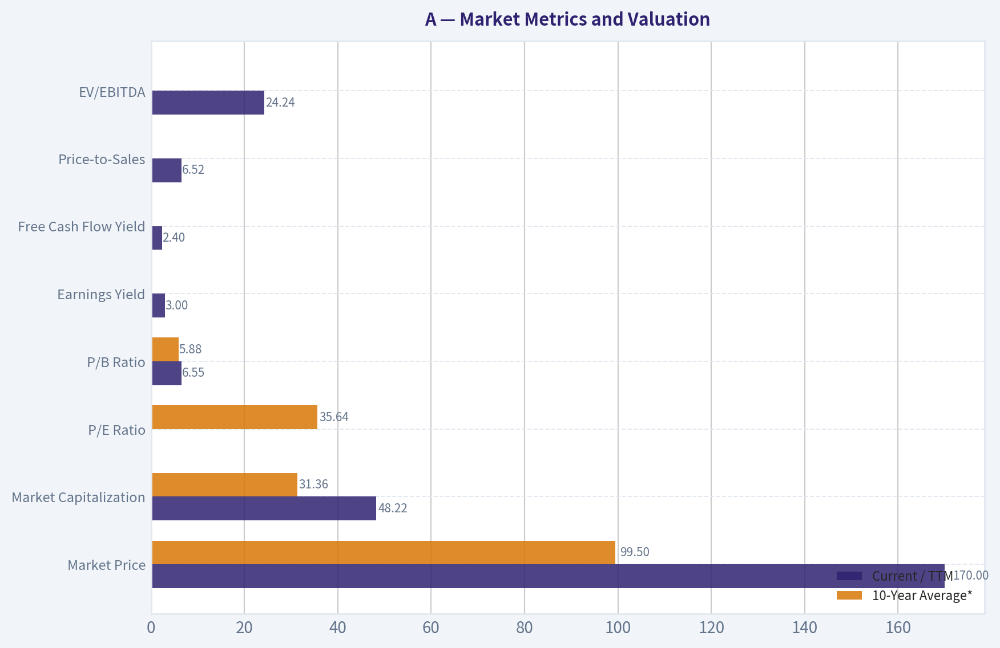

---

### Options Market Analysis

> *Reading options flow - put/call ratios, IV skew, and unusual activity - to gauge institutional positioning and event-driven risk.*

ANALYST STANCE: **Neutral**

#### Scope and Data Quality

Options data for ticker **A** was retrieved as of **November 22, 2026**. The supplied chain covers December 18, 2026; January 15, 2027; and February 19, 2027 expirations. The underlying share price was not included, so exact ITM, ATM, and OTM classification for individual strikes-especially the unusual $155 put-cannot be confirmed.

#### Put/Call Ratio Analysis

| Expiration | Days to Expiry | Call OI | Put OI | Put/Call OI | Call Volume | Put Volume | Put/Call Volume |
|---|---:|---:|---:|---:|---:|---:|---:|
| Dec. 18, 2026 | 26 | 2,393 | 1,427 | 0.60 | 291 | 1,315 | 4.52 |
| Jan. 15, 2027 | 54 | 4,600 | 2,744 | 0.60 | 293 | 207 | 0.71 |
| Feb. 19, 2027 | 89 | 550 | 513 | 0.93 | 97 | 92 | 0.95 |
| **Aggregate** | - | **7,543** | **4,684** | **0.62** | **681** | **1,614** | **2.37** |

**Key Takeaways:** Aggregate put/call open interest is 0.62, below the approximately 0.70 neutral baseline, indicating that calls dominate existing open interest. However, aggregate put volume is 2.37 times call volume, driven primarily by the December expiration, signaling concentrated near-term hedging or bearish speculation. The structure is therefore longer-dated call-heavy but short-dated flow-heavy on the put side.

#### Implied Volatility Assessment

| Expiration | Call ATM IV | Put ATM IV | Call-Put IV Difference | Interpretation |
|---|---:|---:|---:|---|
| Dec. 18, 2026 | 52.1% | 51.4% | +0.7 pts | Essentially balanced |
| Jan. 15, 2027 | 46.1% | 42.1% | +4.0 pts | Call IV premium |
| Feb. 19, 2027 | 43.1% | 38.0% | +5.1 pts | Call IV premium |

The available data provides ATM IV but not dedicated out-of-the-money put and call IV. Consequently, a conventional OTM skew calculation is unavailable. ATM volatility is highest in the December expiration and declines into January and February, consistent with elevated short-term event or near-term uncertainty.

There is no catalyst calendar in the supplied data, so it is not possible to confirm whether the December IV premium reflects earnings, a product event, or another scheduled catalyst.

**Key Takeaways:** Near-term ATM IV is elevated relative to later expirations, with December call and put IV both near 52%. The available ATM data shows a modest call-side premium rather than a conventional downside put skew. A true OTM skew assessment remains incomplete because OTM volatility levels were not provided.

#### Unusual Options Activity

| Expiration | Contract | Strike | Volume | Open Interest | Volume/OI | IV | DTE | Interpretation |
|---|---|---:|---:|---:|---:|---:|---:|---|
| Dec. 18, 2026 | Put | $155 | 585 | 105 | 5.6x | 50.2% | 26 | Fresh-looking downside protection or bearish speculation |

The December 18 $155 put is the only contract flagged by the data provider as unusual, with volume exceeding five times existing open interest and volume above 500 contracts. Because the underlying price was not supplied, its ITM, ATM, or OTM status cannot be established.

The high volume-to-open-interest ratio suggests substantial new activity, although it cannot distinguish bought puts from sold puts without trade-level execution data. The contract may reflect institutional hedging, especially given its size, but retail speculation cannot be ruled out.

**Key Takeaways:** The standout flow is a December $155 put with 5.6 times as much volume as open interest. Its size and short maturity make it the clearest near-term bearish or protective signal in the chain, but the lack of bid-ask execution data prevents a definitive classification as bought protection versus sold volatility.

#### Open Interest Concentration and Gamma Levels

| Expiration | Highest OI Category | Call OI | Put OI | Combined OI |
|---|---|---:|---:|---:|
| Dec. 18, 2026 | Expiration-level concentration | 2,393 | 1,427 | 3,820 |
| Jan. 15, 2027 | Expiration-level concentration | 4,600 | 2,744 | 7,344 |
| Feb. 19, 2027 | Expiration-level concentration | 550 | 513 | 1,063 |

The January 15 expiration has the largest open-interest concentration, representing approximately 56% of total call and put open interest across the reported expirations. December is the second-largest concentration and has the strongest trading activity.

Strike-level open-interest detail was not provided, so specific gamma walls, max-pain levels, and likely pinning strikes cannot be calculated. The large aggregate call OI in January could create upside liquidity or resistance depending on whether the calls were bought or written, while the December put activity could amplify short-term downside sensitivity.

**Key Takeaways:** January 15 is the dominant open-interest expiration, while December 18 is the most active near-term expiration. The data does not contain enough strike-level detail to identify exact gamma walls or max-pain levels. Expiration-level concentration is meaningful, but its directional effect depends on whether the listed contracts were bought or sold.

#### Overall Options Sentiment Signal

**Overall signal: NEUTRAL, with a near-term bearish tilt.**

The call-heavy open-interest structure, particularly in January, indicates that longer-dated market exposure is not broadly defensive. However, the near-term evidence is more cautious: December put volume is 4.5 times call volume, aggregate put volume is 2.37 times call volume, and the December $155 put is the only flagged unusual contract.

The main driver of the neutral classification is the conflict between call-dominant open interest and put-dominant short-dated activity. The near-term bearish tilt reflects the concentration and freshness of December put flow, while the lower put/call open-interest ratio and call-side ATM IV premiums prevent a fully bearish conclusion. The evidence supports elevated near-term downside risk but does not establish a broad, persistent bearish consensus.

#### Summary

| Category | Assessment |
|---|---|
| Put/Call Ratio | OI ratio 0.62, below the 0.70 neutral baseline; volume ratio 2.37, indicating heavy recent put activity |
| IV Level | Elevated near term; December ATM IV is about 51% to 52%, declining to 38% to 46% in later expirations |
| Skew Direction | Available ATM data favors calls, but true OTM skew is unavailable |
| Unusual Activity | December 18 $155 put, 585 volume versus 105 OI, or 5.6 times volume-to-OI |
| Overall Signal | **NEUTRAL with a near-term bearish tilt** |

**Key Takeaways:** A has a call-heavy open-interest base but unusually strong near-term put activity. The December $155 put is the primary directional warning signal, while January call concentration and call-side IV premiums offset some of the bearish evidence. Confidence is moderate because strike-level gamma data, underlying price, trade direction, and catalyst information are unavailable.

---

## Research Team Commentary

> *The Research Manager synthesizes the Bull vs Bear debate into action-free commentary. This is a pre-risk view, not the final stance.*

Core Takeaway: Agilent is a high-quality laboratory-technology franchise, but the evidence does not support the valuation at $170. Its installed base, validated workflows, technical reputation, and recurring service and consumables revenue create meaningful switching costs. The 52.4% gross margin and 16.2% ROIC confirm attractive economics. Nevertheless, a 33.6 times earnings multiple and an approximately 2.5% owner-earnings yield require cash-flow growth materially stronger and more durable than the supplied assumptions of 5.4% growth fading to 2.5%. This is a good company priced as though a particularly favorable outcome is already established.

The strongest bull argument is that Agilent sells mission-critical capabilities rather than interchangeable laboratory equipment. Pharmaceutical and biotechnology customers care about accuracy, regulatory compliance, reproducibility, software compatibility, and global service. Changing systems can require retraining and revalidation, while the installed base supports recurring demand for maintenance, consumables, calibration, software, and upgrades. Long-term demand should also benefit from increasingly complex drug development, biologics, environmental testing, and laboratory automation. These attributes warrant a premium relative to an ordinary cyclical equipment manufacturer.

The strongest bear argument is that the premium appears far greater than the demonstrated growth supports. Based on approximately $1.3 billion of owner earnings against an equity value near $50 billion, the starting cash yield is only about 2.5%. With an 8.3% discount rate, that valuation requires a long period of elevated growth, significant margin expansion, higher normalized owner earnings, or some combination of all three. A simplified perpetuity comparison implies growth near the high-single-mid-single-digit boundary for a very long duration, whereas the supplied model fades toward 2.5%. The precise intrinsic value cannot be established without verified share count, net debt, and a full cash-flow bridge, but the unfavorable direction and magnitude are difficult to explain away.

Rationale: Under a Buffett-style framework, Agilent earns strong marks for business quality but weak marks for price versus intrinsic value. Its 16.2% ROIC is comfortably above the supplied discount rate, suggesting real economic value creation. Its 19.3% ROE and 10.2% ROA also indicate that the franchise is productive rather than merely benefiting from accounting leverage. These characteristics justify requiring only a modest margin of safety if cash flows are predictable and the growth assumptions are well supported.

That modest margin of safety is not visible here. The current valuation does not merely recognize Agilent's moat; it appears to assume that the company will monetize its scientific-market runway substantially better than the base-case forecast indicates. Recent growth evidence is not strong enough to establish that outcome. The quality premium could be justified if normalized owner earnings are understated, recurring revenue is expanding rapidly, or organic growth can remain in the high single digits without sacrificing margins. Those conditions are plausible, but the supplied evidence does not demonstrate them.

The moat also needs to be described accurately. Switching costs are meaningful but not absolute. Agilent competes against sophisticated, well-capitalized companies such as Thermo Fisher, Danaher, Waters, and Shimadzu. Customers can change platforms when competing technology offers better performance, lower total cost, or broader workflow integration. Large pharmaceutical companies and contract laboratories can also consolidate vendors and negotiate aggressively. Agilent must keep investing in instruments, automation, software, and support to preserve its competitive position; this is not a passive toll-road franchise.

Cyclicality further increases the burden of proof. Services and consumables make Agilent more resilient than a pure capital-equipment supplier, but instrument demand remains exposed to biotechnology funding, pharmaceutical capital budgets, academic spending, China, industrial activity, and equipment-replacement cycles. At a lower valuation, temporary demand weakness could create a favorable mismatch between price and durable economics. At the present valuation, ordinary cyclicality instead creates substantial sensitivity to missed growth expectations.

Management may have attractive options for reinvestment, acquisitions, and repurchases, but the record is insufficiently documented to award an exceptional capital-allocation premium. Future analysis should distinguish between total earnings growth and per-share owner-earnings growth, while testing whether acquisitions create value after goodwill, integration expenses, and incremental capital. Possible uses of cash are not the same as demonstrated per-share value creation.

The technical picture does not change this conclusion. A rising 200-day moving average indicates constructive long-term sentiment, while weakness relative to the 50-day and 10-day measures suggests softer near-term momentum. Neither establishes intrinsic value. The options data are too incomplete to provide a reliable contrary signal because the underlying reference price and clear moneyness classifications were unavailable.

The relevant lesson from similar cases is not to confuse admiration for a business with evidence of an attractive valuation. It would be equally mistaken to reject Agilent simply because it trades at a premium multiple: durable, high-return franchises deserve premiums. The discipline is to determine whether the premium can be supported by conservative cash flows. Here, the reverse-DCF burden appears too demanding. The rough low-to-mid-$20 billion DCF indication should not be treated as a precise appraisal, but it reinforces that the issue is more than a small modeling disagreement.

Monitoring Plan: Over the next one to four quarters, the first item to watch is organic revenue growth, particularly whether it accelerates enough to support something materially above the 5.4% base assumption. Orders, backlog, instrument placements, and management's comments on replacement cycles will help distinguish a temporary spending pause from structurally modest growth.

Second, watch pharmaceutical and biotechnology demand, China performance, and academic or government spending separately. A broad recovery would strengthen the normalized-growth argument; dependence on one geography or customer category would weaken it.

Third, track the recurring-revenue mix. Service, consumables, and software should grow faster than instruments and produce measurable improvements in revenue stability. Claims about an annuity-like installed base are more persuasive if recurring categories expand during weak equipment periods.

Fourth, monitor operating margins and free-cash-flow conversion. Revenue growth that requires heavier promotion, elevated research spending, working-capital investment, or acquisition spending would be less valuable than comparable growth accompanied by stable margins and strong cash conversion.

Finally, update owner earnings, net debt, diluted shares, and intrinsic value each quarter. Evidence of sustained high-single-digit owner-earnings growth, durable ROIC, and disciplined per-share capital allocation would narrow the gap between the business narrative and the market valuation. Continued mid-single-digit growth with no material margin expansion would reinforce the conclusion that the price embeds too favorable an outcome.

Final stance label: Bearish. This label reflects clear valuation risk under the supplied assumptions, not concern that Agilent is a distressed or low-quality enterprise.

---

## Value Investing Team Commentary

> *The Investor translates the research view into an investment thesis before risk review. This is still not the final stance.*

Agilent appears to be a high-quality business whose valuation is the central risk-not a weak franchise facing immediate distress.

The company benefits from meaningful switching costs. Laboratory customers value validated workflows, regulatory reliability, instrument compatibility, technical support, and reproducibility. Once an instrument ecosystem is embedded in a pharmaceutical, biotechnology, or academic laboratory, replacement involves training, validation, workflow disruption, and potential compliance costs. Service, consumables, software, and maintenance further improve revenue durability. These characteristics support a premium valuation relative to a conventional capital-equipment manufacturer.

However, the premium must be supported by cash-flow growth. At $170 and a stated P/E of 33.6, the market is assigning substantial value to future earnings expansion. The supplied owner earnings of approximately $1.3 billion imply an owner-earnings yield near 2.5% against an equity value of roughly $50 billion. With an 8.3% discount rate and growth fading from 5.4% to 2.5%, the valuation requires either stronger normalized earnings, sustained growth above the base case, meaningful margin expansion, or a combination of these factors.

That is the key reverse-DCF issue. Agilent does not need to be a poor business for the valuation to be unattractive; it only needs to deliver ordinary mid-single-digit growth while the market price assumes a more favorable compounding path. A 16.2% ROIC is encouraging and indicates genuine economic value creation, but it does not by itself justify any price. The relevant question is how much future growth is already embedded in the valuation and how much room remains for disappointing execution.

The contrarian case deserves attention. Recent weakness in laboratory spending could reflect temporary biotechnology funding pressure, China softness, academic budget constraints, or delayed instrument replacement rather than permanent impairment. If those pressures reverse, Agilent's installed base and recurring categories could produce better operating leverage than the recent growth rate suggests. Market skepticism toward life-science tools can therefore create opportunities in the right circumstances.

Yet contrarianism is not automatically bullish. Cyclical weakness is more damaging when the starting valuation leaves little room for execution misses. Agilent also faces capable competitors including Thermo Fisher, Danaher, Waters, and Shimadzu. Switching costs are real but not absolute, and customers can consolidate vendors, negotiate pricing, or adopt competing platforms when performance and total cost justify the change. Continued investment in instruments, automation, software, and service infrastructure is necessary to preserve the moat.

The most important evidence would be sustained organic growth above the supplied 5.4% assumption, expanding service and consumables revenue, stable or improving margins, strong free-cash-flow conversion, and disciplined per-share capital allocation. Conversely, continued mid-single-digit growth, weak instrument demand, elevated acquisition dependence, or limited margin improvement would reinforce the conclusion that the valuation assumes too favorable an outcome.

The technical signals and options information add little to intrinsic-value analysis. A rising long-term moving average describes market sentiment, not business worth, while the incomplete options data cannot establish a reliable forward-looking signal. The main analytical uncertainty is not whether Agilent is a quality franchise; it is whether the quality and growth outlook are sufficient to support the current valuation.

**ANALYST STANCE: Bearish.** Agilent merits recognition as a durable, high-return laboratory-technology business, but the supplied evidence indicates clear valuation risk. The market price appears to require stronger and more persistent cash-flow growth than the base case demonstrates, leaving an inadequate margin of safety despite the company's attractive moat.

---

## Deep Values Commentary

> *The Risk Management Team debates and the Risk Judge provides the final action-free verdict. This section determines the final Bullish / Neutral / Bearish stance.*

#### Final Stance Scorecard

This scorecard converts the final research view into a weighted decision frame. It does not replace the narrative judgement, but it makes the main drivers of the verdict easier to scan.

| Criterion | Score | Weight | Commentary |
| --- | ---: | ---: | --- |
| Business Quality | 3.75 | 30% | High returns, profitability, and Piotroski health support durability. |
| Valuation Support | 1.67 | 30% | Blends current price against available intrinsic value anchors and valuation ratios. |
| Financial Strength | 4.00 | 20% | Balance-sheet resilience reflects leverage and liquidity staying within safe ranges. |
| Growth Durability | 2.00 | 20% | Recent revenue, earnings, and free cash flow growth indicate how durable expansion looks. |
| TOTAL / FINAL STANCE | 2.83 | 100% | Neutral |

#### Key Takeaways

The weighted score lands at **2.83 / 5.0**, while the final stance remains **Neutral**. This is useful as a quick calibration aid rather than a mechanical signal.

#### Risk Summary

Higher scores indicate more risk pressure. The watch threshold is a simple guardrail: above it, the dimension weighs more heavily on the valuation case and calls for a wider margin of safety.

| Dimension | Current Score | Watch Threshold | Commentary |
| --- | ---: | ---: | --- |
| Business Quality | 2.25 | 3.00 | High returns, profitability, and Piotroski health support durability. |
| Valuation Support | 4.33 | 3.00 | Blends current price against available intrinsic value anchors and valuation ratios. |
| Financial Strength | 2.00 | 3.00 | Balance-sheet resilience reflects leverage and liquidity staying within safe ranges. |
| Growth Durability | 4.00 | 3.00 | Recent revenue, earnings, and free cash flow growth indicate how durable expansion looks. |

#### Key Takeaways

This view helps readers separate *where* the risk sits: valuation, business quality, balance sheet, or growth durability. It is especially useful when the final stance is close to the line between Neutral and Bearish.
