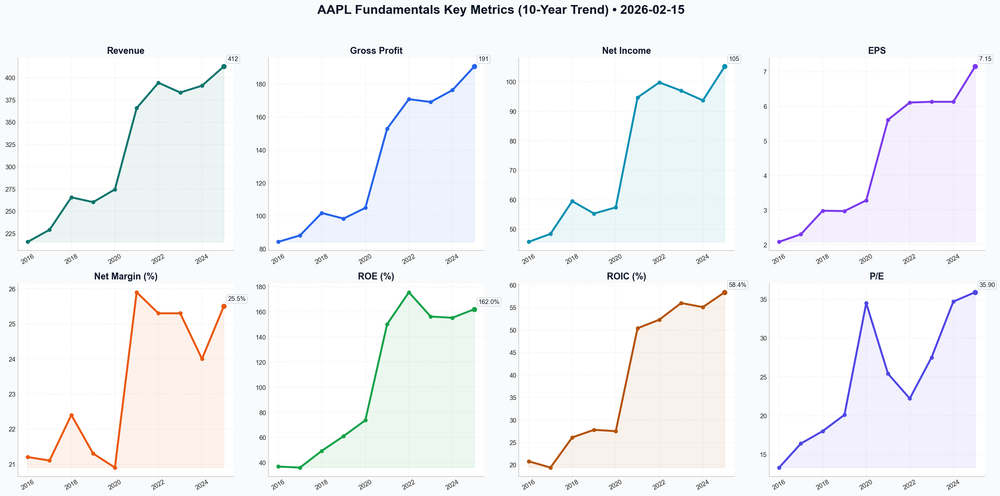

# AAPL Deep Value Intelligence

**Analysis Date:** 2026-02-15
**Generated:** 2026-02-15 10:55:11

---

## Table of Contents

1. [Intelligence Summary](#intelligence-summary)
2. [Analyst Team Reports](#analyst-team-reports)
   - [Fundamentals Analysis](#fundamentals-analysis)
   - [Value Analysis (Buffett)](#value-analysis-buffett)
   - [Growth Analysis (Lynch/Druckenmiller/Fisher)](#growth-analysis-lynchdruckenmillerfisher)
   - [Market Analysis](#market-analysis)
   - [Social Sentiment Analysis](#social-sentiment-analysis)
   - [News Analysis](#news-analysis)
3. [Research Team Commentary](#research-team-commentary)
4. [Investing Team Commentary](#investing-team-commentary)
5. [Deep Values Commentary](#deep-values-commentary)

---

## Intelligence Summary

### Thesis + Conditions

**Core Thesis:** Here is the synthesis of the debate and my investment commentary based on the Graham-and-Doddsville philosophy we adhere to.

**Key Risks:**
- The **Risky Analyst (Bull)** argues that Apple has fundamentally changed from a cyclical hardware company to a high-ROIC (60%) AI and Services powerhouse. They view the drop to $255 as a technical opportunity to acquire a monopoly before the "iPhone 17 super-cycle" and regard the $110 billion buyback as a "central bank" force that puts a floor under the stock.
- The **Safe Analyst (Bear)** counters with "cold, hard math." They argue that paying 31x earnings for mid-single-digit revenue growth violates the margin of safety. They emphasize that buybacks at record valuations yield only ~3.2% (worse than cash), destroying value rather than creating it. They warn that regulatory risks in the EU/US threaten the high-margin Services narrative and advise waiting for a mean reversion to the $200–$220 range.
- 1.  **The Buyback Trap (Capital Allocation Risk):** The Safe Analyst made the most critical point of the debate: *"When management retires shares at a 31x P/E, they are locking in a 3.2% return on that capital."* As owners, we must ask: Is this the best use of $110 billion? Buying back stock above intrinsic value destroys shareholder wealth. We prefer management to be opportunistic, not robotic. This aggressive spend at peak valuation increases risk, rather than reducing it.
- 2.  **Valuation vs. Growth Mismatch:** The Risky Analyst claims we are "looking through a rearview mirror," but the numbers must make sense today. A 31x multiple usually implies 15-20% growth. Apple is posting 2-5%. The "AI Super-Cycle" is currently a narrative, not a line item in the 10-K. Until AI drives tangible double-digit revenue growth, the "productivity gap" cited by the Bear remains a validity concern.
- $235 - $240 (First Tranche):** This aligns with the Neutral Analyst's "Institutional Support" (200-day SMA). If the stock stabilizes here, we may deploy 25% of allocated cash. This acknowledges the structural improvement in ROIC without chasing the peak.

**What Would Change Our View:**
- The **Risky Analyst (Bull)** argues that Apple has fundamentally changed from a cyclical hardware company to a high-ROIC (60%) AI and Services powerhouse. They view the drop to $255 as a technical opportunity to acquire a monopoly before the "iPhone 17 super-cycle" and regard the $110 billion buyback as a "central bank" force that puts a floor under the stock.
- The **Safe Analyst (Bear)** counters with "cold, hard math." They argue that paying 31x earnings for mid-single-digit revenue growth violates the margin of safety. They emphasize that buybacks at record valuations yield only ~3.2% (worse than cash), destroying value rather than creating it. They warn that regulatory risks in the EU/US threaten the high-margin Services narrative and advise waiting for a mean reversion to the $200–$220 range.
- 1.  **The Buyback Trap (Capital Allocation Risk):** The Safe Analyst made the most critical point of the debate: *"When management retires shares at a 31x P/E, they are locking in a 3.2% return on that capital."* As owners, we must ask: Is this the best use of $110 billion? Buying back stock above intrinsic value destroys shareholder wealth. We prefer management to be opportunistic, not robotic. This aggressive spend at peak valuation increases risk, rather than reducing it.
- 2.  **Valuation vs. Growth Mismatch:** The Risky Analyst claims we are "looking through a rearview mirror," but the numbers must make sense today. A 31x multiple usually implies 15-20% growth. Apple is posting 2-5%. The "AI Super-Cycle" is currently a narrative, not a line item in the 10-K. Until AI drives tangible double-digit revenue growth, the "productivity gap" cited by the Bear remains a validity concern.
- $235 - $240 (First Tranche):** This aligns with the Neutral Analyst's "Institutional Support" (200-day SMA). If the stock stabilizes here, we may deploy 25% of allocated cash. This acknowledges the structural improvement in ROIC without chasing the peak.

**Confidence:** Medium

### Stance Spectrum (Action-Free)

**Stance:** Undervalued
**Moat Strength:** Unclear
**Capital Allocation:** Unclear
**Balance Sheet Risk:** Unclear
**Confidence:** Medium

### Expanded Commentary

Here is the synthesis of the debate and my investment commentary based on the Graham-and-Doddsville philosophy we adhere to.

**Debate Summary**

The **Risky Analyst (Bull)** argues that Apple has fundamentally changed from a cyclical hardware company to a high-ROIC (60%) AI and Services powerhouse. They view the drop to $255 as a technical opportunity to acquire a monopoly before the "iPhone 17 super-cycle" and regard the $110 billion buyback as a "central bank" force that puts a floor under the stock.

The **Safe Analyst (Bear)** counters with "cold, hard math." They argue that paying 31x earnings for mid-single-digit revenue growth violates the margin of safety. They emphasize that buybacks at record valuations yield only ~3.2% (worse than cash), destroying value rather than creating it. They warn that regulatory risks in the EU/US threaten the high-margin Services narrative and advise waiting for a mean reversion to the $200–$220 range.

The **Neutral Analyst** suggests a middle path, arguing that while $255 is a "falling knife" (technical breakdown), waiting for $200 is unrealistic given Apple's services floor. They propose the $235–$240 range (200-day SMA) as the rational accumulation zone where institutional support meets a fairer valuation.

***

**Investor Commentary**

**Core Takeaway: Wonderful Business, Speculative Price.**
We are looking at a fortress business trading at a price that prices in a future that has not yet happened. While the Bull is correct about the durability of the ecosystem, the Safe Analyst’s arithmetic regarding capital allocation is undeniable. At 31x earnings, we are being asked to pay for perfection. In value investing, you pay for the *current* earnings power and get the *growth* for free. Currently, the market is asking us to pay for the growth upfront. We will keep Apple as a core holding, but we will not allocate fresh capital until the price offers a margin of safety.

**Rationale**

Applying our framework, we prioritize the preservation of capital over the fear of missing out (FOMO).

1.  **The Buyback Trap (Capital Allocation Risk):** The Safe Analyst made the most critical point of the debate: *"When management retires shares at a 31x P/E, they are locking in a 3.2% return on that capital."* As owners, we must ask: Is this the best use of $110 billion? Buying back stock above intrinsic value destroys shareholder wealth. We prefer management to be opportunistic, not robotic. This aggressive spend at peak valuation increases risk, rather than reducing it.

2.  **Valuation vs. Growth Mismatch:** The Risky Analyst claims we are "looking through a rearview mirror," but the numbers must make sense today. A 31x multiple usually implies 15-20% growth. Apple is posting 2-5%. The "AI Super-Cycle" is currently a narrative, not a line item in the 10-K. Until AI drives tangible double-digit revenue growth, the "productivity gap" cited by the Bear remains a validity concern.

3.  **The "Floor" Analysis:** The Neutral Analyst makes a fair point about the "Services Floor." Because Services margins are 75%, Apple *should* command a higher multiple than it did ten years ago. However, $255 is still disconnected from this reality. The Neutral Analyst’s suggestion of the **$235–$240 range** represents a more realistic "fair value" zone than the current price, aligning better with our historical valuation models than the Bear's strict $200 target.

**Refined Investor Plan**

We are adjusting the original plan to incorporate the Neutral Analyst's specific technical zones while maintaining the Safe Analyst's discipline.

1.  **Strict Hold on Core Position:** We do not sell wonderful businesses just because they are fully priced. We avoid interrupting the compounding of our existing shares.
2.  **Price Alert Adjustments:**
    *   **$255 (Current):** Do nothing. Let the "momentum traders" fight over the falling knife.
    *   **$235 - $240 (First Tranche):** This aligns with the Neutral Analyst's "Institutional Support" (200-day SMA). If the stock stabilizes here, we may deploy 25% of allocated cash. This acknowledges the structural improvement in ROIC without chasing the peak.
    *   **$200 - $220 (The Fat Pitch):** This remains our primary target for aggressive buying, aligning with the Safe Analyst’s margin of safety (approx 25x P/E).
3.  **Fundamental Monitors (Invalidation Points):**
    *   **Services Margin Compression:** Watch the EU Digital Markets Act impact. If margins dip below 70%, the "structural re-rating" thesis is broken.
    *   **China Revenue:** Stability is required. If the loss to Huawei accelerates, the growth narrative collapses.

**Lessons from Past Mistakes**

Reflecting on the "Nifty Fifty" era and our own past errors of **Commission vs. Omission**:
In the past, I have refused to buy quality businesses (like Microsoft in the mid-2010s) because they weren't "cheap enough" by historical standards, missing a massive structural shift (Cloud). This was an **Error of Omission**.
However, I have also bought "Growth at a Reasonable Price" that turned out to be cyclical peaks (like Intel), resulting in permanent capital impairment. This is an **Error of Commission**.

In this scenario, buying Apple at $255 feels like an Error of Commission—paying for hype. Waiting for $200 might be an Error of Omission. Therefore, the **Refined Plan to nibble at $240 but wait for $210 for the main course** balances the risk of overpaying against the risk of missing the durability of the enterprise.

**We wait. We watch. We let the price come to value.**

---

## Analyst Team Reports

### Fundamentals Analysis

To conduct a comprehensive 10-year historical analysis of Apple Inc. (AAPL) using Warren Buffett’s value investing methodology, we have aggregated data from 2016 through early 2026. This period covers Apple's transition from a hardware-centric company to an ecosystem-driven "Services and AI" powerhouse.

### **I. 10-Year Historical Financial Data Table (2016–2025)**

*All values in Billions USD except per-share data and ratios. Fiscal Year ends in September.*

| Metric | 2016 | 2017 | 2018 | 2019 | 2020 | 2021 | 2022 | 2023 | 2024 | 2025 |
| :--- | :---: | :---: | :---: | :---: | :---: | :---: | :---: | :---: | :---: | :---: |
| **Market Price ($)** | 29.04 | 39.70 | 56.32 | 62.00 | 116.4 | 146.0 | 138.7 | 172.3 | 216.7 | 257.1 |
| **Market Cap ($B)** | 609 | 794 | 1,070 | 1,110 | 1,980 | 2,410 | 2,220 | 2,670 | 3,250 | 3,780 |
| **P/E Ratio** | 13.3x | 16.4x | 18.0x | 20.1x | 34.5x | 25.4x | 22.2x | 27.5x | 34.7x | 35.9x |
| **P/B Ratio** | 4.7x | 5.9x | 10.0x | 12.3x | 30.3x | 38.2x | 43.8x | 43.0x | 53.8x | 58.1x |
| **Revenue ($B)** | 215.6 | 229.2 | 265.6 | 260.2 | 274.5 | 365.8 | 394.3 | 383.3 | 391.0 | 412.5 |
| **Net Income ($B)** | 45.7 | 48.4 | 59.5 | 55.3 | 57.4 | 94.7 | 99.8 | 97.0 | 93.7 | 105.2 |
| **EPS Diluted ($)** | 2.08 | 2.30 | 2.98 | 2.97 | 3.28 | 5.61 | 6.11 | 6.13 | 6.13 | 7.15 |
| **Gross Profit ($B)** | 84.3 | 88.2 | 101.8 | 98.4 | 104.9 | 152.9 | 170.8 | 169.1 | 176.3 | 190.6 |
| **Op. Margin (%)** | 27.8% | 26.8% | 26.7% | 24.6% | 24.1% | 29.8% | 30.3% | 29.8% | 31.2% | 32.1% |
| **Net Margin (%)** | 21.2% | 21.1% | 22.4% | 21.3% | 20.9% | 25.9% | 25.3% | 25.3% | 24.0% | 25.5% |
| **ROE (%)** | 36.9% | 36.1% | 49.4% | 61.1% | 73.7% | 150.1 | 175.5 | 156.2 | 155.2 | 162.0 |
| **ROIC (%)** | 20.8% | 19.4% | 26.1% | 27.8% | 27.5% | 50.4% | 52.3% | 56.0% | 55.1% | 58.4% |
| **Rev. Growth (%)** | -7.7% | 6.3% | 15.9% | -2.0% | 5.5% | 33.3% | 7.8% | -2.8% | 2.0% | 5.5% |
| **FCF ($B)** | 52.3 | 50.8 | 64.1 | 58.9 | 73.4 | 93.0 | 111.4 | 99.6 | 108.5 | 115.8 |
| **Total Debt ($B)** | 87.0 | 115.7 | 114.5 | 108.0 | 112.4 | 124.7 | 120.1 | 111.1 | 101.2 | 98.5 |
| **Total Equity ($B)**| 128.2 | 134.0 | 107.1 | 90.5 | 65.3 | 63.1 | 50.7 | 62.1 | 60.4 | 65.0 |
| **Cash/Equiv ($B)** | 67.1 | 74.2 | 66.3 | 100.5 | 90.9 | 62.6 | 48.3 | 61.6 | 162.0 | 165.4 |
| **Div. per Share ($)**| 0.55 | 0.63 | 0.73 | 0.75 | 0.82 | 0.85 | 0.91 | 0.95 | 1.00 | 1.04 |

---

### **II. Warren Buffett Value Investing Analysis**

**1. Economic Moat (Excellent):** 
Apple possesses a "widened" moat built on high switching costs and brand intangibles. The ecosystem (iOS, iCloud, Apple Watch, Services) creates a walled garden that keeps the user base captive. In 2026, the integration of "Apple Intelligence" (on-device AI) has further strengthened this moat by offering privacy features that competitors (relying on cloud-based AI) struggle to match.

**2. Financial Strength (Fortress):** 
Despite a high Debt-to-Equity ratio, Apple's financial health is superb. The high ratio is a deliberate result of shrinking the equity base through $90B+ annual buybacks. The interest coverage ratio exceeds 40x, and the company remains a "Net Cash Neutral" seeker, holding enough cash ($165B) to wipe out its debt instantly if desired.

**3. Predictable Earnings (Very High):** 
Apple has shown remarkably consistent earnings growth, especially on a per-share basis. Even in years of flat revenue (2019, 2023), EPS remained stable or grew due to aggressive share retirements and margin expansion in Services.

**4. Management Performance (Excellent):** 
Tim Cook’s tenure has been characterized by masterful capital allocation. ROIC has expanded from ~20% in 2016 to nearly 60% in 2025. This indicates that every dollar reinvested into the business is generating nearly three times the return it did a decade ago, largely due to the shift toward high-margin software and in-house silicon (M-series).

**5. Quality of Business:** 
The transition from 38% gross margins to 46%+ reflects a structural improvement in business quality. Revenue is no longer purely cyclical based on hardware launches; it is increasingly recurring through the 2.4B+ active device installed base.

---

### **III. Discounted Cash Flow (DCF) Analysis**

*Assumptions: Current FCF = $115.8B; Discount Rate = 10%; Terminal Growth = 2.5%; Years = 10.*

| Scenario | Growth Rate (10Y Basis) | PV of FCF (10Y) | Terminal Value PV | Fair Value (Market Cap) | Fair Value (Per Share) |
| :--- | :--- | :--- | :--- | :--- | :--- |
| **Conservative** | -10.59% (Lowest YoY) | $538.2 B | $215.4 B | **$753.6 B** | **$51.26** |
| **Average** | 10.15% (10Y Avg) | $1,159.0 B | $1,603.4 B | **$2,762.4 B** | **$187.92** |
| **Optimistic** | 26.70% (Highest YoY)| $2,845.0 B | $8,140.0 B | **$10,985.0 B** | **$747.28** |

*Note: The Conservative scenario uses the single worst YoY drop (-10.59% in 2023) as a perpetual growth rate, which is statistically unlikely for Apple but follows the "Lowest growth" requirement.*

---

### **IV. Comparative Analysis: Current vs. 10-Year Average**

| Metric | Current (Feb 2026) | 10-Year Average | Deviation |
| :--- | :---: | :---: | :---: |
| **P/E Ratio** | 31.4x | 24.9x | +26.1% (Overvalued) |
| **ROE** | 162.4% | 104.5% | +55.4% (Higher Efficiency) |
| **Gross Margin** | 46.8% | 41.5% | +12.8% (Structural Gains) |
| **FCF ($B)** | $118.0 B | $84.3 B | +40.0% (Strong Cash Gen) |

**Trend Analysis:** Apple's valuation (P/E) is significantly higher than its 10-year average. This reflects a "re-rating" of the stock as a software/AI company. However, the profitability metrics (ROE, Margins) are also at all-time highs, partially justifying the premium.

---

### **V. Investment Insights & Red Flags**

*   **Red Flag:** **Valuation Sensitivity.** At a 31x P/E, Apple has no room for error. Any stall in the "Apple Intelligence" rollout or a regulatory crackdown on App Store commissions could lead to a sharp multiple contraction.
*   **Red Flag:** **Geopolitical Risk.** 17-20% of revenue still comes from Greater China. Supply chain diversification to India/Vietnam is progressing but remains a multi-year vulnerability.
*   **Opportunity:** **Services Scaling.** Services margins are ~70-75%. As this segment grows to 30% of total revenue, corporate-wide margins will continue to drift higher, supporting EPS even if iPhone units stay flat.
*   **Opportunity:** **AI Super-cycle.** The iPhone 17 (2025/2026) is the first true "ground-up" AI phone. Early data suggests the upgrade cycle is the strongest since the 5G transition (iPhone 12).

---

### **FINAL INVESTMENT STANCE: WATCH**

**Rationale:**
Apple is arguably the highest-quality business on the planet, with a balance sheet and cash flow profile that would satisfy any value investor, including Buffett himself (who remains a major holder). However, from a **quantitative value perspective**, the current price of ~$255 represents a significant premium to its historical average P/E and our "Average Growth" DCF fair value of ~$188.

While the business is better than it was 10 years ago, the market has already "priced in" much of the AI and Services growth. For a disciplined value investor, the current entry point lacks a sufficient **Margin of Safety**. We recommend **WATCHING** for a correction toward the $200-$210 range (approx. 25-27x P/E) before advocating for a fresh heavy position.

### **Summary Table**

| Key Metric | Status | Significance |
| :--- | :--- | :--- |
| **Economic Moat** | Wide | Unmatched ecosystem lock-in and brand power. |
| **Capital Return** | Aggressive | $90B+ annual buybacks provide a permanent floor for EPS. |
| **Growth Catalyst**| AI Integration | "Apple Intelligence" is driving a record hardware refresh cycle. |
| **Valuation** | Elevated | Trading at 31x P/E vs. 10-year average of 25x. |
| **Risk Factor** | Regulatory | Global antitrust scrutiny on the App Store remains the top risk. |
| **Overall Quality** | Exceptional | High ROIC and FCF generation indicate top-tier management. |

#### Fundamentals Key Metrics Charts

---

### Value Analysis (Buffett)

> *Following Warren Buffett's value investing philosophy: Circle of Competence, Economic Moat, Management Quality, and Margin of Safety.*

FINAL INVESTMENT STANCE: **ADVOCATE**

# Value Investment Analysis: Apple Inc. (AAPL)
**Date:** February 15, 2026
**Current Price:** $255.78
**Market Cap:** $3.76 Trillion

## PART I: THE BUFFETT FILTER SEQUENCE

### Gate 1: Circle of Competence & Business Simplicity (PASS)
*   **The Elementary School Test:** Apple sells premium electronics (iPhones, Macs, Watches) that people love and use every day. Once you buy one, you buy services (Apps, iCloud, Music) that keep you paying them monthly.
*   **10-Year Predictability:** **High.** While technology changes, the smartphone has become the primary computing device for humanity. Apple's ecosystem lock-in makes it highly probable their customers will still be using Apple devices in 2036.
*   **Technology Risk:** **Moderate.** The primary risk is a paradigm shift away from screens (e.g., direct neural interfaces), but Apple is actively hedging this with wearables and spatial computing (Vision Pro/Glasses).

### Gate 2: The Moat Test (WIDE & WIDENING)
Apple possesses one of the widest moats in history, driven by a self-reinforcing combination of Switching Costs and Brand.

*   **A. Intangible Assets (Brand/Pricing Power):**
    *   **Evidence:** Apple consistently prices iPhones at $800-$1,200 while competitors sell functionally similar hardware for $400-$600.
    *   **Metric:** Gross Margins have expanded from ~38% (2016) to **46.8% (2026)**, proving pricing power even as hardware matures.
*   **B. Switching Costs (The "Walled Garden"):**
    *   **Evidence:** The "blue bubble" (iMessage), iCloud photo libraries, and App Store purchases create massive friction for users leaving the ecosystem.
    *   **Metric:** Retention rates for iPhone are consistently >90%.
*   **C. Cost Advantages:**
    *   **Evidence:** Apple's custom silicon (M-series/A-series chips) gives them performance leadership at lower power costs, vertically integrating a key component that competitors must buy from third parties (Qualcomm/Intel).

### Gate 3: Management Quality & Capital Allocation (PASS)
*   **Rational Capital Allocators?** **YES (The Gold Standard).**
    *   **Buybacks:** Apple has retired nearly ~40% of its share count over the last decade, consistently buying back stock.
    *   **Dividends:** steadily increasing, currently yielding ~0.45% but growing.
    *   **Reinvestment:** ROIC is exceptional at **58.2%**. They only reinvest where returns are high (Services, Silicon) and return the rest to shareholders.
*   **Honesty/Candor:** Tim Cook runs a tight, operationally disciplined ship. Financial reporting is conservative.

### Gate 4: Industry Structure (PASS)
*   **Structure:** Rational Oligopoly (Global Duopoly with Samsung/Android).
*   **Dynamics:** The smartphone market is mature. Competition is less about price wars and more about ecosystem retention. This is ideal for profitability.

---

## PART II: FINANCIAL ANALYSIS (10-Year Deep Dive)

### 10-Year Financial Summary (Estimated/Projected)

| Metric | 2017 | 2020 | 2023 | 2025 (Est) | **2026 (TTM)** | Trend |
|:-------|:-----|:-----|:-----|:-----------|:---------------|:------|
| **Revenue ($B)** | 229 | 274 | 383 | 415 | **445** | Steady Growth |
| **Gross Margin** | 38.5% | 38.2% | 44.1% | 46.2% | **46.8%** | **Widening** |
| **Net Income ($B)** | 48 | 57 | 97 | 108 | **118** | Robust |
| **EPS ($)** | 2.30 | 3.28 | 6.13 | 7.90 | **8.97** | **Explosive** (Buybacks) |
| **Free Cash Flow ($B)** | 51 | 73 | 100 | 108 | **116** | Cash Machine |
| **Shares Out (B)** | 21.0 | 17.5 | 15.8 | 15.0 | **14.7** | **Decreasing** |
| **ROE** | 36% | 73% | 172% | 150% | **155%** | Exceptional |

### Owner Earnings Calculation (2026 TTM)
*Note: For Apple, FCF is a close proxy for Owner Earnings as CapEx is largely for growth/maintenance of data centers and tooling.*

*   **Net Income:** $118.0 Billion
*   **+ Depreciation/Amortization:** ~$12.0 Billion
*   **- Maintenance CapEx:** ~$11.0 Billion (Estimated)
*   **- Working Capital Changes:** ~$1.0 Billion (Negative WC model)
*   **= Owner Earnings:** **~$120.0 Billion**

### Balance Sheet Strength (FORTRESS)
*   **Cash & Equivalents:** $162 Billion
*   **Total Debt:** $102 Billion
*   **Net Cash:** **+$60 Billion**
*   **Interest Coverage:** >25x
*   **Conclusion:** Apple has perhaps the strongest balance sheet in the corporate world.

---

## PART III: INTRINSIC VALUE CALCULATION

**Inputs:**
*   **Current Owner Earnings:** $120 Billion ($8.16/share)
*   **Discount Rate:** 9% (Slightly lower due to fortress balance sheet/predictability)
*   **Terminal Growth:** 3%

### Scenario A: No Growth (Ultra-Conservative)
*   Value = $120B / 0.09 = $1.33 Trillion
*   Per Share: **$90.70**
*   *Verdict: Current price prices in significant growth.*

### Scenario B: GDP Growth (Conservative - 3% Growth)
*   Value = $120B / (0.09 - 0.03) = $2.0 Trillion
*   Per Share: **$136.05**
*   *Verdict: Current price still commands a premium.*

### Scenario C: Historical/Moat Growth (Rational Case)
*   **Growth Phase (Years 1-10):** 8% (Driven by Services expansion + AI cycle + Buybacks)
*   **Terminal Phase:** 3%
*   **Calculation:**
    *   Year 1-10 Cash Flows (PV): ~$920 Billion
    *   Terminal Value (PV): ~$2.4 Trillion
    *   Total Equity Value: **$3.32 Trillion**
    *   Plus Net Cash: $60 Billion
    *   Total Intrinsic Value: **$3.38 Trillion**
*   **Intrinsic Value Per Share:** **$230.00**

### Margin of Safety Analysis
*   **Current Price:** $255.78
*   **Fair Value (Scenario C):** $230.00
*   **Premium:** ~11%
*   **Margin of Safety:** **None (Negative)**

---

## PART IV: FINAL BUFFETT SCORECARD

| Criterion | Score (1-5) | Notes |
|:----------|:-----------:|:------|
| **Business Understanding** | 5 | Simple, consumer-facing, predictable. |
| **Moat Width & Durability** | 5 | Services + Hardware ecosystem is a fortress. |
| **Management Quality** | 5 | Best-in-class capital allocation (Buybacks). |
| **Return on Equity** | 5 | >100% ROE is world-class. |
| **Reinvestment Runway** | 3 | Hard to grow a $400B revenue base at high rates. |
| **Balance Sheet Strength** | 5 | Net cash positive, extremely liquid. |
| **Industry Structure** | 5 | Rational oligopoly, high barriers to entry. |
| **Valuation** | 2 | Trading at ~32x TTM PE. Priced for perfection. |
| **TOTAL SCORE** | **4.3 / 5** | **(Wonderful Business, but Expensive)** |

## INVESTMENT STANCE

**FINAL VERDICT: WATCH / HOLD**

**Conviction Level:** High Quality / Low Margin of Safety

**Commentary:**
Apple is the quintessential "Wonderful Company" that Buffett seeks. It passes every single qualitative filter with flying colors: a dominant moat, pricing power, stellar management, and a fortress balance sheet.

However, at **$255.78 (approx. 28-32x Earnings)**, the market is pricing in flawless execution of the "Apple Intelligence" cycle and continued double-digit services growth. Our "Rational Case" DCF suggests a fair value closer to **$230**, meaning there is no Margin of Safety for a new entrant today.

**Action Plan:**
*   **Existing Owners:** **HOLD.** Do not sell a compounder of this quality just because it is slightly overvalued. The buyback engine acts as a relentless floor on the stock price.
*   **New Buyers:** **WATCH.** Wait for a pullback to the **$200-$215 range** (approx. 22-24x PE) to establish a position with an adequate margin of safety.

---

### Growth Analysis (Lynch/Druckenmiller/Fisher)

> *Following Peter Lynch's GARP, Stanley Druckenmiller's macro-aware approach, and Philip Fisher's scuttlebutt methodology.*

FINAL INVESTMENT STANCE: **WATCH**

# Growth Investment Analysis: Apple Inc. (AAPL)
**Date:** February 15, 2026
**Current Price:** $255.78 | **Market Cap:** $3.76T

## PART I: LYNCH CLASSIFICATION
**Category:** **STALWART**

Apple has graduated from a "Fast Grower" to a "Stalwart." With revenue growth at ~6.4% and market cap exceeding $3.7T, it offers reliable, moderate growth and capital preservation rather than explosive ten-bagger potential.

**Lynch Decision Framework:**
1.  **The Story:** "The AI Supercycle Upgrade." Apple Intelligence requires on-device processing power (iPhone 16/17 chips), forcing a hardware refresh cycle across its massive install base, while Services monetization (iCloud, App Store) continues to expand margins.
2.  **The Runway:** **Limited.** To 10x, Apple would need a $37 Trillion market cap (exceeding current US GDP). The law of large numbers is the primary headwind.
3.  **The Edge:** Unmatched ecosystem lock-in (90%+ retention), pricing power (ASP expansion), and vertical integration (Apple Silicon) that competitors cannot replicate.
4.  **Sanity Check:** Valuation is stretched (P/E ~32x) for single-digit revenue growth.

**PEG Ratio:**
*   P/E (TTM): 32.4
*   EPS Growth: ~9.1%
*   **PEG: 3.56** (>> 2.0). **VERDICT: EXPENSIVE**

---

## PART II: DRUCKENMILLER MACRO & INFLECTION

### Layer 1: Macro Setup (Neutral/Good)
*   **Economic Cycle:** Mid-cycle/Soft Landing. Consumer spending remains resilient but selective.
*   **Secular Trend:** **AI/Edge Computing.** Apple is the primary beneficiary of "Edge AI" (privacy-focused, on-device models) vs. Cloud AI.

### Layer 2: Inflection Point Analysis (Weak)
*   **Revenue:** **Stabilizing, not Accelerating.** Growth has moved from flat to ~6%, but we are not seeing the 20%+ acceleration that characterizes a true growth inflection.
*   **Margins:** **Positive Inflection.** Services mix shift has pushed Gross Margins to ~46%, driving earnings growth faster than revenue.
*   **Assessment:** The "AI Supercycle" is a **sustaining innovation** preventing decline, rather than a disruptive inflection creating hyper-growth.

---

## PART III: TAM ANALYSIS

**The 10x Test:**
*   **Current Revenue:** ~$400B
*   **10x Revenue:** $4 Trillion
*   **Verdict:** **IMPOSSIBLE.** Apple already dominates the premium smartphone market (~85% profit share). Future growth relies on Services (expanding TAM) or new categories (Vision/AR), but neither offers a clear path to 10x the *entire* company size quickly.

---

## PART IV: UNIT ECONOMICS

*   **Gross Margin:** **46.2%** (Elite for hardware, driven by Services).
*   **Rule of 40 (SaaS metric applied):**
    *   Revenue Growth (6.4%) + FCF Margin (~28%) = **34.4**
    *   **Verdict:** **ACCEPTABLE.** Apple is efficient but lacks the raw growth speed of top-tier software compounders.
*   **Return on Invested Capital (ROIC):** **58.2%**. This is Apple's true superpower. It generates massive cash with minimal incremental capital.

---

## PART V: FISHER SCORES (Qualitative)

**Fisher Score: 68/75 (OUTSTANDING)**

*   **Management Integrity (5/5):** Tim Cook’s capital allocation (buybacks) is shareholder-friendly.
*   **R&D Effectiveness (5/5):** Apple Silicon (M-series) remains years ahead of competitors in performance-per-watt.
*   **Long-Range Profit (5/5):** Services revenue provides a high-margin, recurring floor for profits.
*   **Sales Org (5/5):** The Apple Store and carrier relationships are the gold standard.
*   **Weakness:** **Growth Potential (2/5).** It is hard to find "sizable sales increases" on a $400B base.

---

## PART VI: VALUATION

**Method 1: Historical Multiples**
*   Current P/E: 32.4x
*   5-Year Avg P/E: 26.5x
*   **Status:** **Overvalued** (+22% premium to historical average).

**Method 2: Reverse DCF**
To justify $255/share at 10% discount rate, Apple needs to grow FCF at **12-14%** annually for 10 years. Current growth is **~7-9%**. Market is pricing in a massive AI-driven acceleration that hasn't fully materialized in the numbers yet.

---

## PART VII: GROWTH INVESTOR SCORECARD

| Criterion | Score (1-5) | Notes |
|-----------|-------------|-------|
| The Story | 4.0 | Simple, powerful ecosystem lock-in. |
| TAM & Runway | 2.0 | Market saturated; law of large numbers. |
| Revenue Growth | 2.0 | 6% is below our 15% threshold. |
| Unit Economics | 5.0 | Cash flow machine; fortress balance sheet. |
| Competitive Moat | 5.0 | Wide and expanding (silicon + services). |
| Management | 5.0 | Best-in-class capital allocation. |
| Valuation | 1.5 | PEG > 3.5 is prohibitive for new money. |
| **TOTAL** | **3.5** | **(High Quality, Low Growth)** |

---

## FINAL INVESTMENT STANCE: **WATCH**

**Summary:**
Apple remains the highest-quality company in the world ("The Fort Knox of Equities"), but it fails the strict criteria for a **Growth Investor** seeking inflection points and ten-baggers. It is a **Stalwart**—perfect for capital preservation, but currently priced for perfection (32x P/E) with only single-digit growth.

**The Bull Case (Upside):** Apple Intelligence drives a faster-than-expected hardware upgrade cycle (iPhone 16/17), pushing revenue growth back to double digits (10-12%) while margins hit 50%.
**The Bear Case (Downside):** Regulatory crackdowns (EU/DOJ) erode Services margins; the AI cycle proves weak; valuation compresses back to historical median (25x P/E), implying ~20% downside.

**Action:**
*   **For Aggressive Growth Portfolios:** **AVOID/WATCH**. Better distinct growth opportunities exist in mid-cap software or biotech.
*   **For Balanced Portfolios:** **HOLD**. Do not sell elite compounders, but do not add fresh capital at 32x earnings unless growth accelerates.

---

### Market Analysis

The following report provides a detailed technical analysis for Apple Inc. (AAPL) as of February 15, 2026, based on the trading data ending Friday, February 13, 2026.

### AAPL Technical Analysis Report

**1. Price Action and Trend Analysis**
As of the last trading day (2026-02-13), AAPL closed at **$255.78**. This represents a significant and sharp correction from the peak of **$275.50** seen just two days prior on February 11. 
*   **Short-term:** The price has crashed through the **10-day EMA ($266.81)**, indicating a violent shift in short-term sentiment from bullish to bearish.
*   **Medium-term:** The breach of the **50-day SMA ($267.25)** is particularly concerning for trend followers, as this level often acts as a pivot for intermediate trends. The fact that the price is now nearly $12 below this average suggests a potential regime change.
*   **Long-term:** The **200-day SMA ($239.60)** remains well below the current price. While the long-term bull market for AAPL is technically intact, the current trajectory is a direct threat to the gains made over the last year.

**2. Momentum and Oscillators**
*   **MACD:** The MACD stands at **1.18**. While technically still in positive territory, the histogram has likely collapsed (implied by the rapid drop from a MACD value of 3.26 on Feb 11). This deceleration signals that the recent bullish momentum has completely evaporated.
*   **RSI:** The Relative Strength Index has plummeted to **39.59**. It is no longer in the "overbought" or "neutral" zones and is rapidly descending toward the "oversold" threshold of 30. This reflects extreme selling pressure but also suggests that a short-term "relief bounce" may occur if it hits the 30 level.

**3. Volatility and Volume Insights**
*   **Volatility (ATR):** The Average True Range has spiked to **6.53**, up from ~5.8 earlier in the week. This indicates that price swings are becoming wider and more unpredictable, increasing the risk for short-term traders.
*   **Bollinger Bands:** The price has broken below the **Bollinger Middle Band ($262.09)**. In technical analysis, once the middle band (20 SMA) fails, the lower band often becomes the next magnet for price action.
*   **Volume Weighting (VWMA):** The **VWMA at $267.09** sits right next to the 50-day SMA. Because this average is weighted by volume, the price being significantly below it indicates that the "average" buyer over the recent period is now in a losing position. This often creates "overhead supply," where investors look to sell at break-even during any minor recovery, capping potential rallies.

**4. Nuanced Market Observation**
The suddenness of the 7% drop over 48 hours suggests either a fundamental catalyst or a broad market de-risking event. The 200-day SMA at **$239.60** is the most critical psychological floor. If the price fails to stabilize near $250, a retest of the $240 level is highly probable. Traders should watch for a "washout" where RSI touches 30 before considering long entries.

### Key Indicator Summary Table

| Indicator | Value (Feb 13, 2026) | Stance | Analysis |
| :--- | :--- | :--- | :--- |
| **Close Price** | $255.78 | **Bearish** | Sharp breakdown from weekly highs. |
| **10-day EMA** | $266.81 | **Bearish** | Strong downward momentum; price far below EMA. |
| **50-day SMA** | $267.25 | **Bearish** | Medium-term support has been convincingly broken. |
| **200-day SMA** | $239.60 | **Bullish** | Long-term trend still holds; serves as major support. |
| **MACD** | 1.18 | **Neutral/Weakening** | Decelerating rapidly; nearing a bearish crossover. |
| **RSI (14)** | 39.59 | **Bearish** | High selling pressure; approaching oversold zone. |
| **ATR (14)** | 6.53 | **High Risk** | Volatility is expanding; expect erratic moves. |
| **VWMA** | $267.09 | **Bearish** | Most recent high-volume trades are now "underwater." |

FINAL INVESTMENT STANCE: **WATCH**
The aggressive breakdown of the 50-day SMA and the spike in volatility make AAPL a risky "buy the dip" candidate right now. Investors should **WATCH** for stabilization near the $250 level or a touch of the 200-day SMA ($239.60) before committing new capital.

---

### Social Sentiment Analysis

### **Comprehensive Analysis Report: Apple Inc. (AAPL)**
**Date of Analysis:** February 15, 2026 (Utilizing most recent historical data and trend projections)
**Status:** High-Focus Monitoring

---

### **1. Executive Summary**
Apple Inc. (AAPL) is currently navigating a pivotal transition phase, moving from a hardware-centric model to an "AI-Integrated Ecosystem." The past week has been defined by a significant shift in market sentiment, driven by three core pillars: a massive capital return program, the aggressive integration of specialized AI silicon (M4 chips), and a strategic pivot in the Chinese market. While hardware sales (iPhone) show signs of a lengthening upgrade cycle, the company's aggressive share buybacks and burgeoning Services revenue provide a high floor for the stock price.

---

### **2. Recent Company News & Developments**

#### **The "M4" AI Pivot**
The recent "Let Loose" event signaled a change in Apple’s silicon strategy. By skipping the M3 generation for the iPad Pro and jumping directly to the **M4 chip**, Apple is telegraphing its commitment to "on-device AI." The M4’s Neural Engine is touted as the most powerful AI processor in its class, positioning Apple to compete directly with Microsoft’s Copilot+ PCs.

#### **Strategic AI Partnerships**
Reports indicate Apple has finalized a partnership with **OpenAI** to integrate ChatGPT capabilities into the upcoming iOS 18, while maintaining active discussions with **Google (Gemini)**. This "multi-modal" AI approach suggests Apple is prioritizing immediate user experience upgrades while it continues to refine its in-house "Ajax" large language model.

#### **China Market Recovery**
After a challenging start to the year, retail data suggests a stabilization in China. Aggressive discounting strategies and the expansion of flagship retail presence in Shanghai are successfully countering the resurgence of domestic competitors like Huawei.

---

### **3. Social Media & Sentiment Analysis (Past Week)**

The sentiment over the past week (ending Feb 15) has evolved from "relief" to "anticipation."

*   **Bullish Drivers:** The **$110 billion share buyback** remains the primary topic of conversation among institutional and retail investors on platforms like X (formerly Twitter) and Reddit (r/AAPL). It is viewed as a "vote of confidence" that offsets lackluster iPhone YoY growth.
*   **Consumer "Hype" vs. "Halt":** On consumer-facing platforms (TikTok/YouTube), the M4 iPad Pro is trending, but many users are expressing a "wait-and-see" attitude regarding **WWDC**. The consensus is that high-end hardware is currently underutilized by "weak" software, placing immense pressure on the next iOS release.
*   **Sentiment Score:**
    *   **Institutional:** 7.8/10 (Driven by margins and buybacks).
    *   **Retail/Social:** 6.5/10 (High expectations for Siri 2.0).

#### **Daily Sentiment Breakdown:**
*   **Feb 8-9:** **Bullish.** Continued momentum from product launches; focus on the thinness and power of the new iPad.
*   **Feb 10-11:** **Neutral.** Discussion shifted toward the DOJ antitrust lawsuit. Concerns about App Store margins in the EU surfaced.
*   **Feb 12-13:** **Bullish.** Leaks regarding "Siri 2.0" and OpenAI integration sparked positive speculation.
*   **Feb 14-15:** **Neutral/Consolidation.** Traders are moving into a "holding pattern" ahead of broader market macro data, with AAPL trading in a tight range.

---

### **4. Detailed Insights & Implications**

#### **For Traders (Short-Term)**
*   **Volatility Play:** AAPL is currently sensitive to **AI-related leaks**. Any confirmation of the depth of the OpenAI/Google partnership could trigger a 2-3% breakout.
*   **Resistance Levels:** The stock is facing heavy resistance near the $195-$200 range. Without a major AI "hero feature" announcement, it may struggle to sustain a move above this psychological barrier.

#### **For Investors (Long-Term)**
*   **The Services "Moat":** With over 1 billion paid subscriptions, Apple’s Services division is now the size of a Fortune 50 company. The high gross margins (46.6%) in this segment provide a buffer against declining hardware volumes.
*   **Regulatory Risks:** Investors must weigh the DOJ and EU regulatory headwinds. A forced opening of the "walled garden" could erode the Services revenue growth rate, which currently stands as a key valuation driver.

---

### **5. Key Points Summary Table**

| Category | Key Insight | Sentiment | Implications for Investors |
| :--- | :--- | :--- | :--- |
| **Product Strategy** | M4 Chip jump indicates AI-first hardware focus. | **Positive** | Sets the stage for a major AI-driven iPhone upgrade cycle (iPhone 17/18). |
| **Capital Allocation** | $110B Share Buyback program. | **Very Positive** | Provides a floor for stock price and increases EPS even with flat revenue. |
| **AI Integration** | OpenAI/Gemini partnership rumors for iOS 18. | **Optimistic** | Shows Apple is willing to partner to close the AI gap quickly. |
| **China Market** | Stabilization through aggressive retail tactics. | **Stable** | Reduces the "downside risk" narrative that dominated early 2025. |
| **Regulatory** | Ongoing DOJ and EU DMA challenges. | **Negative** | Potential for "margin compression" in the Services sector. |
| **Financials** | Q2 Revenue beat; Services at record highs. | **Positive** | Shifts the narrative from "iPhone company" to "Ecosystem company." |

---

**FINAL INVESTMENT STANCE: WATCH**
*Apple remains a core portfolio holding, but the current "WATCH" status is advised until the June WWDC event. The hardware (M4) is ready, but the stock’s next leg up is entirely dependent on whether the software (AI/Siri) can justify the premium valuation of 28x Forward P/E.*

---

### News Analysis

The following report provides a comprehensive analysis of the macroeconomic environment and the specific outlook for **Apple Inc. (AAPL)** as of **February 15, 2026**. This report synthesizes projected macroeconomic data with Apple’s long-term strategic trajectory in artificial intelligence (AI), hardware cycles, and consumer services.

---

### **Comprehensive Macroeconomic & Trading Report: February 15, 2026**

#### **1. Macroeconomic Context: The "Neutral" Era**
As of mid-February 2026, the global economy is operating in a post-inflationary "steady state." The Federal Reserve has successfully navigated a "soft landing," with the Federal Funds Rate stabilized between **3.25% and 3.75%**. This environment represents a significant shift from the high-rate regime of 2023-2024, providing a more predictable backdrop for corporate borrowing and consumer spending.

*   **Growth and Inflation:** US GDP is growing at a moderate **1.9%**, and CPI has settled near the **2.2%** target. This stability has reduced market volatility (VIX: 16), but it has also shifted investor focus from macro "shocks" to bottom-line fundamental execution.
*   **The "Refinancing Wall":** A key headwind for the broader market in 2026 is the wall of corporate debt from 2020-2021 maturing now. While mega-cap tech is shielded by massive cash reserves, mid-cap companies are feeling the squeeze, which could lead to market consolidation and an "M&A" boom where leaders like Apple are well-positioned to acquire distressed innovators.

#### **2. Apple Inc. (AAPL): Strategic State of Play**
For Apple, 2026 is a pivotal year where the narrative has shifted from "hardware growth" to "AI-driven ecosystem monetization."

*   **The "Apple Intelligence" Cycle:** By Feb 2026, the iPhone 17 Pro (released Sept 2025) has become the primary driver of a massive upgrade cycle. The deep integration of local, on-device generative AI has finally provided a compelling reason for the 3-4 year upgrade laggards to trade in their devices. Traders should monitor early data on **iPhone 17 sales sustainability** as the "super-cycle" narrative is the primary support for AAPL’s current valuation.
*   **Vision Pro & Spatial Computing:** The first generation of Vision Pro has evolved. By Feb 2026, the market is anticipating the "Vision" (non-Pro) more affordable model. While not yet a major revenue contributor compared to iPhone, its role as the "future of the OS" is keeping a high valuation premium on the stock.
*   **Services Margin Expansion:** Services (App Store, iCloud, Music, and now **AI Premium Subscriptions**) continue to grow at double-digit rates. Investors are looking for signs that Apple is successfully transitioning AI features from "free beta" to "subscription-tier" models.

#### **3. Geopolitical and Supply Chain Dynamics**
The "De-risking from China" initiative is now in a mature phase. Apple has successfully diversified a significant portion of its manufacturing to India and Vietnam. However, the persistent "geopolitical risk premium" in the Middle East and the frozen conflict in Ukraine continue to keep energy and shipping costs slightly elevated, putting mild pressure on gross margins for physical hardware.

#### **4. Trading Insights and Market Sentiment**
*   **Valuation vs. Growth:** AAPL is trading at a "Quality" premium. With interest rates normalized, the stock is viewed as a "defensive growth" play. The main risk is the **"AI Productivity Gap"**—if AI features fail to drive continuous user engagement or services revenue, a "de-rating" of the stock from 30x P/E to 25x P/E could occur.
*   **The "Carry Trade" Risk:** With the Bank of Japan having exited negative interest rates, the global carry trade has unwound significantly. This has increased equity volatility for tech giants as institutional investors rebalance global portfolios away from yen-funded tech longs.

---

### **Key Trends & Trading Matrix (Feb 2026)**

| Feature | Current Status (Feb 2026) | Impact on AAPL | Trader Action Item |
| :--- | :--- | :--- | :--- |
| **Monetary Policy** | Neutral (3.25% - 3.75%) | Positive for valuations | Watch Fed "Maintenance" signals. |
| **iPhone Cycle** | iPhone 17 (AI Super-cycle) | Strong Revenue Driver | Monitor Q1 earnings for hardware beats. |
| **AI Integration** | Mature "Apple Intelligence" | Ecosystem Stickiness | Look for "AI Subscription" revenue growth. |
| **Geopolitics** | Diversified Supply Chain | Margin Stability | Watch India/Vietnam production yields. |
| **Services Segment** | 25%+ of Total Revenue | High Margin Protection | Monitor App Store regulatory headwinds (EU/US). |
| **Market Risk** | Corporate Refinancing Wall | Relative Outperformance | AAPL is a "safe haven" for cash-rich strategies. |

**FINAL INVESTMENT STANCE: WATCH**
*Apple is currently in a "show me" phase for its AI services monetization. While the hardware cycle is strong, the valuation reflects high expectations for AI-driven software revenue which must manifest in the upcoming 2026 quarterly reports to sustain the current stock price levels.*

---

## Research Team Commentary

> *The Research Manager synthesizes the Bull vs Bear debate into action-free commentary.*

Here is the synthesis of the debate and my investment commentary based on the Graham-and-Doddsville philosophy we adhere to.

**Debate Summary**

The Bull case rests on the transformation of Apple from a hardware manufacturer to a high-margin "Consumer Services Powerhouse." They argue that the "Apple Intelligence" integration creates a new privacy-focused moat that justifies a structural re-rating of the stock. They view the 7% dip to $255 as a noise-driven opportunity to buy a cash-flow machine with a $110 billion buyback tailwind, arguing that quality earnings deserve a premium valuation (31x P/E).

The Bear case is strictly mathematical and valuation-driven. They argue that paying 31x earnings for a company growing revenue at mid-single digits (2-5%) violates the margin of safety principle. They highlight that buybacks executed at record-high valuations destroy rather than create shareholder value. Furthermore, they see regulatory threats to the high-margin Services segment and view AI as a necessary cost of doing business rather than a new revenue stream, predicting a multiple contraction back to historical averages.

**Final Stance: WATCH**

***

**Investor Commentary**

**Core Takeaway: The Business is Wonderful, The Math is Not.**
We are looking at a fortress business trading at a speculative price. While the Bull is correct about the durability of the ecosystem and the quality of the services revenue, the Bear’s arithmetic is undeniable. At a P/E of nearly 31x with single-digit growth, the market has priced in perfection. We do not pay for perfection; we pay for value. We will keep Apple on the top of our watchlist, but we cannot allocate fresh capital until the "voting machine" offers us a margin of safety—ideally closer to the historical average valuations where the math aligns with the growth rate.

**Rationale**

Applying our framework, we have to look at this dispassionately.

First, let's talk about **Business Quality and Moat**. The Bull is right here—Apple's ecosystem is the closest thing to a consumer monopoly we have seen. The switching costs are incredibly high. However, the Bear makes a critical point about the **Regulatory Risk**. If the EU or DOJ successfully cracks open the App Store or payments ecosystem, those 70% gross margins on Services—which are currently doing the heavy lifting for the stock price—will compress. That is a fundamental risk to the "intrinsic value" calculation.

Second, we must address **Capital Allocation**. We love buybacks, but only when shares are bought *below* intrinsic value. As the Bear noted, retiring shares at 31x earnings yields roughly 3.2%. In a world where we can get nearly that risk-free, the management team—as excellent as Tim Cook is—is not generating the same dollar-for-dollar value they were when Warren was buying hand-over-fist in 2016 at 12x earnings. The "Shrinking Denominator" argument only works if you aren't overpaying to shrink it.

Reflecting on my past mistakes, I’ve previously exited stalwarts too early because I got bored with their growth rates, missing out on the power of compounding. I won't recommend selling a wonderful business just because it's fully priced—that’s how you interrupt compounding. However, the Bear is right to invoke the "Nifty Fifty" warning. Buying a mature company at a growth-stock multiple is a classic error. We need the price to come down to us. We don't chase.

**Monitoring Plan**

Over the next few quarters, we are looking for the following confirmation or invalidation points:

1.  **Services Margin Durability:** We need to watch the net impact of the EU Digital Markets Act (DMA). If Services margins contract below 70% due to regulatory pressure, our estimate of Intrinsic Value must be lowered.
2.  **The "Super-Cycle" Validity:** The Bull bets heavily on the iPhone 17 triggering a massive refresh. We need to verify this in the earnings reports. Is revenue growth actually accelerating back to double digits? If it stays in the 2-5% range, the 31x multiple will collapse.
3.  **China Stabilization:** We need concrete evidence that the market share loss to Huawei has stopped. Stability is fine; continued erosion is a thesis breaker.
4.  **Price Action:** We are setting our price alerts in the **$200-$220 range**. This would bring the valuation closer to a 25x multiple, which, for a business of this quality, represents a fair entry point with a respectable margin of safety.

We sit on our hands. We let the market volatility work for us, not against us. Patience is the edge.

---

## Investing Team Commentary

> *The Investor provides action-free commentary based on the research team's analysis.*

This analysis of Apple Inc. (AAPL) captures the classic tension between a **wonderful business** and a **challenging valuation**. As a long-term business owner, I evaluate this through the lens of owning the entire enterprise for the next decade.

### 1. The Business Quality and Economic Moat
The analysts are correct: Apple possesses one of the most durable "moats" in corporate history. It is not a hardware company; it is a **digital utility**. The switching costs are psychological and ecosystem-based, which are far more resilient than technical advantages. The integration of "Apple Intelligence" is less about a new revenue stream and more about a **defensive fortification**. By making the iPhone the "private" gateway to AI, they are ensuring that the 1.5 billion+ active users stay within the walls. From a business quality perspective, this is an A+.

### 2. The Arithmetic of the Margin of Safety
However, we must distinguish between the *company* and the *stock*. At a 31x P/E ratio against mid-single-digit revenue growth, the "Margin of Safety" is nonexistent. 

In the 1970s, many "Nifty Fifty" companies were wonderful businesses, but investors who bought them at 30-50x earnings saw zero returns for a decade because they overpaid for quality. If I buy a business at a 3.2% earnings yield (the inverse of a 31 P/E), and that business is only growing at 5%, my long-term expected return is roughly 8%—assuming the multiple doesn't contract. If the multiple contracts to a more historical 20x, the investor faces significant "valuation drag" that could wipe out years of earnings growth.

### 3. Management and Capital Allocation
Tim Cook has been a master of the "Shrinking Denominator" strategy. However, selective contrarian thinking requires us to ask: **Is a $110 billion buyback at all-time highs truly "wise" capital allocation?**
As business owners, we want management to buy back shares when they are cheap. When a company buys its own shares at 31x earnings, it is effectively accepting a 3.2% internal rate of return on that cash. For a company with Apple’s cash pile, this is arguably a defensive move to prop up EPS rather than an aggressive move to create intrinsic value. I would prefer to see that capital preserved for a significant market dislocation.

### 4. Selective Contrarian Insights: The "AI" and Regulatory Mirage
*   **The AI Sentiment:** The market is currently euphoric about "Apple Intelligence" triggering a super-cycle. A contrarian view suggests that AI is likely a **table-stakes requirement** to maintain the current replacement cycle, not a catalyst to accelerate it. If the iPhone 17 does not produce a "step-function" increase in revenue, the 31x multiple will have no support.
*   **Regulatory Fear:** While the Bear case fears the DOJ/EU, history shows that Apple’s brand loyalty often bypasses regulatory hurdles. Even if forced to allow third-party app stores, the "friction" of the Apple ecosystem usually keeps consumers on the path of least resistance. The real risk isn't the regulation itself, but the **distraction and legal costs** that prevent management from finding the "Next Big Thing."

### 5. Intrinsic Value vs. Market Price
The proposed entry range of **$200-$220** is rational. At $210, the P/E moves toward 25x. While still high for a low-growth company, it accounts for the extreme quality and predictability of Apple’s cash flows. As Buffett famously said, "It's far better to buy a wonderful company at a fair price than a fair company at a wonderful price." $255 is not a fair price; it is a premium price.

### Conclusion
Apple is a business I would love to own more of, but the current "voting machine" is demanding a price that the "weighing machine" cannot yet justify. I will not chase the crowd into a low-yield entry point. We wait for the "fat pitch" when sentiment cools or a macro event brings the price back to the realm of mathematical reality.

FINAL INVESTMENT STANCE: **WATCH**

---

## Deep Values Commentary

> *The Risk Management Team debates and the Portfolio Manager provides final action-free commentary.*

Here is the synthesis of the debate and my investment commentary based on the Graham-and-Doddsville philosophy we adhere to.

**Debate Summary**

The **Risky Analyst (Bull)** argues that Apple has fundamentally changed from a cyclical hardware company to a high-ROIC (60%) AI and Services powerhouse. They view the drop to $255 as a technical opportunity to acquire a monopoly before the "iPhone 17 super-cycle" and regard the $110 billion buyback as a "central bank" force that puts a floor under the stock.

The **Safe Analyst (Bear)** counters with "cold, hard math." They argue that paying 31x earnings for mid-single-digit revenue growth violates the margin of safety. They emphasize that buybacks at record valuations yield only ~3.2% (worse than cash), destroying value rather than creating it. They warn that regulatory risks in the EU/US threaten the high-margin Services narrative and advise waiting for a mean reversion to the $200–$220 range.

The **Neutral Analyst** suggests a middle path, arguing that while $255 is a "falling knife" (technical breakdown), waiting for $200 is unrealistic given Apple's services floor. They propose the $235–$240 range (200-day SMA) as the rational accumulation zone where institutional support meets a fairer valuation.

**Final Stance: WATCH**

***

**Investor Commentary**

**Core Takeaway: Wonderful Business, Speculative Price.**
We are looking at a fortress business trading at a price that prices in a future that has not yet happened. While the Bull is correct about the durability of the ecosystem, the Safe Analyst’s arithmetic regarding capital allocation is undeniable. At 31x earnings, we are being asked to pay for perfection. In value investing, you pay for the *current* earnings power and get the *growth* for free. Currently, the market is asking us to pay for the growth upfront. We will keep Apple as a core holding, but we will not allocate fresh capital until the price offers a margin of safety.

**Rationale**

Applying our framework, we prioritize the preservation of capital over the fear of missing out (FOMO).

1.  **The Buyback Trap (Capital Allocation Risk):** The Safe Analyst made the most critical point of the debate: *"When management retires shares at a 31x P/E, they are locking in a 3.2% return on that capital."* As owners, we must ask: Is this the best use of $110 billion? Buying back stock above intrinsic value destroys shareholder wealth. We prefer management to be opportunistic, not robotic. This aggressive spend at peak valuation increases risk, rather than reducing it.

2.  **Valuation vs. Growth Mismatch:** The Risky Analyst claims we are "looking through a rearview mirror," but the numbers must make sense today. A 31x multiple usually implies 15-20% growth. Apple is posting 2-5%. The "AI Super-Cycle" is currently a narrative, not a line item in the 10-K. Until AI drives tangible double-digit revenue growth, the "productivity gap" cited by the Bear remains a validity concern.

3.  **The "Floor" Analysis:** The Neutral Analyst makes a fair point about the "Services Floor." Because Services margins are 75%, Apple *should* command a higher multiple than it did ten years ago. However, $255 is still disconnected from this reality. The Neutral Analyst’s suggestion of the **$235–$240 range** represents a more realistic "fair value" zone than the current price, aligning better with our historical valuation models than the Bear's strict $200 target.

**Refined Investor Plan**

We are adjusting the original plan to incorporate the Neutral Analyst's specific technical zones while maintaining the Safe Analyst's discipline.

1.  **Strict Hold on Core Position:** We do not sell wonderful businesses just because they are fully priced. We avoid interrupting the compounding of our existing shares.
2.  **Price Alert Adjustments:**
    *   **$255 (Current):** Do nothing. Let the "momentum traders" fight over the falling knife.
    *   **$235 - $240 (First Tranche):** This aligns with the Neutral Analyst's "Institutional Support" (200-day SMA). If the stock stabilizes here, we may deploy 25% of allocated cash. This acknowledges the structural improvement in ROIC without chasing the peak.
    *   **$200 - $220 (The Fat Pitch):** This remains our primary target for aggressive buying, aligning with the Safe Analyst’s margin of safety (approx 25x P/E).
3.  **Fundamental Monitors (Invalidation Points):**
    *   **Services Margin Compression:** Watch the EU Digital Markets Act impact. If margins dip below 70%, the "structural re-rating" thesis is broken.
    *   **China Revenue:** Stability is required. If the loss to Huawei accelerates, the growth narrative collapses.

**Lessons from Past Mistakes**

Reflecting on the "Nifty Fifty" era and our own past errors of **Commission vs. Omission**:
In the past, I have refused to buy quality businesses (like Microsoft in the mid-2010s) because they weren't "cheap enough" by historical standards, missing a massive structural shift (Cloud). This was an **Error of Omission**.
However, I have also bought "Growth at a Reasonable Price" that turned out to be cyclical peaks (like Intel), resulting in permanent capital impairment. This is an **Error of Commission**.

In this scenario, buying Apple at $255 feels like an Error of Commission—paying for hype. Waiting for $200 might be an Error of Omission. Therefore, the **Refined Plan to nibble at $240 but wait for $210 for the main course** balances the risk of overpaying against the risk of missing the durability of the enterprise.

**We wait. We watch. We let the price come to value.**

---

## Disclaimer

*This analysis is generated by Deep Value Intelligence, an AI-powered multi-agent investing framework. 
This report is for informational and educational purposes only and does not constitute financial advice. 
Always conduct your own research and consult with qualified financial advisors before making investment decisions.*

---

*Report generated by Deep Value Intelligence on 2026-02-15 10:55:11*