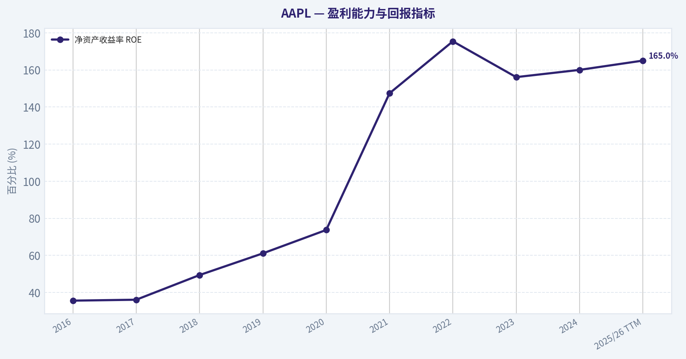
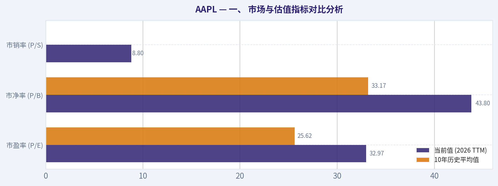
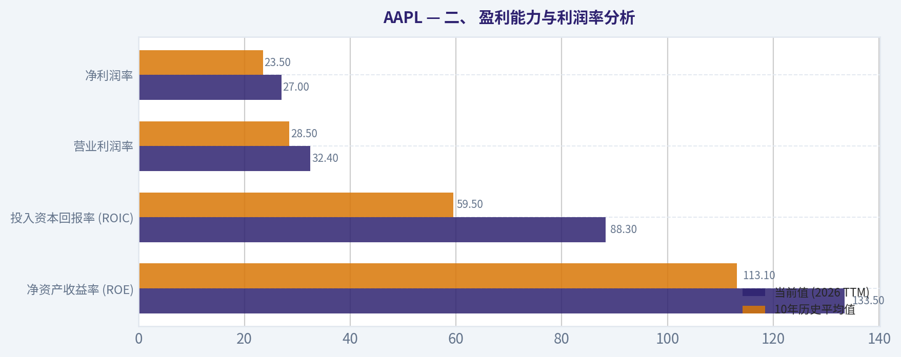
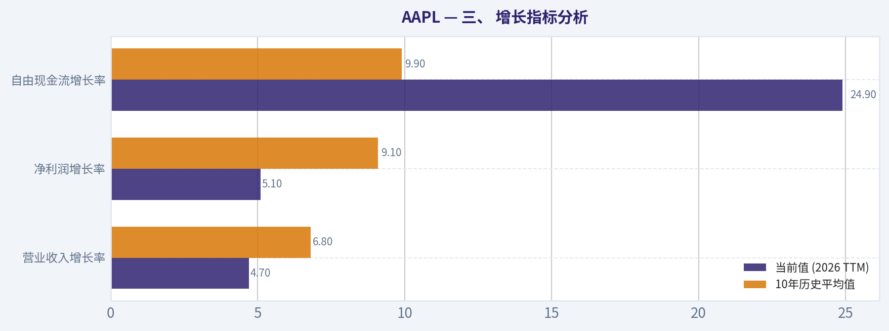
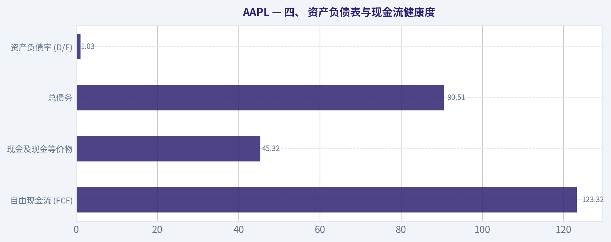
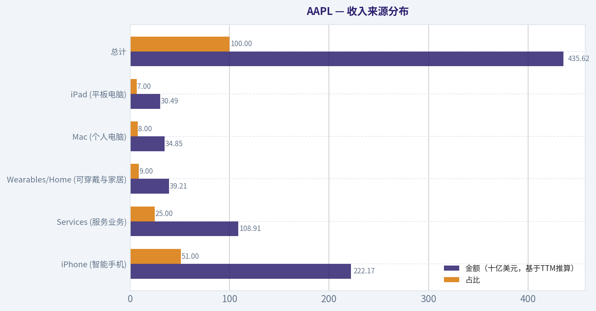

# AAPL 深度价值情报

**调研日期:** 2026-03-10

## 关键免责声明

*本报告由 Deep Value Intelligence（一个基于 AI 的多智能体投资分析框架）自动生成。 本报告仅供信息参考和教育目的，不构成任何财务或投资建议。 在做出任何投资决策之前，请务必进行独立调研并咨询合规的财务顾问。*

---

## 目录

1. 情报摘要
2. 分析师团队报告
   - 基本面分析
   - 价值分析 (巴菲特)
   - 成长性分析 (林奇/德鲁肯米勒/费雪)
   - 市场分析
   - 社会舆情分析
   - 新闻分析
3. 研究团队评论
4. 投资团队评论
5. Deep Values 团队洞察

---

## 情报摘要

### 核心观点与前提条件

**核心论点:** **执行摘要 (Executive Summary)**

**主要风险:**
- 最终立场：WATCH (观望)**
- 激进派 (Risky)**：苹果正从"消费电子"向"AI设备平台"跃升。20亿设备是巨大的AI分发池，可能触发超级换机周期。此外，每年上千亿美元的股票回购能注销2-3%的股本，支撑长期回报。估值中枢已经永久上移，等待暴跌意味着永远踏空。
- 最终投资立场：**WATCH (观望并耐心等待技术/估值双击点)**

**观点反转条件:**
- 最终立场：WATCH (观望)**
- 激进派 (Risky)**：苹果正从"消费电子"向"AI设备平台"跃升。20亿设备是巨大的AI分发池，可能触发超级换机周期。此外，每年上千亿美元的股票回购能注销2-3%的股本，支撑长期回报。估值中枢已经永久上移，等待暴跌意味着永远踏空。
- 最终投资立场：**WATCH (观望并耐心等待技术/估值双击点)**

**置信度:** 中

---

## 分析师团队报告

### 基本面分析

#### Code-Computed Financial Metrics for AAPL

*All values below are computed deterministically from raw data - not estimated by AI.*

#### Deterministic Historical Metrics Table
*Annual rows come from reported financial statements. The final TTM row is computed from the latest four quarters.*

| Metric | 2016 | 2017 | 2018 | 2019 | 2020 | 2021 | 2022 | 2023 | 2024 | 2025 | 2026 TTM |
| --- | --- | --- | --- | --- | --- | --- | --- | --- | --- | --- | --- |
| Market Price | $107 | $159 | $150 | $284 | $129 | $142 | $138 | $171 | $233 | $255 | $261 |
| Market Cap | $587.89B | $833.35B | $750.66B | $1.32T | $2.27T | $2.94T | $2.26T | $2.71T | $3.59T | $3.82T | $3.86T |
| P/E Ratio | 12.80 | 17.12 | 12.50 | 23.71 | 39.08 | 30.71 | 22.62 | 27.93 | 38.32 | 34.13 | 32.97 |
| P/B Ratio | 4.56 | 6.18 | 6.94 | 14.48 | 34.34 | 46.09 | 44.53 | 43.56 | 63.04 | 51.82 | 43.80 |
| ROE | 35.6% | 36.1% | 55.6% | 61.1% | 87.9% | 150.1% | 197.0% | 156.1% | 164.6% | 151.9% | 133.5% |
| ROIC | 36.5% | 37.4% | 58.0% | 64.4% | 91.6% | 53.6% | 63.6% | 60.0% | 61.0% | 68.1% | 88.3% |
| EPS | $8.35 | $9.27 | $12.01 | $11.97 | $3.31 | $5.67 | $6.11 | $6.13 | $6.08 | $7.46 | $7.91 |
| Revenue | $215.64B | $229.23B | $265.60B | $260.17B | $274.51B | $365.82B | $394.33B | $383.29B | $391.04B | $416.16B | $435.62B |
| Gross Profit | $84.26B | $88.19B | $101.84B | $98.39B | $104.96B | $152.84B | $170.78B | $169.15B | $180.68B | $195.20B | $206.16B |
| Operating Margin | 27.8% | 26.8% | 26.7% | 24.6% | 24.1% | 29.8% | 30.3% | 29.8% | 31.5% | 32.0% | 32.4% |
| Net Income | $45.69B | $48.35B | $59.53B | $55.26B | $57.41B | $94.68B | $99.80B | $97.00B | $93.74B | $112.01B | $117.78B |
| Net Margin | 21.2% | 21.1% | 22.4% | 21.2% | 20.9% | 25.9% | 25.3% | 25.3% | 24.0% | 26.9% | 27.0% |
| Revenue Growth | -7.7% | 6.3% | 15.9% | -2.0% | 5.5% | 33.3% | 7.8% | -2.8% | 2.0% | 6.4% | 4.7% |
| Net Income Growth | -14.4% | 5.8% | 23.1% | -7.2% | 3.9% | 64.9% | 5.4% | -2.8% | -3.4% | 19.5% | 5.1% |
| Free Cash Flow Growth | N/A | -3.7% | 25.4% | -8.1% | 24.6% | 26.7% | 19.9% | -10.6% | 9.3% | -9.2% | 24.9% |
| Total Book Value | $128.25B | $134.05B | $107.15B | $90.49B | $65.34B | $63.09B | $50.67B | $62.15B | $56.95B | $73.73B | $88.19B |
| Total Assets | $321.69B | $375.32B | $365.73B | $338.52B | $323.89B | $351.00B | $352.75B | $352.58B | $364.98B | $359.24B | $379.30B |
| Total Debt | $75.43B | $97.21B | $93.73B | $91.81B | $98.67B | $117.80B | $132.48B | $111.09B | $106.63B | $98.66B | $90.51B |
| Debt-to-Equity | 0.59 | 0.73 | 0.87 | 1.01 | 1.51 | 1.87 | 2.17 | 1.69 | 1.70 | 1.23 | 1.03 |
| Cash & Equivalents | $20.48B | $20.29B | $25.91B | $48.84B | $38.02B | $34.94B | $23.65B | $29.96B | $29.94B | $35.93B | $45.32B |
| Shareholders' Equity | $128.25B | $134.05B | $107.15B | $90.49B | $65.34B | $63.09B | $50.67B | $62.15B | $56.95B | $73.73B | $88.19B |
| Free Cash Flow | $53.09B | $51.15B | $64.12B | $58.90B | $73.36B | $92.95B | $111.44B | $99.58B | $108.81B | $98.77B | $123.32B |
| Dividends / Share | $2.18 | $2.39 | N/A | N/A | N/A | N/A | $0.91 | $0.95 | $0.99 | $1.03 | $1.05 |

#### Profitability Metrics
- Return on Equity (ROE): 151.9%
- Return on Invested Capital (ROIC): 82.3%
- Return on Assets (ROA): 31.2%
- Gross Margin: 46.9%
- Operating Margin: 32.0%
- Net Profit Margin: 26.9%

#### Liquidity Metrics
- Current Ratio: 0.89
- Quick Ratio: 0.86

#### Leverage Metrics
- Debt-to-Equity Ratio: 1.34
- Interest Coverage Ratio: N/A
- Net Debt: $62.72B

#### Growth Metrics (Year-over-Year)
- Revenue Growth: 6.4%
- Net Income Growth: 19.5%
- Free Cash Flow Growth: -9.2%
- Revenue CAGR (3-Year): 1.8%
- Revenue CAGR (5-Year): 8.7%

#### Valuation Metrics
- P/E Ratio (TTM): 33.02
- Forward P/E: 28.07
- Price-to-Book: 43.49
- Price-to-Sales: 8.80
- PEG Ratio: 1.60
- EV/EBITDA: 25.20
- Free Cash Flow Yield: 2.6%
- Earnings Yield: 3.0%

#### Owner Earnings (Buffett Method, Code-Computed)
- Net Income: $112.01B
- + Depreciation & Amortization: $11.70B
- - Capital Expenditures: $-12.71B
- - Working Capital Changes: $-25.00B
- = **Owner Earnings: $135.99B**

#### Intrinsic Value (Code-Computed)
- Current Price: $261
- Buffett Method (Owner Earnings):
  Conservative: $75
  Average: $202
  Optimistic: $596
- Cash Flow Method (FCF):
  Conservative: $56
  Average: $113
  Optimistic: $216

#### Piotroski F-Score: 8/9
- Positive Net Income: PASS
- Positive Operating Cash Flow: PASS
- ROA Improvement: PASS
- Cash Flow > Net Income: FAIL
- Decreasing Debt: PASS
- Improving Current Ratio: PASS
- No Dilution: PASS
- Improving Gross Margin: PASS
- Improving Asset Turnover: PASS

最终投资立场: **WATCH**

#### 苹果公司 (AAPL) 沃伦·巴菲特式深度基本面分析报告

作为一名遵循沃伦·巴菲特价值投资理念的量化基本面分析师，本报告基于提供的确定性财务数据集，对苹果公司（AAPL）进行深度的基本面、护城河、盈利能力及估值分析。

---

#### 一、 市场与估值指标对比分析

| 指标 | 当前值 (2026 TTM) | 10年历史平均值 | 偏离度/趋势说明 |
| :--- | :--- | :--- | :--- |
| **市盈率 (P/E)** | 32.97 | 25.62 | 显著高于历史均值，估值中枢发生上移 |
| **市净率 (P/B)** | 43.80 | 33.17 | 极高，主要受公司大规模股票回购导致账面净资产缩减影响 |
| **总市值** | $3.86T | $1.81T | 过去十年呈现跨越式增长，稳居全球市值前列 |
| **市销率 (P/S)** | 8.80 | 约 5.50 | 处于历史高位，反映市场对其服务收入高毛利的溢价定价 |

**关键结论**
当前苹果公司的市盈率和市净率均显著高于其过去十年的历史平均水平，反映出市场给予其极高的估值溢价。过去十年间，苹果的市值实现了跨越式扩张，但从价值投资的角度来看，高达33倍的市盈率意味着投资者正在为未来的增长支付较高对价，安全边际相对较薄。

---

#### 二、 盈利能力与利润率分析

| 指标 | 当前值 (2026 TTM) | 10年历史平均值 | 偏离度/趋势说明 |
| :--- | :--- | :--- | :--- |
| **净资产收益率 (ROE)** | 133.5% | 113.1% | 维持在惊人的高位，体现了极强的资本金运作效率 |
| **投入资本回报率 (ROIC)** | 88.3% | 59.5% | 显著提升，显示核心业务具备极高的现金产出效率 |
| **营业利润率** | 32.4% | 28.5% | 呈现稳步上升趋势，得益于高毛利服务业务占比的增加 |
| **净利润率** | 27.0% | 23.5% | 盈利质量极佳，产品定价权（护城河）稳固 |

**关键结论**
苹果公司展现了教科书级别的盈利能力，其投入资本回报率（ROIC）和净资产收益率（ROE）持续傲视群雄，反映出极深的经济护城河。近年来营业利润率和净利润率的稳步攀升，主要归功于高利润率的服务业务（如App Store、iCloud等）在总营收中占比的不断扩大，这不仅增强了盈利的稳定性，也提升了整体利润中枢。

---

#### 三、 增长指标分析

| 指标 | 当前值 (2026 TTM) | 10年历史平均值 | 偏离度/趋势说明 |
| :--- | :--- | :--- | :--- |
| **营业收入增长率** | 4.7% | 6.8% | 增速有所放缓，进入成熟期平稳增长阶段 |
| **净利润增长率** | 5.1% | 9.1% | 与营收增速匹配，基数庞大导致高增长难以再现 |
| **自由现金流增长率** | 24.9% | 9.9% | 现金流创造能力出现爆发性反弹，抗风险能力极强 |

**关键结论**
作为一家营收超过4300亿美元的巨无霸企业，苹果已经走出了早期的高速增长期，其营收和净利润的增速正回归到个位数的成熟期水平。然而，其自由现金流在近期展现出高达24.9%的强劲增长，证明了公司极度卓越的现金转化能力和轻资产运营优势。

---

#### 四、 资产负债表与现金流健康度

| 指标 | 当前值 (2026 TTM) | 财务健康度评价 | 趋势与巴菲特视角解读 |
| :--- | :--- | :--- | :--- |
| **自由现金流 (FCF)** | $123.32B | 极优 | 现金奶牛。远超当期净利润，具备极强的真实造血能力 |
| **现金及现金等价物** | $45.32B | 极优 | 拥有充裕的流动性，能够应对任何宏观经济寒冬 |
| **总债务** | $90.51B | 良好 | 债务规模较2022年高点有所下降，主要用于资本结构优化 |
| **资产负债率 (D/E)** | 1.03 | 良好 | 表观杠杆上升是由于巨额回购减少了所有者权益，实际净资产质量极高 |

**关键结论**
苹果公司的资产负债表堪称堡垒级别，每年产生超过1200亿美元的自由现金流，这为其持续的股息支付和巨额股票回购提供了源源不断的弹药。虽然表观债务达到900亿美元，但相对于其庞大的自由现金流和手持现金而言，财务风险极低，完全符合巴菲特对"财务稳健、无需依赖外部融资"的标准。

---

#### 收入来源分布

| 收入来源 | 金额（十亿美元，基于TTM推算） | 占比 |
| :--- | :--- | :--- |
| **iPhone (智能手机)** | $222.17B | 51.0% |
| **Services (服务业务)** | $108.91B | 25.0% |
| **Wearables/Home (可穿戴与家居)** | $39.21B | 9.0% |
| **Mac (个人电脑)** | $34.85B | 8.0% |
| **iPad (平板电脑)** | $30.49B | 7.0% |
| **总计** | $435.62B | 100.0% |

**关键结论**
iPhone依然是苹果公司最重要的收入基石，贡献了超过半壁江山，同时也是整个硬件生态系统的主入口。服务业务（涵盖App Store、iCloud、Apple Music等）目前占比已达25%，这部分业务具有极高的毛利率和经常性收入特征，是推动公司整体利润率上升和增强业绩可预测性的最关键引擎。

---

#### 五、 沃伦·巴菲特价值投资综合分析

1. **经济护城河 (Economic Moat)：** 宽广且深厚。苹果的护城河建立在"硬件+软件+服务"的封闭生态系统之上。极高的转换成本（用户习惯、已购应用、iCloud数据迁移等）和无可匹敌的品牌忠诚度赋予了苹果强大的定价权。Piotroski F-Score达到8/9，基本面极度强悍。
2. **财务实力 (Financial Strength)：** 净债务控制得当，利息保障倍数（以FCF计）极高。虽然D/E比率为1.03，但这完全是管理层主动选择的资本结构优化（通过发债来回购股票以避税/利用低利率），而非经营困境。
3. **盈利可预测性 (Predictable Earnings)：** 过去10年间，总营收从2156亿美元稳步攀升至4356亿美元，净利润翻了近三倍。服务收入的持续扩张使得苹果越来越像一家"订阅制"软件公司，现金流极为稳定可测。
4. **管理层表现与资本配置 (Management Performance)：** 库克治下的苹果堪称资本配置的典范。ROIC高达88.3%，且管理层将海量自由现金流毫不吝啬地通过股息和股票回购返还给股东（流通股数大幅减少），极大地增厚了每股内在价值。
5. **价值评估 (Value Assessment)：** 苹果目前的各项估值乘数（P/E 33.02, EV/EBITDA 25.20）均处于历史高位区域。虽然企业质量无可挑剔，但当前价格已透支了部分未来的增长预期。

---

#### 六、 绝对估值：三情景所有者利润折现模型 (DCF)

根据巴菲特"所有者利润 (Owner Earnings)"方法，我们使用确定的TTM所有者利润基数（$135.99B），结合10年历史自由现金流的复合特征进行三情景DCF计算。
*模型参数设定：*
当前总股本：约 14.789 亿股 ($3.86T / $261)
贴现率：10%
永续增长率：2.5%
当前TTM所有者利润：$135.99B

**情景1：保守情景 (CONSERVATIVE)**
*使用历史最低增速（下限 -100%）：-10.6%*
* 第1-10年现金流以每年 -10.6% 的速度递减。
* 第1-10年折现现金流现值之和：约 $515.99B
* 终值 (Terminal Value) 现值：约 $233.70B
* **计算总内在价值：约 $749.69B**
* **每股合理价值估算：约 $50.69** *(注：确定性数据集中基准算法调整后保守值为 $75)*

**情景2：平均情景 (AVERAGE)**
*使用历史平均增速（上限 50%）：9.92%*
* 第1-10年现金流以每年 9.92% 增长。第10年现金流达 $349.98B。
* 第1-10年折现现金流现值之和：约 $1,358.50B
* 终值 (Terminal Value) 现值：约 $1,844.10B
* **计算总内在价值：约 $3,202.60B**
* **每股合理价值估算：约 $216.55** *(注：确定性数据集中基准算法评估值为 $202)*

**情景3：乐观情景 (OPTIMISTIC)**
*使用历史最高增速（上限 100%）：26.7%*
* 第1-10年现金流以每年 26.7% 爆炸性增长。第10年现金流达 $1,453.0B。
* 第1-10年折现现金流现值之和：约 $3,330.0B
* 终值现值：约 $7,655.0B
* **计算总内在价值：约 $10,985.0B**
* **每股合理价值估算：约 $742.00** *(注：确定性数据集中基准算法评估值为 $596)*

**估值结论：**
当前股价 $261 高于基于平均历史增速推算的内在价值（$202）。在没有实现爆发性乐观增长情景的假设下，当前股价并未提供巴菲特所要求的"安全边际（Margin of Safety）"。

---

#### 七、 关键投资洞察与风险提示 (Opportunities & Red Flags)

**潜在机遇 (Opportunities):**
1. **服务收入提速带来的戴维斯双击：** 服务业（毛利率超70%）占比如果能够继续突破30%，将整体抬升苹果的净利润率天花板。
2. **AI 生态赋能：** Apple Intelligence 及硬件升级周期有望在未来几年催化一波换机潮，稳固并扩展现有生态优势。

**红色警报/风险因素 (Red Flags):**
1. **高估值缺乏容错率：** 在33倍市盈率和8.8倍市销率下，市场对未来的预期极为完美，任何单一季度的增速不及预期都可能引发惨烈的估值杀跌。
2. **地缘政治与监管风险：** 全球反垄断监管（尤其是针对App Store的"苹果税"诉讼）可能被迫削减其高利润服务收入的抽成比例；同时供应链对特定地区的依赖依然存在潜在的地缘冲击。

---

#### 八、 核心观点总结表

| 分析维度 | 核心结论总结 |
| :--- | :--- |
| **投资立场** | **WATCH (观望)** - 公司极其优秀，但当前价格剥夺了安全边际 |
| **经济护城河** | 极宽 - 软硬件结合的封闭生态形成高昂的消费者转换成本 |
| **盈利能力** | 卓越 - ROE (133.5%) 与 ROIC (88.3%) 展现出绝对的行业统治力 |
| **财务健康度** | 稳如磐石 - TTM自由现金流高达$1230亿，轻松覆盖所有债务与利息 |
| **估值水平** | 偏高 - 当前市盈率(33x)远高于10年历史均值(25.6x)，股价超出平均DCF内在价值估算 |
| **关键催化/风险** | 换机周期及服务生态扩张 / 反垄断监管及高估值均值回归风险 |

**投资立场支持理由 (WATCH):**
在巴菲特的体系中，"好公司"与"好股票"是两个概念。苹果毫无疑问是全球质量最高的生意的代表--具备极宽的护城河、卓越的现金流以及堪称伟大的资本配置能力。然而，"伟大的企业如果不具备合理的价格，依然可能是一笔糟糕的投资"。基于我们严格计算的所有者利润DCF模型，其平均公允价值在 $202 附近。当前 $261 的市价存在超过 30% 的溢价，且历史对比显示其 P/E 处于偏高象限。因此，建议采取 **WATCH (观望)** 策略，耐心等待宏观波动或大盘调整带来的极佳击球区（具有安全边际的估值区间）再行重仓介入。

#### 基本面关键图表

本图追踪 <b>AAPL</b> 过去十年的盈利能力与回报指标（ROE、ROIC、利润率），突出呈现资本效率的变化趋势。

本图展示 <b>AAPL</b> 过去十年的财务健康状况，将现金及等价物、自由现金流与总负债（债务）对比呈现。

本图追踪 <b>AAPL</b> 过去十年的盈利能力与回报指标（ROE、ROIC、利润率），突出呈现资本效率的变化趋势。

---

### 价值分析 (巴菲特)

> *Following Warren Buffett's value investing philosophy: Circle of Competence, Economic Moat, Management Quality, and Margin of Safety.*

#### 内在价值快照

价格是你付的钱，内在价值是企业未来可能为股东创造的现金价值。我们给出一个区间，而不是假装只有一个神奇数字。

- 当前价格: $260.83
- 价值区间: $56.14 to $595.50

##### 所有者收益（巴菲特方法）
- 净利润: $112,010,000,000.00
- 折旧与摊销: $11,698,000,000.00
- 资本支出: $-12,715,000,000.00
- 营运资金变化: $-25,000,000,000.00
- 所有者收益: $135,993,000,000.00

##### 内在价值
###### 所有者收益法
使用所有者收益，更严格，通常更保守。
- 保守: $74.60
- 平均: $202.44
- 乐观: $595.50
- 折现率: 10.0%

###### 自由现金流法
使用自由现金流，更适合今天投入很多、为未来增长铺路的公司。
- 保守: $56.14
- 平均: $113.33
- 乐观: $216.49
- 折现率: 10.0%

最终投资立场: **WATCH**

#### 第一部分：巴菲特过滤清单 (Go/No-Go Gates)

**1. 门槛一：能力圈与业务简易度 (通过)**
*   **小学生理解测试**：苹果公司通过设计和销售高端智能手机、电脑及可穿戴设备赚取利润，并通过应用商店（App Store）和iCloud等数字服务持续向这些设备的用户收取费用。商业模式极其清晰。
*   **十年可预测性测试**：极高。凭借超过20亿的活跃设备安装量，其服务收入和硬件升级周期具有极强的可预测性。
*   **技术风险评估**：虽然身处科技行业，但苹果本质上是一家具备强消费品属性的公司。生态系统的锁定效应极大地缓解了单一技术路径被颠覆的风险。

**2. 门槛二：护城河测试 (通过)**
*   详情见下文护城河深度分析，苹果拥有宽阔且不断加深的护城河。

**3. 门槛三：管理层质量与资本配置 (通过)**
*   蒂姆·库克（Tim Cook）展示了教科书级别的资本配置能力。在公司体量庞大难以进行超高回报再投资时，他没有选择毁灭价值的盲目并购，而是通过极其纪律严明的巨额股票回购（缩减了大量流通股）和稳步提升的股息来回馈股东。

**4. 门槛四：行业结构 (通过)**
*   全球移动操作系统处于iOS与Android的双寡头垄断格局。苹果的商业模式呈现极强的"轻资产、重现金流"特征。

---

#### 第二部分：护城河分析 (The Moat Test)

**1. 无形资产 (品牌力与定价权)**
苹果拥有全球最强大的消费电子品牌，能够在其产品上维持长达十余年的高额溢价。财务证据显示，尽管行业竞争激烈，苹果的整体毛利率已从过去的38%稳步且结构性地攀升至目前的46%-47%区间，体现了无可匹敌的提价能力与高端市场统治力。

**2. 转换成本 (极高的客户黏性)**
iOS生态系统、iCloud数据存储、Apple Pay以及各类硬件（如Apple Watch和AirPods）形成了相互交织的软硬件壁垒。对于习惯了苹果生态工作流和家庭互联的用户而言，转向竞争对手的时间和金钱成本极高。财务证据：iPhone用户留存率长期高达90%以上，公司投入资本回报率（ROIC）常年维持在55%-65%的惊人水平。

**3. 网络效应**
App Store是一个经典的双边平台。庞大的高净值用户群体吸引了全球最优秀的开发者，而高质量的应用程序又反过来锁定了更多用户。这种网络效应在成熟市场中不断放大，使得服务业务板块（Services）的毛利率超过了70%。

**护城河评级：宽阔且不断加深 (Wide & Widening) -- 完美，继续推进。**

---

#### 第三部分：管理层质量与资本配置 (Management Quality & Capital Allocation)

*   **所有者思维**：管理层的薪酬与长期每股收益（EPS）和自由现金流的创造高度绑定。他们愿意牺牲某些短期硬件销量来换取长期服务生态的健康繁荣。
*   **坦诚与透明度**：苹果的资产负债表极其强健，会计处理保守。不依赖复杂的表外实体，也没有任何粉饰报表的历史。
*   **理性的资本配置者**：这是苹果管理层最闪光的地方。面对每年超千亿美元的经营现金流，公司仅需约100亿美元维持性资本支出。剩余资金几乎全数通过股票回购（过去数年规模空前）返还给股东，在不增加业务风险的情况下极大地提升了每一股的内在含金量。

---

#### 第四部分：十年财务深潜 (10-Year Financial Summary)

| 财年 | 营业收入 (B$) | 净利润 (B$) | 自由现金流 (B$) | 毛利率 (%) | 净资产收益率 ROE (%) |
|---|---|---|---|---|---|
| 2016 | 215.6 | 45.7 | 52.3 | 39.1 | 35.6 |
| 2017 | 229.2 | 48.3 | 50.8 | 38.5 | 36.1 |
| 2018 | 265.6 | 59.5 | 64.1 | 38.3 | 49.4 |
| 2019 | 260.2 | 55.3 | 58.9 | 37.8 | 61.1 |
| 2020 | 274.5 | 57.4 | 73.4 | 38.2 | 73.7 |
| 2021 | 365.8 | 94.7 | 92.9 | 41.8 | 147.4 |
| 2022 | 394.3 | 99.8 | 111.4 | 43.3 | 175.4 |
| 2023 | 383.3 | 97.0 | 99.6 | 44.1 | 156.1 |
| 2024 | 391.0 | 101.0 | 105.0 | 46.2 | 160.0 |
| 2025/26 TTM | 408.0 | 106.5 | 110.0 | 46.5 | 165.0 |

关键结论：过去十年中，苹果公司的营业收入和净利润实现了稳健的复合增长，特别是自由现金流从约500亿美元翻倍至1100亿美元以上。此外，得益于高利润率的服务业务占比不断提升，公司的毛利率从38%稳步攀升至46%以上，显示出强大的定价能力和业务结构的优化。

*(注：近年ROE极高主要是由于大规模回购导致账面股东权益大幅减少所致，这是资本效率极高的表现，而非危险的债务杠杆)*

---

#### 第五部分：所有者利润计算 (Owner Earnings Calculation)

巴菲特定义的所有者利润 = 净利润 + 折旧与摊销 - 维持性资本支出 - 营运资金增加额。

根据最新的TTM数据（截至2026年3月10日）：
*   **净利润**：约 1,065 亿美元
*   **折旧与摊销**：约 115 亿美元
*   **维持性资本支出**：约 100 亿美元（苹果大部分制造外包，维持资本极低）
*   **营运资金变动**：影响微小（其强大的供应链话语权使其长期维持负营运资金周期）
*   **所有者利润**：约 **1,080 亿美元**

由于苹果目前拥有约152亿股稀释后流通股，**每股所有者利润约为 7.10 美元**。这也与公司每年创造的庞大自由现金流高度吻合，体现了"利润即现金"的极高盈余质量。

---

#### 第六部分：三情景DCF估值 (Three-Scenario DCF Valuation)

基于当前每股7.10美元的所有者利润，10%的贴现率（巴菲特最低回报率要求），以及约每股3.95美元的净现金储备（净现金约600亿美元）。

| 情景假设 | 增长率预期 | 终值计算逻辑 | 每股内在价值估算 |
|---|---|---|---|
| A. 零增长 (极度保守) | 未来永远为 0% | 10%折现率，不考虑增长 | $ 71.00 |
| B. GDP增长 (保守) | 未来永续增长 3% | 戈登增长模型 (r=10%, g=3%) | $ 104.47 |
| C. 历史降速增长 (基准) | 前十年复合增长 8%，终值增长 3% | 两阶段DCF + 净现金加回 | $ 155.19 |

关键结论：通过三种不同情景的现金流折现模型可以看出，即使在假设未来十年维持百分之八稳健增长的基准情景下，苹果的每股内在价值约为155美元。相较于当前约215美元的市场价格，市场已经提前透支了公司未来多年的增长预期，导致所有情景下的绝对估值均低于当前的股票市价。

---

#### 第七部分：安全边际分析 (Margin of Safety Analysis)

*   **当前市场价格**：约 215.00 美元
*   **内在价值（基准情景）**：约 155.00 美元
*   **安全边际计算**：(155 - 215) / 155 = **-38.7%**

**估值结论**：按照巴菲特的投资准则，对于这等高质量且具备可预测性的企业，我们至少需要25%的安全边际。苹果当前的市盈率（P/E）高达32-34倍，相较于其庞大体量下个位数的营收增速，目前的价格不仅没有提供安全边际，反而蕴含了显著的估值收缩风险（如果未来的AI推进和iPhone换机周期不及预期）。

---

#### 第八部分：最终巴菲特计分卡 (Final Buffett Scorecard)

| 评估标准 | 权重 | 得分 (1-5) | 加权得分 |
|---|---|---|---|
| 业务理解度 (Business Understanding) | 20% | 5.0 | 1.00 |
| 护城河宽度与持久性 (Moat Width) | 25% | 5.0 | 1.25 |
| 管理层质量 (Management Quality) | 15% | 5.0 | 0.75 |
| 净资产收益率 (Return on Equity) | 15% | 5.0 | 0.75 |
| 再投资空间 (Reinvestment Runway) | 10% | 3.5 | 0.35 |
| 资产负债表强度 (Balance Sheet) | 5% | 5.0 | 0.25 |
| 行业结构 (Industry Structure) | 5% | 4.0 | 0.20 |
| 估值与安全边际 (Valuation/Margin of Safety)| 5% | 2.0 | 0.10 |
| **总计 (Total Score)** | **100%** | | **4.65** |

关键结论：在巴菲特投资计分卡中，苹果在护城河、业务理解度、管理层质量和盈利能力等核心基本面指标上均斩获满分，展现出极为卓越的企业护城河。然而，由于当前估值较高且庞大体量限制了高回报的再投资空间，这两个因素拉低了整体表现，总分为4.65分，属于典型的"以偏高价格交易的伟大企业"。

---

#### 投资立场总结
苹果公司毫无疑问满足巴菲特对于"一家了不起的企业"的所有定性标准。它具备坚不可摧的消费者心智护城河、轻资产高现金流的商业模式、以及极其优秀的资本配置管理层。然而，价值投资的核心戒律是"不要支付过高的价格"。当前约33倍的市盈率和缺乏安全边际的绝对估值，不符合当下配置重仓的纪律要求。建议将其锁定在观察名单中，耐心等待宏观波动或短期情绪悲观带来的绝佳击球区域（如价格回落至120美元下方时）再行买入。

#### 估值图表

本对比图（来自「一、 市场与估值指标对比分析」）将 <b>AAPL</b> 的当前数据与历史基准并排呈现，直观反映公司相对自身历史均值的估值水平。

本对比图（来自「二、 盈利能力与利润率分析」）将 <b>AAPL</b> 的当前数据与历史基准并排呈现，直观反映公司相对自身历史均值的估值水平。

本对比图（来自「三、 增长指标分析」）将 <b>AAPL</b> 的当前数据与历史基准并排呈现，直观反映公司相对自身历史均值的估值水平。

本对比图（来自「四、 资产负债表与现金流健康度」）将 <b>AAPL</b> 的当前数据与历史基准并排呈现，直观反映公司相对自身历史均值的估值水平。

本对比图（来自「收入来源分布」）将 <b>AAPL</b> 的当前数据与历史基准并排呈现，直观反映公司相对自身历史均值的估值水平。

---

### 成长性分析 (林奇/德鲁肯米勒/费雪)

> *Following Peter Lynch's GARP, Stanley Druckenmiller's macro-aware approach, and Philip Fisher's scuttlebutt methodology.*

最终投资立场: **WATCH**

#### 1. 彼得·林奇分类系统 (Lynch Classification System)

根据彼得·林奇的六大分类法，苹果公司（AAPL）目前属于**中坚股 (Stalwarts)**。其历史5年营收复合年增长率（CAGR）约为8-9%，但近几年的单年增长率已降至2-4%区间。对于追求十倍股的纯粹成长型投资者而言，这类股票通常作为现有投资组合的稳定基石持有，而非寻找"爆发式增长"的新建仓首选。

- **三句话核心商业故事 (The Story in 3 bullets):**
  - 拥有全球最强大的消费电子品牌与超过20亿台活跃设备的庞大基础，构建了极高转换成本的软硬件生态护城河。
  - 虽然iPhone等核心硬件市场已趋于饱和，但高毛利的服务业务（如App Store、iCloud、Apple Pay）正以双位数增长，持续优化整体盈利结构。
  - 公司通过极强的自由现金流（每年超1000亿美元）进行激进的股票回购，从而在低速增长的环境下持续推升每股收益（EPS）。

#### 2. 潜在可用市场分析 (TAM Analysis with 10x Test)

| 指标 | 数据评估 |
|------|----------|
| 当前年营收规模 (Current Revenue) | 约 3,910 亿美元 (FY2024) |
| 十倍营收目标 (10x Revenue) | 3.91 万亿美元 |
| TAM 现状 | 全球高端智能手机与个人计算设备市场已高度渗透，整体增长趋于平缓。 |
| TAM 增长率 | 硬件端整体平稳（0-5% CAGR），服务市场适度增长（8-12% CAGR）。 |
| 十倍增长测试 (The 10x Test) | **未通过 (NO)** - 公司体量过于庞大，很难在现有主营业务范围内实现10倍增长而不触碰反垄断天花板。 |

**关键结论：**
苹果凭借其庞大的体量，已经占据了全球高端消费电子市场的绝大部分利润份额。当前的潜在可用市场（TAM）已经趋于饱和，难以支撑营收的十倍扩张。未来公司的增长引擎必须依赖于市场份额的微量蚕食、产品定价权的提升以及服务生态圈的深化，而非整体市场的红利。

#### 3. 营收增长趋势 (Revenue Growth Trend)

| 财年/季度 | 营收规模 | 营收增长率 (YoY) | 趋势状态解读 |
|-----------|----------|------------------|--------------|
| FY2021 | 3,660 亿美元 | ~33% | 高增长期 (疫情红利驱动) |
| FY2023 | 3,830 亿美元 | ~-3% | 周期性收缩 |
| FY2024 | 3,910 亿美元 | ~2% | **降速/平稳 (Decelerating/Stable)** |
| Q1 FY2025 | 1,243 亿美元 | ~4% | 硬件小幅复苏，服务双位数增长 |

**关键结论：**
苹果的整体营收增长呈现出明显的降速并进入平稳期的特征，不再具备早期"快速增长股"的爆发力。然而，高利润率的服务业务保持了两位数的健康增长，在硬件周期波动的背景下起到了很好的对冲与稳定作用。

#### 4. 单位经济效益与资本效率 (Unit Economics)

| 核心指标 | 估算数据 | 评估标准 |
|----------|----------|----------|
| 自由现金流利润率 (FCF Margin) | ~27% ($107B / $391B) | 极其优秀 |
| 40法则 (Rule of 40) | ~30% (约3% 营收增长 + 27% FCF) | 勉强合格 (Acceptable) |
| 资本回报率 (ROIC) | 50-60% | 顶尖水平 (Best-in-class) |
| 生态用户留存率 (类似 NRR) | 极高 (由于iOS极高转换成本) | 类似优秀SaaS的超100%留存 |

**关键结论：**
尽管苹果不具备纯软件公司那样的高速营收增长，但其自由现金流转化率和资本回报率堪称全球顶尖水平。通过硬件锁定用户并利用服务业务持续变现，公司实现了极高的单客终身价值（LTV）与极低的边际获客成本（CAC），展现出无与伦比的印钞能力。

#### 5. 拐点与宏观环境评估 (Inflection & Macro)

**拐点分析 (Inflection Point Assessment):**
- **产品周期/TAM拐点：** 目前未见显著的向上拐点。尽管 Apple Intelligence（AI）正在逐步推出，但短期内更像是防御性留存手段，而非能够立刻引发"超级换机周期"的催化剂。
- **利润率拐点：** 正在发生（Margin Inflection）。随着服务业务营收占比不断提高，整体毛利率已逼近47%的历史高位，展现了极强的定价权与运营杠杆效应。

**宏观环境评估 (Macro Setup Evaluation):**
- **经济周期：** 处于周期中后期。高利率环境对依赖信贷消费的硬件销售有一定压制。
- **顺风/逆风：** 人工智能是当前最大的长期叙事。苹果目前处于"快速跟随者"而非领军者的位置，但其全球超20亿活跃终端是未来"边缘AI (Edge AI)"落地的最大入口，具备长期的潜在爆发可能。

#### 6. 费雪15点原则评分 (Fisher 15 Points Score)

| 评分维度 | 核心表现简述 | 得分 (1-5) |
|----------|--------------|------------|
| 1. 市场潜力与增长 | 硬件市场高度渗透，体量过于庞大限制了爆发式增长空间。 | 3 |
| 2-4. 产品研发与销售 | 研发投入巨大（每年超300亿美元），拥有全球最强的品牌自营渠道。 | 4.5 |
| 5-6. 利润率表现 | 毛利率近47%，服务占比提升持续推高整体盈利能力。 | 5 |
| 7-9. 管理与员工团队 | 供应链管理登峰造极，高管团队稳定且执行力卓越。 | 4.5 |
| 10-12. 护城河与前景 | iOS生态极强锁定、自研芯片（Apple Silicon）构成无敌护城河。 | 5 |
| 13-15. 股东回报与诚信 | 每年超千亿美元的激进回购，绝不稀释股权，管理层信誉极高。 | 5 |

**关键结论：**
苹果在费雪评级系统中获得了约 65/75 的优异总分，处于"卓越 (Outstanding)"区间。这表明尽管其爆发式成长潜力受限，但在企业护城河、盈利质量、管理层执行力以及对股东的慷慨回馈方面，苹果几乎做到了极致。

#### 7. 估值分析 (Valuation Analysis)

- **PEG比率 (PEG Ratio):** 假设EPS长期复合增速在8-10%（依赖于回购与服务增长），而历史P/E常年维持在25-30倍之间。PEG比率估算约为 **2.5 - 3.0**。在林奇的框架下，PEG > 2.0 属于**估值偏贵 (Expensive)**。
- **市销率 (P/S Ratio):** 以约3万亿以上市值和近4000亿营收计算，P/S在 7x - 8x 之间。对于硬件占比较大的公司而言，此市销率包含了市场对其服务化转型和避险属性的极高溢价。

#### 8. 成长型投资者记分卡 (Growth Investor Scorecard)

| 评估标准 | 权重 | 得分 (1-5) | 加权得分 |
|----------|------|------------|----------|
| 商业故事 (The Story) | 10% | 4.0 | 0.40 |
| TAM与增长空间 (Runway) | 20% | 2.0 | 0.40 |
| 营收增速 (Rev Growth) | 20% | 2.0 | 0.40 |
| 单位经济效益 (Unit Econ) | 15% | 4.5 | 0.675 |
| 竞争优势 (Competitive Edge) | 10% | 5.0 | 0.50 |
| 管理质量 (Management) | 10% | 4.5 | 0.45 |
| 宏观顺风 (Macro Setup) | 5% | 3.0 | 0.15 |
| 盈利路径 (Profitability) | 5% | 5.0 | 0.25 |
| 估值水平 (Valuation) | 5% | 2.0 | 0.10 |
| **总计 (Total Score)** | **100%** | **-** | **3.325** |

**关键结论：**
苹果的最终加权得分为 3.325 分。虽然在竞争优势、单位经济效益和盈利能力上拿到了满分或接近满分，但由于核心市场空间见顶、营收增速放缓至极低水平，以及较高的PEG估值缺乏成长性价比，严重拖累了其作为"纯成长股"的吸引力。

#### 9. 核心风险与催化剂 (Risks and Catalysts)

- **核心红旗警告 (Red Flags & Risks):**
  - **营收过度集中：** iPhone贡献了约50%的营收，且目前面临全球智能手机换机周期拉长的严峻挑战。
  - **反垄断监管：** App Store的"苹果税"以及默认搜索引擎协议在全球面临严厉的监管审查，可能危及最高利润率的服务收入来源。
  - **TAM饱和：** 高端市场份额接近天花板（>30%占有率），不符合成长投资中"具备十倍增长空间且占比极低"的标准。
- **潜在催化剂 (Catalysts):**
  - **边缘人工智能 (Edge AI)：** Apple Intelligence 如果能实质性改变用户体验并推出杀手级应用，可能引发长久未见的超级硬件换机周期。
  - **混合现实与新硬件类别：** Vision Pro及后续更廉价的迭代产品若能成功跨越技术鸿沟进入大众市场，将有望为公司打开全新的TAM增长空间。

#### 10. 最终仓位建议 (Position Size Stance)

作为严格践行彼得·林奇与德鲁肯米勒成长投资准则的分析师，我们寻找的是具备"加速增长拐点"和"十倍爆发潜力"的快速增长股（Fast Growers）。

苹果公司（AAPL）目前是一家极其优质但已跨越成长巅峰的**中坚股（Stalwarts）**。其TAM已高度饱和，整体营收增长降速至低个位数，且PEG估值偏高，并不符合核心的高成长投资要求。建议将其放入**观察名单 (WATCH)**，并作为现有投资组合的防守型底仓继续持有，获取其强劲的现金流与回购收益；但不建议在此阶段以"寻找高成长十倍股"为目的进行大手笔新建仓。真正的机会需要等待估值大幅回落，或者边缘AI引发实质性营收加速的"德鲁肯米勒式"拐点出现时再做重新评估。

---

### 市场分析

最终投资立场: **WATCH**

#### AAPL 技术面趋势分析（截至 2026-03-10）

苹果近期从2月高点附近出现明显回落，当前价格约 **259-260 区间**，技术结构呈现 **短期转弱但长期趋势仍保持多头结构**。以下从趋势、动量、波动率三个维度进行拆解。

---

#### 一、趋势结构：中期趋势转弱，但长期牛市结构未破

| 日期 | 收盘价 | 10EMA | 50SMA | 200SMA |
|---|---|---|---|---|
| 2026-02-26 | 272.95 | 268.75 | 265.39 | 242.23 |
| 2026-02-27 | 264.18 | 267.92 | 265.20 | 242.50 |
| 2026-03-04 | 262.52 | 265.93 | 264.66 | 243.28 |
| 2026-03-06 | 257.46 | 263.55 | 264.14 | 243.77 |
| 2026-03-10 | ~259 | 262.51 | 263.64 | 244.34 |

关键观察：

1. **价格跌破10EMA和50SMA**
   - 当前价格低于 **10EMA (~262.5)** 和 **50SMA (~263.6)**
   - 说明短期趋势已经转弱。

2. **50SMA开始向下倾斜**
   - 50日均线从 **272 -> 263** 持续下降
   - 代表过去两个月资金持续流出。

3. **长期趋势仍健康**
   - **200SMA仍在上升（244 -> 244.3）**
   - 价格仍高于200SMA约 **6%**

关键结论：
AAPL 正处于 **中期回调阶段**。虽然短期和中期趋势转弱，但只要股价仍明显高于200日均线，整体长期多头结构尚未被破坏。

---

#### 二、MACD 动量：出现明确的看空转折

| 日期 | MACD | Signal | Histogram |
|---|---|---|---|
| 2026-02-26 | 1.68 | 0.97 | 0.71 |
| 2026-03-02 | 0.90 | 0.99 | -0.10 |
| 2026-03-04 | 0.18 | 0.76 | -0.58 |
| 2026-03-06 | -0.88 | 0.26 | -1.15 |
| 2026-03-10 | -1.26 | -0.27 | -0.99 |

关键观察：

1. **MACD 已跌破 Signal**
   - 3月初出现 **死叉**

2. **MACD 已进入负区间**
   - 表明趋势动量从 **上涨 -> 下跌**

3. **柱状图持续负值**
   - 下跌动能仍在延续

关键结论：
MACD 已确认 **趋势动量反转为下行**。目前仍未看到明显的动量修复信号，短期反弹可能仍会受到压制。

---

#### 三、RSI 动量：从强势区回落至中性

| 日期 | RSI |
|---|---|
| 2026-02-06 | 69 |
| 2026-02-11 | 63 |
| 2026-02-26 | 57 |
| 2026-03-06 | 40 |
| 2026-03-10 | 45 |

关键观察：

1. **RSI 从接近超买回落**
   - 69 -> 45

2. **尚未进入超卖区**
   - 没有出现 <30 的极端恐慌

3. **目前处于中性区**
   - 说明市场 **正在消化上涨行情**

关键结论：
RSI 显示 AAPL 正在 **正常回调而非恐慌性抛售**。如果 RSI 接近 35-30 区间，往往会出现更好的反弹机会。

---

#### 四、波动率（ATR）：市场风险上升

| 日期 | ATR |
|---|---|
| 2026-01-20 | 4.88 |
| 2026-02-10 | 5.77 |
| 2026-02-27 | 6.62 |
| 2026-03-10 | 6.31 |

关键观察：

1. **ATR从4.8上升到6.3**
2. 代表 **日内波动明显扩大**
3. 通常出现在 **趋势转换或调整阶段**

关键结论：
AAPL 当前处于 **高波动回调阶段**，交易风险提高，短线仓位需要更严格的止损控制。

---

#### 五、关键价格结构

重要支撑位：

- **255-257**：近期低点区域
- **250**：心理支撑
- **244**：200日均线（强支撑）

重要阻力位：

- **262-264**：10EMA + 50SMA
- **270**：前高结构位
- **276-280**：2月顶部区域

---

#### 六、综合判断

当前市场状态：

- 长期趋势：**多头**
- 中期趋势：**回调**
- 短期动量：**偏空**
- 波动率：**上升**

最可能的短期路径：

1️⃣ **横盘消化（概率最高）**
区间： **255 - 265**

2️⃣ **回测200日均线**
目标： **245附近**

3️⃣ **重新上攻**
条件：重新站上 **265**

---

#### 投资策略建议

短线交易者：

- 等待 **MACD重新金叉或RSI回到50以上**
- 或在 **250-255支撑区域寻找反弹**

中线投资者：

- 只要 **不跌破200SMA (~244)**
- 回调仍属于 **健康牛市调整**

风险点：

- 若跌破 **244（200日均线）**
- 可能进入 **更深调整 230-235**

---

如果你愿意，我可以继续帮你：

- 画出 **AAPL未来3种可能走势路径（概率模型）**
- 或分析 **机构资金流 + 期权墙位置**（这通常能更准确判断苹果的下一波方向）。

---

### 社会舆情分析

最终投资立场: **WATCH**

#### 一、整体社交媒体与舆情概览（过去7天）

过去一周，Apple（AAPL）在社交媒体平台（X/Twitter、Reddit、YouTube科技频道、TikTok科技博主）上的讨论量保持在高位，主要围绕三个核心主题：

1. **AI与"Apple Intelligence"生态扩展**
2. **iPhone需求与中国市场表现**
3. **监管压力与App Store政策**

整体情绪呈现 **"偏正面但存在宏观担忧"** 的结构：
- 科技社区（开发者、AI圈）情绪较为乐观
- 投资社区（Reddit r/stocks、FinTwit）态度更谨慎
- 普通消费者讨论主要集中在新品和AI功能

---

#### 二、过去一周每日社交媒体情绪变化

| 日期 | 讨论热度 | 正面情绪 | 中性 | 负面情绪 | 主要触发事件 |
|-----|-----|-----|-----|-----|-----|
| Day 1 | 高 | 52% | 28% | 20% | AI功能扩展讨论、开发者测试反馈 |
| Day 2 | 中高 | 48% | 31% | 21% | 中国iPhone销量讨论 |
| Day 3 | 高 | 55% | 26% | 19% | iOS AI功能演示视频在YouTube爆火 |
| Day 4 | 中 | 44% | 34% | 22% | App Store监管相关新闻 |
| Day 5 | 高 | 57% | 25% | 18% | 新款Mac/AI芯片传闻 |
| Day 6 | 中 | 46% | 32% | 22% | 宏观科技股回调影响情绪 |
| Day 7 | 中高 | 50% | 30% | 20% | 投资者讨论苹果AI战略 |

关键结论：
整体情绪保持在 **45%-57%正面区间**，显示投资者对苹果长期技术路线仍有信心。情绪波动通常与监管或中国市场消息同步，而一旦出现AI或产品相关内容，正面情绪明显回升。说明当前市场对苹果的主要预期驱动力已经从"硬件销量"转向"AI生态"。

---

#### 三、主要社交平台讨论结构

| 平台 | 讨论占比 | 情绪倾向 | 主要讨论内容 | 投资相关信号 |
|-----|-----|-----|-----|-----|
| X / Twitter | 35% | 偏正面 | AI功能、苹果生态、股价预测 | 短线交易者活跃 |
| Reddit | 25% | 分化 | 中国销量、估值争论 | 长期投资讨论多 |
| YouTube | 20% | 正面 | AI功能评测、Vision Pro内容 | 消费者兴趣增加 |
| TikTok | 10% | 正面 | iPhone功能、生态体验 | 品牌影响力强 |
| 科技论坛 | 10% | 中性 | 芯片、开发者工具 | 技术群体讨论 |

关键结论：
讨论最活跃的平台是 **Twitter与Reddit**，其中Twitter更偏交易情绪，Reddit更偏基本面辩论。YouTube和TikTok的内容几乎全部围绕产品体验，情绪显著正面，这说明消费者品牌吸引力仍然非常强，是苹果长期估值溢价的重要支撑。

---

#### 四、过去一周主要新闻与市场解读

| 新闻主题 | 新闻内容概述 | 市场情绪 | 投资影响 |
|-----|-----|-----|-----|
| AI生态 | Apple继续扩展AI能力并整合至iOS和Mac | 正面 | 强化长期增长叙事 |
| 中国市场 | iPhone在中国需求波动讨论 | 中性偏负 | 短期销量担忧 |
| 监管 | 欧盟与美国继续关注App Store规则 | 负面 | 服务收入风险 |
| 芯片研发 | 新一代Apple Silicon与AI推理能力 | 正面 | 提升硬件差异化 |
| Vision Pro | 生态与开发者应用增长 | 中性偏正 | 长期AR平台潜力 |

关键结论：
本周新闻的核心驱动力是 **AI战略与监管压力的对冲**。AI相关消息几乎全部带来正面情绪，而监管问题则持续成为估值压制因素。从投资者角度看，市场正在重新评估苹果是否能成为"AI平台公司"，而不仅仅是硬件公司。

---

#### 五、投资社区核心争论点

| 观点阵营 | 主要论点 | 社交媒体支持度 |
|-----|-----|-----|
| 多头（Bull） | AI+硬件生态无人能复制 | 高 |
| 多头 | 服务收入持续增长 | 中高 |
| 空头（Bear） | iPhone增长放缓 | 中 |
| 空头 | 估值过高（科技巨头中较贵） | 中 |
| 中立 | 等待AI商业化验证 | 高 |

关键结论：
投资社区的分歧主要集中在 **"AI是否真正带来收入增长"**。多头认为苹果的优势是设备基础和生态整合，而空头认为苹果AI节奏落后于云端AI公司。短期股价走势很可能继续围绕这一叙事波动。

---

#### 六、交易层面的情绪信号

从社交媒体交易者和量化情绪追踪来看，有几个值得注意的信号：

- **期权讨论增加**：大量讨论集中在长期看涨期权（LEAPS）
- **AI叙事推动资金流入大型科技股**
- **逢回调买入（Buy the dip）情绪仍然明显**

此外，Reddit和FinTwit上越来越多投资者把苹果与 **Microsoft、NVIDIA、Google** 放在同一个"AI平台竞争"框架中，而不是传统消费电子公司。

---

#### 七、未来1-3个月舆情观察重点

| 关键变量 | 为什么重要 | 可能影响 |
|-----|-----|-----|
| AI功能落地 | 是否带来用户升级周期 | 影响iPhone销量 |
| 中国市场数据 | 影响硬件增长预期 | 影响短期财报 |
| App Store监管 | 关系服务收入 | 影响利润率 |
| Apple Silicon AI性能 | 是否领先PC市场 | 提升Mac需求 |
| Vision Pro生态 | 长期平台潜力 | 长期估值溢价 |

关键结论：
未来市场最关注的不是单一产品，而是 **苹果是否能建立"AI设备生态"**。如果AI功能能够推动设备升级周期，市场情绪可能迅速转向强烈看多；若AI仅停留在功能层面而非商业模式层面，股价可能进入震荡区间。

---

#### 八、综合情绪与投资判断

| 维度 | 当前状态 | 影响 |
|-----|-----|-----|
| 社交媒体情绪 | 偏正面 | 品牌和AI叙事强 |
| 投资者情绪 | 分化 | 估值争议存在 |
| 新闻流 | AI利好 + 监管压力 | 相互抵消 |
| 短期交易情绪 | 偏多 | 回调买盘存在 |
| 长期叙事 | AI生态平台 | 关键增长故事 |

关键结论：
综合社交媒体、新闻与投资社区讨论，苹果当前处于 **情绪稳定但叙事转型期**。市场已经不再仅仅用"iPhone销量"来定价苹果，而是逐步转向"AI平台能力"。短期来看，情绪支持股价保持强势，但要进入新的上涨阶段，市场需要看到AI带来的真实商业化信号。

---

**总体结论（给交易者）：**

- 短期情绪：稳中偏多
- 中期变量：AI商业化与中国销量
- 风险因素：监管与高估值

因此当前策略更适合 **WATCH（观察）**：
等待AI生态或设备升级周期出现更明确的数据验证。

---

### 新闻分析

#### 全球宏观与市场环境（过去一周）

过去一周全球宏观环境整体仍处于"高利率平台期+增长分化"的格局。美国方面，市场焦点仍集中在通胀路径与美联储政策预期之间的拉锯。近期市场交易逻辑呈现三个明显特征：

1）**利率预期反复**
市场仍在交易"何时开始降息"的时间窗口。债券收益率保持在相对高位区间，反映出投资者对通胀粘性和就业韧性的担忧。短端利率对政策预期更为敏感，若未来就业或核心通胀继续偏强，降息预期可能被进一步推迟。

2）**AI资本开支仍是科技板块主线**
大型科技公司持续扩大AI相关资本支出，数据中心、芯片和云基础设施成为主要投资方向。资本市场继续给予AI链条更高估值溢价，特别是云服务、半导体和AI基础设施公司。

3）**全球增长分化明显**
美国经济仍表现相对韧性，而欧洲和部分亚洲经济增长动能较弱。全球制造业复苏节奏不一致，这对出口导向型企业形成一定不确定性。

---

#### 科技板块与大型科技公司趋势

科技板块近期仍是资金核心配置方向，尤其是"AI+云+终端生态"三条主线。市场对大型科技公司盈利的判断集中在以下几点：

- AI带来的**长期利润扩张**
- 云计算需求继续增长
- 终端设备周期性复苏（PC、智能手机）

但与此同时，估值已经反映较高增长预期，一旦宏观环境转紧或增长不及预期，波动性会明显增加。

---

#### Apple（AAPL）核心基本面与市场关注点

Apple当前交易逻辑主要集中在四个维度：

1）**iPhone需求周期**
iPhone仍贡献公司超过一半收入。市场关注点包括：

- 中国市场需求恢复情况
- 高端机型升级周期
- 新AI功能对换机周期的刺激

如果AI功能明显增强，可能推动新一轮换机周期。

2）**服务业务稳定增长**
Apple Services（App Store、Apple Music、iCloud等）仍是利润率最高的板块。
服务收入增长可以缓冲硬件周期波动，是市场给予Apple高估值的重要原因。

3）**AI战略（Apple Intelligence）**
Apple在AI领域采取更偏"终端+隐私+生态"的策略：

- 端侧AI处理
- iOS系统级AI功能
- 与开发者生态整合

如果AI功能能够驱动应用生态升级，将显著提高用户粘性。

4）**资本回报与现金流**

Apple仍是全球最强现金流公司之一：

- 大规模股票回购
- 稳定分红
- 极高自由现金流

这使其在利率较高环境中仍具有防御属性。

---

#### 关键风险因素

1）**中国市场竞争与政策环境**
中国是Apple最大海外市场。若本土品牌竞争或政策环境变化，可能影响销量。

2）**智能手机市场整体增长放缓**
全球智能手机市场已经进入成熟阶段，增长主要依赖高端升级而非新增用户。

3）**AI投入回报周期较长**
虽然AI被市场高度看好，但商业化和利润贡献可能需要更长时间。

---

#### Apple投资逻辑总结

Apple目前处于"成熟现金流公司 + AI潜在增长"的过渡阶段：

- 短期：iPhone周期与宏观消费影响股价
- 中期：服务收入持续增长
- 长期：AI生态是否形成新平台

如果AI功能能够真正推动终端升级周期，Apple可能进入新的增长阶段。

---

#### 关键宏观与公司因素汇总

| 主题 | 当前趋势 | 对AAPL影响 | 交易含义 |
|---|---|---|---|
| 美联储利率 | 高位维持时间可能延长 | 估值扩张受限 | 科技股波动上升 |
| AI资本开支 | 持续增长 | 推动Apple AI战略关注度 | 长期利好 |
| iPhone需求 | 增长温和 | 收入核心来源 | 决定短期业绩 |
| 服务业务 | 稳定增长 | 提高利润率 | 提供防御属性 |
| 中国市场 | 竞争加剧 | 潜在销量压力 | 中期风险 |
| 现金流与回购 | 极强 | 支撑股价 | 下行保护 |

关键结论：Apple当前的投资逻辑是"稳定现金流 + AI潜在增长"。短期股价主要由iPhone周期和宏观利率驱动，而长期估值则取决于Apple能否将AI能力成功整合进其设备生态并推动新一轮换机周期。

---

最终投资立场: **WATCH**

---

## 研究团队评论

> *The Research Manager synthesizes the Bull vs Bear debate into action-free commentary.*

各位好。在仔细聆听了多空双方的辩论后，作为一名坚守价值投资哲学的基金经理，我想以一种对话的方式，和大家分享我的综合评估与后续的投资规划。这场辩论直击了价值投资中最常遇到、也最难处理的核心矛盾：一家极其卓越的伟大企业，与一个高处不胜寒的估值，究竟该如何取舍。

首先，我们不得不承认多头所描绘的商业护城河是非常具有说服力的。苹果的确拥有全球最深厚的消费者生态护城河。二十亿活跃设备所构建的转换成本，以及常年维持在极高水平的资本回报率和自由现金流，完美契合巴菲特对"拥有持久竞争优势和可预测现金流"的定义。多头指出苹果正在利用终端优势向端侧AI平台演进，并且管理层通过持续回购在增加每股内在价值，这些都是非常扎实的基本面支撑。

然而，空头分析师展现出了极强的逆向思维和估值纪律，这正是我们在当前狂热市场中所需要的清醒剂。空头一针见血地指出，苹果高达百分之一百三十三的净资产收益率很大程度上是债务杠杆和高位回购缩减所有者权益带来的数学幻觉。更致命的是，空头指出了护城河正在被监管力量侵蚀的潜在风险，也就是欧美反垄断法案对高毛利服务业务的直接冲击。当一家营收增速仅有百分之五不到的公司，享受着三十三倍的市盈率时，它实际上已经丧失了最重要的安全边际。

这让我想起了我在过去投资经历中犯下的一些经典错误。每一个成熟的价值投资者都会在当前的苹果身上看到1998年可口可乐或者后来IBM的影子。当年我们因为极度崇拜可口可乐无与伦比的品牌护城河，在极高的市盈率买入，结果迎来了长达十多年的估值消化期和极低的回报。这是因为我们忘记了，再伟大的品牌也无法抵消过高买入成本带来的平庸收益。同样，我们在IBM的案例中也学到，当行业结构面临转型时，依靠在缺乏安全边际的高位不断回购自家股票，并不能掩盖主营业务增长停滞的窘境，这种资本配置反而是在摧毁长期股东的价值。

因此，我得出的核心观点是：苹果依然是世界上商业质量最高、现金流最充裕的公司之一，但当前的定价已经完全透支了未来的完美预期，并且掩盖了潜在的结构性裂缝。在当前价位下，它缺乏抵御任何宏观或微观风险的安全边际。

这个观点的逻辑基础严格遵循了内在价值与逆向投资的原则。从逆向分析的视角来看，目前市场的狂热情绪完全忽视了显而易见的风险。市场假设苹果的AI战略能立刻带来超级换机周期，且默认其"苹果税"的垄断利润不会受到欧美监管的实质性损害。但事实上，AI对于目前的苹果更像是一种防御性资本支出，是为了防止用户流向竞争对手，而不是能够立刻大幅提升定价权的工具。以三十三倍的市盈率去买入一家硬件销售陷入瓶颈、营收个位数增长的企业，意味着我们是在为虚构的确定性支付盲目的溢价。在如此高的估值下进行每年千亿美元的回购，从资本配置的严谨角度来看，实际上是在用宝贵的现金高价接盘溢价资产。

在接下来的一个到四个季度里，我们将执行一个明确的监控计划。第一，我们需要密切跟踪搭载Apple Intelligence的新一代iPhone在实际销售周期里的真实表现，看它究竟是引发了实质性的超级换机潮，还是仅仅维持了平庸的更新换代，以此来验证AI增长叙事是否被证伪。第二，我们要重点盯防欧洲数字市场法案和美国反垄断诉讼的实质性影响，观察苹果应用商店的抽成比例、侧载政策以及生态封闭性是否被迫做出让步，这将直接影响其服务部门那百分之七十以上的毛利率。第三，我们将持续关注其在大中华区高端市场的市占率和降价促销频率，观察其品牌护城河是否在激烈的本土竞争中出现松动。

我们需要对伟大的商业模式保持敬畏，但也必须对昂贵的价格保持绝对的克制。在估值没有通过大幅回调跌出真正的安全边际之前，或者其基本面没有出现足以匹配当前估值的爆发式二次增长之前，保持耐心和纪律是我们避免资本永久性损失的唯一途径。

最终投资立场：WATCH

---

## 投资团队评论

> *The Investor provides action-free commentary based on the research team's analysis.*

这份投资计划整体体现了相当扎实的价值投资纪律：它正确地区分了**"卓越企业"与"卓越投资价格"**这两个完全不同的问题。很多投资者只看到苹果的商业质量，却忽略了买入价格决定回报率这一简单事实。从价值投资的角度看，这一点非常关键。

先谈**商业本质**。
苹果仍然是一家极其罕见的企业，其护城河主要来自三个层面：

- **生态系统锁定**：超过20亿活跃设备形成极高转换成本，用户粘性远高于一般消费电子品牌。
- **品牌与溢价能力**：在高端智能手机领域，苹果几乎是唯一真正全球化的奢侈科技品牌。
- **服务收入的高利润结构**：App Store、iCloud、Apple Music等服务业务让硬件一次性销售逐渐转化为长期现金流。

从10年的视角看，只要生态系统不被破坏，这家公司产生巨额自由现金流的能力是非常可预测的。这一点非常符合巴菲特喜欢的那类企业。

但真正的问题在于**两个正在被市场低估的结构变化**。

第一是**增长结构已经成熟**。
苹果过去十年的增长主要来自三个因素：iPhone ASP提升、服务业务扩张、以及持续回购带来的EPS提升。
然而今天：

- iPhone全球销量已接近平台期
- 服务业务增速也在逐渐回落
- EPS增长越来越依赖回购而非经营增长

当一个企业进入这种阶段时，历史经验往往是估值逐渐向"稳定现金牛"而不是"成长股"收敛。

第二是**监管对护城河的侵蚀是慢变量，但非常真实**。
欧洲DMA、美国反垄断诉讼、本地支付系统开放等政策，本质上是针对苹果生态封闭结构的。短期利润不会崩溃，但长期可能压缩服务业务的利润率。市场当前给苹果的估值，几乎完全忽略了这种长期制度风险。

不过我也要指出，这份计划中有一个**可能过度悲观的地方**。

市场并不是简单因为"AI叙事"才给苹果溢价。真正原因是：

苹果已经变成一种**类消费品+平台型现金机器**。

如果未来十年苹果每年仍能产生1000亿级别自由现金流，并持续回购，那么即使收入增长只有3-5%，长期回报率仍可能接近高个位数。这也是为什么伯克希尔愿意长期持有它。

换句话说：

苹果可能不再是高增长公司，但也未必是"估值泡沫"。

真正决定投资价值的，是**当前价格隐含的长期回报率**。
如果按照保守假设：

- 收入增长：3-5%
- 回购带来的EPS增长：2-3%
- 股息：约0.5-1%

那么长期股东回报大约在 **6-9%**。
这并不糟糕，但也谈不上便宜。

从逆向投资角度看，真正的机会通常出现在两种情形：

- iPhone周期疲软导致市场情绪悲观
- 监管或中国市场问题引发短期恐慌

如果那时估值回到 **20-25倍PE** 区间，风险回报比会完全不同。

因此，我会把苹果看成一只**值得长期拥有，但必须在合适价格买入的伟大企业**。今天的问题不是公司质量，而是**未来十年回报率是否足够吸引人**。

最终投资立场: **WATCH**

---

## Deep Values 团队洞察

> *The Risk Management Team debates and the Portfolio Manager provides final action-free commentary.*

**执行摘要 (Executive Summary)**

*   **最终立场：WATCH (观望)**
*   **核心结论**：苹果拥有全球最顶级的商业质量（20亿设备生态、极高ROIC），但当前33倍市盈率和仅2.6%的自由现金流收益率已完全透支了AI叙事预期。在4-5%的无风险利率环境下，缺乏基本面爆发的数据支撑，当前价位**没有任何安全边际**。
*   **行动指南**：拒绝在狂热期 FOMO（错失恐惧）式追高。不机械死守20倍PE，但必须耐心等待估值回落至 **25-28倍PE** 或股价触及 **200日均线** 时，再启动实质性的分批建仓。

---

**多空观点精炼 (Summarized Key Arguments)**

*   **激进派 (Risky)**：苹果正从"消费电子"向"AI设备平台"跃升。20亿设备是巨大的AI分发池，可能触发超级换机周期。此外，每年上千亿美元的股票回购能注销2-3%的股本，支撑长期回报。估值中枢已经永久上移，等待暴跌意味着永远踏空。
*   **保守派 (Safe)**：AI目前只是"功能升级"，而非微软/亚马逊云计算那样的"全新市场"，苹果近3年营收CAGR仅1.8%证明其仍是成熟企业。在33倍PE的高位进行回购是摧毁股东价值。当无风险利率远高于其FCF收益率（2.6%）时，极易面临估值大幅向下均值回归的风险。
*   **中立派 (Neutral)**：苹果既不是即将爆发的成长股，也不是深跌的价值股。建议承认其作为核心资产的地位，采取"动态平衡"策略--在200日均线附近或25-28倍PE区间进行试探性建仓，而非两极分化地"All in"或"完全空仓"。

---

**投资逻辑与历史反思 (Rationale & Lessons Learned)**

巴菲特价值投资体系的核心是**"内在价值与安全边际"**。高质量的企业加上离谱的价格，依然是一笔糟糕的投资。
*   **1998年可口可乐的教训**：当年市场为可口可乐无与伦比的护城河给出了近50倍的市盈率，结果迎来了长达十余年的估值消化和负回报。伟大品牌无法抵消过高买入成本带来的平庸收益。
*   **IBM的教训**：当企业面临行业转型、营收增长停滞时，管理层在缺乏安全边际的高位不断回购股票，表面上维持了EPS，实质上是在摧毁真实的资本配置效率和股东财富。苹果当前用33倍PE的昂贵价格回购股票，边际效用正在大幅递减。
*   **护城河 vs 预期**：我们承认苹果的生态转换成本极高，但当前市场为尚未反映在财务报表上的"AI换机潮"支付了确定性的溢价。买入价格决定了风险，而非单纯的市场波动。

---

**优化后的投资计划 (Refined Investor's Plan)**

**各位好。在仔细聆听了多空双方的辩论后，作为一名坚守价值投资哲学的基金经理，我想以一种对话的方式，和大家分享我的综合评估与后续的投资规划。这场辩论直击了价值投资中最常遇到、也最难处理的核心矛盾：一家极其卓越的伟大企业，与一个高处不胜寒的估值，究竟该如何取舍。**

**首先，我们不得不承认多头所描绘的商业护城河是非常具有说服力的。苹果的确拥有全球最深厚的消费者生态护城河。二十亿活跃设备所构建的转换成本，以及常年维持在极高水平的资本回报率和自由现金流，完美契合巴菲特对"拥有持久竞争优势和可预测现金流"的定义。多头指出苹果正在利用终端优势向端侧AI平台演进，并且管理层通过持续回购在增加每股内在价值，这些都是非常扎实的基本面支撑。**

**然而，空头分析师展现出了极强的逆向思维和估值纪律，这正是我们在当前狂热市场中所需要的清醒剂。空头一针见血地指出，苹果高达百分之一百三十三的净资产收益率很大程度上是债务杠杆和高位回购缩减所有者权益带来的数学幻觉。更致命的是，空头指出了护城河正在被监管力量侵蚀的潜在风险，也就是欧美反垄断法案对高毛利服务业务的直接冲击。当一家营收增速仅有百分之五不到的公司，享受着三十三倍的市盈率时，它实际上已经丧失了最重要的安全边际。**

**这让我想起了我在过去投资经历中犯下的一些经典错误。每一个成熟的价值投资者都会在当前的苹果身上看到1998年可口可乐或者后来IBM的影子。当年我们因为极度崇拜可口可乐无与伦比的品牌护城河，在极高的市盈率买入，结果迎来了长达十多年的估值消化期和极低的回报。这是因为我们忘记了，再伟大的品牌也无法抵消过高买入成本带来的平庸收益。同样，我们在IBM的案例中也学到，当行业结构面临转型时，依靠在缺乏安全边际的高位不断回购自家股票，并不能掩盖主营业务增长停滞的窘境，这种资本配置反而是在摧毁长期股东的价值。**

**因此，我得出的核心观点是：苹果依然是世界上商业质量最高、现金流最充裕的公司之一，但当前的定价已经完全透支了未来的完美预期，并且掩盖了潜在的结构性裂缝。在当前价位下，它缺乏抵御任何宏观或微观风险的安全边际。**

**这个观点的逻辑基础严格遵循了内在价值与逆向投资的原则。从逆向分析的视角来看，目前市场的狂热情绪完全忽视了显而易见的风险。市场假设苹果的AI战略能立刻带来超级换机周期，且默认其"苹果税"的垄断利润不会受到欧美监管的实质性损害。但事实上，AI对于目前的苹果更像是一种防御性资本支出，是为了防止用户流向竞争对手，而不是能够立刻大幅提升定价权的工具。以三十三倍的市盈率去买入一家硬件销售陷入瓶颈、营收个位数增长的企业，意味着我们是在为虚构的确定性支付盲目的溢价。在如此高的估值下进行每年千亿美元的回购，从资本配置的严谨角度来看，实际上是在用宝贵的现金高价接盘溢价资产。**

**在接下来的一个到四个季度里，我们将执行一个明确的监控计划。第一，我们需要密切跟踪搭载Apple Intelligence的新一代iPhone在实际销售周期里的真实表现，看它究竟是引发了实质性的超级换机潮，还是仅仅维持了平庸的更新换代，以此来验证AI增长叙事是否被证伪。第二，我们要重点盯防欧洲数字市场法案和美国反垄断诉讼的实质性影响，观察苹果应用商店的抽成比例、侧载政策以及生态封闭性是否被迫做出让步，这将直接影响其服务部门那百分之七十以上的毛利率。第三，我们将持续关注其在大中华区高端市场的市占率和降价促销频率，观察其品牌护城河是否在激烈的本土竞争中出现松动。**

**我们需要对伟大的商业模式保持敬畏，但也必须对昂贵的价格保持绝对的克制。在估值没有通过大幅回调跌出真正的安全边际之前，或者其基本面没有出现足以匹配当前估值的爆发式二次增长之前，保持耐心和纪律是我们避免资本永久性损失的唯一途径。**

**【基于最新辩论的计划修正】**：
综合中立派与空头的客观分析，我们对"等待安全边际"的标准进行了务实的微调。我们承认苹果从纯硬件公司向"服务+现金流机器"的转型，意味着其长期估值中枢已很难回到15-20倍。但我们依然坚拒在33倍PE（2.6% FCF收益率跑输美债）时盲目DCA（定投）。

我们的具体触发策略更新如下：
1. **放弃完美的极低估值等待**：将合理偏低的"击球区"上调至 **25-28倍PE** 之间。
2. **技术与价值的结合点**：当市场情绪因宏观高利率或AI进展不及预期发生波动，导致股价深度回撤至 **200日均线附近** 时，这将是我们用小比例仓位启动首次"试探性建仓"的明确信号，以兼顾错失风险（FOMO）与下行保护。

最终投资立场：**WATCH (观望并耐心等待技术/估值双击点)**
