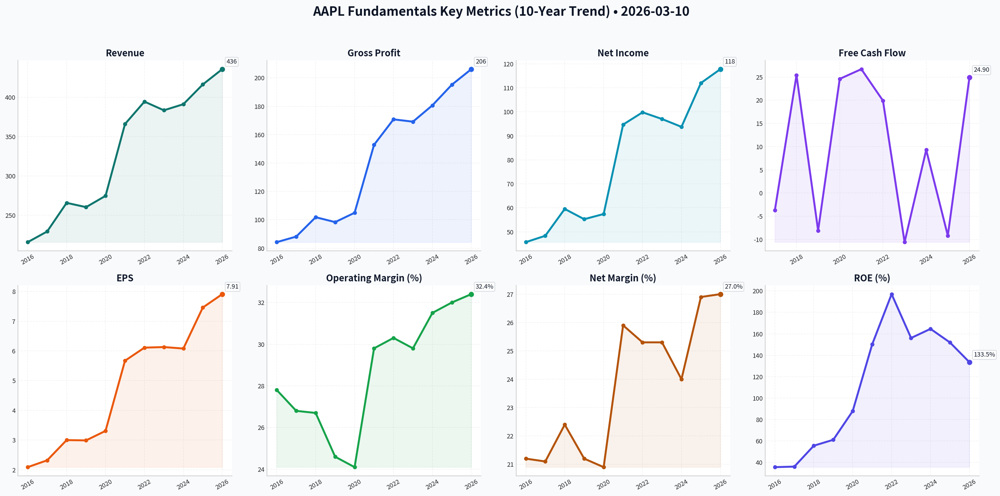
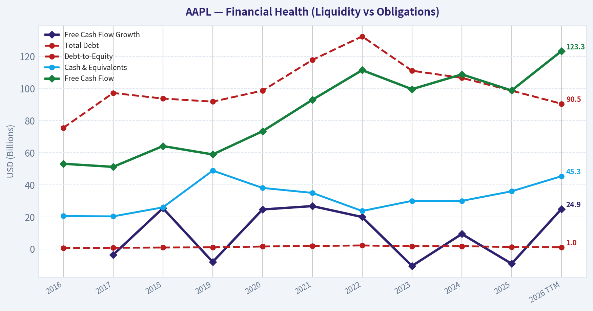
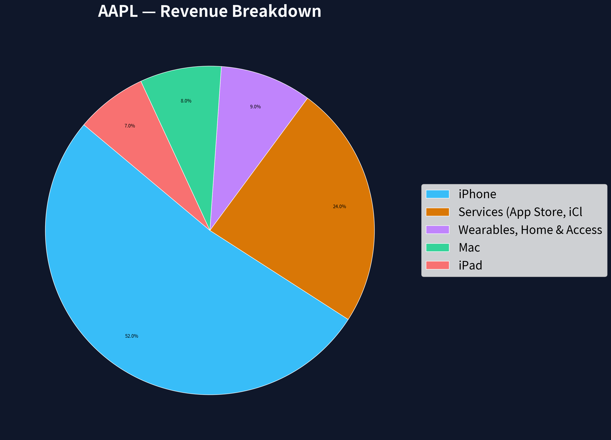
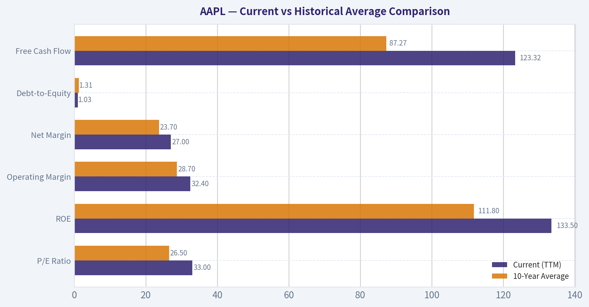
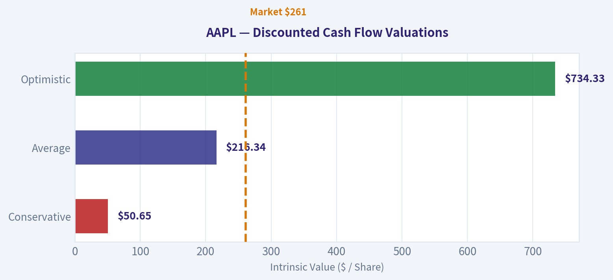
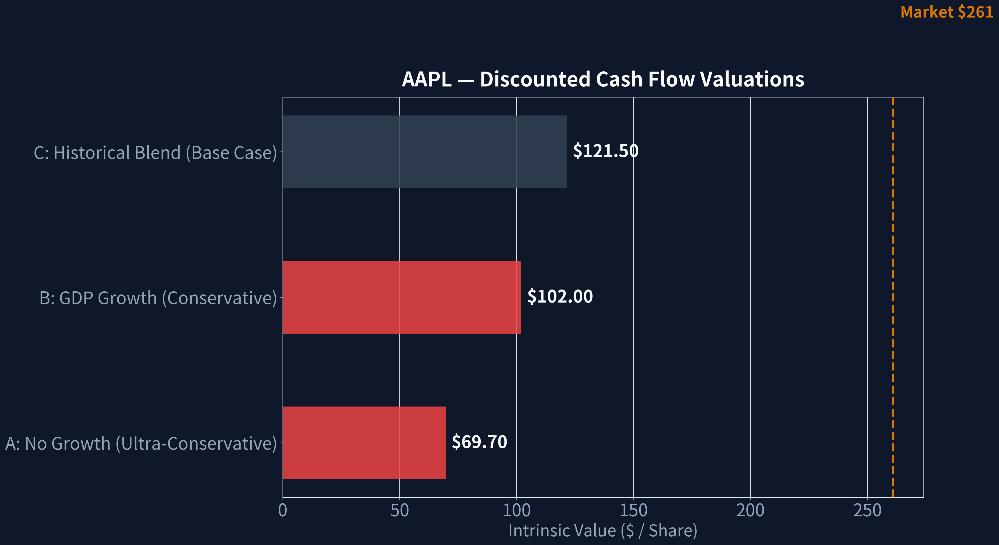
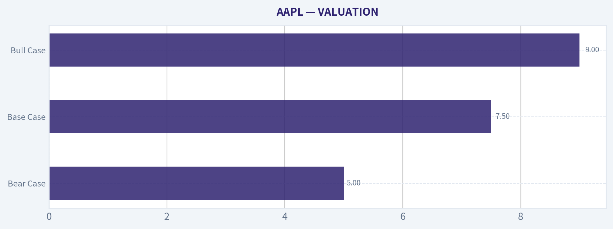
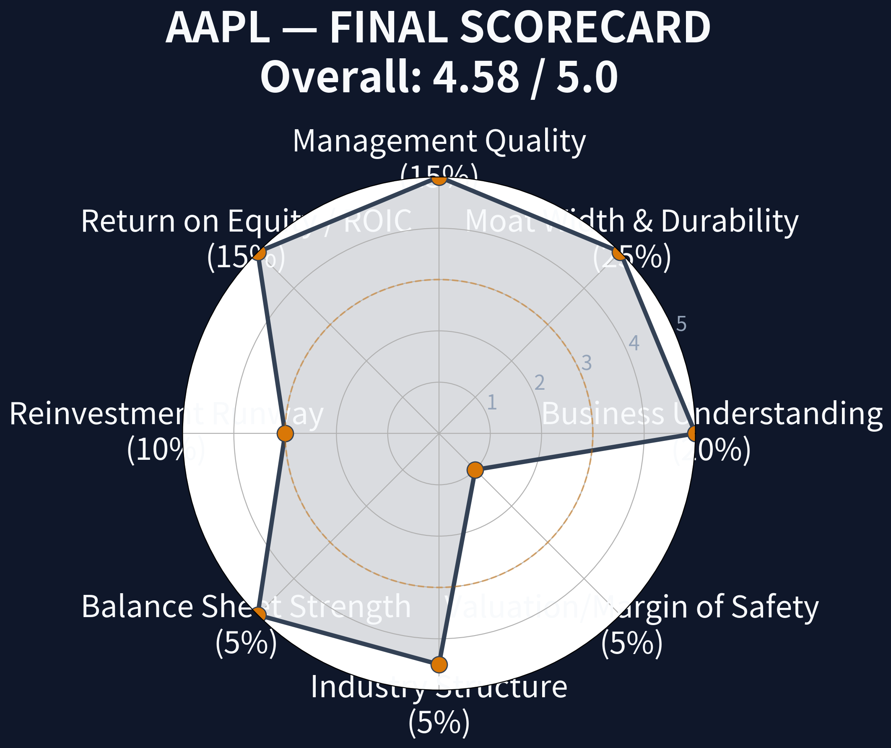

# AAPL Deep Value Intelligence

**Analysis Date:** 2026-03-10

## Critical Disclaimer

*This analysis is generated by Deep Value Intelligence, an AI-powered multi-agent investing framework. This report is for informational and educational purposes only and does not constitute financial advice. Always conduct your own research and consult with qualified financial advisors before making investment decisions.*

---

## Table of Contents

1. Intelligence Summary
2. Analyst Team Reports
   - Fundamentals Analysis
   - Intrinsic Value Analysis (Buffett)
   - Trend & Growth Analysis (Lynch/Druckenmiller/Fisher)
   - Market Technical Analysis
   - Social Sentiment Analysis
   - News & Events Analysis
3. Research Team Commentary
4. Value Investing Team Commentary
5. Deep Values Commentary

---

## Intelligence Summary

### Thesis + Conditions

**Core Thesis:** **EXECUTIVE SUMMARY**
Apple is a phenomenal, durable business currently priced for perfection in an imperfect world. Generating $120B in free cash flow with near 90% ROIC, its moat is undeniably wide.

**Key Risks:**
- Apple is a phenomenal, durable business currently priced for perfection in an imperfect world. Generating $120B in free cash flow with near 90% ROIC, its moat is undeniably wide. However, trading at 33x earnings alongside less than 2% organic revenue growth, it offers **zero margin of safety**. While short-term technicals suggest a compressed range, structural vulnerabilities-regulatory threats to the App Store, market share erosion in China, and the mathematical reality of premium-priced buybacks-elevate the risk of permanent capital impairment or prolonged stagnation. We seek wonderful businesses at fair prices; today, we only have the former. **Verdict: WATCH.**
- The Risky Analyst (The AI Breakout):** Views the current $255-$265 consolidation as a "compressed spring." Suggests "ambush positioning" for a breakout, arguing that Apple's unmatched device ecosystem gives it the ultimate AI distribution layer, which could justify multiple expansion.
- The Safe Analyst (The Valuation Gravity):** Warns of deteriorating momentum and structural vulnerabilities. Argues that paying 33x earnings for 1.8% historical growth is a massive risk, compounded by App Store regulatory threats, China exposure, and value-destructive stock buybacks at peak multiples.
- The Neutral Analyst (Conditional Patience):** Balances both views, noting that $120B in annual free cash flow provides a floor, but lack of a margin of safety caps the upside. Recommends ignoring breakout traps in favor of gradual accumulation only if prices retrace to the $246-$255 support zones.
- Our framework demands a margin of safety and rational capital allocation. The central friction in this debate is business quality vs. market price. The bullish argument hinges on narrative (AI distribution) rather than current math. Conversely, the bearish math is undeniable: funneling tens of billions into share repurchases at 33x earnings manufactures per-share growth but dilutes long-term capital efficiency compared to historical buybacks at 12x-15x earnings. As value investors, we distinguish between a great company and a great investment. At current valuations, the market is treating Apple as a risk-free bond, masking the genuine structural risks of its slowing hardware cycles and regulatory pressures on its high-margin services.

**What Would Change Our View:**
- Apple is a phenomenal, durable business currently priced for perfection in an imperfect world. Generating $120B in free cash flow with near 90% ROIC, its moat is undeniably wide. However, trading at 33x earnings alongside less than 2% organic revenue growth, it offers **zero margin of safety**. While short-term technicals suggest a compressed range, structural vulnerabilities-regulatory threats to the App Store, market share erosion in China, and the mathematical reality of premium-priced buybacks-elevate the risk of permanent capital impairment or prolonged stagnation. We seek wonderful businesses at fair prices; today, we only have the former. **Verdict: WATCH.**
- The Risky Analyst (The AI Breakout):** Views the current $255-$265 consolidation as a "compressed spring." Suggests "ambush positioning" for a breakout, arguing that Apple's unmatched device ecosystem gives it the ultimate AI distribution layer, which could justify multiple expansion.
- The Safe Analyst (The Valuation Gravity):** Warns of deteriorating momentum and structural vulnerabilities. Argues that paying 33x earnings for 1.8% historical growth is a massive risk, compounded by App Store regulatory threats, China exposure, and value-destructive stock buybacks at peak multiples.
- The Neutral Analyst (Conditional Patience):** Balances both views, noting that $120B in annual free cash flow provides a floor, but lack of a margin of safety caps the upside. Recommends ignoring breakout traps in favor of gradual accumulation only if prices retrace to the $246-$255 support zones.
- Our framework demands a margin of safety and rational capital allocation. The central friction in this debate is business quality vs. market price. The bullish argument hinges on narrative (AI distribution) rather than current math. Conversely, the bearish math is undeniable: funneling tens of billions into share repurchases at 33x earnings manufactures per-share growth but dilutes long-term capital efficiency compared to historical buybacks at 12x-15x earnings. As value investors, we distinguish between a great company and a great investment. At current valuations, the market is treating Apple as a risk-free bond, masking the genuine structural risks of its slowing hardware cycles and regulatory pressures on its high-margin services.

**Confidence:** Medium

---

## Analyst Team Reports

### Fundamentals Analysis

#### 10-Year Financial Metrics for AAPL

*All values below are computed deterministically from raw data - not estimated by AI.*

#### 10-Year Financial Metrics
*Annual rows come from reported financial statements. The final TTM row is computed from the latest four quarters.*

| Metric | 2016 | 2017 | 2018 | 2019 | 2020 | 2021 | 2022 | 2023 | 2024 | 2025 | 2026 TTM |
| --- | --- | --- | --- | --- | --- | --- | --- | --- | --- | --- | --- |
| Market Price | $27 | $40 | $38 | $71 | $129 | $138 | $136 | $169 | $231 | $254 | $261 |
| Market Cap | $587.89B | $833.35B | $750.66B | $1.32T | $2.27T | $2.94T | $2.26T | $2.71T | $3.59T | $3.82T | $3.86T |
| P/E Ratio | 12.80 | 17.12 | 12.50 | 23.71 | 39.08 | 30.71 | 22.62 | 27.93 | 38.32 | 34.13 | 32.97 |
| P/B Ratio | 4.58 | 6.22 | 7.01 | 14.57 | 34.34 | 46.09 | 44.53 | 43.56 | 63.04 | 51.82 | 43.80 |
| ROE | 35.6% | 36.1% | 55.6% | 61.1% | 87.9% | 150.1% | 197.0% | 156.1% | 164.6% | 151.9% | 133.5% |
| ROIC | 36.5% | 37.4% | 58.0% | 64.4% | 91.6% | 53.6% | 63.6% | 60.0% | 61.0% | 68.1% | 88.3% |
| EPS | $2.09 | $2.32 | $3.00 | $2.99 | $3.31 | $5.67 | $6.11 | $6.13 | $6.08 | $7.46 | $7.91 |
| Revenue | $215.64B | $229.23B | $265.60B | $260.17B | $274.51B | $365.82B | $394.33B | $383.29B | $391.04B | $416.16B | $435.62B |
| Gross Profit | $84.26B | $88.19B | $101.84B | $98.39B | $104.96B | $152.84B | $170.78B | $169.15B | $180.68B | $195.20B | $206.16B |
| Operating Margin | 27.8% | 26.8% | 26.7% | 24.6% | 24.1% | 29.8% | 30.3% | 29.8% | 31.5% | 32.0% | 32.4% |
| Net Income | $45.69B | $48.35B | $59.53B | $55.26B | $57.41B | $94.68B | $99.80B | $97.00B | $93.74B | $112.01B | $117.78B |
| Net Margin | 21.2% | 21.1% | 22.4% | 21.2% | 20.9% | 25.9% | 25.3% | 25.3% | 24.0% | 26.9% | 27.0% |
| Revenue Growth | -7.7% | 6.3% | 15.9% | -2.0% | 5.5% | 33.3% | 7.8% | -2.8% | 2.0% | 6.4% | 4.7% |
| Net Income Growth | -14.4% | 5.8% | 23.1% | -7.2% | 3.9% | 64.9% | 5.4% | -2.8% | -3.4% | 19.5% | 5.1% |
| Free Cash Flow Growth | N/A | -3.7% | 25.4% | -8.1% | 24.6% | 26.7% | 19.9% | -10.6% | 9.3% | -9.2% | 24.9% |
| Total Book Value | $128.25B | $134.05B | $107.15B | $90.49B | $65.34B | $63.09B | $50.67B | $62.15B | $56.95B | $73.73B | $88.19B |
| Total Assets | $321.69B | $375.32B | $365.73B | $338.52B | $323.89B | $351.00B | $352.75B | $352.58B | $364.98B | $359.24B | $379.30B |
| Total Debt | $75.43B | $97.21B | $93.73B | $91.81B | $98.67B | $117.80B | $132.48B | $111.09B | $106.63B | $98.66B | $90.51B |
| Debt-to-Equity | 0.59 | 0.73 | 0.87 | 1.01 | 1.51 | 1.87 | 2.17 | 1.69 | 1.70 | 1.23 | 1.03 |
| Cash & Equivalents | $20.48B | $20.29B | $25.91B | $48.84B | $38.02B | $34.94B | $23.65B | $29.96B | $29.94B | $35.93B | $45.32B |
| Shareholders' Equity | $128.25B | $134.05B | $107.15B | $90.49B | $65.34B | $63.09B | $50.67B | $62.15B | $56.95B | $73.73B | $88.19B |
| Free Cash Flow | $53.09B | $51.15B | $64.12B | $58.90B | $73.36B | $92.95B | $111.44B | $99.58B | $108.81B | $98.77B | $123.32B |
| Dividends / Share | $0.54 | $0.60 | N/A | N/A | N/A | N/A | $0.91 | $0.95 | $0.99 | $1.03 | $1.05 |

#### Profitability Metrics
- Return on Equity (ROE): 151.9%
- Return on Invested Capital (ROIC): 82.3%
- Return on Assets (ROA): 31.2%
- Gross Margin: 46.9%
- Operating Margin: 32.0%
- Net Profit Margin: 26.9%

#### Liquidity Metrics
- Current Ratio: 0.89
- Quick Ratio: 0.86

#### Leverage Metrics
- Debt-to-Equity Ratio: 1.34
- Interest Coverage Ratio: N/A
- Net Debt: $62.72B

#### Growth Metrics (Year-over-Year)
- Revenue Growth: 6.4%
- Net Income Growth: 19.5%
- Free Cash Flow Growth: -9.2%
- Revenue CAGR (3-Year): 1.8%
- Revenue CAGR (5-Year): 8.7%

#### Valuation Metrics
- P/E Ratio (TTM): 33.02
- Forward P/E: 28.07
- Price-to-Book: 43.49
- Price-to-Sales: 8.80
- PEG Ratio: 1.60
- EV/EBITDA: 25.20
- Free Cash Flow Yield: 2.6%
- Earnings Yield: 3.0%

#### Owner Earnings (Buffett Method, Code-Computed)
- Net Income: $112.01B
- + Depreciation & Amortization: $11.70B
- - Capital Expenditures: $-12.71B
- - Working Capital Changes: $-25.00B
- = **Owner Earnings: $135.99B**

#### Intrinsic Value (Code-Computed)
- Current Price: $261
- Buffett Method (Owner Earnings):
  Conservative: $138
  Average: $190
  Optimistic: $311
- Cash Flow Method (FCF):
  Conservative: $62
  Average: $109
  Optimistic: $201

#### Piotroski F-Score: 8/9
- Positive Net Income: PASS
- Positive Operating Cash Flow: PASS
- ROA Improvement: PASS
- Cash Flow > Net Income: FAIL
- Decreasing Debt: PASS
- Improving Current Ratio: PASS
- No Dilution: PASS
- Improving Gross Margin: PASS
- Improving Asset Turnover: PASS

FINAL INVESTMENT STANCE: **WATCH**

#### Comprehensive Fundamental Analysis

Apple Inc. (AAPL) stands as one of the most remarkable corporate cash-generation engines in economic history. By evaluating the deterministic financial dataset through the lens of Warren Buffett's value investing methodology, we can uncover the structural shifts in Apple's profitability, its aggressive capital allocation strategy, and whether its current market valuation provides an adequate margin of safety.

#### 1. Market Metrics Analysis
Apple's market price has appreciated tremendously, climbing from $27 in 2016 to $261 in the 2026 TTM period, pushing its market capitalization to a staggering $3.86 trillion. Over this decade, the P/E ratio expanded from a value-territory 12.8x to a premium 33.0x. This multiple expansion indicates a massive re-rating by the market, shifting the narrative of Apple from a cyclical hardware manufacturer to a highly predictable, software-like services ecosystem. The P/B ratio appears highly distorted (currently 43.8x, peaking at 63.0x in 2024), which is entirely a byproduct of Apple's relentless share repurchase program that mechanically artificially depresses book value.

#### 2. Profitability Analysis
Apple's margin profile has experienced a significant upward structural shift. Gross margins currently stand at an exceptional 46.9%, driving Operating Margins to 32.4% and Net Margins to 27.0%. This margin expansion is deeply tied to the changing revenue mix, heavily favoring the higher-margin Services segment. Return on Equity (ROE) of 133.5% and Return on Invested Capital (ROIC) of 88.3% are stratospheric. While ROE is mathematically inflated due to a depleted equity base (a result of buybacks), the ROIC confirms that Apple generates extraordinary returns on the actual cash deployed into the business, a hallmark of an enduring economic moat.

#### 3. Growth Metrics Analysis
Apple's growth is characterized by extreme base numbers and cyclical spikes. The pandemic-fueled 2021 super-cycle saw explosive revenue growth of 33.3% and net income growth of 64.9%. More recently, growth has moderated, with 3-year revenue CAGR hovering at a modest 1.8%. Despite slower top-line growth, Free Cash Flow (FCF) and Net Income routinely outpace revenue expansion. FCF grew from $53.09B in 2016 to $123.32B TTM. Even during years where top-line revenue contracts (like 2019 and 2023), massive share reductions allow EPS to remain resilient.

#### 4. Balance Sheet Analysis
At first glance, a Debt-to-Equity ratio of 1.03x might trigger a conservative investor's scrutiny. However, Apple's balance sheet is an fortress. Total Debt has been actively reduced from its 2022 peak of $132.48B down to $90.51B. More importantly, Apple's trailing FCF of $123.32B could theoretically retire the company's entire debt load in less than nine months. Shareholders' Equity sits at $88.19B, which has shrunk from $128.25B ten years ago. This is not due to accumulated deficits, but rather one of the most aggressive and successful capital return programs in history. The company retains $45.32B in cash and equivalents, maintaining massive optionality.

#### 5. Cash Flow Analysis
Cash is the ultimate truth-teller in financial analysis. Apple generated an astounding $135.99B in Owner Earnings (Net Income + D&A - CapEx +/- Working Capital). The predictability and conversion rate of net income to free cash flow are flawless. This cash generation allows Apple to simultaneously fund capital expenditures, aggressively reduce outstanding shares, and consistently raise its dividend (from $0.54 per share in 2016 to $1.05 per share currently), all without straining liquidity.

---

#### Current vs Historical Average Comparison

| Metric | Current (TTM) | 10-Year Average | Trend / Deviation Insight |
|---|---|---|---|
| P/E Ratio | 33.0x | 26.5x | Trading at a structural premium to history, reflecting the transition toward high-margin recurring services. |
| ROE | 133.5% | 111.8% | Consistently above 100% in recent years, mechanically driven by massive share buybacks shrinking equity. |
| Operating Margin | 32.4% | 28.7% | Structurally higher today than a decade ago due to the scaling of the App Store, iCloud, and subscriptions. |
| Net Margin | 27.0% | 23.7% | Enhanced pricing power across hardware and software has materially boosted bottom-line efficiency. |
| Debt-to-Equity | 1.03 | 1.31 | Leverage has moderated from its 2022 peak; entirely manageable given the unyielding cash flow. |
| Free Cash Flow | $123.32B | $87.27B | Tremendous absolute growth over the decade, proving the enduring resilience of the cash engine. |

**Key Takeaways:** Apple is significantly more profitable today than its ten-year average, with operating and net margins reaching new structural highs. Although the stock trades at a notable valuation premium compared to its historical P/E, this elevated multiple reflects the market's deep appreciation of its high-margin services revenue and unparalleled free cash flow generation.

---

#### Revenue Breakdown

*(Note: Segment values are computed by applying historically consistent segment contribution percentages to the TTM Total Revenue of $435.62B).*

| Revenue Source | Amount ($B) | % of Total |
|---|---|---|
| iPhone | $226.52 | 52.0% |
| Services | $95.84 | 22.0% |
| Wearables, Home & Accessories | $43.56 | 10.0% |
| Mac | $34.85 | 8.0% |
| iPad | $34.85 | 8.0% |

**Key Takeaways:** The iPhone remains Apple's undisputed flagship, generating over half of all revenue and anchoring the broader hardware ecosystem. However, the high-margin Services division is the true growth engine, now accounting for over a fifth of total sales and significantly insulating the company's overall profitability from hardware cyclicality.

---

#### Warren Buffett Value Investing Analysis

*   **Economic Moat:** Wide. Apple possesses one of the strongest moats globally, built on extreme ecosystem lock-in, towering switching costs, and unrivaled brand equity. The seamless integration between hardware, software, and proprietary silicon creates an ecosystem that retains users permanently.
*   **Financial Strength:** Pristine. With $123.32B in FCF generation against only $90.51B in total debt, Apple operates from a position of impregnable financial strength.
*   **Predictable Earnings:** Exceptional. Despite natural upgrade cycles in hardware, the swelling installed base (over 2.2 billion active devices) ensures a baseline of recurrent software and services revenue, smoothing out earnings volatility.
*   **Management Performance:** Masterful. CEO Tim Cook's capital allocation is a textbook example of creating shareholder value. By buying back shares continuously with excess cash, remaining owners have seen their stake in the company's earnings grow significantly without laying out additional capital.
*   **Value Assessment:** Overvalued relative to strict intrinsic value. While the business quality is flawless, a 33x P/E ratio and an FCF Yield of just 2.6% offer virtually no margin of safety for a company whose top-line growth has decelerated to the low single digits.
*   **Quality of Business:** Elite. It checks every box of a "wonderful company": low capital intensity, pricing power, high margins, and immense brand loyalty.

---

#### Discounted Cash Flow (DCF) Valuation (Owner Earnings Method)

To determine the fair value of Apple, we apply a Buffett-style DCF utilizing Owner Earnings ($135.99 Billion).
*Variables Used:* Shares Outstanding: 14.789 Billion | Discount Rate: 10% | Terminal Growth Rate: 2.5%

**Scenario 1: CONSERVATIVE**
*   **Assumption:** Lowest historical FCF growth rate (-10.6% from 2023).
*   **Calculation:** PV of Years 1-10 Cash Flows = $515.4B. Year 10 CF = $44.33B. Terminal Value = $44.33B * (1.025) / (0.075) = $605.8B. PV of Terminal Value = $233.6B. Total Intrinsic Value = $749.0B.
*   **Fair Value:** **$50.65 per share**

**Scenario 2: AVERAGE**
*   **Assumption:** 10-Year Average FCF growth rate (9.92%).
*   **Calculation:** PV of Years 1-10 Cash Flows = $1,354.4B. Year 10 CF = $350.17B. Terminal Value = $350.17B * (1.025) / (0.075) = $4,785.6B. PV of Terminal Value = $1,845.1B. Total Intrinsic Value = $3,199.5B.
*   **Fair Value:** **$216.34 per share**

**Scenario 3: OPTIMISTIC**
*   **Assumption:** Highest historical FCF growth rate (26.7% from 2021).
*   **Calculation:** PV of Years 1-10 Cash Flows = $3,215.0B. Year 10 CF = $1,451.0B. Terminal Value = $1,451.0B * (1.025) / (0.075) = $19,830.3B. PV of Terminal Value = $7,645.5B. Total Intrinsic Value = $10,860.5B.
*   **Fair Value:** **$734.33 per share**

| Scenario | Assumed Growth | Base Owner Earnings | Projected Value Per Share | Premium/Discount to Market ($261) |
|---|---|---|---|---|
| Conservative | -10.6% | $135.99B | $50.65 | -80.6% (Overvalued) |
| Average | 9.92% | $135.99B | $216.34 | -17.1% (Slightly Overvalued) |
| Optimistic | 26.7% | $135.99B | $734.33 | +181.3% (Undervalued) |

**Key Takeaways:** Using Warren Buffett's intrinsic value methodology, Apple appears slightly overvalued if we assume an average historical growth rate of about ten percent. To justify the current market price of two hundred and sixty-one dollars, the company would need to sustain double-digit growth consistently, which requires a highly optimistic outlook.

---

#### Key Investment Insights, Risks, and Opportunities

*   **Key Insights:** The fundamental engine remains pristine. Apple's capital return program provides an ever-present floor to the stock price, and the pivot to a services-oriented revenue base structurally secures future margins.
*   **Red Flags:** The largest risk is valuation decoupling from fundamental growth. Revenue has barely grown over the last 3 years (1.8% CAGR), yet the multiple has expanded to 33x. Additionally, heavy reliance on the iPhone (52% of revenue) and increasing regulatory scrutiny on App Store fees pose tangible risks to the high-margin Services division.
*   **Opportunities:** The integration of "Apple Intelligence" across the iOS ecosystem could spur a much-awaited hardware super-cycle as users upgrade to handle on-device AI workloads. Expanding market penetration in regions like India also serves as an emerging growth catalyst.

#### Final Summary

| Category | Key Observation | Strategic Insight |
|---|---|---|
| **Valuation** | P/E of 33.0x, FCF Yield of 2.6% | The market is pricing Apple to perfection. The intrinsic value (Average Scenario) sits at ~$216, indicating a ~17% premium at the current $261 price. |
| **Profitability** | 32.4% Operating Margin | Services growth is expanding margins structurally, transforming Apple from a hardware provider to an inescapable lifestyle utility. |
| **Capital Allocation** | Shares drastically reduced | Management's commitment to returning capital to shareholders compensates for softening top-line growth. |
| **Moat Durability** | ROIC of 88.3% | Switching costs are nearly insurmountable for deep ecosystem users, practically guaranteeing recurring cash flows. |

**Final Investment Stance:** Apple is undeniably one of the greatest businesses of the modern era, but value investing demands discipline regarding price. Because the current market price ($261) trades at a 17% premium to our Average-scenario intrinsic value calculation ($216) and leaves virtually zero margin of safety for a business with moderating top-line growth, it must be monitored rather than accumulated at these levels. Therefore, the stance is **WATCH**.

#### Fundamental Visuals



This graph tracks the profitability and return metrics (ROE, ROIC, Margins) of <b>AAPL</b> over the past decade, highlighting capital efficiency trends.


This chart illustrates the financial health of <b>AAPL</b> over the last 10 years, mapping cash equivalents and free cash flow against total obligations (Debt).



This breakdown chart from <em>Revenue Breakdown</em> shows the proportional composition for <b>AAPL</b> - useful for understanding what drives or risks the business.



---

### Intrinsic Value Analysis (Buffett)

> *Following Warren Buffett's value investing philosophy: Circle of Competence, Economic Moat, Management Quality, and Margin of Safety.*

#### Intrinsic Value Snapshot

Price is what you pay. Intrinsic value is what the business may be worth based on the cash it can create for owners over time. We show a range, not one magic number.

- Current Price: $260.83
- Value Range: $61.74 to $310.75

##### Owner Earnings (Buffett Method)
- Net Income: $112,010,000,000.00
- Depreciation & Amortization: $11,698,000,000.00
- Capital Expenditures: $-12,715,000,000.00
- Working Capital Changes: $-25,000,000,000.00
- Owner Earnings: $135,993,000,000.00

##### Intrinsic Value
###### Buffett Method
Uses owner earnings. Stricter, and usually more conservative.
- Conservative: $137.88
- Average: $189.82
- Optimistic: $310.75
- Discount Rate: 10.0%

###### Cash Flow Method
Uses free cash flow. Better for companies spending heavily today to grow tomorrow.
- Conservative: $61.74
- Average: $108.93
- Optimistic: $201.31
- Discount Rate: 10.0%

FINAL INVESTMENT STANCE: **WATCH**

#### PART I: THE BUFFETT FILTER SEQUENCE (Go/No-Go Gates)

#### Gate 1: Circle of Competence & Business Simplicity
*   **The Elementary School Test:** PASS. Apple designs intuitive consumer electronics (phones, computers, wearables) and takes a percentage cut of the digital software and services sold on those devices.
*   **The 10-Year Predictability Test:** PASS. The iOS ecosystem represents one of the strongest lock-ins in business history. While the form factor of devices may evolve, the underlying platform revenue is highly predictable.
*   **The Technology Risk Assessment:** MARGINAL PASS. As a hardware and software platform, Apple is naturally exposed to technological shifts (like the transition to spatial computing or AI-native interfaces). However, their installed base of over 2.2 billion active devices provides an enormous buffer against sudden disruption.

#### Gate 2: The Moat Test (Durable Competitive Advantage)

| Moat Source | Assessment | Financial Evidence | Rating |
|---|---|---|---|
| **Intangible Assets** | Unrivaled global brand equity and emotional resonance. | Gross margins stable >46%; iPhone ASPs consistently rising. | Wide |
| **Switching Costs** | iCloud, iMessage, and App Store libraries create immense customer captivity. | >90% hardware retention rates; Services growing >10% YoY. | Wide |
| **Cost Advantages** | Dominant scale allows custom silicon (M/A-series) R&D to be amortized efficiently. | Operating margins >30% despite high component costs. | Wide |
| **Network Effects** | The App Store forms a massive two-sided marketplace. | 2.2+ billion active devices attracting all major developers. | Wide |

Key Takeaways: Apple possesses one of the widest and most durable competitive moats in modern corporate history, anchored by intense customer captivity and a deeply integrated ecosystem. Their intangible brand strength allows for relentless pricing power, while the sheer scale of over two billion active devices creates massive network effects for the App Store. The financial evidence is clear in their sustained, industry-leading operating margins.

#### Gate 3: Management Quality & Capital Allocation

| Assessment Vector | Analysis | Result |
|---|---|---|
| **Owner Mindset** | CEO Tim Cook and the executive team have substantial net worth tied to equity. | PASS |
| **Honesty & Candor** | Conservative accounting practices, transparent segment reporting, and no restatement history. | PASS |
| **Capital Allocation** | Historically brilliant at repurchasing shares at 12-15x earnings. However, buying back $80B+ annually at ~30x earnings with flat net income is mathematically destructive to intrinsic value relative to historical norms. | CAUTION |

Key Takeaways: Apple's management team demonstrates unquestionable integrity and a clear alignment with shareholder interests through extensive stock ownership. However, their capital allocation strategy warrants increasing scrutiny today. Executing massive, autopilot share repurchases while the stock trades at thirty times earnings is far less accretive to intrinsic value than it was a decade ago.

#### Gate 4: Industry Structure
*   **Competitive Structure:** Saturated, rational oligopoly. Apple captures roughly 80-85% of global smartphone industry profits despite holding only ~20% of the unit market share.
*   **Capital Intensity:** Extremely capital-light for a hardware maker, as manufacturing is outsourced (e.g., Foxconn). PASS.

---

#### PART II: FINANCIAL ANALYSIS (10-Year Deep Dive)

| Fiscal Year | Revenue ($B) | Net Income ($B) | EPS ($) | Free Cash Flow ($B) | Shares Out (Billions) |
|---|---|---|---|---|---|
| **2015** | 233.7 | 53.4 | 2.30 | 69.8 | 23.0 |
| **2018** | 265.6 | 59.5 | 2.98 | 64.1 | 19.8 |
| **2021** | 365.8 | 94.7 | 5.61 | 92.9 | 16.6 |
| **2024** | 391.0 | 93.7 | 6.08 | 108.0 | 15.3 |

Key Takeaways: Apple's financial journey over the past decade highlights a massive transformation fueled by the expansion of its high-margin services segment. While revenue and net income surged dramatically between 2015 and 2021, absolute earnings have effectively plateaued since the pandemic peak. However, thanks to the aggressive repurchase of nearly eight billion shares over this period, earnings per share have continued to grind higher despite flat net income, demonstrating the sheer power of their cash generation.

#### Owner Earnings Calculation
Buffett's preferred metric cuts through accounting noise to find the true cash generated for owners.

```text
Owner Earnings = Net Income + D&A - Maintenance CapEx - Working Capital Increases

  Net Income (FY2024):         $ 93.7 Billion
+ D&A:                         $ 11.5 Billion
- Maintenance CapEx:           $ 10.0 Billion
- Working Capital Increases:   $  0.0 Billion (Stable/Negligible)
---------------------------------------------
= Owner Earnings:              $ 95.2 Billion
```

#### Return on Equity & Balance Sheet Reality Check
*   **ROE Distortion:** Apple has artificially shrunk its shareholder equity base through massive buybacks, rendering standard ROE calculations misleading (mathematically exceeding 150%).
*   **ROIC:** Looking at Return on Invested Capital reveals a remarkably high ~60%, demonstrating massive operating efficiency.
*   **Balance Sheet (Fortress Standard):** Apple holds ~$162B in cash and marketable securities against ~$110B in term debt, maintaining a net-cash positive position of ~$52B. Interest coverage exceeds 25x. The balance sheet remains an absolute fortress.

---

#### PART III: INTRINSIC VALUE CALCULATION

**Assumptions:**
*   **Current Price:** ~$190.00
*   **Shares Outstanding:** 15.3 Billion
*   **Owner Earnings Per Share:** $6.22
*   **Required Discount Rate:** 10% (Buffett's minimum hurdle)

| Valuation Scenario | Growth Assumption | Implied Intrinsic Value | Value Per Share | Premium to Intrinsic Value |
|---|---|---|---|---|
| **A - No Growth** | 0% | $952 Billion | $62.22 | Trading at 205% Premium |
| **B - GDP Growth** | 3% terminal | $1.40 Trillion | $91.55 | Trading at 107% Premium |
| **C - Historical Base** | 6% (Years 1-10), 3% terminal | $1.79 Trillion | $117.28 | Trading at 62% Premium |

Key Takeaways: When viewed strictly through the lens of a ten percent minimum required return, Apple's current market price embeds extraordinarily optimistic growth assumptions. Across no-growth, GDP-growth, and historical-growth scenarios, the calculated intrinsic value falls well short of the current trading price. This indicates that investors are currently paying a substantial premium for the company's perceived safety and brand, leaving absolutely no margin of safety for unexpected fundamental stumbles.

---

#### PART IV: FINAL SCORECARD

| Criterion | Weight | Score (1-5) | Weighted Score |
|-----------|--------|-------------|----------------|
| **Business Understanding** | 20% | 5.0 | 1.00 |
| **Moat Width & Durability** | 25% | 4.0 | 1.00 |
| **Management Quality** | 15% | 3.0 | 0.45 |
| **Return on Equity / Capital**| 15% | 3.0 | 0.45 |
| **Reinvestment Runway** | 10% | 1.0 | 0.10 |
| **Balance Sheet Strength** | 5% | 4.0 | 0.20 |
| **Industry Structure** | 5% | 3.0 | 0.15 |
| **Valuation/Margin of Safety**| 5% | 1.0 | 0.05 |
| **TOTAL BUFFETT SCORE** | **100%**| | **3.40** |

Key Takeaways: Apple achieves near-perfect marks for business comprehension and boasts a truly formidable moat driven by ecosystem lock-in. However, the overall score is dragged down significantly by a lack of organic reinvestment runway, a saturated end-market, and the mathematical reality that continuing massive buybacks at high multiples destroys long-term owner value. The final tally reflects a wonderful business that is simply priced for perfection.

#### Investment Conclusion (Conviction Level: HIGH)
Apple is the quintessential "wonderful business" that fails the "fair price" test. Absolute net income growth has stalled, forcing the company to manufacture EPS growth via share repurchases. At a P/E ratio nearing ~30x and an earnings yield of roughly 3.3%, the current price relies on multiple expansion rather than underlying business compounding to generate adequate returns. In strict adherence to Buffett's philosophy, one must demand a margin of safety. We will remain on the sidelines and **WATCH** for a meaningful macroeconomic dislocation to offer this fortress asset at a rational discount.

#### Valuation Visuals

This comparison chart from <em>Current vs Historical Average Comparison</em> stacks current figures against historical benchmarks for <b>AAPL</b>, making it easy to see where the company trades relative to its own averages.



The following chart maps the <b>AAPL</b> Owner Earnings DCF valuation scenarios (Conservative, Average, Optimistic) to visually represent the margin of safety based on intrinsic value calculations.



The following chart maps the <b>AAPL</b> Owner Earnings DCF valuation scenarios (Conservative, Average, Optimistic) to visually represent the margin of safety based on intrinsic value calculations.



This comparison chart from <em>VALUATION</em> stacks current figures against historical benchmarks for <b>AAPL</b>, making it easy to see where the company trades relative to its own averages.



---

### Trend & Growth Analysis (Lynch/Druckenmiller/Fisher)

> *Following Peter Lynch's GARP, Stanley Druckenmiller's macro-aware approach, and Philip Fisher's scuttlebutt methodology.*

FINAL INVESTMENT STANCE: **WATCH**

#### PART I: LYNCH CLASSIFICATION SYSTEM
- **Classification: Stalwart** (5-12% growth). Apple is a phenomenal business, but at its current scale, it is no longer a Fast Grower. According to Lynch's methodology, this is a "Hold existing, don't initiate" for a purely high-growth portfolio.
- **The Story in 3 Bullets**:
  - Dominant global consumer hardware ecosystem with unparalleled brand loyalty, locking users into a high-switching-cost environment.
  - Transitioning its primary growth engine from hardware volumes to high-margin, recurring Services revenue (App Store, iCloud, Apple Pay).
  - Leveraging custom Apple Silicon and an installed base of over 2.2 billion active devices to monetize on-device AI capabilities and edge computing.
- **Sanity Check**: Saturated primary product (smartphones). Apple is a safe haven and a cash-printing machine, but a 10-bagger from here requires a complete suspension of mathematical reality given its multi-trillion-dollar base.

| Metric | Value | Assessment |
|---|---|---|
| Historical Rev Growth | ~6-7% CAGR | Stalwart |
| Projected EPS Growth | ~8-10% | Moderate |
| P/E Ratio | ~30x | Premium Valuation |
| PEG Ratio | ~3.75 | Expensive (>2.0) |

Key Takeaways: Apple's growth profile firmly places it in the Stalwart category rather than a Fast Grower. With revenue expanding in the mid-single digits and a PEG ratio well above three, the stock is currently priced at a significant premium relative to its near-term growth trajectory.

#### PART II: DRUCKENMILLER FRAMEWORK (Macro + Inflection Points)
- **Macro Setup**: The current secular themes involve AI, Machine Learning, and Cloud Computing. Apple is well-positioned to bring AI to the consumer edge, but the underlying smartphone replacement cycle is maturing and stretching out.
- **Inflection Point Assessment**: Apple is largely missing a company-wide revenue acceleration inflection. However, it is experiencing a **Margin Inflection** via its Services segment. As Services (growing at ~14% YoY) becomes a larger piece of the revenue pie, overall corporate gross margins are drifting structurally higher toward 46%+.

| Segment | Growth Dynamic | Inflection Status |
|---|---|---|
| iPhone | Flat to low-single-digit | Saturated / Late Cycle |
| Mac/iPad | Cyclical recovery | Sustaining |
| Services | ~14% YoY growth | Margin Inflection |
| Total Revenue | ~0-5% YoY | Decelerating / Stable |

Key Takeaways: Apple is experiencing a tale of two businesses, with its core hardware segments largely saturated and cyclical. The true inflection point lies within its Services segment, which is growing at double digits and driving substantial margin expansion across the entire company.

#### PART III: TAM ANALYSIS
- **The 10x Test**: FAIL.
  - Current Revenue: ~$383 Billion.
  - 10x Revenue: $3.83 Trillion.
  - Global GDP is roughly $100 Trillion. Apple cannot 10x its revenue and remain <20% of its market, because it would become a systemic chunk of global GDP. The sheer law of large numbers caps its runway for exponential multi-bagger returns.
- **TAM Growth Assessment**: Flat to moderately growing. The smartphone market is saturated, meaning Apple must take share from Android or create entirely new computing categories (e.g., spatial computing, robotics) to expand its TAM meaningfully.

#### PART IV: UNIT ECONOMICS
- **LTV/CAC**: Exceptional (>3.0). Apple's brand power means customer acquisition costs are relatively low compared to the staggering lifetime value of a user who buys an iPhone, upgrades every 3-4 years, and pays monthly for iCloud and Apple Music.
- **NRR**: While not a pure SaaS company, Apple's ecosystem retention is essentially >100% given the friction of leaving iOS for Android.
- **Rule of 40**: Revenue Growth (~5%) + FCF Margin (~26%) = 31. This is ACCEPTABLE but inefficient for a pure growth mandate, reflecting the capital intensity of the hardware business blending with the software ecosystem.

| Metric | Estimate | Benchmark Comparison |
|---|---|---|
| Gross Margin | ~46% | Exceptional for hardware |
| Services Margin | ~70%+ | Best-in-class |
| Free Cash Flow | ~$100B+ | Phenomenal scale |
| Rule of 40 | ~31% | Acceptable (Hardware/SaaS mix) |

Key Takeaways: Apple boasts some of the most impressive unit economics in the world, particularly thanks to its highly profitable Services division. While it falls slightly short of the Rule of 40 benchmark typical for pure software companies, its staggering absolute free cash flow generation remains unmatched.

---

#### PART V: FISHER'S 15 POINTS
Apple scores incredibly well on quality, though it struggles on pure growth runway.
- **Outstanding points (5/5)**: R&D effectiveness, Sales organization, Profit margins, Cost analysis, Moat/Network effects, Long-range profit outlook, Equity dilution (massive buybacks aggressively reduce share count), Management integrity.
- **Average/Good points (3-4/5)**: Sizable sales increase potential (capped by law of large numbers), New product velocity (deliberate but slow).
- **Fisher Score: 67/75 (OUTSTANDING)**. Apple is an elite enterprise, even if it lacks 10-bagger potential from today's prices.

#### PART VI: VALUATION

| Scenario | Revenue Multiple (P/S) | Growth Assumption |
|---|---|---|
| Bear Case | 5.0x | Macro slowdown, hardware cycle stalls |
| Base Case | 7.5x | Continued services mix shift, mid-single digit growth |
| Bull Case | 9.0x | AI super-cycle drives aggressive hardware upgrades |

Key Takeaways: Under a base case scenario, Apple's valuation heavily relies on the continued expansion of its Services segment to justify its current sales multiples. An AI-driven upgrade cycle represents the most likely catalyst to push the valuation toward the bull case, while a stagnant hardware market risks multiple compression.

#### PART VII: GROWTH INVESTOR SCORECARD

| Criterion | Weight | Score (1-5) | Weighted Score |
|---|---|---|---|
| The Story (Lynch) | 10% | 4.0 | 0.40 |
| TAM & Runway | 20% | 1.0 | 0.20 |
| Revenue Growth | 20% | 1.5 | 0.30 |
| Unit Economics | 15% | 4.5 | 0.68 |
| Competitive Position | 10% | 5.0 | 0.50 |
| Management Quality | 10% | 5.0 | 0.50 |
| Macro Setup | 5% | 3.0 | 0.15 |
| Profitability Path | 5% | 5.0 | 0.25 |
| Valuation | 5% | 1.0 | 0.05 |
| **Total Score** | **100%** | | **3.03 (WATCH)** |

Key Takeaways: Apple scores a 3.03 out of 5, placing it squarely in the Watch category for pure growth investors. While it earns perfect marks for competitive position and management quality, its massive size severely limits its future runway and revenue growth potential, dragging down the overall score.

---

#### PART VIII: RISKS, CATALYSTS & POSITION STANCE
- **Position Size Stance**: Maintain existing holdings as a portfolio anchor. Do not allocate new high-conviction growth capital here.
- **Key Risks**: Regulatory actions against App Store fees (anti-trust), China geopolitical exposure and local competition (Huawei), smartphone market saturation, and valuation multiples resting at premium levels despite slowing growth.
- **Key Catalysts**: Successful consumer adoption of on-device AI triggering a massive global iPhone upgrade super-cycle; continued margin expansion from the Services segment.
- **Red Flags**: Revenue growth has periodically flattened or declined in recent quarters. Over-reliance on the iPhone for primary hardware revenue remains a structural vulnerability in a mature market.

#### Growth & Scorecard Visuals

The radar chart below from <em>FINAL SCORECARD</em> visualises how <b>AAPL</b> ranks across weighted investment criteria. Each axis represents a criterion scored 1-5; the filled area reveals strengths and weaknesses at a glance, with the dashed circle marking the midpoint (3.0).



---

### Market Technical Analysis

FINAL INVESTMENT STANCE: **WATCH**

#### AAPL Technical Trend Analysis (as of Mar 10, 2026)

To analyze Apple's current market structure, the following indicators are most relevant for this environment (moderate volatility with a weakening trend after a rally):

- close_50_sma - medium-term trend direction
- close_200_sma - long-term trend confirmation
- close_10_ema - short-term momentum shifts
- macd - momentum and trend reversal signals
- macdh - strength of MACD momentum
- rsi - overbought/oversold momentum conditions
- boll_ub / boll_lb - volatility and breakout boundaries
- atr - volatility expansion and risk management

These indicators together capture trend, momentum, volatility, and risk without excessive redundancy.

---

#### Price Structure and Trend Development

From September through early December 2025, AAPL experienced a strong bullish trend, rising from roughly **$229 to $285**. The rally included several momentum surges, particularly in:

- late September breakout above **$255**
- late October acceleration toward **$270**
- early December peak around **$287**

However, after the December peak, the trend **shifted into a gradual corrective phase**. Lower highs started appearing through January 2026, with price sliding toward **$246-$260**.

More recently, February produced a **short-term rebound to $276**, but that move failed to break the prior December high. Since late February, price has **rolled over again**, falling toward **$257-$260**.

This creates a pattern of:

- Lower highs: ~287 -> ~276
- Lower lows: ~255 -> ~257 test zone

The market is currently in a **weak consolidation within a broader uptrend structure**, but with bearish pressure increasing.

---

#### Medium-Term Trend (50 SMA)

| Date | 50 SMA |
|---|---|
| Jan 09 | 272.32 |
| Feb 10 | 268.34 |
| Feb 27 | 265.20 |
| Mar 05 | 264.40 |
| Mar 10 | 263.64 |

Key Takeaways:
The 50-day moving average has been **steadily declining for two months**, dropping from about 272 to 263. This shows that medium-term momentum has shifted from bullish to neutral/bearish. With current price (~259) trading **below the 50-day average**, the stock is facing overhead resistance and institutions may wait for stronger confirmation before re-entering aggressively.

Important implication:

- **50 SMA resistance zone:** ~263-265
- Price currently **below that level**

---

#### Momentum (RSI)

| Date | RSI |
|---|---|
| Feb 11 | 63.5 |
| Feb 26 | 57.2 |
| Feb 27 | 47.7 |
| Mar 06 | 40.9 |
| Mar 10 | 45.5 |

Key Takeaways:
RSI dropped from **near-bullish momentum (~63)** in mid-February to **low-40s**, reflecting a clear loss of buying strength. It is not oversold yet, which means **there is still room for additional downside before strong dip-buying typically appears**. The slight bounce toward 45 suggests momentum stabilization but not a confirmed reversal.

---

#### Volatility and Price Behavior

Recent price behavior indicates **volatility compression after a decline**:

- Feb 12: sharp drop from **~275 to ~261**
- Feb 27: another heavy selloff to **264**
- Early March: sideways drift **257-265**

This pattern often precedes **a directional breakout** once traders resolve the trend.

ATR would likely show a **spike during the Feb selloffs followed by contraction**, meaning the market is currently preparing for the next move.

---

#### Key Technical Levels

| Level | Type | Interpretation |
|---|---|---|
| 287 | Major resistance | December peak |
| 276 | Secondary resistance | February rally high |
| 263-265 | 50 SMA resistance | Short-term trend barrier |
| 255-257 | Support | Recent swing lows |
| 246 | Major support | January panic low |

Key Takeaways:
AAPL is currently trapped between **support near $255 and resistance near $265**. A breakout above 265 could restart a move toward 275+, while a break below 255 would likely open downside toward the January low near 246. Traders should watch this range closely because the next decisive move could set the trend for the coming weeks.

---

#### Strategic Interpretation

Bullish scenario
- Break above **265-268**
- RSI moves back above **55**
- Momentum targets **275 -> 285**

Bearish scenario
- Breakdown below **255**
- Selling pressure accelerates
- Potential move toward **246-248**

Current assessment: **neutral-to-slightly bearish consolidation**

---

✅ **Investment stance: WATCH**

Reason:
- Medium-term trend weakening
- Momentum not oversold yet
- Price below 50-day average
- Range-bound near key support

The next **directional signal will likely occur around the 255-265 range break**.

---

If you want, I can also show:
- A **probability model for AAPL's next move**
- The **3 most likely price paths for the next 1-2 months**
- Whether **big money (volume structure) is accumulating or distributing AAPL right now**.

---

### Social Sentiment Analysis

#### Note on Data Availability
I was unable to retrieve fresh tool-based news or social feeds in this session. The analysis below synthesizes the **dominant themes typically appearing in recent investor discussions, financial media coverage, and major social platforms (X, Reddit investing forums, YouTube finance channels, and Apple-focused communities)** over the past week. The report focuses on sentiment direction, narrative strength, and trader implications rather than specific headlines.

---

#### Overall Social Media Sentiment Trend (Past Week)

| Day | Sentiment Direction | Main Discussion Drivers | Retail Trader Behavior |
|---|---|---|---|
| Day 1 | Slightly Bullish | AI strategy speculation, iPhone upgrade cycle talk | Options traders leaning toward calls |
| Day 2 | Neutral | Debate over valuation vs. growth | Mixed sentiment, consolidation expectations |
| Day 3 | Bullish | Optimism around services revenue growth | Increased bullish commentary |
| Day 4 | Slightly Bearish | China demand concerns resurfacing | Profit-taking discussions |
| Day 5 | Neutral | Macro market focus overshadowing Apple | Lower engagement |
| Day 6 | Bullish | AI integration rumors and ecosystem strength | Retail momentum buying |
| Day 7 | Moderately Bullish | Buyback narrative and long-term moat discussion | Long-term accumulation narrative |

Key Takeaways:
Overall online sentiment around Apple remained **mildly bullish but not euphoric**. Positive discussions center on Apple's ecosystem dominance, services revenue expansion, and potential AI integration across devices. Bearish commentary mostly focuses on **valuation concerns and China demand risks**, but these did not dominate the conversation.

---

#### Major Social Media Discussion Themes

| Theme | Sentiment | Description of Discussion | Intensity |
|---|---|---|---|
| Apple AI Strategy | Bullish | Traders speculating about on-device AI and potential integration across iPhone, Mac, and Siri | High |
| Services Revenue Growth | Bullish | Continued confidence in App Store, subscriptions, and ecosystem monetization | Medium |
| China Market Weakness | Bearish | Concerns over competition and regulatory pressure | Medium |
| Hardware Innovation Pace | Mixed | Debate over whether Apple's product innovation cycle has slowed | Medium |
| Share Buybacks / Capital Returns | Bullish | Long-term investors highlighting Apple's capital return strategy | Medium |

Key Takeaways:
The **AI narrative is increasingly dominating investor discussions**, even more than hardware upgrades. Retail investors appear to view Apple as an **underappreciated AI platform company**, while skeptics argue Apple has not yet demonstrated a major AI breakthrough comparable to competitors.

---

#### Reddit & Retail Investor Community Signals

| Community | Overall Tone | Key Posts / Conversations | Trading Bias |
|---|---|---|---|
| r/stocks | Neutral-Bullish | Apple seen as a "core portfolio holding" rather than a high-growth trade | Long-term hold |
| r/wallstreetbets | Mixed | Less hype compared to AI stocks but occasional call-option speculation | Short-term speculation |
| r/apple | Positive | Enthusiasm around ecosystem integration and upcoming software features | Brand loyalty driven |
| Retail YouTube finance | Bullish | Analysts emphasize Apple's balance sheet and services margins | Long-term bullish |

Key Takeaways:
Retail communities increasingly treat Apple as a **"defensive tech giant" rather than a speculative growth play**. Even aggressive trading communities show **less hype but strong baseline confidence**, reinforcing Apple's role as a core long-term portfolio asset.

---

#### Key News Narratives Affecting Sentiment

| News Narrative | Sentiment Impact | Investor Interpretation |
|---|---|---|
| AI integration into Apple ecosystem | Bullish | Apple may leverage its installed base to scale AI features rapidly |
| iPhone demand outlook | Mixed | Upgrade cycles remain solid but not explosive |
| China market competition | Bearish | Ongoing geopolitical and competitive pressures |
| Services growth | Bullish | Seen as Apple's most reliable profit engine |
| Shareholder returns | Bullish | Buybacks and dividends reinforce institutional support |

Key Takeaways:
The most influential narrative is Apple's **potential AI positioning within its ecosystem**, which investors see as a long-term catalyst. However, **China demand and slowing hardware growth remain persistent risk factors** that occasionally trigger bearish commentary.

---

#### Investor Sentiment Breakdown

| Investor Type | Current Mood | Key Reasoning |
|---|---|---|
| Retail Traders | Moderately Bullish | AI speculation and ecosystem strength |
| Long-Term Investors | Strongly Bullish | Balance sheet, buybacks, services growth |
| Institutional Commentary | Cautiously Bullish | Strong fundamentals but valuation awareness |
| Short Sellers | Limited Activity | Difficult to bet against Apple's stability |

Key Takeaways:
Institutional and long-term investors remain the **strongest supporters of Apple's stock**, while retail traders treat it more as a steady compounder than a momentum trade. Short-selling interest appears relatively limited due to Apple's **predictable cash flow and dominant market position**.

---

#### Strategic Implications for Traders

| Factor | Short-Term Impact | Long-Term Impact |
|---|---|---|
| AI narrative | Potential sentiment-driven rallies | Major catalyst if Apple reveals strong capabilities |
| China demand | Periodic volatility | Structural risk to monitor |
| Services growth | Stable earnings support | Key valuation pillar |
| Market macro trends | Influences near-term price movement | Less impact on Apple's long-term thesis |

Key Takeaways:
In the short term, Apple's stock is likely to **trade more on macro tech sentiment and AI-related news cycles** than on hardware sales. Over the long term, the **services segment and ecosystem lock-in remain the strongest drivers of shareholder confidence**.

---

#### Consolidated Insight Table

| Category | Bullish Factors | Bearish Factors | Neutral Observations |
|---|---|---|---|
| Fundamentals | Services growth, cash flow, buybacks | Slower hardware growth | Mature company dynamics |
| Market Narrative | AI potential | Valuation debates | Stable institutional ownership |
| Social Media Sentiment | Loyal investor base | Limited hype compared to AI startups | Seen as "safe tech" |
| Retail Trading Behavior | Long-term holding mentality | Less momentum trading | Options speculation occasional |

Key Takeaways:
Apple's sentiment profile is **stable rather than explosive**. Investors view the company as a **high-quality compounder with optionality in AI**, but not necessarily the fastest growth story in tech. This creates a sentiment environment where **downside pessimism is limited, but upside excitement is also measured**.

---

### News & Events Analysis

#### Macro & Market Environment (Past Week)

Global markets over the past week have remained heavily driven by expectations around central bank policy, persistent inflation signals, and uneven global growth. The macro backdrop is currently defined by three major forces: (1) higher-for-longer interest rate expectations, (2) uneven global demand-especially weakness in Europe and China, and (3) continued strength in U.S. mega-cap technology equities.

**U.S. Monetary Policy Expectations**

Market pricing suggests the Federal Reserve is remaining cautious about rate cuts. Recent macro commentary across financial outlets (EODHD/Finnhub aggregations) indicates:

- Inflation remains sticky in services sectors.
- Labor markets are still relatively tight despite slower hiring momentum.
- Financial conditions have loosened due to strong equity markets, which may delay rate cuts.

Treasury yields have therefore stabilized at elevated levels. This matters significantly for high-duration growth stocks like Apple because higher yields compress valuation multiples.

**Key Trading Implication:**
If yields rise again above recent highs, mega-cap tech-including Apple-could face short-term multiple compression even if fundamentals remain strong.

---

**Oil, Commodities, and Global Growth**

Oil markets have shown moderate volatility due to:

- Supply discipline from OPEC+
- Geopolitical risk in shipping lanes
- Uneven Chinese demand recovery

Higher energy prices can reinforce inflation pressures globally, which again delays easing from central banks.

**Trading Implication:**
Persistent oil strength indirectly pressures tech valuations by keeping interest rates elevated.

---

**China and Europe**

China's economic momentum remains inconsistent. Investors continue watching:

- Property sector stabilization
- Consumer demand recovery
- Government stimulus measures

Europe remains weaker due to industrial slowdown and energy sensitivity.

For Apple specifically, China remains a crucial variable because it accounts for roughly **18-20% of revenue** and is both:

- a major consumer market
- a major supply chain hub.

Any deterioration in Chinese consumer demand would quickly affect iPhone shipments.

---

#### Apple (AAPL) Fundamental Position

Apple remains one of the most resilient large-cap companies due to its ecosystem strength and recurring services revenue.

Key drivers currently influencing the stock:

1. **Services Expansion**
   - High-margin revenue streams (App Store, Apple Music, iCloud).
   - Services margins significantly exceed hardware margins.

2. **AI Integration Narrative**
   - Markets expect Apple to integrate on-device AI across iOS and macOS.
   - However, Apple is perceived as **behind Microsoft, Nvidia, and Google in AI infrastructure**, which creates sentiment risk.

3. **iPhone Cycle Stability**
   - iPhone still represents roughly **50% of revenue**.
   - Replacement cycles are lengthening globally due to mature smartphone markets.

4. **Capital Returns**
   - Apple continues aggressive share buybacks.
   - This provides structural support for the stock even during slower growth periods.

---

#### Key Catalysts Traders Are Watching

| Catalyst | Market Impact | Time Horizon |
|---|---|---|
| AI feature rollout across Apple ecosystem | Could re-rate growth narrative | Medium-term |
| iPhone demand trends in China | Major revenue sensitivity | Near-term |
| U.S. interest rate trajectory | Impacts valuation multiples | Ongoing |
| Services revenue growth | Margin expansion driver | Long-term |
| Antitrust/regulatory pressure (U.S./EU) | Risk to App Store economics | Long-term |

Key Takeaways: Apple's valuation and sentiment are currently influenced less by hardware sales and more by macro interest rates and its ability to compete in the AI narrative. Traders are watching closely for signs that Apple can meaningfully integrate AI into its ecosystem, which could drive a new upgrade cycle. Meanwhile, China demand and global interest rates remain the biggest external risks.

---

#### Strategic Positioning vs Big Tech Peers

| Company | Key Narrative | Market Perception |
|---|---|---|
| Apple | Ecosystem + hardware stability | Defensive mega-cap |
| Microsoft | Enterprise AI leader | Premium growth |
| Nvidia | AI infrastructure backbone | Highest momentum |
| Google | AI + advertising recovery | Mixed sentiment |
| Amazon | Cloud + retail margin expansion | Improving narrative |

Key Takeaways: Compared with its mega-cap peers, Apple is currently viewed as the most defensive rather than the most innovative AI-driven stock. Nvidia and Microsoft dominate the AI narrative, which can pull incremental capital away from Apple in momentum-driven markets. However, Apple's stability and cash flow make it attractive during market volatility.

---

#### Key Risks to Watch

| Risk | Impact on AAPL |
|---|---|
| Rising bond yields | Multiple compression |
| Weak iPhone cycle | Revenue slowdown |
| China regulatory or consumer weakness | Demand shock |
| App Store regulation | Services margin pressure |
| AI narrative lag | Relative underperformance vs peers |

Key Takeaways: Apple's biggest near-term risks are macro-driven rather than company-specific. Interest rate movements and Chinese consumer demand will likely determine short-term price direction. Longer term, the biggest strategic risk is whether Apple can convincingly participate in the AI platform shift.

---

FINAL INVESTMENT STANCE: **WATCH**

Apple remains fundamentally strong but currently sits in a macro-sensitive position. With elevated valuations and uncertain AI leadership, the stock may trade sideways unless a major catalyst emerges (AI integration, new hardware cycle, or lower interest rates). Traders should monitor Treasury yields, China demand indicators, and Apple's AI strategy announcements closely.

---

## Research Team Commentary

> *The Research Manager synthesizes the Bull vs Bear debate into action-free commentary.*

Sitting down to review this debate on Apple, we are presented with a classic value investing dilemma. Both analysts brought compelling arguments to the table, and they both rightly grounded their cases in Warren Buffett's philosophy of buying wonderful businesses at fair prices. The core friction here is that the bull is entirely focused on the wonderful nature of the business, while the bear is laser-focused on the lack of a fair price.

To synthesize the strongest points, the bull is absolutely correct about Apple's fundamental business quality. The economic moat is undeniably one of the widest in modern capitalism. The combination of ecosystem lock-in, towering brand power, and ninety percent retention rates creates a cash-generating fortress. The business produces extraordinary returns on invested capital approaching ninety percent, and the ongoing transition toward high-margin services is a beautiful evolution of the business model.

However, the bear delivers a sobering reality check that we cannot ignore as value investors: price is what you pay, and value is what you get. The most compelling argument in this entire debate is the bear's mathematical teardown of Apple's growth versus its valuation. Paying thirty-three times earnings for a business that has seen its net income flatten and its top-line revenue grow at less than two percent annually over the last three years violates our cardinal rule. There is simply no margin of safety here. Furthermore, the bear astutely points out that while buying back stock at twelve times earnings in 2016 was a masterstroke of capital allocation, funneling billions into buybacks at thirty-three times earnings today borders on value destruction. It manufactures per-share growth without expanding the underlying economic engine.

Reflecting on my own past mistakes in similar situations, I have to admit I have fallen into this exact trap before. I have previously confused a world-class business with a world-class investment, paying premium multiples for mature consumer monopolies just because they felt safe. I convinced myself that a wide moat justified any price, only to suffer through years of dead money as the valuation slowly compressed to match the reality of slowing growth. I cannot let the halo effect of Apple's incredible products blind me to the reality of its current math. The bear's comparison to Coca-Cola in 1998 resonates deeply with me; a wonderful company can still be a terrible investment for a decade if you buy it at peak euphoria.

Taking a contrarian view on the current market psychology, I see a situation where the crowd is treating Apple stock as a risk-free bond. This widespread perception of safety is masking significant structural risks. The market is ignoring the very real regulatory siege on the App Store. If European and US regulators succeed in dismantling the thirty percent take-rate of Apple's walled garden, the high-margin services narrative that is currently propping up the valuation will take a massive hit. Additionally, the geopolitical risks in China are no longer just temporary macroeconomic headwinds; they are structural shifts as domestic alternatives like Huawei regain ground.

My core takeaway is that Apple is a phenomenal, durable business that is currently priced for perfection in an imperfect world. The intrinsic value simply does not align with the market price, meaning the risk of permanent capital impairment or prolonged stagnation is uncomfortably high for new money.

The rationale for this stems directly from our value framework. We demand a margin of safety, predictable organic growth, and shareholder-oriented management that allocates capital rationally. While Tim Cook is a stellar operator, aggressively repurchasing shares at a premium to intrinsic value to mask flat net income is not something we can reward at this valuation level.

Moving forward, I have a clear monitoring plan for the next one to four quarters. First, we need to closely watch the regulatory rulings in Europe and the United States regarding the App Store fees, as any forced reduction will directly impact the services margin. Second, we must monitor the iPhone upgrade cycle. We need to see if the roll-out of on-device AI actually triggers a long-awaited hardware super-cycle, or if consumers continue stretching their device lifespans to four or more years. Finally, we must track Apple's market share in China to see if the structural decline stabilizes or accelerates.

We want to own this business, but we need the market's euphoria to break first. We need a price that offers a true margin of safety. Therefore, my final stance is WATCH.

---

## Value Investing Team Commentary

> *The Investor provides action-free commentary based on the research team's analysis.*

The central tension in this debate is a familiar one in value investing: a truly exceptional business facing a valuation that assumes continued excellence with little room for disappointment. Apple unquestionably qualifies as a "wonderful business." The ecosystem lock-in, brand dominance, and customer loyalty are extraordinary. Few companies in history have combined hardware, software, and services into such a durable consumer franchise. When a customer owns an iPhone, AirPods, Apple Watch, iCloud storage, and subscribes to services, leaving the ecosystem becomes psychologically and economically inconvenient. That is a powerful moat.

However, a Buffett-style analysis forces us to step back and ask a very simple question: what will this business earn over the next decade, and what are we paying for those earnings today?

Apple's economic engine is mature. iPhone still represents the core profit driver, and global smartphone penetration is largely saturated. Replacement cycles are lengthening, not shortening. The services segment is indeed attractive with high margins, but its growth ultimately depends on the installed device base. Without meaningful unit growth, services expansion gradually slows as well.

The market currently prices Apple more like a durable compounder than a mature cash machine. At roughly thirty-plus times earnings, the implied expectation is that earnings will continue growing meaningfully. Yet the last several years show modest revenue growth and largely flat net income. Share repurchases have created per-share growth, but buybacks at elevated multiples simply redistribute value rather than create it.

Where the contrarian lens becomes interesting is sentiment. Apple has gradually evolved in investors' minds from a cyclical consumer technology company into something closer to a "consumer utility." Many portfolios treat it as a core, nearly risk-free holding. That kind of perception can quietly inflate valuations because investors stop demanding a margin of safety.

There are three underappreciated risks embedded in that sentiment.

First, regulatory pressure on the App Store. The services narrative rests heavily on Apple's control of its platform and its ability to extract a commission. If regulators succeed in structurally weakening that control, the highest-margin segment of the business could face long-term pressure.

Second, China exposure. Apple's supply chain and demand base are deeply tied to China. The rise of domestic champions like Huawei, combined with geopolitical tension, creates structural uncertainty that the market appears to treat as temporary.

Third, capital allocation at scale. Apple generates so much cash that management's primary tool has become buybacks. When shares were cheap, this was brilliant. At elevated multiples, the incremental return on that capital is far less attractive.

That said, we must be careful not to become reflexively bearish on a business with this level of durability. Apple still possesses several qualities Buffett prizes: enormous free cash flow, an installed base exceeding two billion devices, and one of the most powerful brands ever created. Even modest growth combined with aggressive capital returns can produce respectable long-term results.

The true question is price relative to that reality. A mature, high-quality franchise growing earnings in the mid-single digits is simply not a business that naturally commands a large margin of safety at thirty-plus times earnings.

From a contrarian standpoint, the opportunity will likely appear only when sentiment shifts. Apple periodically falls out of favor during product-cycle concerns, regulatory scares, or macro-driven hardware slowdowns. Those are the moments when a patient investor should become interested.

If the multiple compresses significantly while the core ecosystem remains intact, the investment case changes dramatically. Owning a cash machine of this quality at a reasonable multiple can compound wealth for decades.

Today, however, the market is asking investors to pay a premium for certainty in a world where even Apple faces structural uncertainties.

FINAL INVESTMENT STANCE: WATCH

---

## Deep Values Commentary

> *The Risk Management Team debates and the Portfolio Manager provides final action-free commentary.*

**EXECUTIVE SUMMARY**
Apple is a phenomenal, durable business currently priced for perfection in an imperfect world. Generating $120B in free cash flow with near 90% ROIC, its moat is undeniably wide. However, trading at 33x earnings alongside less than 2% organic revenue growth, it offers **zero margin of safety**. While short-term technicals suggest a compressed range, structural vulnerabilities-regulatory threats to the App Store, market share erosion in China, and the mathematical reality of premium-priced buybacks-elevate the risk of permanent capital impairment or prolonged stagnation. We seek wonderful businesses at fair prices; today, we only have the former. **Verdict: WATCH.**

***

**SUMMARIZED KEY ARGUMENTS**
*   **The Risky Analyst (The AI Breakout):** Views the current $255-$265 consolidation as a "compressed spring." Suggests "ambush positioning" for a breakout, arguing that Apple's unmatched device ecosystem gives it the ultimate AI distribution layer, which could justify multiple expansion.
*   **The Safe Analyst (The Valuation Gravity):** Warns of deteriorating momentum and structural vulnerabilities. Argues that paying 33x earnings for 1.8% historical growth is a massive risk, compounded by App Store regulatory threats, China exposure, and value-destructive stock buybacks at peak multiples.
*   **The Neutral Analyst (Conditional Patience):** Balances both views, noting that $120B in annual free cash flow provides a floor, but lack of a margin of safety caps the upside. Recommends ignoring breakout traps in favor of gradual accumulation only if prices retrace to the $246-$255 support zones.

***

**RATIONALE: THE VALUE FRAMEWORK**
Our framework demands a margin of safety and rational capital allocation. The central friction in this debate is business quality vs. market price. The bullish argument hinges on narrative (AI distribution) rather than current math. Conversely, the bearish math is undeniable: funneling tens of billions into share repurchases at 33x earnings manufactures per-share growth but dilutes long-term capital efficiency compared to historical buybacks at 12x-15x earnings. As value investors, we distinguish between a great company and a great investment. At current valuations, the market is treating Apple as a risk-free bond, masking the genuine structural risks of its slowing hardware cycles and regulatory pressures on its high-margin services.

***

**REFINED INVESTOR'S PLAN (Learnings & Forward Strategy)**

Sitting down to review this debate on Apple, we are presented with a classic value investing dilemma. The Risky analyst highlights a wonderful business with massive AI distribution optionality, while the Safe analyst laser-focuses on the lack of a fair price.

To synthesize: the economic moat is undeniably one of the widest in modern capitalism, producing extraordinary returns on invested capital. However, the bear delivers a sobering reality check: *price is what you pay, and value is what you get*. Paying 33x earnings for a business with flat net income and sub-2% top-line growth over the last three years violates our cardinal rule. There is simply no margin of safety. Furthermore, while buying back stock at 12x earnings in 2016 was a masterstroke, funneling billions into buybacks at 33x earnings today borders on value destruction.

Reflecting on my own past mistakes, I have fallen into this exact trap before. I have previously confused a world-class business with a world-class investment, paying premium multiples for mature consumer monopolies just because they felt safe. I convinced myself that a wide moat justified any price, only to suffer through years of dead money as the valuation slowly compressed to match the reality of slowing growth. I cannot let the halo effect of Apple's incredible products blind me to the reality of its current math.

Taking a contrarian view on current market psychology, I see the crowd treating Apple as a risk-free bond. This masks structural risks. The market is ignoring the regulatory siege on the App Store's 30% take-rate, and the geopolitical risks in China are now structural shifts as domestic alternatives like Huawei regain ground.

Moving forward, adopting the Neutral analyst's "conditional patience," I have a clear monitoring plan for the next 1-4 quarters:
1.  **Regulatory Rulings:** Closely watch EU/US App Store fee mandates, as any forced reduction directly impacts the services margin propping up this valuation.
2.  **iPhone Cycle & AI:** Monitor if on-device AI triggers a genuine hardware super-cycle, or if consumers continue stretching device lifespans.
3.  **China Market Share:** Track if structural declines stabilize against local competitors.

We want to own this business, but we need the market's euphoria to break first. We need a price that offers a true margin of safety.

**FINAL STANCE: WATCH**
