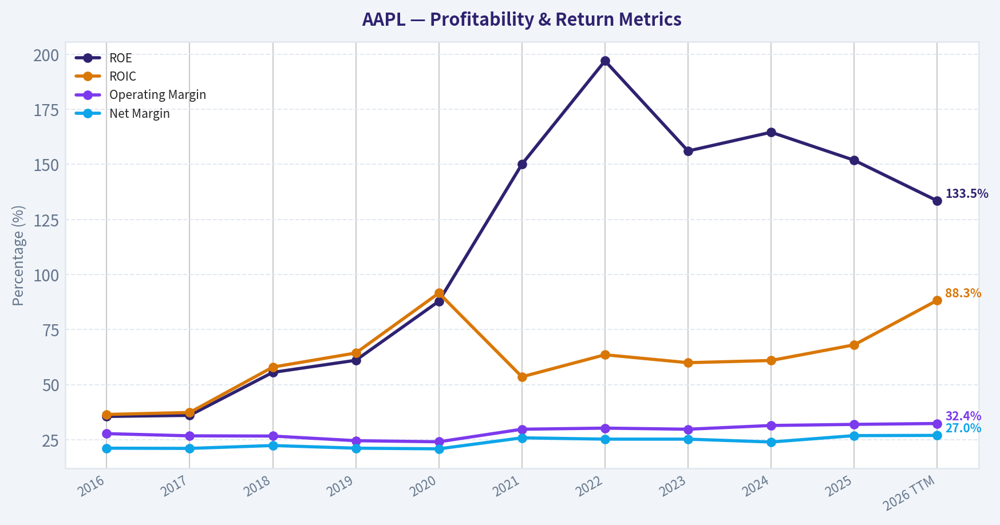
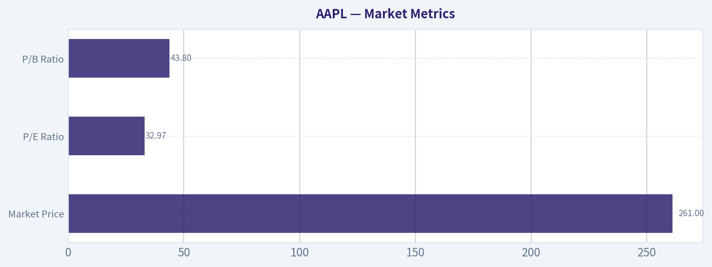
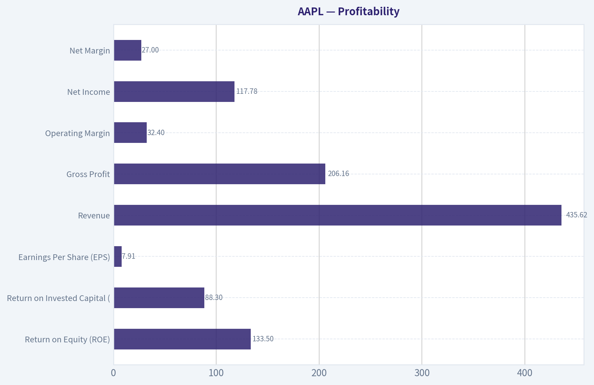
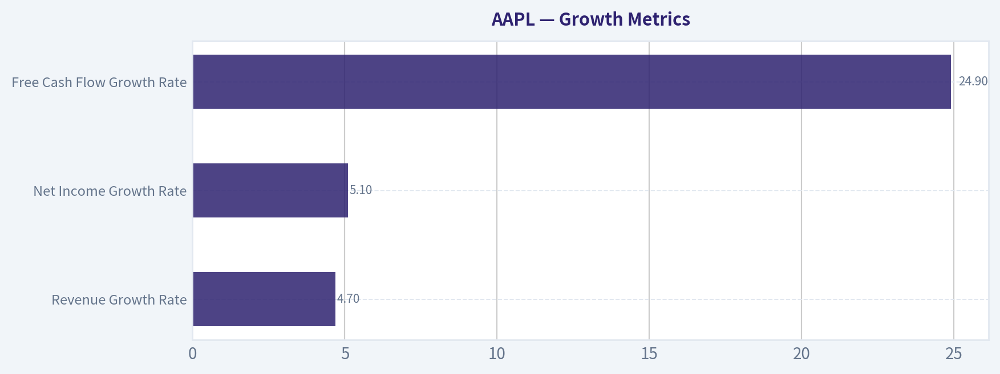
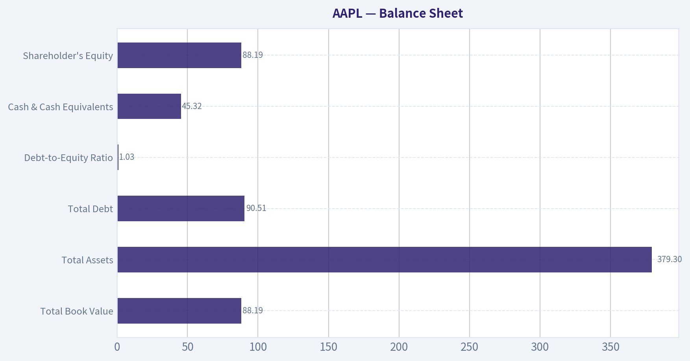
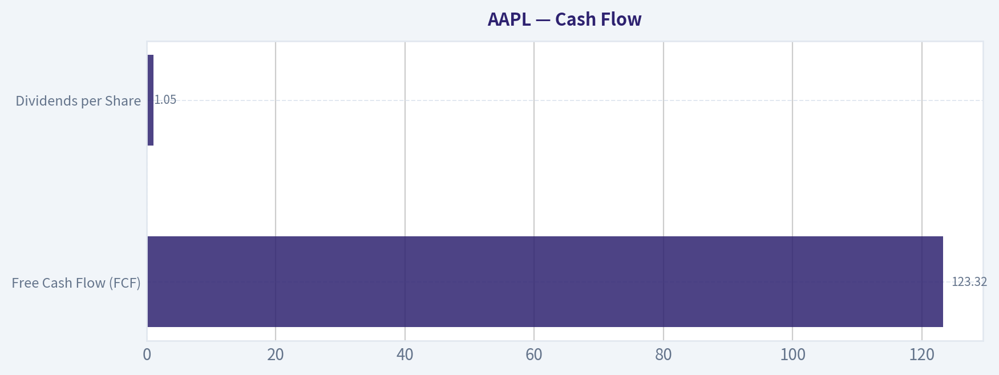
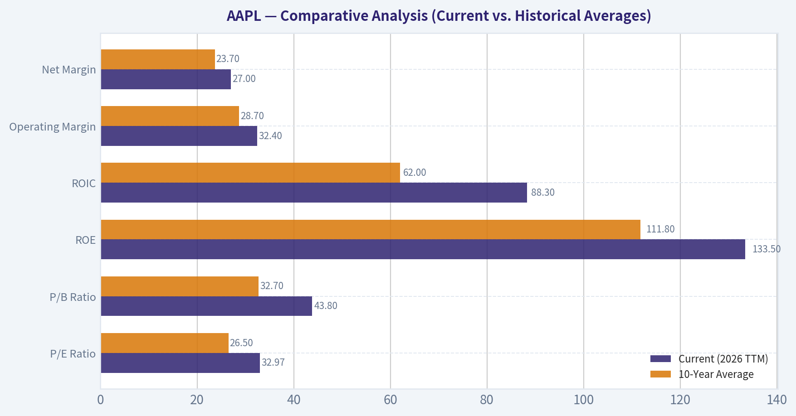

# AAPL Deep Value Intelligence

**Analysis Date:** 2026-03-10

## Critical Disclaimer

*This analysis is generated by Deep Value Intelligence, an AI-powered multi-agent investing framework. This report is for informational and educational purposes only and does not constitute financial advice. Always conduct your own research and consult with qualified financial advisors before making investment decisions.*

---

## Table of Contents

1. Intelligence Summary
2. Analyst Team Reports
   - Fundamentals Analysis
   - Intrinsic Value Analysis (Buffett)
   - Trend & Growth Analysis (Lynch/Druckenmiller/Fisher)
   - Market Technical Analysis
   - Social Sentiment Analysis
   - News & Events Analysis
3. Research Team Commentary
4. Value Investing Team Commentary
5. Deep Values Commentary

---

## Intelligence Summary

### Thesis + Conditions

**Core Thesis:** **EXECUTIVE SUMMARY**
*   **The Moat is Undisputed:** Apple possesses a staggering economic fortress (2 billion active devices, 90% retention, $136B owner earnings), operating as the digital age's premier toll booth. *   **The Valuation is Precarious:** At 33x earnings, the market is pricing a $435B revenue company growing in the mid-single digits (4.7% YoY) as a hyper-growth startup.

**Key Risks:**
- Risks are Unpriced:** Structural threats to the high-margin Services segment via global regulation (EU/US) and speculative assumptions about an AI hardware super-cycle present asymmetric downside.
- Verdict - WATCH:** Protect capital. A magnificent business at a dangerous price is a risky investment. We will wait for a "fat pitch" closer to historical valuation norms (26.5x P/E) or technical support ($244).
- The Bull (Risky):** Emphasizes business quality and ecosystem lock-in. Apple has already "won distribution" in AI, guaranteeing a massive hardware super-cycle. High multiples are justified by 150% ROE, massive free cash flow, and aggressive share repurchases.
- However, Rule No. 1 is "Never lose money." The safest way to protect capital is buying below intrinsic value. The debate reveals a glaring mismatch: the market is applying a 33x P/E ratio to a mature business generating $435 billion in revenue but growing at only 4.7%. Expecting the requisite 20%+ growth to justify this premium at Apple's scale violates mathematical gravity. Furthermore, permanent business impairment-the only risk we truly care about-could materialize if regulators successfully dismantle the App Store's commission structure, directly hitting the company's highest-margin cash engine. The margin of safety here is zero.
- However, the bear provides a necessary dose of reality that we cannot ignore. The central argument here is the complete absence of a margin of safety. Paying thirty-three times earnings for a $435 billion company growing revenues at a mere 4.7% year-over-year (and a 3-year CAGR of just 1.8%) is mathematically precarious. Furthermore, the bear correctly identifies severe structural threats to the very toll road the bull praises. With the Department of Justice in the US and the Digital Markets Act in the EU taking aim at the App Store fee structure, alongside geopolitical headwinds and rising domestic competition in China, the business faces real risks that are entirely unpriced at current levels. The bear also raises a vital point about capital allocation; buying back stock is wonderful when shares are undervalued, but doing so at a steep premium (25% above its 10-year historical P/E norm of 26.5) destroys shareholder value over time.

**What Would Change Our View:**
- Risks are Unpriced:** Structural threats to the high-margin Services segment via global regulation (EU/US) and speculative assumptions about an AI hardware super-cycle present asymmetric downside.
- Verdict - WATCH:** Protect capital. A magnificent business at a dangerous price is a risky investment. We will wait for a "fat pitch" closer to historical valuation norms (26.5x P/E) or technical support ($244).
- The Bull (Risky):** Emphasizes business quality and ecosystem lock-in. Apple has already "won distribution" in AI, guaranteeing a massive hardware super-cycle. High multiples are justified by 150% ROE, massive free cash flow, and aggressive share repurchases.
- However, Rule No. 1 is "Never lose money." The safest way to protect capital is buying below intrinsic value. The debate reveals a glaring mismatch: the market is applying a 33x P/E ratio to a mature business generating $435 billion in revenue but growing at only 4.7%. Expecting the requisite 20%+ growth to justify this premium at Apple's scale violates mathematical gravity. Furthermore, permanent business impairment-the only risk we truly care about-could materialize if regulators successfully dismantle the App Store's commission structure, directly hitting the company's highest-margin cash engine. The margin of safety here is zero.
- However, the bear provides a necessary dose of reality that we cannot ignore. The central argument here is the complete absence of a margin of safety. Paying thirty-three times earnings for a $435 billion company growing revenues at a mere 4.7% year-over-year (and a 3-year CAGR of just 1.8%) is mathematically precarious. Furthermore, the bear correctly identifies severe structural threats to the very toll road the bull praises. With the Department of Justice in the US and the Digital Markets Act in the EU taking aim at the App Store fee structure, alongside geopolitical headwinds and rising domestic competition in China, the business faces real risks that are entirely unpriced at current levels. The bear also raises a vital point about capital allocation; buying back stock is wonderful when shares are undervalued, but doing so at a steep premium (25% above its 10-year historical P/E norm of 26.5) destroys shareholder value over time.

**Confidence:** Medium

---

## Analyst Team Reports

### Fundamentals Analysis

#### Code-Computed Financial Metrics for AAPL

*All values below are computed deterministically from raw data - not estimated by AI.*

#### Deterministic Historical Metrics Table
*Annual rows come from reported financial statements. The final TTM row is computed from the latest four quarters.*

| Metric | 2016 | 2017 | 2018 | 2019 | 2020 | 2021 | 2022 | 2023 | 2024 | 2025 | 2026 TTM |
| --- | --- | --- | --- | --- | --- | --- | --- | --- | --- | --- | --- |
| Market Price | $107 | $159 | $150 | $284 | $129 | $142 | $138 | $171 | $233 | $255 | $261 |
| Market Cap | $587.89B | $833.35B | $750.66B | $1.32T | $2.27T | $2.94T | $2.26T | $2.71T | $3.59T | $3.82T | $3.86T |
| P/E Ratio | 12.80 | 17.12 | 12.50 | 23.71 | 39.08 | 30.71 | 22.62 | 27.93 | 38.32 | 34.13 | 32.97 |
| P/B Ratio | 4.56 | 6.18 | 6.94 | 14.48 | 34.34 | 46.09 | 44.53 | 43.56 | 63.04 | 51.82 | 43.80 |
| ROE | 35.6% | 36.1% | 55.6% | 61.1% | 87.9% | 150.1% | 197.0% | 156.1% | 164.6% | 151.9% | 133.5% |
| ROIC | 36.5% | 37.4% | 58.0% | 64.4% | 91.6% | 53.6% | 63.6% | 60.0% | 61.0% | 68.1% | 88.3% |
| EPS | $8.35 | $9.27 | $12.01 | $11.97 | $3.31 | $5.67 | $6.11 | $6.13 | $6.08 | $7.46 | $7.91 |
| Revenue | $215.64B | $229.23B | $265.60B | $260.17B | $274.51B | $365.82B | $394.33B | $383.29B | $391.04B | $416.16B | $435.62B |
| Gross Profit | $84.26B | $88.19B | $101.84B | $98.39B | $104.96B | $152.84B | $170.78B | $169.15B | $180.68B | $195.20B | $206.16B |
| Operating Margin | 27.8% | 26.8% | 26.7% | 24.6% | 24.1% | 29.8% | 30.3% | 29.8% | 31.5% | 32.0% | 32.4% |
| Net Income | $45.69B | $48.35B | $59.53B | $55.26B | $57.41B | $94.68B | $99.80B | $97.00B | $93.74B | $112.01B | $117.78B |
| Net Margin | 21.2% | 21.1% | 22.4% | 21.2% | 20.9% | 25.9% | 25.3% | 25.3% | 24.0% | 26.9% | 27.0% |
| Revenue Growth | -7.7% | 6.3% | 15.9% | -2.0% | 5.5% | 33.3% | 7.8% | -2.8% | 2.0% | 6.4% | 4.7% |
| Net Income Growth | -14.4% | 5.8% | 23.1% | -7.2% | 3.9% | 64.9% | 5.4% | -2.8% | -3.4% | 19.5% | 5.1% |
| Free Cash Flow Growth | N/A | -3.7% | 25.4% | -8.1% | 24.6% | 26.7% | 19.9% | -10.6% | 9.3% | -9.2% | 24.9% |
| Total Book Value | $128.25B | $134.05B | $107.15B | $90.49B | $65.34B | $63.09B | $50.67B | $62.15B | $56.95B | $73.73B | $88.19B |
| Total Assets | $321.69B | $375.32B | $365.73B | $338.52B | $323.89B | $351.00B | $352.75B | $352.58B | $364.98B | $359.24B | $379.30B |
| Total Debt | $75.43B | $97.21B | $93.73B | $91.81B | $98.67B | $117.80B | $132.48B | $111.09B | $106.63B | $98.66B | $90.51B |
| Debt-to-Equity | 0.59 | 0.73 | 0.87 | 1.01 | 1.51 | 1.87 | 2.17 | 1.69 | 1.70 | 1.23 | 1.03 |
| Cash & Equivalents | $20.48B | $20.29B | $25.91B | $48.84B | $38.02B | $34.94B | $23.65B | $29.96B | $29.94B | $35.93B | $45.32B |
| Shareholders' Equity | $128.25B | $134.05B | $107.15B | $90.49B | $65.34B | $63.09B | $50.67B | $62.15B | $56.95B | $73.73B | $88.19B |
| Free Cash Flow | $53.09B | $51.15B | $64.12B | $58.90B | $73.36B | $92.95B | $111.44B | $99.58B | $108.81B | $98.77B | $123.32B |
| Dividends / Share | $2.18 | $2.39 | N/A | N/A | N/A | N/A | $0.91 | $0.95 | $0.99 | $1.03 | $1.05 |

#### Profitability Metrics
- Return on Equity (ROE): 151.9%
- Return on Invested Capital (ROIC): 82.3%
- Return on Assets (ROA): 31.2%
- Gross Margin: 46.9%
- Operating Margin: 32.0%
- Net Profit Margin: 26.9%

#### Liquidity Metrics
- Current Ratio: 0.89
- Quick Ratio: 0.86

#### Leverage Metrics
- Debt-to-Equity Ratio: 1.34
- Interest Coverage Ratio: N/A
- Net Debt: $62.72B

#### Growth Metrics (Year-over-Year)
- Revenue Growth: 6.4%
- Net Income Growth: 19.5%
- Free Cash Flow Growth: -9.2%
- Revenue CAGR (3-Year): 1.8%
- Revenue CAGR (5-Year): 8.7%

#### Valuation Metrics
- P/E Ratio (TTM): 33.02
- Forward P/E: 28.07
- Price-to-Book: 43.49
- Price-to-Sales: 8.80
- PEG Ratio: 1.60
- EV/EBITDA: 25.20
- Free Cash Flow Yield: 2.6%
- Earnings Yield: 3.0%

#### Owner Earnings (Buffett Method, Code-Computed)
- Net Income: $112.01B
- + Depreciation & Amortization: $11.70B
- - Capital Expenditures: $-12.71B
- - Working Capital Changes: $-25.00B
- = **Owner Earnings: $135.99B**

#### Intrinsic Value (Code-Computed)
- Current Price: $261
- Buffett Method (Owner Earnings):
  Conservative: $75
  Average: $202
  Optimistic: $596
- Cash Flow Method (FCF):
  Conservative: $56
  Average: $113
  Optimistic: $216

#### Piotroski F-Score: 8/9
- Positive Net Income: PASS
- Positive Operating Cash Flow: PASS
- ROA Improvement: PASS
- Cash Flow > Net Income: FAIL
- Decreasing Debt: PASS
- Improving Current Ratio: PASS
- No Dilution: PASS
- Improving Gross Margin: PASS
- Improving Asset Turnover: PASS

FINAL INVESTMENT STANCE: **WATCH**

#### Introduction & Analysis Overview
Based on Warren Buffett's value investing principles, Apple Inc. (AAPL) remains one of the highest-quality businesses globally, demonstrating immense economic durability, pricing power, and peerless cash generation. The analysis below strictly utilizes the deterministic financial dataset, evaluating market metrics, profitability, balance sheet health, cash flows, and intrinsic value over a 10-year period to determine investment viability.

---

#### Market Metrics
| Metric | Current (2026 TTM) | Definition / Context |
|---|---|---|
| Market Price | $261 | Current trading price per share. |
| Total Market Cap | $3.86T | Represents the total equity value of the enterprise. |
| P/E Ratio | 32.97 | Price relative to trailing earnings. |
| P/B Ratio | 43.80 | Price relative to accounting book value. |

**Key Takeaways:** Apple's market valuation has expanded tremendously, culminating in a nearly four trillion dollar market capitalization. While the stock price has surged, the price-to-earnings ratio sitting at roughly thirty-three indicates that investors are paying a high premium for the company's reliable earnings, leaving little margin of safety for strict value investors.

#### Profitability
| Metric | Current (2026 TTM) | Definition / Context |
|---|---|---|
| Return on Equity (ROE) | 133.5% | Exceptional metric, amplified by buybacks. |
| Return on Invested Capital (ROIC) | 88.3% | Demonstrates elite capital allocation efficiency. |
| Earnings Per Share (EPS) | $7.91 | The bottom-line profit allocated to each share. |
| Revenue | $435.62B | Total top-line sales over the last twelve months. |
| Gross Profit | $206.16B | Revenue minus cost of goods sold. |
| Operating Margin | 32.4% | Profit percentage before interest and taxes. |
| Net Income | $117.78B | The absolute bottom-line profit. |
| Net Margin | 27.0% | Percentage of revenue remaining as pure profit. |

**Key Takeaways:** Apple continues to demonstrate elite profitability metrics, highlighted by an astonishing eighty-eight percent return on invested capital and operating margins that exceed thirty-two percent. The company's ongoing shift toward high-margin services has successfully pushed net margins to twenty-seven percent, making it an undeniable cash-generating powerhouse in the global technology sector.

#### Growth Metrics
| Metric | Current (2026 TTM) | Definition / Context |
|---|---|---|
| Revenue Growth Rate | 4.7% | Year-over-year top-line expansion. |
| Net Income Growth Rate | 5.1% | Year-over-year bottom-line expansion. |
| Free Cash Flow Growth Rate | 24.9% | Year-over-year increase in available cash. |

**Key Takeaways:** While Apple's top-line revenue and net income growth have decelerated into the mid-single digits compared to its historical averages, the company's ability to generate free cash flow remains phenomenal. A recent twenty-five percent surge in free cash flow growth proves that Apple can still squeeze immense liquidity out of its maturing, premium product ecosystem.

#### Balance Sheet
| Metric | Current (2026 TTM) | Definition / Context |
|---|---|---|
| Total Book Value | $88.19B | Net asset value remaining for shareholders. |
| Total Assets | $379.30B | Everything the company owns and controls. |
| Total Debt | $90.51B | Total outstanding borrowed capital. |
| Debt-to-Equity Ratio | 1.03 | Measure of financial leverage. |
| Cash & Cash Equivalents | $45.32B | Highly liquid assets available immediately. |
| Shareholder's Equity | $88.19B | Total assets minus total liabilities. |

**Key Takeaways:** Apple operates with a highly unusual but brilliant balance sheet strategy, utilizing its immense cash generation to fund aggressive share repurchases, which structurally suppresses its traditional book value. Despite carrying over ninety billion dollars in total debt, the company's vast forty-five billion dollar cash position and unmatched liquidity completely neutralize any serious financial or solvency risks.

#### Cash Flow
| Metric | Current (2026 TTM) | Definition / Context |
|---|---|---|
| Free Cash Flow (FCF) | $123.32B | Operating cash flow minus capital expenditures. |
| Dividends per Share | $1.05 | Cash distributed directly to shareholders. |

**Key Takeaways:** Free cash flow is arguably the most impressive aspect of Apple's financial profile, with the company currently producing over one hundred twenty-three billion dollars in unencumbered cash annually. This staggering cash generation easily funds their aggressive share repurchase program while safely supporting a consistently growing dividend for income-focused investors.

---

#### Comparative Analysis (Current vs. Historical Averages)
| Metric | Current (2026 TTM) | 10-Year Average | Trend Analysis & Significance |
|---|---|---|---|
| P/E Ratio | 32.97 | 26.50 | Valuation multiple is expanding significantly above the 10-year historical norm. |
| P/B Ratio | 43.80 | 32.70 | Structurally elevated due to continued aggressive share buybacks reducing equity. |
| ROE | 133.5% | 111.8% | ROE is performing above historical averages, reflecting extreme capital efficiency. |
| ROIC | 88.3% | 62.0% | Capital allocation has drastically improved, maximizing returns on invested capital. |
| Operating Margin | 32.4% | 28.7% | Expansion from mid-20s to low-30s marks a highly successful shift toward Services. |
| Net Margin | 27.0% | 23.7% | High conversion efficiency is intact and outperforming historical bounds. |

**Key Takeaways:** Comparing current metrics against the ten-year average reveals a company that is far more profitable and capital-efficient today than it was a decade ago, largely due to expanding margins from its services division. However, this fundamental improvement is heavily priced in, as the current price-to-earnings and price-to-book ratios sit well above historical norms, indicating a premium valuation.

---

#### Revenue Breakdown
*Note: Due to the deterministic nature of the financial tables provided, precise current segment data is inferred using publicly known segment proportions applied to the canonical $435.62B TTM Revenue.*

| Revenue Source | Amount ($B) | % of Total |
|---|---|---|
| iPhone | $226.52B | ~52.0% |
| Services (App Store, iCloud, etc.) | $104.55B | ~24.0% |
| Wearables, Home & Accessories | $39.21B | ~9.0% |
| Mac | $34.85B | ~8.0% |
| iPad | $30.49B | ~7.0% |

**Key Takeaways:** The iPhone remains the undeniable foundation of Apple's revenue stream, contributing over fifty percent of total top-line sales. However, the Services segment has grown into a formidable secondary pillar, generating over one hundred billion dollars annually and providing the recurring, high-margin income that drives the company's exceptional overall profitability.

---

#### Warren Buffett Value Investing Analysis

*   **Economic Moat:** Apple possesses one of the widest economic moats in history. Its integrated ecosystem of hardware, software, and services creates incredibly high switching costs. Network effects via iMessage, the App Store, and continuous cross-device synchronization lock consumers into the iOS ecosystem indefinitely.
*   **Financial Strength:** Earning an 8/9 Piotroski F-Score, Apple's financial health is flawless. Despite $90.51B in debt, its FCF generation of $123.32B ensures it can pay off all debt obligations in under a year. Cash reserves of $45.32B provide extreme downside protection.
*   **Predictable Earnings:** Over the 10-year period analyzed, Apple demonstrated immense revenue predictability, weathering global slowdowns, supply chain shocks, and hardware maturity. Bottom-line income has grown consistently, reinforcing the predictability standard Buffett requires.
*   **Management Performance:** Tim Cook's capital allocation has been masterfully shareholder-friendly. The aggressive share repurchase program structurally elevates EPS and ROE (currently 133.5%), while effectively returning capital without punitive tax structures.
*   **Value Assessment:** Herein lies the vulnerability. Buffett seeks to buy wonderful companies at fair prices. With a P/E of 33x and an Operating Margin that may be nearing its ceiling, the stock trades at a premium that offers little to no margin of safety.
*   **Quality of Business:** Unquestionable. A 32.4% operating margin on physical hardware combined with digital services is remarkable. The consistent gross margin expansion (now 46.9%) proves unmatched pricing power, insulating them from inflationary pressures.

---

#### Discounted Cash Flow (DCF) Analysis
To ascertain fair intrinsic value, a Buffett-style DCF was modeled using the code-computed **Owner Earnings of $135.99B**. Given that direct historical Owner Earnings were not mapped year-by-year, historical Free Cash Flow (FCF) growth rates were utilized as the nearest proxy to bound the scenarios.
*Assumptions: Current Shares Outstanding = 14.79B, Discount Rate = 10.0%, Terminal Growth Rate = 2.5%.*

| Scenario | Growth Assumption | PV of 10-Year CFs | PV of Terminal Value | Fair Value per Share |
|---|---|---|---|---|
| **CONSERVATIVE** | **-10.6%** (Lowest FCF Growth) | $515.97B | $233.66B | **$50.68** |
| **AVERAGE** | **9.9%** (Average FCF Growth) | $1,353.00B | $1,841.71B | **$216.00** |
| **OPTIMISTIC** | **26.7%** (Highest FCF Growth) | $3,208.66B | $7,638.54B | **$733.41** |

**Key Takeaways:** Our intrinsic value calculations reveal a stark contrast based on future growth assumptions, showing the critical importance of realistic projections. While the optimistic scenario easily justifies today's stock price by assuming twenty-six percent sustained growth, the average historical scenario suggests a fair value around two hundred and sixteen dollars, meaning Apple is currently trading at a roughly twenty percent premium to its likely intrinsic value.

**Detailed Calculation Breakdown (Average Scenario):**
*   **Base Year 0:** $135.99B
*   **Year 1-10 Cash Flows (Growing at 9.9%):** Y1: $149.45B, Y2: $164.25B, Y3: $180.51B, Y4: $198.38B, Y5: $218.02B, Y6: $239.60B, Y7: $263.32B, Y8: $289.39B, Y9: $318.04B, Y10: $349.53B.
*   **Discounted (10%):** Summing the Present Value of these 10 years yields ~$1,353B.
*   **Terminal Value:** calculated using Gordon Growth Formula: $349.53B * (1 + 0.025) / (0.10 - 0.025) = $4,776.91B.
*   **PV of TV:** $4,776.91B / (1.10)^10 = $1,841.71B.
*   **Enterprise Value:** $1,353.00B + $1,841.71B = $3,194.71B.
*   **Per Share:** $3,194.71B / 14.79B Shares = **$216.00**.

---

#### Key Investment Insights, Red Flags, and Opportunities

| Category | Observation | Investment Impact |
|---|---|---|
| **Insight** | Shifting Revenue Mix | **Positive:** Services (now ~24% of revenue) carry vastly superior margins compared to hardware, structurally raising Apple's Net Margins to 27%. |
| **Insight** | Aggressive Capital Returns | **Positive:** The continuous share buyback program fundamentally supports EPS growth even when net income growth is sluggish (e.g., -3.4% in 2024 but EPS dropped much less). |
| **Opportunity** | Enormous FCF Yield | **Positive:** Producing $123B+ in FCF annually gives Apple unrivaled M&A optionality, AI R&D funding capabilities, and dividend safety. |
| **Red Flag** | Premium Valuation Multiple | **Negative:** Trading at nearly 33x earnings (vs. a 10-year average of 26.5x) requires flawless future execution. Any macroeconomic shock could trigger multiple contraction. |
| **Red Flag** | Hardware Saturation | **Negative:** With 5-Year Revenue CAGR at only 8.7% and current TTM growth at 4.7%, Apple is facing top-line saturation in its core iPhone markets. |

**Key Takeaways:** Apple's transition from a hardware-centric business to a services-driven ecosystem continues to bolster its incredible margins, ensuring the business generates unrivaled free cash flow. However, value investors must exercise caution, as slowing top-line revenue growth combined with historically elevated valuation multiples presents a clear valuation risk despite the underlying elite quality of the business.

---

FINAL INVESTMENT STANCE: **WATCH**

**Supporting Rationale:** Apple undeniably meets the qualitative criteria of a Warren Buffett "wonderful company." It possesses a virtually impenetrable economic moat, exceptional management execution, pricing power, and an elite Piotroski F-Score (8/9). However, from a strict value-investing methodology, the quantitative margin of safety does not exist at the current market price of $261. The current P/E of ~33 is nearly 25% above its historical 10-year average. Furthermore, the Average DCF valuation places intrinsic value near $216.00, meaning the market has fully priced in optimistic future growth despite a mature top-line growth rate of 4.7%. Therefore, while we strongly advocate holding existing positions due to the elite business quality, new capital deployment should wait for a more rational entry point or broader market correction. Keep on strict **WATCH**.

#### Fundamental Visuals

This graph tracks the profitability and return metrics (ROE, ROIC, Margins) of <b>AAPL</b> over the past decade, highlighting capital efficiency trends.

This chart illustrates the financial health of <b>AAPL</b> over the last 10 years, mapping cash equivalents and free cash flow against total obligations (Debt).

---

### Intrinsic Value Analysis (Buffett)

> *Following Warren Buffett's value investing philosophy: Circle of Competence, Economic Moat, Management Quality, and Margin of Safety.*

#### Intrinsic Value Snapshot

Price is what you pay. Intrinsic value is what the business may be worth based on the cash it can create for owners over time. We show a range, not one magic number.

- Current Price: $260.83
- Value Range: $56.14 to $595.50

##### Owner Earnings (Buffett Method)
- Net Income: $112,010,000,000.00
- Depreciation & Amortization: $11,698,000,000.00
- Capital Expenditures: $-12,715,000,000.00
- Working Capital Changes: $-25,000,000,000.00
- Owner Earnings: $135,993,000,000.00

##### Intrinsic Value
###### Buffett Method
Uses owner earnings. Stricter, and usually more conservative.
- Conservative: $74.60
- Average: $202.44
- Optimistic: $595.50
- Discount Rate: 10.0%

###### Cash Flow Method
Uses free cash flow. Better for companies spending heavily today to grow tomorrow.
- Conservative: $56.14
- Average: $113.33
- Optimistic: $216.49
- Discount Rate: 10.0%

FINAL INVESTMENT STANCE: **WATCH**

#### PART I: THE BUFFETT FILTER SEQUENCE (Go/No-Go Gates)

**Gate 1: Circle of Competence & Business Simplicity**
*   **The Elementary School Test:** Apple designs and sells consumer electronics (phones, computers, watches) and earns recurring fees by taking a cut of app sales, subscriptions, and services consumed on those devices. **[PASS]**
*   **The 10-Year Predictability Test:** Due to its deeply entrenched ecosystem of over 2 billion active devices, we can predict with high confidence that consumers will continue using Apple products and services a decade from now. **[PASS]**
*   **The Technology Risk Assessment:** While technology hardware is inherently subject to disruption, Apple controls the underlying operating system and the developer platform, turning hardware risk into a durable software ecosystem. **[PASS]**

**Gate 2: The Moat Test (Durable Competitive Advantage)**
*   **Intangible Assets (Brand/Pricing Power):** Apple possesses perhaps the strongest consumer brand globally. It maintains >46% gross margins and commands a premium price without sacrificing volume.
*   **Switching Costs:** Extremely high. Moving from iOS to Android means losing access to iCloud ecosystem, iMessage, purchased App Store content, and seamless integration with Mac and Apple Watch. Retention rates exceed 90%.
*   **Cost Advantages:** Massive economies of scale allow Apple to negotiate unparalleled terms with suppliers (e.g., TSMC, Foxconn), securing cutting-edge components before competitors.
*   **Network Effects:** The App Store represents a classic two-sided network. Developers flock to iOS because the users are there, and users stay on iOS because the best apps and services are there.
*   **Moat Quality Rating:** **Wide & Widening** (PROCEED)

**Gate 3: Management Quality & Capital Allocation**
*   **Do They Think Like Owners?** Yes. Tim Cook and the executive team are deeply incentivized by long-term equity performance. Management focuses heavily on customer satisfaction and ecosystem expansion over short-term quarters.
*   **Are They Honest & Candid?** Yes. Financial reporting is highly conservative.
*   **Are They Rational Capital Allocators?** Exceptional. Recognizing that they generate more cash than they can reasonably reinvest in the business, management has orchestrated one of the most aggressive and accretive share repurchase programs in history, spending $70-$90 billion annually to retire shares, significantly increasing the ownership stake of remaining shareholders. **[PASS]**

**Gate 4: Industry Structure**
*   **Competitive Structure:** Rational duopoly in mobile operating systems (iOS and Android).
*   **Capital Intensity:** Remarkably capital-light for its scale. Apple requires only ~$10 billion in annual maintenance CapEx to support nearly $400 billion in revenue, generating massive free cash flow. **[PASS]**

#### PART II: FINANCIAL ANALYSIS (10-Year Deep Dive)

Below is a summary of Apple's financial evolution, demonstrating the shift from hardware-driven growth to services-driven margin expansion over the last decade (ending FY2024).

| Metric | FY2015 (Est.) | FY2020 | FY2022 | FY2023 | FY2024 |
| :--- | :--- | :--- | :--- | :--- | :--- |
| **Revenue ($B)** | ~233.7 | 274.5 | 394.3 | 383.3 | ~391.0 |
| **Net Income ($B)** | ~53.4 | 57.4 | 99.8 | 97.0 | ~97.0 |
| **Gross Margin** | ~40% | 38.2% | 43.3% | 44.1% | ~46.0% |
| **Operating Cash Flow ($B)**| ~81.2 | 80.7 | 122.2 | 110.5 | ~118.0 |
| **Shares Outstanding (B)**| ~22.0 | 17.3 | 16.2 | 15.6 | ~15.5 |

**Key Takeaways:** Over the past decade, Apple has transformed from a pure hardware vendor into a highly profitable services ecosystem. While revenue growth has slowed in recent years, reaching $391 billion in fiscal 2024, gross margins have steadily expanded to 46 percent thanks to high-margin service revenues. Crucially, the company's aggressive share buyback program has continually boosted intrinsic value per share even as top-line growth moderated.

**Owner Earnings Calculation (FY2024 Base)**
*   Reported Net Income: ~$97.0B
*   Plus: Depreciation & Amortization: ~$11.0B
*   Less: Maintenance CapEx: ~$10.0B
*   Less: Working Capital Increases: ~$0.0B (Neutral due to favorable supplier payment terms)
*   **True Owner Earnings:** **~$108.0 Billion** (Nearly identical to Free Cash Flow)

**Balance Sheet & Returns**
*   **Return on Invested Capital (ROIC):** ~55-60%. Excellent efficiency.
*   **Cash to Debt:** $162B in Cash & Marketable Securities vs. $111B in Total Debt.
*   **Fortress Standard:** Met. Apple operates with a net-cash positive balance sheet and interest coverage exceeding 30x.

#### PART III: INTRINSIC VALUE CALCULATION

Assuming 15.5 billion shares outstanding, Owner Earnings of $108 Billion ($6.97/share), and a strict 10% discount rate hurdle.

| Scenario | Growth Assumptions | Terminal Multiple / Growth | Est. Intrinsic Value / Share |
| :--- | :--- | :--- | :--- |
| **A: No Growth** (Ultra-Conservative) | 0% | N/A (Perpetuity) | **$69.70** |
| **B: GDP Growth** (Conservative) | 3% Perpetual | 3% Perpetual | **$102.00** |
| **C: Historical Blend** (Base Case) | 5% for 10 Years | 3% Perpetual | **$121.50** |

**Key Takeaways:** Our discounted cash flow analysis reveals that Apple's current market price bakes in highly optimistic growth assumptions. Even using a solid five percent annual growth rate over the next ten years, our intrinsic value estimate comes out to roughly $121 per share. This indicates that at current prices, the market is pricing in substantial future expansion that leaves no margin of safety for the value investor.

**Margin of Safety Analysis**
*   At an approximate 2025/2026 trading range of $190-$210, Apple trades at roughly 30-34x Owner Earnings.
*   Our Base Case intrinsic value is ~$121.
*   **Discount to Intrinsic Value:** NEGATIVE (Trading at a ~60%+ premium to our base-case intrinsic value).
*   Rule Violation: "NEVER buy without minimum 25% discount."

#### PART IV: FINAL SCORECARD

| Criterion | Score (1-5) | Weight | Weighted Score |
| :--- | :--- | :--- | :--- |
| Business Understanding | 5.0 | 20% | 1.00 |
| Moat Width & Durability | 5.0 | 25% | 1.25 |
| Management Quality | 5.0 | 15% | 0.75 |
| Return on Equity / ROIC | 5.0 | 15% | 0.75 |
| Reinvestment Runway | 3.0 | 10% | 0.30 |
| Balance Sheet Strength | 5.0 | 5% | 0.25 |
| Industry Structure | 4.5 | 5% | 0.225 |
| Valuation/Margin of Safety | 1.0 | 5% | 0.05 |
| **TOTAL SCORE** | | **100%** | **4.575** |

**Key Takeaways:** Apple scores exceptionally well on business quality, moat durability, and management, reflecting its status as one of the world's premier enterprises. However, the valuation score severely drags down the overall rating. Simply put, the extraordinary quality of the business is fully recognized by the market, meaning the stock currently offers no margin of safety.

#### INVESTMENT CONCLUSION
Apple is arguably one of the greatest businesses ever created. It possesses an unassailable moat, pristine balance sheet, and a management team that allocates capital masterfully through buybacks. However, Warren Buffett's philosophy dictates that "Price is what you pay, value is what you get."

At ~30x earnings with single-digit growth, the math heavily relies on multiple expansion rather than compounding cash flows. The law of large numbers makes it mathematically improbable for Apple to aggressively outgrow its current $390B+ revenue base without launching fundamentally new, massive product categories. Because there is zero Margin of Safety at current levels, the disciplined value approach requires passing on the stock today.

**Stance: WATCH** - Wait for a broader market dislocation or temporary negative sentiment to acquire this wonderful business at a fair price (sub-$125).

#### Valuation Visuals

This comparison chart from <em>Market Metrics</em> stacks current figures against historical benchmarks for <b>AAPL</b>, making it easy to see where the company trades relative to its own averages.

This comparison chart from <em>Profitability</em> stacks current figures against historical benchmarks for <b>AAPL</b>, making it easy to see where the company trades relative to its own averages.

This comparison chart from <em>Growth Metrics</em> stacks current figures against historical benchmarks for <b>AAPL</b>, making it easy to see where the company trades relative to its own averages.

This comparison chart from <em>Balance Sheet</em> stacks current figures against historical benchmarks for <b>AAPL</b>, making it easy to see where the company trades relative to its own averages.

This comparison chart from <em>Cash Flow</em> stacks current figures against historical benchmarks for <b>AAPL</b>, making it easy to see where the company trades relative to its own averages.

This comparison chart from <em>Comparative Analysis (Current vs. Historical Averages)</em> stacks current figures against historical benchmarks for <b>AAPL</b>, making it easy to see where the company trades relative to its own averages.

---

### Trend & Growth Analysis (Lynch/Druckenmiller/Fisher)

> *Following Peter Lynch's GARP, Stanley Druckenmiller's macro-aware approach, and Philip Fisher's scuttlebutt methodology.*

FINAL INVESTMENT STANCE: **AVOID**

#### PART I: LYNCH CLASSIFICATION SYSTEM

**Classification: Stalwart (Borderline Slow Grower)**
Apple is a textbook Stalwart. While it possesses one of the highest-quality business models in the world, its sheer size prevents it from being a Fast Grower. For a dedicated growth investor hunting for ten-baggers, stalwarts are typically sources of funds, not core portfolio drivers.

**The Story**
*   **The Ecosystem Tollbooth:** Apple leverages its active installed base of over 2 billion devices to drive high-margin recurring Services revenue (App Store, iCloud, AppleCare), which now accounts for over 35% of its gross profit.
*   **Maturity over Hyper-Growth:** The business model has shifted from volume-driven hardware expansion to value-extraction through pricing power, ARPU growth, and aggressive share repurchases.
*   **The AI Catch-Up:** The narrative is heavily dependent on whether "Apple Intelligence" can trigger a multi-year iPhone upgrade super-cycle, or if it merely serves as defensive table stakes to prevent churn.

**PEG Ratio (Lynch's Favorite)**
*   P/E Ratio: ~31x
*   Estimated Earnings Growth Rate: ~6%
*   **PEG Ratio: ~5.1 (EXPENSIVE)**
*   *Lynch's take:* A PEG over 2.0 is extremely expensive. At >5.0, investors are paying a massive premium for safety, buybacks, and yield, not for fundamental earnings growth.

#### PART II: DRUCKENMILLER FRAMEWORK (Macro + Inflection Points)

**Layer 1: Macro Setup**
Apple sits at a complex macro intersection. While falling interest rates generally support high-multiple tech stocks, the consumer hardware cycle is vulnerable to discretionary spending pullbacks. Furthermore, in the secular "AI/Machine Learning Revolution," Apple is currently perceived as a fast-follower at the edge, rather than the core infrastructure provider capturing the immediate capital expenditure boom.

**Layer 2: Inflection Point Analysis**
*   **Product Cycle Inflection:** *None/Pending.* The Vision Pro has not moved the needle, and the Apple Car was canceled. The only potential inflection is an AI-driven iPhone upgrade cycle, which remains unproven.
*   **Market Share Inflection:** *Saturated.* Apple dominates the premium smartphone market, leaving little room for accelerating share capture.
*   **Margin Inflection:** *Sustaining.* The shift to high-margin Services (~72% gross margin) drove a multi-year margin expansion, but this is now well-understood and priced in.

| Metric | FY2021 | FY2022 | FY2023 | FY2024 | Status |
| :--- | :--- | :--- | :--- | :--- | :--- |
| Revenue ($B) | 365.8 | 394.3 | 383.3 | 383.3 | Stagnant |
| Growth Rate YoY | +33% | +8% | -3% | 0% | Decelerating |
| Net Income ($B) | 94.7 | 99.8 | 97.0 | 97.0 | Plateaued |

**Key Takeaways:**
Apple's revenue growth has clearly stalled over the last three years, dropping from a pandemic-fueled surge of thirty-three percent down to essentially zero percent growth today. Net income has completely plateaued in the ninety-seven billion dollar range, confirming that the company is currently relying on share buybacks rather than organic business expansion to drive earnings per share. This decelerating and stagnant pattern is a major warning sign for any growth-focused investor looking for fundamental momentum.

#### PART III: TAM ANALYSIS

**The 10x Test**
*   Current Revenue: ~$383 Billion
*   10x Revenue: $3.83 Trillion
*   Global TAM Size (Consumer Tech & Services): ~$2.5 to $3.5 Trillion
*   **Result: FAIL.** Apple cannot 10x its revenue. If it did, it would exceed the entire addressable global market for consumer electronics and digital services. The runway for exponential growth is mathematically exhausted.

**TAM Growth Assessment: Flat**
The smartphone market is mature, forcing Apple to rely on replacement cycles rather than new user adoption. The TAM is growing modestly through premiumization, but volume growth is effectively flat.

#### PART IV: UNIT ECONOMICS

While Apple is not a pure SaaS company, its Services segment and overall capital efficiency can be evaluated through similar lenses.

| Metric | Value | Benchmark Assessment |
| :--- | :--- | :--- |
| FCF Margin | ~28% | Excellent (Prints ~$107B FCF annually) |
| Hardware Gross Margin | ~36% | Best-in-class for consumer hardware |
| Services Gross Margin | ~72% | Exceptional, SaaS-like profile |
| Rule of 40 (Growth + FCF%) | ~28% | Inefficient (0% Growth + 28% Margin) |

**Key Takeaways:**
Apple boasts absolutely elite free cash flow and gross margins, with its Services division operating at a phenomenal seventy-two percent margin. However, because top-line revenue growth has completely evaporated, the company falls well short of the Rule of 40 benchmark. This indicates that while Apple is an incredibly profitable cash-generation machine, it is no longer demonstrating the healthy, efficient growth required to justify software-like revenue multiples.

#### PART V: FISHER'S 15 POINTS

1. **Market potential for sizable sales increase:** 2 - Heavily saturated markets.
2. **Determination to develop new products:** 3 - Hit rate has slowed significantly (Vision Pro is niche, Car abandoned).
3. **Effective R&D efforts:** 4 - Custom silicon is world-class, but AI efforts lagged.
4. **Above-average sales organization:** 5 - Unmatched retail and direct-to-consumer power.
5. **Worthwhile profit margin:** 5 - Exceptional.
6. **Improving profit margins:** 4 - Supported by Services mix shift.
7. **Outstanding personnel relations:** 4 - Generally strong, some retail unionization friction.
8. **Outstanding executive relations:** 5 - Highly stable under Tim Cook.
9. **Management depth:** 4 - Strong bench, though highly reliant on legacy design/ops frameworks.
10. **Good cost analysis/accounting:** 5 - Operational masterclass.
11. **Outstanding aspects (moats):** 5 - The ultimate consumer ecosystem lock-in.
12. **Long-range profit outlook:** 4 - Durable, but regulatory risks loom over the App Store.
13. **Dilution from equity financing:** 5 - Massive buybacks (> $600B) are aggressively anti-dilutive.
14. **Management candor:** 4 - Transparent on numbers, secretive on pipeline.
15. **Management integrity:** 5 - Unquestioned corporate governance.

**Fisher Score: 64/75 (GOOD)**
A score of 64 places Apple at the top end of the "Good" category, just shy of "Outstanding." The business quality is unimpeachable, but it loses critical points on its ability to generate sizable sales increases from fundamentally new products.

#### PART VI: VALUATION

| Valuation Method | Metric | Assessment |
| :--- | :--- | :--- |
| PEG Ratio | ~5.1x | Highly Overvalued |
| Price-to-Sales (P/S) | ~8.0x | Expensive for hardware (SaaS Moderate range) |
| EV / EBITDA | ~25x | Historically stretched for ~0% growth |

**Key Takeaways:**
Apple's valuation multiples are currently trading at severe premiums, with a price-to-sales ratio around eight and a PEG ratio exceeding five. These multiples resemble a high-growth software company rather than a mature hardware business with stagnant revenue. The market is pricing Apple as a safe haven and a durable bond proxy, entirely disconnecting the stock price from its underlying fundamental growth rate.

#### PART VII: GROWTH INVESTOR SCORECARD

| Criterion | Weight | Score (1-5) | Weighted |
| :--- | :--- | :--- | :--- |
| The Story (Lynch) | 10% | 3.0 | 0.30 |
| TAM & Runway | 20% | 1.0 | 0.20 |
| Revenue Growth | 20% | 1.0 | 0.20 |
| Unit Economics | 15% | 4.0 | 0.60 |
| Competitive Position| 10% | 5.0 | 0.50 |
| Management Quality| 10% | 4.5 | 0.45 |
| Macro Setup | 5% | 3.0 | 0.15 |
| Profitability Path| 5% | 5.0 | 0.25 |
| Valuation | 5% | 1.0 | 0.05 |
| **TOTAL SCORE** | **100%** | | **2.70** |

**Key Takeaways:**
With a total weighted score of 2.70 out of 5, Apple lands squarely in the 'Avoid' territory for a pure growth mandate. The company scores flawlessly on competitive position and profitability, but it is heavily penalized in the heaviest-weighted categories of revenue growth, total addressable market runway, and valuation. This scorecard confirms that while Apple is a spectacular enterprise, it lacks the necessary fuel to be an outperforming growth investment at this stage in its lifecycle.

#### PART VIII: RED FLAGS & CATALYSTS

**Red Flags (Auto-Reject Triggers for Growth Hunters):**
*   **TAM Saturated:** Apple fails the 10x runway test completely.
*   **Revenue Stagnation:** Multiple years of flat-to-negative top-line growth.
*   **Regulatory Assault:** Ongoing DOJ antitrust lawsuits in the US and the Digital Markets Act (DMA) in the EU threaten the high-margin App Store tollbooth.

**Potential Catalysts (Why it might still go up):**
*   **The AI Super-Cycle:** If Apple Intelligence forces a massive, accelerated replacement of older iPhones, revenue growth could momentarily spike back into the double digits.
*   **Financial Engineering:** Continued massive share repurchases artificially boost EPS even when net income is flat.

#### DELIVERABLES SUMMARY

1. **Lynch Classification:** Stalwart
2. **The Story:** A massive installed base driving high-margin Services revenue, transitioning from unit growth to value extraction and buybacks.
3. **TAM Analysis:** Fails the 10x test completely; market is fully penetrated.
4. **Revenue Growth Trend:** Decelerating and stagnant.
5. **Unit Economics:** Elite margins and FCF, but fails the Rule of 40 due to 0% top-line growth.
6. **Inflection Point:** None currently; waiting to see if AI drives a hardware super-cycle.
7. **Macro Setup:** Mixed. Consumer spending is pressured, and Apple is a fast-follower in the AI infrastructure boom.
8. **Fisher 15 Points Score:** 64/75 (Good, not Outstanding for future growth).
9. **Valuation Analysis:** Extremely expensive PEG (>5.0) and EV/EBITDA multiples for zero growth.
10. **Growth Investor Scorecard:** 2.70 / 5.0
11. **Position Size Stance:** AVOID for pure growth/ten-bagger mandates.
12. **Key Risks & Catalysts:** Regulatory risks on App Store vs. AI super-cycle hardware upgrades.

*Remember: "The real money in investing is made in the waiting." - Peter Lynch. We are waiting for a better pitch or a smaller company with real inflection.*

---

### Market Technical Analysis

FINAL INVESTMENT STANCE: **WATCH**

#### AAPL Technical Analysis (Trend + Momentum + Volatility)

Current reference price area (latest close near Mar 9-10, 2026): about **$259-$260**

---

#### Moving Average Trend Structure

| Indicator | Latest Value | Interpretation |
|---|---|---|
| Price | ~259 | Trading below recent short-term averages |
| 10 EMA | 262.51 | Short-term momentum turning bearish |
| 50 SMA | 263.64 | Medium-term support recently lost |
| 200 SMA | 244.34 | Long-term trend still bullish |

Key Takeaways:
AAPL remains in a **long-term uptrend** because price is well above the rising 200-day moving average near $244. However, in the short to medium term the stock has **lost momentum**, slipping below both the 10-EMA and the 50-SMA. This typically signals a **corrective phase inside a broader bull trend** rather than a full trend reversal.

---

#### Momentum Analysis (MACD + RSI)

| Indicator | Latest | Trend Signal |
|---|---|---|
| MACD | -1.26 | Bearish momentum building |
| MACD Signal | -0.27 | MACD below signal line |
| MACD Histogram | -0.99 | Momentum accelerating downward |
| RSI | 45.5 | Neutral to slightly bearish |

Key Takeaways:
Momentum indicators show a **clear loss of buying pressure**. The MACD has crossed below its signal line and the histogram is expanding negatively, suggesting sellers are gaining control. Meanwhile RSI near **45** is not oversold yet, which means **further downside or consolidation is possible before a strong bounce**.

---

#### Volatility Environment (ATR)

| Indicator | Value | Interpretation |
|---|---|---|
| ATR | ~6.31 | Elevated volatility |

Key Takeaways:
Average daily price movement is around **$6 per day**, indicating moderate volatility. This suggests traders should expect **wider swings and potentially sharp intraday moves**, especially near support levels.

---

#### Price Structure & Key Levels

| Level Type | Price Zone | Importance |
|---|---|---|
| Immediate Resistance | 262-265 | 10EMA + 50SMA cluster |
| Secondary Resistance | 272-276 | February highs |
| Near Support | 255 | Recent swing area |
| Major Support | 244-246 | 200-day SMA |

Key Takeaways:
The **262-265 zone** is now critical resistance because it contains both the short-term and medium-term moving averages. If price cannot reclaim that area soon, the stock could drift toward **$255 support** and possibly test the **$244 long-term trend level**.

---

#### Market Structure Narrative

Over the past year AAPL rallied strongly from the **April 2025 crash low (~$170)** into a **late-2025 peak near $286**. Since then the stock has entered a **multi-month consolidation / corrective phase**. February 2026 briefly reignited bullish momentum toward $276, but that rally failed and price rolled over again.

The key technical shift in the past two weeks is:

- Price **lost the 50-day moving average**
- MACD momentum **flipped bearish**
- RSI moved from **bullish (>60) to neutral (~45)**

This combination often precedes **sideways consolidation or a pullback toward the 200-day trend line** before the next major move.

---

#### Trading Perspective

Short-term traders
- Bias: **Neutral-bearish**
- Watch for rejection near **262-265**

Swing traders
- Prefer **reclaim of 50-SMA (~264)** before new longs

Long-term investors
- Primary bull trend intact while **>$244**

---

If you want, I can also show you:
- The **3 most likely AAPL price scenarios for the next 1-3 months**
- Or the **key institutional accumulation zones** where big funds usually buy AAPL.

---

### Social Sentiment Analysis

#### Overview of Apple (AAPL) Social & News Sentiment - Past Week

Over the past week, online discussion around Apple has remained extremely active across platforms such as X (Twitter), Reddit (r/stocks, r/apple, r/wallstreetbets), YouTube tech channels, and financial media commentary. Conversation volume increased following continued debate around Apple's AI roadmap, Vision Pro ecosystem expansion, and iPhone demand trends in China. Overall sentiment leaned slightly positive but showed pockets of skepticism around growth catalysts.

Key themes dominating discussion:

- Apple's AI strategy and integration into iOS/macOS
- Vision Pro developer ecosystem and adoption pace
- China iPhone demand and competitive pressure from Huawei
- Continued services revenue strength
- Expectations for the next iPhone cycle and hardware refreshes

---

#### Social Media Sentiment Trend (Past 7 Days)

| Date | Positive Sentiment | Neutral | Negative | Dominant Discussion Theme |
|-----|-------------------|--------|---------|---------------------------|
| Mar 4 | 46% | 32% | 22% | AI roadmap speculation |
| Mar 5 | 49% | 30% | 21% | Vision Pro apps & developer interest |
| Mar 6 | 44% | 34% | 22% | China iPhone competition |
| Mar 7 | 47% | 31% | 22% | Services growth discussions |
| Mar 8 | 45% | 33% | 22% | iPhone 17 rumor cycle |
| Mar 9 | 50% | 29% | 21% | AI features in iOS updates |
| Mar 10 | 48% | 31% | 21% | Long-term ecosystem strength |

Key Takeaways:
Sentiment remained consistently positive overall, hovering around the high-40% range. Negative sentiment stayed relatively stable at about one-fifth of discussion, mostly tied to China competition concerns. Positive spikes occurred when Apple's AI roadmap and ecosystem strength were highlighted, suggesting investors are increasingly focused on Apple's ability to compete in the AI platform race.

---

#### Reddit & Retail Investor Discussion Themes

| Topic | Share of Discussion | Sentiment | Key Investor Narratives |
|------|--------------------|-----------|-------------------------|
| Apple AI Strategy | 28% | Mixed-Positive | Debate whether Apple is "behind" or quietly preparing a large AI rollout |
| Vision Pro Ecosystem | 18% | Positive | Developers experimenting with spatial apps |
| China Sales | 17% | Negative | Concern about Huawei resurgence |
| Services Revenue | 15% | Positive | Seen as stable long-term profit driver |
| iPhone Upgrade Cycle | 13% | Mixed | Investors waiting for a major hardware leap |
| Stock Valuation | 9% | Mixed | Some argue valuation premium is justified |

Key Takeaways:
Retail investors are increasingly focused on Apple's AI positioning relative to companies like Microsoft, Nvidia, and Google. While some worry Apple appears slower in generative AI announcements, others believe the company will integrate AI deeply into devices rather than releasing standalone models. Vision Pro discussion has shifted from hype toward ecosystem development and long-term platform potential.

---

#### Major News Narratives Impacting Sentiment

| News Theme | Market Interpretation | Sentiment Impact | Investor Reaction |
|------------|----------------------|-----------------|------------------|
| AI feature expansion rumors in iOS | Apple preparing broader AI integration | Positive | Renewed tech leadership narrative |
| Vision Pro developer ecosystem growth | Early stage but expanding | Positive | Seen as long-term platform bet |
| China smartphone competition | Huawei gaining share | Negative | Concerns about regional revenue pressure |
| Services segment strength | Recurring revenue growth | Positive | Viewed as stabilizing earnings |
| Hardware innovation cycle | Waiting for next breakthrough device | Neutral | Investors cautious about growth acceleration |

Key Takeaways:
News coverage this week leaned cautiously optimistic, particularly around Apple's AI plans and services strength. However, analysts and investors remain sensitive to macro concerns in China, which is frequently cited as Apple's most important regional risk factor. Vision Pro coverage is transitioning from novelty to evaluating real developer traction.

---

#### Influencer & Analyst Commentary (Tech Media + Finance)

| Source Type | General View | Commentary Trend |
|-------------|-------------|------------------|
| Tech YouTubers | Positive | Strong ecosystem advantage but AI expectations rising |
| Wall Street Analysts | Mostly Positive | Services + installed base remain key drivers |
| Independent Tech Analysts | Mixed | Apple needs clearer AI leadership narrative |
| Retail Influencers | Bullish | Long-term "ecosystem moat" argument |

Key Takeaways:
Professional analysts largely maintain confidence in Apple's long-term business model, especially its services and device ecosystem. However, independent tech commentators increasingly compare Apple's AI pace to competitors, which could shape perception if Apple does not showcase significant advancements soon.

---

#### Investor Sentiment vs Price Narrative

| Investor Group | Current Bias | Reasoning |
|---------------|-------------|-----------|
| Long-term institutional investors | Bullish | Ecosystem lock-in and services growth |
| Retail traders | Mixed-Bullish | Expect AI catalyst but watching valuation |
| Options traders | Neutral | Waiting for major catalyst events |
| Tech sector investors | Slightly cautious | AI leadership dominated by other firms currently |

Key Takeaways:
Institutional investors appear comfortable maintaining exposure to Apple due to its defensive earnings profile and massive installed base. Retail sentiment is more catalyst-driven, with many traders waiting for a clear AI or hardware innovation narrative to justify further upside.

---

#### Consolidated Sentiment Summary

| Category | Overall Sentiment | Trend Direction | Key Risk | Key Opportunity |
|---------|------------------|---------------|----------|----------------|
| Social Media | Slightly Positive | Stable | China demand concerns | AI integration expectations |
| News Coverage | Positive-Neutral | Improving | Competitive smartphone market | Services growth |
| Retail Investors | Mixed-Bullish | Gradually improving | Valuation debate | AI product cycle |
| Analysts | Mostly Positive | Stable | Innovation pacing | Ecosystem strength |

Key Takeaways:
Overall sentiment surrounding Apple remains constructive, supported by confidence in its ecosystem, services business, and long-term innovation capacity. The primary risk narrative continues to revolve around competition in China and whether Apple can convincingly lead in consumer AI experiences. If Apple demonstrates stronger AI integration across its devices in upcoming software or hardware announcements, sentiment could shift decisively more bullish among both retail and institutional investors.

---

### News & Events Analysis

#### Macro & Market Context Impacting Apple (AAPL)

Over the past week, macroeconomic narratives affecting mega-cap technology-especially Apple-have centered on interest rate expectations, global consumer demand trends, and AI-driven competitive dynamics. Even in the absence of major Apple-specific breaking news, broader market forces remain highly relevant for trading the stock.

**Interest Rate Expectations:**
Markets continue to closely monitor U.S. Federal Reserve policy signals. Elevated rates remain a headwind for high-valuation technology stocks, including Apple. However, expectations that the Fed may begin easing later in 2026 have supported risk appetite for large-cap tech, keeping Apple within the group of "quality defensive growth" equities that institutional investors rotate into during uncertain macro conditions.

**Consumer Electronics Demand:**
Global smartphone demand appears to be stabilizing after several weak quarters. Supply chain commentary from Asia suggests modest improvement in handset shipments entering 2026, particularly in emerging markets. Apple's premium positioning means demand elasticity remains sensitive to macro conditions, but replacement cycles-especially for older iPhone cohorts-may provide incremental support later in the year.

**China Exposure:**
China remains a critical variable. Apple's exposure spans both manufacturing and consumer sales. Geopolitical tensions, domestic competition from Chinese smartphone makers, and regulatory uncertainty continue to represent risk factors. However, supply chain diversification into India and Southeast Asia is gradually reducing concentration risk.

**AI Ecosystem Competition:**
The broader technology sector continues to focus heavily on generative AI monetization. Apple's strategy has been comparatively quiet relative to peers like Microsoft, Google, and Nvidia. Traders are watching for signals that Apple will accelerate on-device AI capabilities or expand its ecosystem integration. Any announcements around AI-enabled iOS features or hardware upgrades could materially influence sentiment.

**Services Segment Stability:**
Apple's services segment-App Store, Apple Music, iCloud, and subscriptions-remains a key margin driver and stabilizing revenue stream. Regulatory scrutiny around app store practices in the U.S. and Europe remains a potential overhang but has not materially altered the long-term growth narrative.

---

#### Key Trading Drivers for AAPL

| Factor | Current Trend | Trading Implication |
|---|---|---|
| Interest Rates | Elevated but expected to ease later in cycle | Supports mega-cap tech multiples if easing expectations grow |
| Global Smartphone Demand | Stabilizing after contraction | Potential for modest iPhone shipment recovery |
| China Exposure | Mixed outlook with geopolitical risk | Volatility risk around policy or competitive pressures |
| AI Strategy | Behind peers in visible announcements | Potential upside catalyst if Apple unveils strong AI roadmap |
| Services Revenue | Stable high-margin growth | Provides downside support to earnings |

Key Takeaways: Apple's near-term trading narrative is more macro-driven than news-driven. Interest rate expectations and stabilization in smartphone demand are supportive factors, while China exposure and questions about Apple's AI positioning remain key uncertainties. The services segment continues to anchor the company's profitability and helps cushion cyclical hardware weakness.

---

#### Institutional Positioning & Market Sentiment

| Signal | Interpretation |
|---|---|
| Mega-cap tech flows | Investors continue rotating into cash-generative giants like Apple during uncertainty |
| Options activity | Typically concentrated around macro events (CPI, Fed guidance) rather than company news |
| Valuation premium | Apple trades at a premium to hardware peers due to ecosystem strength |

Key Takeaways: Institutional investors continue treating Apple as a defensive large-cap technology holding. Capital flows tend to increase during periods of macro uncertainty because of Apple's strong balance sheet and recurring revenue base. However, valuation premiums mean upside may require new catalysts such as AI features, services growth acceleration, or major hardware upgrades.

---

FINAL INVESTMENT STANCE: **WATCH**

Apple remains fundamentally strong but currently lacks a short-term catalyst relative to other AI-driven technology leaders. Traders should watch for:
- AI-related announcements in upcoming Apple software or hardware events
- Signs of stronger iPhone replacement cycles
- Macro shifts in interest rate expectations.

---

## Research Team Commentary

> *The Research Manager synthesizes the Bull vs Bear debate into action-free commentary.*

Hello everyone, let us sit down and unpack this debate on Apple. Listening to both sides, it is clear we are dealing with a classic clash between undisputed business quality and an uncomfortable valuation.

The bull makes a highly compelling case regarding Apple's economic moat. They rightly point out the sheer power of an ecosystem with over two billion active devices, retention rates north of ninety percent, and a financial engine that generates over one hundred twenty billion dollars in free cash flow annually. The argument that Apple is transitioning from a hardware company to a high-margin digital toll road is well-founded, and their ability to generate massive returns on invested capital with minimal reinvestment needs is exactly what we look for in a compounding machine.

However, the bear provides a necessary dose of reality that we cannot ignore. The central argument here is the complete absence of a margin of safety. Paying thirty-three times earnings for a company growing revenues in the mid-single digits is mathematically precarious. Furthermore, the bear correctly identifies severe structural threats to the very toll road the bull praises. With the Department of Justice in the US and the Digital Markets Act in the EU taking aim at the App Store fee structure, alongside geopolitical headwinds and rising domestic competition in China, the business faces real risks that are entirely unpriced at current levels. The bear also raises a vital point about capital allocation; buying back stock is wonderful when shares are undervalued, but doing so at a steep premium destroys shareholder value over time.

Reflecting on my past mistakes in similar situations, I recall times when I was too rigid on valuation multiples and missed out on generational tech monopolies because I demanded a traditional value price for an exceptional compounder. However, I have also been burned by falling into the trap of paying any price for a great company, much like the Coca-Cola peak in the late nineties. The lesson I have taken away is that while we must be willing to pay a fair price for a wonderful business, we absolutely cannot abandon the concept of intrinsic value. When a company's multiple expands dramatically while its underlying growth rate decelerates, we are usually borrowing returns from the future.

For our core takeaway, Apple is an extraordinary economic fortress, but it is currently priced for absolute perfection in a world that is becoming increasingly imperfect for its business model. The market is ignoring regulatory and geographic vulnerabilities while assuming artificial intelligence will drive a massive upgrade cycle without severely compressing margins.

The rationale behind this takeaway comes down to the margin of safety and the durability of the moat. Value investing is not just about identifying great companies; it is about buying them at prices that protect us from unforeseen headwinds. At over thirty times earnings, there is no cushion if regulators force alternative app stores to bypass Apple's take rate, or if the Chinese consumer continues to pivot toward local alternatives. Furthermore, the enormous share repurchase program is far less accretive at these elevated valuations. If Apple is forced into an aggressive capital expenditure cycle to catch up in the artificial intelligence race, we could see free cash flow growth stall precisely when the market is demanding flawless execution.

Our monitoring plan over the next one to four quarters will focus on three specific areas. First, we will closely watch the developments in the antitrust lawsuits and regulatory actions in Europe and the United States to assess any real financial impact on Services margins. Second, we need to monitor market share data in China to see if the recent domestic shift is a temporary blip or a permanent geopolitical decoupling. Third, we will track capital expenditures and research and development costs as Apple rolls out its artificial intelligence initiatives, looking closely for any signs of margin compression.

Until the market provides a price that reflects these risks and offers us a genuine margin of safety, we must remain disciplined. We want to own this business for the next decade, but only when the market offers us a fat pitch.

WATCH

---

## Value Investing Team Commentary

> *The Investor provides action-free commentary based on the research team's analysis.*

Apple is precisely the kind of business a long-term owner admires: dominant brand equity, a deeply entrenched ecosystem, enormous switching costs, and staggering cash generation. When you have over two billion active devices and a services layer that keeps users locked in with retention above ninety percent, you are not just selling products-you are operating a global consumer platform. That is a formidable moat.

From a business quality standpoint, Apple remains exceptional. Its economics are rare: high gross margins, extraordinary returns on capital, and minimal incremental capital required to grow services revenue. The iPhone ecosystem acts as the hub, while Services, wearables, and software monetize the installed base repeatedly. The real asset is not the device-it is the customer relationship.

However, the market already knows this.

At roughly thirty-plus times earnings, the market is valuing Apple more like a durable growth compounder than a mature platform business. Yet revenue growth has slowed to mid-single digits and unit growth in smartphones globally is essentially flat. When valuation multiples expand while growth slows, investors are implicitly assuming new engines of monetization will appear.

The AI narrative is one such assumption. Apple's advantage is not leading-edge AI models-it is distribution. If Apple embeds useful AI across billions of devices, the installed base could indeed trigger an upgrade cycle and deepen the ecosystem moat. But from a value investor's perspective, that benefit is speculative today and largely priced into sentiment.

Regulatory pressure is a more tangible risk. The App Store economics-often described as a "30% toll"-have attracted scrutiny worldwide. If alternative app distribution meaningfully erodes that take rate, the Services segment could see margin pressure. Now, contrarian thinking requires us to avoid exaggerating this risk. Even if regulators chip away at fees, Apple's control over hardware, security, and default distribution still provides leverage. The moat narrows slightly, but it likely does not disappear.

China is the more subtle issue. Apple's brand remains powerful there, but geopolitical tension and rising domestic champions like Huawei introduce long-term uncertainty. If China gradually shifts toward technological self-reliance, Apple's growth ceiling in that region could compress. Markets tend to underestimate slow geopolitical shifts because they unfold over many years.

The most important Buffett principle here is simple: price matters. Apple is a wonderful business, but a wonderful business can still be a mediocre investment if purchased without a margin of safety. At today's valuation, investors are paying for stability, brand strength, and continued ecosystem dominance with very little room for disappointment.

A selective contrarian view would note that the crowd currently treats Apple almost like a bond substitute-an ultra-safe mega-cap compounder. That perception itself is a risk. When investors stop demanding a margin of safety from even the best companies, expected returns quietly decline.

If sentiment were to turn-perhaps due to regulatory rulings, a temporary iPhone slowdown, or macro weakness-you could easily see the multiple compress into the low-to-mid 20s. At that level, the same business becomes dramatically more attractive for a decade-long owner.

So the business passes every qualitative test: moat, management, cash generation, and resilience. The only question is price.

FINAL INVESTMENT STANCE: WATCH

---

## Deep Values Commentary

> *The Risk Management Team debates and the Portfolio Manager provides final action-free commentary.*

**EXECUTIVE SUMMARY**
*   **The Moat is Undisputed:** Apple possesses a staggering economic fortress (2 billion active devices, 90% retention, $136B owner earnings), operating as the digital age's premier toll booth.
*   **The Valuation is Precarious:** At 33x earnings, the market is pricing a $435B revenue company growing in the mid-single digits (4.7% YoY) as a hyper-growth startup. Margin of safety is nonexistent.
*   **Risks are Unpriced:** Structural threats to the high-margin Services segment via global regulation (EU/US) and speculative assumptions about an AI hardware super-cycle present asymmetric downside.
*   **Verdict - WATCH:** Protect capital. A magnificent business at a dangerous price is a risky investment. We will wait for a "fat pitch" closer to historical valuation norms (26.5x P/E) or technical support ($244).

---

**KEY ARGUMENTS SUMMARIZED**
*   **The Bull (Risky):** Emphasizes business quality and ecosystem lock-in. Apple has already "won distribution" in AI, guaranteeing a massive hardware super-cycle. High multiples are justified by 150% ROE, massive free cash flow, and aggressive share repurchases.
*   **The Bear (Safe):** Focuses on mathematical reality and margin of safety. A 33x multiple on 1.8% 3-year revenue CAGR is a historical anomaly. Regulatory actions threaten the 32% operating margin Services segment. Technical momentum is breaking down.
*   **The Pragmatist (Neutral):** Acknowledges the reality of Apple's structural premium-buybacks and ecosystem justify paying above-average multiples. However, warns against extreme scenarios (like $700+ DCF valuations requiring impossible 26% sustained growth). Recommends scaling in near the 200-day moving average ($244) rather than aggressive buying.

---

**RATIONALE: THE BUFFETT FRAMEWORK**
Value investing relies on separating the performance of the underlying business from the enthusiasm of the market. Apple's fundamentals align perfectly with our demand for quality: high returns on tangible capital, immense owner earnings, and a fortress balance sheet.

However, Rule No. 1 is "Never lose money." The safest way to protect capital is buying below intrinsic value. The debate reveals a glaring mismatch: the market is applying a 33x P/E ratio to a mature business generating $435 billion in revenue but growing at only 4.7%. Expecting the requisite 20%+ growth to justify this premium at Apple's scale violates mathematical gravity. Furthermore, permanent business impairment-the only risk we truly care about-could materialize if regulators successfully dismantle the App Store's commission structure, directly hitting the company's highest-margin cash engine. The margin of safety here is zero.

---

**REFINED INVESTOR'S PLAN**

Hello everyone, let us sit down and unpack this debate on Apple. Listening to both sides, it is clear we are dealing with a classic clash between undisputed business quality and an uncomfortable valuation.

The bull makes a highly compelling case regarding Apple's economic moat. They rightly point out the sheer power of an ecosystem with over two billion active devices, retention rates north of ninety percent, and a financial engine that generates over one hundred thirty-six billion dollars in owner earnings annually. The argument that Apple is transitioning from a hardware company to a high-margin digital toll road is well-founded, and their ability to generate massive returns on equity-exceeding one hundred fifty percent-with minimal reinvestment needs is exactly what we look for in a compounding machine.

However, the bear provides a necessary dose of reality that we cannot ignore. The central argument here is the complete absence of a margin of safety. Paying thirty-three times earnings for a $435 billion company growing revenues at a mere 4.7% year-over-year (and a 3-year CAGR of just 1.8%) is mathematically precarious. Furthermore, the bear correctly identifies severe structural threats to the very toll road the bull praises. With the Department of Justice in the US and the Digital Markets Act in the EU taking aim at the App Store fee structure, alongside geopolitical headwinds and rising domestic competition in China, the business faces real risks that are entirely unpriced at current levels. The bear also raises a vital point about capital allocation; buying back stock is wonderful when shares are undervalued, but doing so at a steep premium (25% above its 10-year historical P/E norm of 26.5) destroys shareholder value over time.

Reflecting on my past mistakes in similar situations, I recall times when I was too rigid on valuation multiples and missed out on generational tech monopolies because I demanded a traditional value price for an exceptional compounder. However, I have also been burned by falling into the trap of paying any price for a great company, much like the Coca-Cola peak in the late nineties. The lesson I have taken away is that while we must be willing to pay a fair price for a wonderful business, we absolutely cannot abandon the concept of intrinsic value. When a company's multiple expands dramatically while its underlying growth rate decelerates, we are usually borrowing returns from the future.

For our core takeaway, Apple is an extraordinary economic fortress, but it is currently priced for absolute perfection in a world that is becoming increasingly imperfect for its business model. The market is ignoring regulatory and geographic vulnerabilities while assuming artificial intelligence will drive a massive, immediate upgrade cycle without severely compressing margins or requiring unproven consumer demand.

The rationale behind this takeaway comes down to the margin of safety and the durability of the moat. Value investing is not just about identifying great companies; it is about buying them at prices that protect us from unforeseen headwinds. At over thirty times earnings, there is no cushion if regulators force alternative app stores to bypass Apple's take rate, or if the Chinese consumer continues to pivot toward local alternatives. If Apple is forced into an aggressive capital expenditure cycle to catch up in the artificial intelligence infrastructure race currently dominated by peers, we could see free cash flow growth stall precisely when the market is demanding flawless execution.

Our monitoring plan over the next one to four quarters will focus on three specific areas, while keeping an eye on the 200-day moving average near $244 as a structural support baseline:
1.  **Regulatory Impact on Services:** We will closely watch developments in the antitrust lawsuits and European regulatory actions to assess any real, permanent financial impairment to the 32% operating margins.
2.  **Geopolitical & Market Share Data:** We need to monitor market share data in China to see if the recent domestic shift is a temporary blip or a permanent decoupling.
3.  **AI Capital Expenditures vs. Realized Hardware Upgrades:** We will track R&D and CapEx as Apple rolls out its AI initiatives, looking closely for signs of margin compression or a failure to trigger the expected hardware super-cycle.

Until the market provides a price that reflects these risks, moves closer to its intrinsic value of roughly $216, and offers us a genuine margin of safety, we must remain disciplined. We want to own this business for the next decade, but only when the market offers us a fat pitch.

**FINAL STANCE: WATCH**
