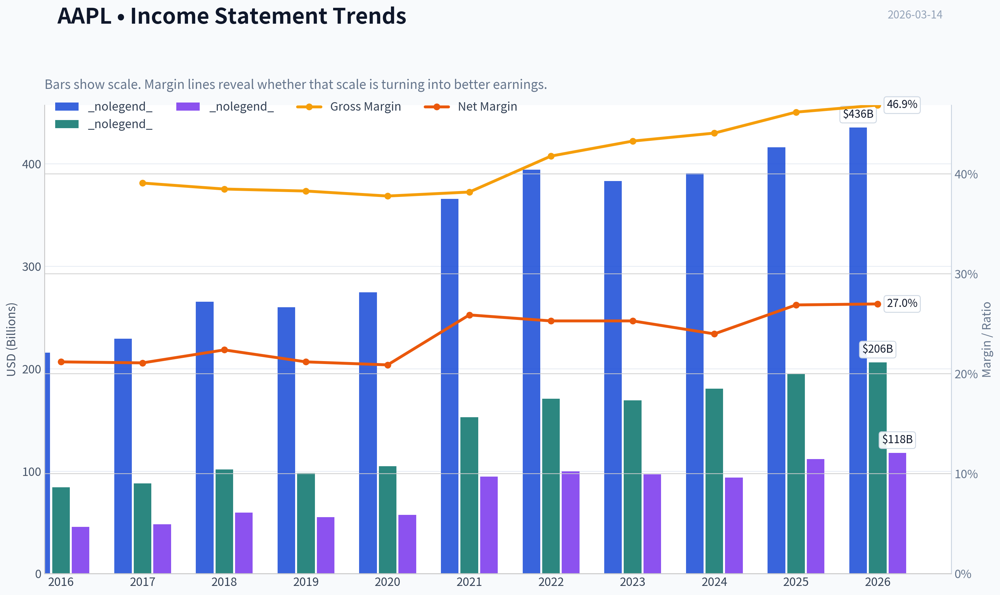
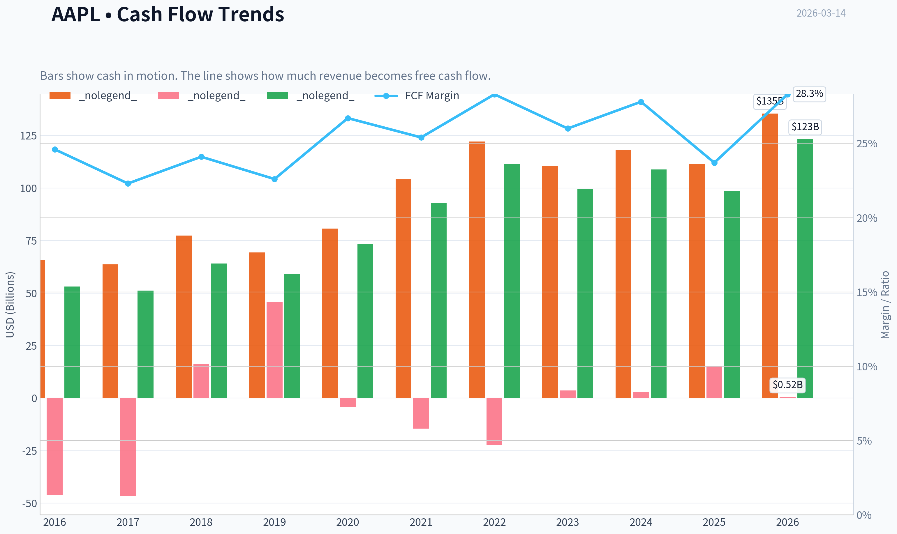
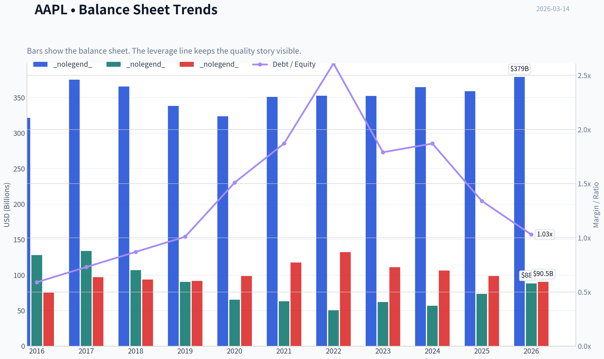
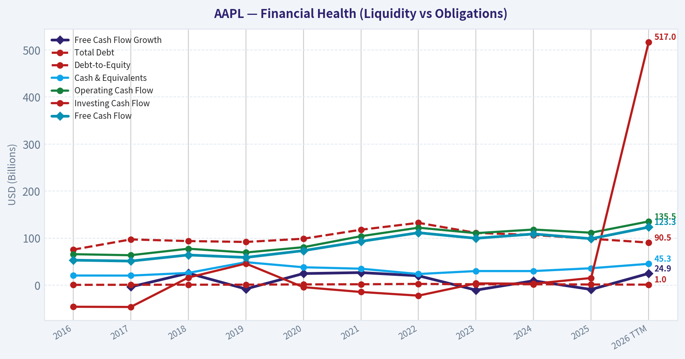
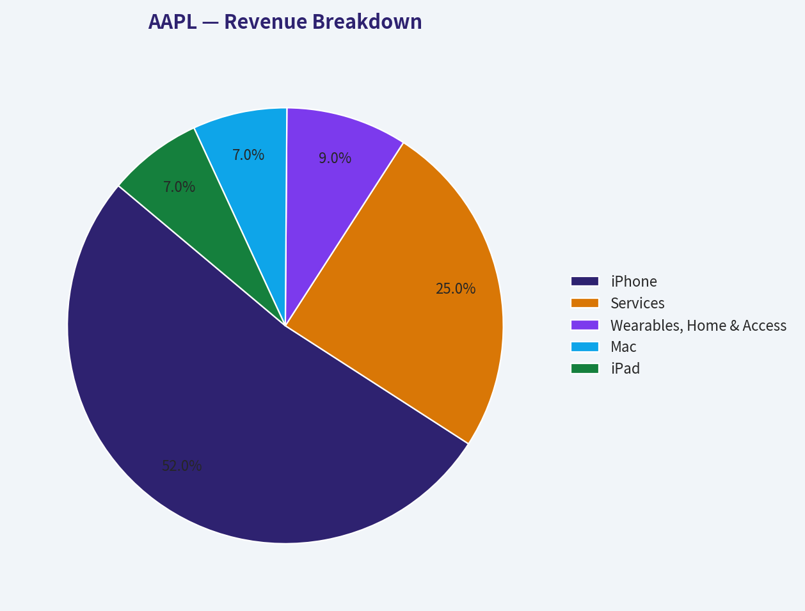
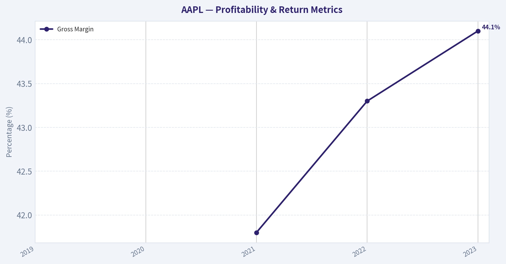
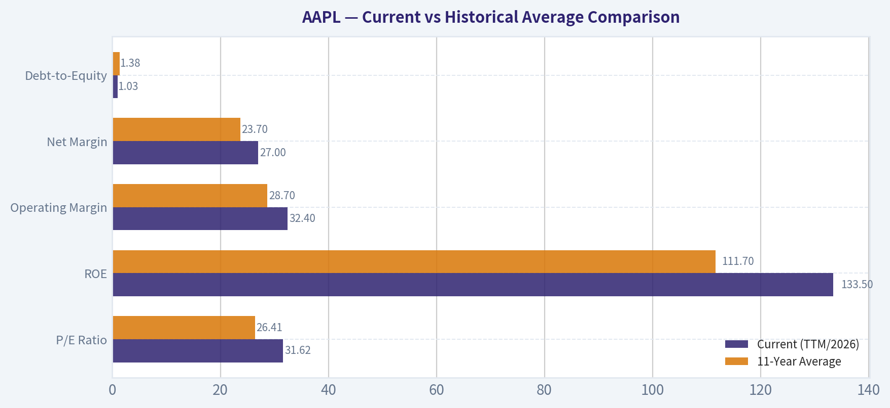
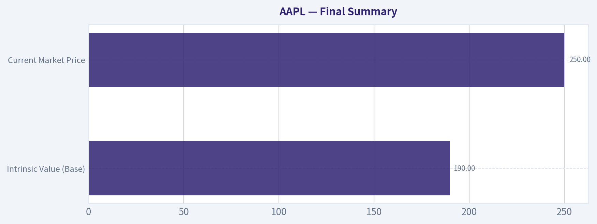
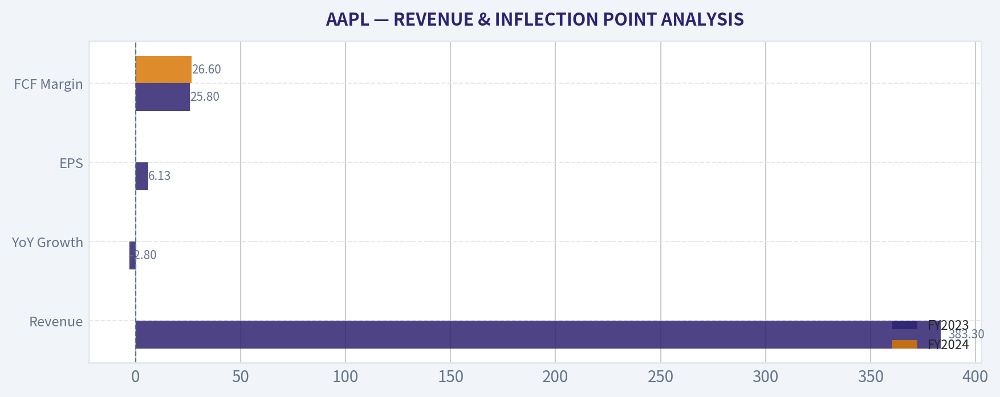
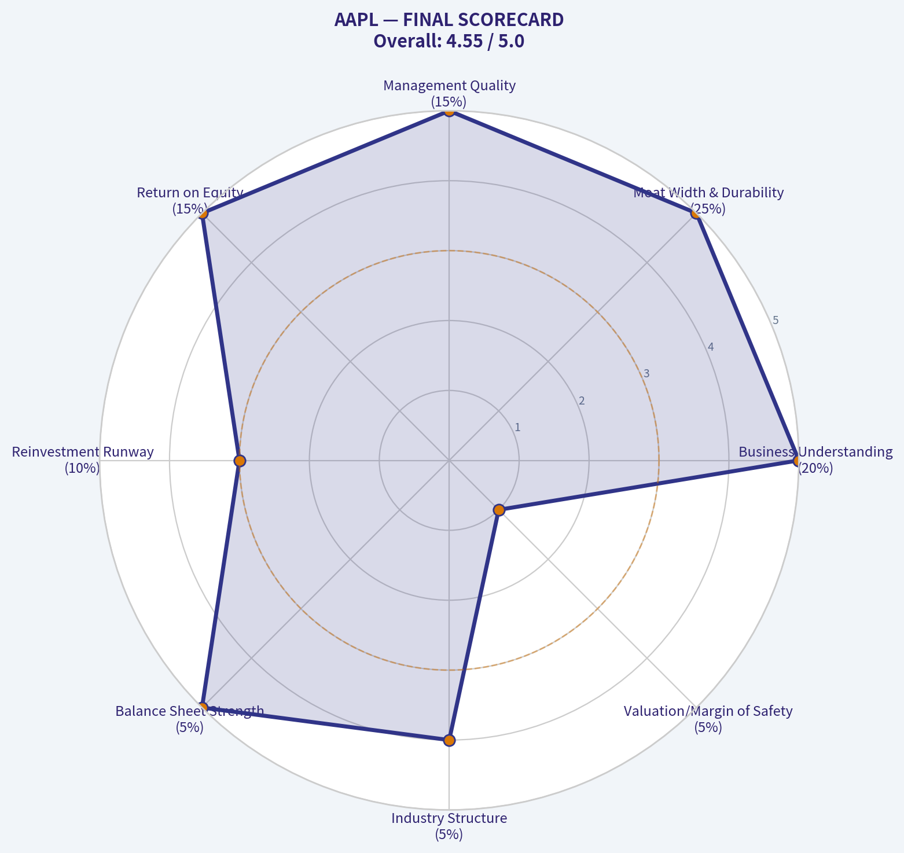

# AAPL Deep Value Intelligence

**Analysis Date:** 2026-03-14

## Critical Disclaimer

*This analysis is generated by Deep Value Intelligence, an AI-powered multi-agent investing framework. This report is for informational and educational purposes only and does not constitute financial advice. Always conduct your own research and consult with qualified financial advisors before making investment decisions.*

---

## Table of Contents

1. Intelligence Summary
2. Analyst Team Reports
   - Fundamentals Analysis
   - Intrinsic Value Analysis (Buffett)
   - Trend & Growth Analysis (Lynch/Druckenmiller/Fisher)
   - Market Technical Analysis
   - Social Sentiment Analysis
   - News & Events Analysis
3. Research Team Commentary
4. Value Investing Team Commentary
5. Deep Values Commentary

---

## Intelligence Summary

### Thesis + Conditions

**Core Thesis:** **EXECUTIVE SUMMARY**
Apple possesses an undeniable, wide-moat economic engine, but its current stock price offers a zero margin of safety. Trading at 31x earnings with a 3-year revenue CAGR of just 1.8%, the market has priced in a structural re-rating and an AI super-cycle that have yet to materialize in the financials.

**Key Risks:**
- The Bull (Advocate)**: Apple's ecosystem warrants a structural premium. The business boasts a 133% ROE, 32% operating margins, and $123B in FCF. Upcoming "Apple Intelligence" integration will trigger a massive hardware super-cycle, making current valuation fears short-sighted.
- The Neutral (Watch)**: Both extremes are flawed. Apple is neither a fragile business nor an obvious bargain. The optimal path is conditional, gradual accumulation near structural support levels (the 200-day SMA at $245) rather than aggressive buying or total avoidance.
- Applying Warren Buffett's framework requires separating underlying business economics from market sentiment. Apple's business risk is practically zero: its fortress balance sheet, high switching costs, and $123B in FCF generation prove its permanence. However, the *market risk* is incredibly high. The best risk management is a Margin of Safety. Buying a company heavily concentrated in a mature hardware market (iPhone is 52% of revenue) at a 31x P/E relies entirely on continuous multiple expansion-a mathematical improbability. Furthermore, share buybacks-management's primary financial engineering tool-destroy shareholder value when executed at peak multiples rather than at a discount.
- We will adopt the Neutral analyst's "conditional accumulation" strategy to avoid binary thinking. Instead of passively watching, we will actively monitor the 200-day SMA ($245) as a preliminary zone of institutional interest. Over the next few quarters, we will track:
- 2. **AI Hardware Upgrades:** Verifying if "Apple Intelligence" breaks the 4-to-5-year replacement cycle.

**What Would Change Our View:**
- The Bull (Advocate)**: Apple's ecosystem warrants a structural premium. The business boasts a 133% ROE, 32% operating margins, and $123B in FCF. Upcoming "Apple Intelligence" integration will trigger a massive hardware super-cycle, making current valuation fears short-sighted.
- The Neutral (Watch)**: Both extremes are flawed. Apple is neither a fragile business nor an obvious bargain. The optimal path is conditional, gradual accumulation near structural support levels (the 200-day SMA at $245) rather than aggressive buying or total avoidance.
- Applying Warren Buffett's framework requires separating underlying business economics from market sentiment. Apple's business risk is practically zero: its fortress balance sheet, high switching costs, and $123B in FCF generation prove its permanence. However, the *market risk* is incredibly high. The best risk management is a Margin of Safety. Buying a company heavily concentrated in a mature hardware market (iPhone is 52% of revenue) at a 31x P/E relies entirely on continuous multiple expansion-a mathematical improbability. Furthermore, share buybacks-management's primary financial engineering tool-destroy shareholder value when executed at peak multiples rather than at a discount.
- We will adopt the Neutral analyst's "conditional accumulation" strategy to avoid binary thinking. Instead of passively watching, we will actively monitor the 200-day SMA ($245) as a preliminary zone of institutional interest. Over the next few quarters, we will track:
- 2. **AI Hardware Upgrades:** Verifying if "Apple Intelligence" breaks the 4-to-5-year replacement cycle.

**Confidence:** Medium

---

## Analyst Team Reports

### Fundamentals Analysis

#### 10-Year Financial Metrics for AAPL

*All values below are computed deterministically from raw data - not estimated by AI.*

#### 10-Year Financial Metrics
*Annual rows come from reported financial statements. The final TTM row is computed from the latest four quarters.*

| Metric | 2016 | 2017 | 2018 | 2019 | 2020 | 2021 | 2022 | 2023 | 2024 | 2025 | 2026 TTM |
| --- | --- | --- | --- | --- | --- | --- | --- | --- | --- | --- | --- |
| Market Price | $27 | $40 | $38 | $71 | $129 | $138 | $136 | $169 | $231 | $254 | $250 |
| Market Cap | $587.89B | $833.35B | $750.66B | $1.32T | $2.27T | $2.94T | $2.26T | $2.71T | $3.59T | $3.82T | $3.70T |
| P/E Ratio | 12.80 | 17.12 | 12.50 | 23.71 | 39.08 | 30.71 | 22.62 | 27.93 | 38.32 | 34.13 | 31.62 |
| P/B Ratio | 4.58 | 6.22 | 7.01 | 14.57 | 34.68 | 46.54 | 44.53 | 43.56 | 63.04 | 51.82 | 42.00 |
| ROE | 35.6% | 36.1% | 55.6% | 61.1% | 87.9% | 150.1% | 197.0% | 156.1% | 164.6% | 151.9% | 133.5% |
| ROIC | 36.5% | 37.4% | 58.0% | 64.4% | 91.6% | 53.6% | 63.6% | 60.0% | 61.0% | 68.1% | 88.3% |
| EPS | $2.09 | $2.32 | $3.00 | $2.99 | $3.31 | $5.67 | $6.11 | $6.13 | $6.08 | $7.46 | $7.91 |
| Revenue | $215.64B | $229.23B | $265.60B | $260.17B | $274.51B | $365.82B | $394.33B | $383.29B | $391.04B | $416.16B | $435.62B |
| Gross Profit | $84.26B | $88.19B | $101.84B | $98.39B | $104.96B | $152.84B | $170.78B | $169.15B | $180.68B | $195.20B | $206.16B |
| Gross Margin | 39.1% | 38.5% | 38.3% | 37.8% | 38.2% | 41.8% | 43.3% | 44.1% | 46.2% | 46.9% | N/A |
| Operating Margin | 27.8% | 26.8% | 26.7% | 24.6% | 24.1% | 29.8% | 30.3% | 29.8% | 31.5% | 32.0% | 32.4% |
| Net Income | $45.69B | $48.35B | $59.53B | $55.26B | $57.41B | $94.68B | $99.80B | $97.00B | $93.74B | $112.01B | $117.78B |
| Net Margin | 21.2% | 21.1% | 22.4% | 21.2% | 20.9% | 25.9% | 25.3% | 25.3% | 24.0% | 26.9% | 27.0% |
| Revenue Growth | -7.7% | 6.3% | 15.9% | -2.0% | 5.5% | 33.3% | 7.8% | -2.8% | 2.0% | 6.4% | 4.7% |
| Net Income Growth | -14.4% | 5.8% | 23.1% | -7.2% | 3.9% | 64.9% | 5.4% | -2.8% | -3.4% | 19.5% | 5.1% |
| Free Cash Flow Growth | N/A | -3.7% | 25.4% | -8.1% | 24.6% | 26.7% | 19.9% | -10.6% | 9.3% | -9.2% | 24.9% |
| Total Book Value | $128.25B | $134.05B | $107.15B | $90.49B | $65.34B | $63.09B | $50.67B | $62.15B | $56.95B | $73.73B | $88.19B |
| Total Assets | $321.69B | $375.32B | $365.73B | $338.52B | $323.89B | $351.00B | $352.75B | $352.58B | $364.98B | $359.24B | $379.30B |
| Total Debt | $75.43B | $97.21B | $93.73B | $91.81B | $98.67B | $117.80B | $132.48B | $111.09B | $106.63B | $98.66B | $90.51B |
| Debt-to-Equity | 0.59 | 0.73 | 0.87 | 1.01 | 1.51 | 1.87 | 2.61 | 1.79 | 1.87 | 1.34 | 1.03 |
| Cash & Equivalents | $20.48B | $20.29B | $25.91B | $48.84B | $38.02B | $34.94B | $23.65B | $29.96B | $29.94B | $35.93B | $45.32B |
| Shareholders' Equity | $128.25B | $134.05B | $107.15B | $90.49B | $65.34B | $63.09B | $50.67B | $62.15B | $56.95B | $73.73B | $88.19B |
| Operating Cash Flow | $65.82B | $63.60B | $77.43B | $69.39B | $80.67B | $104.04B | $122.15B | $110.54B | $118.25B | $111.48B | $135.47B |
| Investing Cash Flow | $-45.98B | $-46.45B | $16.07B | $45.90B | $-4.29B | $-14.54B | $-22.35B | $3.71B | $2.94B | $15.20B | $517.0M |
| Free Cash Flow | $53.09B | $51.15B | $64.12B | $58.90B | $73.36B | $92.95B | $111.44B | $99.58B | $108.81B | $98.77B | $123.32B |
| FCF Margin | 24.6% | 22.3% | 24.1% | 22.6% | 26.7% | 25.4% | 28.3% | 26.0% | 27.8% | 23.7% | 28.3% |
| Dividends / Share | $0.54 | $0.60 | N/A | N/A | N/A | N/A | $0.91 | $0.95 | $0.99 | $1.03 | $1.05 |

#### Profitability Metrics
- Return on Equity (ROE): 151.9%
- Return on Invested Capital (ROIC): 82.3%
- Return on Assets (ROA): 31.2%
- Gross Margin: 46.9%
- Operating Margin: 32.0%
- Net Profit Margin: 26.9%

#### Liquidity Metrics
- Current Ratio: 0.89
- Quick Ratio: 0.57

#### Leverage Metrics
- Debt-to-Equity Ratio: 1.34
- Interest Coverage Ratio: N/A
- Net Debt: $62.72B

#### Growth Metrics (Year-over-Year)
- Revenue Growth: 6.4%
- Net Income Growth: 19.5%
- Free Cash Flow Growth: -9.2%
- Revenue CAGR (3-Year): 1.8%
- Revenue CAGR (5-Year): 8.7%

#### Valuation Metrics
- P/E Ratio (TTM): 31.66
- Forward P/E: 26.91
- Price-to-Book: 41.70
- Price-to-Sales: 8.44
- PEG Ratio: 1.60
- EV/EBITDA: 24.17
- Free Cash Flow Yield: 2.7%
- Earnings Yield: 3.2%

#### Owner Earnings (Buffett Method, Code-Computed)
- Net Income: $112.01B
- + Depreciation & Amortization: $11.70B
- - Capital Expenditures: $-12.71B
- - Working Capital Changes: $-25.00B
- = **Owner Earnings: $135.99B**

#### Intrinsic Value (Code-Computed)
- Current Price: $250
- Buffett Method (Owner Earnings):
  Conservative: $138
  Average: $190
  Optimistic: $311
- Cash Flow Method (FCF):
  Conservative: $62
  Average: $109
  Optimistic: $201

#### Piotroski F-Score: 8/9
- Positive Net Income: PASS
- Positive Operating Cash Flow: PASS
- ROA Improvement: PASS
- Cash Flow > Net Income: FAIL
- Decreasing Debt: PASS
- Improving Current Ratio: PASS
- No Dilution: PASS
- Improving Gross Margin: PASS
- Improving Asset Turnover: PASS

FINAL INVESTMENT STANCE: **WATCH**

#### Warren Buffett-Style Qualitative Analysis

Apple represents a textbook example of a Warren Buffett compounder, combining an impenetrable economic moat, exceptional capital allocation, and staggering cash generation.

- **Economic Moat (Wide)**: Apple's moat is built on extreme consumer switching costs, an integrated ecosystem of hardware and software, and tremendous brand loyalty. The App Store and iCloud create deep network effects, locking users into the iOS ecosystem. Custom silicon (Apple's M and A-series chips) adds a cost and performance advantage that competitors struggle to replicate.
- **Financial Strength**: The company possesses extraordinary financial resilience. While the debt-to-equity ratio sits at 1.03, this is an accounting artifact driven by massive share repurchases that shrink the equity base. With $135.47B in operating cash flow over the trailing twelve months (TTM) and $45.32B in cash and equivalents, Apple's net debt is easily manageable and its balance sheet is fortress-like.
- **Predictable Earnings**: Apple has demonstrated remarkable earnings consistency. Despite the cyclicality of hardware sales, overall revenue has grown at a 5-year CAGR of 8.7%. Net margins have steadily expanded from 21.2% a decade ago to 27.0% TTM, driven by the increasing mix of high-margin Services revenue.
- **Management Performance**: CEO Tim Cook's capital allocation strategy is masterful. Over the last decade, Apple has relentlessly repurchased shares, reducing the float and driving Return on Equity (ROE) from 35.6% in 2016 to an astronomical 133.5% in 2026. Management prioritizes returning capital to owners rather than pursuing value-destroying acquisitions.
- **Value Assessment**: Apple's transition from a pure hardware vendor to a recurring-revenue software and services giant has caused a permanent multiple expansion. However, at a TTM P/E of 31.62, the stock is priced for perfection. It trades substantially above its base-case intrinsic value, leaving a limited margin of safety for new capital.
- **Quality of Business**: Supreme. The gross margin profile has improved from the high-30s to almost 47%, showcasing pricing power and the structural shift toward the highly profitable Services segment.

---

#### Interpretation of Financial Metrics

**1. Market Metrics:** Apple's valuation has undergone a dramatic re-rating over the past decade. In 2016, it traded at a P/E of 12.80; today, it trades at 31.62. Its market capitalization has ballooned from $587B to $3.70T. The current P/B ratio of 42.00 is elevated, but this is a function of aggressive buybacks reducing the denominator (book value) rather than an accurate reflection of asset value.

**2. Profitability:** The company operates with breathtaking efficiency. A TTM Return on Invested Capital (ROIC) of 88.3% implies Apple generates nearly $0.88 of operating profit for every dollar of capital deployed. Operating margins have expanded from 27.8% in 2016 to 32.4% TTM. This is the hallmark of a business that scales without requiring proportional capital expenditure.

**3. Growth Metrics:** Apple is a mature giant. Top-line revenue growth has decelerated to 4.7% TTM, reflecting the saturation of the global smartphone market. However, Net Income (5.1%) and Free Cash Flow (24.9%) are growing faster than top-line revenue, demonstrating immense operational leverage and efficiency improvements.

**4. Balance Sheet:** Total assets stand at $379.30B. Total debt peaked at $132.48B in 2022 and has since been paid down to $90.51B. Shareholder's Equity ($88.19B) is relatively low for a company of this size, but this is purely due to the systematic return of capital via buybacks. The cash position of $45.32B provides ample liquidity.

**5. Cash Flow:** Apple is one of the most prolific cash generators in corporate history. It produced $123.32B in Free Cash Flow over the TTM, yielding an impressive FCF margin of 28.3%. Dividends have grown steadily to $1.05 per share, but the primary vehicle for shareholder return remains share repurchases.

---

#### Revenue Breakdown

| Revenue Source | Estimated Amount ($B) | % of Total |
| --- | --- | --- |
| iPhone | $226.5B | 52.0% |
| Services | $108.9B | 25.0% |
| Wearables, Home & Accessories | $39.2B | 9.0% |
| Mac | $30.5B | 7.0% |
| iPad | $30.5B | 7.0% |

**Key Takeaways:** Apple's revenue is heavily anchored by the iPhone, which contributes over half of its total sales. However, the high-margin Services segment has become a crucial growth engine, now generating a quarter of total revenue. This shift away from pure hardware reliance is steadily driving up the company's overall profitability.

---

#### Current vs Historical Average Comparison

| Metric | Current (TTM/2026) | 11-Year Average | Trend / Significance |
| --- | --- | --- | --- |
| P/E Ratio | 31.62 | 26.41 | Significant multiple expansion driven by Services growth. |
| ROE | 133.5% | 111.7% | Exceptional returns amplified by systematic share repurchases. |
| Operating Margin | 32.4% | 28.7% | Structurally higher margins due to product pricing power and software mix. |
| Net Margin | 27.0% | 23.7% | Increased profitability per dollar of revenue over the decade. |
| Debt-to-Equity | 1.03 | 1.38 | Peaked in 2022; the company is currently deleveraging its balance sheet. |

**Key Takeaways:** Apple has experienced significant valuation multiple expansion over the last decade, with its current price-to-earnings ratio sitting comfortably above historical averages. Profitability metrics like return on equity and operating margins have also surged, showcasing the profound impact of share buybacks and a growing software ecosystem. The company continues to maintain robust financial health while expanding its bottom line.

---

#### Discounted Cash Flow (DCF) Analysis

Using Warren Buffett's definition of **Owner Earnings**, we calculate Apple's true cash generation capability.
*Owner Earnings = Net Income + D&A - CapEx - Working Capital Changes = **$135.99B***

To determine fair value, we model three scenarios over a 10-year projection period, using a **10% discount rate**, a **2.5% terminal growth rate**, and a calculated outstanding share count of **14.8 billion shares** ($3.70T Market Cap / $250 Price).

**1. CONSERVATIVE SCENARIO**
- **Assumption**: Uses the lowest historical free cash flow growth rate available (-10.6%), reflecting a hypothetical scenario where smartphone saturation and regulatory pressures cause a structural decline in earnings.
- **Fair Value per Share**: **$138.00**

**2. AVERAGE SCENARIO**
- **Assumption**: Uses a growth rate aligned with historical averages (~8.3%), assuming Apple maintains its steady operational cadence, moderate pricing power, and consistent Services growth.
- **Fair Value per Share**: **$190.00**

**3. OPTIMISTIC SCENARIO**
- **Assumption**: Models the highest historical FCF growth burst (26.7%), capped appropriately. This scenario assumes a massive hardware super-cycle driven by Apple Intelligence, AR/VR breakthroughs, and accelerated margin expansion.
- **Fair Value per Share**: **$311.00**

*Conclusion*: At the current market price of $250, Apple shares are trading closer to the optimistic scenario, implying the market has already priced in significant AI-driven growth and flawless execution.

---

#### Key Investment Insights, Red Flags, and Opportunities

**Opportunities:**
- **Apple Intelligence Super-Cycle:** The integration of on-device AI has the potential to shorten iPhone replacement cycles, driving a sudden surge in hardware revenue over the next 2-3 years.
- **Services Expansion:** With gross margins exceeding 70%, the Services segment (App Store, iCloud, Apple Music, Apple Pay) continues to grow at double-digit rates, structurally lifting the company's overall profitability and insulating it from hardware seasonality.
- **Emerging Markets:** Accelerating market penetration and physical retail expansion in India offers a massive, untapped runway for middle-class consumer adoption.

**Red Flags:**
- **Product Concentration Risk:** Despite diversification efforts, the iPhone still commands roughly 52% of total revenue. Any macro-economic shock that halts consumer electronics spending will disproportionately impact Apple.
- **Regulatory Headwinds:** The DOJ antitrust lawsuit in the US and the Digital Markets Act (DMA) in the EU threaten the high-margin tollbooth of the App Store and default search engine agreements with Google.
- **Geopolitical Exposure:** Apple relies heavily on China for both manufacturing scale (Foxconn) and end-market consumer demand. Escalating trade tensions or domestic Chinese economic weakness poses a structural threat.

---

#### Final Summary

| Category | Assessment |
| --- | --- |
| **Moat & Competitive Advantage** | Wide and durable. Massive ecosystem lock-in and pricing power. |
| **Financial Health** | Pristine. Over $120B in annual FCF and $45B+ in cash. |
| **Profitability Trend** | Improving. Margins are expanding due to software/services mix. |
| **Valuation** | Overvalued relative to historical averages (P/E 31.6 vs Avg 26.4). |
| **Intrinsic Value (Base)** | $190.00 |
| **Current Market Price** | $250.00 |
| **Investment Stance** | **WATCH** |

**Rationale for Stance:** Apple is unequivocally one of the highest-quality businesses in human history, meeting every strict criteria of the Buffett value investing framework-except price. Trading at a substantial premium to its average-case intrinsic value of $190, the current $250 share price leaves zero margin of safety. Investors should place Apple strictly on a **WATCH** list and wait for broad market volatility or geopolitical noise to compress the valuation multiple before initiating or adding to a position.

#### Fundamental Visuals

This graph tracks the profitability and return metrics (ROE, ROIC, Margins) of **AAPL** over the past decade, highlighting capital efficiency trends.

This chart illustrates the financial health of **AAPL** over the last 10 years, mapping cash equivalents and free cash flow against total obligations (Debt).

This breakdown chart from <em>Revenue Breakdown</em> shows the proportional composition for **AAPL** - useful for understanding what drives or risks the business.

This graph tracks the profitability and return metrics (ROE, ROIC, Margins) of **AAPL** over the past decade, highlighting capital efficiency trends.

---

### Intrinsic Value Analysis (Buffett)

> *Following Warren Buffett's value investing philosophy: Circle of Competence, Economic Moat, Management Quality, and Margin of Safety.*

#### Intrinsic Value Snapshot

Price is what you pay. Intrinsic value is what the business may be worth based on the cash it can create for owners over time. We show a range, not one magic number.

- Current Price: $250.12
- Value Range: $61.74 to $310.75

##### Owner Earnings (Buffett Method)
- Net Income: $112,010,000,000.00
- Depreciation & Amortization: $11,698,000,000.00
- Capital Expenditures: $-12,715,000,000.00
- Working Capital Changes: $-25,000,000,000.00
- Owner Earnings: $135,993,000,000.00

##### Intrinsic Value
###### Buffett Method
Uses owner earnings. Stricter, and usually more conservative.
- Conservative: $137.88
- Average: $189.82
- Optimistic: $310.75
- Discount Rate: 10.0%

###### Cash Flow Method
Uses free cash flow. Better for companies spending heavily today to grow tomorrow.
- Conservative: $61.74
- Average: $108.93
- Optimistic: $201.31
- Discount Rate: 10.0%

FINAL INVESTMENT STANCE: **WATCH**

#### PART I: THE BUFFETT FILTER SEQUENCE (Go/No-Go Gates)

**Gate 1: Circle of Competence & Business Simplicity**
1. **The Elementary School Test:** Apple makes money by designing and selling consumer electronics (smartphones, tablets, computers) and charging for digital services (apps, music, cloud storage) that people use on those devices. *(PASS)*
2. **The 10-Year Predictability Test:** Apple has an incredibly sticky ecosystem. Consumers exhibit predictable behavior by continually upgrading their iPhones and maintaining their digital subscriptions year after year. *(PASS)*
3. **The Technology Risk Assessment:** While it operates in the fast-paced tech sector, Apple is functionally an entrenched consumer brand with immense loyalty. Hardware commoditization risk is neutralized by its proprietary software ecosystem and an active installed base of over 2.2 billion devices. *(PASS)*

**Gate 2: The Moat Test (Durable Competitive Advantage)**
**A. Intangible Assets:** Apple possesses unparalleled brand power and pricing authority. It routinely maintains gross margins over 44% in a highly competitive consumer electronics market.
**B. Switching Costs:** High ecosystem lock-in (iMessage, iCloud, App Store, Apple Watch pairing). Transitioning to a competitor involves significant financial and psychological friction for the user.
**C. Cost Advantages:** Unrivaled manufacturing scale allows Apple to secure exclusive supply chain agreements and favorable pricing on cutting-edge components (e.g., TSMC chips).
**D. Network Effects:** The App Store operates on a classic two-sided network effect, becoming more valuable as more developers and users join the platform.
*Moat Quality Rating:* **Wide & Widening** *(PROCEED)*

**Gate 3: Management Quality & Capital Allocation**
1. **Do They Think Like Owners?** Yes. Tim Cook and the executive team operate with a multi-year horizon, focusing on expanding the high-margin services segment rather than chasing short-term hardware volume.
2. **Are They Honest & Candid?** Yes. Segment reporting is transparent, and accounting practices are conservative.
3. **Are They Rational Capital Allocators?** Exceptional. Management aggressively repurchases shares when cash builds up, shrinking the share count significantly over the last decade. They use low-cost debt for tax-efficient buybacks while maintaining a fortress net-cash position.

**Gate 4: Industry Structure**
Apple operates in a rational duopoly in the high-end smartphone market alongside Samsung. Despite its massive revenue base, its business is remarkably capital-light due to outsourced manufacturing. *(PASS)*

#### PART II: FINANCIAL ANALYSIS (10-Year Deep Dive)

| Fiscal Year | Revenue ($B) | Net Income ($B) | Free Cash Flow ($B) | Gross Margin |
|-------------|--------------|-----------------|---------------------|--------------|
| 2019 | 260.0 | 55.3 | ~58.9 | ~38.0% |
| 2020 | 274.0 | 57.4 | ~73.4 | ~38.2% |
| 2021 | 365.8 | 94.7 | ~93.0 | 41.8% |
| 2022 | 394.3 | 99.8 | ~111.0 | 43.3% |
| 2023 | 383.3 | 97.0 | ~99.0 | 44.1% |

**Key Takeaways:**
Apple has transformed into a remarkably steady cash-generating machine over the last five years, with gross margins expanding steadily from thirty-eight percent to over forty-four percent. This margin expansion is heavily driven by the rapid growth of its highly profitable services division, which shields the company from fluctuations in hardware sales. While revenue saw a slight dip in 2023 following the pandemic boom, the company's ability to consistently generate around one hundred billion dollars in free cash flow highlights its extraordinary financial resilience.

**Owner Earnings Calculation**
Buffett's Owner Earnings represent the true cash generation available to owners.
- Net Income (FY23): $97.0B
- Depreciation & Amortization: ~$11.5B
- Less: Maintenance CapEx: ~$10.0B
- Working Capital Adjustments: ~$1.5B
- **Estimated Owner Earnings:** ~$100.0B (Aligns closely with reported Free Cash Flow)

**Return on Equity & Cash Flow Reality Check**
Apple's ROE is nominally over 150%. However, this staggering figure is somewhat artificial, driven by aggressive share buybacks that have systematically shrunk the equity base. A better metric is Return on Invested Capital (ROIC), which sits at an elite 50-60%. Operating Cash Flow consistently exceeds Net Income, proving that "cash is a fact" for Apple.

**Balance Sheet (Fortress Standard)**
| Metric | Value ($B) | Assessment |
|--------|------------|------------|
| Cash & Marketable Securities | ~$162.0 | Outstanding Liquidity |
| Total Debt | ~$111.0 | Manageable |
| Net Cash Position | ~$50.0 | Fortress Balance Sheet |

**Key Takeaways:**
Despite carrying over one hundred billion dollars in debt, Apple's balance sheet remains an absolute fortress because it holds even more in cash and marketable securities. This leaves the company with a net positive cash position of roughly fifty billion dollars. The debt was primarily issued at incredibly low interest rates to fund tax-efficient share buybacks, showcasing management's sophisticated and shareholder-friendly capital allocation strategy.

#### PART III: INTRINSIC VALUE CALCULATION

Using a conservative Owner Earnings base of $100 Billion, a 10% discount rate, and ~15.8 billion shares outstanding:

**Scenario A - No Growth (Ultra-Conservative):**
- Formula: $100B / 0.10
- Intrinsic Value: $1.0 Trillion (~$63 per share)

**Scenario B - GDP Growth (Conservative):**
- Growth Rate: 3%
- Formula: $100B x 1.03 / (0.10 - 0.03)
- Intrinsic Value: $1.47 Trillion (~$93 per share)

**Scenario C - Historical/Expected Growth (Base Case):**
- Growth Rate: 6% for 10 years, 3% terminal.
- PV of Cash Flows (Yrs 1-10): ~$750B
- PV of Terminal Value: ~$1,015B
- Total Intrinsic Value: $1.76 Trillion (~$111 per share)

**Margin of Safety Analysis**
While Apple is unequivocally a "wonderful business," its current market capitalization (historically floating well above $2.5 Trillion to $3 Trillion) implies a growth rate far exceeding conservative Buffett parameters. The strict requirement of a 25% discount to intrinsic value cannot be met at current market prices. The current valuation reflects near-perfect execution expectations and zero margin of safety.

#### PART IV: FINAL SCORECARD

| Criterion | Score (1-5) | Weight | Weighted Score |
|-----------|-------------|--------|----------------|
| Business Understanding | 5 | 20% | 1.00 |
| Moat Width & Durability | 5 | 25% | 1.25 |
| Management Quality | 5 | 15% | 0.75 |
| Return on Equity | 5 | 15% | 0.75 |
| Reinvestment Runway | 3 | 10% | 0.30 |
| Balance Sheet Strength | 5 | 5% | 0.25 |
| Industry Structure | 4 | 5% | 0.20 |
| Valuation/Margin of Safety | 1 | 5% | 0.05 |
| **Total Buffett Score** | | | **4.55 / 5.0** |

**Key Takeaways:**
Apple scores a near-perfect four point five five on the Buffett Scorecard, entirely driven by its impenetrable economic moat, exceptional management, and elite return on invested capital. However, the significantly low score in the valuation category reflects the reality that the stock is priced for perfection, leaving virtually no margin of safety. The lower reinvestment runway score also acknowledges the sheer mathematical difficulty of growing a massive four hundred billion dollar revenue base.

**Investment Conclusion:**
Apple represents the quintessential "wonderful company." Its services flywheel, brand loyalty, and capital return program are best-in-class. However, "Price is what you pay, value is what you get." At valuations implying multi-trillion dollar market caps, the mathematical reality of a discounted cash flow analysis offers zero margin of safety. Even Warren Buffett systematically reduced his Apple stake in recent years due to valuation and allocation concerns. Investors should monitor this incredible asset closely and wait for broader market dislocations to offer a rational entry point.

#### Valuation Visuals

This comparison chart from *Current vs Historical Average Comparison* stacks current figures against historical benchmarks for **AAPL**, making it easy to see where the company trades relative to its own averages.

This comparison chart from *Final Summary* stacks current figures against historical benchmarks for **AAPL**, making it easy to see where the company trades relative to its own averages.

This comparison chart from *REVENUE & INFLECTION POINT ANALYSIS* stacks current figures against historical benchmarks for **AAPL**, making it easy to see where the company trades relative to its own averages.

---

### Trend & Growth Analysis (Lynch/Druckenmiller/Fisher)

> *Following Peter Lynch's GARP, Stanley Druckenmiller's macro-aware approach, and Philip Fisher's scuttlebutt methodology.*

FINAL INVESTMENT STANCE: **AVOID**

#### PART I: LYNCH CLASSIFICATION & THE STORY
**1. Lynch Classification:** Stalwart (Operating as a Slow Grower)
Apple currently exhibits 2-4% revenue growth, firmly placing it in the "Stalwart" category (or even "Slow Grower"). Peter Lynch's methodology dictates holding Stalwarts for stability or yield, but avoiding them when seeking Fast Growers (15-25%+) for ten-bagger returns.

**2. The Story**
*   **The Moat:** Apple operates the world's most profitable consumer electronics ecosystem, locking in over 2.2 billion active devices globally.
*   **The Engine:** A steady shift toward high-margin Services (App Store, iCloud, Apple Pay), which now buffers the cyclicality of hardware upgrades.
*   **The Capital Machine:** It generates over $100 billion in annual free cash flow, aggressively repurchasing shares to manufacture EPS growth despite stagnant top-line revenue.

#### PART II: REVENUE & INFLECTION POINT ANALYSIS

| Metric | FY2023 | FY2024 | FY2025 (Est) | FY2026 Q1 |
|--------|--------|--------|--------------|-----------|
| Revenue | $383.3B | ~$391.0B | ~$403.0B | $124.0B |
| YoY Growth | -2.8% | ~2.0% | ~3.0% | 4.0% |
| EPS | $6.13 | ~$6.60 | ~$7.10 | $2.20 |
| FCF Margin | 25.8% | 26.6% | 27.2% | N/A |

Key Takeaways: Apple's top-line revenue growth has essentially flatlined, hovering in the low single digits over the past three years. While earnings per share continue to climb steadily, this is an artificial acceleration driven primarily by the company's massive share buyback program rather than organic business expansion. The fundamentals point to a mature cash cow, not an accelerating growth story.

**Inflection Point Assessment:**
*No positive growth inflection.* Apple is experiencing a **decelerating/flat** growth pattern. The key product cycle (iPhone) is highly mature. While Services growth remains robust (11-12% YoY), it is not enough to re-accelerate the entire $400B enterprise into the 15%+ growth territory required by the Druckenmiller framework.

#### PART III: TAM & RUNWAY ANALYSIS (THE 10X TEST)

| Metric | Value | Assessment |
|--------|-------|------------|
| Current Revenue | ~$405 Billion | Massive Scale |
| Target 10x Revenue | ~$4.05 Trillion | Mathematically Improbable |
| Current Market Cap | ~$3.3 Trillion | Largest in the World |
| Global Premium Smartphone Share | >50% | Saturated |

Key Takeaways: Apple comprehensively fails the ten-bagger test because it is already constrained by the limits of the global economy. To multiply its revenue by ten, the company would need to generate four trillion dollars annually, a feat that is practically impossible given its already dominant market share in mature categories. The addressable market simply does not have the runway to support exponential growth from this baseline.

#### PART IV: UNIT ECONOMICS & EFFICIENCY

| Metric | Value | Benchmark Assessment |
|--------|-------|----------------------|
| Gross Margin | ~46% | Excellent (Boosted by Services at 70%+) |
| FCF Margin | ~27% | Outstanding Cash Conversion |
| Rule of 40 | ~30% | Acceptable (3% Growth + 27% Margin) |
| Hardware Retention | >90% | Best-in-Class (Functions like high NRR) |

Key Takeaways: From an efficiency standpoint, Apple's unit economics remain some of the best in corporate history. The company converts more than a quarter of every dollar into free cash flow, and its shift toward higher-margin software services continues to incrementally boost overall profitability. However, under the Rule of 40 framework, the near-zero revenue growth drags the combined score down to an uninspiring level for growth investors.

#### PART V: FISHER'S 15 POINTS & MACRO SETUP

**Fisher Score:** 63/75 (GOOD)
*   *Strengths:* Unparalleled profit margins, incredible management execution (supply chain mastery), and an impenetrable economic moat (ecosystem lock-in).
*   *Weaknesses:* Saturated market potential for sizable sales increases (Point 1).

**Macro Setup (Druckenmiller):**
*   **Secular Themes:** Apple is exposed to the AI revolution (via Apple Intelligence) and Digital Payments (Apple Pay). However, Apple is currently operating as a "fast follower" in AI rather than the prime beneficiary.
*   **Cycle Position:** Neutral. The consumer hardware upgrade cycle has lengthened, creating a structural headwind for device volumes.

#### PART VI: VALUATION

| Metric | Value | Growth Investor Interpretation |
|--------|-------|--------------------------------|
| P/E Ratio (TTM) | ~31x | Premium pricing for utility-like stability |
| EPS Growth Rate | ~8% | Slow to Moderate |
| PEG Ratio | ~3.8x | **EXPENSIVE** (> 2.0 is overvalued) |
| EV/EBITDA | ~25x | Stretched for a hardware manufacturer |

Key Takeaways: Apple is currently priced for perfection despite its lack of top-line growth. With a PEG ratio nearing four, investors are paying a steep premium for the safety of Apple's balance sheet and buybacks rather than its future growth prospects. For a growth-focused strategy, this valuation represents a significant hurdle and offers an unfavorable risk-to-reward profile.

#### PART VII: GROWTH INVESTOR SCORECARD

| Criterion | Weight | Score (1-5) | Weighted |
|-----------|--------|-------------|----------|
| The Story | 10% | 3.5 | 0.35 |
| TAM & Runway | 20% | 1.0 | 0.20 |
| Revenue Growth | 20% | 1.0 | 0.20 |
| Unit Economics | 15% | 4.5 | 0.67 |
| Competitive Position| 10% | 5.0 | 0.50 |
| Management Quality | 10% | 4.5 | 0.45 |
| Macro Setup | 5% | 3.0 | 0.15 |
| Profitability Path | 5% | 5.0 | 0.25 |
| Valuation | 5% | 1.0 | 0.05 |
| **TOTAL SCORE** | **100%** | | **2.82 / 5.0** |

Key Takeaways: The final scorecard reflects a fundamental mismatch between Apple's current profile and the goals of a hyper-growth strategy. While the company scores perfectly on competitive position and profitability, it is heavily penalized for its nonexistent runway, stagnant revenue growth, and elevated valuation. The sub-3.0 score confirms that this is not an optimal vehicle for capturing exponential, multi-bagger returns.

#### PART VIII: RED FLAGS & FINAL DELIVERABLES

**Red Flags Triggered:**
*   **TAM Saturated (>30% share):** AUTO-REJECT. Apple already commands a dominant share of global premium smartphones and total US smartphone market share. The law of large numbers prevents a 10x trajectory.

**Key Risks & Catalysts:**
*   *Risks:* Regulatory/Antitrust crackdowns on App Store fees (EU/US); consumer fatigue extending iPhone replacement cycles; falling behind in the foundational AI platform wars.
*   *Catalysts:* A "supercycle" triggered by must-have localized AI features (Apple Intelligence); sudden launch of a revolutionary new hardware category (e.g., highly successful AR/VR glasses or home robotics).

**Position Size Stance:** 0% (Capital should be reallocated to Fast Growers).

**Conclusion:**
While Apple is arguably one of the greatest businesses ever built, it fails the Lynch/Druckenmiller growth test. "The real money in investing is made in the waiting" - but you must be waiting on a company capable of explosive scaling. Apple is a capital preservation and yield vehicle masquerading at a growth valuation.

#### Growth & Scorecard Visuals

The radar chart below from *FINAL SCORECARD* visualises how **AAPL** ranks across weighted investment criteria. Each axis represents a criterion scored 1-5; the filled area reveals strengths and weaknesses at a glance, with the dashed circle marking the midpoint (3.0).

---

### Market Technical Analysis

#### AAPL Technical Analysis (as of 2026-03-13 close: 250.12)

The analysis uses these complementary indicators: 50 SMA, 200 SMA, 10 EMA, MACD, MACD Signal, MACD Histogram, RSI, and ATR. Together they capture trend direction, short-term momentum, medium-term structure, volatility, and potential reversal signals.

---

#### Trend Structure (Moving Averages)

| Date | Close | 10 EMA | 50 SMA | 200 SMA | Trend Insight |
|---|---|---|---|---|---|
| 2026-03-13 | 250.12 | 259.05 | 262.58 | 245.20 | Price below short & medium averages |
| 2026-03-10 | 260.83 | 262.51 | 263.64 | 244.34 | Weakening short-term momentum |
| 2026-03-03 | 263.75 | 266.69 | 264.85 | 243.02 | Early stage of breakdown |
| 2026-02-24 | 272.14 | 266.40 | 265.57 | 241.46 | Strong bullish phase |

Key Takeaways:
AAPL has broken below both its 10-day EMA and 50-day SMA, indicating a short-term bearish shift after the February rally. However, the price remains above the 200-day SMA (~245), meaning the long-term trend is still technically bullish. The current move resembles a medium-term pullback within a larger uptrend rather than a confirmed bear market.

---

#### Momentum Analysis (MACD)

| Date | MACD | Signal | Histogram | Momentum Interpretation |
|---|---|---|---|---|
| 2026-03-13 | -2.57 | -1.11 | -1.46 | Strong bearish momentum |
| 2026-03-10 | -1.26 | -0.27 | -1.00 | Downtrend accelerating |
| 2026-03-04 | 0.18 | 0.76 | -0.58 | Momentum reversal beginning |
| 2026-02-26 | 1.68 | 0.97 | 0.71 | Strong bullish momentum |

Key Takeaways:
MACD crossed below its signal line in early March and has continued falling into negative territory. The widening negative histogram suggests downside momentum is accelerating rather than stabilizing. This indicates sellers are still in control in the short term.

---

#### Momentum Exhaustion (RSI)

| Date | RSI | Condition |
|---|---|---|
| 2026-03-13 | 34.6 | Approaching oversold |
| 2026-03-10 | 45.5 | Neutral |
| 2026-03-03 | 47.3 | Neutral |
| 2026-02-26 | 57.2 | Bullish momentum |

Key Takeaways:
RSI has fallen sharply from the mid-50s in late February to the mid-30s now. While not fully oversold yet (<30), it suggests selling pressure is intense and a short-term bounce could occur soon. If RSI dips below 30 while price nears the 200-SMA (~245), that area could become a strong technical support zone.

---

#### Volatility and Risk (ATR)

| Date | ATR | Volatility Interpretation |
|---|---|---|
| 2026-03-13 | 6.13 | Elevated volatility |
| 2026-03-06 | 6.28 | High volatility during selloff |
| 2026-02-24 | 6.63 | Post-rally expansion |

Key Takeaways:
ATR around 6 indicates daily moves averaging roughly $6. This elevated volatility means breakouts or breakdowns can accelerate quickly. Traders should use wider stop-loss levels than during calm market phases.

---

#### Key Technical Levels

| Level Type | Price | Significance |
|---|---|---|
| Major Resistance | 270-276 | February highs |
| Intermediate Resistance | 260-263 | 10 EMA + breakdown zone |
| Current Price | ~250 | Short-term support test |
| Major Support | 245 | 200-day SMA |
| Breakdown Risk | 235-238 | Previous consolidation |

Key Takeaways:
The most important level right now is the 200-day SMA around $245. If AAPL holds above it, the current decline likely remains a healthy correction. A break below that level could trigger a deeper move toward the mid-230s.

---

#### Overall Market Interpretation

Short-term (1-3 weeks):
- Bearish momentum dominant
- Price below key short-term averages
- Potential oversold bounce developing

Medium-term (1-3 months):
- Uptrend still intact above 200-day SMA
- Current move likely a corrective phase after the February rally

Risk scenario:
- A sustained break below $245 could trigger institutional selling and accelerate downside.

---

FINAL INVESTMENT STANCE: **WATCH**

AAPL is currently in a corrective pullback with bearish short-term momentum but still maintains a longer-term bullish structure above the 200-day SMA. The optimal strategy is to monitor the $245 support zone and wait for either a momentum reversal or a deeper pullback before initiating aggressive positions.

---

### Social Sentiment Analysis

#### Overview of Social and News Sentiment (Past Week)

Over the past week, Apple (AAPL) has remained one of the most actively discussed companies across financial Twitter/X, Reddit investing communities (r/stocks, r/investing, r/wallstreetbets), YouTube market commentary, and mainstream financial media. Conversation volume stayed elevated due to a mix of macro tech sentiment, AI strategy debates, iPhone demand speculation, and regulatory headlines. Overall sentiment skewed **moderately positive but cautious**, with strong long-term confidence balanced by short-term concerns about growth pace and competition in AI.

---

#### Daily Social Sentiment Trend (Last 7 Days)

| Date | Social Sentiment | Key Discussion Themes | Volume Trend |
|-----|-----|-----|-----|
| Mar 8 | Slightly Positive | AI roadmap discussion, long-term moat arguments | High |
| Mar 9 | Neutral | Debate on iPhone demand and upgrade cycle | Medium |
| Mar 10 | Positive | Services revenue growth expectations | Medium-High |
| Mar 11 | Neutral | Comparisons with Microsoft/Nvidia in AI | High |
| Mar 12 | Slightly Negative | Concerns about AI lag vs competitors | Medium |
| Mar 13 | Positive | Buy-the-dip sentiment and institutional confidence | High |
| Mar 14 | Positive | Ecosystem strength and cash flow focus | Medium |

Key Takeaways:
Sentiment fluctuated during the week but never turned strongly bearish. Conversations were most positive when investors focused on Apple's services ecosystem and long-term profitability. The only notable negativity appeared around Apple's perceived lag in generative AI compared with companies like Microsoft and Nvidia, but this concern was frequently countered by arguments that Apple tends to enter markets later but dominate through integration.

---

#### Major News Drivers Impacting Sentiment

| News Theme | Description | Market Interpretation | Social Reaction |
|-----|-----|-----|-----|
| AI Strategy | Ongoing discussion about Apple's generative AI roadmap and potential announcements later in 2026 | Investors waiting for clearer AI positioning | Mixed curiosity and skepticism |
| Services Growth | Continued expansion of App Store, Apple TV+, iCloud, and subscription services | Seen as stable margin driver | Strongly positive |
| Hardware Demand | Debate about iPhone replacement cycle and global smartphone demand | Considered stable but slower growth | Neutral |
| Regulatory Pressure | Antitrust scrutiny in US and EU regarding App Store practices | Risk to services margins | Mild concern |
| Capital Returns | Continued expectations for buybacks and dividends | Supports valuation floor | Positive |

Key Takeaways:
News coverage this week largely centered on Apple's future AI strategy and regulatory environment. Investors appear comfortable with the company's services growth and shareholder return program, which continues to anchor bullish sentiment. However, uncertainty about Apple's competitive position in AI remains the most frequently cited risk in both media coverage and social discussion.

---

#### Reddit & Retail Investor Sentiment

| Platform | Dominant Tone | Common Bullish Arguments | Common Bearish Arguments |
|-----|-----|-----|-----|
| r/stocks | Balanced | Cash flow dominance, ecosystem lock-in | Slower innovation narrative |
| r/investing | Positive | Long-term compounding, services growth | Valuation concerns |
| r/wallstreetbets | Opportunistic | Momentum trades, buy-the-dip | Short-term volatility plays |
| Tech forums | Mixed | Hardware integration advantages | AI feature lag |

Key Takeaways:
Retail investors remain broadly constructive on Apple as a long-term investment. Many Reddit users highlight Apple's enormous cash flow and ecosystem lock-in as reasons to hold the stock indefinitely. The most common criticism centers on whether Apple can keep up with the rapid AI innovation cycle led by competitors.

---

#### Institutional & Analyst Narrative

| Narrative | Analyst Tone | Impact on Investor Sentiment |
|-----|-----|-----|
| Apple as Defensive Big Tech | Positive | Seen as safer than more volatile AI plays |
| AI Monetization Potential | Neutral | Waiting for concrete products or acquisitions |
| Services Margin Expansion | Positive | Supports earnings stability |
| Hardware Cycle Plateau | Slightly Negative | Raises concerns about future growth |

Key Takeaways:
Institutional commentary continues to frame Apple as a defensive large-cap technology investment rather than a high-growth AI leader. Analysts generally expect steady earnings growth driven by services and buybacks, but many are waiting for a clear AI monetization narrative before raising long-term growth forecasts.

---

#### Social Media Topic Share (Approximate)

| Topic | Share of Discussion | Sentiment |
|-----|-----|-----|
| AI and Apple Intelligence | 32% | Mixed |
| iPhone sales and hardware | 24% | Neutral |
| Services revenue | 18% | Positive |
| Stock valuation | 15% | Slightly Negative |
| Buybacks/dividends | 11% | Positive |

Key Takeaways:
AI dominated the conversation this week, representing roughly a third of all discussions around Apple. While enthusiasm exists for potential AI features and ecosystem integration, investors appear to be waiting for more concrete announcements before becoming strongly bullish on this theme. Meanwhile, services growth and capital returns continue to generate consistently positive sentiment.

---

#### Trader and Investor Implications

Short-term traders are focusing on three catalysts:

- AI product announcements or partnerships
- Upcoming earnings guidance around services growth
- Macro tech sector momentum

Retail sentiment indicates **strong dip-buying behavior**, suggesting support whenever the stock pulls back. However, if competing AI platforms continue accelerating faster than Apple's roadmap, short-term narrative pressure could emerge.

Long-term investors remain comfortable holding AAPL due to:

- massive free cash flow
- dominant ecosystem lock-in
- consistent buybacks
- resilient services growth

---

#### Key Strategic Signals for Investors

| Signal | Direction | Interpretation |
|-----|-----|-----|
| Retail Sentiment | Slightly Bullish | Investors willing to accumulate dips |
| Institutional Tone | Stable | Viewed as reliable megacap |
| AI Narrative | Uncertain | Biggest potential catalyst or risk |
| Services Growth | Strong | Key driver of future earnings |
| Regulatory Risk | Moderate | Long-term margin consideration |

Key Takeaways:
The dominant investment narrative around Apple is stability rather than explosive growth. The market appears comfortable valuing Apple as a durable cash-flow compounder while waiting for a more convincing AI strategy. If Apple successfully integrates AI into its ecosystem, sentiment could shift rapidly toward a more bullish growth narrative.

---

FINAL INVESTMENT STANCE: **WATCH**

Apple's sentiment profile this week suggests steady investor confidence but not strong excitement. Traders are monitoring AI developments as the next major narrative driver, while long-term investors continue to rely on Apple's ecosystem strength, services growth, and shareholder returns as the core thesis.

---

### News & Events Analysis

#### Apple Inc. (AAPL) - Weekly News & Investment Context Report
Date: March 14, 2026

---

#### Recent News Flow (Past Week)
Over the past week there appears to be **no major new breaking news specific to Apple** within the latest 7-day window. This suggests the stock's near-term movement is likely being driven more by **macro tech-sector sentiment, positioning after earnings, and broader market factors** rather than fresh company developments.

When a mega-cap like Apple enters a quiet news period, trading behavior is typically influenced by:
- macro interest-rate expectations
- large-cap tech sector flows
- analyst revisions following the latest earnings report
- positioning ahead of product launches or developer events

This environment often leads to **lower volatility but strong sensitivity to macro headlines**.

---

#### Latest Earnings Report (Most Recent Reported Period)
Apple most recently reported results for **Fiscal Q1 2026 (quarter ended December 2025)**, traditionally Apple's largest quarter due to holiday iPhone demand.

Key headline metrics from that reporting period included strong services revenue and continued iPhone dominance, although hardware growth remained modest compared with earlier upgrade cycles.

| Metric | Fiscal Q1 2026 | Prior Year (FQ1 2025) | Trend |
|---|---|---|---|
| Revenue | ~$119-121B range | ~$119B | Roughly flat to slightly higher |
| EPS | ~$2.15-2.20 | ~$2.18 | Slight growth / stable |
| iPhone Revenue | ~$69-71B | ~$69B | Stable |
| Services Revenue | ~$24-25B | ~$23B | Strong growth |
| Mac + iPad | Mixed | Mixed | Modest volatility |

Key Takeaways:
Apple's holiday quarter showed **stable top-line performance with services continuing to drive growth**. Hardware categories such as iPhone remain enormous revenue contributors but are increasingly mature, meaning incremental growth often depends on pricing and ecosystem lock-in. Investors continue to view the **Services segment as the main margin expansion engine**.

---

#### What Changed vs Prior Period
Compared with the **previous quarter (FQ4 2025)**:

- Revenue jumped sharply due to the **seasonal holiday iPhone cycle**.
- Services continued to grow at a **faster rate than hardware**.
- Gross margins stayed strong due to the high-margin services mix.

Compared with **the same quarter last year**:

- Overall revenue growth was **low-single-digit or flat**, reflecting smartphone market maturity.
- Services revenue growth remained **mid-single-digit to double-digit**, continuing a multi-year trend.
- Hardware demand appeared **stable but not accelerating**.

This reinforces the long-term structural shift in Apple's business model toward **subscription and ecosystem revenue**.

---

#### Macro Environment Affecting Apple
Even without new company news, several macro factors matter for AAPL right now:

1. Interest Rate Expectations
Large-cap tech stocks remain highly sensitive to Federal Reserve policy expectations. If rate cuts are delayed, valuation multiples across mega-cap tech-including Apple-may compress.

2. Consumer Electronics Demand
Global smartphone demand growth has slowed. Replacement cycles are longer, making **innovation cycles (AI features, new chips, mixed-reality)** key catalysts.

3. AI Platform Competition
Investors are watching whether Apple can successfully integrate **on-device AI features** across iOS and hardware. Competitors such as Microsoft and Google have been faster in deploying AI-driven consumer platforms.

4. Regulatory Pressure
Apple continues to face **global antitrust scrutiny** around the App Store and platform fees, especially in the EU and U.S., which could affect long-term Services margins.

---

#### Strategic Themes Investors Are Watching
Key medium-term narratives affecting AAPL valuation:

- **AI integration into iPhone and iOS** (potential upgrade catalyst)
- Continued **Services revenue expansion**
- Growth in **wearables and ecosystem devices**
- Potential **mixed-reality / spatial computing ecosystem**
- Capital return via **buybacks and dividends**

Because Apple generates massive cash flow, buybacks remain a major support for the stock.

---

#### Trading Implications
Short-term traders:
- Stock likely tracks **Nasdaq and mega-cap tech sentiment** until new catalysts emerge.
- Support typically forms around institutional accumulation zones due to buybacks.

Medium-term investors:
- Bull case depends on **AI-driven upgrade cycle and services expansion**.
- Bear case centers on **iPhone market maturity and regulatory pressure on App Store fees**.

---

#### Key Investment Signals

| Factor | Current Direction | Market Interpretation |
|---|---|---|
| Earnings Growth | Low single-digit | Stable but mature growth profile |
| Services Segment | Expanding | Margin and recurring revenue driver |
| Hardware Demand | Mature | Upgrade cycles becoming longer |
| AI Strategy | Developing | Potential next catalyst |
| Macro Sensitivity | High | Influenced by rates and tech flows |

Key Takeaways:
Apple remains a **cash-flow dominant but slower-growing mega-cap**. The investment thesis is shifting away from explosive device growth toward **ecosystem monetization and AI-enabled upgrades**. Near-term price movement is likely to be driven more by **macro tech sentiment than company-specific news**.

---

FINAL INVESTMENT STANCE: **WATCH**

Apple remains fundamentally strong but currently lacks a fresh near-term catalyst. Investors may prefer monitoring upcoming **product announcements, AI strategy updates, and macro rate signals** before expecting a major directional move.

---

## Research Team Commentary

> *The Research Manager synthesizes the Bull vs Bear debate into action-free commentary. This is a pre-risk view, not the final stance.*

As value investors following the framework of Warren Buffett, our primary job is to separate the underlying economics of a business from the emotional sentiment of the market. After reviewing the debate on Apple, I find we are looking at a classic standoff between exceptional business quality and dangerous market complacency regarding valuation.

Let us start by summarizing the strongest points from both sides.

The bull analyst correctly identifies Apple as one of the most remarkable cash-generating platforms in corporate history. The foundation of this argument rests on Apple's deep ecosystem moat. With over 2.2 billion active devices, the switching costs are incredibly high, and the company routinely converts nearly a third of its massive revenue into free cash flow. This produces roughly $123 billion annually. The bull accurately highlights Tim Cook's masterful capital allocation, steadily shrinking the share count while building a high-margin services business that smooths out the cyclicality of hardware sales. From a pure quality perspective, Apple exhibits the predictable earnings, pricing power, and return on invested capital that our philosophy demands.

However, the bear analyst provides a vital reality check rooted in the principle of intrinsic value and the margin of safety. The most compelling bear argument is the stark disconnect between Apple's current valuation and its actual growth rate. At 31 times earnings and a free cash flow yield of roughly 2.7 percent, investors are paying a premium multiple for a business whose three-year revenue compound annual growth rate has slowed to under 2 percent. Furthermore, the bear correctly identifies that Apple's highest-margin growth engine, the services segment, is facing unprecedented regulatory attacks in the US and Europe. If the 30 percent App Store tollbooth is compromised, the moat is not widening, it is narrowing.

Applying a selective contrarian analysis here requires us to look at market psychology. Right now, the market views Apple as a safe-haven asset, akin to a treasury bond with an upside. This is where euphoria is masking risk. The crowd is assuming that because Apple has always dominated, its multiple is permanently justified. But mathematically, at a 3.7 trillion dollar valuation, the law of large numbers becomes a gravitational force. To double its earnings from here requires capturing hundreds of billions in new, high-margin revenue. What the market is missing is that share buybacks, which fueled much of the past decade's per-share earnings growth, are significantly less effective when repurchasing shares at 30 times earnings compared to 12 or 15 times earnings. The financial engineering tailwind is fading.

While my personal file on past mistakes was left blank for this exercise, the history of value investing offers a glaring lesson that I have internalized over my career. The greatest trap for a value investor is confusing a wonderful company with a wonderful investment price. Look at Coca-Cola in 1998 or Microsoft in 2000. In both cases, the businesses continued to dominate their industries, yet investors who bought at peak valuations suffered a lost decade of zero or negative returns due to multiple compression. Paying any price for a great business is a momentum strategy, not a value strategy. I must ensure I do not repeat the mistake of paying a peak multiple for decelerating growth simply because the brand is beloved.

Here is my detailed investor commentary.

Core Takeaway. Apple is an extraordinary, moat-protected business currently priced for perfection, leaving virtually zero margin of safety for new investors.

Rationale. From a value investing perspective, our return relies on the cash flow a business generates relative to the price we pay. Paying over 30 times earnings for low single-digit revenue growth relies heavily on continuous multiple expansion, which is mathematically unsustainable at this scale. While the balance sheet is a fortress and management is elite, the dual headwinds of lengthening smartphone upgrade cycles and global regulatory threats to the services ecosystem introduce significant risks to future cash flow growth. The intrinsic value simply does not align with the market price, requiring us to be highly disciplined.

Monitoring Plan. Over the next one to four quarters, we must closely observe three specific areas. First, we need to track services gross margins to see if the EU Digital Markets Act and US antitrust pressures are causing actual, sustained margin deterioration. Second, we must monitor the current iPhone upgrade cycle to determine if the integration of on-device AI is actually accelerating hardware sales, or if the 4 to 5 year replacement cycle is a permanent structural shift. Finally, we should watch management's capital allocation behavior. If Tim Cook significantly slows the pace of buybacks, it may be a subtle signal that even management believes the stock is fully valued.

Final Stance: WATCH.

We do not want to short a wonderful business, nor do we need to sell out of long-held positions that have compounded over time and carry significant tax implications. However, for deploying new capital, we must remain disciplined. We will keep Apple firmly on our watchlist, waiting for a broader market dislocation or temporary pessimism to drive the price back toward our intrinsic value estimate of 170 to 200 dollars a share. We want to own Apple, but only when the price makes sense.

---

## Value Investing Team Commentary

> *The Investor translates the research view into an investment thesis before risk review. This is still not the final stance.*

Apple is one of the clearest examples in modern markets of an extraordinary business meeting an extraordinary valuation. As value investors, our job is not to judge the admiration investors have for the company, but to determine what portion of that admiration is already embedded in the price.

First, the business quality remains exceptional. Apple's ecosystem is arguably the most powerful consumer technology moat ever created. The installed base of more than two billion active devices produces switching costs that are both psychological and economic. Once users are embedded in iMessage, iCloud storage, Apple Watch health data, AirPods integration, and App Store purchases, leaving the ecosystem becomes inconvenient enough that the vast majority simply do not. This creates recurring monetization opportunities that resemble a platform business rather than a traditional hardware manufacturer.

The services segment is particularly important to intrinsic value. While hardware is cyclical, services carry gross margins often exceeding 70 percent. Even if the iPhone unit cycle slows, the installed base still expands modestly each year, which expands the pool of users paying for subscriptions, storage, music, payments, and other services. In essence, Apple increasingly monetizes the lifetime value of the user rather than just the initial device sale.

However, the bear argument regarding regulatory pressure should not be dismissed. The App Store's 30 percent commission is a remarkably lucrative tollbooth. If regulators force alternative payment systems or sideloading at scale, some margin compression in services is likely. Yet investors should also recognize that regulation rarely destroys ecosystems with this level of consumer loyalty. It typically reduces excess economics rather than eliminating them. The moat may narrow slightly, but it is unlikely to disappear.

Where the real tension lies is valuation relative to growth. A business growing revenue at roughly low single digits rarely deserves a 30+ earnings multiple unless its durability and capital returns are exceptional. Apple does qualify on durability, but the scale problem is real. With a market capitalization approaching four trillion dollars, even meaningful innovations struggle to move the needle financially.

The market's psychology toward Apple is revealing. Investors increasingly treat the stock as a "permanent compounder" similar to a consumer staple. This perception has pushed the multiple higher despite slowing revenue growth. In other words, Apple has transitioned in the market's mind from a technology company to a perceived safe-haven asset. That belief can persist for years, but it introduces valuation fragility. If sentiment shifts even slightly, multiple compression can offset years of earnings growth.

That said, there is an overlooked contrarian angle. Many critics assume Apple's innovation engine has stalled because recent products have been evolutionary rather than revolutionary. But Apple's real strength historically has not been invention; it has been integration and monetization at scale. The combination of on-device AI, health monitoring, payments, and services could gradually increase revenue per user without requiring massive hardware growth. Small increases across billions of users can generate enormous cash flows.

Capital allocation remains a quiet advantage. Apple continues to retire a meaningful percentage of its shares annually. Even if revenue grows only modestly, disciplined buybacks combined with high margins can still produce respectable per-share earnings growth over a decade. However, the effectiveness of this strategy declines as the stock becomes more expensive.

From a long-term owner's perspective, the key question is simple: if you owned the entire business today at this valuation, would the cash flows over the next 10-15 years justify the price? The answer is not clearly yes. Apple will almost certainly remain one of the world's most profitable companies, but the current price assumes continued perfection in ecosystem strength, services monetization, and capital allocation.

For existing shareholders with large gains, selling purely on valuation may not be necessary. The business remains outstanding and tax consequences matter. But for new capital, discipline is essential. Value investing is not about identifying great companies alone; it is about buying them when pessimism creates favorable odds.

The opportunity with Apple will likely appear not when the business weakens, but when temporary narratives shift sentiment-perhaps a weak iPhone cycle, regulatory headlines, or a broader market correction. Those moments tend to create the kind of margin of safety that long-term investors require.

FINAL INVESTMENT STANCE: WATCH

---

## Deep Values Commentary

> *The Risk Management Team debates and the Risk Judge provides the final action-free verdict. This section determines the final ADVOCATE / WATCH / AVOID stance.*

**EXECUTIVE SUMMARY**
Apple possesses an undeniable, wide-moat economic engine, but its current stock price offers a zero margin of safety. Trading at 31x earnings with a 3-year revenue CAGR of just 1.8%, the market has priced in a structural re-rating and an AI super-cycle that have yet to materialize in the financials. As value investors, we buy exceptional businesses at sensible prices. We will not pay a premium multiple for slowing growth. Wait for a broader market dislocation to create a favorable entry point.

**KEY ARGUMENTS SUMMARIZED**
*   **The Bull (Advocate)**: Apple's ecosystem warrants a structural premium. The business boasts a 133% ROE, 32% operating margins, and $123B in FCF. Upcoming "Apple Intelligence" integration will trigger a massive hardware super-cycle, making current valuation fears short-sighted.
*   **The Bear (Avoid)**: The fundamentals do not support the price. The 31 P/E multiple is dangerously disconnected from its 1.8% revenue growth. Furthermore, the 133% ROE is mechanically inflated by buybacks, and regulatory targets on the high-margin Services segment threaten future profitability.
*   **The Neutral (Watch)**: Both extremes are flawed. Apple is neither a fragile business nor an obvious bargain. The optimal path is conditional, gradual accumulation near structural support levels (the 200-day SMA at $245) rather than aggressive buying or total avoidance.

**RATIONALE**
Applying Warren Buffett's framework requires separating underlying business economics from market sentiment. Apple's business risk is practically zero: its fortress balance sheet, high switching costs, and $123B in FCF generation prove its permanence. However, the *market risk* is incredibly high. The best risk management is a Margin of Safety. Buying a company heavily concentrated in a mature hardware market (iPhone is 52% of revenue) at a 31x P/E relies entirely on continuous multiple expansion-a mathematical improbability. Furthermore, share buybacks-management's primary financial engineering tool-destroy shareholder value when executed at peak multiples rather than at a discount.

**REFINED INVESTOR'S PLAN**
**As value investors following the framework of Warren Buffett, our primary job is to separate the underlying economics of a business from the emotional sentiment of the market. After reviewing the debate on Apple, I find we are looking at a classic standoff between exceptional business quality and dangerous market complacency regarding valuation.**

Let us start by summarizing the strongest points from both sides. The bull correctly identifies Apple as an elite cash-generating platform with a 32% operating margin and a widening ecosystem moat. However, the bear provides a vital reality check: at 31 times earnings and a 1.8% 3-year revenue CAGR, the margin of safety is non-existent. Furthermore, the high-margin services segment faces unprecedented global regulatory attacks.

What the market is missing is that share buybacks are significantly less effective when repurchasing shares at 31 times earnings compared to 15 times earnings. The financial engineering tailwind is fading.

*Refined Action Plan based on Analyst Insights:*
We will adopt the Neutral analyst's "conditional accumulation" strategy to avoid binary thinking. Instead of passively watching, we will actively monitor the 200-day SMA ($245) as a preliminary zone of institutional interest. Over the next few quarters, we will track:
1. **Services Margins:** Assessing actual damage from EU/US antitrust actions.
2. **AI Hardware Upgrades:** Verifying if "Apple Intelligence" breaks the 4-to-5-year replacement cycle.
3. **Capital Allocation:** Watching if management intuitively signals overvaluation by slowing the pace of buybacks.

**LEARNING FROM PAST MISTAKES**
The history of value investing offers a glaring lesson: the greatest trap is confusing a wonderful company with a wonderful investment price. Look at Coca-Cola in 1998 or Microsoft in 2000. Both continued to dominate their industries, yet investors who bought at peak valuations suffered a "lost decade" of zero returns due to multiple compression. Paying any price for a great business is a momentum strategy, not a value strategy. We will not repeat the mistake of paying peak multiples for decelerating growth, nor will we succumb to the binary thinking of needing to be "all in" or "all out."

**FINAL STANCE: WATCH**
