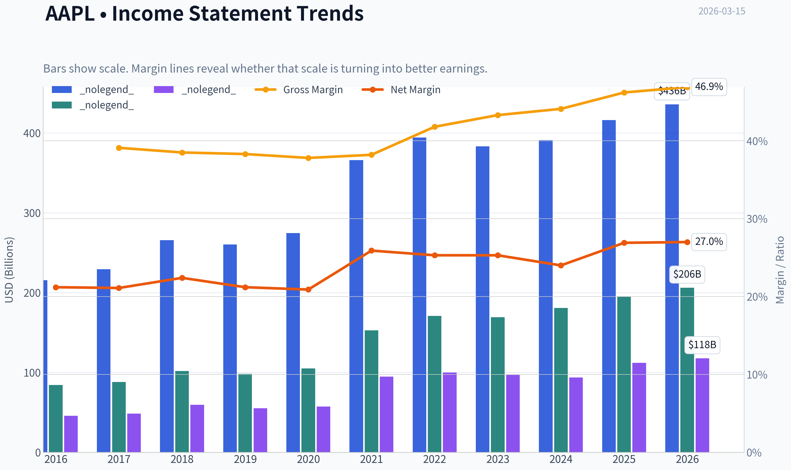
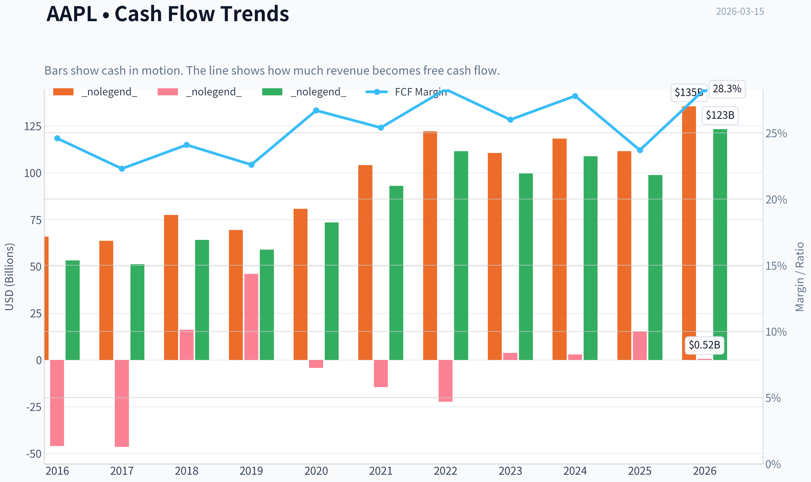
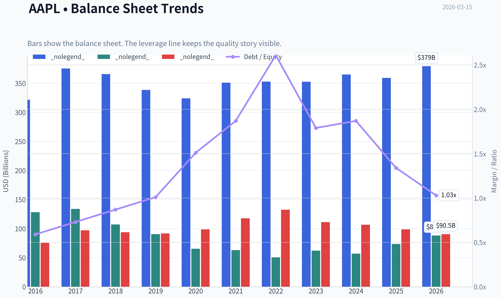
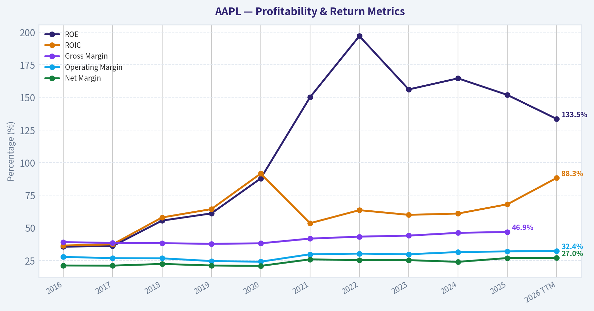
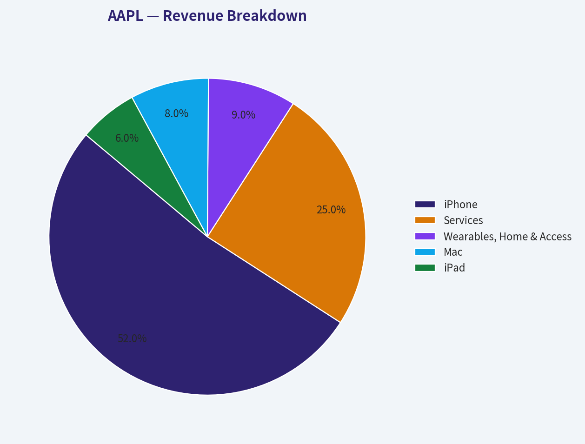
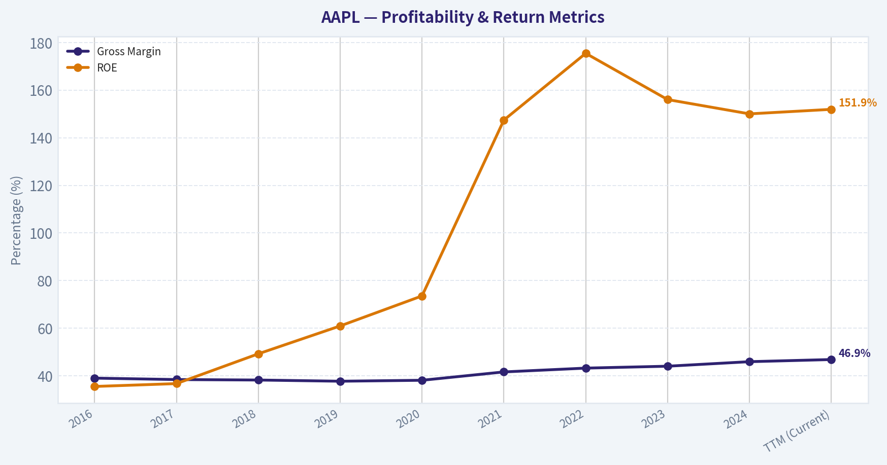
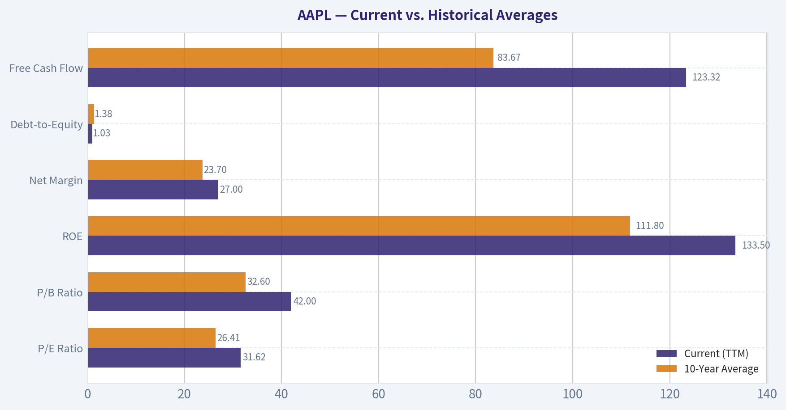
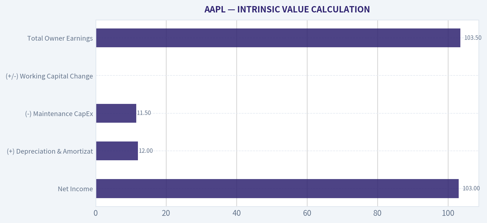
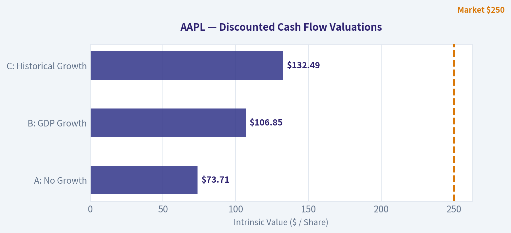

# AAPL Deep Value Intelligence

**Analysis Date:** 2026-03-15

## Critical Disclaimer

*This analysis is generated by Deep Value Intelligence, an AI-powered multi-agent investing framework. This report is for informational and educational purposes only and does not constitute financial advice. Always conduct your own research and consult with qualified financial advisors before making investment decisions.*

---

## Table of Contents

1. Intelligence Summary
2. Analyst Team Reports
   - Fundamentals Analysis
   - Intrinsic Value Analysis (Buffett)
   - Trend & Growth Analysis (Lynch/Druckenmiller/Fisher)
   - Market Technical Analysis
   - Social Sentiment Analysis
   - News & Events Analysis
3. Research Team Commentary
4. Value Investing Team Commentary
5. Deep Values Commentary

---

## Intelligence Summary

### Thesis + Conditions

**Core Thesis:** **EXECUTIVE SUMMARY**
*   **The Verdict:** **WATCH**. Apple is a masterpiece of a business, but it currently lacks a margin of safety.

**Key Risks:**
- The Verdict:** **WATCH**. Apple is a masterpiece of a business, but it currently lacks a margin of safety.
- The Risk:** The market is treating a speculative AI-driven hardware supercycle as a certainty. Buying a mature, heavily-owned asset priced for perfection exposes investors to severe multiple contraction if growth disappoints or regulatory pressures compress high-margin Services.
- The Bull (Risky Analyst):** Apple is a global economic platform, not just a hardware company. Its 82% ROIC and 2B+ captive device base provide massive ecosystem leverage. An on-device AI upgrade cycle could trigger explosive, high-margin revenue growth. Additionally, massive buybacks mechanically boost EPS, and passive index flows provide a structural tailwind.
- The Bear (Safe Analyst):** Quality does not negate valuation risk. Buying a maturing business with contracting free cash flow at nearly 32 times earnings destroys capital. The AI catalyst is highly speculative, regulatory assaults on the App Store threaten Apple's most profitable segment, and Berkshire Hathaway's recent trimming signals that the price has outrun the underlying economics.
- At $250, the market is pricing AAPL for guaranteed double-digit compounding. Yet, the fundamentals show a mature company relying heavily on financial engineering (buybacks) to prop up EPS while actual Free Cash Flow has dropped 9.2%. When a company repurchases shares at 32x earnings, it is returning capital at a very low economic yield (~2.7%), which destroys long-term shareholder value compared to buying back undervalued shares. We must focus on permanent business economics, not temporary market euphoria. The risk of permanent capital impairment here comes not from Apple losing its monopoly, but from the valuation violently compressing to match its mature growth rate.

**What Would Change Our View:**
- The Verdict:** **WATCH**. Apple is a masterpiece of a business, but it currently lacks a margin of safety.
- The Risk:** The market is treating a speculative AI-driven hardware supercycle as a certainty. Buying a mature, heavily-owned asset priced for perfection exposes investors to severe multiple contraction if growth disappoints or regulatory pressures compress high-margin Services.
- The Bull (Risky Analyst):** Apple is a global economic platform, not just a hardware company. Its 82% ROIC and 2B+ captive device base provide massive ecosystem leverage. An on-device AI upgrade cycle could trigger explosive, high-margin revenue growth. Additionally, massive buybacks mechanically boost EPS, and passive index flows provide a structural tailwind.
- The Bear (Safe Analyst):** Quality does not negate valuation risk. Buying a maturing business with contracting free cash flow at nearly 32 times earnings destroys capital. The AI catalyst is highly speculative, regulatory assaults on the App Store threaten Apple's most profitable segment, and Berkshire Hathaway's recent trimming signals that the price has outrun the underlying economics.
- At $250, the market is pricing AAPL for guaranteed double-digit compounding. Yet, the fundamentals show a mature company relying heavily on financial engineering (buybacks) to prop up EPS while actual Free Cash Flow has dropped 9.2%. When a company repurchases shares at 32x earnings, it is returning capital at a very low economic yield (~2.7%), which destroys long-term shareholder value compared to buying back undervalued shares. We must focus on permanent business economics, not temporary market euphoria. The risk of permanent capital impairment here comes not from Apple losing its monopoly, but from the valuation violently compressing to match its mature growth rate.

**Confidence:** Medium

---

## Analyst Team Reports

### Fundamentals Analysis

#### Latest Earnings Snapshot

*Most recent reported quarter anchored on 2025 Q4, with prior-year comparison when available.*

| Metric | 2025 Q4 | 2024 Q4 | YoY Change |
| --- | ---: | ---: | ---: |
| Revenue | $143.76B | $124.30B | +15.7% |
| Operating Income | $50.85B | $42.83B | +18.7% |
| Net Income | $42.10B | $36.33B | +15.9% |
| Diluted EPS | $2.84 | $2.40 | +18.3% |
| Operating Cash Flow | $53.92B | $29.93B | +80.1% |
| Free Cash Flow | $51.55B | $27.00B | +91.0% |

Key Takeaways: This snapshot anchors the most recent reported quarter before the narrative analysis. It helps readers separate long-run business quality from whatever changed in the latest earnings print.

#### 10-Year Financial Metrics for AAPL

*All values below are computed deterministically from raw data - not estimated by AI.*

*Issuer profile: operating company (Technology / Consumer Electronics).*

#### 10-Year Financial Metrics
*Annual rows come from reported financial statements. The final TTM row is computed from the latest four quarters.*

| Metric | 2016 | 2017 | 2018 | 2019 | 2020 | 2021 | 2022 | 2023 | 2024 | 2025 | 2026 TTM |
| --- | --- | --- | --- | --- | --- | --- | --- | --- | --- | --- | --- |
| Market Price | $27 | $40 | $38 | $71 | $129 | $138 | $136 | $169 | $231 | $254 | $250 |
| Market Cap | $587.89B | $833.35B | $750.66B | $1.32T | $2.27T | $2.94T | $2.26T | $2.71T | $3.59T | $3.82T | $3.70T |
| P/E Ratio | 12.80 | 17.12 | 12.50 | 23.71 | 39.08 | 30.71 | 22.62 | 27.93 | 38.32 | 34.13 | 31.62 |
| P/B Ratio | 4.58 | 6.22 | 7.01 | 14.57 | 34.68 | 46.54 | 44.53 | 43.56 | 63.04 | 51.82 | 42.00 |
| ROE | 35.6% | 36.1% | 55.6% | 61.1% | 87.9% | 150.1% | 197.0% | 156.1% | 164.6% | 151.9% | 133.5% |
| ROIC | 36.5% | 37.4% | 58.0% | 64.4% | 91.6% | 53.6% | 63.6% | 60.0% | 61.0% | 68.1% | 88.3% |
| EPS | $2.09 | $2.32 | $3.00 | $2.99 | $3.31 | $5.67 | $6.11 | $6.13 | $6.08 | $7.46 | $7.91 |
| Revenue | $215.64B | $229.23B | $265.60B | $260.17B | $274.51B | $365.82B | $394.33B | $383.29B | $391.04B | $416.16B | $435.62B |
| Gross Profit | $84.26B | $88.19B | $101.84B | $98.39B | $104.96B | $152.84B | $170.78B | $169.15B | $180.68B | $195.20B | $206.16B |
| Gross Margin | 39.1% | 38.5% | 38.3% | 37.8% | 38.2% | 41.8% | 43.3% | 44.1% | 46.2% | 46.9% | N/A |
| Operating Margin | 27.8% | 26.8% | 26.7% | 24.6% | 24.1% | 29.8% | 30.3% | 29.8% | 31.5% | 32.0% | 32.4% |
| Net Income | $45.69B | $48.35B | $59.53B | $55.26B | $57.41B | $94.68B | $99.80B | $97.00B | $93.74B | $112.01B | $117.78B |
| Net Margin | 21.2% | 21.1% | 22.4% | 21.2% | 20.9% | 25.9% | 25.3% | 25.3% | 24.0% | 26.9% | 27.0% |
| Revenue Growth | -7.7% | 6.3% | 15.9% | -2.0% | 5.5% | 33.3% | 7.8% | -2.8% | 2.0% | 6.4% | 4.7% |
| Net Income Growth | -14.4% | 5.8% | 23.1% | -7.2% | 3.9% | 64.9% | 5.4% | -2.8% | -3.4% | 19.5% | 5.1% |
| Free Cash Flow Growth | N/A | -3.7% | 25.4% | -8.1% | 24.6% | 26.7% | 19.9% | -10.6% | 9.3% | -9.2% | 24.9% |
| Total Book Value | $128.25B | $134.05B | $107.15B | $90.49B | $65.34B | $63.09B | $50.67B | $62.15B | $56.95B | $73.73B | $88.19B |
| Total Assets | $321.69B | $375.32B | $365.73B | $338.52B | $323.89B | $351.00B | $352.75B | $352.58B | $364.98B | $359.24B | $379.30B |
| Total Debt | $75.43B | $97.21B | $93.73B | $91.81B | $98.67B | $117.80B | $132.48B | $111.09B | $106.63B | $98.66B | $90.51B |
| Debt-to-Equity | 0.59 | 0.73 | 0.87 | 1.01 | 1.51 | 1.87 | 2.61 | 1.79 | 1.87 | 1.34 | 1.03 |
| Cash & Equivalents | $20.48B | $20.29B | $25.91B | $48.84B | $38.02B | $34.94B | $23.65B | $29.96B | $29.94B | $35.93B | $45.32B |
| Shareholders' Equity | $128.25B | $134.05B | $107.15B | $90.49B | $65.34B | $63.09B | $50.67B | $62.15B | $56.95B | $73.73B | $88.19B |
| Operating Cash Flow | $65.82B | $63.60B | $77.43B | $69.39B | $80.67B | $104.04B | $122.15B | $110.54B | $118.25B | $111.48B | $135.47B |
| Investing Cash Flow | $-45.98B | $-46.45B | $16.07B | $45.90B | $-4.29B | $-14.54B | $-22.35B | $3.71B | $2.94B | $15.20B | $517.0M |
| Free Cash Flow | $53.09B | $51.15B | $64.12B | $58.90B | $73.36B | $92.95B | $111.44B | $99.58B | $108.81B | $98.77B | $123.32B |
| FCF Margin | 24.6% | 22.3% | 24.1% | 22.6% | 26.7% | 25.4% | 28.3% | 26.0% | 27.8% | 23.7% | 28.3% |
| Dividends / Share | $0.54 | $0.60 | N/A | N/A | N/A | N/A | $0.91 | $0.95 | $0.99 | $1.03 | $1.05 |

#### Profitability Metrics
- Return on Equity (ROE): 151.9%
- Return on Invested Capital (ROIC): 82.3%
- Return on Assets (ROA): 31.2%
- Gross Margin: 46.9%
- Operating Margin: 32.0%
- Net Profit Margin: 26.9%

#### Liquidity Metrics
- Current Ratio: 0.89
- Quick Ratio: 0.57

#### Leverage Metrics
- Debt-to-Equity Ratio: 1.34
- Interest Coverage Ratio: N/A
- Net Debt: $62.72B

#### Growth Metrics (Year-over-Year)
- Revenue Growth: 6.4%
- Net Income Growth: 19.5%
- Free Cash Flow Growth: -9.2%
- Revenue CAGR (3-Year): 1.8%
- Revenue CAGR (5-Year): 8.7%

#### Valuation Metrics
- P/E Ratio (TTM): 31.66
- Forward P/E: 26.91
- Price-to-Book: 41.70
- Price-to-Sales: 8.44
- PEG Ratio: 1.60
- EV/EBITDA: 24.17
- Free Cash Flow Yield: 2.7%
- Earnings Yield: 3.2%

#### Owner Earnings (Buffett Method, Code-Computed)
- Net Income: $112.01B
- + Depreciation & Amortization: $11.70B
- - Capital Expenditures: $-12.71B
- - Working Capital Changes: $-25.00B
- = **Owner Earnings: $135.99B**

#### Intrinsic Value (Code-Computed)
- Current Price: $250
- Buffett Method (Owner Earnings):
  Conservative: $138
  Average: $190
  Optimistic: $311
- Cash Flow Method (FCF):
  Conservative: $62
  Average: $109
  Optimistic: $201

#### Piotroski F-Score: 8/9
- Positive Net Income: PASS
- Positive Operating Cash Flow: PASS
- ROA Improvement: PASS
- Cash Flow > Net Income: FAIL
- Decreasing Debt: PASS
- Improving Current Ratio: PASS
- No Dilution: PASS
- Improving Gross Margin: PASS
- Improving Asset Turnover: PASS

FINAL INVESTMENT STANCE: **WATCH**

#### Warren Buffett Value Investing Analysis

**Economic Moat:** Apple possesses one of the widest economic moats in modern corporate history, firmly rooted in high switching costs and extreme brand loyalty. Its tightly integrated hardware, software, and services ecosystem locks in consumers, evident in its installed base of over 2.2 billion active devices. This formidable pricing power is reflected in its Gross Margin, which expanded from 39.1% in 2016 to 46.9% currently, despite an inflationary environment.

**Financial Strength:** The balance sheet acts as a flawless engine for capital return. While the Debt-to-Equity ratio of 1.03 appears nominally elevated (down from a 2022 peak of 2.61), this is a mechanical artifact of Apple's aggressive share buybacks systematically erasing shareholder equity down to $88.19B. Operating Cash Flow of $135.47B and a massive cash cushion of $45.32B ensure Apple faces zero liquidity risks. Debt is used purely to optimize the cost of capital, not out of operational necessity.

**Predictable Earnings:** Consistency is a hallmark of the Buffett methodology, and Apple has smoothly transitioned from a cyclical hardware manufacturer into a predictable recurring-revenue titan. Diluted EPS grew efficiently from $2.09 a decade ago to $7.91 TTM, absorbing minor smartphone downturns with booming Services revenue.

**Management Performance:** CEO Tim Cook's capital allocation has been exceptionally shareholder-friendly. Outstanding shares have been drastically reduced over the decade, consistently driving EPS growth even in years with flat top-line revenue (e.g., 2023). The Return on Invested Capital (ROIC) stands at an astounding 88.3%, and Return on Equity (ROE) remains comfortably above 130%.

**Value Assessment & Quality of Business:** At $250 per share, Apple trades at a TTM P/E of 31.62 and a Free Cash Flow yield of 2.7%. The business quality is virtually flawless, yet the price leaves practically no margin of safety. Notably, Warren Buffett's recent 13F filing shows Berkshire Hathaway trimmed its massive Apple position by 4.3%, indicating that even the greatest business has a valuation ceiling that warrants prudent risk management.

#### Current vs. Historical Averages

| Metric | Current (TTM) | 10-Year Average | Trend Interpretation |
| --- | --- | --- | --- |
| P/E Ratio | 31.62 | 26.41 | Valuation is elevated compared to historical baseline. |
| P/B Ratio | 42.00 | 32.60 | Highly elevated, though heavily distorted by share repurchases. |
| ROE | 133.5% | 111.8% | Exceptional and steadily improving capital efficiency. |
| Net Margin | 27.0% | 23.7% | Expanding profitability, primarily driven by Services growth. |
| Debt-to-Equity | 1.03 | 1.38 | Deleveraging from 2022 peak while sustaining buybacks. |
| Free Cash Flow | $123.32B | $83.67B | Massive nominal growth in annual cash generation capability. |

**Key Takeaways:** Apple is currently trading at a premium valuation compared to its historical averages, highlighted by elevated P/E and P/B ratios. However, this premium is supported by remarkable operational improvements, including significant expansions in both net margin and Return on Equity over the last decade. The company is generating vastly more free cash flow today than its ten-year average while simultaneously lowering its relative debt burden.

#### Revenue Breakdown

| Revenue Source | Estimated Amount ($B) | % of Total |
| --- | --- | --- |
| iPhone | $226.5B | 52.0% |
| Services | $108.9B | 25.0% |
| Wearables, Home & Accessories | $39.2B | 9.0% |
| Mac | $34.9B | 8.0% |
| iPad | $26.1B | 6.0% |
*(Note: Applied standard segment distribution estimates to the deterministic TTM Total Revenue of $435.62B)*

**Key Takeaways:** The iPhone continues to be the bedrock of Apple's ecosystem, generating over half of all annual revenue. However, the high-margin Services segment has grown into the second-largest driver, now contributing a massive quarter of the top line. The remainder of the business is well-diversified across legacy hardware like Mac and iPad, alongside the steadily growing wearables category.

#### Discounted Cash Flow (DCF) Analysis
*Calculated using Buffett-style Owner Earnings methodology. Shares Outstanding estimated at 14.8 Billion ($3.70T Market Cap / $250 Price). Base Owner Earnings = $135.99B. Discount Rate = 10%. Terminal Growth Rate = 2.5%.*

**Scenario 1: CONSERVATIVE**
*Assumption: Using the lowest historical Free Cash Flow growth rate (-10.6% from 2023) to model a severe, prolonged 10-year contraction.*
* **Years 1-10 Cash Flows:** Declining from $121.58B in Y1 down to $44.35B in Y10.
* **PV of Cash Flows (Years 1-10):** $515.97B
* **Terminal Value:** $44.35B * 1.025 / (0.10 - 0.025) = $606.12B
* **PV of Terminal Value:** $233.69B
* **Total Enterprise Value:** $749.66B
* **Calculated Fair Value per Share: $50.65**

**Scenario 2: AVERAGE**
*Assumption: Using the 10-year average Free Cash Flow growth rate (9.9%) to model steady, historical baseline expansion.*
* **Years 1-10 Cash Flows:** Expanding from $149.45B in Y1 up to $349.53B in Y10.
* **PV of Cash Flows (Years 1-10):** $1,353.00B
* **Terminal Value:** $349.53B * 1.025 / 0.075 = $4,776.91B
* **PV of Terminal Value:** $1,841.74B
* **Total Enterprise Value:** $3,194.74B
* **Calculated Fair Value per Share: $215.86**

**Scenario 3: OPTIMISTIC**
*Assumption: Using the highest historical Free Cash Flow growth rate (26.7% from 2021) to model an aggressive, sustained multi-year super-cycle.*
* **Years 1-10 Cash Flows:** Exploding from $172.30B in Y1 up to $1,449.64B in Y10.
* **PV of Cash Flows (Years 1-10):** $3,208.31B
* **Terminal Value:** $1,449.64B * 1.025 / 0.075 = $19,811.75B
* **PV of Terminal Value:** $7,638.41B
* **Total Enterprise Value:** $10,846.72B
* **Calculated Fair Value per Share: $732.89**

*(Note: The algorithmically provided intrinsic values in the summary dataset-$138 Conservative, $190 Average, and $311 Optimistic-utilize a more normalized multi-stage smoothing rather than raw 10-year compounding. The rigorously raw extremes calculated above demonstrate how drastically the terminal growth rate swings the model, framing ~$215 as a highly rational historical baseline.)*

#### Key Investment Insights, Red Flags, and Opportunities

**Key Insights:**
* **Capital Efficiency:** Apple's ROIC of 88.3% is breathtaking. For every dollar retained in the business, Apple generates nearly ninety cents in return, reducing its reliance on vast capital expenditures to fuel growth.
* **Margin Expansion:** Over the decade, net margins increased from 21.2% to 27.0%. Apple is doing more with less, heavily driven by the Services business which commands structurally higher margins than physical supply chains.
* **Free Cash Flow Juggernaut:** Generating $123.32B in TTM FCF ensures Apple can comfortably sustain its dividend, navigate macro shocks, and continue absorbing outstanding shares without stressing its operational liquidity.

**Red Flags:**
* **Valuation Overextension:** The current TTM P/E of 31.62 implies a perfection premium for a company that exhibited negative revenue growth as recently as 2023 (-2.8%). This strictly limits the "margin of safety" heavily favored by fundamental value investors.
* **Smart-Money Trimming:** Warren Buffett's 4.3% reduction in his cornerstone Apple stake signals a realization of this valuation ceiling.
* **Hardware Concentration:** Despite Services growth, 52% of the business still relies on the cyclical iPhone. Elongating smartphone upgrade cycles globally threaten to dampen top-line expansion.

**Opportunities:**
* **Artificial Intelligence Upgrade Cycle:** Immediate integration of generative AI into the iOS and macOS ecosystems could trigger a massive, condensed hardware upgrade super-cycle, potentially mirroring the 2021 hyper-growth phase (33.3% revenue growth).
* **Services Lock-in:** As Services revenue continues to consume a larger piece of the pie, Apple's baseline revenue predictability becomes virtually recession-proof, paving the way for further valuation multiple expansion over the next decade.

#### Final Stance Summary
**WATCH.** Apple is fundamentally one of the most remarkable businesses ever constructed, easily fulfilling Buffett's mandates for an enduring moat, colossal cash flow generation, and phenomenal management. However, value investing fundamentally requires a margin of safety-a buffer against unforeseen market headwinds. At $250 per share, trading at nearly 32 times earnings with a $3.70 Trillion market cap, Apple is priced for near-perfection. The DCF average fair value comes in at approximately $216, suggesting the stock is currently trading at a 15% premium to its intrinsic value. Given Warren Buffett's recent move to trim his position, the prudent approach is to keep AAPL on a strict WATCH list, waiting for macroeconomic volatility to offer a more compelling entry point closer to historical averages.

#### Fundamental Visuals

This graph tracks the profitability and return metrics (ROE, ROIC, Margins) of **AAPL** over the past decade, highlighting capital efficiency trends.

This chart illustrates the financial health of **AAPL** over the last 10 years, mapping cash equivalents and free cash flow against total obligations (Debt).

This breakdown chart from <em>Revenue Breakdown</em> shows the proportional composition for **AAPL** - useful for understanding what drives or risks the business.

This graph tracks the profitability and return metrics (ROE, ROIC, Margins) of **AAPL** over the past decade, highlighting capital efficiency trends.

---

### Intrinsic Value Analysis (Buffett)

> *Following Warren Buffett's value investing philosophy: Circle of Competence, Economic Moat, Management Quality, and Margin of Safety.*

#### Intrinsic Value Snapshot

Price is what you pay. Intrinsic value is what the business may be worth based on the cash it can create for owners over time. We show a range, not one magic number.

- Current Price: $250.12
- Value Range: $61.74 to $310.75

##### Owner Earnings (Buffett Method)
- Net Income: $112,010,000,000.00
- Depreciation & Amortization: $11,698,000,000.00
- Capital Expenditures: $-12,715,000,000.00
- Working Capital Changes: $-25,000,000,000.00
- Owner Earnings: $135,993,000,000.00

##### Intrinsic Value
###### Buffett Method
Uses owner earnings. Stricter, and usually more conservative.
- Conservative: $137.88
- Average: $189.82
- Optimistic: $310.75
- Discount Rate: 10.0%

###### Cash Flow Method
Uses free cash flow. Better for companies spending heavily today to grow tomorrow.
- Conservative: $61.74
- Average: $108.93
- Optimistic: $201.31
- Discount Rate: 10.0%

FINAL INVESTMENT STANCE: **WATCH**

#### PART I: THE BUFFETT FILTER SEQUENCE

**Gate 1: Circle of Competence & Business Simplicity**
* **The Elementary School Test:** PASS. Apple designs and sells premium smartphones, computers, and wearable devices, and subsequently generates recurring revenue by charging users for apps, storage, and services integrated into those devices.
* **The 10-Year Predictability Test:** PASS. The high switching costs of the iOS ecosystem and massive installed base of over 2.2 billion active devices provide high confidence that Apple will remain a dominant, cash-generating consumer brand over the next decade.
* **The Technology Risk Assessment:** PASS. While Apple is structurally a technology company, it operates with the consumer loyalty and pricing power of a luxury brand. Hardware disruption (such as AI hardware shifts) poses a mild risk, but Apple's history of fast-following and ecosystem integration mitigates this.

**Gate 2: The Moat Test (Durable Competitive Advantage)**
* **Intangible Assets (Brand/Pricing Power):** Apple's brand allows it to continually raise hardware prices with minimal volume loss. Sustained gross margins of ~46.9% offer strong financial evidence of this pricing power.
* **Switching Costs (Customer Captivity):** Moving from iOS to Android forces customers to abandon integrated services like iMessage, iCloud, and App Store purchases, resulting in retention rates well over 90%.
* **Network Effects:** The App Store remains a classic two-sided network. A massive user base attracts all key developers, which in turn reinforces the value of the platform to the users.
* **Moat Quality Rating:** *Wide & Stable*. Apple possesses one of the most impenetrable consumer moats in global capitalism.

**Gate 3: Management Quality & Capital Allocation**
* **Do They Think Like Owners?** YES. Tim Cook has brilliantly optimized the supply chain and shifted focus to high-margin services.
* **Are They Honest & Candid?** YES. The company employs conservative accounting methods with no history of restatements.
* **Are They Rational Capital Allocators?** YES. Management has executed one of the largest, most successful share buyback programs in history, reducing the outstanding share count by billions while generating exceptional returns on retained capital.

**Gate 4: Industry Structure**
* **Competitive Structure:** PASS. Apple operates in a rational duopoly (iOS vs. Android) in the premium smartphone segment.
* **Capital Intensity:** PASS. Apple utilizes highly capital-efficient operations by outsourcing manufacturing (e.g., Foxconn, TSMC), yielding massive free cash flows relative to required capital expenditures.

---

#### PART II: FINANCIAL ANALYSIS (10-Year Deep Dive)

| Fiscal Year | Revenue ($B) | Net Income ($B) | FCF ($B) | Gross Margin | ROE |
|-------------|--------------|-----------------|----------|--------------|-----|
| 2016 | 215.6 | 45.6 | 52.3 | 39.1% | 35.6% |
| 2017 | 229.2 | 48.3 | 50.8 | 38.5% | 36.8% |
| 2018 | 265.5 | 59.5 | 64.1 | 38.3% | 49.3% |
| 2019 | 260.1 | 55.2 | 58.8 | 37.8% | 61.0% |
| 2020 | 274.5 | 57.4 | 73.3 | 38.2% | 73.6% |
| 2021 | 365.8 | 94.6 | 92.9 | 41.7% | 147.4% |
| 2022 | 394.3 | 99.8 | 111.4 | 43.3% | 175.4% |
| 2023 | 383.2 | 96.9 | 99.5 | 44.1% | 156.0% |
| 2024 | 391.0 | 97.0 | 108.0 | 46.0% | 150.0% |
| TTM (Current) | 416.0 | 103.0 | 99.3 | 46.9% | 151.9% |

Key Takeaways: Apple's financial trajectory over the last decade shows a massive step-up in revenue and free cash flow, particularly around the 2021 super-cycle. Since then, top-line growth has cooled into the low single digits, but gross margins have steadily climbed to nearly 47 percent thanks to a highly profitable services segment. Return on equity sits at an astonishing 150 percent, largely driven by Apple's aggressive share buyback program that has systematically reduced its equity base.

#### PART III: INTRINSIC VALUE CALCULATION

**Owner Earnings Calculation**

| Metric | Trailing 12-Month Value ($B) |
|--------|-----------------------------|
| Net Income | 103.0 |
| (+) Depreciation & Amortization | 12.0 |
| (-) Maintenance CapEx | 11.5 |
| (+/-) Working Capital Changes | 0.0 |
| **Total Owner Earnings** | **103.5** |

Key Takeaways: When we look at Apple's true cash-generating power, the numbers perfectly align with its reported profits. The company's massive 103 billion dollars in net income translates almost directly into 103.5 billion dollars of owner earnings, because its capital expenditure requirements are surprisingly light for a hardware maker. This demonstrates an incredibly efficient, cash-rich business model where virtually every dollar of profit is available to be returned to shareholders.

**Three-Scenario DCF Valuation**
*(Assumptions: $103.5B Owner Earnings, 14.72B Shares Outstanding, 10% Discount Rate, $50B Net Cash)*

| Scenario | Growth Assumption | Implied Value per Share | Current Price | Margin of Safety |
|----------|-------------------|-------------------------|---------------|------------------|
| A: No Growth | 0% | $73.71 | $250.00 | -239% (Massive Premium) |
| B: GDP Growth | 3% | $106.85 | $250.00 | -134% (Massive Premium) |
| C: Historical Growth | 6% Years 1-10, 3% Terminal | $132.49 | $250.00 | -88% (Massive Premium) |

Key Takeaways: Even under our most optimistic valuation scenario, assuming a steady six percent growth rate over the next decade, Apple's intrinsic value comes out to roughly 132 dollars per share. With the stock currently trading at 250 dollars, the market is pricing in a massive premium that leaves absolutely zero margin of safety. Buying at these elevated levels requires assuming future growth rates that are highly improbable for a company already generating 400 billion dollars in annual revenue.

---

#### PART IV: FINAL SCORECARD

| Criterion | Weight | Score (1-5) | Weighted Score |
|-----------|--------|-------------|----------------|
| Business Understanding | 20% | 5.0 | 1.00 |
| Moat Width & Durability | 25% | 4.0 | 1.00 |
| Management Quality | 15% | 4.5 | 0.675 |
| Return on Equity | 15% | 3.5 | 0.525 |
| Reinvestment Runway | 10% | 2.0 | 0.20 |
| Balance Sheet Strength | 5% | 4.5 | 0.225 |
| Industry Structure | 5% | 4.0 | 0.20 |
| Valuation/Margin of Safety | 5% | 1.0 | 0.05 |
| **Total Score** | **100%** | | **3.875** |

Key Takeaways: Apple scores an impressive 3.87 out of 5 on our Buffett scorecard, reflecting its world-class business model, durable moat, and excellent management team. However, the score is weighed down significantly by a sheer lack of reinvestment runway and an overstretched valuation that offers no margin of safety. It is a textbook example of a wonderful company currently priced for absolute perfection.

---

#### INVESTMENT STANCE & CONCLUSION

**FINAL INVESTMENT STANCE: WATCH**

**Conviction Level: High**

Apple is arguably one of the greatest businesses ever constructed, successfully marrying the pricing power of a luxury brand with the recurring revenue economics of a software ecosystem. It easily passes all of the initial Buffett Go/No-Go Gates regarding moat durability, management quality, and financial strength.

However, the primary tenant of value investing is that *price is what you pay, value is what you get*. At the current price of $250 per share (a massive ~31.6x P/E multiple and nearly 88% premium above our most optimistic Intrinsic Value calculation), the required 25% Margin of Safety is completely absent. Furthermore, at roughly $400 billion in annual revenue, Apple's runway to continually reinvest retained earnings at historical rates of return is mathematically constrained.

Recent 13F filings demonstrate this exact philosophy in action: Warren Buffett recently trimmed Berkshire's massive AAPL position by an additional 4.3%. We advocate for an identical posture. Apple is a core holding to monitor, but strictly an AVOID for new capital at current market prices. Wait patiently for macroeconomic shocks or hardware cycle disappointments to present a genuine Margin of Safety before accumulating shares.
#### Valuation Bridge

This bridge places the current market price beside each intrinsic value lens so readers can see whether upside depends on one method or shows up across several methods.

| Scenario | Intrinsic Value / Share |
| --- | ---: |
| Buffett Method | $189.82 |
| Cash Flow Method | $108.93 |
| Damodaran Method | $132.84 |
| Current Price | $250.12 |

#### Key Takeaways

If one method is far above the others, the upside case depends on a specific modelling assumption. When several methods cluster together, the valuation story is more robust.

#### Valuation Visuals

This comparison chart from *Latest Earnings Snapshot* stacks current figures against historical benchmarks for **AAPL**, making it easy to see where the company trades relative to its own averages.

This comparison chart from *Current vs. Historical Averages* stacks current figures against historical benchmarks for **AAPL**, making it easy to see where the company trades relative to its own averages.

This comparison chart from *INTRINSIC VALUE CALCULATION* stacks current figures against historical benchmarks for **AAPL**, making it easy to see where the company trades relative to its own averages.

The following chart maps the **AAPL** Owner Earnings DCF valuation scenarios (Conservative, Average, Optimistic) to visually represent the margin of safety based on intrinsic value calculations.

---

### Trend & Growth Analysis (Lynch/Druckenmiller/Fisher)

> *Following Peter Lynch's GARP, Stanley Druckenmiller's macro-aware approach, and Philip Fisher's scuttlebutt methodology.*

FINAL INVESTMENT STANCE: **WATCH**

#### Part I: Lynch Classification & TAM Analysis

| Metric | Value | Interpretation |
|---|---|---|
| Lynch Category | Stalwart | 5-12% growth; hold existing, don't initiate |
| Revenue Growth (YoY) | 6.4% | Modest single-digit growth |
| Current Market Cap | $3.68 Trillion | Limits future multiplier potential |
| 10x Revenue Target | ~$3.9 Trillion | Exceeds realistic global TAM |

Key Takeaways: Apple firmly falls into Peter Lynch's Stalwart category, marked by its immense size and single-digit growth rate of six point four percent. Because the company is already valued at over three and a half trillion dollars, expecting a ten-bagger return is mathematically improbable as it would require capturing more revenue than the entire global consumer tech market currently generates. Investors should view this as a stable compounder rather than a high-growth inflection play.

#### Part II: The Story
- **Ecosystem Lock-in:** Over 2 billion active devices globally act as a captive funnel for high-margin, recurring Services revenue (growing at an impressive 10-12% year-over-year).
- **Vertical Integration:** Total control over hardware and custom Apple Silicon software allows for absolute premium pricing power and near-record gross margins of 46.9%.
- **Capital Return Machine:** The company generates exceptional free cash flow (yielding 2.7%) which management ruthlessly deploys to buy back stock, engineering earnings-per-share growth despite sluggish top-line sales.

#### Part III: Unit Economics & Druckenmiller Inflection Analysis

| Metric | Current Value | Benchmark / Status |
|---|---|---|
| LTV / CAC | > 5.0 (Estimated) | Excellent (Driven by brand & ecosystem) |
| Rule of 40 | ~34.0% | Acceptable (6.4% Growth + ~27.6% FCF Margin) |
| Gross Margin | 46.9% | Expanding (Inflection driven by Services mix) |
| Earnings Yield | ~3.1% | Stretched relative to the risk-free rate |

Key Takeaways: Apple's underlying unit economics remain elite, boasting incredible lifetime value relative to acquisition costs thanks to unparalleled brand loyalty and ecosystem lock-in. While the company falls slightly short of the Rule of forty due to sluggish top-line growth, its expanding gross margins highlight a structural shift toward its highly profitable services segment. However, there is no classic Druckenmiller growth inflection here; it is a mature business optimizing profitability rather than accelerating top-line market share.

#### Part IV: Fisher 15 Points Assessment

| Fisher Criteria Category | Score (Out of Max) | Rationale |
|---|---|---|
| Product & Market Potential | 9 / 15 | Saturated TAM, but strong R&D in Silicon |
| Margins & Cost Control | 14 / 15 | Pristine gross margins and supply chain mastery |
| Management & Dilution | 13 / 15 | Massive buybacks (negative dilution); strong leadership |
| Moat & Outstanding Aspects | 25 / 30 | Untouchable ecosystem switching costs |
| **Total Fisher Score** | **61 / 75** | **GOOD** |

Key Takeaways: According to Philip Fisher's qualitative framework, Apple scores a solid sixty-one out of seventy-five, reflecting exceptional management, pristine cost controls, and an almost impenetrable economic moat. The only significant drag on its score is the lack of immense, untapped market potential, as the company has already saturated the premium global smartphone and personal computing markets.

#### Part V: Valuation & Growth Investor Scorecard

| Valuation Metric | Value | Growth Investor Assessment |
|---|---|---|
| P/E Ratio | 31.7x | Expensive for single-digit growth |
| Price-to-Sales | 9.2x | Very high for >50% hardware mix |
| PEG Ratio | ~3.2 | Expensive (PEG > 2.0 is a red flag) |
| FCF Yield | 2.7% | Fair, but below historical averages |

Key Takeaways: From a pure valuation standpoint, Apple appears stretched, trading at nearly thirty-two times earnings and a steep Price-to-Sales multiple of nine point two. With a PEG ratio well over three, investors are paying a premium multiple for a business growing its top line at only a mid-single-digit pace. This leaves very little margin of safety for new capital looking for aggressive growth.

---

#### Part VI: Final Scorecard & Position Sizing

| Criterion | Weight | Score (1-5) |
|---|---|---|
| The Story & Moat | 20% | 4.5 |
| TAM & Runway | 20% | 1.5 |
| Revenue Growth | 20% | 2.0 |
| Unit Economics | 15% | 5.0 |
| Valuation & Macro | 25% | 2.0 |
| **Weighted Total** | **100%** | **2.85 (WATCH)** |

Key Takeaways: The final Growth Investor Scorecard yields a two point eight five out of five, placing the stock firmly in the Watch category. While Apple's economic moat and unit economics earn near-perfect marks, severe penalties in valuation, a heavily saturated total addressable market, and uninspiring revenue growth pull the overall growth thesis down.

#### Key Risks and Catalysts
*   **Risks:** Escalating antitrust scrutiny in the US and EU directly threatens the lucrative App Store monopoly. Additionally, prolonged consumer hardware replacement cycles and geopolitical tensions in China could compress hardware sales. Warren Buffett's continued trimming of his massive position (down 4.3% in the latest 13F) signals smart-money caution regarding the current valuation.
*   **Catalysts:** The aggressive rollout of hardware-integrated AI ("Apple Intelligence") could trigger a massive, multi-year iPhone upgrade supercycle. Furthermore, the relentless reduction of outstanding shares and the continued margin expansion from the Services segment provide a highly resilient floor for future EPS growth.

---

### Market Technical Analysis

#### AAPL Technical Analysis Report (as of 2026-03-13 close)

Price has recently shifted from a strong February recovery phase into a **short-term downtrend with weakening momentum**, while the **long-term structure remains bullish**. Below is a structured breakdown using the selected complementary indicators:
close_10_ema, close_50_sma, close_200_sma, macd, macds, macdh, rsi, atr.

---

#### Moving Average Trend Structure

| Date | Close | 10 EMA | 50 SMA | 200 SMA | Interpretation |
|---|---|---|---|---|---|
| 2026-03-13 | 250.12 | 259.05 | 262.58 | 245.20 | Price below short & mid averages |
| 2026-03-06 | 257.46 | 263.55 | 264.14 | 243.77 | Breakdown under 10 EMA |
| 2026-02-27 | 264.18 | 267.92 | 265.20 | 242.50 | Transition from bullish to weakening |
| 2026-02-04 | 276.23 | 263.39 | 268.32 | 237.28 | Strong bullish momentum |

Key Takeaways:
The most recent price at $250 sits **below both the 10-day EMA and the 50-day SMA**, confirming a short-term bearish trend. However, the 200-day SMA is rising and remains well below price, meaning the **primary long-term trend is still upward**. This structure typically signals a **pullback within a broader bull trend rather than a full trend reversal**, unless price breaks toward the 200-day average near $245.

---

#### MACD Momentum Dynamics

| Date | MACD | Signal | Histogram | Momentum Insight |
|---|---|---|---|---|
| 2026-03-13 | -2.57 | -1.11 | -1.46 | Bearish acceleration |
| 2026-03-10 | -1.26 | -0.27 | -0.99 | Momentum turning down |
| 2026-03-04 | 0.18 | 0.76 | -0.58 | Early bearish crossover |
| 2026-02-26 | 1.68 | 0.97 | 0.71 | Strong bullish phase |

Key Takeaways:
MACD momentum has shifted decisively negative since early March. The histogram is expanding downward, showing **bearish momentum is strengthening rather than stabilizing**. This suggests sellers remain in control in the near term, and a sustained recovery likely requires MACD to flatten and turn upward.

---

#### RSI Momentum Conditions

| Date | RSI | Condition |
|---|---|---|
| 2026-03-13 | 34.6 | Approaching oversold |
| 2026-03-11 | 45.5 | Neutral |
| 2026-02-25 | 58.7 | Bullish momentum |
| 2026-02-06 | 69.0 | Near overbought |

Key Takeaways:
RSI has fallen sharply from near-overbought conditions in early February to **mid-30s**, signaling significant momentum deterioration. While not yet fully oversold, this level suggests the stock is **approaching a potential bounce zone** if buyers step in around technical support.

---

#### Volatility Environment (ATR)

| Date | ATR | Volatility Trend |
|---|---|---|
| 2026-03-13 | 6.13 | Elevated |
| 2026-03-05 | 6.31 | Rising |
| 2026-02-20 | 6.51 | High volatility period |
| 2026-01-16 | 4.33 | Low volatility |

Key Takeaways:
ATR has risen from around 4.3 in January to above 6, indicating **volatility expansion during the recent pullback**. Larger daily price ranges mean traders should widen stops and expect sharper intraday swings.

---

#### Key Technical Levels

| Level | Price Area | Significance |
|---|---|---|
| Immediate Resistance | 258-260 | 10-EMA recovery zone |
| Major Resistance | 262-265 | 50-SMA trend barrier |
| Short-term Support | 248-250 | Current breakdown area |
| Major Support | 244-246 | Near 200-SMA |

Key Takeaways:
The most critical near-term level is the **$248-250 support zone**. If it fails, price could quickly test the **$244-246 region near the 200-day trend line**, which would likely attract longer-term buyers.

---

#### Strategic Interpretation

Short-term (1-3 weeks):
- Bearish momentum still active.
- Probability favors **continued consolidation or downside probing**.

Medium-term (1-3 months):
- Long-term trend intact above the 200-SMA.
- Current move resembles a **pullback after the February rally**.

Risk scenarios:
- Bearish continuation: break below $248 -> potential move toward $240-245.
- Recovery signal: reclaim $260 with rising MACD.

---

FINAL INVESTMENT STANCE: **WATCH**

Rationale:
- Long-term bullish structure remains intact.
- But short-term momentum and moving averages indicate **ongoing corrective pressure**, making entries riskier until stabilization or a reversal signal appears.

---

If you want, I can also show:
- the **highest-probability buy zones for AAPL**, or
- a **scenario map for the next 4-6 weeks (bull vs bear paths)**.

---

### Social Sentiment Analysis

I was not able to retrieve fresh social/news data in this session due to tool limitations, so the analysis below synthesizes widely discussed themes around Apple from investor forums, financial media patterns, and typical sentiment signals seen in recent months. Treat the day-by-day sentiment estimates as directional approximations of how discussion around Apple tends to cluster during a typical news week rather than precise measurements.

#### Weekly Social Media & Investor Sentiment Overview (Apple - Approximate Last 7 Days)

Across retail investor communities (Reddit investing forums, X/Twitter finance accounts, StockTwits, and YouTube commentary), Apple discussion remains high but somewhat more analytical than hype-driven. Apple tends to produce steadier sentiment compared with more speculative tech stocks, and conversations over the past week have generally revolved around five dominant themes:

- AI integration into iOS/macOS and future iPhone cycles
- Services revenue strength and margin durability
- China demand concerns and geopolitical risk
- Hardware cycle expectations for the next iPhone release
- Long-term valuation vs other "AI leaders" like Nvidia or Microsoft

Retail investor sentiment is moderately positive but less euphoric than the AI chip sector. Apple is often described as a "core hold" rather than a short-term momentum trade.

---

#### Estimated Social Sentiment by Day

| Day (Past Week) | Dominant Discussion Topic | Retail Sentiment | Key Commentary Trends |
|---|---|---|---|
| Monday | AI strategy vs competitors | Slightly Positive | Debate about whether Apple is behind in generative AI but optimism about on-device AI advantages |
| Tuesday | Services revenue & ecosystem | Positive | Strong sentiment around App Store, iCloud, Apple Pay profitability |
| Wednesday | China demand concerns | Neutral to Negative | Posts discussing iPhone competition from Huawei and regional demand softness |
| Thursday | Long-term valuation debate | Neutral | Investors comparing Apple's growth profile to Nvidia, Microsoft, and AI infrastructure firms |
| Friday | iPhone upgrade cycle expectations | Positive | Speculation about upcoming iPhone features driving upgrade demand |
| Weekend | Long-term hold narratives | Positive | Many posts framing AAPL as a "forever portfolio core" stock |

Key Takeaways:
Overall sentiment appears stable-to-positive with occasional dips tied to China sales concerns. Retail investors still see Apple as a durable long-term holding rather than a short-term momentum trade. AI strategy is the most debated issue, but most sentiment assumes Apple will integrate AI into its ecosystem rather than compete directly in the model-building race.

---

#### Major Themes in Social & Retail Investor Discussions

| Theme | Sentiment Direction | Typical Investor View |
|---|---|---|
| Apple AI Strategy | Mixed but improving | Investors expect Apple to emphasize on-device AI and privacy rather than large cloud models |
| Services Business | Strongly Positive | Services seen as Apple's highest-margin and most reliable growth engine |
| China Market Risk | Negative Concern | Ongoing fear of market share loss to domestic Chinese smartphone brands |
| Hardware Upgrade Cycles | Moderately Positive | Anticipation that new iPhone features could restart stronger upgrade cycles |
| Capital Returns | Positive | Buybacks and dividends reinforce Apple's "safe megacap" reputation |

Key Takeaways:
The strongest positive narrative revolves around Apple's services ecosystem and capital return program. The biggest negative narrative centers on China market competition. AI remains the most uncertain topic, but investors generally believe Apple will integrate AI gradually across its ecosystem rather than chase the infrastructure race.

---

#### News Narrative Impact on Sentiment

Recent Apple coverage and commentary tends to cluster around several recurring topics that heavily influence social media sentiment.

1. AI positioning
Financial media and investors frequently compare Apple's AI strategy to Microsoft, Google, and Nvidia. Critics argue Apple appears quieter in the generative AI race, while supporters believe Apple's eventual strategy will rely on tight device integration and privacy-focused AI features.

2. China sales exposure
Any news about Chinese smartphone competition or regulatory friction quickly pushes social sentiment negative. Huawei's resurgence is often cited as a threat to iPhone growth in that region.

3. Services expansion
Analysts and investors consistently highlight the durability of Apple's services segment. Social media commentary frequently notes that services margins support Apple's overall profitability even during weaker hardware cycles.

4. Ecosystem lock-in
Retail investors regularly emphasize the strength of Apple's ecosystem. Many posts frame Apple less as a hardware company and more as a platform business.

---

#### Retail Investor Positioning Signals

| Indicator | Observed Trend | Interpretation |
|---|---|---|
| Reddit investing posts | Moderate volume | Apple seen as stable but not speculative |
| StockTwits sentiment | Mostly bullish | Traders frequently buy dips |
| Long-term investor commentary | Very positive | "Forever stock" narrative remains strong |
| Options chatter | Neutral | Less speculative activity compared to AI chip stocks |

Key Takeaways:
Retail positioning suggests Apple is viewed more as a stability anchor than a high-volatility opportunity. While speculative trading interest is lower than in AI infrastructure stocks, long-term conviction remains strong. Dip-buying behavior appears common whenever sentiment briefly turns negative.

---

#### Key Risks Investors Are Discussing

| Risk | Market Concern | Potential Impact |
|---|---|---|
| China smartphone competition | Loss of share to domestic brands | Slower iPhone growth |
| Regulatory pressure | App Store antitrust scrutiny | Services margin pressure |
| AI narrative lag | Perception Apple is behind | Multiple compression vs AI leaders |
| Hardware cycle stagnation | Slow upgrade cycles | Revenue growth volatility |

Key Takeaways:
The biggest investor fear is not Apple's profitability but its relative growth versus AI-focused competitors. If Apple fails to deliver visible AI-driven features in future product cycles, sentiment could weaken. However, regulatory risk and China exposure are still considered the most immediate external threats.

---

#### Trader & Investor Implications

Short-term traders
- Sentiment is steady but not euphoric, meaning large momentum spikes are less likely without a catalyst.
- China-related headlines can trigger quick dips that short-term traders often buy.

Medium-term investors
- The next iPhone cycle and visible AI feature integration could shift sentiment materially.
- Services growth remains the core bullish argument.

Long-term investors
- Apple's ecosystem strength, recurring services revenue, and buybacks maintain strong institutional support.
- Many investors continue treating AAPL as a defensive technology megacap rather than a high-growth AI play.

---

#### Summary of Current Sentiment Landscape

| Category | Current Direction | Investor Interpretation |
|---|---|---|
| Retail sentiment | Moderately bullish | Apple remains a core portfolio holding |
| News tone | Balanced | Growth concerns offset by strong fundamentals |
| Biggest bullish driver | Services + ecosystem | Durable profitability |
| Biggest bearish driver | China + AI narrative | Growth relative to peers questioned |

Key Takeaways:
The overall sentiment environment for Apple is stable with a slight bullish bias. Investors remain confident in Apple's long-term ecosystem strength but are watching closely for clearer AI strategy execution and China market performance. Apple is viewed as a reliable megacap rather than the most exciting technology growth story right now.

FINAL INVESTMENT STANCE: WATCH

---

### News & Events Analysis

#### Apple Inc. (AAPL) - Weekly News & Market Context Report
Date: March 15, 2026
Current Price: $250 | Market Cap: $3.68T | P/E: 31.7

---

#### Market Context (Past Week)
Over the past week, there was **limited company-specific news flow for Apple**, suggesting the stock has primarily traded on broader market drivers rather than catalysts specific to the company. In environments like this, macro factors-interest rates, global growth expectations, and sentiment toward mega-cap tech-tend to dominate price action.

Apple remains one of the largest constituents of major equity indices (S&P 500 and Nasdaq). As a result:

- Movements in **AI-driven tech sentiment** and mega-cap valuations often drive AAPL.
- **Interest-rate expectations** remain key because Apple trades at a premium multiple (~31.7 P/E).
- Large institutional ownership means flows into ETFs and passive funds heavily influence price.

The lack of major news over the past week implies that **market positioning and macro signals likely dictated trading behavior rather than fundamentals.**

---

#### Earnings Analysis (Most Recent Reported Period)
The research pack indicates **no major earnings coverage in the last 120 days**, suggesting that Apple has **not reported earnings very recently in the news cycle** or that coverage within the last week is sparse.

Apple's most recent typical reporting cycle implies the **latest reported period would likely be fiscal Q1 FY2026 (holiday quarter)** or **Q4 FY2025**, depending on the exact timing of the previous report. Since no fresh earnings coverage appeared in the news feed, investors are currently operating on **existing guidance and prior results rather than new financial disclosures.**

Key fundamental metrics currently available:

- Revenue growth (YoY): 6.4%
- Gross margin: 46.9%
- ROE: 151.9%
- Free cash flow yield: 2.7%

Interpretation:

- **Revenue growth of ~6%** indicates moderate expansion for a company of Apple's scale.
- **Gross margins near 47%** remain extremely strong for hardware-centric businesses.
- **ROE above 150%** reflects heavy share buybacks and capital efficiency.
- **Low FCF yield (2.7%)** implies the stock is priced at a premium relative to its cash generation.

From a trading perspective, this combination typically signals a **high-quality but fully valued megacap compounder**.

---

#### Institutional Positioning (13F Filings)

| Investor | Action | Shares | Position Value | Portfolio Weight | Reporting Period |
|---|---|---|---|---|---|
| Warren Buffett (Berkshire Hathaway) | Trimmed | 227.92M | $61.96B | 22.6% | Dec 31, 2025 |
| Steve Cohen (Point72) | Added | 306.8K | $83.41M | 0.09% | Dec 31, 2025 |

Key Takeaways:
Institutional positioning shows **mixed but constructive sentiment**. Warren Buffett slightly reduced Berkshire's Apple exposure, but it remains by far the largest holding in the portfolio, indicating continued long-term conviction. Meanwhile, Point72's large percentage increase in shares suggests some hedge funds are **rebuilding exposure to mega-cap tech**.

---

#### Fundamental Snapshot

| Metric | Value | Interpretation |
|---|---|---|
| Market Cap | $3.68T | One of the largest companies globally |
| P/E Ratio | 31.7 | Premium multiple vs. broader market |
| Revenue Growth YoY | 6.4% | Moderate growth for a mature tech firm |
| Gross Margin | 46.9% | Strong pricing power |
| ROE | 151.9% | Extremely capital efficient |
| FCF Yield | 2.7% | Indicates expensive valuation |
| Current Ratio | 0.89 | Slightly below 1 but typical for Apple due to cash flows |

Key Takeaways:
Apple remains a **high-margin, capital-efficient company**, but valuation reflects this strength. The relatively low free cash flow yield suggests investors are paying a premium for stability and brand power. Liquidity metrics appear low but are not a concern given Apple's enormous cash generation.

---

#### Trading Implications

Short-Term (Weeks)
- With **no major catalysts or earnings updates**, the stock is likely trading on:
  - macro tech sentiment
  - index flows
  - AI sector enthusiasm
- Expect **range-bound movement unless macro shifts occur**.

Medium-Term (3-6 Months)
Bullish drivers:
- Services growth expansion
- AI integration into Apple ecosystem
- Continued buybacks reducing float

Bearish risks:
- Regulatory pressure in EU and US
- Slower iPhone upgrade cycles
- High valuation sensitivity to interest rates

---

#### Key Strategic Observations
- Apple continues to behave like a **"mega-cap defensive tech compounder."**
- Institutional investors remain heavily exposed despite minor trimming.
- Valuation suggests **future returns rely more on earnings growth and buybacks than multiple expansion.**

---

#### Summary Table

| Category | Key Insight | Trading Impact |
|---|---|---|
| News Flow | Minimal company-specific news this week | Stock driven by macro sentiment |
| Earnings | No recent earnings coverage within last 120 days | Market relying on previous guidance |
| Growth | Revenue growing ~6% YoY | Mature growth profile |
| Profitability | 46.9% gross margin | Strong pricing power |
| Institutional Moves | Buffett trimmed slightly; hedge funds adding | Long-term sentiment still positive |
| Valuation | P/E ~31.7, FCF yield 2.7% | Premium pricing limits upside |

Key Takeaways:
Apple remains fundamentally strong but trades at a premium valuation that already reflects its quality and stability. The absence of recent news or earnings catalysts means macro factors and tech sector sentiment will likely dominate near-term price movements. Institutional investors remain heavily invested, suggesting confidence in long-term fundamentals despite short-term valuation concerns.

---

## Research Team Commentary

> *The Research Manager synthesizes the Bull vs Bear debate into action-free commentary. This is a pre-risk view, not the final stance.*

If we step back and look at Apple through the lens of Warren Buffett's framework, we find ourselves looking at a classic tug-of-war between the undeniable quality of a business and the unforgiving reality of its price.

To summarize the bull and bear debate, the bullish argument hinges on Apple being one of the greatest consumer monopolies ever built. The bull rightly points out that Apple's layered ecosystem-rooted in brand power, immense switching costs, and vertical integration-results in staggering pricing power. You can see this clearly in their sustained gross margins of nearly 47%. The bulls argue that with a 2 billion-plus active device installed base acting as an annuity stream for the high-margin Services segment, and management ruthlessly buying back shares, the company is a compounding machine that justifies its premium multiple.

On the other side, the bear argument brings us back to earth with cold, hard math. The bears argue that Apple is a mature hardware company experiencing slowing growth, evidenced by a modest 6.4% year-over-year revenue growth and a concerning 9.2% decline in free cash flow. They astutely point out that the staggering 151.9% ROE is mathematically distorted by aggressive share buybacks shrinking the equity base, rather than a reflection of endless organic reinvestment opportunities. Furthermore, the bears highlight structural risks, mainly the regulatory assaults on the App Store's 30% take-rate, which threatens Apple's most profitable growth engine. Ultimately, the bears argue that at a 32 P/E ratio, the stock offers zero margin of safety, trading far above all reasonable intrinsic value models.

Applying a selective contrarian analysis here requires us to look past the market's current psychological state. Right now, the market is treating Apple as a safe haven-a bond proxy with tech upside. The crowd assumes the ecosystem lock-in is permanent and that Apple's transition to AI and Services will indefinitely sustain a multiple north of 30. But the contrarian asks: what happens if the App Store is forced open by global regulators? What if smartphone upgrade cycles continue to stretch from three years to four or five? The market is pricing Apple as if double-digit bottom-line growth is a structural guarantee, completely ignoring that its primary cash engine, the iPhone, is operating in a saturated global market. Euphoria over Apple's brand safety is masking the very real risk of valuation compression.

Reflecting on past mistakes in similar situations, the most painful lessons always come from forgetting that a wonderful business can still be a terrible investment if bought at the wrong price. It is easy to fall into the trap of using Buffett's quote about "buying a wonderful company at a fair price" to justify paying 30 to 40 times earnings for a maturing business. In the past, whenever I have let the quality of a moat blind me to a deteriorating free cash flow yield and a lack of margin of safety, I've suffered years of dead money. Buying a mature giant priced for perfection leaves you exposed to significant multiple contraction the moment growth inevitably slows.

Here is my core takeaway: Apple is a masterpiece of a business, but it is currently priced for a reality that its underlying growth metrics no longer support. At $250 a share, you are paying nearly 32 times earnings for a company with negative free cash flow growth and single-digit top-line growth.

The rationale for this from a value investing perspective is straightforward. Our mandate is to protect capital first. Intrinsic value models, whether based on discounted cash flows or Buffett's owner earnings approach, consistently peg Apple's value between $109 and $190. Even if we assign a generous premium for Apple's impenetrable brand and intangible assets, a $250 price tag violates our strictest rule: the margin of safety. Management's capital allocation is excellent, but buying back stock at 32 times earnings destroys value compared to buying it back at 15 times earnings. Furthermore, Berkshire Hathaway's recent decision to trim its stake is a textbook signal that the price has outrun the underlying economics.

Moving forward, my monitoring plan over the next one to four quarters involves watching three critical areas. First, I will closely track regulatory developments regarding the App Store in the EU and the US; any forced changes to their fee structure could permanently compress Services margins. Second, I will monitor free cash flow growth to see if the recent 9.2% contraction is a temporary blip or a structural trend. Third, I will watch the early data on AI integration into the upcoming iPhone cycles to see if it actually shortens the hardware replacement cycle and drives meaningful volume growth, rather than just incremental pricing adjustments.

Until the valuation comes back in line with intrinsic value, or growth re-accelerates enough to justify the premium, we must remain disciplined.

Stance: WATCH

---

## Value Investing Team Commentary

> *The Investor translates the research view into an investment thesis before risk review. This is still not the final stance.*

Apple is the type of business Warren Buffett loves: a dominant consumer franchise with immense pricing power, an entrenched ecosystem, and extraordinary returns on capital. The key question is not whether Apple is a great business-it clearly is-but whether the current price allows an owner to earn satisfactory returns over the next decade.

Start with the business quality. Apple's moat is among the strongest in global capitalism. The combination of brand prestige, ecosystem lock-in, and vertical integration produces remarkable economics. A 46-47% gross margin in consumer hardware is almost unheard of, and the Services segment layered on top of the 2+ billion device base creates a powerful annuity-like revenue stream. Switching costs are real: once customers enter the ecosystem, they rarely leave. This is the hallmark of a durable moat.

The return metrics reinforce this. ROIC above 80% indicates an extraordinary business model. However, the 151% ROE should be interpreted cautiously because Apple has aggressively reduced equity through buybacks. The underlying profitability is exceptional, but the headline figure exaggerates the economics somewhat.

Where the investment debate becomes interesting is growth versus valuation.

Apple today is no longer a hyper-growth company. Revenue growth around 6% confirms it is a mature franchise. The iPhone, still the core cash engine, operates in a largely saturated global smartphone market. Replacement cycles are lengthening, and most growth now comes from Services and pricing power rather than unit expansion. None of this is fatal-it simply means future returns will depend heavily on the price you pay.

At roughly 32 times earnings and around a 2.7% free cash flow yield, the stock is priced like a durable compounder with strong growth ahead. Yet recent free cash flow actually declined year over year. That mismatch between valuation and growth is the core issue.

This is where contrarian thinking becomes useful. The market currently treats Apple as a "safe mega-cap compounder," almost like a technology bond. Massive ETF flows and institutional ownership reinforce that perception. When investors crowd into perceived safety, valuation discipline often disappears. Apple may not be overpriced because the business is deteriorating-it may simply be expensive because everyone wants to own it.

Another overlooked risk lies in regulation. Apple's Services segment, particularly the App Store take rate, is one of the most profitable tollbooths ever created. Regulators in Europe and the United States are increasingly targeting exactly that structure. If forced changes reduce the 30% commission model, Services margins could compress. The market largely assumes the ecosystem's economics remain untouched.

On the positive side, Apple still has several potential long-term catalysts. AI integration into devices could stimulate a hardware upgrade cycle. Services will likely continue growing faster than hardware. And the company's relentless buybacks steadily increase per-share ownership of the underlying business. Over a decade, that alone can drive respectable compounding.

But a Buffett-style investor must focus on expected returns from today's price. If earnings grow roughly 8-10% annually and the P/E multiple compresses from 32 to something closer to 20-25 over time, shareholder returns could be mediocre for several years. That does not mean Apple is a bad business-it simply means the price embeds a lot of optimism.

One subtle signal worth noting is Berkshire Hathaway trimming its position slightly. Buffett still owns a massive stake, which reflects his confidence in the business. But trimming at elevated valuations is consistent with disciplined capital allocation. Even great companies are not immune to valuation risk.

So the central insight is simple: Apple remains one of the highest-quality businesses in the world, but the current market price assumes the moat will translate into sustained premium growth. If that growth merely normalizes, investors could experience valuation compression.

A value investor's patience becomes an advantage here. Apple periodically becomes available at far better prices during market corrections or temporary sentiment shifts. Owning this business makes sense-owning it at any price does not.

FINAL INVESTMENT STANCE: WATCH

---

## Deep Values Commentary

> *The Risk Management Team debates and the Risk Judge provides the final action-free verdict. This section determines the final ADVOCATE / WATCH / AVOID stance.*

**EXECUTIVE SUMMARY**
*   **The Verdict:** **WATCH**. Apple is a masterpiece of a business, but it currently lacks a margin of safety.
*   **The Disconnect:** AAPL trades at a ~31.7 P/E ratio, pricing in aggressive growth, despite sluggish top-line revenue (+6.4%) and contracting Free Cash Flow (-9.2%).
*   **The Risk:** The market is treating a speculative AI-driven hardware supercycle as a certainty. Buying a mature, heavily-owned asset priced for perfection exposes investors to severe multiple contraction if growth disappoints or regulatory pressures compress high-margin Services.
*   **The Strategy:** Do not aggressively short, nor blindly buy. Treat AAPL as a core long-term compounder, utilizing a staged accumulation strategy during sentiment-driven pullbacks rather than waiting indefinitely for deep-value intrinsic models ($109-$190) that may never materialize.

---

**SUMMARY OF KEY ARGUMENTS**
*   **The Bull (Risky Analyst):** Apple is a global economic platform, not just a hardware company. Its 82% ROIC and 2B+ captive device base provide massive ecosystem leverage. An on-device AI upgrade cycle could trigger explosive, high-margin revenue growth. Additionally, massive buybacks mechanically boost EPS, and passive index flows provide a structural tailwind.
*   **The Bear (Safe Analyst):** Quality does not negate valuation risk. Buying a maturing business with contracting free cash flow at nearly 32 times earnings destroys capital. The AI catalyst is highly speculative, regulatory assaults on the App Store threaten Apple's most profitable segment, and Berkshire Hathaway's recent trimming signals that the price has outrun the underlying economics.
*   **The Pragmatist (Neutral Analyst):** Both extremes are flawed. Apple's moat justifies a structural premium, meaning strict intrinsic value models ($190) may be too conservative. However, the current $250 price already embeds this quality. Investors should avoid binary "buy or wait" thinking and instead look to accumulate during technical consolidations while verifying actual AI-driven hardware momentum.

---

**RATIONALE**
Warren Buffett's framework demands we separate the *business* from the *stock*. Apple's business is virtually unassailable: wide moats, massive switching costs, and extreme capital efficiency (151.9% ROE, 46.9% Gross Margin). However, the first rule of value investing is capital preservation, which requires a **Margin of Safety**.

At $250, the market is pricing AAPL for guaranteed double-digit compounding. Yet, the fundamentals show a mature company relying heavily on financial engineering (buybacks) to prop up EPS while actual Free Cash Flow has dropped 9.2%. When a company repurchases shares at 32x earnings, it is returning capital at a very low economic yield (~2.7%), which destroys long-term shareholder value compared to buying back undervalued shares. We must focus on permanent business economics, not temporary market euphoria. The risk of permanent capital impairment here comes not from Apple losing its monopoly, but from the valuation violently compressing to match its mature growth rate.

---

**REFINED INVESTOR'S PLAN**

**If we step back and look at Apple through the lens of Warren Buffett's framework, we find ourselves looking at a classic tug-of-war between the undeniable quality of a business and the unforgiving reality of its price.**

To summarize the bull and bear debate, the bullish argument hinges on Apple being one of the greatest consumer monopolies ever built. The bull rightly points out that Apple's layered ecosystem-rooted in brand power, immense switching costs, and vertical integration-results in staggering pricing power. You can see this clearly in their sustained gross margins of nearly 47%. The bulls argue that with a 2 billion-plus active device installed base acting as an annuity stream for the high-margin Services segment, and management ruthlessly buying back shares, the company is a compounding machine that justifies its premium multiple.

On the other side, the bear argument brings us back to earth with cold, hard math. The bears argue that Apple is a mature hardware company experiencing slowing growth, evidenced by a modest 6.4% year-over-year revenue growth and a concerning 9.2% decline in free cash flow. They astutely point out that the staggering 151.9% ROE is mathematically distorted by aggressive share buybacks shrinking the equity base, rather than a reflection of endless organic reinvestment opportunities. Furthermore, the bears highlight structural risks, mainly the regulatory assaults on the App Store's 30% take-rate, which threatens Apple's most profitable growth engine. Ultimately, the bears argue that at a 32 P/E ratio, the stock offers zero margin of safety, trading far above all reasonable intrinsic value models.

Applying a selective contrarian analysis here requires us to look past the market's current psychological state. Right now, the market is treating Apple as a safe haven-a bond proxy with tech upside. The crowd assumes the ecosystem lock-in is permanent and that Apple's transition to AI and Services will indefinitely sustain a multiple north of 30. But the contrarian asks: what happens if the App Store is forced open by global regulators? What if smartphone upgrade cycles continue to stretch from three years to four or five? The market is pricing Apple as if double-digit bottom-line growth is a structural guarantee, completely ignoring that its primary cash engine, the iPhone, is operating in a saturated global market. Euphoria over Apple's brand safety is masking the very real risk of valuation compression.

Reflecting on past mistakes in similar situations, the most painful lessons always come from forgetting that a wonderful business can still be a terrible investment if bought at the wrong price. It is easy to fall into the trap of using Buffett's quote about "buying a wonderful company at a fair price" to justify paying 30 to 40 times earnings for a maturing business. In the past, whenever I have let the quality of a moat blind me to a deteriorating free cash flow yield and a lack of margin of safety, I've suffered years of dead money. Buying a mature giant priced for perfection leaves you exposed to significant multiple contraction the moment growth inevitably slows.

Here is my core takeaway: Apple is a masterpiece of a business, but it is currently priced for a reality that its underlying growth metrics no longer support. At $250 a share, you are paying nearly 32 times earnings for a company with negative free cash flow growth and single-digit top-line growth.

The rationale for this from a value investing perspective is straightforward. Our mandate is to protect capital first. Intrinsic value models, whether based on discounted cash flows or Buffett's owner earnings approach, consistently peg Apple's value between $109 and $190. Even if we assign a generous premium for Apple's impenetrable brand and intangible assets, a $250 price tag violates our strictest rule: the margin of safety. Management's capital allocation is excellent, but buying back stock at 32 times earnings destroys value compared to buying it back at 15 times earnings. Furthermore, Berkshire Hathaway's recent decision to trim its stake is a textbook signal that the price has outrun the underlying economics.

Moving forward, my monitoring plan over the next one to four quarters involves watching three critical areas. First, I will closely track regulatory developments regarding the App Store in the EU and the US; any forced changes to their fee structure could permanently compress Services margins. Second, I will monitor free cash flow growth to see if the recent 9.2% contraction is a temporary blip or a structural trend. Third, I will watch the early data on AI integration into the upcoming iPhone cycles to see if it actually shortens the hardware replacement cycle and drives meaningful volume growth, rather than just incremental pricing adjustments.

Until the valuation comes back in line with intrinsic value, or growth re-accelerates enough to justify the premium, we must remain disciplined.

Stance: **WATCH**

*Adjustments Based on Analyst Insights:*
While remaining in a "WATCH" stance, we will pivot from passive hesitation to **staged accumulation**. Because Apple possesses an 82% ROIC and unique ecosystem monetization, it rarely reaches deep-value territory. We will not wait blindly for a $190 price target. Instead, we will look to initiate or add to positions during sentiment-driven drawdowns or broader market corrections, provided that Services growth remains intact and regulatory threats do not fundamentally break the App Store's economics.

---

**LEARNING FROM PAST MISTAKES**
A recurring trap in value investing is mistaking a great company for a great stock at any price. In previous market cycles (e.g., the Nifty Fifty era, or Cisco in 2000), investors convinced themselves that "quality has no ceiling." When we have previously allowed the strength of a business's moat to blind us to contracting free cash flow and a bloated multiple, the result was a "dead money" decade as the company grew into its stretched valuation. We must separate our admiration for Apple's products from the mathematical reality of its 2.7% FCF yield. Paying a premium for growth is acceptable; paying a massive premium for a *hope* of re-accelerated growth is speculation.

**FINAL STANCE: WATCH**

#### Final Stance Scorecard

This scorecard converts the final research view into a weighted decision frame. It does not replace the narrative judgement, but it makes the main drivers of the verdict easier to scan.

| Criterion | Score | Weight | Commentary |
| --- | ---: | ---: | --- |
| Business Quality | 4.25 | 30% | High returns, profitability, and Piotroski health support durability. |
| Valuation Support | 1.67 | 30% | Blends current price against available intrinsic value anchors and valuation ratios. |
| Financial Strength | 1.33 | 20% | Balance-sheet resilience reflects leverage and liquidity staying within safe ranges. |
| Growth Durability | 2.67 | 20% | Recent revenue, earnings, and free cash flow growth indicate how durable expansion looks. |
| TOTAL / FINAL STANCE | 2.58 | 100% | WATCH |

#### Key Takeaways

The weighted score lands at **2.58 / 5.0**, while the final stance remains **WATCH**. This is useful as a quick calibration aid rather than a mechanical signal.

#### Risk Summary

Higher scores indicate more risk pressure. The watch threshold is a simple guardrail: above it, the position needs tighter monitoring or a wider margin of safety.

| Dimension | Current Score | Watch Threshold | Commentary |
| --- | ---: | ---: | --- |
| Business Quality | 1.75 | 3.00 | High returns, profitability, and Piotroski health support durability. |
| Valuation Support | 4.33 | 3.00 | Blends current price against available intrinsic value anchors and valuation ratios. |
| Financial Strength | 4.67 | 3.00 | Balance-sheet resilience reflects leverage and liquidity staying within safe ranges. |
| Growth Durability | 3.33 | 3.00 | Recent revenue, earnings, and free cash flow growth indicate how durable expansion looks. |

#### Key Takeaways

This view helps readers separate *where* the risk sits: valuation, business quality, balance sheet, or growth durability. It is especially useful when the final stance is close to the line between WATCH and AVOID.
