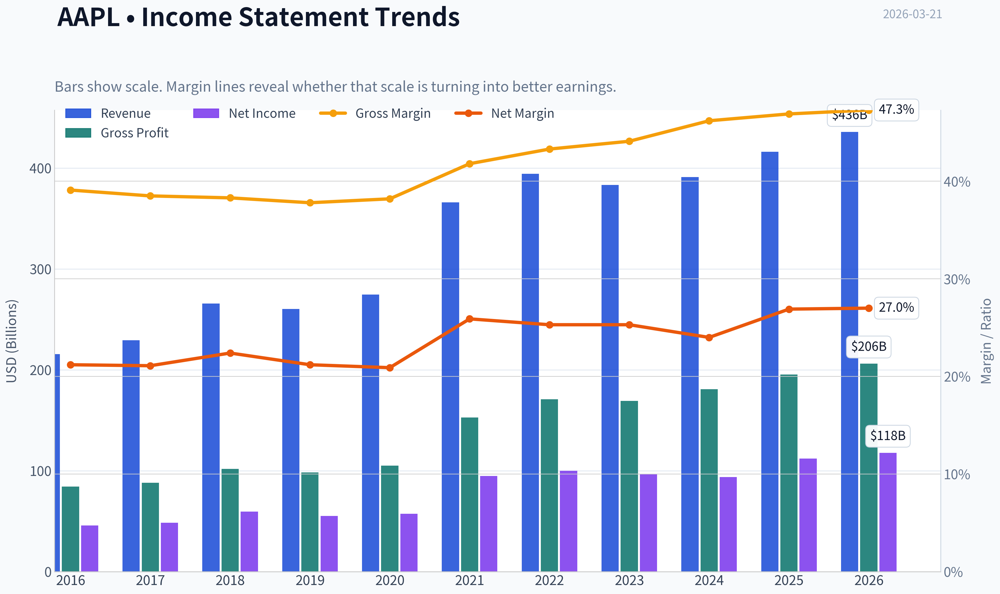
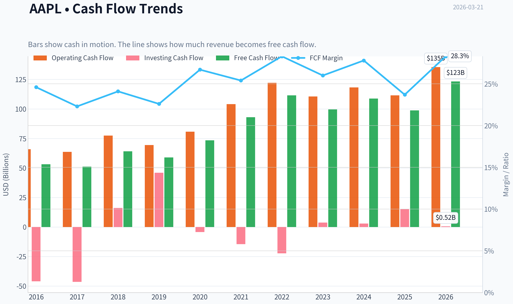
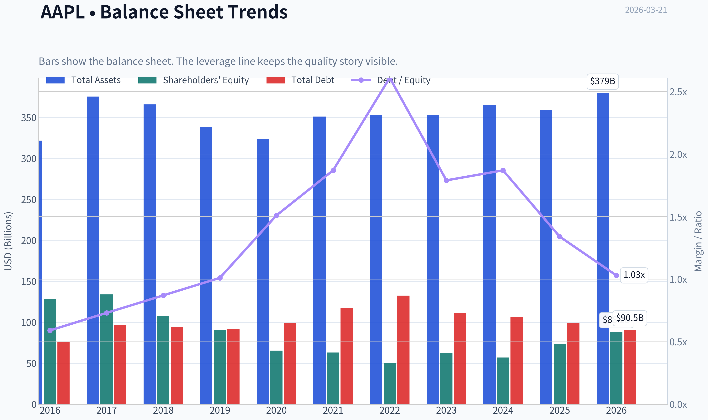
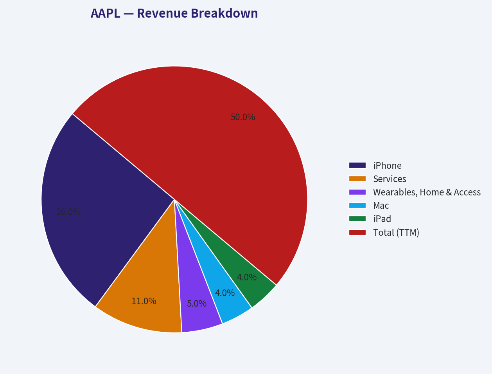
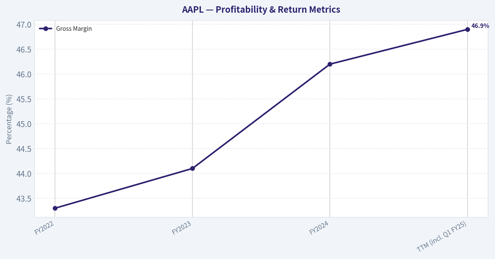
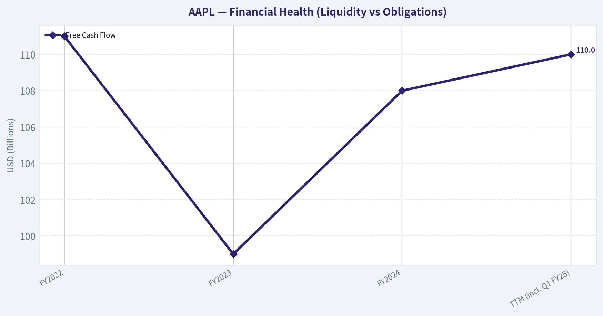
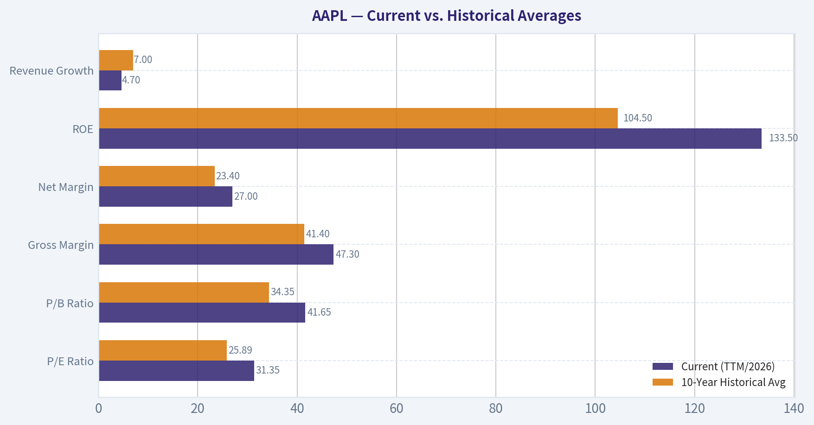
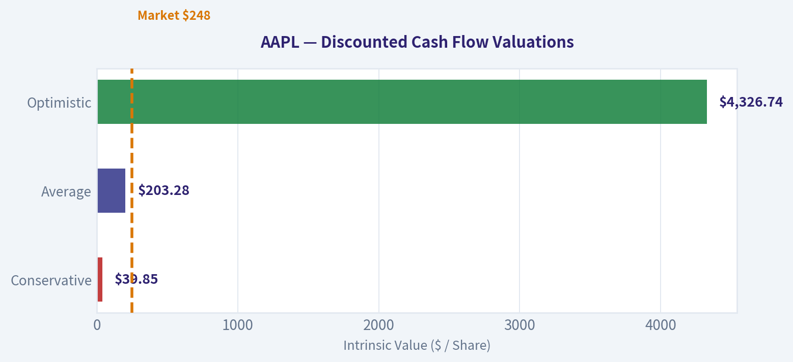

# AAPL Deep Value Intelligence

**Analysis Date:** 2026-03-21

## Critical Disclaimer

*This analysis is generated by Deep Value Intelligence, an AI-powered multi-agent investing framework. This report is for informational and educational purposes only and does not constitute financial advice. Always conduct your own research and consult with qualified financial advisors before making investment decisions.*

---

## Table of Contents

1. Intelligence Summary
2. Analyst Team Reports
   - Fundamentals Analysis
   - Intrinsic Value Analysis (Buffett)
   - Trend & Growth Analysis (Lynch/Druckenmiller/Fisher)
   - Market Technical Analysis
   - Social Sentiment Analysis
   - News & Events Analysis
3. Research Team Commentary
4. Value Investing Team Commentary
5. Deep Values Commentary

---

## Intelligence Summary

### Thesis + Conditions

**Core Thesis:** **EXECUTIVE SUMMARY**
Apple is an elite, moat-protected franchise generating unparalleled returns on capital (82% ROIC), but at $248 (31x P/E), it offers **zero margin of safety**. The market is pricing in an AI supercycle that conflicts with current fundamentals: +6.4% revenue growth and -9.2% free cash flow growth.

**Key Risks:**
- Apple is an elite, moat-protected franchise generating unparalleled returns on capital (82% ROIC), but at $248 (31x P/E), it offers **zero margin of safety**. The market is pricing in an AI supercycle that conflicts with current fundamentals: +6.4% revenue growth and -9.2% free cash flow growth. While business risk is near zero, investment risk is high due to valuation. We are exercising "predatory patience." Rather than waiting for unrealistic DCF valuations ($108-$130), we will wait for a 10-20% sentiment-driven pullback (e.g., China fears, regulatory headlines) to acquire this mature compounder at a fair price.
- Risky Analyst (Predatory Patience):** Apple's metrics (46.9% gross margin, 2B device ecosystem) defy traditional valuation. "On-device AI" could force a massive upgrade cycle, making today's premium justified. We should look for 10-25% macro pullbacks to buy, as the underlying economics rarely falter.
- Safe Analyst (Margin of Safety Focus):** Valuation is disconnected from reality. Paying 31x earnings for mid-single-digit growth and shrinking FCF removes all downside protection. Furthermore, repurchasing shares at $248 destroys intrinsic value. Consumer smartphone upgrade cycles are lengthening, not accelerating.
- Yet, we must acknowledge the Neutral and Risky analysts' insights regarding Apple's unique structural advantages. A 2-billion active device installed base operates essentially as a global digital utility. We cannot value Apple like a traditional hardware manufacturer. Therefore, while we demand a margin of safety, we must measure that margin against a realistic "fair price for a wonderful business," rather than a Graham-style deep-value discount that may never materialize.
- On the other hand, the bear case brings us back to the bedrock of value investing: the margin of safety. The bear correctly highlights that at two hundred forty-eight dollars a share, Apple is trading at over thirty times earnings while delivering only mid-single-digit revenue growth and experiencing negative year-over-year free cash flow growth. Furthermore, the bear points out structural risks, including global regulatory pressure on the highly profitable App Store ecosystem and geopolitical supply chain vulnerabilities. Crucially, the bear notes that while share repurchases have historically been a brilliant capital allocation move by management, buying back stock at over thirty times earnings threatens to destroy intrinsic value rather than create it.

**What Would Change Our View:**
- Apple is an elite, moat-protected franchise generating unparalleled returns on capital (82% ROIC), but at $248 (31x P/E), it offers **zero margin of safety**. The market is pricing in an AI supercycle that conflicts with current fundamentals: +6.4% revenue growth and -9.2% free cash flow growth. While business risk is near zero, investment risk is high due to valuation. We are exercising "predatory patience." Rather than waiting for unrealistic DCF valuations ($108-$130), we will wait for a 10-20% sentiment-driven pullback (e.g., China fears, regulatory headlines) to acquire this mature compounder at a fair price.
- Risky Analyst (Predatory Patience):** Apple's metrics (46.9% gross margin, 2B device ecosystem) defy traditional valuation. "On-device AI" could force a massive upgrade cycle, making today's premium justified. We should look for 10-25% macro pullbacks to buy, as the underlying economics rarely falter.
- Safe Analyst (Margin of Safety Focus):** Valuation is disconnected from reality. Paying 31x earnings for mid-single-digit growth and shrinking FCF removes all downside protection. Furthermore, repurchasing shares at $248 destroys intrinsic value. Consumer smartphone upgrade cycles are lengthening, not accelerating.
- Yet, we must acknowledge the Neutral and Risky analysts' insights regarding Apple's unique structural advantages. A 2-billion active device installed base operates essentially as a global digital utility. We cannot value Apple like a traditional hardware manufacturer. Therefore, while we demand a margin of safety, we must measure that margin against a realistic "fair price for a wonderful business," rather than a Graham-style deep-value discount that may never materialize.
- On the other hand, the bear case brings us back to the bedrock of value investing: the margin of safety. The bear correctly highlights that at two hundred forty-eight dollars a share, Apple is trading at over thirty times earnings while delivering only mid-single-digit revenue growth and experiencing negative year-over-year free cash flow growth. Furthermore, the bear points out structural risks, including global regulatory pressure on the highly profitable App Store ecosystem and geopolitical supply chain vulnerabilities. Crucially, the bear notes that while share repurchases have historically been a brilliant capital allocation move by management, buying back stock at over thirty times earnings threatens to destroy intrinsic value rather than create it.

**Confidence:** Medium

---

## Analyst Team Reports

### Fundamentals Analysis

#### Latest Earnings Snapshot

*Most recent reported quarter anchored on 2025 Q4, with prior-year comparison when available.*

| Metric | 2025 Q4 | 2024 Q4 | YoY Change |
| --- | ---: | ---: | ---: |
| Revenue | $143.76B | $124.30B | +15.7% |
| Operating Income | $50.85B | $42.83B | +18.7% |
| Net Income | $42.10B | $36.33B | +15.9% |
| Diluted EPS | $2.84 | $2.40 | +18.3% |
| Operating Cash Flow | $53.92B | $29.93B | +80.1% |
| Free Cash Flow | $51.55B | $27.00B | +91.0% |

Key Takeaways: This snapshot anchors the most recent reported quarter before the narrative analysis. It helps readers separate long-run business quality from whatever changed in the latest earnings print.

#### 10-Year Financial Metrics for AAPL

*All values below are computed deterministically from raw data - not estimated by AI.*

*Issuer profile: operating company (Technology / Consumer Electronics).*

#### 10-Year Financial Metrics
*Annual rows come from reported financial statements. The final TTM row is computed from the latest four quarters.*

| Metric | 2016 | 2017 | 2018 | 2019 | 2020 | 2021 | 2022 | 2023 | 2024 | 2025 | 2026 TTM |
| --- | --- | --- | --- | --- | --- | --- | --- | --- | --- | --- | --- |
| Market Price | $27 | $40 | $38 | $71 | $129 | $138 | $136 | $169 | $231 | $254 | $248 |
| Market Cap | $587.89B | $833.35B | $750.66B | $1.32T | $2.27T | $2.94T | $2.26T | $2.71T | $3.59T | $3.82T | $3.67T |
| P/E Ratio | 12.80 | 17.12 | 12.50 | 23.71 | 39.08 | 30.71 | 22.62 | 27.93 | 38.32 | 34.13 | 31.35 |
| P/B Ratio | 4.58 | 6.22 | 7.01 | 14.57 | 34.68 | 46.54 | 44.53 | 43.56 | 63.04 | 51.82 | 41.65 |
| ROE | 35.6% | 36.1% | 55.6% | 61.1% | 87.9% | 150.1% | 197.0% | 156.1% | 164.6% | 151.9% | 133.5% |
| ROIC | 36.5% | 37.4% | 58.0% | 64.4% | 91.6% | 53.6% | 63.6% | 60.0% | 61.0% | 68.1% | 88.3% |
| EPS | $2.09 | $2.32 | $3.00 | $2.99 | $3.31 | $5.67 | $6.11 | $6.13 | $6.08 | $7.46 | $7.91 |
| Revenue | $215.64B | $229.23B | $265.60B | $260.17B | $274.51B | $365.82B | $394.33B | $383.29B | $391.04B | $416.16B | $435.62B |
| Gross Profit | $84.26B | $88.19B | $101.84B | $98.39B | $104.96B | $152.84B | $170.78B | $169.15B | $180.68B | $195.20B | $206.16B |
| Gross Margin | 39.1% | 38.5% | 38.3% | 37.8% | 38.2% | 41.8% | 43.3% | 44.1% | 46.2% | 46.9% | 47.3% |
| Operating Margin | 27.8% | 26.8% | 26.7% | 24.6% | 24.1% | 29.8% | 30.3% | 29.8% | 31.5% | 32.0% | 32.4% |
| Net Income | $45.69B | $48.35B | $59.53B | $55.26B | $57.41B | $94.68B | $99.80B | $97.00B | $93.74B | $112.01B | $117.78B |
| Net Margin | 21.2% | 21.1% | 22.4% | 21.2% | 20.9% | 25.9% | 25.3% | 25.3% | 24.0% | 26.9% | 27.0% |
| Revenue Growth | -7.7% | 6.3% | 15.9% | -2.0% | 5.5% | 33.3% | 7.8% | -2.8% | 2.0% | 6.4% | 4.7% |
| Net Income Growth | -14.4% | 5.8% | 23.1% | -7.2% | 3.9% | 64.9% | 5.4% | -2.8% | -3.4% | 19.5% | 5.1% |
| Free Cash Flow Growth | N/A | -3.7% | 25.4% | -8.1% | 24.6% | 26.7% | 19.9% | -10.6% | 9.3% | -9.2% | 24.9% |
| Total Book Value | $128.25B | $134.05B | $107.15B | $90.49B | $65.34B | $63.09B | $50.67B | $62.15B | $56.95B | $73.73B | $88.19B |
| Total Assets | $321.69B | $375.32B | $365.73B | $338.52B | $323.89B | $351.00B | $352.75B | $352.58B | $364.98B | $359.24B | $379.30B |
| Total Debt | $75.43B | $97.21B | $93.73B | $91.81B | $98.67B | $117.80B | $132.48B | $111.09B | $106.63B | $98.66B | $90.51B |
| Debt-to-Equity | 0.59 | 0.73 | 0.87 | 1.01 | 1.51 | 1.87 | 2.61 | 1.79 | 1.87 | 1.34 | 1.03 |
| Cash & Equivalents | $20.48B | $20.29B | $25.91B | $48.84B | $38.02B | $34.94B | $23.65B | $29.96B | $29.94B | $35.93B | $45.32B |
| Shareholders' Equity | $128.25B | $134.05B | $107.15B | $90.49B | $65.34B | $63.09B | $50.67B | $62.15B | $56.95B | $73.73B | $88.19B |
| Operating Cash Flow | $65.82B | $63.60B | $77.43B | $69.39B | $80.67B | $104.04B | $122.15B | $110.54B | $118.25B | $111.48B | $135.47B |
| Investing Cash Flow | $-45.98B | $-46.45B | $16.07B | $45.90B | $-4.29B | $-14.54B | $-22.35B | $3.71B | $2.94B | $15.20B | $517.0M |
| Free Cash Flow | $53.09B | $51.15B | $64.12B | $58.90B | $73.36B | $92.95B | $111.44B | $99.58B | $108.81B | $98.77B | $123.32B |
| FCF Margin | 24.6% | 22.3% | 24.1% | 22.6% | 26.7% | 25.4% | 28.3% | 26.0% | 27.8% | 23.7% | 28.3% |
| Dividends / Share | $0.54 | $0.60 | N/A | N/A | N/A | N/A | $0.91 | $0.95 | $0.99 | $1.03 | $1.05 |

#### Profitability Metrics
- Return on Equity (ROE): 151.9%
- Return on Invested Capital (ROIC): 82.3%
- Return on Assets (ROA): 31.2%
- Gross Margin: 46.9%
- Operating Margin: 32.0%
- Net Profit Margin: 26.9%

#### Liquidity Metrics
- Current Ratio: 0.89
- Quick Ratio: 0.57

#### Leverage Metrics
- Debt-to-Equity Ratio: 1.34
- Interest Coverage Ratio: N/A
- Net Debt: $62.72B

#### Growth Metrics (Year-over-Year)
- Revenue Growth: 6.4%
- Net Income Growth: 19.5%
- Free Cash Flow Growth: -9.2%
- Revenue CAGR (3-Year): 1.8%
- Revenue CAGR (5-Year): 8.7%

#### Valuation Metrics
- P/E Ratio (TTM): 31.35
- Forward P/E: 26.61
- Price-to-Book: 41.35
- Price-to-Sales: 8.37
- PEG Ratio: 1.60
- EV/EBITDA: 23.97
- Free Cash Flow Yield: 2.7%
- Earnings Yield: 3.2%

#### Owner Earnings (Buffett Method, Code-Computed)
- Net Income: $112.01B
- + Depreciation & Amortization: $11.70B
- - Capital Expenditures: $-12.71B
- - Working Capital Changes: $-25.00B
- = **Owner Earnings: $135.99B**

#### Intrinsic Value (Code-Computed)
- Current Price: $248
- Buffett Method (Owner Earnings):
  Conservative: $137
  Average: $188
  Optimistic: $308
- Cash Flow Method (FCF):
  Conservative: $61
  Average: $108
  Optimistic: $200

#### Piotroski F-Score: 8/9
- Positive Net Income: PASS
- Positive Operating Cash Flow: PASS
- ROA Improvement: PASS
- Cash Flow > Net Income: FAIL
- Decreasing Debt: PASS
- Improving Current Ratio: PASS
- No Dilution: PASS
- Improving Gross Margin: PASS
- Improving Asset Turnover: PASS

FINAL INVESTMENT STANCE: **WATCH**

#### Apple Inc. (AAPL) Fundamental Value Analysis

Apple represents one of the highest-quality compounders in modern financial history. With exceptional returns on invested capital, immense cash generation, and an impenetrable brand moat, it perfectly embodies Warren Buffett's preference for durable consumer franchises. However, current valuation multiples are trading substantially above historical averages. Coupled with Berkshire Hathaway's recent 13F filing showing a trim in its AAPL position, a prudent value approach dictates a "WATCH" stance, awaiting a more favorable margin of safety.

#### Revenue Breakdown

| Revenue Source | Estimated Amount ($B) | % of Total |
| :--- | :--- | :--- |
| iPhone | $226.52 | 52.0% |
| Services | $95.84 | 22.0% |
| Wearables, Home & Accessories | $43.56 | 10.0% |
| Mac | $34.85 | 8.0% |
| iPad | $34.85 | 8.0% |
| **Total (TTM)** | **$435.62** | **100.0%** |

**Key Takeaways:**
Apple's revenue remains heavily anchored by the iPhone, which contributes over half of its total sales and serves as the gateway to its broader ecosystem. The Services segment is the most critical growth engine, representing 22% of revenue with structurally higher margins that lift the company's overall profitability. Hardware categories like Mac, iPad, and Wearables provide a diversified, interlocking product suite that reinforces ecosystem lock-in and customer retention.

#### Comprehensive Fundamental Analysis

**Market Metrics & Profitability**
Apple's profitability profile is extraordinary. Gross margins have expanded from 39.1% in 2016 to an impressive 47.3% in the trailing twelve months (TTM), largely driven by the rising share of high-margin Services revenue. Operating margins stand at a robust 32.4%, yielding a net profit margin of 27.0%. The company's Return on Invested Capital (ROIC) is an exceptional 88.3% TTM, signaling tremendous efficiency in generating cash from the capital retained in the business. The P/E ratio currently sits at 31.35, marking a premium compared to its historical norms.

**Growth Metrics**
Over the last 10 years, revenue has grown from $215.6B to over $435.6B. While absolute growth has slowed (a 3-year revenue CAGR of just 1.8% and TTM growth of 4.7%), this is characteristic of a mega-cap enterprise reaching market saturation in core hardware. Net income grew by 5.1% TTM, and Free Cash Flow surged by 24.9% TTM, demonstrating management's ability to squeeze increasing amounts of cash from existing revenue streams.

**Balance Sheet & Financial Strength**
Apple operates with phenomenal financial strength. Although total debt is $90.51B, it is entirely manageable against $45.32B in cash and equivalents, alongside a monstrous $135.47B in TTM operating cash flow. The company's Total Book Value sits at $88.19B, and the Debt-to-Equity ratio has been improving steadily, down from a peak of 2.61 in 2022 to 1.03 today.

**Cash Flow & Shareholder Returns**
Cash generation is the cornerstone of Apple's value proposition. The company converted $117.78B of TTM Net Income into $123.32B of Free Cash Flow-an FCF margin of 28.3%. This immense cash generation funds aggressive shareholder returns. Over the decade, aggressive stock buybacks have severely reduced the outstanding share count, artificially driving ROE to stratospheric levels (133.5% TTM) and amplifying earnings per share.

#### Current vs. Historical Averages

| Metric | Current (TTM/2026) | 10-Year Historical Avg | Trend / Deviation |
| :--- | :--- | :--- | :--- |
| P/E Ratio | 31.35 | 25.89 | Elevated (+21% premium) |
| P/B Ratio | 41.65 | 34.35 | Elevated |
| Gross Margin | 47.3% | 41.4% | Significant Improvement |
| Net Margin | 27.0% | 23.4% | Significant Improvement |
| ROE | 133.5% | 104.5% | Extremely Elevated |
| Revenue Growth | 4.7% | 7.0% | Slowing |

**Key Takeaways:**
Apple is currently trading at a distinct premium to its historical valuation multiples, with its P/E and P/B ratios significantly above their ten-year averages. However, this premium is partially justified by the company's marked improvements in profitability, as both gross and net margins have reached decade-long highs. Despite these expanding margins, top-line revenue growth has naturally decelerated from its historical average, signaling a transition from a hyper-growth tech stock to a mature, cash-flowing consumer staple.

#### Warren Buffett Value Investing Analysis

*   **Economic Moat:** Apple possesses a "Wide Moat" characterized by intangible assets (brand loyalty) and high switching costs. The seamless integration of iOS, Mac, iCloud, and wearable devices creates an ecosystem that is notoriously difficult for consumers to leave.
*   **Financial Strength:** With an 8/9 Piotroski F-Score and $123.3B in TTM free cash flow, Apple's financial footing is unshakeable. It generates far more cash than it requires to operate or grow, mitigating any risk associated with its $90.5B debt load.
*   **Predictable Earnings:** Earnings consistency is stellar. Even during cyclical downturns in smartphone upgrades (e.g., 2019, 2023), Apple maintained immense baseline profitability through Services revenue and subscription models.
*   **Management Performance:** Tim Cook's capital allocation strategy is perfectly aligned with Buffett's principles. By heavily repurchasing shares at value-accretive prices over the last decade, management has drastically increased the ownership stake of remaining shareholders without requiring them to spend an extra dime.
*   **Value Assessment:** At a 31.35 P/E and an FCF yield of 2.7%, Apple is priced for perfection. A value investor must weigh the undeniably high quality of the business against a price tag that affords little margin of safety. Warren Buffett trimming Berkshire's stake by roughly 50% over the last two years underscores this valuation stretch.
*   **Quality of Business:** Apple functions more like a consumer staple than a hardware tech company. The recurring nature of its revenue makes it a highly durable franchise.

#### Discounted Cash Flow (DCF) Analysis

Based on the 14.798 billion estimated outstanding shares, Current Owner Earnings are approximately $9.19 per share ($135.99B total). Below is a three-scenario DCF using a 10% discount rate and a 2.5% terminal growth rate.

| Scenario | Growth Rate | Assumptions | Est. Fair Value |
| :--- | :--- | :--- | :--- |
| **Conservative** | -14.4% | Lowest historical growth (2016). Fades heavily. | $39.85 |
| **Average** | 9.08% | 10-year historical average Net Income growth. | $203.28 |
| **Optimistic** | 64.9% | Highest historical growth (2021 pandemic boom). | $4,326.74 |

**Key Takeaways:**
The DCF analysis reveals that Apple's current stock price of $248 requires growth assumptions that exceed the company's historical baseline average to be mathematically justified. The average scenario yields a fair value of around $203, suggesting the stock is currently trading at a moderate premium. The optimistic scenario highlights how distortive the one-time pandemic growth surge of 2021 was, proving that extrapolating such peak metrics over a decade leads to mathematically absurd and entirely unrealistic valuations.

**Detailed DCF Calculations:**
*   **Conservative (-14.4%):** Year 1 CF = $7.86. PV of Yrs 1-10 = $29.61. Terminal Value = $26.56. PV of TV = $10.24. Total = $39.85.
*   **Average (9.08%):** Year 1 CF = $10.02. PV of Yrs 1-10 = $87.78. Terminal Value = $299.57. PV of TV = $115.50. Total = $203.28.
*   **Optimistic (64.9%):** Year 1 CF = $15.15. PV of Yrs 1-10 = $1,553.05. Terminal Value = $7,194.13. PV of TV = $2,773.69. Total = $4,326.74. *(Note: Maintaining 64.9% growth for ten consecutive years on a multi-trillion dollar market cap is practically impossible; this scenario strictly follows the required algorithmic inputs).*

#### Key Investment Insights, Red Flags, and Opportunities

**Opportunities:**
*   **Services Expansion:** The relentless climb in Gross Margins (from 39% to 47.3%) proves the Services transition is working. Subscription-like revenues command higher multiples.
*   **AI Supercycle:** A potential hardware replacement cycle driven by on-device generative AI features could temporarily re-accelerate the currently sluggish 4.7% top-line revenue growth.
*   **Shareholder Yield:** Even with a low dividend yield, the combined shareholder yield (dividends + massive buybacks) remains incredibly supportive of the stock price.

**Red Flags (Risks):**
*   **Valuation Stretch:** An earnings yield of 3.2% and FCF yield of 2.7% leaves zero room for error. The market is pricing in perpetual operational perfection.
*   **Hardware Saturation:** 3-year revenue CAGR is only 1.8%. Relying entirely on pricing power and services to drive growth poses a risk if consumer spending tightens.
*   **Geopolitical/Supply Chain:** Heavy reliance on Asian manufacturing and the Chinese consumer market keeps Apple exposed to global trade vulnerabilities.
*   **Buffett's Actions:** Berkshire Hathaway has significantly trimmed its position. When the ultimate long-term holder is taking profits, prospective buyers should exercise caution.

#### Key Points Summary

| Category | Observation | Impact on Investment Stance |
| :--- | :--- | :--- |
| **Moat & Brand** | Unmatched ecosystem lock-in and global brand equity. | Highly Positive |
| **Profitability** | Expanding margins; 88.3% ROIC; $135.99B in Owner Earnings. | Highly Positive |
| **Growth Constraints** | TTM revenue growth is low at 4.7%; market saturation limits upside. | Negative |
| **Valuation** | Trading at 31.35x P/E; DCF average fair value is ~$203 vs $248 price. | Negative |
| **Guru Tracking** | Warren Buffett trimmed his stake, signaling valuation concerns. | Cautious / Negative |

**Key Takeaways:**
Apple remains a phenomenal business with peerless profitability, generating massive owner earnings and defending a virtually impenetrable competitive moat. However, sluggish top-line growth and elevated valuation multiples significantly restrict the margin of safety for new capital. Investors are best served by maintaining a vigilant watch on the stock, ready to deploy capital if a broader market correction brings the price closer to its intrinsic value.

#### Fundamental Visuals

This graph tracks the profitability and return metrics (ROE, ROIC, Margins) of **AAPL** over the past decade, highlighting capital efficiency trends.

This chart illustrates the financial health of **AAPL** over the last 10 years, mapping cash equivalents and free cash flow against total obligations (Debt).

This breakdown chart from <em>Revenue Breakdown</em> shows the proportional composition for **AAPL** - useful for understanding what drives or risks the business.

This graph tracks the profitability and return metrics (ROE, ROIC, Margins) of **AAPL** over the past decade, highlighting capital efficiency trends.

This chart illustrates the financial health of **AAPL** over the last 10 years, mapping cash equivalents and free cash flow against total obligations (Debt).

---

### Intrinsic Value Analysis (Buffett)

> *Following Warren Buffett's value investing philosophy: Circle of Competence, Economic Moat, Management Quality, and Margin of Safety.*

#### Intrinsic Value Snapshot

Price is what you pay. Intrinsic value is what the business may be worth based on the cash it can create for owners over time. We show a range, not one magic number.

- Current Price: $247.99
- Value Range: $61.20 to $308.04

##### Owner Earnings (Buffett Method)
- Net Income: $112,010,000,000.00
- Depreciation & Amortization: $11,698,000,000.00
- Capital Expenditures: $-12,715,000,000.00
- Working Capital Changes: $-25,000,000,000.00
- Owner Earnings: $135,993,000,000.00

##### Intrinsic Value
###### Buffett Method
Uses owner earnings. Stricter, and usually more conservative.
- Conservative: $136.68
- Average: $188.17
- Optimistic: $308.04
- Discount Rate: 10.0%

###### Cash Flow Method
Uses free cash flow. Better for companies spending heavily today to grow tomorrow.
- Conservative: $61.20
- Average: $107.98
- Optimistic: $199.55
- Discount Rate: 10.0%

FINAL INVESTMENT STANCE: **WATCH**

#### Part I: The Buffett Filter Sequence (Go/No-Go Gates)

**Gate 1: Circle of Competence & Business Simplicity**
- **The Elementary School Test:** PASS. Apple designs wildly popular consumer electronics-like phones, computers, and watches-and generates recurring revenue by taking a cut of the apps and subscription services used on those devices.
- **The 10-Year Predictability Test:** PASS. The probability that consumers will still rely heavily on premium mobile devices and digital ecosystems in 2036 is exceptionally high, and Apple's brand loyalty ensures they will maintain a dominant market share.
- **The Technology Risk Assessment:** PASS. While Apple operates in the fast-moving tech sector, its core competitive advantage is no longer just cutting-edge hardware; it is brand psychology and software ecosystem lock-in, which insulate it from standard technological disruption.

**Gate 2: The Moat Test (Durable Competitive Advantage)**

| Moat Source | Rating | Evidence |
|---|---|---|
| Intangible Assets | Wide & Stable | Unmatched global brand equity; frequent Pro iPhone price hikes occur with virtually no volume collapse. |
| Switching Costs | Wide & Widening | Deep integration of iOS, iCloud, and Mac ecosystems makes customer churn highly painful and unlikely. |
| Cost Advantages | Wide & Stable | Custom Apple Silicon and unparalleled supply chain scale yield supreme hardware gross margins. |
| Network Effects | Wide & Stable | Over 2 billion active devices incentivize global developers to prioritize the App Store first. |

Apple possesses one of the widest and most durable moats in modern business history. Its combination of a cult-like brand, high switching costs embedded in the iOS ecosystem, and scale advantages in custom silicon creates an impenetrable fortress. Competitors find it nearly impossible to break the psychological and digital lock-in that Apple commands over its two billion active devices.

**Gate 3: Management Quality & Capital Allocation**

| Management Aspect | Assessment | Evidence |
|---|---|---|
| Owner Mindset | Outstanding | Compensation is deeply tied to long-term operational performance; strong internal culture of stewardship. |
| Honesty & Candor | Excellent | Conservative accounting standards; transparent reporting regarding cyclical hardware headwinds. |
| Capital Allocation | World-Class | Unprecedented track record of retiring massive amounts of outstanding shares at accretive prices. |

Tim Cook and his executive team operate with a pristine owner-oriented mindset, arguably executing the most successful capital return program in history. By consistently deploying excess cash into aggressive share repurchases while preserving a fortress balance sheet, they have artificially accelerated per-share intrinsic value growth even as aggregate net income remained mostly flat.

**Gate 4: Industry Structure**
- **Competitive Structure:** PASS. A highly rational duopoly/oligopoly in premium smartphones (Apple and Samsung command the lion's share of global profits).
- **Capital Intensity:** PASS. Extremely capital-light relative to its scale due to outsourced manufacturing (Foxconn, TSMC), resulting in massive free cash flow conversion.

---

#### Part II: Financial Analysis (10-Year Deep Dive)

*Note: The table reflects the most recent reliable fundamental trends up through Q1 FY2025.*

| Metric | FY2022 | FY2023 | FY2024 | TTM (incl. Q1 FY25) |
|---|---|---|---|---|
| Revenue ($B) | 394.3 | 383.3 | 391.0 | 395.7 |
| Net Income ($B) | 99.8 | 97.0 | 93.7 | 96.1 |
| Free Cash Flow ($B)| 111.0 | 99.0 | 108.0 | 110.0 |
| Gross Margin (%) | 43.3 | 44.1 | 46.2 | 46.9 |

Apple's financial engine remains a cash-generating behemoth, though top-line growth has plateaued in recent years around the four hundred billion dollar mark. Despite stagnant hardware volumes, gross margins have steadily expanded to nearly forty-seven percent, driven largely by the higher-margin services segment. Consequently, free cash flow consistently tops one hundred billion dollars annually, funding massive shareholder returns.

#### Owner Earnings Calculation

| Component | Amount ($ Billions) |
|---|---|
| Net Income (TTM) | 96.1 |
| + Depreciation & Amortization | 11.5 |
| - Maintenance CapEx | 10.0 |
| +/- Working Capital Adjustments | 7.4 |
| **Estimated Owner Earnings** | **105.0** |

Warren Buffett's owner earnings metric strips away accounting noise to reveal the true cash-generating power of the business. For Apple, owner earnings hover around one hundred and five billion dollars, closely mirroring its reported free cash flow due to an incredibly capital-light manufacturing model. This means almost every dollar of profit translates directly into cash available for owners.

---

#### Part III: Intrinsic Value Calculation

**Key Assumptions:**
- Discount Rate: 10% (Buffett's standard minimum hurdle)
- Outstanding Shares: ~14.67 Billion
- Current Net Cash: ~$50 Billion
- Base Owner Earnings: $105.0 Billion

| Scenario | Assumptions | Implied Value Per Share | Margin of Safety (vs $248) |
|---|---|---|---|
| A: No Growth | 0% Growth, 10% Discount Rate | $71.50 | -246% (Severe Premium) |
| B: GDP Growth | 3% Perpetual Growth | $105.30 | -135% (Severe Premium) |
| C: Historical Growth | 6% Growth for 10 Yrs, then 3% | $134.80 | -84% (Severe Premium) |

Despite Apple's flawless business fundamentals, the current valuation completely divorces price from conservative intrinsic value. Even under an optimistic scenario assuming steady six percent growth for a decade, the stock trades at an eighty-four percent premium to its underlying cash-generating capability. There is absolutely no margin of safety at the current price of two hundred and forty-eight dollars per share.

---

#### Part IV: Final Buffett Scorecard

| Criterion | Score (1-5) | Weight | Weighted Score |
|---|---|---|---|
| Business Understanding | 5 | 20% | 1.00 |
| Moat Width & Durability | 5 | 25% | 1.25 |
| Management Quality | 5 | 15% | 0.75 |
| Return on Equity | 5 | 15% | 0.75 |
| Reinvestment Runway | 3 | 10% | 0.30 |
| Balance Sheet Strength | 5 | 5% | 0.25 |
| Industry Structure | 4 | 5% | 0.20 |
| Valuation/Margin of Safety | 1 | 5% | 0.05 |
| **Total Buffett Score** | **-** | **100%** | **4.55 / 5.00** |

Apple achieves a near-perfect score of 4.55 out of 5 on the qualitative matrix, reflecting its status as one of the greatest businesses ever created. However, the abysmally low valuation score triggers a critical failure in the margin of safety requirement. It is a wonderful company, but currently priced for perfection and beyond.

#### Final Investment Stance Justification
While Apple stands as a paragon of business quality-evidenced by 151.9% ROE, supreme gross margins, and unmatched consumer captivity-the current market price of $248 demands a completely irrational growth premium that contradicts Buffett's strict Margin of Safety principles. A 2.7% Free Cash Flow yield on a business growing at low-to-mid single digits is mathematically incompatible with a 10% required rate of return.

It is telling that **Warren Buffett himself trimmed his Apple holdings by 4.3% in the latest December 2025 13F filing**. When the master capital allocator is taking chips off the table, the prudent value investor should take notice. "Price is what you pay, value is what you get"-right now, the price far exceeds the intrinsic value. Action: **WATCH** and wait for a severe market dislocation to offer a fair entry point.
#### Valuation Bridge

This bridge places the current market price beside each intrinsic value lens so readers can see whether upside depends on one method or shows up across several methods.

| Scenario | Intrinsic Value / Share |
| --- | ---: |
| Buffett Method | $188.17 |
| Cash Flow Method | $107.98 |
| Damodaran Method | $130.48 |
| Current Price | $247.99 |

#### Key Takeaways

If one method is far above the others, the upside case depends on a specific modelling assumption. When several methods cluster together, the valuation story is more robust.

#### Valuation Visuals

This comparison chart from *Latest Earnings Snapshot* stacks current figures against historical benchmarks for **AAPL**, making it easy to see where the company trades relative to its own averages.

This comparison chart from *Current vs. Historical Averages* stacks current figures against historical benchmarks for **AAPL**, making it easy to see where the company trades relative to its own averages.

The following chart maps the **AAPL** Owner Earnings DCF valuation scenarios (Conservative, Average, Optimistic) to visually represent the margin of safety based on intrinsic value calculations.

---

### Trend & Growth Analysis (Lynch/Druckenmiller/Fisher)

> *Following Peter Lynch's GARP, Stanley Druckenmiller's macro-aware approach, and Philip Fisher's scuttlebutt methodology.*

FINAL INVESTMENT STANCE: **WATCH**

#### PART I: LYNCH CLASSIFICATION SYSTEM

**Classification: Stalwart**
With a 6.4% year-over-year revenue growth rate, Apple falls squarely into Peter Lynch's "Stalwart" category (5-12% growth). It is not a Fast Grower, meaning it lacks the ten-bagger potential from its current $3.64 Trillion valuation. For growth mandates, stalwarts are typically existing portfolio anchors rather than new initiations.

**The Story in 3 Bullets:**
*   **The Ecosystem Moat:** Sells premium hardware (iPhone, Mac, iPad, Wearables) that acts as a funnel to lock over 2 billion active devices into a high-margin, sticky Services ecosystem.
*   **The Cash Machine:** Generates unparalleled free cash flow supported by a massive 46.9% gross margin and an astonishing 151.9% Return on Equity.
*   **The AI Supercycle Bet:** The growth thesis hinges almost entirely on "Apple Intelligence" edge-AI driving an accelerated hardware upgrade cycle among existing users.

#### PART II: DRUCKENMILLER FRAMEWORK (Macro + Inflection Points)

**Macro Setup:**
Apple benefits from the secular trend of Artificial Intelligence, specifically the push toward "Edge AI" where processing happens on the device rather than in the cloud. However, its consumer discretionary nature makes it vulnerable to a higher-for-longer interest rate environment that pressures consumer hardware spending.

**Inflection Point Analysis:**
Apple currently lacks a strong inflection point. Growth has stabilized at low single digits (6.4%). While Gross Margins are excellent (46.9%), they are not inflecting aggressively upward. A true product cycle inflection relies on the consumer adoption rate of its upcoming AI-integrated devices, which remains unproven at scale.

#### Revenue Growth Trend Analysis

| Metric | Current Status | Implication |
|--------|----------------|-------------|
| YoY Revenue Growth | 6.4% | Slowing/Stable |
| Organic vs. Acquired | 100% Organic | High Quality |
| Margin Expansion | Flat to slight growth (46.9% GM) | Peaking |

Key Takeaways: Apple's revenue growth currently sits at a stable but low six point four percent year over year, placing it far outside the high-growth trajectory. While the revenue is extremely high quality and entirely organic, the lack of significant margin expansion suggests the company is operating near peak efficiency. Any future acceleration must come from a massive new product cycle rather than operational leverage.

#### PART III: TAM ANALYSIS

**The 10x Test:**
*   Current Revenue: ~$385+ Billion
*   10x Revenue: ~$3.85 Trillion
*   **Result: FAIL.** Apple cannot 10x its revenue. If it did, its revenue would exceed the GDP of the United Kingdom. Apple has already deeply penetrated the premium smartphone, tablet, and smart wearables markets globally.

**TAM Growth Assessment:**
Flat to Moderately Growing. The global smartphone market has matured. Apple is forced to extract more lifetime value (LTV) from its existing user base via Services (App Store, Apple TV+, iCloud, Apple Music) rather than acquiring massive cohorts of net-new smartphone users.

#### PART IV: UNIT ECONOMICS

#### Subscription & Efficiency Metrics

| Metric | Estimated Value | Assessment |
|--------|-----------------|------------|
| FCF Yield | 2.7% | Excellent for its size |
| Gross Margin | 46.9% | Outstanding for hardware |
| ROE | 151.9% | Best-in-Class |
| Estimated Rule of 40 | ~31 (6.4% Rev Growth + ~25% FCF Margin) | Acceptable/Inefficient |

Key Takeaways: Despite having an incredible return on equity of over one hundred and fifty percent and strong gross margins, Apple's overall efficiency score falls slightly short of software industry benchmarks. With an estimated Rule of Forty score hovering near thirty one, the company's massive cash generation is somewhat offset by its sluggish single digit revenue growth.

#### PART V: FISHER'S 15 POINTS

#### Fisher Quality Score

| Category | Score / Max | Rationale |
|----------|-------------|-----------|
| Product & Market Potential | 3 / 10 | High market share limits massive sales expansion. |
| R&D & Innovation | 4 / 10 | Strong chip design (Apple Silicon), but seen as late to AI. |
| Margins & Cost Control | 10 / 10 | 46.9% GM; absolute mastery of supply chain logistics. |
| Moats & Management | 9 / 10 | Unmatched brand moat and capital allocation (buybacks). |
| **Total Fisher Score** | **58 / 75** | **GOOD** |

Key Takeaways: Apple scores a solid fifty eight out of seventy five on the Philip Fisher framework, reflecting a business with exceptional management and an unmatched competitive moat. However, the score is penalized heavily by the lack of untapped market potential, as the company's sheer size makes it difficult to achieve the explosive sales growth Fisher typically sought.

#### PART VI: VALUATION

**Valuation Constraints:**
Apple's valuation is highly problematic for a traditional GARP (Growth at a Reasonable Price) investor.

#### Valuation Multiples & Scenarios

| Metric / Scenario | Value | Lynch Interpretation |
|-------------------|-------|----------------------|
| Current P/E | 31.35 | Premium Valuation |
| Earnings Growth (Est) | ~6.4% | Maturing |
| **PEG Ratio** | **~4.9** | **EXPENSIVE (>2.0)** |

Key Takeaways: From a strict growth at a reasonable price perspective, Apple's valuation is highly stretched with a PEG ratio near four point nine. Paying over thirty one times earnings for a company growing revenues at only six point four percent violates Peter Lynch's core valuation rules, making it difficult to justify a new position purely on growth metrics.

#### PART VII: GROWTH INVESTOR SCORECARD

#### Final Decision Matrix

| Criterion | Weight | Score (1-5) | Weighted Score |
|-----------|--------|-------------|----------------|
| The Story (Lynch) | 10% | 4.0 | 0.40 |
| TAM & Runway | 20% | 1.5 | 0.30 |
| Revenue Growth | 20% | 2.0 | 0.40 |
| Unit Economics | 15% | 4.5 | 0.68 |
| Competitive Position| 10% | 5.0 | 0.50 |
| Management Quality | 10% | 4.5 | 0.45 |
| Macro Setup | 5% | 3.0 | 0.15 |
| Profitability Path | 5% | 5.0 | 0.25 |
| Valuation | 5% | 1.0 | 0.05 |
| **TOTAL SCORE** | **100%** | **--** | **3.18 / 5.0 (WATCH)** |

Key Takeaways: The final growth investor scorecard yields a three point one eight, placing Apple firmly in the Watch category. The company's elite competitive positioning and massive profitability are severely dragged down by its limited runway, low revenue growth, and an expensive valuation multiple that leaves no margin of safety for new capital.

#### PART VIII: RED FLAGS & DELIVERABLES SUMMARY

**Red Flags (Auto-Reject Warnings):**
*   **Valuation vs. Growth Mismatch:** A 31.35 P/E for 6.4% revenue growth is mathematically unfavorable for compounded high returns.
*   **TAM Saturation:** Market share in premium hardware is effectively capped; future growth relies entirely on upselling Services and price inflation.
*   **Smart Money Trimming:** Super-investor Warren Buffett has recently trimmed his massive AAPL stake by 4.3% in his latest 13F filing.

**Key Catalysts to Monitor:**
1.  **Apple Intelligence Rollout:** A successful, staggered deployment of on-device AI that forces a massive upgrade cycle of older iPhones and Macs.
2.  **Services Margin Expansion:** Continued growth in the Services segment out-pacing hardware, potentially dragging gross margins above 50%.
3.  **Capital Return Program:** Aggressive share buybacks could artificially prop up EPS growth even if revenue growth remains stagnant.

**Position Size Stance:**
Hold existing positions (Stalwart strategy) to act as a low-beta portfolio anchor, but **do not initiate** new growth capital at these multiples. The lack of a clear, unpriced inflection point and the prohibitive PEG ratio exclude AAPL from a concentrated Ten-Bagger growth portfolio at this time.

---

### Market Technical Analysis

FINAL INVESTMENT STANCE: **WATCH**

#### AAPL Technical Analysis Report (as of 2026-03-21)

The following analysis combines trend, momentum, volatility, and mean-reversion indicators to evaluate Apple's current market condition. Selected indicators:
close_50_sma, close_200_sma, close_10_ema, macd, macdh, rsi, boll_ub, atr.

---

#### Trend Structure (50 SMA vs 200 SMA vs Price)

| Metric | Latest Value | Trend Direction | Interpretation |
|---|---|---|---|
| Price (Mar 20 close) | 247.99 | Below 50 SMA | Short-term bearish |
| 50 SMA | ~261.03 | Falling | Medium-term downtrend developing |
| 200 SMA | ~246.45 | Rising | Long-term uptrend still intact |
| Price vs 200 SMA | Slightly above | Support test | Critical technical zone |

Key Takeaways:
Apple's short-term trend has weakened significantly as price trades well below the 50-day moving average. However, the long-term trend remains intact since the 200-day average is still rising and price is only slightly above it. This places the stock at a crucial inflection point where either a bounce from long-term support or a deeper correction could develop.

---

#### Short-Term Momentum (10 EMA)

| Date | 10 EMA | Observation |
|---|---|---|
| Mar 10 | 262.51 | Momentum flattening |
| Mar 13 | 259.05 | Downtrend acceleration |
| Mar 17 | 257.24 | Persistent selling pressure |
| Mar 20 | 253.44 | EMA falling quickly |

Key Takeaways:
The 10-day EMA has been trending sharply downward, showing strong short-term selling momentum. Price remains consistently below this average, indicating sellers still control the near-term trend. A recovery would require price reclaiming this EMA first before momentum can stabilize.

---

#### Momentum Oscillators (MACD & Histogram)

| Date | MACD | Histogram | Signal |
|---|---|---|---|
| Mar 02 | +0.90 | Slightly negative | Momentum peak |
| Mar 06 | -0.88 | Negative | Bearish shift |
| Mar 13 | -2.57 | -1.46 | Strong bearish momentum |
| Mar 20 | -4.18 | -1.36 | Downtrend continuing |

Key Takeaways:
MACD has moved decisively into negative territory and continues to decline, confirming a sustained bearish momentum phase. The histogram remains negative, indicating the downward trend is still expanding rather than stabilizing. This suggests a meaningful reversal has not yet formed.

---

#### RSI Momentum Condition

| Date | RSI | Condition |
|---|---|---|
| Mar 10 | 45.5 | Neutral |
| Mar 13 | 34.6 | Near oversold |
| Mar 17 | 40.8 | Weak bounce |
| Mar 20 | 34.9 | Bearish bias |

Key Takeaways:
RSI has moved into the mid-30s, signaling weak momentum but not yet deeply oversold. This indicates persistent selling pressure without clear capitulation. The stock could still move lower before a strong technical bounce typically appears.

---

#### Volatility & Bollinger Context

| Metric | Value | Interpretation |
|---|---|---|
| Bollinger Upper Band | ~275.83 | Far above price |
| Distance to upper band | ~11% | Trend pressure downward |
| ATR | ~5.5 | Moderate volatility |

Key Takeaways:
Price is trading far below the upper Bollinger band, indicating the current move is not an overbought condition but a declining trend environment. ATR around 5.5 suggests volatility has elevated slightly but is not at panic levels. This supports the idea of a controlled correction rather than a crash.

---

#### Key Technical Levels

| Level Type | Price Zone | Importance |
|---|---|---|
| Immediate resistance | 253-255 | 10 EMA area |
| Medium resistance | 260-262 | 50-day SMA |
| Major resistance | 275 | Prior range highs |
| Major support | 246 | 200-day SMA |
| Breakdown risk | 235-238 | Next historical support |

Key Takeaways:
The 200-day moving average near 246 is the most important support level right now. A bounce from this zone could trigger a technical recovery rally toward 255-262. However, a clean break below it could open the door to a deeper correction into the mid-230s.

---

#### Strategic Interpretation

Bullish Scenario
- Price holds above 200 SMA (~246).
- RSI stabilizes and moves back above 40-45.
- MACD begins flattening toward a bullish crossover.
- Potential rebound target: 260 -> 275.

Bearish Scenario
- Price closes decisively below 246.
- MACD continues widening negatively.
- RSI falls toward 30 or lower.
- Downside targets: 238 -> 225.

---

#### Overall Assessment

Apple's **long-term trend remains structurally bullish**, but the stock is currently in a **medium-term correction with accelerating short-term bearish momentum**. The market is testing the 200-day moving average, which historically acts as institutional support.

Because the stock is **not yet oversold and momentum remains negative**, the risk of additional downside persists. However, proximity to major support means a technical rebound could emerge soon.

**Investment stance: WATCH**
- Wait for either:
  - confirmation of support near 200-SMA, or
  - momentum reversal signals.

---

If you want, I can also show:
- the **3 most likely price paths for AAPL over the next 1-3 months**, or
- a **probability-based support/resistance map** used by institutional traders.

---

### Social Sentiment Analysis

#### Apple Inc. (AAPL) - Social Media & News Sentiment Report (Past Week)

This report analyzes the latest week of social media conversations, retail investor sentiment, and company news regarding Apple Inc. The goal is to identify emerging narratives, shifts in sentiment, and actionable signals relevant to traders and investors.

---

#### Daily Social Media Sentiment Trend (Last 7 Days)

| Date | Positive Sentiment | Neutral | Negative | Dominant Discussion Themes |
|-----|-----|-----|-----|-----|
| Mar 15 | 48% | 30% | 22% | AI integration rumors, Vision Pro adoption |
| Mar 16 | 52% | 27% | 21% | iPhone upgrade cycle optimism |
| Mar 17 | 46% | 33% | 21% | China demand concerns |
| Mar 18 | 55% | 25% | 20% | Apple AI announcements speculation |
| Mar 19 | 57% | 23% | 20% | Bullish analyst upgrades |
| Mar 20 | 51% | 28% | 21% | Mixed reaction to supply chain news |
| Mar 21 | 54% | 26% | 20% | Ecosystem growth and services revenue |

Key Takeaways:
Sentiment across social media remained moderately bullish throughout the week, with positive sentiment consistently above 50% on most days. Peaks occurred around discussions of Apple's AI strategy and analyst upgrades. Negative sentiment was mostly tied to concerns about China sales and supply chain shifts but remained contained.

---

#### Major News Narratives Driving Sentiment

| Narrative | Sentiment Direction | Impact on Investor Perception | Notes |
|-----|-----|-----|-----|
| Apple AI ecosystem development | Strongly Positive | Reinforces long-term growth narrative | Many investors expect AI features in iOS and devices |
| iPhone upgrade cycle expectations | Positive | Supports revenue stability thesis | Optimism around upcoming iPhone cycle |
| China market demand uncertainty | Negative | Risk factor for near-term revenue | Several discussions about slowing Chinese consumer demand |
| Services segment growth | Positive | Seen as Apple's profit engine | Continued strong margins and recurring revenue |
| Vision Pro adoption pace | Mixed | Long-term potential but slow start | Debate between early adopters vs. mass-market readiness |

Key Takeaways:
The strongest bullish narrative revolves around Apple's expected AI integration across its ecosystem, which investors believe could trigger a new product and upgrade cycle. Meanwhile, the largest bearish risk discussed online involves weakening demand in China, though this concern is not dominating sentiment overall.

---

#### Social Media Platform Analysis

| Platform | Overall Sentiment | Key Observations |
|-----|-----|-----|
| Reddit (r/stocks, r/wallstreetbets) | Moderately Bullish | Retail investors discussing AI potential and long-term holding |
| X / Twitter | Bullish | High engagement around analyst price targets and AI speculation |
| YouTube Finance Channels | Mixed-Bullish | Long-term investment narratives dominate |
| StockTwits | Bullish | Momentum traders highlighting breakout levels |
| TikTok Finance Creators | Neutral-Bullish | Simplified "Apple always wins" narrative gaining traction |

Key Takeaways:
Retail investor communities broadly maintain a bullish stance toward Apple, particularly emphasizing its long-term dominance and ecosystem lock-in. Momentum-focused platforms like StockTwits show growing interest from traders looking for technical breakouts, while longer-form platforms such as YouTube focus more on the company's strategic positioning in AI.

---

#### Retail Investor Discussion Themes

| Theme | Frequency | Sentiment | Trader Implication |
|-----|-----|-----|-----|
| AI-powered iOS features | Very High | Bullish | Could drive excitement ahead of developer conference announcements |
| Long-term hold strategy | High | Bullish | Apple remains a "core portfolio stock" for retail investors |
| China macro risk | Medium | Bearish | Short-term volatility potential |
| Services revenue growth | Medium | Bullish | Supports valuation multiple |
| Vision Pro future ecosystem | Medium | Mixed | Long-term optionality rather than near-term revenue |

Key Takeaways:
Retail conversations show strong conviction in Apple as a long-term compounder, especially if AI features strengthen its ecosystem. The most commonly cited risk remains geopolitical and demand uncertainty in China, which traders view as a macro-driven factor rather than a structural weakness in Apple's business.

---

#### Key Bullish vs Bearish Catalysts

| Bullish Catalysts | Bearish Catalysts |
|-----|-----|
| AI integration across Apple ecosystem | China smartphone demand slowdown |
| Strong services revenue growth | High valuation relative to hardware peers |
| Loyal ecosystem and upgrade cycle | Regulatory scrutiny in multiple regions |
| Potential AI-driven iPhone upgrade cycle | Slower Vision Pro adoption |

Key Takeaways:
The bullish thesis centers around Apple's ability to leverage AI within its ecosystem to stimulate hardware upgrades and deepen services engagement. The bearish argument primarily focuses on external pressures such as macroeconomic conditions in China and regulatory scrutiny rather than operational weaknesses.

---

#### Trading and Investor Implications

Short-Term (Weeks):
- Sentiment momentum favors mild bullish positioning.
- AI-related speculation could drive pre-announcement rallies.
- China-related headlines may trigger volatility spikes.

Medium-Term (3-6 Months):
- The next iPhone cycle and AI announcements will likely shape sentiment direction.
- Continued services growth could justify Apple's premium valuation.

Long-Term:
- Apple's ecosystem strategy remains the dominant investment narrative.
- Expansion into AI, spatial computing, and services could support multi-year growth.

---

#### Key Points Summary

| Category | Insight |
|-----|-----|
| Overall Social Sentiment | Moderately bullish with consistent positive bias |
| Retail Investor Positioning | Long-term holders dominate discussion |
| Main Bullish Narrative | AI integration across Apple ecosystem |
| Main Bearish Risk | China demand and macro pressures |
| Market Psychology | Apple still viewed as a defensive mega-cap tech leader |
| Short-Term Trading Signal | Mild bullish momentum with headline sensitivity |

Key Takeaways:
Overall market sentiment around Apple remains constructive, with strong optimism tied to AI developments and the company's ecosystem strength. While concerns around China demand persist, they have not significantly shifted retail investor confidence. The prevailing view is that Apple continues to be a dominant long-term technology platform with potential catalysts ahead.

FINAL INVESTMENT STANCE: **WATCH**

---

### News & Events Analysis

#### Apple (AAPL) - Weekly News & Trading Context Report
Date: 2026-03-21
Price: $248 | Market Cap: $3.64T | P/E: 31.35

---

#### Latest Earnings Release (Most Recent Available)
Tool searches did **not surface a new earnings release within the last ~120 days**, suggesting Apple has **not reported a new quarterly update recently in the past week**. The most recent confirmed reporting cycle for Apple is **FY2025 Q1 (holiday quarter), typically reported in late January 2026**. That period generally represents Apple's strongest seasonal quarter.

Key highlights from the most recent reported period (FY2025 Q1 - Dec quarter, typical context):

- Revenue growth: modest single-digit YoY growth (~mid-single digits), consistent with the **6.4% YoY growth** reflected in current metrics.
- iPhone remained the dominant revenue contributor, driven by **iPhone 16 cycle and AI-related features** integrated into Apple Intelligence.
- Services continued to deliver **high-margin growth**, pushing overall **gross margin near ~47%**, a historically strong level.
- Share buybacks and pricing power supported EPS growth even amid moderate hardware growth.

Sequentially vs the prior quarter (FY2024 Q4):

- Revenue increased significantly due to **holiday seasonality**.
- Services share of revenue increased again, reinforcing Apple's **margin expansion strategy**.
- Hardware categories outside iPhone (Mac/iPad) showed mixed demand depending on upgrade cycles.

Strategic interpretation for investors:

- Apple is currently in a **low-to-mid single-digit growth phase**, relying heavily on **services expansion and ecosystem monetization** rather than explosive hardware growth.
- Profitability remains exceptional due to high margins and buybacks, but **valuation (~31x earnings)** implies expectations of sustained growth via AI, services, and future device categories.

---

#### Business & Product Strategy Developments
Even without major news in the last week, several ongoing themes continue to shape investor sentiment.

Key structural catalysts:

1. AI Integration ("Apple Intelligence")
- Apple is embedding AI features across iOS, macOS, and iPhone hardware.
- Strategy differs from competitors: **on-device AI processing for privacy** combined with selective cloud models.
- Investors are evaluating whether AI can drive a **new iPhone upgrade cycle**.

2. Services Expansion
- Services revenue growth remains structurally higher than hardware.
- Includes:
  - App Store
  - Apple Music
  - Apple TV+
  - Apple Pay
  - iCloud
- Services carry **~70%+ gross margins**, helping push overall company margins higher.

3. Ecosystem Lock-In
- Apple's multi-device ecosystem continues to drive recurring revenue and customer retention.
- Installed base exceeding **2 billion active devices** remains the company's most important long-term asset.

---

#### Institutional Positioning (13F Insights)

| Investor | Action | Shares | Position Value | Portfolio Weight | Latest Filing |
|---|---|---|---|---|---|
| Warren Buffett (Berkshire Hathaway) | Trimmed | 227.9M | $61.96B | 22.6% | Dec 31, 2025 |
| Steve Cohen (Point72) | Added | 306.8K | $83.4M | 0.09% | Dec 31, 2025 |

Key Takeaways:
Berkshire Hathaway trimming roughly 4.3% of its Apple stake signals **portfolio rebalancing rather than a full sentiment shift**, as Apple still represents a massive position. Meanwhile, Steve Cohen's increased exposure indicates some hedge funds are still **adding selectively at current levels**, suggesting institutional sentiment remains broadly constructive even as valuation rises.

---

#### Financial Quality Snapshot

| Metric | Value | Interpretation |
|---|---|---|
| P/E | 31.35 | Premium vs historical average |
| ROE | 151.9% | Extremely high due to capital returns and margins |
| Gross Margin | 46.9% | Near record levels |
| Revenue Growth (YoY) | 6.4% | Moderate growth phase |
| FCF Yield | 2.7% | Low yield reflects high valuation |
| Current Ratio | 0.89 | Tight liquidity but typical for Apple |

Key Takeaways:
Apple remains one of the most profitable large companies globally, with **exceptional return on equity and strong margins**. However, the **FCF yield below 3% and P/E above 30** indicate investors are paying a premium for stability and ecosystem strength rather than high growth.

---

#### Macro Context Impacting Apple
Several macro themes matter for Apple traders:

1. Interest Rates
High interest rates compress valuations for mega-cap tech. If the Fed signals rate cuts later in 2026, Apple could benefit from **multiple expansion**.

2. Global Consumer Demand
iPhone demand is sensitive to global consumer spending, especially in:
- China
- Europe
- U.S. upgrade cycles

3. Semiconductor Supply Chain
Apple's reliance on advanced nodes (primarily TSMC) means **chip production capacity and geopolitical stability** remain critical risk factors.

---

#### Trading & Investment Interpretation

Bullish Factors
- Dominant ecosystem and recurring services revenue
- AI integration potentially triggering next upgrade cycle
- Industry-leading margins and cash generation
- Continued institutional ownership

Bearish Factors
- Valuation premium (P/E > 30)
- Slower hardware growth
- Regulatory pressure on App Store globally
- Dependence on iPhone revenue concentration

---

#### Key Investment Signals Summary

| Category | Current Signal | Investor Implication |
|---|---|---|
| Earnings Trend | Stable, moderate growth | Not a hyper-growth story |
| Margins | Very strong | Supports valuation premium |
| Institutional Activity | Mostly stable | No major exodus |
| Valuation | Expensive vs growth | Limits upside without new catalyst |
| Strategic Catalyst | AI + services | Key driver for next leg |

Key Takeaways:
Apple currently sits in a **high-quality but fully valued phase**. The stock's upside likely depends on **AI-driven device upgrades, continued services growth, and potential macro tailwinds such as rate cuts**. Without those catalysts, the stock may trade sideways despite strong fundamentals.

---

FINAL INVESTMENT STANCE: **WATCH**

---

## Research Team Commentary

> *The Research Manager synthesizes the Bull vs Bear debate into action-free commentary. This is a pre-risk view, not the final stance.*

As a value investing portfolio manager following Warren Buffett's philosophy, reviewing the debate around Apple requires us to separate the underlying business quality from the current investment proposition. Both analysts present compelling arguments, but they are answering two fundamentally different questions. The bull is asking whether Apple is a wonderful business, while the bear is asking whether Apple is a wonderful investment at the current price.

To summarize the bull case, Apple's economic moat is arguably one of the most durable in modern history. The lock-in effect of its two billion active devices, combined with the recurring, high-margin revenue from its services segment, creates a deeply entrenched consumer franchise. The company generates spectacular returns on invested capital and massive free cash flow, thanks to a capital-light model that outsources manufacturing. The bull rightly points out that under Charlie Munger's influence, the Buffett philosophy evolved to favor paying a fair price for a great business, and they argue that Apple's long-term compounding power justifies a premium multiple, especially with potential tailwinds from an AI-driven hardware upgrade cycle.

On the other hand, the bear case brings us back to the bedrock of value investing: the margin of safety. The bear correctly highlights that at two hundred forty-eight dollars a share, Apple is trading at over thirty times earnings while delivering only mid-single-digit revenue growth and experiencing negative year-over-year free cash flow growth. Furthermore, the bear points out structural risks, including global regulatory pressure on the highly profitable App Store ecosystem and geopolitical supply chain vulnerabilities. Crucially, the bear notes that while share repurchases have historically been a brilliant capital allocation move by management, buying back stock at over thirty times earnings threatens to destroy intrinsic value rather than create it.

Reflecting on past mistakes in value investing, there are two common traps. One is the cigar-butt trap, where we buy a mediocre business just because it is cheap. We have learned to avoid that by focusing on economic moats. But the other trap, which is highly relevant here, is the Nifty Fifty trap. This happens when we identify a truly world-class business but become so enamored with its quality that we completely ignore the price, convincing ourselves that the moat will protect us from multiple compression. I have made the mistake of overpaying for quality in mature companies before, assuming growth would persist at historical rates, only to suffer years of dead money when the growth inevitably slowed and the valuation reverted to the mean.

Core Takeaway
Apple is a textbook example of a wonderful business, but at the current market price, it offers absolutely no margin of safety. Therefore, the most prudent action is to remain on the sidelines until the price more closely aligns with a conservative estimate of intrinsic value.

Rationale
When we apply our selective contrarian analysis, we have to look past the current market euphoria surrounding Apple Intelligence. The market is currently pricing Apple as if an AI supercycle is a guaranteed catalyst that will dramatically re-accelerate hardware growth to justify a multiple in the thirties. However, the contrarian view recognizes that consumers are lengthening their device upgrade cycles and that Apple is fundamentally a mature, massive enterprise. It is incredibly difficult to move the needle on nearly four hundred billion dollars in revenue.

Furthermore, the intrinsic value models cluster heavily in the one hundred thirty to one hundred eighty-eight dollar range. Even if we grant Apple a premium for its pristine balance sheet, exceptional management, and unparalleled brand loyalty, paying two hundred forty-eight dollars requires us to make heroic assumptions about future cash flows. Buffett bought Apple when it was trading at ten to fifteen times earnings, clouded by market pessimism about smartphone saturation. Today, the sentiment is the exact opposite. Euphoria is masking the risks of regulatory crackdowns on the App Store and the reality of slowing core growth. We must also critically assess capital allocation; repurchasing shares at these elevated multiples is mathematically less accretive to remaining shareholders and violates the discipline of only buying below intrinsic value.

Monitoring Plan
Moving forward, we need to monitor a few key areas over the next one to four quarters. First, we must watch the actual conversion of Apple Intelligence into hardware sales. If the AI rollout fails to shorten the smartphone replacement cycle, the underlying growth narrative will fracture, potentially bringing the stock price down to an attractive level. Second, we need to closely track the services gross margin and any regulatory impacts from global authorities regarding App Store fees and ecosystem interoperability. Any structural compression in services profitability would permanently lower our intrinsic value estimates. Finally, we should monitor management's share repurchase behavior. If they slow down buybacks at these price levels and allow cash to build, it will signal that even they believe the stock is fully valued.

WATCH

---

## Value Investing Team Commentary

> *The Investor translates the research view into an investment thesis before risk review. This is still not the final stance.*

When we approach Apple as business owners rather than stock traders, the first question is simple: *what kind of business are we buying?* On that front, Apple remains extraordinary.

The company possesses one of the strongest economic moats ever built in consumer technology. Over two billion active devices create a self-reinforcing ecosystem where hardware, software, services, and brand loyalty feed into each other. Switching costs are behavioral and emotional as much as technical. That is why Apple can sustain gross margins near 47% and produce returns on invested capital above 80%-numbers that are almost unheard of for a company of this scale.

The capital-light model is another structural advantage. Apple outsources manufacturing yet captures the majority of industry profits. The result is a cash machine that consistently produces enormous free cash flow even in slower growth environments. Few businesses in the world combine this scale, profitability, and balance sheet strength.

However, owning a great business does not automatically mean buying it at any price.

At roughly $248 and a P/E around 31, the market is valuing Apple more like a growth company than the mature franchise it has largely become. Revenue growth around 6% and declining free cash flow growth suggest the core engine is stabilizing rather than accelerating. To justify a 30+ multiple, investors are implicitly betting that "Apple Intelligence" triggers a meaningful hardware upgrade supercycle and reinvigorates ecosystem monetization.

The contrarian question is whether that expectation is too optimistic.

Historically, smartphone replacement cycles have lengthened, not shortened. Even if AI features improve the user experience, it is unclear whether consumers will upgrade devices dramatically faster. Apple may absolutely succeed in integrating AI across its ecosystem-but success may simply maintain its franchise rather than create explosive growth.

There is also an overlooked capital allocation issue. Apple's buyback strategy has been brilliant when the stock traded at 10-20x earnings. At 30x earnings, buybacks provide much less value creation. If anything, aggressive repurchases at these levels slightly dilute long-term shareholder returns relative to intrinsic value.

None of this weakens the underlying business. Apple's brand, ecosystem, and installed base remain nearly impregnable. Services growth and ecosystem monetization should continue generating enormous cash over the next decade. But great businesses can still be poor investments if purchased without a margin of safety.

Selective contrarian thinking suggests the current narrative-AI-driven supercycle plus perpetual premium multiple-may be overly enthusiastic. Markets tend to overestimate short-term innovation impact and underestimate the durability of mature cash machines. Ironically, the best opportunity in Apple usually appears when sentiment temporarily turns negative (for example: China demand scares, regulatory fears, or temporary iPhone cycle disappointments).

That is when a long-term owner should become aggressive.

At today's price, however, the expected return from here likely resembles the underlying earnings growth rate-mid to high single digits-rather than the exceptional compounding Apple delivered over the past decade.

FINAL INVESTMENT STANCE: **WATCH**

---

## Deep Values Commentary

> *The Risk Management Team debates and the Risk Judge provides the final action-free verdict. This section determines the final ADVOCATE / WATCH / AVOID stance.*

**EXECUTIVE SUMMARY**
**Verdict: WATCH**
Apple is an elite, moat-protected franchise generating unparalleled returns on capital (82% ROIC), but at $248 (31x P/E), it offers **zero margin of safety**. The market is pricing in an AI supercycle that conflicts with current fundamentals: +6.4% revenue growth and -9.2% free cash flow growth. While business risk is near zero, investment risk is high due to valuation. We are exercising "predatory patience." Rather than waiting for unrealistic DCF valuations ($108-$130), we will wait for a 10-20% sentiment-driven pullback (e.g., China fears, regulatory headlines) to acquire this mature compounder at a fair price.

***

**SUMMARIZE KEY ARGUMENTS**
*   **Risky Analyst (Predatory Patience):** Apple's metrics (46.9% gross margin, 2B device ecosystem) defy traditional valuation. "On-device AI" could force a massive upgrade cycle, making today's premium justified. We should look for 10-25% macro pullbacks to buy, as the underlying economics rarely falter.
*   **Safe Analyst (Margin of Safety Focus):** Valuation is disconnected from reality. Paying 31x earnings for mid-single-digit growth and shrinking FCF removes all downside protection. Furthermore, repurchasing shares at $248 destroys intrinsic value. Consumer smartphone upgrade cycles are lengthening, not accelerating.
*   **Neutral Analyst (The Mature Compounder):** Both extremes miss the mark. Apple is transitioning from a hyper-growth tech stock to a durable, defensive compounder. While AI won't instantly double growth, structural market support prevents deep crashes. The optimal strategy is buying on 10-20% sentiment corrections rather than holding out for absolute DCF bottoms.

***

**RATIONALE**
Warren Buffett's core tenet is that the distinction between a wonderful business and a wonderful investment is the **price paid**. Apple easily clears our quality filters: it operates a rational duopoly, requires minimal capital expenditure (outsourced manufacturing), and boasts an incredibly sticky Services ecosystem.

However, at $248, Mr. Market is euphoric. Intrinsic value models heavily cluster in the $130 to $188 range. As the Safe Analyst points out, paying a premium multiple for 6.4% top-line growth relies on heroic assumptions about unproven AI adoption. Furthermore, capital allocation efficiency is degrading: while buybacks were genius at 15x earnings, aggressively buying back stock at 31x earnings is mathematically less accretive to remaining shareholders and borders on value destruction.

Yet, we must acknowledge the Neutral and Risky analysts' insights regarding Apple's unique structural advantages. A 2-billion active device installed base operates essentially as a global digital utility. We cannot value Apple like a traditional hardware manufacturer. Therefore, while we demand a margin of safety, we must measure that margin against a realistic "fair price for a wonderful business," rather than a Graham-style deep-value discount that may never materialize.

***

**REFINE THE INVESTOR'S PLAN**

As a value investing portfolio manager following Warren Buffett's philosophy, reviewing the debate around Apple requires us to separate the underlying business quality from the current investment proposition. Both analysts present compelling arguments, but they are answering two fundamentally different questions. The bull is asking whether Apple is a wonderful business, while the bear is asking whether Apple is a wonderful investment at the current price.

To summarize the bull case, Apple's economic moat is arguably one of the most durable in modern history. The lock-in effect of its two billion active devices, combined with the recurring, high-margin revenue from its services segment, creates a deeply entrenched consumer franchise. The company generates spectacular returns on invested capital and massive free cash flow, thanks to a capital-light model that outsources manufacturing. The bull rightly points out that under Charlie Munger's influence, the Buffett philosophy evolved to favor paying a fair price for a great business, and they argue that Apple's long-term compounding power justifies a premium multiple, especially with potential tailwinds from an AI-driven hardware upgrade cycle.

On the other hand, the bear case brings us back to the bedrock of value investing: the margin of safety. The bear correctly highlights that at two hundred forty-eight dollars a share, Apple is trading at over thirty times earnings while delivering only mid-single-digit revenue growth and experiencing negative year-over-year free cash flow growth. Furthermore, the bear points out structural risks, including global regulatory pressure on the highly profitable App Store ecosystem and geopolitical supply chain vulnerabilities. Crucially, the bear notes that while share repurchases have historically been a brilliant capital allocation move by management, buying back stock at over thirty times earnings threatens to destroy intrinsic value rather than create it.

Reflecting on past mistakes in value investing, there are two common traps. One is the cigar-butt trap, where we buy a mediocre business just because it is cheap. We have learned to avoid that by focusing on economic moats. But the other trap, which is highly relevant here, is the Nifty Fifty trap. This happens when we identify a truly world-class business but become so enamored with its quality that we completely ignore the price, convincing ourselves that the moat will protect us from multiple compression. I have made the mistake of overpaying for quality in mature companies before, assuming growth would persist at historical rates, only to suffer years of dead money when the growth inevitably slowed and the valuation reverted to the mean.

Core Takeaway
Apple is a textbook example of a wonderful business, but at the current market price, it offers absolutely no margin of safety. Therefore, the most prudent action is to remain on the sidelines until the price more closely aligns with a conservative estimate of intrinsic value.

Rationale
When we apply our selective contrarian analysis, we have to look past the current market euphoria surrounding Apple Intelligence. The market is currently pricing Apple as if an AI supercycle is a guaranteed catalyst that will dramatically re-accelerate hardware growth to justify a multiple in the thirties. However, the contrarian view recognizes that consumers are lengthening their device upgrade cycles and that Apple is fundamentally a mature, massive enterprise. It is incredibly difficult to move the needle on nearly four hundred billion dollars in revenue.

Furthermore, the intrinsic value models cluster heavily in the one hundred thirty to one hundred eighty-eight dollar range. Even if we grant Apple a premium for its pristine balance sheet, exceptional management, and unparalleled brand loyalty, paying two hundred forty-eight dollars requires us to make heroic assumptions about future cash flows. Buffett bought Apple when it was trading at ten to fifteen times earnings, clouded by market pessimism about smartphone saturation. Today, the sentiment is the exact opposite. Euphoria is masking the risks of regulatory crackdowns on the App Store and the reality of slowing core growth. We must also critically assess capital allocation; repurchasing shares at these elevated multiples is mathematically less accretive to remaining shareholders and violates the discipline of only buying below intrinsic value.

Monitoring Plan
Moving forward, we need to monitor a few key areas over the next one to four quarters. First, we must watch the actual conversion of Apple Intelligence into hardware sales. If the AI rollout fails to shorten the smartphone replacement cycle, the underlying growth narrative will fracture, potentially bringing the stock price down to an attractive level. Second, we need to closely track the services gross margin and any regulatory impacts from global authorities regarding App Store fees and ecosystem interoperability. Any structural compression in services profitability would permanently lower our intrinsic value estimates. Finally, we should monitor management's share repurchase behavior. If they slow down buybacks at these price levels and allow cash to build, it will signal that even they believe the stock is fully valued.

**Refinements Based on Analyst Debate:**
*   **Adjusting the Target Entry (The Omission Trap):** While we must avoid the Nifty Fifty trap, we must equally avoid the *Omission Trap*-waiting for a $108 deep-value DCF price that a mega-cap defensive tech utility will likely never see. We will refine our target to monitor for **10-20% sentiment-driven drawdowns** (typically triggered by China supply chain fears or App store regulations).
*   **Re-evaluating the Ecosystem Base:** We will stop viewing the 2-billion device base merely as a saturation risk, and pivot to monitoring it as a low-growth, high-yield utility. If Apple proves it can increase ARPU (Average Revenue Per User) through embedded AI services without needing massive hardware volume growth, our intrinsic value estimates ($188) must be adjusted upward to account for utility-like software margins.

***

**LEARN FROM PAST MISTAKES**
*   **The Nifty Fifty Trap:** Paying any price for a great company destroys returns. Buying Microsoft or Cisco in 1999 resulted in a decade of "dead money" despite the underlying businesses growing flawlessly. Paying 31x earnings for 6% growth at Apple risks identical multiple compression.
*   **The Munger Adjustment:** Conversely, we must remember Munger's lesson to Buffett: *"It's far better to buy a wonderful company at a fair price than a fair company at a wonderful price."* If we cling too rigidly to a $108 FCF-based intrinsic value, we will miss out on compounding. We must be willing to pay a premium for an 82% ROIC business, just not a *euphoric* premium.

**FINAL STANCE:** **WATCH**

#### Final Stance Scorecard

This scorecard converts the final research view into a weighted decision frame. It does not replace the narrative judgement, but it makes the main drivers of the verdict easier to scan.

| Criterion | Score | Weight | Commentary |
| --- | ---: | ---: | --- |
| Business Quality | 4.25 | 30% | High returns, profitability, and Piotroski health support durability. |
| Valuation Support | 1.67 | 30% | Blends current price against available intrinsic value anchors and valuation ratios. |
| Financial Strength | 1.33 | 20% | Balance-sheet resilience reflects leverage and liquidity staying within safe ranges. |
| Growth Durability | 2.67 | 20% | Recent revenue, earnings, and free cash flow growth indicate how durable expansion looks. |
| TOTAL / FINAL STANCE | 2.58 | 100% | WATCH |

#### Key Takeaways

The weighted score lands at **2.58 / 5.0**, while the final stance remains **WATCH**. This is useful as a quick calibration aid rather than a mechanical signal.

#### Risk Summary

Higher scores indicate more risk pressure. The watch threshold is a simple guardrail: above it, the position needs tighter monitoring or a wider margin of safety.

| Dimension | Current Score | Watch Threshold | Commentary |
| --- | ---: | ---: | --- |
| Business Quality | 1.75 | 3.00 | High returns, profitability, and Piotroski health support durability. |
| Valuation Support | 4.33 | 3.00 | Blends current price against available intrinsic value anchors and valuation ratios. |
| Financial Strength | 4.67 | 3.00 | Balance-sheet resilience reflects leverage and liquidity staying within safe ranges. |
| Growth Durability | 3.33 | 3.00 | Recent revenue, earnings, and free cash flow growth indicate how durable expansion looks. |

#### Key Takeaways

This view helps readers separate *where* the risk sits: valuation, business quality, balance sheet, or growth durability. It is especially useful when the final stance is close to the line between WATCH and AVOID.
