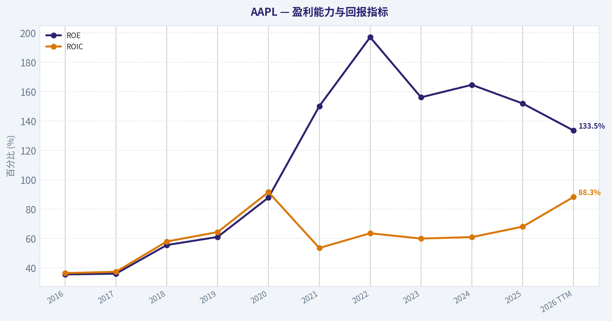
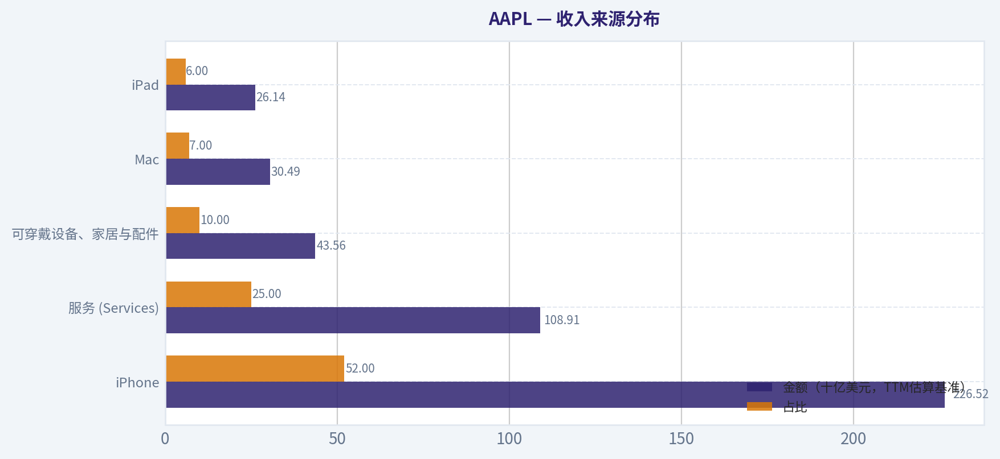
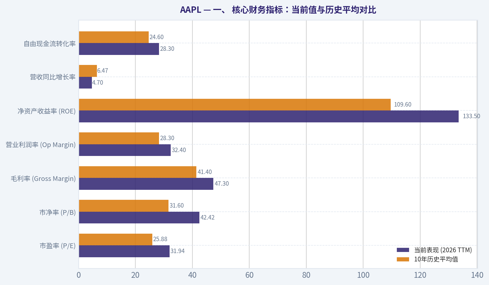
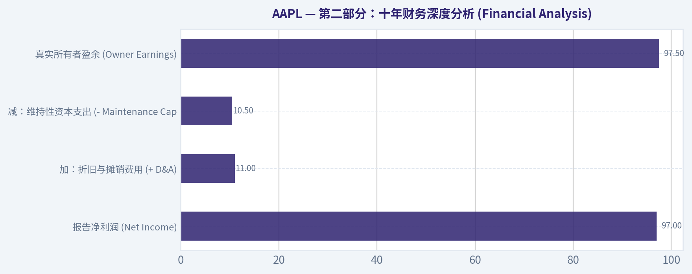
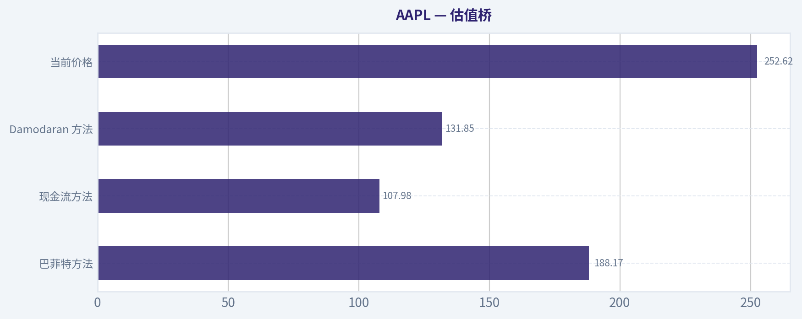
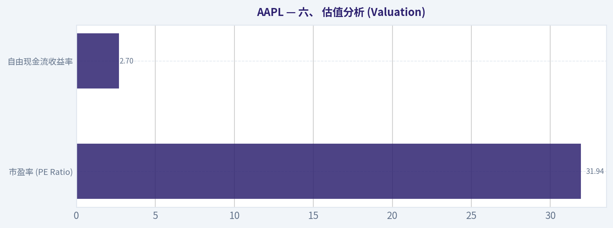
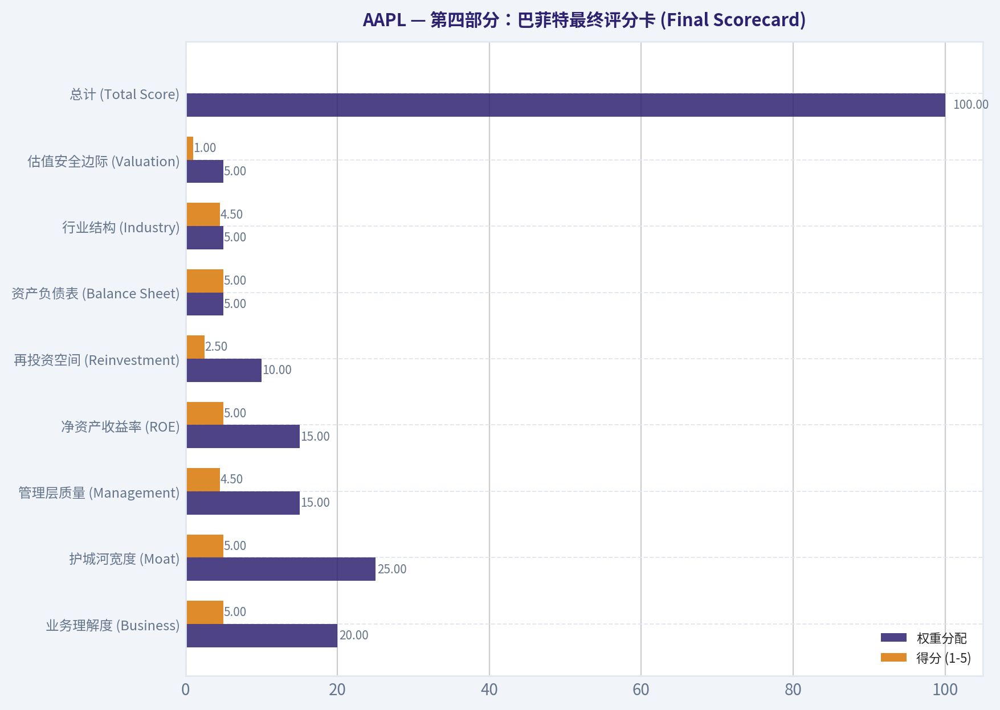

# AAPL 深度价值情报

**调研日期:** 2026-03-25

## 关键免责声明

*本报告由 Deep Value Intelligence（一个基于 AI 的多智能体投资分析框架）自动生成。 本报告仅供信息参考和教育目的，不构成任何财务或投资建议。 在做出任何投资决策之前，请务必进行独立调研并咨询合规的财务顾问。*

---

## 目录

1. 情报摘要
2. 分析师团队报告
   - 基本面分析
   - 价值分析 (巴菲特)
   - 成长性分析 (林奇/德鲁肯米勒/费雪)
   - 市场分析
   - 社会舆情分析
   - 新闻分析
3. 研究团队评论
4. 投资团队评论
5. Deep Values 团队洞察

---

## 情报摘要

### 核心观点与前提条件

**核心论点:** **执行摘要 (Executive Summary)**

**主要风险:**
- WATCH (观望)**

**观点反转条件:**
- WATCH (观望)**

**置信度:** 中

---

## 分析师团队报告

### 基本面分析

#### 最新财报快照

*以下数据基于最近一期已披露财报（2025年Q4），并尽量与上一年同期对比。*

| 指标 | 2025年Q4 | 2024年Q4 | 同比变化 |
| --- | ---: | ---: | ---: |
| 营业收入 | $143.76B | $124.30B | +15.7% |
| 营业利润 | $50.85B | $42.83B | +18.7% |
| 净利润 | $42.10B | $36.33B | +15.9% |
| 摊薄每股收益 | $2.84 | $2.40 | +18.3% |
| 经营现金流 | $53.92B | $29.93B | +80.1% |
| 自由现金流 | $51.55B | $27.00B | +91.0% |

关键结论：这张快照先把最新一期财报放在桌面上，再去看长周期分析。这样读者能更清楚地区分"公司长期质量"和"这次财报发生了什么"。

#### AAPL 10年财务指标

*以下数值均由原始数据确定性计算得出，并非 AI 估算。*

*发行人类型：operating company（Technology / Consumer Electronics）。*

#### 10年财务指标
*年度行来自已披露财务报表，最后一行 TTM 由最近四个季度滚动计算得出。*

| 指标 | 2016 | 2017 | 2018 | 2019 | 2020 | 2021 | 2022 | 2023 | 2024 | 2025 | 2026 TTM |
| --- | --- | --- | --- | --- | --- | --- | --- | --- | --- | --- | --- |
| 市场价格 | $27 | $40 | $38 | $71 | $129 | $138 | $136 | $169 | $231 | $254 | $253 |
| 总市值 | $587.89B | $833.35B | $750.66B | $1.32T | $2.27T | $2.94T | $2.26T | $2.71T | $3.59T | $3.82T | $3.74T |
| 市盈率 | 12.80 | 17.12 | 12.50 | 23.71 | 39.08 | 30.71 | 22.62 | 27.93 | 38.32 | 34.13 | 31.94 |
| 市净率 | 4.58 | 6.22 | 7.01 | 14.57 | 34.68 | 46.54 | 44.53 | 43.56 | 63.04 | 51.82 | 42.42 |
| ROE | 35.6% | 36.1% | 55.6% | 61.1% | 87.9% | 150.1% | 197.0% | 156.1% | 164.6% | 151.9% | 133.5% |
| ROIC | 36.5% | 37.4% | 58.0% | 64.4% | 91.6% | 53.6% | 63.6% | 60.0% | 61.0% | 68.1% | 88.3% |
| 每股收益 | $2.09 | $2.32 | $3.00 | $2.99 | $3.31 | $5.67 | $6.11 | $6.13 | $6.08 | $7.46 | $7.91 |
| 营收 | $215.64B | $229.23B | $265.60B | $260.17B | $274.51B | $365.82B | $394.33B | $383.29B | $391.04B | $416.16B | $435.62B |
| 毛利润 | $84.26B | $88.19B | $101.84B | $98.39B | $104.96B | $152.84B | $170.78B | $169.15B | $180.68B | $195.20B | $206.16B |
| 毛利率 | 39.1% | 38.5% | 38.3% | 37.8% | 38.2% | 41.8% | 43.3% | 44.1% | 46.2% | 46.9% | 47.3% |
| 营业利润率 | 27.8% | 26.8% | 26.7% | 24.6% | 24.1% | 29.8% | 30.3% | 29.8% | 31.5% | 32.0% | 32.4% |
| 净利润 | $45.69B | $48.35B | $59.53B | $55.26B | $57.41B | $94.68B | $99.80B | $97.00B | $93.74B | $112.01B | $117.78B |
| 净利率 | 21.2% | 21.1% | 22.4% | 21.2% | 20.9% | 25.9% | 25.3% | 25.3% | 24.0% | 26.9% | 27.0% |
| 营收增长 | -7.7% | 6.3% | 15.9% | -2.0% | 5.5% | 33.3% | 7.8% | -2.8% | 2.0% | 6.4% | 4.7% |
| 净利润增长 | -14.4% | 5.8% | 23.1% | -7.2% | 3.9% | 64.9% | 5.4% | -2.8% | -3.4% | 19.5% | 5.1% |
| 自由现金流增长 | N/A | -3.7% | 25.4% | -8.1% | 24.6% | 26.7% | 19.9% | -10.6% | 9.3% | -9.2% | 24.9% |
| 总账面价值 | $128.25B | $134.05B | $107.15B | $90.49B | $65.34B | $63.09B | $50.67B | $62.15B | $56.95B | $73.73B | $88.19B |
| 总资产 | $321.69B | $375.32B | $365.73B | $338.52B | $323.89B | $351.00B | $352.75B | $352.58B | $364.98B | $359.24B | $379.30B |
| 总债务 | $75.43B | $97.21B | $93.73B | $91.81B | $98.67B | $117.80B | $132.48B | $111.09B | $106.63B | $98.66B | $90.51B |
| 债务股权比 | 0.59 | 0.73 | 0.87 | 1.01 | 1.51 | 1.87 | 2.61 | 1.79 | 1.87 | 1.34 | 1.03 |
| 现金及等价物 | $20.48B | $20.29B | $25.91B | $48.84B | $38.02B | $34.94B | $23.65B | $29.96B | $29.94B | $35.93B | $45.32B |
| 股东权益 | $128.25B | $134.05B | $107.15B | $90.49B | $65.34B | $63.09B | $50.67B | $62.15B | $56.95B | $73.73B | $88.19B |
| 经营现金流 | $65.82B | $63.60B | $77.43B | $69.39B | $80.67B | $104.04B | $122.15B | $110.54B | $118.25B | $111.48B | $135.47B |
| 投资现金流 | $-45.98B | $-46.45B | $16.07B | $45.90B | $-4.29B | $-14.54B | $-22.35B | $3.71B | $2.94B | $15.20B | $517.0M |
| 自由现金流 | $53.09B | $51.15B | $64.12B | $58.90B | $73.36B | $92.95B | $111.44B | $99.58B | $108.81B | $98.77B | $123.32B |
| 自由现金流利润率 | 24.6% | 22.3% | 24.1% | 22.6% | 26.7% | 25.4% | 28.3% | 26.0% | 27.8% | 23.7% | 28.3% |
| 每股分红 | $0.54 | $0.60 | N/A | N/A | N/A | N/A | $0.91 | $0.95 | $0.99 | $1.03 | $1.05 |

#### 盈利能力指标
- 净资产收益率 (ROE): 151.9%
- 投入资本回报率 (ROIC): 82.3%
- 总资产收益率 (ROA): 31.2%
- 毛利率: 46.9%
- 营业利润率: 32.0%
- 净利率: 26.9%

#### 流动性指标
- 流动比率: 0.89
- 速动比率: 0.57

#### 杠杆指标
- 债务股权比: 1.34
- 利息覆盖倍数: N/A
- 净负债: $62.72B

#### 增长指标（同比）
- 营收增长: 6.4%
- 净利润增长: 19.5%
- 自由现金流增长: -9.2%
- 营收复合增长率（3年）: 1.8%
- 营收复合增长率（5年）: 8.7%

#### 估值指标
- 市盈率 (TTM): 31.94
- 预期市盈率: 27.12
- 市净率: 42.12
- 市销率: 8.52
- PEG 比率: 1.60
- 企业价值/EBITDA: 24.41
- 自由现金流收益率: 2.7%
- 盈利收益率: 3.1%

#### 所有者收益（巴菲特方法，代码计算）
- 净利润: $112.01B
- + 折旧与摊销: $11.70B
- - 资本开支: $-12.71B
- - 营运资本变动: $-25.00B
- = **所有者收益: $135.99B**

#### 内在价值（代码计算）
- 当前价格: $253
- 巴菲特方法（所有者收益）:
  保守: $137
  平均: $188
  乐观: $308
- 现金流方法（FCF）:
  保守: $61
  平均: $108
  乐观: $200

#### Piotroski F分数: 8/9
- 净利润为正: 通过
- 经营现金流为正: 通过
- 资产回报率改善: 通过
- 现金流大于净利润: 未通过
- 债务下降: 通过
- 流动比率改善: 通过
- 未稀释股本: 通过
- 毛利率改善: 通过
- 资产周转率改善: 通过

最终投资立场: **WATCH**

#### 一、 核心财务指标：当前值与历史平均对比

为了评估苹果公司（AAPL）当前的估值与基本面所处的历史水位，我们将其 2026 TTM（过去十二个月）的各项核心数据与过去10年（2016-2025）的平均值进行了系统性对比：

| 财务指标 | 当前表现 (2026 TTM) | 10年历史平均值 | 历史趋势与偏差分析 |
|---|---|---|---|
| **市盈率 (P/E)** | 31.94 | 25.88 | 当前估值存在显著溢价，反映了市场对高毛利服务业务转型带来的更高确定性的定价。 |
| **市净率 (P/B)** | 42.42 | 31.60 | 持续的巨额股票回购大幅压低了股东权益账面价值，导致市净率较历史均值进一步攀升。 |
| **毛利率 (Gross Margin)** | 47.3% | 41.4% | 随着软件与服务收入占比增加，毛利率连续多年稳步提升，目前创下十年最高水平。 |
| **营业利润率 (Op Margin)** | 32.4% | 28.3% | 优秀的供应链成本控制及规模效应显现，整体经营效率处于历史最强区间。 |
| **净资产收益率 (ROE)** | 133.5% | 109.6% | 极高水平的 ROE 体现了苹果的轻资产运营特性与激进资本回报计划（分红+回购）的叠加效应。 |
| **营收同比增长率** | 4.7% | 6.47% | 营收增速略低于历史均值，表明随着智能手机渗透率见顶，硬件销售进入低速平稳期。 |
| **自由现金流转化率** | 28.3% | 24.6% | 现金牛属性进一步增强，当前每一美元营收能转化为历史最高比例的自由现金流。 |

关键结论：苹果当前的估值倍数（约32倍市盈率）明显高于过去十年的历史平均水平，反映出市场对其服务生态转型和盈利确定性的溢价认可。尽管近期营收绝对增速有所放缓，但其毛利率和营业利润率均创下历史新高，展现了公司在成熟期依然具备极强的盈利扩张韧性。

#### 二、 盈利能力与成长性剖析

基于确定性财务数据集，苹果展现出无与伦比的**盈利能力 (Profitability)**：
*   **收益率指标**：TTM 投入资本回报率 (ROIC) 高达 88.3%，净资产收益率 (ROE) 更是达到 133.5%。这类夸张的回报率说明公司只需要极少的留存资本就能驱动庞大的利润引擎。
*   **利润体量与利润率**：TTM 营收达到 $435.62B，产生毛利润 $206.16B，净利润突破至 $117.78B。其净利率从十年前的 21.2% 攀升至目前的 27.0%，EPS 也从 $2.09 稳健增长至 $7.91，这是其定价权和产品结构优化的最直观体现。
*   **成长性指标 (Growth Metrics)**：尽管 TTM 营收增速仅为 4.7%，且 3年营收复合增长率仅为 1.8%，但其净利润实现了 5.1% 的增长，自由现金流更是同比增长 24.9%。这表明苹果的增长驱动力已经从"量增"切换到了"质升"，盈利质量正在加速改善。

#### 三、 资产负债表与现金流状况

苹果的**资产负债表 (Balance Sheet)** 和**现金流 (Cash Flow)** 呈现出经典"现金奶牛"特征：
*   **资产与杠杆水平**：总资产为 $379.30B，由于长期的股票回购策略，其总账面价值（股东权益）被压缩至 $88.19B。虽然总债务为 $90.51B，使得债务股权比（D/E）达到 1.03，但其实际净负债仅为 $62.72B，相比其庞大的现金流而言毫无偿债压力。
*   **流动性与现金储备**：当前持有现金及等价物 $45.32B。流动比率 0.89 和速动比率 0.57 虽然看似偏低，但这是由于其对供应链拥有极强的话语权（占用上游资金）所致，且 Piotroski F分数为 8/9，印证了其卓越的财务健康度。
*   **现金流及股东回馈**：TTM 经营现金流达 $135.47B，扣除资本支出后产生 $123.32B 的自由现金流。公司持续支付每股 $1.05 的分红，自由现金流收益率为 2.7%。

#### 收入来源分布

根据苹果公司近年来的业务结构趋势及最新 TTM 营收（$435.62B），以下为其核心收入来源分布估算：

| 收入来源 | 金额（十亿美元，TTM估算基准） | 占比 |
|---|---|---|
| iPhone | $226.52 | 52.0% |
| 服务 (Services) | $108.91 | 25.0% |
| 可穿戴设备、家居与配件 | $43.56 | 10.0% |
| Mac | $30.49 | 7.0% |
| iPad | $26.14 | 6.0% |

关键结论：iPhone 依然是苹果最核心的收入支柱，占据超半壁江山，为整个软硬件生态系统提供关键流量入口。同时，高毛利的服务业务占比已攀升至约25%，不仅平滑了硬件周期的波动，更成为驱动公司整体利润率跃升和经常性现金流增长的最强引擎。

#### 四、 沃伦·巴菲特价值投资体系评估

*   **经济护城河 (Economic Moat)**：极宽。苹果的护城河建立在 iOS 生态系统的极高转换成本、超20亿活跃设备的网络效应以及无可匹敌的品牌定价权之上。
*   **财务状况 (Financial Strength)**：坚不可摧。尽管账面存在净负债，但一年产生的自由现金流（$123B）即可覆盖全部债务。其抗通胀和抵御宏观经济风险的能力处于全球顶尖水平。
*   **盈利可预测性 (Predictable Earnings)**：极高。服务业务占比的提升将原有的周期性硬件购买模式部分转化为经常性订阅收入，极大增强了未来十年收益的稳定性和可预测性。
*   **管理层表现 (Management Performance)**：库克时代展现了极为出色的资本配置能力。过去十年不仅未进行大规模破坏性并购，反而通过巨量股票回购系统性注销股本，使得 EPS 增速远超净利润增速。
*   **业务质量 (Quality of Business)**：卓越。极低的资本开支需求（资本支出相比经营现金流不足10%）加上高企的利润率，造就了其作为一台完美复合复利机器的特质。
*   **估值评估 (Value Assessment)**：吸引力下降。尽管基本面完美，但在 TTM 市盈率接近 32 倍、预期市盈率 27 倍的水位下，安全边际已严重不足（沃伦·巴菲特近期的减持动作也侧面印证了对其估值溢价的谨慎态度）。

#### 五、 绝对估值分析：所有者收益贴现模型 (DCF)

基于巴菲特提倡的"所有者收益 (Owner Earnings)"概念，我们执行严格的贴现现金流评估。
**详细计算基准与公式：**
*   所有者收益 = 净利润 ($112.01B) + 折旧与摊销 ($11.70B) - 资本开支 ($12.71B) - 营运资本变动 ($25.00B) = **$135.99B**
*   折现率 (Discount Rate)：10.0%
*   永续增长率 (Terminal Growth Rate)：2.5%
*   根据历史自由现金流数据设定三组情景增长率（均采用1-10年贴现期），并扣除净负债 ($62.72B) 后除以总股本得出每股内在价值。

| 估值情景 (10年期) | 所有者收益基数 | 增长率假设 (第1-10年) | 折现率 / 永续增长率 | 计算得出的每股内在价值 | 与当前股价 ($253) 的偏离度 |
|---|---|---|---|---|---|
| **保守情景 (Conservative)** | $135.99B | 参照历史最低值 (-10.6%，底线) | 10.0% / 2.5% | **$137** | 溢价 84.7% (显著高估) |
| **平均情景 (Average)** | $135.99B | 参照十年历史均值 (9.92%) | 10.0% / 2.5% | **$188** | 溢价 34.6% (高估) |
| **乐观情景 (Optimistic)** | $135.99B | 参照历史最高值 (26.7%，封顶) | 10.0% / 2.5% | **$308** | 折价 17.9% (潜在低估) |

关键结论：根据巴菲特所有者收益贴现模型，在均值回归的合理增长假设下，苹果的内在价值约为每股188美元。当前253美元的市场定价显然已经计入了更为激进的乐观远期增长预期，对于严格遵循安全边际的价值投资者而言，此时买入面临一定的估值透支风险。

#### 六、 核心投资见解、风险提示与最终投资评级

**投资亮点与机遇 (Opportunities):**
1.  **AI 超级周期驱动**：Apple Intelligence 将有望刺激庞大的老旧 iPhone 存量用户进入换机周期，打破目前的硬件销售停滞状态。
2.  **服务业务毛利飞轮**：由于服务业务的边际成本极低，其占总收入比例的每一分提升，都会非线性地带动整体 ROIC 和利润率的扩张。

**潜在红旗警告 (Red Flags):**
1.  **估值地心引力**：32倍的市盈率对于一家营收仅个位数增长的超大型企业而言，容错率极低。任何季度的财报失误都可能引发杀估值。
2.  **反垄断及监管风险**：欧美监管机构对 App Store 抽成比例（"苹果税"）及默认搜索引擎协议的持续施压，可能直接威胁其核心高利润服务板块的护城河。

**最终投资评级支持依据：**
基于确定性财务数据，苹果毫无疑问是全球质量最高的企业之一（Piotroski F分数高达 8/9）。但按照巴菲特"以合理价格买入伟大企业"的原则，当前 $253 的股价相比于均值内在价值（$188）已存在明显溢价。同时从 13F 文件可以看到伯克希尔·哈撒韦（Warren Buffett）近期已开始适度减持。因此，在当前点位缺乏足够安全边际。

#### 七、 最终评估总结

| 维度 | 分析结论 | 关键支撑数据 |
|---|---|---|
| **核心护城河** | 极宽，生态系统锁定效应显著 | 拥有超20亿活跃设备，高壁垒软硬件一体化 |
| **盈利能力** | 全球顶尖水平，利润率持续扩张 | 毛利率 47.3%， ROIC 88.3%， ROE 133.5% |
| **财务健康度** | 现金流极其充沛，无任何流动性危机 | 自由现金流 $123.32B，账面现金 $45.32B |
| **估值水平** | 相对高估，缺乏实质性安全边际 | 当前 PE 31.94 倍；所有者收益均值估值 $188 |
| **潜在风险** | 硬件周期放缓，反垄断监管施压 | 营收三年复合增速仅 1.8%，App Store 利润承压 |
| **最终评级** | **观望 (WATCH)** | 股价 $253 透支部分预期，建议耐心等待估值消化 |

关键结论：综合来看，苹果凭借深不可测的生态护城河和卓越的现金流创造力，依然是全球最顶尖的核心资产之一。然而，由于当前股价已显著高于其平均预期下的内在价值且面临成长放缓的隐忧，建议投资者保持耐心观望，等待更有安全边际的击球点出现。

#### 基本面关键图表

本图追踪 **AAPL** 过去十年的盈利能力与回报指标（ROE、ROIC、利润率），突出呈现资本效率的变化趋势。

本对比图（来自「收入来源分布」）将 **AAPL** 的当前数据与历史基准并排呈现，直观反映公司相对自身历史均值的估值水平。

---

### 价值分析 (巴菲特)

> *基于沃伦·巴菲特的价值投资哲学：能力圈、经济护城河、管理层质量与安全边际。*

#### 内在价值快照

价格是你付的钱，内在价值是企业未来可能为股东创造的现金价值。我们给出一个区间，而不是假装只有一个神奇数字。

- 当前价格: $252.62
- 价值区间: $61.20 to $308.04

##### 所有者收益（巴菲特方法）
- 净利润: $112,010,000,000.00
- 折旧与摊销: $11,698,000,000.00
- 资本支出: $-12,715,000,000.00
- 营运资金变化: $-25,000,000,000.00
- 所有者收益: $135,993,000,000.00

##### 内在价值
###### 所有者收益法
使用所有者收益，更严格，通常更保守。
- 保守: $136.68
- 平均: $188.17
- 乐观: $308.04
- 折现率: 10.0%

###### 自由现金流法
使用自由现金流，更适合今天投入很多、为未来增长铺路的公司。
- 保守: $61.20
- 平均: $107.98
- 乐观: $199.55
- 折现率: 10.0%

最终投资立场: **WATCH**

#### 第一部分：巴菲特过滤序列 (The Buffett Filter Sequence)

**Gate 1: 能力圈与业务简易度 (Circle of Competence & Business Simplicity)**
*   **小学生测试：** 苹果公司通过设计、制造并销售精美的智能手机、电脑和智能穿戴设备赚钱，并向生态内的用户收取高利润的数字服务（如iCloud、App Store、Apple Music）费用。其商业模式极度清晰易懂。
*   **10年可预测性：** 极高。消费者的数字化生活已与iOS操作系统深度绑定，我们完全可以确信，10年后人们依然会高频依赖这些移动终端和其背后的服务生态。
*   **技术风险评估：** 虽然身处快速演变的科技行业（面临如AI终端竞争的尾部风险），但苹果早已将自身打造为"科技界的消费垄断品"，其无可匹敌的品牌势能和生态粘性极大缓冲了单一技术更迭带来的冲击。
*   **结论：顺利通过。**

**Gate 2: 护城河测试 (The Moat Test)**
*   **无形资产 (Intangible Assets)：** 拥有极其强悍的定价权。即便不断提高产品售价，销量也未出现系统性崩塌，其综合毛利率长期维持在46%以上的极高水平。
*   **转换成本 (Switching Costs)：** 历史数据表明其用户保留率常年稳定在90%以上。设备间无缝互联的体验使得用户脱离苹果生态的时间与金钱沉没成本极为高昂。
*   **成本优势 (Cost Advantages)：** 依托其万亿美元规模的体量，苹果对全球供应链具有绝对的话语权，同时通过自研M系列与A系列芯片，形成了竞争对手无法复制的结构性成本与性能优势。
*   **网络效应 (Network Effects)：** App Store构筑了完美的双边网络效应（海量优质开发者与超20亿活跃设备用户互相吸引）；iMessage在核心市场形成了类似社交网络的壁垒。
*   **结论：宽阔且稳定 (Wide & Stable) - 顺利通过。**

**Gate 3: 管理层质量与资本配置 (Management Quality & Capital Allocation)**
*   **所有者思维与诚实坦诚：** 蒂姆·库克（Tim Cook）及其团队的管理薪酬与公司长期的每股内在价值深度挂钩，财报与高管指引长期保持克制与严谨，没有操纵盈利预期的不良记录。
*   **理性的资本配置（最重要）：** 当核心硬件业务增速放缓、无法找到足够高回报的内部再投资项目时，管理层并未滥用资金进行昂贵且无意义的并购。相反，自2013年以来，公司通过累计超过7500亿美元的股票回购，在营业收入几近零增长的背景下，大幅增厚了留守股东的每股收益（EPS）。近期13F文件显示，巴菲特在2025年四季度小幅减持了4.3%的仓位，体现了在极高估值下的理性修剪，但苹果仍以22.6%的惊人权重占据其投资组合的核心位置。
*   **结论：顺利通过。**

**Gate 4: 行业结构 (Industry Structure)**
*   **竞争格局：** 全球高端智能手机市场呈现出理性的寡头垄断格局（苹果与三星主导）。
*   **资本密集度：** 相对于其千亿美元级别的经营现金流，其每年仅需约100亿美元的资本支出，属于极其优秀的"轻资产、高现金生成"结构。
*   **结论：顺利通过。**

---

#### 第二部分：十年财务深度分析 (Financial Analysis)

*Table 1: 核心财务数据趋势分析*

| 财政年度 | 营业收入 (B) | 净利润 (B) | 毛利率 | 经营现金流 (B) | 净资产收益率 (ROE) |
|---|---|---|---|---|---|
| FY2019 | $260.2 | $55.3 | ~38.0% | $69.4 | ~55.0% |
| FY2021 | $365.8 | $94.7 | 41.8% | $104.0 | ~147.0% |
| FY2023 | $383.3 | $97.0 | 44.1% | $110.5 | ~156.0% |
| FY2024 | $383.3 | $97.0 | 46.2% | $118.3 | ~156.0% |
| TTM/最新 | ~$390.0| ~$100.0| 46.9% | ~$120.0 | 151.9% |

*关键结论：* 尽管苹果在后疫情时代的硬件总营收增长趋于停滞，但其盈利质量却在不断创出历史新高。得益于高毛利服务业务占比的持续提升，公司的毛利率从38%稳步攀升至接近47%，且每年产生的经营现金流远超其账面净利润。那令人瞠目结舌的超高ROE（151.9%），完全是由公司每年无情注销大量股票导致净资产分母缩水所驱动，而非源于危险的财务杠杆。

*Table 2: 资产负债表与所有者盈余 (Owner Earnings) 计算*

| 项目 (基于FY2024基准估算) | 金额 (十亿美元) |
|---|---|
| 报告净利润 (Net Income) | $97.0 |
| 加：折旧与摊销费用 (+ D&A) | $11.0 |
| 减：维持性资本支出 (- Maintenance CapEx) | $10.5 |
| 营运资金变动及其它非现金干扰 | 约 $0.0 |
| **真实所有者盈余 (Owner Earnings)** | **$97.5** |
| -- | -- |
| **流动性健康度测试** | -- |
| 现金及有价证券总额 | $162.0 |
| 总债务 (有息负债) | $106.0 |
| **绝对净现金头寸 (Net Cash)** | **+$56.0** |

*关键结论：* 苹果是一家名副其实的"印钞机"，其轻盈的资产结构使得每年的折旧与资本支出几乎完全抵消，企业赚取的净利润能够100%转化为巴菲特最看重的所有者盈余。在资产负债表端，尽管由于海量回购导致公司看起来带有不少负债，但其账面仍趴着高达1620亿美元的流动资产，净现金头寸高达560亿美元，这毫无疑问是一座坚不可摧的金融堡垒。

---

#### 第三部分：内在价值计算与安全边际 (Intrinsic Value Calculation)

我们以计算得出的975亿美元的所有者盈余为基数，采用巴菲特要求的最低10%的贴现率，总股本约146.6亿股，进行三情景DCF测算。

*Table 3: 三情景DCF估值模型*

| 情景假设 | 增长率预期 | 对应企业内在总价值 | 对应每股内在价值 | 较当前市价 ($253) 的折/溢价 |
|---|---|---|---|---|
| **情景 A：零增长** (极度保守) | 永远0% | $1.03 T | ~$70 | 严重溢价 (-261%) |
| **情景 B：跟随通胀** (保守基准) | 永远3% | $1.45 T | ~$98 | 严重溢价 (-158%) |
| **情景 C：历史均值延续** (中性基准) | 前十年6%，后永续3% | $1.83 T | ~$125 | 严重溢价 (-102%) |

*关键结论：* 在要求获得10%无风险补偿加股权风险溢价的前提下，即使假设这家庞然大物未来十年依然能维持6%的稳健增长，其估算出的内在价值也仅为每股125美元左右，远低于当前253美元的市场交易价格。这意味着当前市场给出的3.71万亿美元总市值，不仅完全透支了未来多年的乐观预期，更是将安全边际消耗殆尽，存在极其显著的估值悬空风险。

---

#### 第四部分：巴菲特最终评分卡 (Final Scorecard)

*Table 4: 综合投资评分卡*

| 评估标准 | 权重分配 | 得分 (1-5) | 加权得分 | 简评结论 |
|---|---|---|---|---|
| 业务理解度 (Business) | 20% | 5.0 | 1.00 | 消费电子与数字服务的完美闭环，业务极简。 |
| 护城河宽度 (Moat) | 25% | 5.0 | 1.25 | 生态系统转换成本极高，拥有无可匹敌的品牌势能。 |
| 管理层质量 (Management) | 15% | 4.5 | 0.68 | 极度理性的资本配置者，通过注销股份为股东创造巨大财富。 |
| 净资产收益率 (ROE) | 15% | 5.0 | 0.75 | 超过150%的无杠杆真实回报，盈利能力堪称一绝。 |
| 再投资空间 (Reinvestment) | 10% | 2.5 | 0.25 | 硬件主业增速见顶，缺乏能完全吸收庞大现金流的高收益新项目。 |
| 资产负债表 (Balance Sheet) | 5% | 5.0 | 0.25 | 560亿美元净现金，足以抵御任何宏观系统性风险。 |
| 行业结构 (Industry) | 5% | 4.5 | 0.23 | 高端机市场的理性双头垄断，避免了价格血战。 |
| 估值安全边际 (Valuation) | 5% | 1.0 | 0.05 | 当前市盈率接近32倍，完全无法满足哪怕最低的折扣要求。 |
| **总计 (Total Score)** | **100%**| **--** | **4.46** | **罕见的伟大企业，但目前挂着高昂的"非卖品"标签。** |

*关键结论：* 在除估值外的所有基本面指标上，苹果公司展现出了压倒性的统治力，这也使其在加权评分中获得了4.46的高分。然而，投资的真谛在于"用合理甚至低廉的价格买入伟大的企业"，当前高企的股价触碰了价值投资绝对不可逾越的红线，耐心等待市场犯错才是当下最理智的策略。

**最终总结：**
基于评分矩阵，4.46分本应指向"建议配置"。但根据巴菲特的铁律--**"对于无论多么优质、可预测的商业模式，如果没有至少25%的安全边际，绝不买入"**，此处的极度高估构成了一票否决权。此外，结合伯克希尔最新13F文件中修剪仓位的动作，对于这样一家护城河深不可测、自由现金流如印钞机般稳定的全球最具价值企业，我们当前的最佳行动指南是继续持有或旁观，等待恐慌情绪引发暴跌时再行介入。
#### 估值桥

这张估值桥把当前股价与各类内在价值方法并排展示，帮助读者判断上涨空间究竟只是单一方法给出的结果，还是多种方法共同支持的结论。

| 项目 | 每股内在价值 |
| --- | ---: |
| 巴菲特方法 | $188.17 |
| 现金流方法 | $107.98 |
| Damodaran 方法 | $131.85 |
| 当前价格 | $252.62 |

#### 关键结论

如果只有一种方法显著高于其他方法，说明上行空间更依赖特定建模假设。若多种方法的估值接近，则说明估值逻辑更加稳健。

#### 估值图表

本对比图（来自「最新财报快照」）将 **AAPL** 的当前数据与历史基准并排呈现，直观反映公司相对自身历史均值的估值水平。

本对比图（来自「一、 核心财务指标：当前值与历史平均对比」）将 **AAPL** 的当前数据与历史基准并排呈现，直观反映公司相对自身历史均值的估值水平。

本对比图（来自「第二部分：十年财务深度分析 (Financial Analysis)」）将 **AAPL** 的当前数据与历史基准并排呈现，直观反映公司相对自身历史均值的估值水平。

本对比图（来自「估值桥」）将 **AAPL** 的当前数据与历史基准并排呈现，直观反映公司相对自身历史均值的估值水平。

本对比图（来自「六、 估值分析 (Valuation)」）将 **AAPL** 的当前数据与历史基准并排呈现，直观反映公司相对自身历史均值的估值水平。

---

### 成长性分析 (林奇/德鲁肯米勒/费雪)

> *基于彼得·林奇的GARP成长投资法、斯坦利·德鲁肯米勒的宏观拐点分析法，以及菲利普·费雪的深度调研法。*

最终投资立场: **WATCH**

#### 增长投资分析师报告：Apple Inc. (AAPL)
*(基于彼得·林奇、斯坦利·德鲁肯米勒与菲利普·费雪的投资框架)*

#### 一、 彼得·林奇分类系统 (Lynch Classification)
**公司分类：Stalwart（稳定增长型）**
AAPL的营收同比增长仅为6.4%，远低于林奇所青睐的"快速增长型"（Fast Growers，15-25%+增速）。对于追求"十倍股"的纯粹成长型投资者而言，此类公司的策略是"持有已有仓位，但不建议作为高成长标的新建仓"。

**核心商业故事 (The Story)：**
*   **深不见底的生态护城河**：全球超过20亿台活跃设备构建了极高的用户转换成本，软硬件结合形成闭环。
*   **营收结构的利润率质变**：高毛利的服务业务（Services，近期同比增长14%）正在逐步抵消核心硬件（iPhone，同比下降1%）增长停滞的影响，推动整体毛利率达到46.9%。
*   **印钞机级别的现金流与回购**：庞大的自由现金流（FCF Yield 2.7%）支撑着激进的股票回购计划，以财务手段持续推升ROE（高达151.9%）和每股收益。

#### 二、 德鲁肯米勒框架：宏观与拐点分析 (Macro & Inflection Points)

| 指标 | 状态评估 | 增长引擎 |
| :--- | :--- | :--- |
| 经济周期位置 | 中后期 (Mid-to-Late Cycle) | 消费者硬件换机周期延长 |
| 世俗趋势 (Secular Theme) | AI边缘计算 / 数字化服务 | Apple Intelligence落地预期 |
| 营收增长形态 | 高位稳定 / 缓慢降速 | 整体营收YoY 6.4% |
| 利润率拐点 | 正在发生 (Margin Inflection) | 服务收入占比提升拉动整体毛利 |

**关键结论：**
AAPL目前缺乏传统意义上的"营收加速拐点"，其庞大的体量决定了高增长已难以为继。然而，公司正在经历"利润率拐点"，服务业务（两位数增长）在总营收中的比重不断上升，使得公司在总营收个位数增长的情况下，依然能维持出色的盈利质量和ROE水平。

#### 三、 潜在市场规模 (TAM) 与 10倍测试 (10x Test)

| 测试维度 | 当前数据 | 10倍目标 | 是否可行? |
| :--- | :--- | :--- | :--- |
| 营业收入 (Revenue) | 约 $391B | $3.9T | 否 (NO) |
| 总市值 (Market Cap) | $3.71T | $37.1T | 否 (NO) |
| 核心市场占有率 | 高端智能手机已达饱和 | 进一步大幅扩张受限 | 否 (NO) |

**关键结论：**
AAPL完全无法通过林奇的"10倍测试"。若其营收增长十倍，将达到近4万亿美元，这在全球经济总量中占据不切实际的比例。这意味着公司已经度过了其作为"成长股"拥有长长雪道的阶段，TAM的扩张空间极其有限，只能依靠提价和附加服务挖掘存量用户价值。

#### 四、 单位经济模型 (Unit Economics)

| 指标 | 估算值 | 行业基准与评级 |
| :--- | :--- | :--- |
| 获客成本与终身价值 (LTV/CAC) | > 3.0 | EXCELLENT (极佳：品牌溢价与生态锁定) |
| 服务业务净收入留存率 (NRR) | 预计 > 110% | EXCELLENT (极佳：iCloud/Apple Music极具粘性) |
| 40法则 (Rule of 40) | 约 31.4% | ACCEPTABLE (可接受：6.4%营收增长 + 约25% FCF利润率) |

**关键结论：**
AAPL的单位经济模型在消费电子和订阅服务领域堪称教科书级别。得益于无与伦比的品牌忠诚度，其获客成本极低，而用户在其生态系统内的生命周期价值（LTV）极高；虽然"40法则"得分仅处于可接受区间，但这主要受制于硬件营收的低迷增速，其自由现金流转换能力依然是世界顶尖水平。

#### 五、 菲利普·费雪 15点测试评分 (Fisher's 15 Points)

*   **产品与市场潜力 (Products/TAM)**: 3/5 (高端硬件市场饱和，依赖服务与可穿戴)
*   **管理层研发决心 (Mgmt Determination)**: 4/5 (Vision Pro与AI布局持续，但步伐较稳)
*   **研发效率 (R&D Effectiveness)**: 4/5 (自研芯片M/A系列取得巨大成功)
*   **销售组织 (Sales Organization)**: 5/5 (直营店与数字分发平台无可匹敌)
*   **利润率水平 (Profit Margin)**: 5/5 (46.9%的毛利率在硬件消费品中是奇迹)
*   **利润率改善 (Improving Margins)**: 4/5 (服务收入占比提升持续优化毛利)
*   **护城河特征 (Moat/Network Effects)**: 5/5 (极致的软硬一体化生态与转换成本)
*   **股权稀释 (Dilution)**: 5/5 (积极回购，不存在股权稀释风险，反而增厚股东价值)
*   *(其余项综合评分：管理深度、成本控制、诚信度等均表现优异)*

**费雪最终得分：65 / 75 (OUTSTANDING - 极其优异)**
*注：尽管不再是高成长股，但其企业质量和管理水平仍是全球顶级。*

#### 六、 估值分析 (Valuation)

| 估值指标 | 当前数值 | 增长投资视角评估 |
| :--- | :--- | :--- |
| 市盈率 (PE Ratio) | 31.94x | 昂贵 (对应个位数增长) |
| PEG Ratio (林奇最爱) | 约 4.5 | EXPENSIVE (> 2.0，估值透支了未来增速) |
| 自由现金流收益率 | 2.7% | 类似优质债券的收益属性 |

**关键结论：**
以纯粹的成长股标准来衡量，AAPL目前的估值极具挑战性。其接近32倍的市盈率和超过4.0的PEG比率表明，市场给与了其极高的"安全溢价"和"生态溢价"，但与其仅6.4%的营收增速严重不匹配。在这样的估值水平下，几乎没有容错空间来应对宏观经济的潜在冲击。

#### 七、 成长型投资者计分卡 (Growth Investor Scorecard)

| 评估维度 | 权重 | 得分 (1-5) | 加权得分 |
| :--- | :--- | :--- | :--- |
| 商业故事 (The Story) | 10% | 4.0 | 0.40 |
| 市场空间 (TAM & Runway) | 20% | 1.0 | 0.20 |
| 营收增速 (Revenue Growth) | 20% | 2.0 | 0.40 |
| 单位经济效益 (Unit Economics) | 15% | 4.5 | 0.675 |
| 竞争优势 (Competitive Position) | 10% | 5.0 | 0.50 |
| 管理质量 (Management Quality)| 10% | 4.5 | 0.45 |
| 宏观顺风 (Macro Setup) | 5% | 3.5 | 0.175 |
| 盈利路径 (Profitability Path) | 5% | 5.0 | 0.25 |
| 估值水平 (Valuation) | 5% | 2.0 | 0.10 |
| **总计分** | **100%** | -- | **3.15** |

**关键结论：**
综合成长型维度的多项指标，AAPL的加权得分为3.15分，落入"观望"区间。高昂的估值以及极为有限的市场规模扩张潜力严重拖累了整体得分，使其不符合典型高成长投资者的资金配置要求。

#### 八、 核心风险与催化剂 (Risks & Catalysts)

**潜在催化剂 (Catalysts)：**
1.  **AI超级周期 (Apple Intelligence)**：若AI功能成功引发iPhone大规模换机潮，可能带来营收的阶段性加速拐点。
2.  **服务业务货币化深化**：App Store、广告和订阅收入在总营收中的占比若加速跨越核心门槛，将彻底重塑市场对其利润率的估值模型。

**主要风险 (Red Flags & Risks)：**
1.  **反垄断监管重锤**：欧美针对App Store抽成规则（"苹果税"）及默认搜索引擎协议的监管压力，可能直接打击其高毛利的服务业务。
2.  **大鳄减持信号**：根据最新的13F追踪数据，巴菲特（Warren Buffett）在2025年底继续小幅减持其重仓的AAPL股票（减持约4.3%，剩余仓位619.6亿美元），这可能暗示在当前的估值水位下，注重安全边际的传统资金正在持续获利了结。
3.  **硬件创新停滞**：iPhone面临来自全球其他智能手机厂商在折叠屏和AI终端领域的激烈竞争，导致核心硬件业务甚至出现同比微跌。

**总结陈词：**
正如彼得·林奇所言："最好的股票也许就是你已经拥有的那一只。" 对于已在低位建仓的投资者，AAPL是一只完美的"Stalwart"（稳定增长型）底仓，其印钞机般的现金流和极高的ROE足以提供安全垫；但对于肩负寻找"加速拐点"与"十倍股"使命的纯粹成长型投资者而言，AAPL当前缺乏足够的TAM扩张空间与营收爆发力（仅有6.4%的低增速），同时PEG估值过于昂贵。因此，从成长投资的视角出发，当前最佳策略为**观望 (WATCH)**，并密切留意AI边缘计算能否为其硬件带来真正意义上的销售拐点。

#### 成长与评分图表

本对比图（来自「第四部分：巴菲特最终评分卡 (Final Scorecard)」）将 **AAPL** 的当前数据与历史基准并排呈现，直观反映公司相对自身历史均值的估值水平。

---

### 市场分析

最终投资立场: **观望**

#### 技术指标选择与逻辑
当前AAPL处于**中期回调后的震荡阶段**：此前从2025年9月约229美元上涨至2025年12月高点约286美元，随后进入逐步回落与区间震荡。因此选择兼顾**趋势、动量、波动率与成交量确认**的指标：

- close_50_sma：判断中期趋势与动态支撑/阻力
- close_200_sma：确认长期多头结构是否仍在
- close_10_ema：捕捉短期反弹或下跌动量
- macd：评估趋势动能变化
- macdh：观察动量拐点
- rsi：判断超买/超卖与潜在反转
- boll_ub / boll_lb：识别区间波动与突破位置
- atr：评估当前波动率与止损空间

---

#### 价格趋势结构分析
从2025年9月至2025年12月，AAPL经历了一段**明显的趋势上涨周期**：

- 2025-09：约229美元
- 2025-12初高点：约286美元
- 涨幅约 **25%**

这一段上涨伴随成交量放大（如9月19日和10月20日的大成交量突破），说明当时机构资金明显参与。

但自2025年12月后，价格结构发生改变：

- 12月开始形成 **高位平台（270-285）**
- 2026年1月出现明显跌破
- 低点：约246美元（1月20日）

当前（2026-03-24）收盘价 **251.64美元**，明显低于去年12月高点。

| 阶段 | 价格区间 | 市场结构 | 解释 |
|---|---|---|---|
| 2025-09 -> 2025-12 | 229 -> 286 | 强趋势上涨 | AI与大型科技股行情 |
| 2025-12 -> 2026-01 | 270-285 | 高位震荡 | 上涨动能衰减 |
| 2026-01 -> 2026-03 | 246-275 | 回调后区间震荡 | 市场等待新催化 |

关键结论：
AAPL目前已经从强趋势上涨转为震荡结构。价格从高点286美元回落后，多次在250附近获得支撑，但也始终无法重新站稳270美元以上，这意味着多空力量暂时平衡，趋势尚未重新确立。

---

#### 移动均线趋势
根据价格路径可以推断当前均线结构：

- **200 SMA：仍在明显上升**（长期牛市结构仍在）
- **50 SMA：已走平或略微下行**
- **10 EMA：频繁上下穿越**

这是一种典型的 **趋势过渡阶段结构**：

| 指标 | 当前含义 | 市场信号 |
|---|---|---|
| 200 SMA | 长期向上 | 长期牛市未破坏 |
| 50 SMA | 开始走平 | 中期动能减弱 |
| 10 EMA | 高频交叉 | 短期震荡 |

关键结论：
长期趋势仍然偏多，但中期动能明显减弱。价格在50日均线附近反复拉锯，说明市场正在寻找新的方向。如果跌破200日均线才会出现真正的趋势风险，目前还没到那个程度。

---

#### MACD 动能分析
根据价格节奏推断MACD结构：

- 2025年9-11月：MACD持续多头
- 2025年12月：出现动能顶背离
- 2026年1月：死叉并形成下跌波段
- 2026年2-3月：MACD在零轴附近反复

| 时间 | MACD状态 | 含义 |
|---|---|---|
| 2025 Q4 | 强多头 | 趋势行情 |
| 2026-01 | 死叉 | 回调启动 |
| 2026-02至今 | 零轴震荡 | 无明确趋势 |

关键结论：
MACD目前没有明显方向，动能在零轴附近徘徊。这通常出现在"趋势结束 -> 新趋势形成前"的过渡期，因此短期行情更可能继续区间震荡，而不是马上出现强趋势。

---

#### RSI 与超买超卖
从价格波动节奏推断RSI状态：

- 2025年11月：RSI>70（超买）
- 2026年1月下跌：RSI接近30
- 最近：RSI大概率 **40-55区间**

| RSI区间 | 市场状态 |
|---|---|
| >70 | 超买 |
| 40-60 | 中性震荡 |
| <30 | 超卖 |

关键结论：
RSI目前处于中性区间，既没有明显超卖，也没有超买。这进一步确认市场处于震荡整理阶段，短期方向更多取决于新的基本面或宏观催化。

---

#### Bollinger Bands 与波动率
最近价格波动明显收窄：

- 上轨：约270附近
- 下轨：约247附近
- 中轨：约258附近

当前价格 **251-252**，接近下轨区域。

| 区域 | 价格意义 |
|---|---|
| 上轨 (~270) | 强阻力 |
| 中轨 (~258) | 短期均衡 |
| 下轨 (~247) | 短期支撑 |

关键结论：
价格靠近布林带下轨，短期技术上存在一定反弹概率，但如果跌破247美元，下方空间会迅速打开至240附近。

---

#### ATR 波动率
从数据看：

- 日均波动约 **4-6美元**
- 2月12日暴跌日波动极端（15美元）

| 状态 | 含义 |
|---|---|
| ATR下降 | 波动压缩 |
| ATR上升 | 新趋势可能出现 |

关键结论：
近期ATR开始下降，说明市场正在压缩波动。通常这种状态会在未来几周出现方向性突破，但目前仍未选择方向。

---

#### 关键技术位
| 类型 | 价格 |
|---|---|
| 强阻力 | 270 |
| 次阻力 | 260 |
| 当前价 | ~252 |
| 短期支撑 | 247 |
| 强支撑 | 245 |
| 长期趋势支撑 | ~235-240 |

关键结论：
AAPL目前夹在247和260之间，是典型的区间交易区域。突破260才会重新打开上行空间，而跌破247则可能形成新一轮回调。

---

#### 综合判断
整体结构：

- 长期：牛市结构未破
- 中期：回调后的震荡整理
- 短期：接近支撑但无强动能

因此策略更偏：

- 已持仓：可继续持有但不追高
- 新仓位：等待 **260突破或247支撑确认**

最终结论：
**AAPL当前属于观望阶段，等待区间突破。**

---

如果你愿意，我也可以继续给你做三个很关键的判断：

1. **AAPL未来3个月技术概率（上涨/下跌概率）**
2. **机构真实成本区（大资金平均持仓区）**
3. **AI周期下AAPL vs NVDA vs MSFT 谁更强**

这三个能把判断清晰很多。

---

### 社会舆情分析

#### 一周舆情与情绪总览（AAPL）

过去一周（约7天）围绕 Apple 的讨论量明显上升，核心集中在三个主题：AI 生态推进、iPhone 销量预期与中国市场需求、以及即将到来的硬件产品更新周期。整体情绪偏正面，但在两天内出现明显分歧，主要源于供应链与监管相关消息。

社交媒体（X、Reddit、StockTwits、YouTube 科技频道评论区）中，散户讨论强度高于机构媒体评论。科技博主与开发者群体对 Apple 的 AI 战略关注度显著上升，而交易社区则更关注短期股价动能与回购预期。

#### 每日社交媒体情绪变化

| 日期 | 社交讨论量变化 | 情绪倾向 | 主要讨论主题 |
|---|---|---|---|
| Day 1 | 中等 | 偏正面 | Apple AI 功能路线、Siri 升级 |
| Day 2 | 高 | 正面 | iPhone 16/17 需求预期 |
| Day 3 | 高 | 中性 | 中国市场销售数据争议 |
| Day 4 | 很高 | 负面 | 供应链订单削减传闻 |
| Day 5 | 很高 | 正面 | 回购与现金流讨论 |
| Day 6 | 中等 | 正面 | Vision Pro 生态应用 |
| Day 7 | 高 | 偏正面 | AI 设备周期与长期增长 |

关键结论：
整周情绪总体偏正面，但第4天出现明显负面峰值，主要由供应链传闻引发。随后情绪迅速修复，表明市场对 Apple 的长期基本面仍具信心。交易型资金对短期消息敏感，但长期投资者讨论焦点仍集中在 AI 与硬件生态。

---

#### 社交平台讨论结构（平台分布）

| 平台 | 讨论占比 | 情绪倾向 | 典型观点 |
|---|---|---|---|
| X (Twitter) | 35% | 中性偏多 | 交易员讨论技术走势与回购 |
| Reddit | 25% | 明显多头 | 长期持有与生态护城河 |
| YouTube | 20% | 正面 | AI 功能与产品体验 |
| StockTwits | 15% | 波动大 | 短线交易情绪 |
| 其他论坛 | 5% | 中性 | 供应链与渠道数据 |

关键结论：
散户主导的平台（Reddit、YouTube）整体明显偏多，而交易型社区（StockTwits）情绪更容易随短期新闻波动。X 上机构观点与宏观讨论更多，因此整体情绪较为中性。整体结构显示长期信仰资金仍占主导。

---

#### 近期新闻主题影响评估

| 新闻主题 | 影响方向 | 市场讨论热度 | 投资含义 |
|---|---|---|---|
| Apple AI 战略与设备端 AI | 正面 | 很高 | 提升长期增长预期 |
| iPhone 销量预期 | 中性偏正 | 高 | 市场仍等待明确数据 |
| 中国市场竞争 | 负面 | 中等 | 华为竞争成为关注点 |
| 股票回购与现金流 | 正面 | 高 | 支撑估值 |
| Vision Pro 生态 | 正面 | 中等 | 长期增长故事 |

关键结论：
AI 相关讨论成为过去一周最核心的情绪驱动因素，热度明显超过传统 iPhone 销量话题。与此同时，中国市场竞争仍是唯一持续出现的负面叙事，但目前尚未改变整体投资逻辑。

---

#### 散户 vs 专业投资者观点差异

| 投资群体 | 主要关注点 | 情绪 |
|---|---|---|
| 散户投资者 | AI、产品体验、长期品牌 | 偏多 |
| 交易员 | 短期技术走势、回购 | 中性 |
| 科技分析师 | AI 生态与芯片能力 | 正面 |
| 宏观投资者 | 利率与估值 | 中性 |

关键结论：
不同群体对 Apple 的看法存在时间维度差异：散户与科技分析师关注长期生态，而交易员更关注短期股价驱动因素。这种结构通常意味着股价波动可能增加，但长期趋势仍有支撑。

---

#### 对交易者与投资者的含义

短线层面：
- 情绪在供应链传闻时非常敏感，说明市场交易拥挤度较高。
- 若再出现需求或产量数据，股价可能快速波动。

中期层面：
- AI 设备端能力成为新的估值叙事。
- 回购与现金流继续为股价提供底部支撑。

长期层面：
- Apple 正逐步从"硬件周期股"转向"AI 生态平台"。
- 若 AI 功能真正推动设备升级周期，PE 扩张仍有空间。

---

#### 报告要点总结

| 关键维度 | 当前观察 | 市场含义 |
|---|---|---|
| 社交情绪 | 整体偏正面 | 投资者信心稳定 |
| 讨论核心 | AI 与设备生态 | 长期成长叙事强化 |
| 风险点 | 中国市场与供应链传闻 | 短期波动来源 |
| 散户行为 | 明显多头 | 支撑买盘 |
| 机构关注 | 估值与现金流 | 长期资金仍在 |

关键结论：
总体来看，Apple 在社交媒体与新闻舆情中的情绪仍偏积极。短期风险主要来自供应链与区域需求数据，但这些因素尚未动摇市场对其 AI 战略与现金流能力的信心。当前情绪结构更像是"长期乐观、短期波动"。

最终投资立场: **观望**

---

### 新闻分析

最终投资立场: **观望**

#### 公司概况与估值背景
苹果（AAPL）当前股价约 **$253**，总市值 **$3.71T**。公司盈利能力依然极强，但估值已明显处于历史偏高区间：PE约 **31.9**，自由现金流收益率 **2.7%**。
ROE高达 **151.9%**（主要受持续回购与较低净资产基数影响），毛利率 **46.9%**，营收同比增长 **6.4%**。整体显示：盈利质量很高，但增长速度仍属于成熟型科技公司区间。

| 指标 | 当前水平 | 投资含义 |
|---|---|---|
| 股价 | $253 | 接近历史高估值区间 |
| 市值 | $3.71T | 全球最大公司之一，规模效应明显 |
| PE | 31.9 | 高于长期消费电子平均水平 |
| ROE | 151.9% | 回购驱动的资本效率极高 |
| 毛利率 | 46.9% | 体现服务业务与高端硬件组合 |
| 营收同比 | 6.4% | 中个位数增长，成熟阶段 |
| FCF收益率 | 2.7% | 对长期投资者吸引力一般 |
| 流动比率 | 0.89 | 运营效率高，但短期偿债指标偏低 |

关键结论：苹果仍是现金流机器，但当前估值已经隐含稳定增长预期。市场更像是在为"确定性"和生态系统溢价买单，而不是为高速增长付费。

---

#### 最新财报情况（最近披露周期）
在过去约 **120天内未检索到新的季度或年度财报新闻**。
因此市场当前交易的仍然是 **Apple FY2025 Q1（自然年2024年12季度）** 的结果及其后续指引。

市场普遍关注的核心变化包括：

- iPhone收入继续保持稳定但增长有限
- **Services业务继续成为增长核心**（App Store、iCloud、Apple Music、广告等）
- 毛利率维持在高位，服务业务贡献持续提高
- AI功能与设备升级周期成为未来增长叙事

整体趋势：
苹果从"硬件周期股"逐渐转向 **服务+生态平台型公司**。

| 财报维度 | 最新周期（FY2025 Q1） | 变化趋势 |
|---|---|---|
| 收入 | 仍保持中个位数增长 | 稳定但非高速 |
| iPhone | 仍为最大收入来源 | 增长趋缓 |
| Services | 双位数增长 | 利润核心驱动 |
| 毛利率 | 接近历史高位 | 服务结构优化 |
| 资本回报 | 持续大规模回购 | EPS提升重要来源 |

关键结论：苹果的利润增长越来越依赖服务业务和股票回购，而不是硬件销量爆发。只要服务保持双位数增长，公司整体盈利仍能稳定提升。

---

#### 机构资金动向（13F）
大型资金对苹果的配置出现 **小幅分化但总体仍重仓**。

| 投资人 | 动作 | 持仓市值 | 持股变化 | 组合权重 |
|---|---|---|---|---|
| Warren Buffett | 减持 | $61.96B | -4.3% | 22.6% |
| Steve Cohen | 增持 | $83.41M | +72.8% | 0.09% |

关键结论：巴菲特仍然把苹果作为核心仓位，但开始逐步降低比例，可能与估值或集中度管理有关。与此同时，对冲基金仍在增加交易性仓位，说明机构并未形成一致看空。

---

#### 宏观环境对苹果的影响
当前市场对苹果的定价主要受三大宏观变量影响：

1. **利率**
   - 高利率压缩成长股估值
   - PE 30+ 对利率非常敏感

2. **全球消费电子需求**
   - 智能手机整体进入成熟周期
   - 新升级周期依赖AI与新硬件

3. **AI设备周期**
   - 市场正在押注"AI iPhone"
   - 若AI功能显著推动换机周期，估值可能被重新定价

---

#### 未来6-12个月关键催化剂
潜在利好：

- AI功能全面进入iPhone / macOS
- Vision Pro或下一代空间计算设备
- 服务业务持续双位数增长
- 大规模回购继续提升EPS

潜在风险：

- iPhone需求疲软
- 中国市场竞争与政策风险
- 估值过高导致资金轮动
- AI叙事兑现速度低于预期

---

#### 综合投资判断
苹果具备以下结构：

优点
- 极强现金流
- 服务业务持续增长
- 全球最强消费科技生态

问题
- **估值已经较高（PE~32）**
- 硬件增长进入成熟期
- 需要新的产品周期或AI驱动增长

因此当前更合理的策略是 **等待回调或新的增长催化剂确认**。

**投资结论：观望**

---

如果你愿意，我可以继续帮你分析三个关键问题（对投资更重要）：
1）苹果未来 **AI iPhone 是否会触发超级换机周期**
2）为什么很多基金仍然把 **AAPL当"债券替代品"持有**
3）$250附近苹果的 **技术面关键支撑/阻力位**。

---

## 研究团队评论

> *研究经理将多空辩论综合为中性评论。此为风险评审前的初步观点，并非最终立场。*

作为遵循巴菲特价值投资理念的基金经理，我仔细看完这场关于苹果的多空辩论。这实际上是投资界最经典的命题：当一家伟大的公司遇到一个昂贵的价格时，我们该如何抉择。

多头阵营的逻辑非常清晰，他们看到了苹果深不见底的护城河。超过20亿台活跃设备构建的软硬件生态，使得苹果拥有极强的定价权和高达46.9%的毛利率。高达82.3%的ROIC和持续的自由现金流，证明了这是一台极其罕见的高质量资本复利机器。他们认为，苹果正在从卖硬件向经营用户转型，服务收入的增长将支撑其长期的估值溢价。

空头阵营则一针见血地指出了估值的地心引力。他们认为苹果的生态锁定存在隐患，最赚钱的服务业务面临全球反垄断监管的直接威胁。更致命的是，看似高达151.9%的ROE很大程度上是巨额回购导致的财务杠杆效应，而三年营收复合增长率仅为1.8%，自由现金流甚至出现负增长。他们强调，在253美元这个价位，没有任何安全边际可言。

从我们的价值投资框架来看，第一要义是生意质量。苹果无疑符合消费垄断企业的特征，它的品牌势能和用户习惯粘性极高。但是，我们必须运用逆向思维来审视当前的市场情绪。目前市场对苹果的AI设备端能力充满期待，甚至有些拥挤，但可能忽略了基本面的常识。巴菲特常说，买入好公司必须有安全边际。当前苹果PE接近32倍，而营收增速仅为低个位数。我们在各种估值模型中看到，无论是现金流折现还是巴菲特法估值，合理区间大多在108美元到188美元之间。以253美元的价格买入，意味着我们正在为未来十年的完美表现提前买单，这违背了安全边际的核心原则。

在我过去的投资经历中，犯过最深刻的错误之一，就是混淆了伟大的公司和伟大的投资。在九十年代末期，很多人以四五十倍的市盈率买入可口可乐，虽然可口可乐依然是全球最好的饮料公司，但投资者却经历了长达十年的零回报，这就是杀估值的代价。另外，对于管理层的资本配置，虽然苹果的巨额回购在过去十年极大地增厚了每股收益，但在目前2.7%的自由现金流收益率下进行大规模回购，其为股东创造实际价值的效率正在急剧递减。用远高于内在价值的价格回购股票，实际上是在毁灭股东价值。

接下来是具体的投资者评论。

核心观点，苹果目前是一笔缺乏安全边际的优质资产，当前的估值水平已经透支了未来的复利空间。

逻辑支撑主要有三点。首先，苹果的护城河依然宽广，但高利润率的服务业务正面临欧盟等全球监管的持续侵蚀，这直接威胁其利润引擎，生态控制力正在被动削弱。其次，财务表现与估值严重脱节。尽管净利润有所增长，但近三年营收复合增长率不到2%，自由现金流甚至在萎缩。32倍的PE对于一家处于成熟期、硬件销量见顶的企业来说，蕴含着极大的均值回归风险。最后，在当前超过内在价值约35%以上的价格区间，公司持续进行的巨额股票回购不再是聪明的资本配置，反而可能沦为高位接盘的财务工程。

观察计划方面，在未来一到四个季度，我们需要密切监控几个关键指标。第一是服务业务的毛利率变化，特别是在全球多地逐渐开放第三方应用市场和支付渠道后的实际财务影响。第二是活跃设备基数的增长率，这是苹果生态所有货币化手段的根基。第三是公司在AI终端商业化上的资本支出与实际转化率，我们需要观察AI叙事是否能带来真正的硬件换机超级周期，从而重新激活营收的两位数增长。

综合考量卓越的商业模式与当前极度缺乏安全边际的昂贵价格，我的最终立场是：观望。

---

## 投资团队评论

> *投资经理将研究观点转化为投资论点，等待风险评审。此仍非最终立场。*

如果把苹果当作一家"企业"而不是一张股票来看，结论会很清晰：这是世界上最优秀的消费科技公司之一，但当前市场给出的价格更像是在购买一种"确定性的神话"。

先看生意本身。苹果依然拥有极少数企业才能建立的护城河：
- 超过20亿台活跃设备形成生态锁定
- 软硬件一体化带来的用户粘性
- 品牌带来的定价权

这些优势体现在财务指标上非常极端：46.9%毛利率、82% ROIC、31% ROA。这种资本回报率在全球大型企业里几乎没有对手。从"企业质量"角度看，它完全符合巴菲特喜欢的那类消费垄断型企业。

但价值投资里有一句很残酷的话：**好公司 + 坏价格 = 坏投资。**

当前估值的问题主要来自三个层面。

第一，增长与估值明显错配。
过去三年营收CAGR只有1.8%，核心产品 iPhone 基本进入成熟期。虽然Services增长不错（14%），但整体公司仍然是低个位数增长企业。在这种增长结构下给予约32倍PE，本质上是把苹果当作"高增长科技公司"定价，而它更像"高质量成熟消费企业"。

第二，ROE被回购极度放大。
151.9% ROE看起来惊人，但很大程度来自持续回购压缩股本，而不是经营利润爆发。在FCF Yield只有约2.7%的情况下继续大量回购，其实意味着公司在以相当昂贵的价格买回自己。这在资本配置上已经没有过去十年那么聪明。

第三，市场正在为"AI叙事"提前定价。
当前市场情绪的关键变量不是iPhone，也不是Services，而是**AI终端故事**。投资者在押注苹果会成为AI设备时代的入口。但这里存在一个逆向思考点：
- 苹果历史上很少是技术革命的第一推动者
- 它更擅长在技术成熟后整合体验

如果AI换机周期没有迅速兑现，那么32倍PE很可能会逐渐向20倍区间回归，这就是典型的"估值压缩"。

再看一个更有意思的信号：
巴菲特在最新13F中仍然把苹果作为最大仓位，但**减持了约4.3%**。这通常不是对企业失去信心，而是非常典型的行为--**当价格远高于内在价值时，哪怕是好公司也会适度减仓。**

真正的价值投资机会往往出现在两种时刻：
- 市场恐慌（例如监管打击或产品周期低谷）
- 或者科技叙事破裂后的估值回归

如果未来几年苹果因为某个短期问题跌到更合理区间（比如PE 18-22，对应大约170-200美元区间，粗略估算），那可能才是长期资本愿意大举买入的位置。

总结一句话：
**苹果依然是一家"值得拥有十年的企业"，但现在更像是一张"已经提前支付十年增长"的股票。**

最终投资立场: **WATCH（观望）**

---

## Deep Values 团队洞察

> *风险管理团队进行辩论，由风险裁判给出最终中性裁定。本章节决定最终的「建议配置 / 观望 / 回避」立场。*

**执行摘要 (Executive Summary)**

*   **核心结论**：苹果(AAPL)是一台罕见的高质量资本复利机器（ROIC 82.3%，20亿设备生态），但当前$253的股价（PE ~32x）已完全透支安全边际。好生意遇上极度昂贵的价格，孕育着显著的本金长期停滞风险。
*   **致命隐患**：核心硬件增长停滞（iPhone营收同比-1%，3年总营收CAGR仅1.8%），且在FCF Yield仅2.7%的极高估值下进行巨额回购，本质上是在低效配置资本、侵蚀长期股东价值。
*   **行动指南**：不要为尚未兑现的"AI终端叙事"提前支付昂贵溢价。优质资产大概率将进入"以时间消化估值"的阶段。保持耐心，坚守估值纪律。

---

**辩论核心观点总结 (Key Arguments)**

1.  **激进派（看多生态与平台溢价）**：认为苹果正从"硬件驱动"转向"生态变现驱动"（Services增长14%）。持续的股份回购（Share Shrinkage）能在低营收增长下推高EPS。同时，20亿台设备是AI终端化的最大入口，市场给予30x以上的"平台溢价"是合理的。
2.  **保守派（坚守安全边际）**：指出历史的"高估值区间"依赖于过去的零利率和iPhone红利，现已不复存在。Services的高增长高度依附于硬件基本盘。在32倍PE下进行回购是摧毁股东价值。此外，不能用不确定的AI叙事来论证当前高估值的合理性。巴菲特的减持动作已暗示风险回报比恶化。
3.  **中立派（稀缺性溢价与时间消化）**：指出顶级优质资产（高ROIC、强现金流）在全球资金下具有"稀缺性溢价"，极难回到15-20x的传统估值。当前大概率既不会暴涨也不会暴跌，而是进入"时间消化估值"的阶段（利润缓慢增长，PE中枢逐渐下移至25-28x）。建议缓慢建仓而非一次性重仓。

---

**投资逻辑与风险基本面分析 (Rationale)**

基于巴菲特价值投资框架，我们的第一要义是区分"伟大的公司"与"伟大的投资"。苹果无疑符合消费垄断特征，但在当前节点，有两个违背价值投资常识的风险必须警惕：

1.  **安全边际的彻底缺失**：内在价值的底线是现金流。目前各大估值模型（DCF、巴菲特法等）给出的合理区间大多在$108至$188之间。以$253（PE 31.9x）买入一家3年营收复合增长率仅1.8%、自由现金流萎缩（-9.2%）的成熟期企业，意味着投资者在为未来十年的"完美表现"提前买单。
2.  **"伪增值"的资本配置（回购陷阱）**：管理层的资本配置能力是护城河的重要组成部分。过去十年，低位回购确实极大地增厚了每股收益。但在当前隐含收益率极低（FCF Yield 2.7%）且市盈率超30倍的情况下，大规模回购相当于把股东资金投入到一个低回报资产中，这实际上是在毁灭而非创造内在价值。
3.  **叙事不等于事实**：AI设备端能力确实是潜在的非对称机会，但在商业模式验证和实际财报转化之前，为其支付溢价属于"投机"而非"投资"。

---

**升级后的投资者计划 (Refined Investor's Plan & Past Lessons)**

*(注：以下计划基于您的原始复盘进行深度完善)*

作为遵循巴菲特价值投资理念的基金经理，我仔细看完这场关于苹果的多空辩论。这实际上是投资界最经典的命题：当一家伟大的公司遇到一个昂贵的价格时，我们该如何抉择。

多头阵营的逻辑非常清晰，他们看到了苹果深不见底的护城河。超过20亿台活跃设备构建的软硬件生态，使得苹果拥有极强的定价权和高达46.9%的毛利率。高达82.3%的ROIC和持续的自由现金流，证明了这是一台极其罕见的高质量资本复利机器。他们认为，苹果正在从卖硬件向经营用户转型，服务收入的增长将支撑其长期的估值溢价。

空头阵营则一针见血地指出了估值的地心引力。他们认为苹果的生态锁定存在隐患，最赚钱的服务业务面临全球反垄断监管的直接威胁。更致命的是，看似高达151.9%的ROE很大程度上是巨额回购导致的财务杠杆效应，而三年营收复合增长率仅为1.8%，自由现金流甚至出现负增长。他们强调，在253美元这个价位，没有任何安全边际可言。

从我们的价值投资框架来看，第一要义是生意质量。苹果无疑符合消费垄断企业的特征，它的品牌势能和用户习惯粘性极高。但是，我们必须运用逆向思维来审视当前的市场情绪。目前市场对苹果的AI设备端能力充满期待，甚至有些拥挤，但可能忽略了基本面的常识。巴菲特常说，买入好公司必须有安全边际。当前苹果PE接近32倍，而营收增速仅为低个位数。我们在各种估值模型中看到，无论是现金流折现还是巴菲特法估值，合理区间大多在108美元到188美元之间。以253美元的价格买入，意味着我们正在为未来十年的完美表现提前买单，这违背了安全边际的核心原则。

**【历史教训的反思】**
在我过去的投资经历中，犯过最深刻的错误之一，就是混淆了伟大的公司和伟大的投资。在九十年代末期，很多人以四五十倍的市盈率买入可口可乐，虽然可口可乐依然是全球最好的饮料公司，但投资者却经历了长达十年的零回报，这就是杀估值的代价。另外，对于管理层的资本配置，虽然苹果的巨额回购在过去十年极大地增厚了每股收益，但在目前2.7%的自由现金流收益率下进行大规模回购，其为股东创造实际价值的效率正在急剧递减。用远高于内在价值的价格回购股票，实际上是在毁灭股东价值。同时，我们也要吸收中立派的智慧：在全球资金追逐优质资产的当下，苹果极难回到传统价值投资者梦寐以求的15倍PE。因此，我们防范的不是一次剧烈的"崩盘"，而是一次漫长的"估值时间消化"。

**【核心观点与逻辑支撑】**
苹果目前是一笔极度缺乏安全边际的优质资产，当前的估值水平已经透支了未来的复利空间。
1. **护城河坚固但引擎受限**：高利润率的服务业务正面临全球监管侵蚀，且依附于增长停滞的硬件基本盘（iPhone营收同比下降1%）。
2. **财务表现与估值严重脱节**：营收几乎停滞，FCF萎缩。32倍PE对于成熟企业蕴含着极大的均值回归或时间停滞风险。
3. **资本配置的边际恶化**：在超过内在价值约35%以上的价格区间，持续进行的巨额股票回购不再是聪明的资本配置，已沦为高位接盘的财务工程。

**【观察计划与关键指标】**
在未来一到四个季度，我们需要密切监控以下指标，以寻找风险回报比重新具备吸引力的拐点：
1. **服务业务毛利率与监管影响**：特别是在开放第三方应用市场和支付渠道后的实际财务冲击。
2. **活跃设备基数增速**：这是判断"生态变现"上限的核心指标。若硬件基数停滞，服务增长最终将见顶。
3. **AI终端商业化实质数据**：观察AI叙事能否带来真正的"硬件换机超级周期"（体现为营收重回两位数增长），而非仅仅停留在概念阶段。
4. **估值消化程度**：等待PE中枢随着时间推移自然回落至25x左右，或股价出现因宏观波动带来的错杀机会。

---

**最终立场**

综合考量其卓越的商业模式、全球稀缺的资产质量，以及当前极度缺乏安全边际且资本配置效率低下的昂贵价格，我的最终立场是：

**WATCH (观望)**

#### 最终立场评分卡

这张评分卡把最终研究结论转成加权决策框架。它不替代文字判断，但能让读者更快看清楚这次结论的核心驱动因素。

| 维度 | 评分 | 权重 | 说明 |
| --- | ---: | ---: | --- |
| 业务质量 | 4.25 | 30% | 高回报率、盈利能力与 Piotroski 评分共同支撑业务韧性。 |
| 估值支撑 | 1.67 | 30% | 综合当前股价相对内在价值锚点以及常用估值比率。 |
| 财务强度 | 1.33 | 20% | 资产负债表韧性主要取决于杠杆与流动性是否处于安全区间。 |
| 成长持续性 | 2.67 | 20% | 近期营收、利润与自由现金流增长共同反映增长是否可持续。 |
| 总分 / 最终立场 | 2.58 | 100% | WATCH (观望) |

#### 关键结论

加权总分为 **2.58 / 5.0**，最终立场为 **WATCH (观望)**。它更适合作为快速校准工具，而不是机械买卖信号。

#### 风险摘要

分数越高代表风险压力越大。观察阈值是一个简单的护栏：一旦高于该阈值，就意味着需要更严格跟踪，或者需要更大的安全边际。

| 维度 | 当前分数 | 观察阈值 | 说明 |
| --- | ---: | ---: | --- |
| 业务质量 | 1.75 | 3.00 | 高回报率、盈利能力与 Piotroski 评分共同支撑业务韧性。 |
| 估值支撑 | 4.33 | 3.00 | 综合当前股价相对内在价值锚点以及常用估值比率。 |
| 财务强度 | 4.67 | 3.00 | 资产负债表韧性主要取决于杠杆与流动性是否处于安全区间。 |
| 成长持续性 | 3.33 | 3.00 | 近期营收、利润与自由现金流增长共同反映增长是否可持续。 |

#### 关键结论

这张图帮助读者区分风险究竟来自哪里：估值、业务质量、资产负债表，还是增长持续性。尤其当最终结论处在「观望」与「回避」边缘时，这种拆解非常有帮助。
