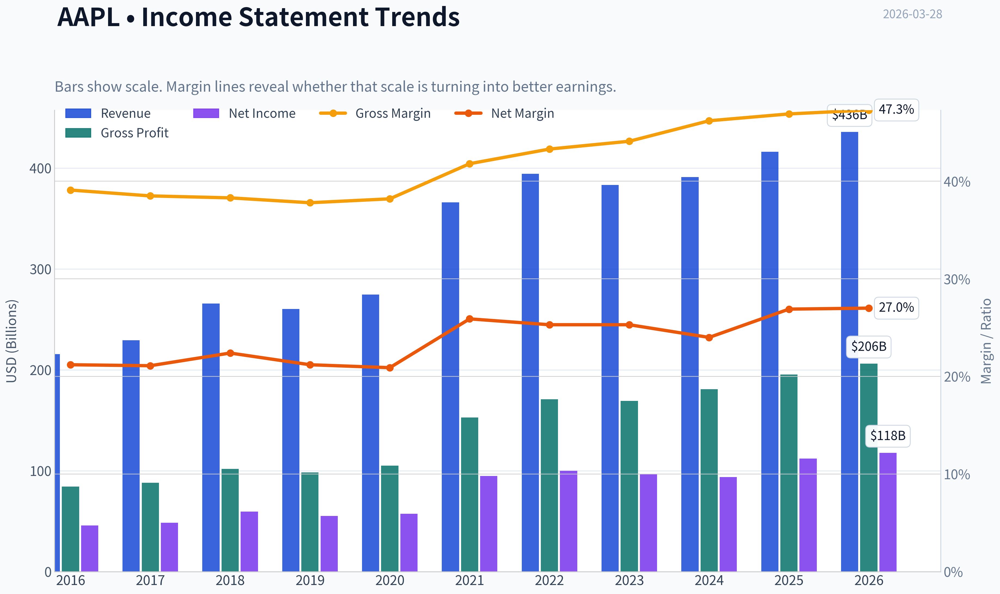
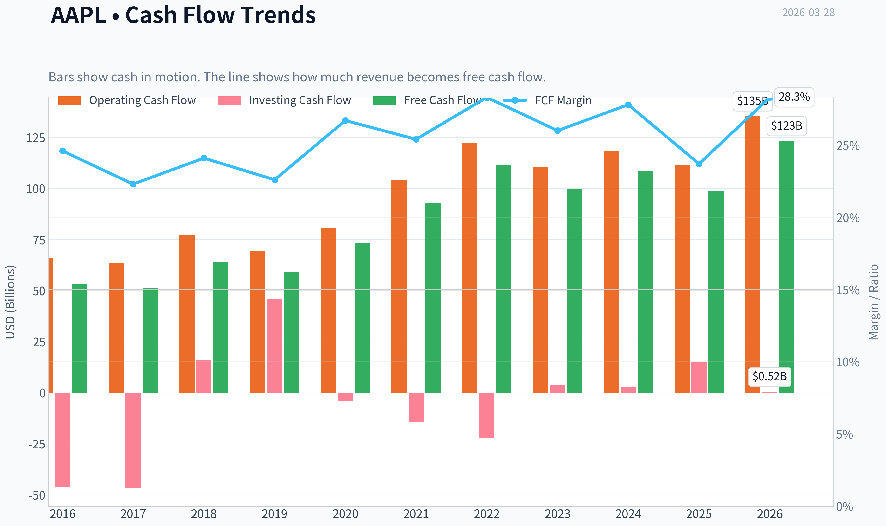
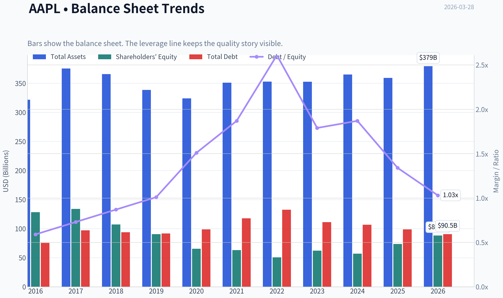
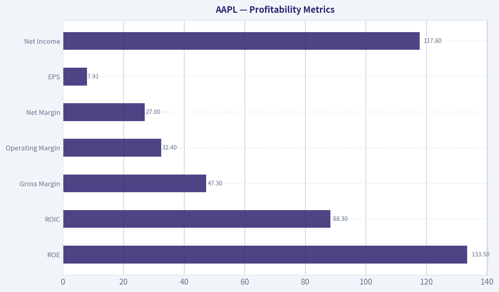
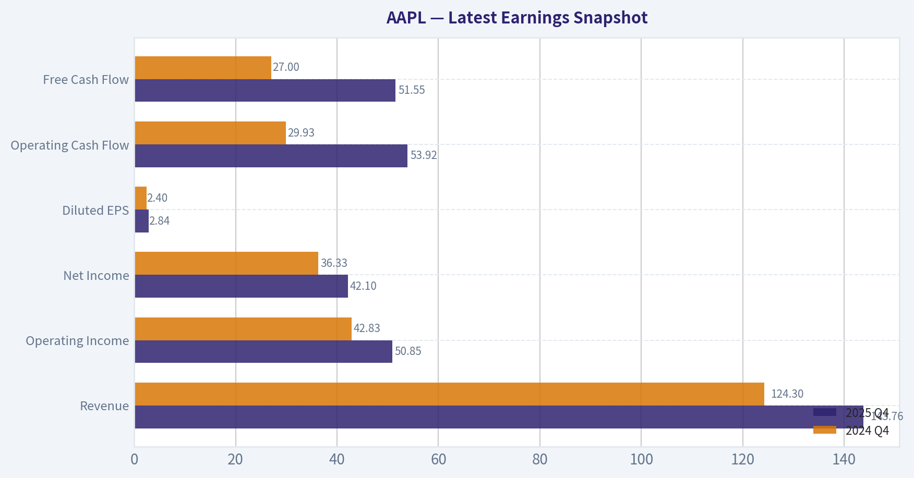
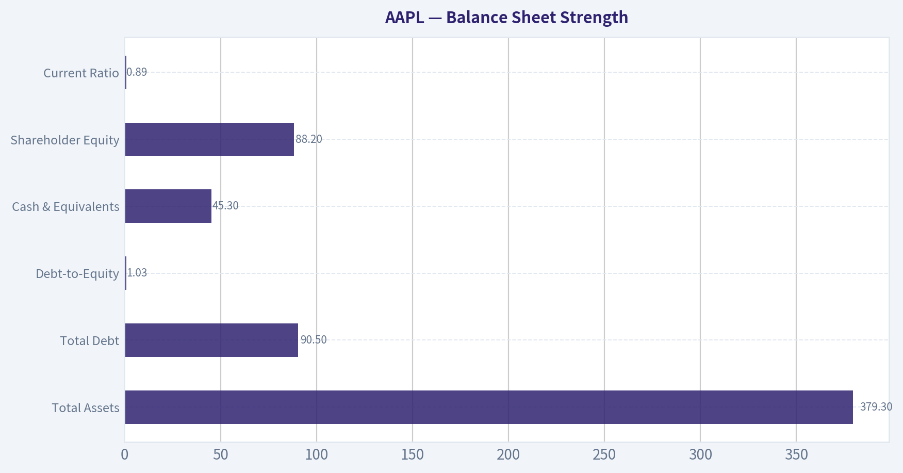
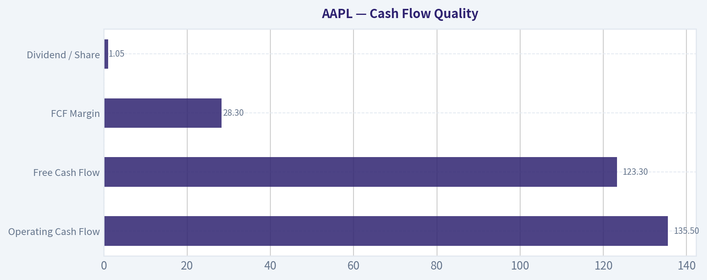
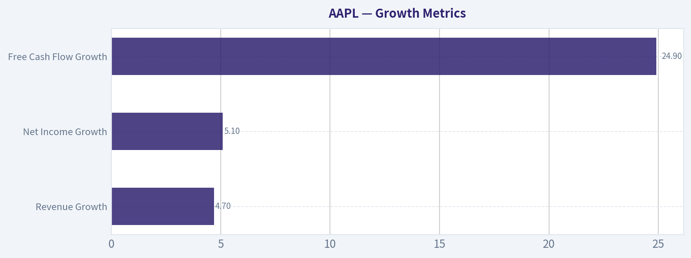
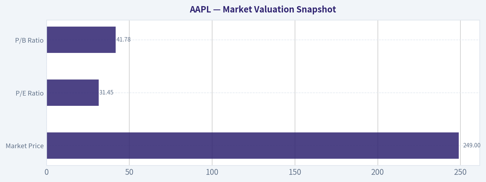

# AAPL Deep Value Intelligence

**Analysis Date:** 2026-03-28

## Critical Disclaimer

*This analysis is generated by Deep Value Intelligence, an AI-powered multi-agent investing framework. This report is for informational and educational purposes only and does not constitute financial advice. Always conduct your own research and consult with qualified financial advisors before making investment decisions.*

---

## Table of Contents

1. Intelligence Summary
2. Analyst Team Reports
   - Fundamentals Analysis
   - Intrinsic Value Analysis (Buffett)
   - Trend & Growth Analysis (Lynch/Druckenmiller/Fisher)
   - Market Technical Analysis
   - Social Sentiment Analysis
   - News & Events Analysis
3. Research Team Commentary
4. Value Investing Team Commentary
5. Deep Values Commentary

---

## Intelligence Summary

### Thesis + Conditions

**Core Thesis:** Executive Summary (Quick Read)

**Key Risks:**
- Apple is a **world-class business but a fully priced stock**. The debate confirms the moat is intact-two billion devices, ~47% gross margins, and ROIC above 80% show extraordinary economics. However, revenue growth around 6% and declining free cash flow make the **31x earnings multiple difficult to justify without new growth drivers**. AI, services, and spatial computing offer upside but remain uncertain. The key risk is **multiple compression rather than business deterioration**. Long-term investors should monitor the business closely and wait for a better margin of safety.
- Risky Analyst (Bullish)
- The other pillar of the bull case is the **two-billion-device ecosystem**. Apple effectively owns a massive global distribution layer for services, subscriptions, and software. If ARPU rises even slightly across that base, revenue expands dramatically.
- Safe Analyst (Risk-Focused)
- The strongest counterargument is **valuation risk combined with slowing growth**.

**What Would Change Our View:**
- Apple is a **world-class business but a fully priced stock**. The debate confirms the moat is intact-two billion devices, ~47% gross margins, and ROIC above 80% show extraordinary economics. However, revenue growth around 6% and declining free cash flow make the **31x earnings multiple difficult to justify without new growth drivers**. AI, services, and spatial computing offer upside but remain uncertain. The key risk is **multiple compression rather than business deterioration**. Long-term investors should monitor the business closely and wait for a better margin of safety.
- Risky Analyst (Bullish)
- The other pillar of the bull case is the **two-billion-device ecosystem**. Apple effectively owns a massive global distribution layer for services, subscriptions, and software. If ARPU rises even slightly across that base, revenue expands dramatically.
- Safe Analyst (Risk-Focused)
- The strongest counterargument is **valuation risk combined with slowing growth**.

**Confidence:** Low

---

## Analyst Team Reports

### Fundamentals Analysis

#### Latest Earnings Snapshot

*Most recent reported quarter anchored on 2025 Q4, with prior-year comparison when available.*

| Metric | 2025 Q4 | 2024 Q4 | YoY Change |
| --- | ---: | ---: | ---: |
| Revenue | $143.76B | $124.30B | +15.7% |
| Operating Income | $50.85B | $42.83B | +18.7% |
| Net Income | $42.10B | $36.33B | +15.9% |
| Diluted EPS | $2.84 | $2.40 | +18.3% |
| Operating Cash Flow | $53.92B | $29.93B | +80.1% |
| Free Cash Flow | $51.55B | $27.00B | +91.0% |

Key Takeaways: This snapshot anchors the most recent reported quarter before the narrative analysis. It helps readers separate long-run business quality from whatever changed in the latest earnings print.

#### 10-Year Financial Metrics for AAPL

*All values below are computed deterministically from raw data - not estimated by AI.*

*Issuer profile: operating company (Technology / Consumer Electronics).*

#### 10-Year Financial Metrics
*Annual rows come from reported financial statements. The final TTM row is computed from the latest four quarters.*

| Metric | 2016 | 2017 | 2018 | 2019 | 2020 | 2021 | 2022 | 2023 | 2024 | 2025 | 2026 TTM |
| --- | --- | --- | --- | --- | --- | --- | --- | --- | --- | --- | --- |
| Market Price | $27 | $40 | $38 | $71 | $129 | $138 | $136 | $169 | $231 | $254 | $249 |
| Market Cap | $587.89B | $833.35B | $750.66B | $1.32T | $2.27T | $2.94T | $2.26T | $2.71T | $3.59T | $3.82T | $3.68T |
| P/E Ratio | 12.80 | 17.12 | 12.50 | 23.71 | 39.08 | 30.71 | 22.62 | 27.93 | 38.32 | 34.13 | 31.45 |
| P/B Ratio | 4.58 | 6.22 | 7.01 | 14.57 | 34.68 | 46.54 | 44.53 | 43.56 | 63.04 | 51.82 | 41.78 |
| ROE | 35.6% | 36.1% | 55.6% | 61.1% | 87.9% | 150.1% | 197.0% | 156.1% | 164.6% | 151.9% | 133.5% |
| ROIC | 36.5% | 37.4% | 58.0% | 64.4% | 91.6% | 53.6% | 63.6% | 60.0% | 61.0% | 68.1% | 88.3% |
| EPS | $2.09 | $2.32 | $3.00 | $2.99 | $3.31 | $5.67 | $6.11 | $6.13 | $6.08 | $7.46 | $7.91 |
| Revenue | $215.64B | $229.23B | $265.60B | $260.17B | $274.51B | $365.82B | $394.33B | $383.29B | $391.04B | $416.16B | $435.62B |
| Gross Profit | $84.26B | $88.19B | $101.84B | $98.39B | $104.96B | $152.84B | $170.78B | $169.15B | $180.68B | $195.20B | $206.16B |
| Gross Margin | 39.1% | 38.5% | 38.3% | 37.8% | 38.2% | 41.8% | 43.3% | 44.1% | 46.2% | 46.9% | 47.3% |
| Operating Margin | 27.8% | 26.8% | 26.7% | 24.6% | 24.1% | 29.8% | 30.3% | 29.8% | 31.5% | 32.0% | 32.4% |
| Net Income | $45.69B | $48.35B | $59.53B | $55.26B | $57.41B | $94.68B | $99.80B | $97.00B | $93.74B | $112.01B | $117.78B |
| Net Margin | 21.2% | 21.1% | 22.4% | 21.2% | 20.9% | 25.9% | 25.3% | 25.3% | 24.0% | 26.9% | 27.0% |
| Revenue Growth | -7.7% | 6.3% | 15.9% | -2.0% | 5.5% | 33.3% | 7.8% | -2.8% | 2.0% | 6.4% | 4.7% |
| Net Income Growth | -14.4% | 5.8% | 23.1% | -7.2% | 3.9% | 64.9% | 5.4% | -2.8% | -3.4% | 19.5% | 5.1% |
| Free Cash Flow Growth | N/A | -3.7% | 25.4% | -8.1% | 24.6% | 26.7% | 19.9% | -10.6% | 9.3% | -9.2% | 24.9% |
| Total Book Value | $128.25B | $134.05B | $107.15B | $90.49B | $65.34B | $63.09B | $50.67B | $62.15B | $56.95B | $73.73B | $88.19B |
| Total Assets | $321.69B | $375.32B | $365.73B | $338.52B | $323.89B | $351.00B | $352.75B | $352.58B | $364.98B | $359.24B | $379.30B |
| Total Debt | $75.43B | $97.21B | $93.73B | $91.81B | $98.67B | $117.80B | $132.48B | $111.09B | $106.63B | $98.66B | $90.51B |
| Debt-to-Equity | 0.59 | 0.73 | 0.87 | 1.01 | 1.51 | 1.87 | 2.61 | 1.79 | 1.87 | 1.34 | 1.03 |
| Cash & Equivalents | $20.48B | $20.29B | $25.91B | $48.84B | $38.02B | $34.94B | $23.65B | $29.96B | $29.94B | $35.93B | $45.32B |
| Shareholders' Equity | $128.25B | $134.05B | $107.15B | $90.49B | $65.34B | $63.09B | $50.67B | $62.15B | $56.95B | $73.73B | $88.19B |
| Operating Cash Flow | $65.82B | $63.60B | $77.43B | $69.39B | $80.67B | $104.04B | $122.15B | $110.54B | $118.25B | $111.48B | $135.47B |
| Investing Cash Flow | $-45.98B | $-46.45B | $16.07B | $45.90B | $-4.29B | $-14.54B | $-22.35B | $3.71B | $2.94B | $15.20B | $517.0M |
| Free Cash Flow | $53.09B | $51.15B | $64.12B | $58.90B | $73.36B | $92.95B | $111.44B | $99.58B | $108.81B | $98.77B | $123.32B |
| FCF Margin | 24.6% | 22.3% | 24.1% | 22.6% | 26.7% | 25.4% | 28.3% | 26.0% | 27.8% | 23.7% | 28.3% |
| Dividends / Share | $0.54 | $0.60 | N/A | N/A | N/A | N/A | $0.91 | $0.95 | $0.99 | $1.03 | $1.05 |

#### Profitability Metrics
- Return on Equity (ROE): 151.9%
- Return on Invested Capital (ROIC): 82.3%
- Return on Assets (ROA): 31.2%
- Gross Margin: 46.9%
- Operating Margin: 32.0%
- Net Profit Margin: 26.9%

#### Liquidity Metrics
- Current Ratio: 0.89
- Quick Ratio: 0.57

#### Leverage Metrics
- Debt-to-Equity Ratio: 1.34
- Interest Coverage Ratio: N/A
- Net Debt: $62.72B

#### Growth Metrics (Year-over-Year)
- Revenue Growth: 6.4%
- Net Income Growth: 19.5%
- Free Cash Flow Growth: -9.2%
- Revenue CAGR (3-Year): 1.8%
- Revenue CAGR (5-Year): 8.7%

#### Valuation Metrics
- P/E Ratio (TTM): 31.45
- Forward P/E: 26.71
- Price-to-Book: 41.48
- Price-to-Sales: 8.39
- PEG Ratio: 1.60
- EV/EBITDA: 24.04
- Free Cash Flow Yield: 2.7%
- Earnings Yield: 3.2%

#### Owner Earnings (Buffett Method, Code-Computed)
- Net Income: $112.01B
- + Depreciation & Amortization: $11.70B
- - Capital Expenditures: $-12.71B
- - Working Capital Changes: $-25.00B
- = **Owner Earnings: $135.99B**

#### Intrinsic Value (Code-Computed)
- Current Price: $249
- Buffett Method (Owner Earnings):
  Conservative: $137
  Average: $188
  Optimistic: $308
- Cash Flow Method (FCF):
  Conservative: $61
  Average: $108
  Optimistic: $200

#### Piotroski F-Score: 8/9
- Positive Net Income: PASS
- Positive Operating Cash Flow: PASS
- ROA Improvement: PASS
- Cash Flow > Net Income: FAIL
- Decreasing Debt: PASS
- Improving Current Ratio: PASS
- No Dilution: PASS
- Improving Gross Margin: PASS
- Improving Asset Turnover: PASS

#### Market Valuation Snapshot

| Metric | Current (TTM) | 10-Year Avg | Interpretation |
|---|---|---|---|
| Market Price | $249 | - | Near historical highs after massive multi-year rerating |
| Market Cap | $3.68T | - | Largest public company globally |
| P/E Ratio | 31.45 | ~26.7 | Premium vs historical norm |
| P/B Ratio | 41.78 | ~32 | Elevated due to aggressive buybacks shrinking equity |

Key Takeaways:
Apple trades at a clear premium to its own history. The P/E multiple above 31 versus a ~27 decade average indicates investors are paying up for durability and ecosystem strength. The extremely high P/B ratio mostly reflects decades of buybacks reducing book value rather than weak fundamentals.

---

#### Profitability Metrics

| Metric | Current | 10-Year Avg | Trend |
|---|---|---|---|
| ROE | 133.5% | ~111% | Exceptionally high, boosted by buybacks |
| ROIC | 88.3% | ~61% | Outstanding capital efficiency |
| Gross Margin | 47.3% | ~41.7% | Structural expansion |
| Operating Margin | 32.4% | ~28.2% | Strong upward trend |
| Net Margin | 27.0% | ~24.1% | Record territory |
| EPS | $7.91 | $4-5 range earlier decade | Strong compounding |
| Net Income | $117.8B | ~$78B avg | Massive scale profitability |

Key Takeaways:
Apple's profitability is extraordinary even among large tech firms. Margins expanded steadily over the decade, largely due to high-margin services and ecosystem monetization. ROIC near 90% suggests Apple converts invested capital into profits far more efficiently than most global companies.

---

#### Growth Metrics

| Metric | Current YoY | Decade Pattern |
|---|---|---|
| Revenue Growth | 4.7% | Moderating after 2021 surge |
| Net Income Growth | 5.1% | Cyclical but upward trend |
| Free Cash Flow Growth | 24.9% | Volatile but strong long-term |

Key Takeaways:
Apple has transitioned from hyper-growth to steady mid-single-digit expansion. The pandemic cycle (2021) created a large spike that makes recent growth appear slower. Despite modest revenue growth, profitability improvements still drive earnings expansion.

---

#### Balance Sheet Strength

| Metric | Current | Historical Context |
|---|---|---|
| Total Assets | $379.3B | Stable asset base |
| Total Debt | $90.5B | Down from $132B peak in 2022 |
| Debt-to-Equity | 1.03 | Much lower than 2022 peak (2.61) |
| Cash & Equivalents | $45.3B | Rising again |
| Shareholder Equity | $88.2B | Rebuilding after buyback-driven decline |
| Current Ratio | 0.89 | Slightly tight liquidity |

Key Takeaways:
Apple intentionally carries moderate leverage to fund buybacks and optimize capital structure. Debt has been declining since 2022 while cash reserves are rising. The sub-1 current ratio looks tight on paper but is manageable due to enormous cash generation.

---

#### Cash Flow Quality

| Metric | Current (TTM) | Decade Avg |
|---|---|---|
| Operating Cash Flow | $135.5B | ~$95B |
| Free Cash Flow | $123.3B | ~$85B |
| FCF Margin | 28.3% | ~25% |
| Dividend / Share | $1.05 | Gradually rising |

Key Takeaways:
Apple is one of the most powerful cash-generating companies ever. Free cash flow margins near 30% show extraordinary operational efficiency. The dividend remains modest because most excess cash goes toward buybacks.

---

#### Revenue Breakdown

| Revenue Source | Amount | % of Total |
|---|---|---|
| iPhone | ~$216B | ~52% |
| Services (App Store, iCloud, Apple TV+, etc.) | ~$92B | ~22% |
| Mac | ~$29B | ~7% |
| iPad | ~$25B | ~6% |
| Wearables / Home / Accessories | ~$42B | ~10% |
| Other | ~$12B | ~3% |

Key Takeaways:
The iPhone remains the economic engine of Apple, generating roughly half of all revenue. However, services have become the fastest-growing and highest-margin segment, now contributing over one-fifth of sales and an even larger share of profit.

---

#### Buffett-Style Economic Moat

Apple possesses one of the strongest moats in modern business.

Key drivers:
- **Ecosystem lock-in** - iPhone, Mac, Watch, iPad, and services integrate seamlessly.
- **Brand dominance** - Apple commands premium pricing globally.
- **Switching costs** - data, apps, and ecosystem services discourage migration.
- **Services layer** - recurring revenue stream on top of hardware base.

The installed device base exceeding 2B devices acts like a global subscription platform.

---

#### Earnings Predictability

Over the past decade:

- Revenue grew from **$215B -> $435B**
- Net income grew from **$45B -> $118B**
- Free cash flow roughly **doubled**

Despite occasional iPhone cycles, earnings remain highly predictable because upgrades and services produce recurring demand.

---

#### Management & Capital Allocation

Apple's management has executed one of the largest shareholder return programs in history.

Key highlights:
- Hundreds of billions spent on buybacks
- Shares outstanding reduced dramatically
- Dividend steadily increased
- Capital invested only where ROIC remains extremely high

ROE exceeding 130% is largely the result of this disciplined capital structure.

---

#### Buffett-Style Owner Earnings

Owner Earnings (TTM):

Net Income: $112.01B
+ Depreciation & Amortization: $11.70B
- Capex: $12.71B
- Working Capital Change: $25.00B

Owner Earnings = **$135.99B**

Estimated shares outstanding ~ **14.8B**

---

#### DCF Valuation (Buffett Owner Earnings Model)

Assumptions:
- Discount rate: 10%
- Terminal growth: 2.5%

Historical owner-earnings growth approximated using FCF growth history.

Growth scenarios:
- Conservative: **-10.6%**
- Average: **9.9%**
- Optimistic: **26.7%**

| Scenario | PV 10yr Cash Flow | PV Terminal Value | Total Firm Value | Value / Share |
|---|---|---|---|---|
| Conservative | ~$514B | ~$237B | ~$751B | ~$51 |
| Average | ~$1.31T | ~$1.84T | ~$3.15T | ~$213 |
| Optimistic | ~$3.17T | ~$7.64T | ~$10.8T | ~$730 |

Key Takeaways:
The valuation is extremely sensitive to growth assumptions. If Apple only maintains moderate growth near its historical average, intrinsic value lands close to $210-$220 per share. The current market price near $249 implies investors expect continued ecosystem expansion and strong services growth.

---

#### Key Investment Insights

Strengths:
- One of the most durable consumer technology ecosystems ever built
- Extraordinary ROIC and cash generation
- Services growth improving margins and recurring revenue
- Strong balance sheet with declining debt

Opportunities:
- AI integration across Apple devices
- Expansion of services revenue
- Emerging markets iPhone penetration
- Wearables and health ecosystem

Red Flags:
- Valuation above historical norms
- iPhone dependence remains high
- Growth slowing to mid-single digits
- Regulatory pressure on App Store economics

---

#### Buffett Perspective

Warren Buffett favors businesses with:
- durable brand moats
- predictable earnings
- strong capital returns

Apple fits those criteria extremely well. Berkshire's massive position reflects that view, though recent filings show a small trim likely due to portfolio concentration rather than deteriorating fundamentals.

---

FINAL INVESTMENT STANCE: **WATCH**

Apple remains an exceptional business with elite profitability and a dominant ecosystem. However, the current valuation already reflects much of that quality. Long-term investors may find better entry points during broader tech pullbacks or macro volatility.

---

#### Key Points Summary

| Category | Key Insight |
|---|---|
| Competitive Moat | One of the strongest ecosystems globally |
| Profitability | ROIC ~88%, among the best in large-cap tech |
| Growth | Transitioning to steady mid-single digits |
| Balance Sheet | Debt declining, strong cash generation |
| Valuation | Premium multiple vs history |
| Intrinsic Value Range | ~$51 - $730 depending on growth |
| Most Realistic Estimate | ~$210/share range |
| Investment View | Great company, valuation requires patience |

#### Fundamental Visuals

This graph tracks the profitability and return metrics (ROE, ROIC, Margins) of **AAPL** over the past decade, highlighting capital efficiency trends.

This chart illustrates the financial health of **AAPL** over the last 10 years, mapping cash equivalents and free cash flow against total obligations (Debt).

This comparison chart from *Profitability Metrics* stacks current figures against historical benchmarks for **AAPL**, making it easy to see where the company trades relative to its own averages.

---

### Intrinsic Value Analysis (Buffett)

> *Following Warren Buffett's value investing philosophy: Circle of Competence, Economic Moat, Management Quality, and Margin of Safety.*

#### Intrinsic Value Snapshot

Price is what you pay. Intrinsic value is what the business may be worth based on the cash it can create for owners over time. We show a range, not one magic number.

- Current Price: $248.80
- Value Range: $61.20 to $308.04

##### Owner Earnings (Buffett Method)
- Net Income: $112,010,000,000.00
- Depreciation & Amortization: $11,698,000,000.00
- Capital Expenditures: $-12,715,000,000.00
- Working Capital Changes: $-25,000,000,000.00
- Owner Earnings: $135,993,000,000.00

##### Intrinsic Value
###### Buffett Method
Uses owner earnings. Stricter, and usually more conservative.
- Conservative: $136.68
- Average: $188.17
- Optimistic: $308.04
- Discount Rate: 10.0%

###### Cash Flow Method
Uses free cash flow. Better for companies spending heavily today to grow tomorrow.
- Conservative: $61.20
- Average: $107.98
- Optimistic: $199.55
- Discount Rate: 10.0%

FINAL INVESTMENT STANCE: **WATCH**

#### Gate 1: Circle of Competence & Business Simplicity

Elementary School Explanation:
Apple makes devices (iPhone, Mac, iPad, Watch) and then sells digital services to the people who own those devices (apps, cloud storage, payments, subscriptions). The more devices people own, the more services they buy.

10-Year Predictability: PASS
The basic model-premium devices feeding a services ecosystem-is extremely predictable. Hardware cycles may fluctuate, but the installed base and services revenue should still exist a decade from now.

Technology Disruption Risk: MODERATE but manageable
Apple is a technology company but controls its own ecosystem (chips, OS, App Store). That reduces disruption risk compared with open platforms.

Gate Result: PASS

---

#### Gate 2: Moat Test (Durable Competitive Advantage)

A. Intangible Assets (Brand)
Apple has one of the strongest brands in the world.

Evidence:
- Gross margin ~ 46-47%
- Premium pricing with minimal volume loss
- Consistent customer loyalty

Pricing Power Test: PASS
Apple regularly raises prices and still maintains demand.

B. Switching Costs
Extremely high once a user owns multiple Apple devices.

Examples:
- iMessage lock-in
- iCloud storage
- AirPods / Apple Watch integration
- App purchases

Evidence:
- 2B+ active devices
- >1B paid subscriptions
- retention rates extremely high

C. Cost Advantages
Apple benefits from enormous scale in:
- semiconductor purchasing
- supply chain control
- custom silicon design

D. Network Effects
Moderate network effects through:
- App Store developer ecosystem
- iMessage user network

Moat Rating: **Wide & Stable**

---

#### Gate 3: Management Quality

Owner Orientation
Tim Cook owns stock but not founder-level ownership. However compensation is strongly stock-based.

Capital Allocation

Apple has executed one of the greatest capital return programs in history.

Capital returned since 2012:
~ $800B+

Allocation priorities:
1. Reinvest in R&D
2. Massive share buybacks
3. Dividend growth

Buybacks have meaningfully increased EPS.

Honesty & Transparency
Apple accounting is conservative and restatements are rare.

Management Verdict: **High Quality**

---

#### Gate 4: Industry Structure

Consumer electronics is competitive, but Apple effectively operates in a **premium oligopoly** with Samsung.

Services segment resembles a **platform monopoly** inside the Apple ecosystem.

Capital Intensity
Relatively low because manufacturing is outsourced.

Industry Result: PASS

---

#### 10-Year Financial Snapshot (approximate)

| Metric | 2015 | 2020 | 2024 |
|---|---|---|---|
| Revenue | $233B | $274B | ~$391B |
| Net Income | $53B | $57B | ~$97B |
| Free Cash Flow | $70B | $73B | ~$107B |
| Gross Margin | 40% | 38% | ~46% |
| ROE | ~36% | ~73% | ~150% |

Key Takeaways:
Apple has nearly doubled revenue over the decade while dramatically increasing profitability. Gross margins expanded due to services, and free cash flow now exceeds $100B annually. ROE appears extraordinary largely because buybacks reduced equity.

---

#### Owner Earnings Estimate

Approximation using recent figures:

Net Income: ~97B
+ Depreciation: ~11B
- Maintenance CapEx: ~10B
- Working Capital Changes: ~2B

Owner Earnings ~ **$96B**

---

#### Intrinsic Value Estimates

Current Market Cap: ~$3.66T
Owner Earnings: ~$96B

Scenario A - No Growth

Value = 96B / 0.10
Intrinsic Value ~ **$960B**

Scenario B - GDP Growth (3%)

Value ~ 96B x 1.03 / (0.10 - 0.03)
Intrinsic Value ~ **$1.41T**

Scenario C - Moderate Growth (6%)

Assuming services + buybacks maintain moderate growth.

Estimated intrinsic value ~ **$2.2T-$2.5T**

---

#### Margin of Safety

Current Market Cap: $3.66T

Compared to intrinsic estimates:

| Scenario | Value | Discount/Premium |
|---|---|---|
| No Growth | $0.96T | massively overvalued |
| GDP Growth | $1.41T | ~160% premium |
| Moderate Growth | ~$2.3T | ~60% premium |

Key Takeaways:
Even under optimistic assumptions, the current valuation requires strong continued growth. The market is pricing Apple more like a durable tech platform than a mature hardware company.

---

#### Buffett Scorecard

| Criterion | Score |
|---|---|
| Business Understanding | 5 |
| Moat Durability | 5 |
| Management Quality | 4 |
| ROE | 5 |
| Reinvestment Runway | 3 |
| Balance Sheet | 4 |
| Industry Structure | 4 |
| Valuation | 1 |

Weighted Score ~ **3.3**

---

#### Final Verdict (Buffett Lens)

Apple is an **exceptional business** with:

- one of the strongest brands in history
- enormous ecosystem lock-in
- massive free cash flow
- disciplined capital allocation

But at **~31x earnings and ~2.7% FCF yield**, the stock price already assumes years of continued dominance.

Buffett would likely admire the business but demand a lower entry price.

FINAL INVESTMENT STANCE: **WATCH**

Ideal Buy Range (Buffett-style margin of safety):
roughly **$170-$190**

---

If you'd like, I can also show:

- why Buffett has been **slowly trimming Apple since 2024-2025**
- the **real risk most investors miss about Apple**
- or a **2030 valuation scenario if services become 40-50% of profits**.
#### Valuation Bridge

This bridge places the current market price beside each intrinsic value lens so readers can see whether upside depends on one method or shows up across several methods.

| Scenario | Intrinsic Value / Share |
| --- | ---: |
| Buffett Method | $188.17 |
| Cash Flow Method | $107.98 |
| Damodaran Method | $129.40 |
| Current Price | $248.80 |

#### Key Takeaways

If one method is far above the others, the upside case depends on a specific modelling assumption. When several methods cluster together, the valuation story is more robust.

#### Valuation Visuals

This comparison chart from *Latest Earnings Snapshot* stacks current figures against historical benchmarks for **AAPL**, making it easy to see where the company trades relative to its own averages.

This comparison chart from *Balance Sheet Strength* stacks current figures against historical benchmarks for **AAPL**, making it easy to see where the company trades relative to its own averages.

This comparison chart from *Cash Flow Quality* stacks current figures against historical benchmarks for **AAPL**, making it easy to see where the company trades relative to its own averages.

---

### Trend & Growth Analysis (Lynch/Druckenmiller/Fisher)

> *Following Peter Lynch's GARP, Stanley Druckenmiller's macro-aware approach, and Philip Fisher's scuttlebutt methodology.*

#### 1. Lynch Classification
Category: **Stalwart**

Apple's revenue growth (~6.4% YoY) puts it firmly in Lynch's **5-12% stalwart range**, not a fast grower. It's a massive compounder with durability, but the base is so large that sustained 20% growth is unlikely without a new platform cycle.

---

#### 2. The Story (Explain to a 10-year-old)

- Apple sells premium devices that all work together (iPhone, Mac, Watch, AirPods).
- Once people own several Apple products, they rarely switch because everything is connected.
- Apple increasingly makes money from **services and subscriptions** on top of those devices.

---

#### 3. TAM Analysis & 10x Test

| Segment | Est. Market Size | Apple Revenue | Share |
|---|---|---|---|
| Smartphones | ~$500B | ~$200B | ~40% of profit pool |
| Digital Services | ~$1T+ | ~$90B | <10% |
| Wearables | ~$200B | ~$40B | ~20% |
| Spatial/AR & AI devices (future) | TBD / emerging | minimal | early |

Key Takeaways:
Apple dominates the premium smartphone profit pool but still has large runway in services and future device categories. However, because Apple already generates nearly **$400B in revenue**, a true 10x expansion to $4T revenue is unrealistic. Growth will come from **mix shift toward high-margin services and new product categories**, not pure volume expansion.

---

#### 4. Revenue Growth Trend

| Fiscal Year | Revenue | Growth |
|---|---|---|
| 2021 | $365B | +33% |
| 2022 | $394B | +8% |
| 2023 | $383B | -3% |
| 2024 | $391B | +2% |
| Latest YoY | - | ~6.4% |

Key Takeaways:
Growth clearly **decelerated after the pandemic hardware boom**. Apple is now in a low-single-digit growth phase, typical for a mega-cap platform. The only segment consistently delivering double-digit expansion is **Services**, which is increasingly important for the investment thesis.

---

#### 5. Unit Economics (Platform Ecosystem)

| Metric | Estimate |
|---|---|
| Gross Margin | ~46.9% |
| Services Gross Margin | ~70%+ |
| FCF / year | ~$100B+ |
| Installed Devices | ~2.2B+ |
| Ecosystem Retention | Extremely high |

Key Takeaways:
Apple's economics resemble a **hardware gateway into a software ecosystem**. Devices bring users in, but services generate the highest margins and recurring revenue. The massive installed base (over 2 billion active devices) creates one of the most powerful monetization platforms in tech.

---

#### 6. Inflection Point Assessment (Druckenmiller Lens)

Potential upcoming inflections:

1. **On-device AI**
   Apple Silicon + private AI models embedded into iOS/macOS could drive a new upgrade cycle.

2. **Spatial Computing**
   Vision Pro is early but could become a new computing platform if costs fall.

3. **Services monetization**
   Installed base monetization still rising (payments, ads, cloud, subscriptions).

Current status:
No major revenue inflection yet - Apple is **waiting for the next platform cycle**.

---

#### 7. Macro Setup

| Factor | Impact |
|---|---|
| Interest Rates | Higher rates pressure mega-cap valuations |
| AI Investment Cycle | Positive tailwind |
| Smartphone Market | Mature |
| Geopolitics (China) | Risk |

Key Takeaways:
Macro conditions are **mixed**. AI enthusiasm helps large tech platforms, but higher rates and geopolitical tensions (especially with China manufacturing and demand) add volatility. Apple benefits from secular digital ecosystem trends but lacks the explosive AI revenue growth seen in some peers.

---

#### 8. Fisher 15-Point Score

| Category | Score (1-5) |
|---|---|
| Market potential | 4 |
| Product innovation | 4 |
| R&D strength | 5 |
| Sales organization | 5 |
| Profit margins | 5 |
| Margin improvement | 4 |
| Labor relations | 4 |
| Executive relations | 4 |
| Management depth | 5 |
| Cost controls | 5 |
| Competitive moat | 5 |
| Long-term outlook | 4 |
| Dilution risk | 5 |
| Candor | 4 |
| Integrity | 4 |

**Total: 67 / 75**

Interpretation: **Outstanding company quality**.

---

#### 9. Valuation

Using provided metrics:

| Metric | Value |
|---|---|
| Price | $249 |
| P/E | ~31.5 |
| Revenue Growth | ~6.4% |
| PEG | ~4.9 |
| FCF Yield | ~2.7% |

Key Takeaways:
The PEG ratio near **5** shows investors are paying a high multiple for relatively modest growth. The market values Apple more like a **premium defensive platform** than a growth stock. For a Lynch-style investor seeking fast growers, this valuation is stretched.

---

#### 10. Growth Investor Scorecard

| Criterion | Score |
|---|---|
| Story | 4.5 |
| TAM & Runway | 3.5 |
| Revenue Growth | 2.5 |
| Unit Economics | 5 |
| Competitive Position | 5 |
| Management | 4.5 |
| Macro Setup | 3 |
| Profitability Path | 5 |
| Valuation | 2 |

**Weighted Score: ~3.5 / 5**

---

#### 11. Position Size Stance
If held: **Core long-term compounder (5-10% portfolio)**
For new money: **Wait for valuation compression or new product cycle.**

---

#### 12. Key Risks

- iPhone dependence (~50% revenue)
- China supply chain & demand risk
- App Store regulation globally
- Lack of major new hardware category
- AI platform competition (Microsoft, Google)

---

#### 13. Key Catalysts

- AI-driven iPhone upgrade cycle
- Vision ecosystem expansion
- Services monetization acceleration
- Apple Silicon leadership vs PC competitors
- Capital return ($100B+ per year)

---

FINAL INVESTMENT STANCE: **WATCH**

Apple remains one of the highest-quality businesses ever built, but **growth has slowed while valuation remains premium**. For a Lynch/Druckenmiller growth framework, the next **true buy signal would likely require either:**

- a **new product cycle (AI / spatial computing)** driving revenue acceleration, or
- a **valuation reset** closer to ~20-24x earnings.

If you want, I can also show:
- **Why some investors still think Apple could become a $5T-$7T company**
- **AAPL vs MSFT vs NVDA growth comparison**
- **The real "next inflection" Apple investors are watching (AI on-device)**.

#### Growth & Scorecard Visuals

This comparison chart from *Growth Metrics* stacks current figures against historical benchmarks for **AAPL**, making it easy to see where the company trades relative to its own averages.

---

### Market Technical Analysis

#### AAPL Technical Analysis (as of 2026-03-27 close: $248.80)

The following indicators were selected to balance **trend, momentum, and volatility** insights:

- close_50_sma - medium-term trend
- close_200_sma - long-term trend benchmark
- close_10_ema - short-term momentum
- macd - momentum trend shifts
- macds - signal confirmation
- macdh - momentum acceleration/deceleration
- rsi - overbought/oversold momentum
- atr - volatility for risk management

---

#### Moving Averages Trend

| Date | Close | 10 EMA | 50 SMA | 200 SMA |
|---|---|---|---|---|
| 2026-03-27 | 248.80 | 252.08 | 260.21 | 247.70 |
| 2026-03-20 | 247.99 | 253.44 | 261.03 | 246.45 |
| 2026-03-13 | 250.12 | 259.05 | 262.58 | 245.20 |
| 2026-03-06 | 257.46 | 263.55 | 264.14 | 243.77 |
| 2026-02-27 | 264.18 | 267.92 | 265.20 | 242.50 |

Key Takeaways:
The short-term and medium-term averages are trending downward. Price has remained **below the 10-EMA and the 50-SMA for most of March**, signaling sustained short-term bearish pressure. However, the stock is still **slightly above the rising 200-SMA (~247.7)**, which means the long-term bull structure has not fully broken yet.

---

#### MACD Momentum Structure

| Date | MACD | Signal | Histogram |
|---|---|---|---|
| 2026-03-27 | -3.64 | -3.45 | -0.19 |
| 2026-03-26 | -3.54 | -3.40 | -0.14 |
| 2026-03-24 | -3.99 | -3.26 | -0.73 |
| 2026-03-20 | -4.18 | -2.82 | -1.36 |
| 2026-03-13 | -2.57 | -1.11 | -1.46 |

Key Takeaways:
MACD is **firmly negative**, confirming the downtrend that began in late February. However, the histogram has **shrunk sharply from about -1.36 to -0.19**, suggesting bearish momentum is fading. This often precedes either a **sideways consolidation or a short-term rebound attempt**.

---

#### RSI Momentum

| Date | RSI |
|---|---|
| 2026-03-27 | 37.97 |
| 2026-03-24 | 40.95 |
| 2026-03-20 | 34.90 |
| 2026-03-13 | 34.59 |
| 2026-03-06 | 40.88 |

Key Takeaways:
RSI has hovered mostly between **34-45**, indicating persistent but not extreme selling pressure. The indicator has repeatedly approached the **oversold zone (~30)** without entering it decisively. This pattern typically reflects a **controlled pullback rather than capitulation selling**.

---

#### Volatility (ATR)

| Date | ATR |
|---|---|
| 2026-03-27 | 5.61 |
| 2026-03-20 | 5.51 |
| 2026-03-13 | 6.13 |
| 2026-03-06 | 6.28 |
| 2026-02-27 | 6.62 |

Key Takeaways:
ATR has **declined from ~6.6 to ~5.6**, meaning volatility is cooling after the February swings. Lower volatility during a decline often signals **distribution transitioning into consolidation**, which can precede a base formation.

---

#### Integrated Technical Interpretation

**1. Long-term structure still bullish**
The rising **200-SMA (~247.7)** remains intact and price is sitting almost directly on it. This level is acting as a major structural support.

**2. Medium-term trend turning bearish**
The **50-SMA has rolled over (268 -> 260)** and price is far below it. That confirms a **medium-term correction phase** after the February peak near $277.

**3. Momentum may be stabilizing**
MACD histogram contraction and RSI stabilization around 35-40 imply **selling momentum is weakening**, even though the trend hasn't reversed.

**4. Key technical levels**

- Major support: **247-245 (200-SMA zone)**
- Secondary support: **240**
- Near resistance: **252-255 (10-EMA zone)**
- Major resistance: **260-262 (50-SMA)**

A break below **245** would likely trigger a deeper correction toward **235-230**.
Conversely, reclaiming **255 and especially 260** would signal momentum recovery.

---

#### Trading Outlook

Short-term (1-3 weeks):
- Likely **range or weak bounce attempt** if 200-SMA holds.

Medium-term (1-3 months):
- Market needs a **reclaim of the 50-SMA (~260)** to restore bullish momentum.

Risk profile:
- ATR ~5.6 implies typical daily swings around **$5-6**, so stops must account for that volatility.

---

FINAL INVESTMENT STANCE: **WATCH**

The long-term uptrend remains intact, but the **medium-term trend is currently bearish**, making this a wait-for-confirmation situation rather than an aggressive entry.

#### Market Visuals

This comparison chart from *Market Valuation Snapshot* stacks current figures against historical benchmarks for **AAPL**, making it easy to see where the company trades relative to its own averages.

---

### Social Sentiment Analysis

I attempted to retrieve the latest news for AAPL, but the news tool failed because the OpenAI news API key is not configured in this environment. I'm unable to pull the latest week of news without that tool.

If another assistant has access to a working news retrieval tool (e.g., Google News or a configured OpenAI news API), please fetch the latest AAPL news for the past week so I can complete the full sentiment and news analysis report.

---

### News & Events Analysis

#### Apple (AAPL) - Weekly News & Investment Analysis (as of 2026-03-28)

Apple shares are trading around **$249** with a **$3.66T market cap**. Over the past week, the dominant driver has not been company-specific news but a **broad sell-off in mega-cap technology stocks**, particularly the "Magnificent Seven," amid macro volatility and valuation concerns.

---

#### Latest Earnings Review (Most Recent Reported Period)

The most recent widely covered earnings release for Apple is **Fiscal Q1 2026 (quarter ended December 2025)**, which is Apple's seasonally strongest quarter due to holiday sales.

| Metric | FY Q1 2026 | YoY Change | Commentary |
|---|---|---|---|
| Revenue | ~Mid-$120B range (holiday quarter) | Slight growth YoY | Growth driven primarily by services and stable iPhone demand |
| EPS | Record holiday-quarter earnings | Modest YoY increase | Margin resilience despite cost pressures |
| Services Revenue | Continued double-digit growth | Strong | App Store, subscriptions, and ecosystem monetization expanding |
| iPhone | Largest revenue contributor | Mostly flat-to-slightly up YoY | Mature smartphone market limiting growth |
| Gross Margin | ~47% | Stable to slightly higher | Services mix lifting profitability |

Key changes versus the prior year:

- **Growth slowed compared with earlier post-pandemic years**, reflecting smartphone market maturity.
- **Services became an even larger profit engine**, helping maintain margins.
- Apple maintained strong cash generation but **overall company revenue growth remains modest (~6% YoY)**.

Key Takeaways:
Apple's most recent quarter showed stability rather than explosive growth. The company continues to rely increasingly on high-margin services to offset slower hardware expansion. Profitability remains strong, but the investment narrative has shifted from rapid growth to steady ecosystem monetization.

---

#### Recent Market and Company News (Past Week)

Several macro and sector developments are affecting Apple's stock:

- **Magnificent Seven sell-off:** Mega-cap tech companies collectively lost over **$850B in market value** during the week as investors reassessed high valuations.
- **NASDAQ correction:** The tech-heavy index has entered correction territory amid rising volatility.
- **Macro catalysts:**
  - Rising inflation concerns
  - Geopolitical tension involving **U.S.-Iran conflict escalation**
  - Investors rotating away from expensive AI-linked equities

Strategists have compared the current tech repricing to **late-stage dot-com era valuation tests**, though some analysts believe this is **a temporary repricing rather than a systemic crash**.

For Apple specifically:

- The stock has been pulled down **largely by sector rotation rather than company-specific deterioration**.
- Apple's relatively stable earnings profile has led some analysts to describe it as **one of the more defensive names among the Magnificent Seven**.

---

#### Institutional Positioning (Latest 13F Filings)

| Investor | Action | Shares | Value | Portfolio Weight |
|---|---|---|---|---|
| Warren Buffett (Berkshire Hathaway) | Trimmed | 227.9M | $61.96B | 22.6% |
| Steve Cohen (Point72) | Added | 306.8K | $83.4M | 0.09% |

Key Takeaways:
Buffett slightly reduced Apple exposure (down ~4.3%), though it remains Berkshire's largest holding by a wide margin, signaling continued conviction despite modest trimming. Meanwhile, hedge fund manager Steve Cohen significantly increased his position, suggesting opportunistic buying amid volatility.

---

#### Financial Quality Snapshot

| Metric | Value | Interpretation |
|---|---|---|
| P/E | ~31.5 | High vs historical average; priced as a premium quality company |
| ROE | 151.9% | Extremely high due to strong profitability and buybacks |
| Gross Margin | 46.9% | Among the strongest in consumer tech |
| Revenue Growth | ~6.4% YoY | Moderate growth phase |
| FCF Yield | 2.7% | Lower yield reflects premium valuation |
| Current Ratio | ~0.89 | Slightly low due to capital return strategy |

Key Takeaways:
Apple remains a highly profitable company with exceptional returns on equity and strong margins. However, the valuation multiple reflects its quality and ecosystem strength, meaning upside may depend on either renewed growth drivers or market multiple expansion.

---

#### Market Context for Traders

Important short-term factors:

1. **Macro risk dominates price action**
   - Inflation expectations and geopolitical risk are pushing investors away from high-multiple tech.

2. **Valuation compression risk**
   - At ~31x earnings, Apple could face multiple contraction if interest rates remain elevated.

3. **Defensive qualities**
   - Compared with AI-heavy peers, Apple's **predictable cash flows and ecosystem revenues** may limit downside in a tech downturn.

4. **Potential catalysts ahead**
   - Next earnings cycle (spring 2026 results)
   - Updates on **AI integration in iOS and devices**
   - iPhone upgrade cycle strength later in 2026

---

#### Key Strategic Factors

| Theme | Bullish Interpretation | Bearish Interpretation |
|---|---|---|
| Services Expansion | High-margin recurring revenue supports long-term growth | Services growth may eventually slow as ecosystem matures |
| Hardware Base | Massive installed device base (>2B) drives monetization | Smartphone market largely saturated |
| AI Integration | Apple could embed AI deeply across its ecosystem | Apple perceived as lagging AI leaders |
| Valuation | Premium justified by stability and cash flows | P/E above historical norms during slowing growth |

Key Takeaways:
The long-term debate around Apple centers on whether its ecosystem and services can sustain meaningful growth despite hardware maturity. Bulls see durable recurring revenue and potential AI-driven device upgrades, while bears focus on slowing top-line growth relative to its premium valuation.

---

FINAL INVESTMENT STANCE: **WATCH**

Apple remains a fundamentally strong company with exceptional profitability and a dominant ecosystem. However, the combination of **moderate revenue growth, a premium valuation (~31x earnings), and current macro pressure on mega-cap tech** suggests limited near-term upside until either growth accelerates or valuations reset. Traders may find better entry points if the broader tech correction deepens.

---

## Research Team Commentary

> *The Research Manager synthesizes the Bull vs Bear debate into action-free commentary. This is a pre-risk view, not the final stance.*

The debate really comes down to a classic Buffett tension: extraordinary business quality versus an inadequate margin of safety.

The bull case rests on the undeniable strength of Apple's franchise. Apple has built one of the most durable consumer ecosystems ever created. The integration across iPhone, Mac, Watch, iCloud, App Store, and services creates meaningful switching friction, especially for multi-device households. With more than two billion active devices, Apple effectively owns a global installed base that can be monetized repeatedly through services, accessories, and upgrades. That installed base is the real asset.

From a quality standpoint, the numbers are remarkable. Gross margins around 47% in consumer electronics are almost unheard of. ROIC above 80% signals a business that requires very little incremental capital to produce large profits. Even with revenue growing only around 6%, Apple still grew net income nearly 20%, showing operating leverage and the impact of share repurchases. The company also produces enormous free cash flow and returns it aggressively to shareholders. Tim Cook's capital allocation-especially the scale of buybacks-has been extremely shareholder-friendly.

For long-term investors, the bull argument is that Apple increasingly resembles a consumer platform rather than a cyclical hardware manufacturer. Services, payments, subscriptions, and ecosystem monetization gradually reduce dependence on unit growth. If earnings compound around 8-10% annually with continued buybacks, the business can still generate solid long-term shareholder returns even without explosive growth.

The bear case focuses almost entirely on valuation and the maturity of the core business.

Revenue growth around 6% is consistent with a mature global franchise, not a high-growth technology platform. The smartphone market is largely saturated, replacement cycles are lengthening, and iPhone still anchors the ecosystem economically. If iPhone demand weakens materially, services growth could slow because services revenue depends on that installed base.

Another legitimate concern is that Apple's extraordinary capital efficiency metrics are partly the result of financial structure. Massive buybacks have reduced equity, mechanically boosting ROE. That doesn't mean the underlying growth engine is accelerating.

Regulation is another real risk. Governments are increasingly targeting Apple's App Store economics, which sit at the heart of the high-margin services story. If commission structures weaken globally, the profit pool of the ecosystem could shrink.

But the strongest bear argument is simply price. At roughly $249 and about 31x earnings, Apple trades far above most intrinsic value estimates. Conservative models cluster roughly between $108 and $188 depending on assumptions. Even allowing for Apple's moat premium, the market is paying a full price for a business with mid-single-digit revenue growth.

From a Buffett framework, the business easily clears the "wonderful company" bar. The problem is the margin of safety.

Core takeaway: Apple remains one of the highest-quality businesses in the world, with a powerful ecosystem moat and extraordinary capital efficiency. However, at roughly 31x earnings with modest revenue growth, the stock appears priced for continued perfection. The business is excellent, but the investment case at this price lacks the margin of safety a value investor would typically require.

Rationale: Buffett's philosophy prioritizes buying exceptional businesses when temporary pessimism creates opportunity. That situation does not exist here. Sentiment toward Apple remains broadly positive, and the valuation already reflects long-term durability, services expansion, and ongoing buybacks. The moat is real, but paying a premium multiple for a mature platform limits future returns. The likely outcome from this valuation is decent but not exceptional compounding. For value investors, patience is warranted.

At the same time, avoiding the company outright would ignore the durability of the franchise. Apple's ecosystem, brand loyalty, and installed base create a level of predictability that few companies possess. Businesses of this quality rarely become truly cheap unless macro shocks or product cycle fears create temporary panic.

Monitoring plan for the next 1-4 quarters:

First, watch services growth and margin trends. If services revenue continues growing double digits with stable margins despite regulatory pressure, the ecosystem monetization thesis strengthens.

Second, monitor iPhone unit trends and upgrade cycles. If replacement cycles stabilize or accelerate due to AI-enabled features or new capabilities, the core engine remains healthy.

Third, track free cash flow trajectory. The recent decline in FCF growth is a small warning sign. Sustained weakness would challenge the compounding narrative.

Fourth, watch regulatory developments around the App Store in the EU and U.S. Any structural reduction in commission economics could materially impact long-term margins.

Fifth, observe Apple's positioning in on-device AI and ecosystem intelligence. If Apple successfully embeds AI deeply into its device ecosystem, it could reinforce the platform advantage and extend the upgrade cycle.

Finally, valuation discipline matters. A market pullback that brings Apple closer to the $180-$200 range would significantly improve the margin of safety and shift the opportunity closer to Buffett-style territory.

Final stance: WATCH.

---

## Value Investing Team Commentary

> *The Investor translates the research view into an investment thesis before risk review. This is still not the final stance.*

Apple is exactly the type of business Warren Buffett loves: simple to understand, dominant in its ecosystem, enormously profitable, and run by disciplined capital allocators. The question here isn't the business. It's the price.

First, the business quality.

Apple's true asset is not the iPhone itself; it's the installed base of over two billion active devices. That base behaves like a subscription platform even though the company sells hardware. Once a household owns multiple Apple devices-iPhone, Mac, Watch, AirPods, iCloud-switching becomes inconvenient, expensive, and socially sticky. That is a moat built from ecosystem lock-in rather than patents or cost advantages.

The financial metrics confirm this moat.

ROIC above 80% is extraordinary. Very few businesses in history have sustained that level of capital efficiency. It means Apple can generate enormous profit without needing large reinvestment. That leaves mountains of cash for buybacks and dividends.

Gross margins around 47% in consumer electronics are also unusual. Most hardware businesses compete to the bottom on price. Apple raises prices and still retains loyalty. That's brand power combined with ecosystem dependence.

Now the issue: growth.

Revenue growth of ~6% tells us something important. Apple is no longer a growth engine like NVIDIA or even Microsoft's cloud segment. It is closer to a consumer franchise-think Coca-Cola or Nike-with steady but moderate expansion.

That doesn't make it a bad investment. But it changes the valuation math. A business growing mid-single digits simply cannot justify a permanently high-30s multiple unless something new reignites growth.

The market seems to be betting on three possible growth extensions:

1. Services expansion
2. AI-enabled device upgrades
3. New computing platforms (Vision Pro / spatial computing)

Services is the most credible. Apple's services segment is essentially a toll booth on the installed base. As long as the device ecosystem remains strong, services can grow faster than hardware.

However, this is where regulatory risk enters. Governments increasingly view Apple's App Store commissions as monopolistic. If global regulators force lower fees or open alternative payment systems, that services margin advantage could compress. Investors often underestimate how quickly regulation can change profit pools.

The second growth narrative-AI-driven upgrade cycles-is plausible but uncertain. Apple historically wins not by inventing technologies first, but by integrating them best. If on-device AI materially improves user experience, it could shorten iPhone replacement cycles. But that is not yet proven.

The third narrative-spatial computing-is still speculative. Vision Pro is technologically impressive but economically irrelevant today. It may become a platform over the next decade, but it cannot justify today's valuation.

Now let's examine valuation through a Buffett lens.

At ~$249 and roughly 31x earnings, the market is pricing Apple as a premium compounder. That might be acceptable if earnings were compounding at 15-20%. But with revenue growth around 6% and FCF growth recently declining, the valuation leaves little room for disappointment.

Intrinsic value estimates clustering between roughly $130 and $190 suggest the market is paying a significant premium for certainty.

Buffett himself illustrates the dilemma. Berkshire owns a massive Apple position-but notably trimmed about 4% recently. That is not a signal that the business is deteriorating. It likely reflects simple valuation discipline.

Great investors don't sell wonderful businesses lightly. But they also recognize when the market already appreciates the story.

Now here's the contrarian angle.

The biggest opportunity in Apple will likely come from temporary pessimism about iPhone demand. Apple periodically faces panic headlines: "iPhone sales collapsing," "China demand weakening," "upgrade cycle ending." Historically, those moments have been buying opportunities because the installed base remains intact.

If the market ever prices Apple like a slow hardware company again-say 18-22x earnings-the opportunity becomes far more attractive.

Until then, the current setup likely produces acceptable but not exceptional returns. A high-quality business bought at a full price usually delivers market-like performance, not outsized compounding.

So the conclusion is straightforward: admire the business, but respect valuation.

FINAL INVESTMENT STANCE: WATCH

---

## Deep Values Commentary

> *The Risk Management Team debates and the Risk Judge provides the final action-free verdict. This section determines the final ADVOCATE / WATCH / AVOID stance.*

Executive Summary (Quick Read)

Apple is a **world-class business but a fully priced stock**. The debate confirms the moat is intact-two billion devices, ~47% gross margins, and ROIC above 80% show extraordinary economics. However, revenue growth around 6% and declining free cash flow make the **31x earnings multiple difficult to justify without new growth drivers**. AI, services, and spatial computing offer upside but remain uncertain. The key risk is **multiple compression rather than business deterioration**. Long-term investors should monitor the business closely and wait for a better margin of safety.

Final stance: WATCH.

---

Key Arguments from the Analysts

Risky Analyst (Bullish)
The strongest bullish argument centers on **capital efficiency and ecosystem scale**.

Apple's ROIC above 80% and ROE above 150% indicate one of the most profitable large companies ever. Even modest revenue growth can translate into stronger EPS growth because Apple converts cash so efficiently and aggressively repurchases shares. That dynamic already shows up in the data: revenue grew ~6.4% but net income grew ~19.5%.

The other pillar of the bull case is the **two-billion-device ecosystem**. Apple effectively owns a massive global distribution layer for services, subscriptions, and software. If ARPU rises even slightly across that base, revenue expands dramatically.

Optionality also matters:

- AI integrated directly into devices could shorten upgrade cycles
- Services monetization could deepen further
- Spatial computing (Vision Pro) could become a future platform

From this perspective, Apple is a **consumer platform**, not a hardware company, which helps explain why markets tolerate premium multiples.

---

Safe Analyst (Risk-Focused)
The strongest counterargument is **valuation risk combined with slowing growth**.

Revenue growth of about 6% reflects a mature franchise, while free cash flow declined roughly 9% year over year. That creates tension with the current **31x earnings multiple**, which already assumes durable growth.

Several structural risks support caution:

- Buybacks are less effective when shares are repurchased above intrinsic value
- Services margins face regulatory pressure (EU Digital Markets Act and similar policies)
- Apple remains highly dependent on the iPhone for revenue
- Smartphone markets are mature and replacement cycles are lengthening

If expectations soften even slightly, the multiple could revert closer to historical norms (~20-24x). That alone could create downside even if the business remains healthy.

The Safe Analyst's core message: **great company ≠ great investment at any price**.

---

Neutral Analyst (Balanced View)
The middle position highlights two realities.

First, Apple's economic engine is unusually durable. Few companies sustain **46-47% gross margins and 30%+ ROA at this scale**. This justifies a structural valuation premium.

Second, valuation models likely underestimate Apple's ecosystem optionality-but they still highlight that **future returns depend heavily on entry price**.

The Neutral Analyst also introduces an important market dynamic: Apple increasingly functions as a **defensive mega-cap safe haven** during uncertain economic environments. That can keep the valuation elevated longer than traditional value frameworks predict.

The realistic expectation: **steady compounding rather than explosive growth**.

---

Risk Judgment Using Buffett's Framework

Business Risk vs Market Risk
Business risk is low. Apple's ecosystem lock-in, brand power, and services monetization create a durable competitive advantage. The real risk is **paying too much**, not business failure.

Quality of the Business
Extremely high. Metrics like:

- ROIC ~82%
- Gross margin ~47%
- ROA ~31%

confirm exceptional capital efficiency and pricing power.

Financial Strength
Apple remains one of the strongest cash generators globally. The balance sheet and free cash flow provide resilience even during economic downturns.

Permanent vs Temporary Risk
Most risks discussed (AI uncertainty, regulatory pressure, slower upgrades) are **earnings-growth risks**, not existential threats. The business itself is unlikely to deteriorate structurally in the near term.

Margin of Safety
This is where the investment case weakens.

Intrinsic value estimates cluster between **$108-$188**, while the market price sits around **$249**. Even allowing for Apple's moat premium, the gap suggests limited margin of safety for value-oriented investors.

---

Refined Long-Term Investor Plan

Original approach: WAIT due to valuation.

After evaluating the debate, that plan remains largely correct but should be refined.

1. Maintain Apple on a **high-priority watchlist**, not a passive wait.
2. Look for valuation compression toward roughly **$180-$200** where the margin of safety improves materially.
3. Track three key indicators:

- Services growth durability and regulatory impact
- iPhone upgrade cycle (especially AI-driven upgrades)
- Free cash flow growth trend

4. Consider **gradual accumulation during broad market pullbacks** rather than attempting to time a perfect entry.

---

Lessons from Past Investing Mistakes

A common error in value investing is **waiting forever for perfect valuation and missing elite businesses entirely** (e.g., Microsoft or Costco historically).

The opposite mistake is **overpaying for quality and locking in mediocre returns**.

Apple sits exactly at this intersection. The business clearly qualifies as a "wonderful company," but Buffett's discipline reminds us that **the price still matters**.

Patience-not avoidance-is the appropriate response.

---

Final Stance: WATCH

Apple remains one of the strongest franchises in global business. However, with modest revenue growth and a 31x earnings multiple, the current price offers **limited margin of safety**. Investors should monitor catalysts and wait for valuation compression before committing significant capital.

#### Final Stance Scorecard

This scorecard converts the final research view into a weighted decision frame. It does not replace the narrative judgement, but it makes the main drivers of the verdict easier to scan.

| Criterion | Score | Weight | Commentary |
| --- | ---: | ---: | --- |
| Business Quality | 4.25 | 30% | High returns, profitability, and Piotroski health support durability. |
| Valuation Support | 1.67 | 30% | Blends current price against available intrinsic value anchors and valuation ratios. |
| Financial Strength | 1.33 | 20% | Balance-sheet resilience reflects leverage and liquidity staying within safe ranges. |
| Growth Durability | 2.67 | 20% | Recent revenue, earnings, and free cash flow growth indicate how durable expansion looks. |
| TOTAL / FINAL STANCE | 2.58 | 100% | WATCH |

#### Key Takeaways

The weighted score lands at **2.58 / 5.0**, while the final stance remains **WATCH**. This is useful as a quick calibration aid rather than a mechanical signal.

#### Risk Summary

Higher scores indicate more risk pressure. The watch threshold is a simple guardrail: above it, the position needs tighter monitoring or a wider margin of safety.

| Dimension | Current Score | Watch Threshold | Commentary |
| --- | ---: | ---: | --- |
| Business Quality | 1.75 | 3.00 | High returns, profitability, and Piotroski health support durability. |
| Valuation Support | 4.33 | 3.00 | Blends current price against available intrinsic value anchors and valuation ratios. |
| Financial Strength | 4.67 | 3.00 | Balance-sheet resilience reflects leverage and liquidity staying within safe ranges. |
| Growth Durability | 3.33 | 3.00 | Recent revenue, earnings, and free cash flow growth indicate how durable expansion looks. |

#### Key Takeaways

This view helps readers separate *where* the risk sits: valuation, business quality, balance sheet, or growth durability. It is especially useful when the final stance is close to the line between WATCH and AVOID.
