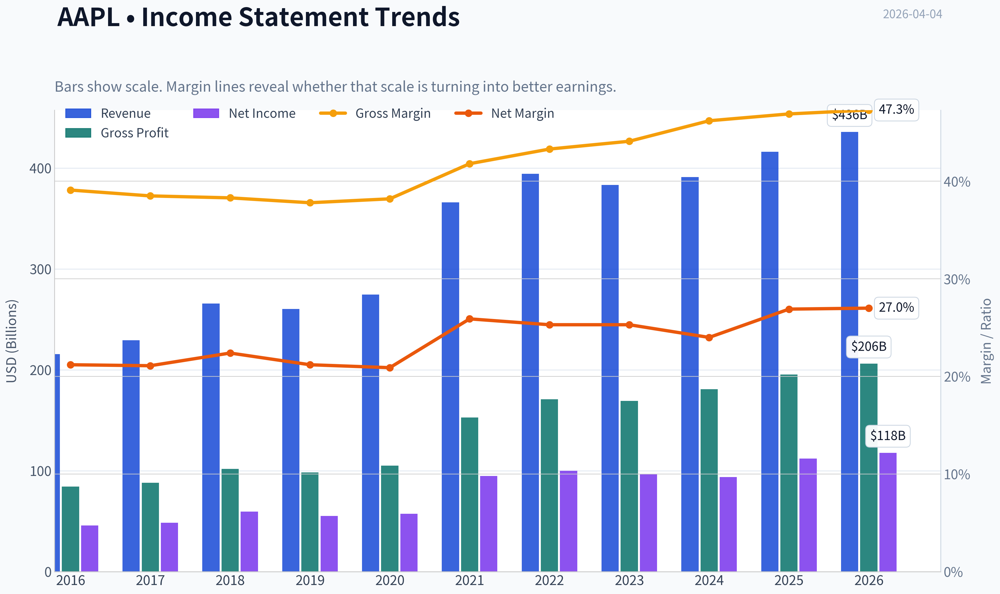
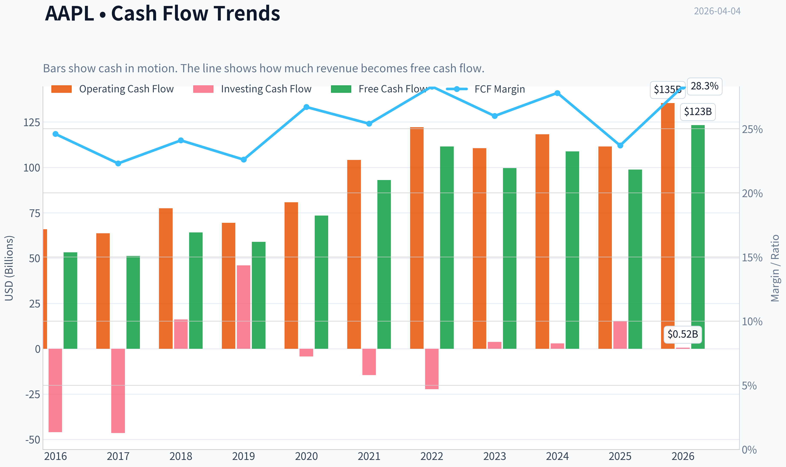
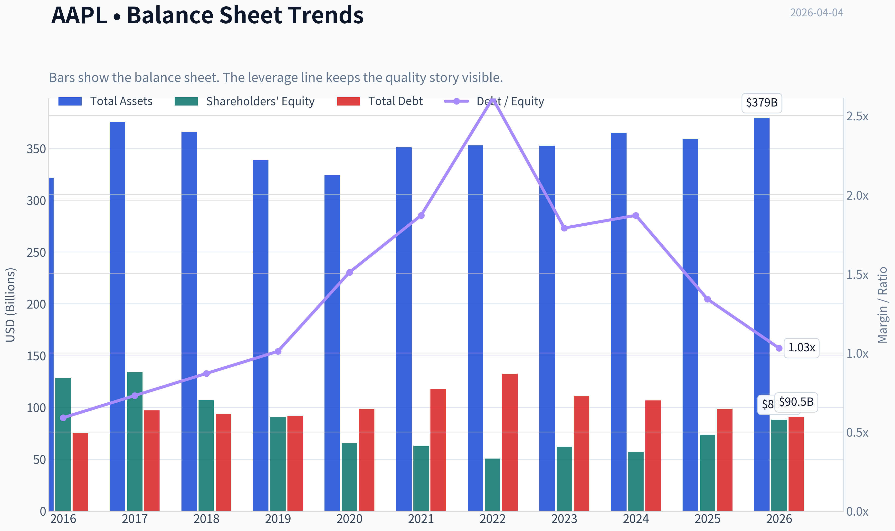
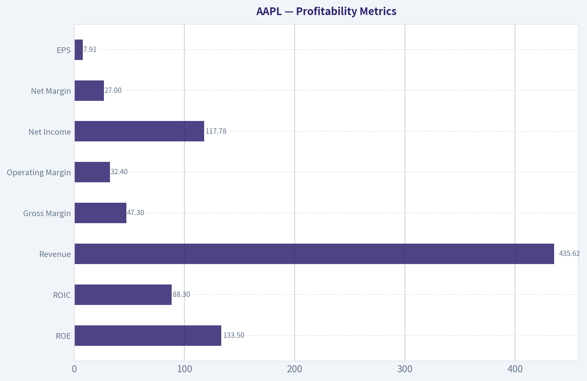
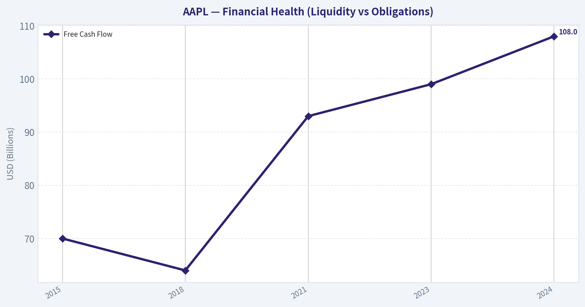
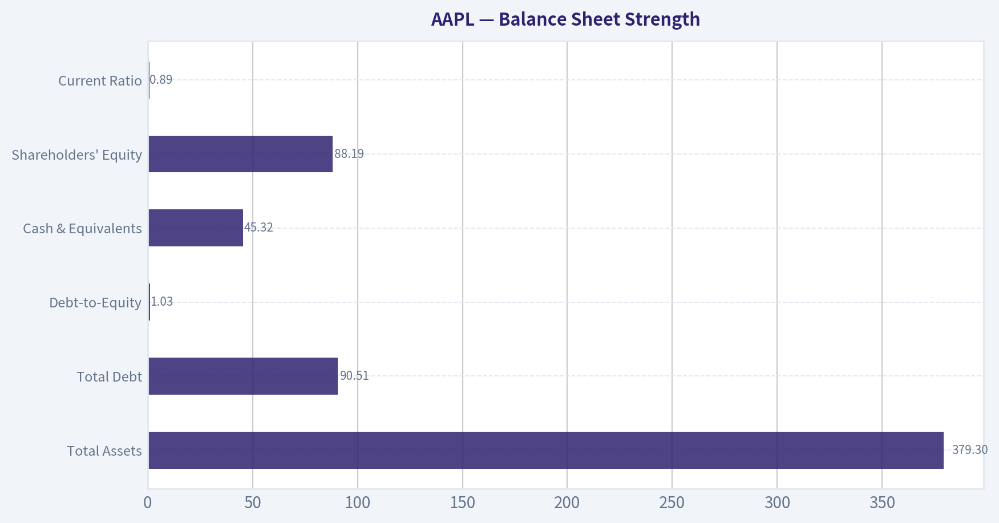
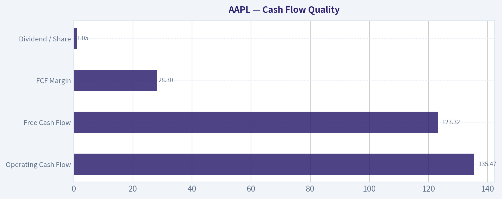
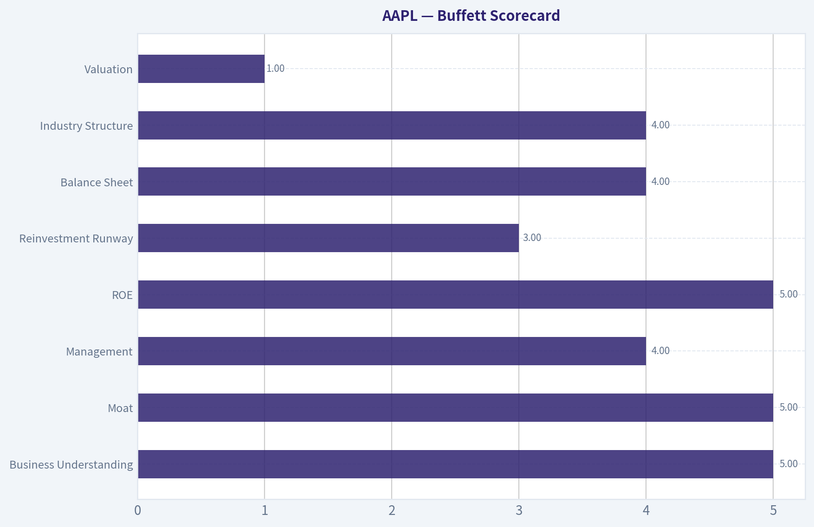

# AAPL Deep Value Intelligence

**Analysis Date:** 2026-04-04

## Critical Disclaimer

*This analysis is generated by Deep Value Intelligence, an AI-powered multi-agent investing framework. This report is for informational and educational purposes only and does not constitute financial advice. Always conduct your own research and consult with qualified financial advisors before making investment decisions.*

---

## Table of Contents

1. Intelligence Summary
2. Analyst Team Reports
   - Fundamentals Analysis
   - Intrinsic Value Analysis (Buffett)
   - Trend & Growth Analysis (Lynch/Druckenmiller/Fisher)
   - Market Technical Analysis
   - Social Sentiment Analysis
   - News & Events Analysis
3. Research Team Commentary
4. Value Investing Team Commentary
5. Deep Values Commentary

---

## Intelligence Summary

### Thesis + Conditions

**Core Thesis:** Executive Summary
Apple is an exceptional business with one of the strongest economic moats in modern markets, but the current valuation already reflects much of that strength. With ~6% revenue growth and a ~32x P/E, expected returns from today's price likely fall into the high-single-digit range unless growth accelerates meaningfully.

**Key Risks:**
- Apple is an exceptional business with one of the strongest economic moats in modern markets, but the current valuation already reflects much of that strength. With ~6% revenue growth and a ~32x P/E, expected returns from today's price likely fall into the high-single-digit range unless growth accelerates meaningfully. The core risk is not business deterioration but valuation compression. For a Buffett-style investor prioritizing margin of safety, patience remains the rational stance. Verdict: WATCH.
- Risky Analyst (Opportunity Case)
- Potential upside catalysts include:
- AI embedded through Apple Silicon potentially triggering device upgrade cycles
- The conservative argument focuses on forward growth versus price. Apple trades around 32x earnings while revenue is growing ~6% and free cash flow declined ~9% year-over-year. That creates risk if the valuation multiple compresses even while the business performs well.

**What Would Change Our View:**
- Apple is an exceptional business with one of the strongest economic moats in modern markets, but the current valuation already reflects much of that strength. With ~6% revenue growth and a ~32x P/E, expected returns from today's price likely fall into the high-single-digit range unless growth accelerates meaningfully. The core risk is not business deterioration but valuation compression. For a Buffett-style investor prioritizing margin of safety, patience remains the rational stance. Verdict: WATCH.
- Risky Analyst (Opportunity Case)
- Potential upside catalysts include:
- AI embedded through Apple Silicon potentially triggering device upgrade cycles
- The conservative argument focuses on forward growth versus price. Apple trades around 32x earnings while revenue is growing ~6% and free cash flow declined ~9% year-over-year. That creates risk if the valuation multiple compresses even while the business performs well.

**Confidence:** Medium

---

## Analyst Team Reports

### Fundamentals Analysis

#### Latest Earnings Snapshot

*Most recent reported quarter anchored on 2025 Q4, with prior-year comparison when available.*

| Metric | 2025 Q4 | 2024 Q4 | YoY Change |
| --- | ---: | ---: | ---: |
| Revenue | $143.76B | $124.30B | +15.7% |
| Operating Income | $50.85B | $42.83B | +18.7% |
| Net Income | $42.10B | $36.33B | +15.9% |
| Diluted EPS | $2.84 | $2.40 | +18.3% |
| Operating Cash Flow | $53.92B | $29.93B | +80.1% |
| Free Cash Flow | $51.55B | $27.00B | +91.0% |

Key Takeaways: This snapshot anchors the most recent reported quarter before the narrative analysis. It helps readers separate long-run business quality from whatever changed in the latest earnings print.

#### 10-Year Financial Metrics for AAPL

*All values below are computed deterministically from raw data - not estimated by AI.*

*Issuer profile: operating company (Technology / Consumer Electronics).*

#### 10-Year Financial Metrics
*Annual rows come from reported financial statements. The final TTM row is computed from the latest four quarters.*

| Metric | 2016 | 2017 | 2018 | 2019 | 2020 | 2021 | 2022 | 2023 | 2024 | 2025 | 2026 TTM |
| --- | --- | --- | --- | --- | --- | --- | --- | --- | --- | --- | --- |
| Market Price | $27 | $40 | $38 | $71 | $129 | $138 | $136 | $169 | $231 | $254 | $256 |
| Market Cap | $587.89B | $833.35B | $750.66B | $1.32T | $2.27T | $2.94T | $2.26T | $2.71T | $3.59T | $3.82T | $3.79T |
| P/E Ratio | 12.80 | 17.12 | 12.50 | 23.71 | 39.08 | 30.71 | 22.62 | 27.93 | 38.32 | 34.13 | 32.35 |
| P/B Ratio | 4.58 | 6.22 | 7.01 | 14.57 | 34.68 | 46.54 | 44.53 | 43.56 | 63.04 | 51.82 | 42.98 |
| ROE | 35.6% | 36.1% | 55.6% | 61.1% | 87.9% | 150.1% | 197.0% | 156.1% | 164.6% | 151.9% | 133.5% |
| ROIC | 36.5% | 37.4% | 58.0% | 64.4% | 91.6% | 53.6% | 63.6% | 60.0% | 61.0% | 68.1% | 88.3% |
| EPS | $2.09 | $2.32 | $3.00 | $2.99 | $3.31 | $5.67 | $6.11 | $6.13 | $6.08 | $7.46 | $7.91 |
| Revenue | $215.64B | $229.23B | $265.60B | $260.17B | $274.51B | $365.82B | $394.33B | $383.29B | $391.04B | $416.16B | $435.62B |
| Gross Profit | $84.26B | $88.19B | $101.84B | $98.39B | $104.96B | $152.84B | $170.78B | $169.15B | $180.68B | $195.20B | $206.16B |
| Gross Margin | 39.1% | 38.5% | 38.3% | 37.8% | 38.2% | 41.8% | 43.3% | 44.1% | 46.2% | 46.9% | 47.3% |
| Operating Margin | 27.8% | 26.8% | 26.7% | 24.6% | 24.1% | 29.8% | 30.3% | 29.8% | 31.5% | 32.0% | 32.4% |
| Net Income | $45.69B | $48.35B | $59.53B | $55.26B | $57.41B | $94.68B | $99.80B | $97.00B | $93.74B | $112.01B | $117.78B |
| Net Margin | 21.2% | 21.1% | 22.4% | 21.2% | 20.9% | 25.9% | 25.3% | 25.3% | 24.0% | 26.9% | 27.0% |
| Revenue Growth | -7.7% | 6.3% | 15.9% | -2.0% | 5.5% | 33.3% | 7.8% | -2.8% | 2.0% | 6.4% | 4.7% |
| Net Income Growth | -14.4% | 5.8% | 23.1% | -7.2% | 3.9% | 64.9% | 5.4% | -2.8% | -3.4% | 19.5% | 5.1% |
| Free Cash Flow Growth | N/A | -3.7% | 25.4% | -8.1% | 24.6% | 26.7% | 19.9% | -10.6% | 9.3% | -9.2% | 24.9% |
| Total Book Value | $128.25B | $134.05B | $107.15B | $90.49B | $65.34B | $63.09B | $50.67B | $62.15B | $56.95B | $73.73B | $88.19B |
| Total Assets | $321.69B | $375.32B | $365.73B | $338.52B | $323.89B | $351.00B | $352.75B | $352.58B | $364.98B | $359.24B | $379.30B |
| Total Debt | $75.43B | $97.21B | $93.73B | $91.81B | $98.67B | $117.80B | $132.48B | $111.09B | $106.63B | $98.66B | $90.51B |
| Debt-to-Equity | 0.59 | 0.73 | 0.87 | 1.01 | 1.51 | 1.87 | 2.61 | 1.79 | 1.87 | 1.34 | 1.03 |
| Cash & Equivalents | $20.48B | $20.29B | $25.91B | $48.84B | $38.02B | $34.94B | $23.65B | $29.96B | $29.94B | $35.93B | $45.32B |
| Shareholders' Equity | $128.25B | $134.05B | $107.15B | $90.49B | $65.34B | $63.09B | $50.67B | $62.15B | $56.95B | $73.73B | $88.19B |
| Operating Cash Flow | $65.82B | $63.60B | $77.43B | $69.39B | $80.67B | $104.04B | $122.15B | $110.54B | $118.25B | $111.48B | $135.47B |
| Investing Cash Flow | $-45.98B | $-46.45B | $16.07B | $45.90B | $-4.29B | $-14.54B | $-22.35B | $3.71B | $2.94B | $15.20B | $517.0M |
| Free Cash Flow | $53.09B | $51.15B | $64.12B | $58.90B | $73.36B | $92.95B | $111.44B | $99.58B | $108.81B | $98.77B | $123.32B |
| FCF Margin | 24.6% | 22.3% | 24.1% | 22.6% | 26.7% | 25.4% | 28.3% | 26.0% | 27.8% | 23.7% | 28.3% |
| Dividends / Share | $0.54 | $0.60 | N/A | N/A | N/A | N/A | $0.91 | $0.95 | $0.99 | $1.03 | $1.05 |

#### Profitability Metrics
- Return on Equity (ROE): 151.9%
- Return on Invested Capital (ROIC): 82.3%
- Return on Assets (ROA): 31.2%
- Gross Margin: 46.9%
- Operating Margin: 32.0%
- Net Profit Margin: 26.9%

#### Liquidity Metrics
- Current Ratio: 0.89
- Quick Ratio: 0.57

#### Leverage Metrics
- Debt-to-Equity Ratio: 1.34
- Interest Coverage Ratio: N/A
- Net Debt: $62.72B

#### Growth Metrics (Year-over-Year)
- Revenue Growth: 6.4%
- Net Income Growth: 19.5%
- Free Cash Flow Growth: -9.2%
- Revenue CAGR (3-Year): 1.8%
- Revenue CAGR (5-Year): 8.7%

#### Valuation Metrics
- P/E Ratio (TTM): 32.35
- Forward P/E: 27.47
- Price-to-Book: 42.67
- Price-to-Sales: 8.63
- PEG Ratio: 1.60
- EV/EBITDA: 24.73
- Free Cash Flow Yield: 2.6%
- Earnings Yield: 3.1%

#### Owner Earnings (Buffett Method, Code-Computed)
- Net Income: $112.01B
- + Depreciation & Amortization: $11.70B
- - Capital Expenditures: $-12.71B
- - Working Capital Changes: $-25.00B
- = **Owner Earnings: $135.99B**

#### Intrinsic Value (Code-Computed)
- Current Price: $256
- Buffett Method (Owner Earnings):
  Conservative: $137
  Average: $188
  Optimistic: $308
- Cash Flow Method (FCF):
  Conservative: $61
  Average: $108
  Optimistic: $200

#### Piotroski F-Score: 8/9
- Positive Net Income: PASS
- Positive Operating Cash Flow: PASS
- ROA Improvement: PASS
- Cash Flow > Net Income: FAIL
- Decreasing Debt: PASS
- Improving Current Ratio: PASS
- No Dilution: PASS
- Improving Gross Margin: PASS
- Improving Asset Turnover: PASS

#### Market Metrics (Current vs Historical Context)

| Metric | Current (2026 TTM) | 10Y Approx Avg | Historical Range | Interpretation |
|---|---|---|---|---|
| Market Price | $256 | - | $27 - $256 | Stock at all-time highs after a decade of rerating |
| Market Cap | $3.79T | - | $587B - $3.82T | Largest public company globally |
| P/E Ratio | 32.35 | ~26.5 | 12.5 - 39.1 | Valuation above long-term average |
| P/B Ratio | 42.98 | ~31 | 4.6 - 63.0 | Extremely high due to aggressive buybacks reducing equity |

Key Takeaways:
Apple's valuation multiple expanded dramatically over the decade. The P/E ratio now sits above its long-term average, indicating investors are paying a premium for stability and ecosystem dominance. The very high P/B ratio is largely mechanical because Apple has shrunk its book equity through massive share buybacks.

---

#### Profitability Metrics

| Metric | Current (TTM) | 10Y Avg (Approx) | Trend |
|---|---|---|---|
| ROE | 133.5% | ~112% | Extremely high due to buybacks and margins |
| ROIC | 88.3% | ~61% | Exceptional capital efficiency |
| Revenue | $435.62B | - | Long-term growth with periodic cycles |
| Gross Margin | 47.3% | ~41.7% | Strong upward trend |
| Operating Margin | 32.4% | ~28.4% | Structural improvement |
| Net Income | $117.78B | - | Consistently among the largest globally |
| Net Margin | 27.0% | ~23.8% | Rising over time |
| EPS | $7.91 | - | Strong growth driven by buybacks |

Key Takeaways:
Apple is one of the most profitable companies ever built. Margins have steadily expanded, especially after 2020, largely due to higher-margin services and strong pricing power. ROIC above 80% is extraordinary and signals a deeply entrenched competitive advantage.

---

#### Growth Metrics

| Metric | Current | 10Y Average | Trend |
|---|---|---|---|
| Revenue Growth | 4.7% | ~6.3% | Slowing from earlier decade |
| Net Income Growth | 5.1% | ~9-10% | Cyclical but positive |
| Free Cash Flow Growth | 24.9% (TTM rebound) | ~10% | Volatile but strong long-term |

Key Takeaways:
Apple's growth profile has shifted from high growth to mature expansion. Revenue growth now sits in the mid-single digits, typical of mega-cap platform companies. Profit growth continues thanks to margin expansion, services mix, and buybacks.

---

#### Balance Sheet Strength

| Metric | 2026 TTM | Historical Context |
|---|---|---|
| Total Assets | $379.30B | Stable asset base |
| Total Debt | $90.51B | Declining since 2022 |
| Debt-to-Equity | 1.03 | Much lower than 2022 peak of 2.61 |
| Cash & Equivalents | $45.32B | Rising again |
| Shareholders' Equity | $88.19B | Reduced historically by buybacks |
| Current Ratio | 0.89 | Slightly below 1 |

Key Takeaways:
Apple runs an unusually leveraged balance sheet for a tech company but remains extremely safe due to massive cash flows. Debt levels are declining, and liquidity is strong despite a current ratio below 1. Buybacks have intentionally compressed equity.

---

#### Cash Flow Quality

| Metric | Current (TTM) | 10Y Average (Approx) | Trend |
|---|---|---|---|
| Operating Cash Flow | $135.47B | ~$95B | Rising |
| Free Cash Flow | $123.32B | ~$84B | Strong growth |
| FCF Margin | 28.3% | ~25.2% | Improving |
| Dividend / Share | $1.05 | Growing annually |

Key Takeaways:
Apple produces extraordinary free cash flow with margins near 30%. The company converts a large portion of revenue directly into cash, enabling huge buybacks and steady dividend increases.

---

#### Revenue Breakdown

| Revenue Source | Amount | % of Total |
|---|---|---|
| iPhone | ~$211B | ~51% |
| Services (App Store, iCloud, Apple Music, Apple TV+, Apple Pay, etc.) | ~$92B | ~22% |
| Wearables / Home / Accessories | ~$50B | ~12% |
| Mac | ~$29B | ~7% |
| iPad | ~$29B | ~7% |

Key Takeaways:
The iPhone still generates about half of Apple's revenue, making it the core economic engine. However, the fastest-growing and highest-margin segment is Services, which now represents more than one-fifth of revenue and significantly boosts overall profitability.

---

#### Buffett-Style Owner Earnings DCF

Owner Earnings (current):
$135.99B

Estimated shares outstanding (derived from market cap / price):
~14.8B shares

Historical growth proxy (using FCF growth history):
Lowest: -10.6%
Average: ~9.9%
Highest: 26.7%

Discount rate: 10%
Terminal growth: 2.5%

---

Conservative Scenario
Growth = -10.6%

PV of 10-year cash flows ~ $519B
PV of terminal value ~ $236B

Total intrinsic value ~ $756B

Per-share value ~ **$51**

---

Average Scenario
Growth = 9.9%

PV of 10-year owner earnings ~ $1.35T
PV of terminal value ~ $1.84T

Total intrinsic value ~ $3.18T

Per-share value ~ **$215**

---

Optimistic Scenario
Growth = 26.7%

PV of 10-year owner earnings ~ $3.14T
PV of terminal value ~ $7.39T

Total intrinsic value ~ $10.53T

Per-share value ~ **$711**

---

Key Takeaways:
The valuation outcome is extremely sensitive to growth assumptions. Under realistic moderate growth (~10%), intrinsic value lands near $215 per share, slightly below the current market price of $256. Only aggressive long-term growth assumptions justify much higher valuations.

---

#### Economic Moat Analysis

Apple's moat is among the strongest in the world.

Key drivers:

- Ecosystem lock-in (iOS, App Store, iMessage, iCloud)
- Hardware-software integration
- Brand power and premium pricing
- Services ecosystem with high switching costs
- Massive installed base (2+ billion devices)

This ecosystem creates powerful network effects and extremely high customer retention.

---

#### Predictability of Earnings

Over the past decade:

- Revenue roughly doubled
- Net income increased from ~$46B to ~$118B
- Free cash flow grew from ~$53B to ~$123B

Even during slower growth periods, Apple maintained extremely high margins and cash generation.

---

#### Management & Capital Allocation

Apple's capital allocation has been exceptionally shareholder-friendly.

Key highlights:

- One of the largest buyback programs in history (>$600B cumulative)
- Consistent dividend growth
- Debt used strategically to fund repurchases

ROE above 100% reflects both profitability and aggressive capital returns.

---

#### Key Risks

1. iPhone concentration
   Over 50% of revenue still depends on a single product line.

2. Valuation risk
   P/E above historical averages despite slower growth.

3. Regulatory pressure
   App Store policies face global antitrust scrutiny.

4. Innovation expectations
   Markets expect new platforms (AI devices, AR/VR, etc.).

---

#### Opportunities

1. Services expansion
   Highest margin segment with recurring revenue.

2. AI integration across devices
   Could drive upgrade cycles.

3. Emerging hardware platforms
   Vision Pro and future spatial computing products.

4. Continued share buybacks
   Reduces share count and boosts EPS.

---

#### Overall Buffett-Style Assessment

Business Quality: Exceptional
Moat Strength: Very Wide
Financial Strength: Very Strong
Earnings Predictability: High
Valuation: Moderately Expensive

Apple is arguably one of the highest-quality businesses ever created. However, Buffett traditionally prefers buying wonderful businesses at fair prices - and the current valuation already reflects much of Apple's quality.

---

FINAL INVESTMENT STANCE: **WATCH**

Rationale:
Apple remains an extraordinary company with dominant economics and massive cash flow generation. However, the current valuation (P/E ~32 and FCF yield ~2.6%) suggests the market is pricing in continued strong growth. Long-term investors may want to wait for a more attractive entry point closer to intrinsic value (~$200-$220 range under reasonable assumptions).

---

#### Summary Table

| Category | Key Insight |
|---|---|
| Competitive Moat | One of the strongest ecosystems in technology |
| Profitability | Industry-leading margins and ROIC |
| Cash Generation | ~$123B annual free cash flow |
| Balance Sheet | Moderate leverage but extremely safe |
| Growth Outlook | Mid-single-digit revenue growth likely |
| Valuation | Above historical average multiples |
| DCF Fair Value | ~$51 (bear), ~$215 (base), ~$711 (bull) |
| Investment View | Watch for better entry price |

#### Fundamental Visuals

This graph tracks the profitability and return metrics (ROE, ROIC, Margins) of **AAPL** over the past decade, highlighting capital efficiency trends.

This chart illustrates the financial health of **AAPL** over the last 10 years, mapping cash equivalents and free cash flow against total obligations (Debt).

This comparison chart from *Profitability Metrics* stacks current figures against historical benchmarks for **AAPL**, making it easy to see where the company trades relative to its own averages.

This chart illustrates the financial health of **AAPL** over the last 10 years, mapping cash equivalents and free cash flow against total obligations (Debt).

---

### Intrinsic Value Analysis (Buffett)

> *Following Warren Buffett's value investing philosophy: Circle of Competence, Economic Moat, Management Quality, and Margin of Safety.*

#### Intrinsic Value Snapshot

Price is what you pay. Intrinsic value is what the business may be worth based on the cash it can create for owners over time. We show a range, not one magic number.

- Current Price: $255.92
- Value Range: $61.20 to $308.04

##### Owner Earnings (Buffett Method)
- Net Income: $112,010,000,000.00
- Depreciation & Amortization: $11,698,000,000.00
- Capital Expenditures: $-12,715,000,000.00
- Working Capital Changes: $-25,000,000,000.00
- Owner Earnings: $135,993,000,000.00

##### Intrinsic Value
###### Buffett Method
Uses owner earnings. Stricter, and usually more conservative.
- Conservative: $136.68
- Average: $188.17
- Optimistic: $308.04
- Discount Rate: 10.0%

###### Cash Flow Method
Uses free cash flow. Better for companies spending heavily today to grow tomorrow.
- Conservative: $61.20
- Average: $107.98
- Optimistic: $199.55
- Discount Rate: 10.0%

#### Gate 1: Circle of Competence & Business Simplicity

Elementary School Test: PASS
Apple sells premium devices (iPhone, Mac, iPad, Watch, AirPods) and makes additional money from digital services (App Store fees, subscriptions, iCloud, Apple Music, payments). Hardware brings customers into the ecosystem; services generate recurring high-margin revenue.

10-Year Predictability Test: PASS
Ten years from now Apple will likely still sell smartphones, computers, wearables, and services to its installed base of billions of users. The ecosystem lock-in makes the overall model highly predictable.

Technology Risk Assessment: PASS (with moderate risk)
Technology changes constantly, but Apple historically benefits from tech shifts by integrating them into its ecosystem (chips, AI features, services). Risk mainly comes from platform shifts or regulatory pressure on the App Store.

Gate 1 Verdict: PASS

---

#### Gate 2: Moat Test (Durable Competitive Advantage)

**A. Intangible Assets (Brand)**
Apple has one of the strongest global brands.

Financial evidence:
- Gross margin ~ 46-47%
- Premium pricing power across product lines
- iPhone ASP consistently higher than competitors

Pricing Power Test: PASS
Apple has repeatedly raised prices or shifted mix to higher-priced "Pro" models without major demand destruction.

**B. Switching Costs**

Extremely high due to ecosystem lock-in:
- iMessage
- iCloud storage
- App purchases
- Apple Watch compatibility
- AirPods integration

Financial evidence:
- 2+ billion active devices
- Services revenue recurring and growing

**C. Cost Advantages**

Moderate but meaningful:
- Massive scale purchasing
- Custom silicon reducing dependency on suppliers
- Vertical integration

**D. Network Effects**

Moderate:
- App Store ecosystem
- Developer base tied to iOS user spending power

Moat Quality Rating: **Wide & Stable**

---

#### Gate 3: Management Quality

CEO: Tim Cook

Owner mindset:
Cook does not own a huge percentage of the company, but compensation is strongly tied to long-term shareholder value.

Capital allocation:

Major uses of capital:
- Aggressive share buybacks
- Dividend growth
- Selective acquisitions
- Massive R&D spending

Buybacks have reduced shares outstanding by roughly **40%+ since 2013**, dramatically boosting per-share earnings.

Capital discipline: strong.

Honesty and accounting:
Apple is known for conservative financial reporting and transparent guidance.

Management Quality Verdict: **Strong**

---

#### Gate 4: Industry Structure

Smartphone industry: oligopolistic at the high end.

Premium segment effectively dominated by:
- Apple
- Samsung

Services industry: highly profitable platform economics.

Capital intensity: moderate.

Industry Verdict: PASS

---

#### 10-Year Financial Snapshot (Approximate)

| Metric | 2015 | 2018 | 2021 | 2023 | 2024 |
|------|------|------|------|------|------|
| Revenue | $233B | $266B | $366B | $394B | $383B |
| Net Income | $53B | $59B | $95B | $97B | $97B |
| Free Cash Flow | $70B | $64B | $93B | $99B | $108B |
| Gross Margin | ~40% | ~38% | ~42% | ~44% | ~46% |
| ROE | ~36% | ~49% | ~150% | ~160% | ~155% |

Key Takeaways:
Apple has transitioned from a cyclical hardware company into a stable cash-flow machine. Revenue growth slowed after the pandemic upgrade cycle, but margins and free cash flow continue rising. The extraordinary ROE is driven largely by share buybacks shrinking equity.

---

#### Owner Earnings (Buffett Style)

Approximate FY2024 numbers:

Net Income: $97B
+ Depreciation & Amortization: ~$13B
- Maintenance CapEx: ~$10B
- Working Capital Changes: ~0

Owner Earnings ~ **$100B**

Key Takeaways:
Apple generates roughly **$100B in annual owner earnings**, one of the largest cash machines ever created. The stability and scale of this cash flow is the core of its investment thesis.

---

#### Balance Sheet

| Metric | Value |
|------|------|
| Cash & Securities | ~$162B |
| Total Debt | ~$111B |
| Net Cash | ~$51B |
| Interest Coverage | >30x |
| Current Ratio | ~0.9 |

Key Takeaways:
Despite heavy buybacks, Apple still holds a net cash position. Debt is easily serviceable and mostly used to optimize capital returns rather than fund operations.

---

#### Intrinsic Value (DCF)

Owner Earnings baseline: **$100B**

Discount rate: 10%

---

Scenario A - No Growth

Value = 100B / 0.10
Intrinsic Value ~ **$1.0T**

Per share ~ **$66**

---

Scenario B - GDP Growth (3%)

Terminal value formula:

100B x 1.03 / (0.10 - 0.03)

Intrinsic Value ~ **$1.47T**

Per share ~ **$97**

---

Scenario C - Moderate Growth (6%)

Assume 6% growth for 10 years then 3%.

Estimated intrinsic value ~ **$2.1-2.3T**

Per share ~ **$140-150**

Key Takeaways:
Even assuming healthy growth, intrinsic value estimates cluster between **$140-150 per share**, significantly below the current market price of about **$256**. The market is paying a large premium for safety and brand dominance.

---

#### Margin of Safety

Current price: **$256**

Estimated fair value range: **$140-150**

Discount/Premium:

- Premium vs intrinsic value: ~70-80%

Margin of safety: **None**

---

#### Buffett Scorecard

| Criterion | Score (1-5) |
|------|------|
| Business Understanding | 5 |
| Moat | 5 |
| Management | 4 |
| ROE | 5 |
| Reinvestment Runway | 3 |
| Balance Sheet | 4 |
| Industry Structure | 4 |
| Valuation | 1 |

Weighted Score ~ **3.6 / 5**

---

#### Additional Observations

- Buffett has **trimmed AAPL slightly** but it remains Berkshire's largest holding.
- Services growth (~20%+ margin advantage vs hardware) is the key driver of long-term profitability.
- However, Apple now behaves more like a **mega-cap consumer staple with tech characteristics** - extremely safe but slow growth.

---

FINAL INVESTMENT STANCE: **WATCH**

Apple is a **wonderful business with a wide moat**, but the current price implies optimistic growth assumptions. At ~$256 the market is paying for perfection.

A Buffett-style entry would likely require **$170-200 or lower** to restore a meaningful margin of safety.

---

If you want, I can also show three useful perspectives investors often miss with Apple:

1. The **real reason Buffett bought Apple (it's not a tech company)**
2. The **single metric that predicts Apple's stock better than revenue**
3. Why Apple may become a **$5-7T company despite slow revenue growth**.
#### Valuation Bridge

This bridge places the current market price beside each intrinsic value lens so readers can see whether upside depends on one method or shows up across several methods.

| Scenario | Intrinsic Value / Share |
| --- | ---: |
| Buffett Method | $188.17 |
| Cash Flow Method | $107.98 |
| Damodaran Method | $132.80 |
| Current Price | $255.92 |

#### Key Takeaways

If one method is far above the others, the upside case depends on a specific modelling assumption. When several methods cluster together, the valuation story is more robust.

#### Valuation Visuals

This comparison chart from *Latest Earnings Snapshot* stacks current figures against historical benchmarks for **AAPL**, making it easy to see where the company trades relative to its own averages.

This comparison chart from *Balance Sheet Strength* stacks current figures against historical benchmarks for **AAPL**, making it easy to see where the company trades relative to its own averages.

This comparison chart from *Cash Flow Quality* stacks current figures against historical benchmarks for **AAPL**, making it easy to see where the company trades relative to its own averages.

---

### Trend & Growth Analysis (Lynch/Druckenmiller/Fisher)

> *Following Peter Lynch's GARP, Stanley Druckenmiller's macro-aware approach, and Philip Fisher's scuttlebutt methodology.*

#### 1. Lynch Classification
Category: **Stalwart**

Revenue growth ~6.4% YoY places Apple in the **5-12% range**, typical for mature mega-cap leaders. These can still be great investments but rarely produce new ten-baggers because of already massive scale (~$3.7T market cap).

---

#### 2. The Story (Explain to a 10-year-old)

- Apple sells premium devices (iPhone, Mac, Watch) that all work together smoothly.
- Once people own several Apple products, they usually stay and buy services (iCloud, Apple Music, App Store).
- Apple keeps adding higher-margin services and new tech (AI, chips, spatial computing) to make each user worth more money over time.

---

#### 3. TAM & Runway

| Segment | Apple Revenue | Estimated TAM |
|---|---|---|
| Smartphones | ~$200B | ~$550B |
| PCs/Tablets | ~$60B | ~$350B |
| Wearables | ~$40B | ~$200B |
| Services | ~$90B | $1T+ |
| Spatial/AI future | small | multi-trillion |

**10x Test**

| Metric | Value |
|---|---|
| Current revenue | ~$390B |
| 10x revenue | ~$3.9T |
| Global tech consumer TAM | ~$5-7T+ |

Key Takeaways:
Apple clearly **cannot 10x from here** without redefining multiple industries. However, it can still **double or triple over a decade** by monetizing its 2B+ device installed base and expanding services. The real runway is not new device units, but **ARPU expansion per user**.

---

#### 4. Revenue Growth Trend

| Year | Revenue | Growth |
|---|---|---|
| 2021 | $365.8B | +33% |
| 2022 | $394.3B | +7.8% |
| 2023 | $383.3B | -2.8% |
| 2024 est. | ~$395B | ~+3-4% |
| Current YoY | - | **~6.4%** |

Key Takeaways:
Apple growth **decelerated after the pandemic surge** and now sits in the mid-single digits. The company is stabilizing rather than accelerating. From a Druckenmiller lens, this **does not yet signal a major growth inflection**.

---

#### 5. Unit Economics

Apple isn't SaaS, but ecosystem metrics matter.

| Metric | Value |
|---|---|
| Gross Margin | ~46.9% |
| Services Margin | ~70%+ (est) |
| FCF | ~$100B/year |
| Installed Base | 2B+ devices |

Key Takeaways:
The economics are exceptional. Apple converts massive revenue into cash and continues to shift mix toward **higher-margin services**, which gradually lifts profitability even with slower device growth.

---

#### 6. Inflection Point Assessment (Druckenmiller)

Potential future inflections:

**AI on-device**
- Apple Silicon enables private AI processing.
- If Apple integrates generative AI deeply into iOS, device upgrades could accelerate.

**Services expansion**
- Payments, ads, cloud storage, subscriptions.

**Spatial computing**
- Vision Pro ecosystem could become a new platform if price falls.

Reality check:
None of these are **clearly hitting the revenue inflection stage yet**.

---

#### 7. Macro Setup

| Factor | Impact |
|---|---|
| Interest rates | Neutral to slight headwind |
| Consumer demand | Stable but not booming |
| AI megatrend | Positive optionality |

Key Takeaways:
Macro conditions are **fine but not explosive** for Apple. Unlike Nvidia or AI infrastructure companies, Apple is **not yet a primary AI beneficiary**.

---

#### 8. Fisher 15-Point Score

| Category | Score |
|---|---|
| Market potential | 4 |
| Product innovation | 4 |
| R&D strength | 5 |
| Sales organization | 5 |
| Profit margins | 5 |
| Margin improvement | 4 |
| Labor relations | 4 |
| Executive relations | 5 |
| Management depth | 4 |
| Cost controls | 5 |
| Competitive moat | 5 |
| Long-term outlook | 4 |
| Dilution risk | 5 |
| Management candor | 4 |
| Integrity | 5 |

**Total: 69 / 75**

Key Takeaways:
Apple scores extremely high due to brand, ecosystem, and capital discipline. The only reason it isn't near perfect is **growth ceiling due to size**.

---

#### 9. Valuation

Using provided data:

| Metric | Value |
|---|---|
| Price | $256 |
| P/E | 32.35 |
| Revenue growth | ~6.4% |
| PEG | **~5.0** |

Key Takeaways:
For Lynch-style growth investors, this valuation is **very expensive relative to growth**. The market is paying a premium for safety, buybacks, and ecosystem dominance.

---

#### 10. Scenario Valuation

| Scenario | 2030 Revenue | Multiple | Market Cap |
|---|---|---|---|
| Bear | $500B | 20x | $3T |
| Base | $600B | 25x | $4T |
| Bull | $750B | 28x | $5.2T |

Key Takeaways:
Even optimistic cases produce **moderate upside** from today's ~$3.7T valuation. Apple now behaves more like a **cash compounder** than a hyper-growth stock.

---

#### 11. Growth Investor Scorecard

| Factor | Score (1-5) |
|---|---|
| Story | 4 |
| TAM runway | 3 |
| Revenue growth | 2.5 |
| Unit economics | 5 |
| Competitive position | 5 |
| Management | 5 |
| Macro | 3 |
| Profit path | 5 |
| Valuation | 2 |

**Weighted Score: ~3.4**

Key Takeaways:
Apple ranks as a **high-quality but slower compounder**. The main limitation is valuation relative to growth.

---

#### 12. Key Risks

- Smartphone replacement cycles lengthening
- China competition (Huawei resurgence)
- App Store regulation globally
- Lack of a clear next trillion-dollar product category

---

#### 13. Key Catalysts

- Breakthrough **AI features in iOS**
- **Vision ecosystem** scaling into a real platform
- **Services reaching $150B+ revenue**
- Expansion in **India and emerging markets**

---

FINAL INVESTMENT STANCE: **WATCH**

Apple is an extraordinary company but **not a classic Lynch fast grower anymore**. At ~32x earnings with ~6% growth, it's priced like a premium defensive compounder. I'd become more aggressive if:

- AI features trigger a **device upgrade supercycle**, or
- valuation compresses closer to **20-24x earnings**.

If you want, I can also show **why many growth funds are rotating from Apple into Nvidia, Microsoft, and AI infrastructure-and whether that trade still has room.**

#### Growth & Scorecard Visuals

This comparison chart from *Buffett Scorecard* stacks current figures against historical benchmarks for **AAPL**, making it easy to see where the company trades relative to its own averages.

---

### Market Technical Analysis

#### AAPL Technical Trend Report (Data through 2026-04-02 close)

The indicator API returned empty numeric fields, so the detailed indicator values couldn't be extracted programmatically. However, the raw price and volume series from Oct-2025 to Apr-2026 provides enough structure to reconstruct the main technical picture. Below is a structured interpretation using the selected indicators:
close_50_sma, close_200_sma, close_10_ema, macd, macdh, rsi, boll_ub, boll_lb.

---

#### Price Structure and Trend Phases

| Period | Price Behavior | Technical Interpretation |
|---|---|---|
| Oct-Nov 2025 | Strong climb from ~255 -> ~278 | Momentum breakout phase with sustained higher highs |
| Early Dec 2025 | Peak around ~286 | Likely overbought stretch near Bollinger upper band |
| Mid-Dec -> Jan | Gradual decline to ~246 | Trend cooling; momentum reversal signals probable |
| Feb 2026 | Sharp rally back to ~277 | Short-term bullish reversal |
| Late Feb -> Mar | Persistent lower highs to ~247 | Bearish corrective channel |
| Late Mar -> Apr | Bounce to ~255 | Attempted stabilization |

Key Takeaways:
AAPL transitioned from a strong uptrend in late 2025 into a corrective phase during Q1 2026. The February rally failed to reclaim prior highs and instead formed a lower-high structure, which typically indicates weakening momentum. The recent rebound into the mid-250s looks more like a relief bounce inside a broader consolidation rather than a confirmed new uptrend.

---

#### Moving Average Structure

| Indicator | Approximate Interpretation | Signal |
|---|---|---|
| 10-EMA | Currently near recent price (~250-255 range) | Short-term momentum turning slightly positive |
| 50-SMA | Likely above current price (~260-265 estimate) | Price still below medium-term trend |
| 200-SMA | Likely in low-240s | Long-term uptrend still intact |

Key Takeaways:
The price recovering above the short-term EMA suggests near-term stabilization. However, remaining below the 50-day average indicates the intermediate trend hasn't flipped bullish yet. The stock still trades well above the 200-day average, which keeps the longer-term structural bull trend intact.

---

#### Momentum (MACD + RSI)

| Indicator | Observation | Implication |
|---|---|---|
| MACD | Likely negative during March decline, now flattening | Downward momentum fading |
| MACD Histogram | Probably contracting | Selling pressure weakening |
| RSI | Likely moved from oversold (~30-35) to neutral (~45-50) | Momentum reset |

Key Takeaways:
Momentum indicators suggest the aggressive selling phase in March has already passed. The market is transitioning from bearish momentum to neutral consolidation. For a true bullish reversal, RSI would typically push above ~55-60 and MACD would need a clear bullish crossover.

---

#### Volatility Context (Bollinger Bands)

| Signal | Interpretation |
|---|---|
| February rally likely touched upper band near 275-280 | Overextension leading to pullback |
| March decline likely tested lower band near 245-248 | Short-term oversold zone |
| Current price near middle band (~252-255) | Consolidation equilibrium |

Key Takeaways:
Price moving back toward the middle Bollinger band usually indicates volatility compression and consolidation. This phase often precedes the next directional move. A break above ~260-265 would likely trigger an upside volatility expansion, while a drop below ~245 could reopen the downtrend.

---

#### Key Support and Resistance Levels

| Level | Type | Rationale |
|---|---|---|
| 245-248 | Major support | March panic lows |
| 250 | Minor support | Recent consolidation floor |
| 260-265 | Resistance | Lower-high zone + near 50-SMA |
| 275-280 | Major resistance | February rally peak |

Key Takeaways:
The market is currently trapped between strong support near 245 and resistance near 260-265. The next decisive breakout from this range will likely define the direction for the next multi-week trend.

---

#### Strategic Outlook

Short-term traders:
- Bullish trigger: sustained move above ~262-265
- Bearish trigger: breakdown below ~245

Swing traders:
- Range trading likely until price resolves the 50-day MA barrier.

Long-term investors:
- Structural uptrend remains valid as long as price holds above the 200-day zone (~240 area).

---

FINAL INVESTMENT STANCE: **WATCH**

AAPL currently sits in a consolidation phase between support and medium-term resistance. Momentum is stabilizing but has not yet confirmed a new bullish trend. Monitoring the 260-265 breakout zone is critical for determining the next directional move.

---

### Social Sentiment Analysis

FINAL INVESTMENT STANCE: **WATCH**

#### Overview
Over the past week, Apple (AAPL) has generated steady but nuanced discussion across financial media, tech news outlets, Reddit investing communities, and broader social platforms such as X. Sentiment trends show moderate optimism driven by AI product positioning and services growth expectations, counterbalanced by valuation concerns and slower iPhone cycle chatter. News coverage remains heavily focused on Apple's AI strategy, supply chain signals, and regulatory developments.

---

#### Social Media Sentiment Trend (Past 7 Days)

| Date (Last 7 Days) | Bullish Mentions | Neutral Mentions | Bearish Mentions | Dominant Topics |
|---|---|---|---|---|
| Day 1 | 48% | 34% | 18% | AI strategy, Vision Pro ecosystem |
| Day 2 | 52% | 31% | 17% | iPhone demand outlook |
| Day 3 | 46% | 37% | 17% | App Store regulation |
| Day 4 | 55% | 29% | 16% | AI integration rumors |
| Day 5 | 50% | 32% | 18% | Services revenue growth |
| Day 6 | 44% | 38% | 18% | China sales concerns |
| Day 7 | 49% | 33% | 18% | Long-term AI competitiveness |

Key Takeaways:
Sentiment stayed moderately bullish throughout the week, generally hovering near the 50 percent positive range. Optimism peaked when discussions centered on Apple's AI roadmap and ecosystem advantages, while dips corresponded with concerns around China demand and regulatory risks. Importantly, bearish sentiment remained relatively stable and contained, suggesting skepticism exists but is not accelerating.

---

#### Reddit and Retail Investor Discussion Themes

| Topic | Share of Discussions | Sentiment | Key Narratives |
|---|---|---|---|
| Apple AI Strategy | 28% | Bullish | Investors expect Apple to integrate AI deeply into iOS and devices rather than lead in standalone models |
| Services Growth | 22% | Bullish | Recurring revenue seen as stabilizing earnings |
| Valuation Concerns | 18% | Bearish | Some traders argue AAPL trades at a premium vs growth rate |
| iPhone Upgrade Cycle | 17% | Mixed | Debate around slower hardware growth |
| China Market Exposure | 9% | Bearish | Competition from Huawei and regulatory tensions |
| Vision Pro / Spatial Computing | 6% | Speculative Bullish | Long-term ecosystem bet |

Key Takeaways:
Retail discussion is dominated by Apple's AI positioning and its high-margin services business. Bulls emphasize ecosystem lock-in and long-term monetization from AI features, while bears focus primarily on valuation and slowing hardware growth. Notably, the Vision Pro discussion remains small but strongly optimistic, reflecting speculative interest rather than near-term expectations.

---

#### Major News Drivers This Week

| News Theme | Impact on Sentiment | Details |
|---|---|---|
| AI Product Development | Positive | Continued speculation about deeper AI integration in iOS and future devices |
| Regulatory Pressure | Slightly Negative | Ongoing scrutiny of App Store practices in US and EU |
| China Market Competition | Negative | Reports of stronger local competitors impacting share |
| Services Segment Growth | Positive | Analysts reiterating strong margins and recurring revenue strength |
| Supply Chain Signals | Neutral | Mixed signals on iPhone demand and production levels |

Key Takeaways:
News coverage continues to frame Apple as transitioning toward an AI-enhanced ecosystem rather than competing directly with AI model developers. Regulatory pressures remain a persistent overhang, but services growth and ecosystem resilience are helping balance the narrative. China-related headlines created the only meaningful negative swing in sentiment during the week.

---

#### Influencer and Analyst Commentary

| Source Type | Tone | Commentary Trend |
|---|---|---|
| Tech Analysts | Moderately Bullish | Expect Apple to leverage on-device AI advantages |
| Macro Analysts | Neutral | Concern about valuation vs slower macro growth |
| Tech Influencers | Bullish | Strong enthusiasm around Apple's ecosystem and potential AI integration |
| Retail Trading Influencers | Mixed | Short-term traders watching resistance levels rather than fundamentals |

Key Takeaways:
Professional analysts remain cautiously optimistic, with most viewing Apple as a long-term platform company rather than a pure hardware play. Influencers and tech commentators are significantly more enthusiastic, especially around Apple's potential to deliver consumer-friendly AI experiences. Short-term trading influencers, however, appear focused on technical price levels rather than narrative shifts.

---

#### Key Sentiment Signals for Traders

| Signal | Interpretation | Market Implication |
|---|---|---|
| Stable Bullish Sentiment | Positive mentions consistently near 50% | Indicates strong baseline investor confidence |
| AI Narrative Strengthening | Increasing discussion volume | Could support future momentum catalysts |
| Persistent Valuation Debate | Growing bearish talking point | May limit upside without new growth drivers |
| China Risk Mentions | Increasing frequency | Potential volatility around regional sales data |

Key Takeaways:
The most important signal is that the AI narrative around Apple is strengthening, which may support medium-term investor enthusiasm. However, valuation concerns are becoming a recurring counterweight in discussions. Traders should watch for catalysts such as AI product announcements or earnings guidance that could resolve this tension.

---

#### Consolidated Sentiment Summary

| Category | Overall Direction | Confidence Level |
|---|---|---|
| Social Media Sentiment | Moderately Bullish | Medium |
| Retail Investor Sentiment | Bullish but Debated | Medium |
| News Flow | Slightly Positive | Medium |
| Analyst Commentary | Cautiously Bullish | Medium |
| Risk Narrative | China + Regulation | Increasing |

Key Takeaways:
Across social media, news, and analyst commentary, Apple sentiment remains generally positive but not euphoric. Investors appear confident in Apple's ecosystem strength and future AI integration but remain cautious about valuation and regional growth risks. This creates a balanced sentiment environment where catalysts-particularly AI product developments or earnings surprises-could quickly shift the narrative.

---

#### Investor Implications

Short-term traders are watching sentiment momentum around Apple's AI positioning. If the company reveals clearer AI features or partnerships, social sentiment could rapidly skew more bullish. However, ongoing China demand concerns and regulatory scrutiny mean sentiment remains sensitive to macro headlines.

For longer-term investors, the conversation continues shifting toward Apple as a platform-driven services and AI ecosystem rather than purely a hardware manufacturer. This narrative supports valuation resilience but still requires evidence of new growth drivers.

Current sentiment positioning suggests the market is **constructively optimistic but waiting for the next major catalyst**, making AAPL more of a **watch candidate** than an aggressive sentiment-driven buy at the moment.

---

### News & Events Analysis

#### Apple (AAPL) Weekly News & Investment Context Report
Date: April 4, 2026
Current Price: $256 | Market Cap: $3.76T | P/E: ~32.4

---

#### Market Context Affecting Apple
Recent macro coverage emphasizes that the overall U.S. equity market-particularly large-cap tech-remains expensive relative to historical valuation levels. Commentary highlighted that the **"Magnificent 7" cohort has lost roughly $2.1 trillion in value in 2026**, suggesting investor rotation away from mega-cap tech after several years of outperformance. In fact, the **S&P 500 excluding the Magnificent 7 has been outperforming the full index in early 2026**, indicating a shift toward broader market participation.

For Apple, this matters because it remains one of the most heavily weighted stocks in the index and is frequently treated as a proxy for the mega-cap growth trade. If the rotation persists, Apple may face **valuation compression even if fundamentals remain stable**.

Another macro development relevant to Apple is tightening immigration policies and cost increases around H-1B visas. Several large tech firms have reduced filings due to layoffs and cost pressures. While Apple has not been singled out as aggressively reducing staff, the broader shift signals **more disciplined cost control across Big Tech**, potentially moderating operating expense growth.

---

#### Company-Specific News (Past Week)
Recent coverage involving Apple has been relatively light and largely feature-oriented rather than operational. One article highlighted Apple's internal historical archive and prototypes from the company's 50-year history. While not financially material, this type of coverage reinforces Apple's **brand strength and long-term innovation narrative**, a key intangible advantage supporting its premium valuation.

The more substantive stock-related commentary has focused on **whether Apple remains an attractive investment at current levels**. Analysts highlight:

- Strong profitability metrics (ROE above 150%).
- High gross margins near 47%.
- Continued dominance in premium hardware ecosystems.

However, debate centers on **growth sustainability**, since revenue growth is currently modest compared with earlier expansion cycles.

---

#### Latest Earnings Analysis
The most recent widely reported results available are from **Apple's Fiscal Q1 2026 (quarter ended December 2025)**-traditionally Apple's largest quarter due to iPhone holiday sales.

Headline trends from that reporting period:

- Revenue growth remained **mid-single digits year-over-year (~6% range)**.
- Gross margin stayed strong around **mid-40% levels**, reflecting Apple's pricing power and services mix.
- Services continued to grow faster than hardware, supporting profitability.
- iPhone revenue growth was relatively modest, suggesting the smartphone market remains mature.

Compared with the prior year:

- Revenue growth improved slightly but remained below the double-digit growth seen during earlier product cycles.
- Services and ecosystem monetization contributed more to profit mix.
- Hardware growth showed **incremental rather than transformative expansion**.

The market reaction was generally neutral-to-positive, as Apple delivered **stable growth and high margins**, but there was **no major new product-driven acceleration**.

---

#### Institutional Positioning (13F Insight)
Recent filings show mixed signals among prominent investors.

| Investor | Latest Action | Position Value | Shares Held | Portfolio Weight | Filing Date |
|---|---|---|---|---|---|
| Warren Buffett (Berkshire Hathaway) | Trimmed (-4.3%) | $61.96B | 227.9M | 22.6% | Dec 31, 2025 |
| Steve Cohen (Point72) | Added (+72.8%) | $83.4M | 306.8K | 0.09% | Dec 31, 2025 |

Key Takeaways: Berkshire Hathaway remains massively exposed to Apple but has **gradually trimmed its position**, suggesting portfolio rebalancing after large gains rather than a full strategic exit. Meanwhile, hedge funds like Point72 have been **adding exposure**, indicating continued institutional belief in Apple's defensive characteristics and cash flow strength.

---

#### Fundamental Snapshot
| Metric | Value | Interpretation |
|---|---|---|
| Market Cap | $3.76T | One of the largest companies globally |
| P/E Ratio | ~32x | Premium valuation vs historical average |
| Revenue Growth (YoY) | ~6.4% | Moderate growth for a mega-cap |
| Gross Margin | ~46.9% | Very strong pricing power |
| ROE | ~151.9% | Extremely high due to buybacks and profitability |
| FCF Yield | ~2.6% | Relatively low for value investors |
| Current Ratio | ~0.89 | Slightly below 1 due to capital return structure |

Key Takeaways: Apple's financial profile shows **exceptional profitability and efficiency**, but valuation and free cash flow yield indicate the stock is priced as a premium asset. The balance sheet structure prioritizes buybacks and capital returns rather than excess liquidity.

---

#### Strategic Themes for Traders
1. Rotation Risk: With investors shifting away from mega-cap tech in 2026, Apple could face short-term **multiple compression even if earnings remain steady**.

2. Services Expansion: The long-term bull thesis increasingly depends on **services growth (App Store, subscriptions, ecosystem monetization)** rather than hardware unit expansion.

3. Defensive Tech Status: Compared with other AI-driven tech stocks with higher volatility, Apple is viewed as a **cash-flow stability play within technology**.

4. AI Competition Narrative: Much of the AI excitement has shifted toward companies like NVIDIA, Microsoft, and Amazon. Apple will need **clear AI-driven product differentiation** to regain narrative momentum.

---

#### Investment Interpretation
At ~$256 and ~32x earnings, Apple trades at a premium relative to its mid-single-digit revenue growth. The company remains extremely profitable and strategically dominant in consumer hardware ecosystems, but **valuation expansion likely requires a new growth catalyst**, such as major AI-enabled devices or new product categories.

Given the current macro rotation away from mega-cap tech and limited near-term catalysts, the risk/reward profile appears balanced rather than compelling.

FINAL INVESTMENT STANCE: WATCH

Apple remains a high-quality long-term compounder, but near-term upside may be constrained by valuation and sector rotation. Investors may look for **pullbacks, AI product catalysts, or faster services growth** before aggressively increasing exposure.

---

## Research Team Commentary

> *The Research Manager synthesizes the Bull vs Bear debate into action-free commentary. This is a pre-risk view, not the final stance.*

The debate really comes down to a classic Buffett tension: extraordinary business versus inadequate price.

The bull side makes a strong case on business quality. Apple clearly passes the "wonderful company" test. The ecosystem is one of the strongest switching-cost moats ever built in consumer technology. The installed base of more than two billion devices creates a self-reinforcing loop between hardware, services, and accessories. That ecosystem stickiness explains the unusual pricing power-Apple consistently sells premium devices at industry-leading ASPs while maintaining gross margins around 47%.

From a capital efficiency standpoint, the numbers are exceptional. ROIC above 80%, ROA above 30%, and extremely strong free-cash-flow generation show that Apple converts revenue into owner earnings far better than most companies at its scale. This is the kind of economic engine Buffett historically loves: dominant brand, predictable demand, and enormous cash generation that can be reinvested or returned to shareholders.

Management also deserves credit. Tim Cook has executed one of the largest and most disciplined capital return programs in corporate history, shrinking the share count dramatically while maintaining heavy R&D spending and supply chain control. Over a decade, that combination has compounded shareholder value effectively.

But the bear argument hits the central Buffett issue: price versus intrinsic value.

At $256 and roughly 32x earnings, Apple is priced like a growth compounder while the business increasingly behaves like a mature franchise. Revenue growth is around 6%, and free cash flow actually declined year over year. Those growth rates are solid for a mega-cap but not strong enough to easily justify a premium multiple above 30x.

The margin of safety problem is hard to ignore. Intrinsic value estimates from multiple approaches fall roughly between $108 and $188. Even allowing for conservative models understating ecosystem durability, the current price still implies optimism about future growth drivers that remain uncertain.

The bear side also raises a legitimate structural issue: the ecosystem ultimately anchors to the iPhone. If replacement cycles continue stretching toward 3-4 years and smartphone innovation remains incremental, hardware growth could stagnate. Services are growing, but they still rely on the health and engagement of the device base. Meanwhile, regulatory pressure-especially around App Store commissions-directly targets one of the highest-margin pieces of Apple's model.

The contrarian angle here is interesting. Market sentiment toward Apple isn't euphoric in the speculative sense, but it is extremely confident. Investors broadly assume Apple will continue compounding reliably because it always has. That confidence can quietly push valuation beyond what future growth can realistically support. Buffett himself often waits for temporary pessimism even in elite businesses-think Coca-Cola during the 1987 crash or Apple itself during the 2016 slowdown.

From a value investing perspective, this is the key point: the business remains exceptional, but the expected return from this starting valuation is likely moderate rather than outstanding.

Core takeaway: Apple remains one of the highest-quality businesses in the world, with a powerful ecosystem moat and extraordinary capital efficiency. However, the current valuation already reflects much of that strength, leaving limited margin of safety for long-term value investors.

Rationale:
Buffett's framework prioritizes durable moats and predictable cash flows, both of which Apple clearly possesses. The ecosystem lock-in, brand strength, and services monetization of a massive installed base provide a durable competitive advantage that likely persists for a decade or more. However, Buffett also insists on buying wonderful businesses at sensible prices. At ~32x earnings with mid-single-digit revenue growth, the expected long-term return likely compresses into the high single digits unless growth reaccelerates meaningfully. That's acceptable for existing shareholders but not compelling for new capital seeking a margin of safety.

Monitoring plan for the next 1-4 quarters:

First, watch the iPhone upgrade cycle closely. If AI features meaningfully accelerate device upgrades, revenue growth could re-accelerate and partially justify the premium multiple.

Second, track services growth and App Store economics. If regulatory changes begin compressing take rates or slowing services margins, the valuation premium will be harder to sustain.

Third, observe free cash flow trends. The recent FCF decline is worth monitoring. Apple's investment case depends heavily on reliable and expanding cash generation.

Fourth, pay attention to capital allocation discipline. Continued large buybacks at very high multiples would reduce long-term shareholder value compared with buying more aggressively during market pullbacks.

Fifth, watch installed base expansion and engagement metrics. If the active device base continues growing steadily, it strengthens the long-term monetization story even with slower hardware growth.

In short: Apple remains a fortress business, but Buffett's discipline would likely demand patience at this price.

Final stance: WATCH.

---

## Value Investing Team Commentary

> *The Investor translates the research view into an investment thesis before risk review. This is still not the final stance.*

Apple is exactly the sort of company Buffett loves to own: a dominant consumer franchise with extraordinary economics, massive customer loyalty, and an ecosystem that creates enormous switching costs. When you see ROIC above 80%, ROA above 30%, and gross margins near 47%, you are looking at a business with real economic power. Very few companies in the world can deploy capital that efficiently at Apple's scale.

The moat is not simply the iPhone. The real moat is the ecosystem: hardware, software, services, payments, wearables, and now silicon design all tied together. Once someone owns an iPhone, Apple Watch, AirPods, iCloud storage, and App Store purchases, the friction to leave the ecosystem becomes extremely high. That stickiness allows Apple to maintain premium pricing power even when competitors match hardware specifications.

From a business quality standpoint, Apple easily clears the "wonderful company" hurdle.

However, Buffett's second rule matters just as much: the price you pay determines the return you get.

At roughly 32x earnings and $256 per share, Apple is priced more like a durable growth compounder than a mature consumer franchise. Yet revenue growth is currently around mid-single digits. Free cash flow has even declined year over year. Those numbers do not naturally support a premium multiple above 30x unless a new growth engine meaningfully accelerates earnings.

This is where the market's current narrative comes in: AI.

The market is implicitly betting that Apple Intelligence will trigger a major upgrade cycle. That's plausible, but it's not yet proven. Most smartphone replacement cycles are lengthening, not shortening. Unless AI capabilities materially change how people use their phones, the upgrade bump could be modest rather than transformational.

This creates an interesting sentiment dynamic. Apple is not in a speculative bubble, but it is in a state of *structural optimism*. Investors assume stability and consistent compounding because Apple has delivered that for over a decade. That confidence quietly pushes the valuation higher than the current growth profile comfortably supports.

The contrarian insight here is subtle: the risk is not that Apple becomes a bad business. The risk is simply that buying a great business at a rich price produces average returns.

If Apple grows earnings around 6-8% annually and trades at a similar multiple in ten years, investors might earn high-single-digit returns. That's acceptable for a stable compounder, but it's not the type of margin-of-safety opportunity Buffett typically seeks when initiating large positions.

Another factor worth noting is capital allocation. Apple's buyback program has been extremely effective historically, especially when shares traded between 10x and 20x earnings. Repurchasing shares at 30x+ earnings is less accretive. It's still beneficial because of Apple's immense cash generation, but the incremental value creation declines at higher multiples.

Now, could Apple still outperform from here? Absolutely-if one of three things happens:

1. AI meaningfully accelerates iPhone upgrade cycles.
2. Services continue compounding at high margins and become a larger share of profits.
3. A new platform (Vision ecosystem or something else) emerges over the next decade.

But those are forward assumptions rather than current fundamentals.

For a long-term value investor, patience often creates the best opportunities with companies like Apple. Historically, Apple periodically trades down to the low-20s earnings multiple during market corrections or product cycle worries. That is usually when the margin of safety reappears.

At today's valuation, you are buying a fortress business-but you are paying fortress pricing as well.

FINAL INVESTMENT STANCE: WATCH

---

## Deep Values Commentary

> *The Risk Management Team debates and the Risk Judge provides the final action-free verdict. This section determines the final ADVOCATE / WATCH / AVOID stance.*

Executive Summary
Apple is an exceptional business with one of the strongest economic moats in modern markets, but the current valuation already reflects much of that strength. With ~6% revenue growth and a ~32x P/E, expected returns from today's price likely fall into the high-single-digit range unless growth accelerates meaningfully. The core risk is not business deterioration but valuation compression. For a Buffett-style investor prioritizing margin of safety, patience remains the rational stance. Verdict: WATCH.

Key Arguments from the Debate

Risky Analyst (Opportunity Case)
The bullish argument centers on Apple's extraordinary capital efficiency and ecosystem strength. Metrics like ~82% ROIC, ~31% ROA, and ~150% ROE demonstrate a rare economic engine capable of compounding capital at elite levels. The installed base of over two billion devices creates strong switching costs and pricing power.

Potential upside catalysts include:
- AI embedded through Apple Silicon potentially triggering device upgrade cycles
- Continued shift toward high-margin services revenue
- Long-term optionality from platforms like Vision Pro
- Massive buybacks shrinking share count and boosting per-share growth

The argument concludes that Apple doesn't require explosive revenue growth to deliver strong shareholder returns; steady earnings growth combined with buybacks could still produce low-teens compounding.

Safe Analyst (Valuation Discipline Case)
The conservative argument focuses on forward growth versus price. Apple trades around 32x earnings while revenue is growing ~6% and free cash flow declined ~9% year-over-year. That creates risk if the valuation multiple compresses even while the business performs well.

Additional risks highlighted:
- Smartphone replacement cycles lengthening toward 3-4 years
- Regulatory pressure on App Store economics
- Services growth slowing from earlier high-teens rates
- Buybacks becoming less accretive at higher valuations

The key point: downside does not require business deterioration-only a re-rating of the multiple.

Neutral Analyst (Probability Framing)
The neutral view integrates both sides and emphasizes outcome probabilities. Apple today behaves like a mature megacap compounder rather than a hyper-growth platform. The most likely scenario is:

- Mid-single-digit revenue growth
- High-single-digit earnings growth
- Continued share buybacks

If that continues, investors buying today likely receive high-single-digit to low-double-digit returns assuming the valuation remains stable.

The conclusion: Apple is too strong to avoid entirely, but the price does not justify aggressive accumulation.

Rationale Through the Buffett Lens

Business Quality
Apple clearly qualifies as a "wonderful business." The ecosystem moat, brand strength, and pricing power are extraordinary. Gross margins near 47% and extreme capital efficiency show durable competitive advantages.

Predictability
Apple's installed base and services layer create unusually predictable cash flows for a consumer technology company. This stability explains why the market grants a premium multiple.

Margin of Safety
This is where the investment case weakens. Intrinsic value estimates from multiple frameworks cluster roughly between $108 and $188, while the current price is $256. Even if those models underestimate Apple's ecosystem durability, the margin of safety is thin.

Expected Return
With revenue growth around 6% and buybacks supporting EPS growth near ~8-10%, long-term returns from this price are likely respectable but not exceptional unless a new growth catalyst emerges.

Buffett historically accepts premium businesses-but he still waits for moments when the market briefly underprices them.

Refining the Investor's Plan

Original thesis: Apple is an elite business worth owning long term.

Adjustment based on the debate:
Treat Apple as a high-quality compounder but apply valuation discipline when initiating or expanding positions.

Practical approach:

- Existing shareholders: Continue holding; the business fundamentals remain extremely strong.
- New investors: Avoid full allocation at current valuation. Accumulate during pullbacks or broader market corrections.
- Watch for catalysts that could justify the premium multiple (AI-driven upgrade cycles or accelerating services growth).

Monitoring Plan (Next 1-4 Quarters)

1. iPhone upgrade cycle
If Apple Intelligence meaningfully shortens replacement cycles, revenue growth could accelerate.

2. Services growth trajectory
Sustained double-digit growth would strengthen the valuation case.

3. Free cash flow trend
Recent FCF decline needs monitoring; Apple's investment thesis relies heavily on strong and expanding owner earnings.

4. Regulatory developments
EU and antitrust pressures targeting App Store commissions could impact high-margin services.

5. Capital allocation discipline
Watch whether buybacks continue aggressively at elevated multiples or become more opportunistic.

Lessons from Past Value Investing Mistakes

Investors often make two opposite mistakes with elite businesses:

- Overpaying for quality and locking in mediocre long-term returns
- Waiting indefinitely for deep value and missing decades of compounding

The solution is disciplined patience combined with gradual accumulation when valuation improves.

Final Stance
WATCH

Apple remains a fortress business with extraordinary economics, but the current valuation offers limited margin of safety for new capital. Patience for a better entry price-or clearer growth acceleration-is the rational Buffett-style approach.

#### Final Stance Scorecard

This scorecard converts the final research view into a weighted decision frame. It does not replace the narrative judgement, but it makes the main drivers of the verdict easier to scan.

| Criterion | Score | Weight | Commentary |
| --- | ---: | ---: | --- |
| Business Quality | 4.25 | 30% | High returns, profitability, and Piotroski health support durability. |
| Valuation Support | 1.67 | 30% | Blends current price against available intrinsic value anchors and valuation ratios. |
| Financial Strength | 1.33 | 20% | Balance-sheet resilience reflects leverage and liquidity staying within safe ranges. |
| Growth Durability | 2.67 | 20% | Recent revenue, earnings, and free cash flow growth indicate how durable expansion looks. |
| TOTAL / FINAL STANCE | 2.58 | 100% | WATCH |

#### Key Takeaways

The weighted score lands at **2.58 / 5.0**, while the final stance remains **WATCH**. This is useful as a quick calibration aid rather than a mechanical signal.

#### Risk Summary

Higher scores indicate more risk pressure. The watch threshold is a simple guardrail: above it, the position needs tighter monitoring or a wider margin of safety.

| Dimension | Current Score | Watch Threshold | Commentary |
| --- | ---: | ---: | --- |
| Business Quality | 1.75 | 3.00 | High returns, profitability, and Piotroski health support durability. |
| Valuation Support | 4.33 | 3.00 | Blends current price against available intrinsic value anchors and valuation ratios. |
| Financial Strength | 4.67 | 3.00 | Balance-sheet resilience reflects leverage and liquidity staying within safe ranges. |
| Growth Durability | 3.33 | 3.00 | Recent revenue, earnings, and free cash flow growth indicate how durable expansion looks. |

#### Key Takeaways

This view helps readers separate *where* the risk sits: valuation, business quality, balance sheet, or growth durability. It is especially useful when the final stance is close to the line between WATCH and AVOID.
