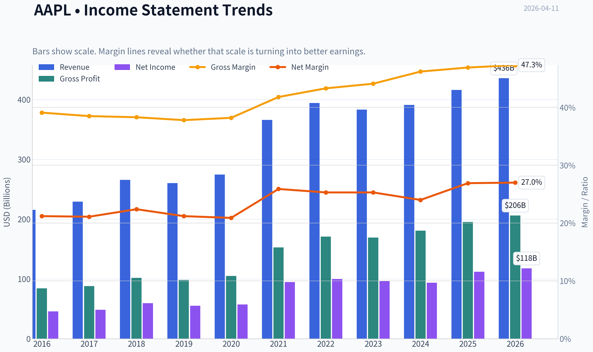
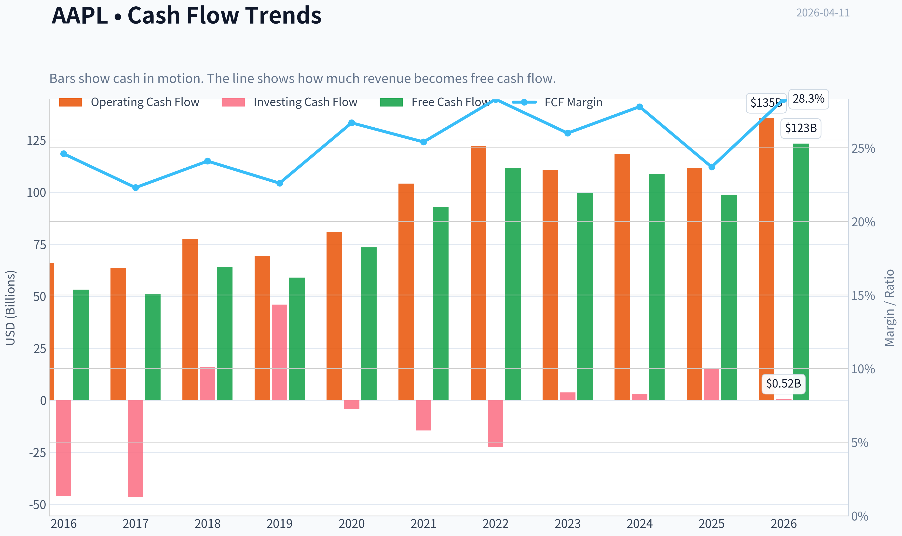
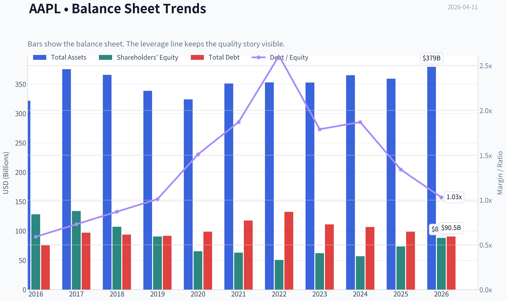
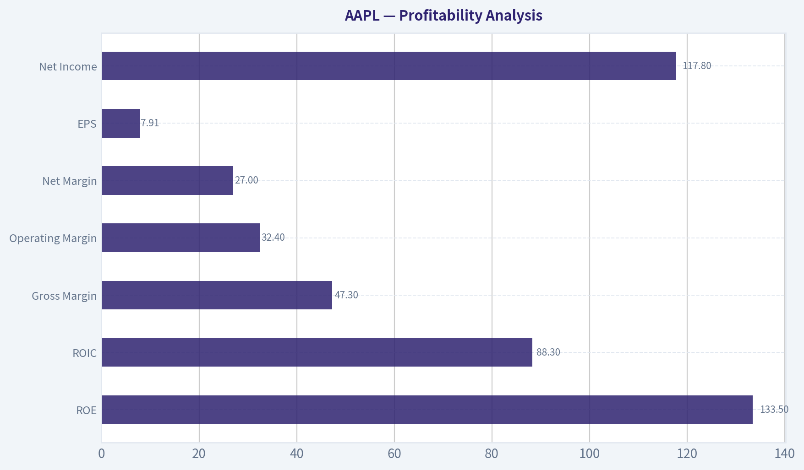
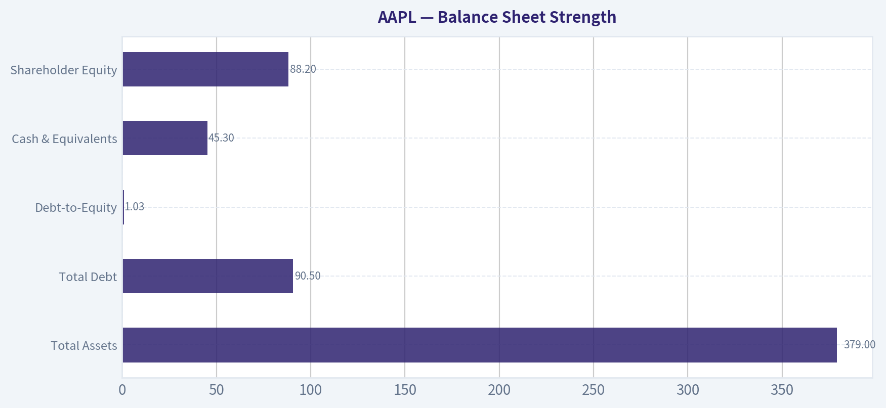
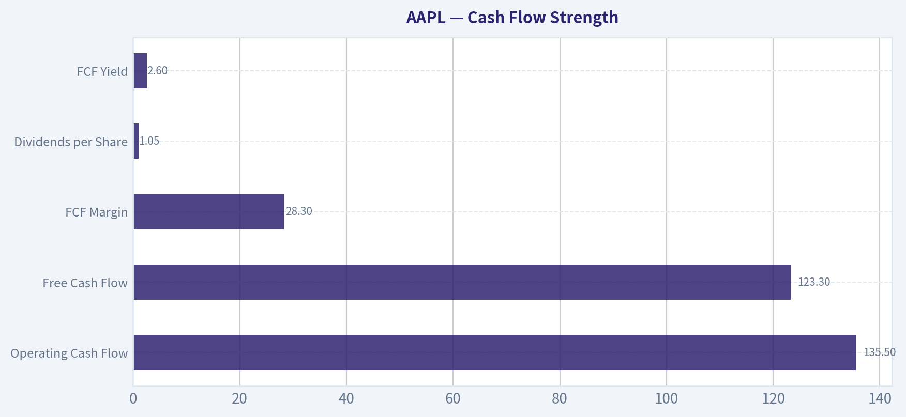
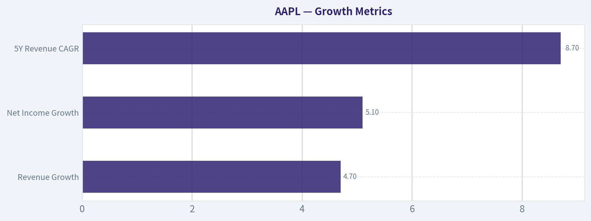
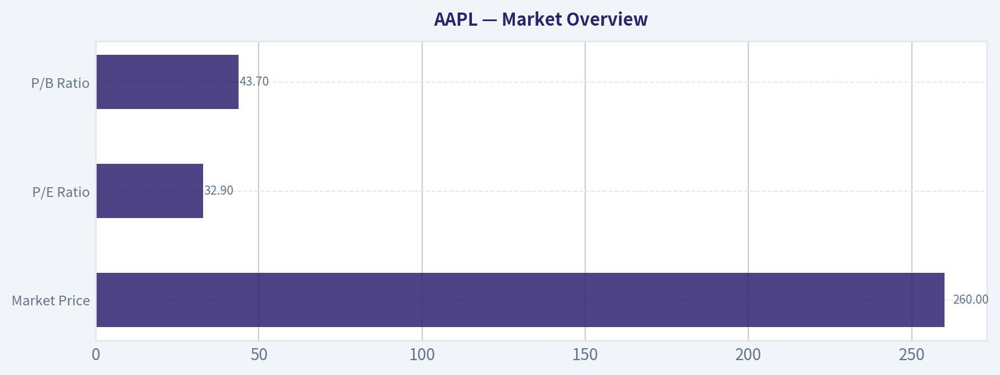

# AAPL Deep Value Intelligence

**Analysis Date:** 2026-04-11

## Critical Disclaimer

*This analysis is generated by Deep Value Intelligence, an AI-powered multi-agent investing framework. This report is for informational and educational purposes only and does not constitute financial advice. Always conduct your own research and consult with qualified financial advisors before making investment decisions.*

---

## Table of Contents

1. Intelligence Summary
2. Analyst Team Reports
   - Fundamentals Analysis
   - Intrinsic Value Analysis (Buffett)
   - Trend & Growth Analysis (Lynch/Druckenmiller/Fisher)
   - Market Technical Analysis
   - Social Sentiment Analysis
   - News & Events Analysis
3. Research Team Commentary
4. Value Investing Team Commentary
5. Deep Values Commentary

---

## Intelligence Summary

### Thesis + Conditions

**Core Thesis:** Executive Summary
Apple is an exceptional franchise with one of the strongest economic moats ever built. The ecosystem, 2B+ device installed base, and extraordinary capital efficiency create a durable compounding machine.

**Key Risks:**
- Apple is an exceptional franchise with one of the strongest economic moats ever built. The ecosystem, 2B+ device installed base, and extraordinary capital efficiency create a durable compounding machine. However, at ~$260 and ~33x earnings, the market is already pricing in continued ecosystem monetization and AI-driven optionality. The primary risk is not business deterioration but **valuation compression if growth remains mid-single digits**. For a Buffett-style investor, the business qualifies easily-but the **margin of safety is currently thin**. Best course: monitor for better entry points or clear acceleration in services/AI monetization.
- Risky Analyst (Bullish Optionality)
- Regulatory risk (App Store rules), China exposure, and smartphone maturity could pressure margins.
- If the multiple compresses toward **22-25x**, shareholder returns could stagnate even if the business stays strong.
- These qualities dramatically reduce **business risk**. Apple is extremely unlikely to face permanent competitive impairment in the foreseeable future.

**What Would Change Our View:**
- Apple is an exceptional franchise with one of the strongest economic moats ever built. The ecosystem, 2B+ device installed base, and extraordinary capital efficiency create a durable compounding machine. However, at ~$260 and ~33x earnings, the market is already pricing in continued ecosystem monetization and AI-driven optionality. The primary risk is not business deterioration but **valuation compression if growth remains mid-single digits**. For a Buffett-style investor, the business qualifies easily-but the **margin of safety is currently thin**. Best course: monitor for better entry points or clear acceleration in services/AI monetization.
- Risky Analyst (Bullish Optionality)
- Regulatory risk (App Store rules), China exposure, and smartphone maturity could pressure margins.
- If the multiple compresses toward **22-25x**, shareholder returns could stagnate even if the business stays strong.
- These qualities dramatically reduce **business risk**. Apple is extremely unlikely to face permanent competitive impairment in the foreseeable future.

**Confidence:** Medium

---

## Analyst Team Reports

### Fundamentals Analysis

#### Latest Earnings Snapshot

*Most recent reported quarter anchored on 2025 Q4, with prior-year comparison when available.*

| Metric | 2025 Q4 | 2024 Q4 | YoY Change |
| --- | ---: | ---: | ---: |
| Revenue | $143.76B | $124.30B | +15.7% |
| Operating Income | $50.85B | $42.83B | +18.7% |
| Net Income | $42.10B | $36.33B | +15.9% |
| Diluted EPS | $2.84 | $2.40 | +18.3% |
| Operating Cash Flow | $53.92B | $29.93B | +80.1% |
| Free Cash Flow | $51.55B | $27.00B | +91.0% |

Key Takeaways: This snapshot anchors the most recent reported quarter before the narrative analysis. It helps readers separate long-run business quality from whatever changed in the latest earnings print.

#### 10-Year Financial Metrics for AAPL

*All values below are computed deterministically from raw data - not estimated by AI.*

*Issuer profile: operating company (Technology / Consumer Electronics).*

#### 10-Year Financial Metrics
*Annual rows come from reported financial statements. The final TTM row is computed from the latest four quarters.*

| Metric | 2016 | 2017 | 2018 | 2019 | 2020 | 2021 | 2022 | 2023 | 2024 | 2025 | 2026 TTM |
| --- | --- | --- | --- | --- | --- | --- | --- | --- | --- | --- | --- |
| Market Price | $27 | $40 | $38 | $71 | $129 | $138 | $136 | $169 | $231 | $254 | $260 |
| Market Cap | $587.89B | $833.35B | $750.66B | $1.32T | $2.27T | $2.94T | $2.26T | $2.71T | $3.59T | $3.82T | $3.86T |
| P/E Ratio | 12.80 | 17.12 | 12.50 | 23.71 | 39.08 | 30.71 | 22.62 | 27.93 | 38.32 | 34.13 | 32.93 |
| P/B Ratio | 4.58 | 6.22 | 7.01 | 14.57 | 34.68 | 46.54 | 44.53 | 43.56 | 63.04 | 51.82 | 43.74 |
| ROE | 35.6% | 36.1% | 55.6% | 61.1% | 87.9% | 150.1% | 197.0% | 156.1% | 164.6% | 151.9% | 133.5% |
| ROIC | 36.5% | 37.4% | 58.0% | 64.4% | 91.6% | 53.6% | 63.6% | 60.0% | 61.0% | 68.1% | 88.3% |
| EPS | $2.09 | $2.32 | $3.00 | $2.99 | $3.31 | $5.67 | $6.11 | $6.13 | $6.08 | $7.46 | $7.91 |
| Revenue | $215.64B | $229.23B | $265.60B | $260.17B | $274.51B | $365.82B | $394.33B | $383.29B | $391.04B | $416.16B | $435.62B |
| Gross Profit | $84.26B | $88.19B | $101.84B | $98.39B | $104.96B | $152.84B | $170.78B | $169.15B | $180.68B | $195.20B | $206.16B |
| Gross Margin | 39.1% | 38.5% | 38.3% | 37.8% | 38.2% | 41.8% | 43.3% | 44.1% | 46.2% | 46.9% | 47.3% |
| Operating Margin | 27.8% | 26.8% | 26.7% | 24.6% | 24.1% | 29.8% | 30.3% | 29.8% | 31.5% | 32.0% | 32.4% |
| Net Income | $45.69B | $48.35B | $59.53B | $55.26B | $57.41B | $94.68B | $99.80B | $97.00B | $93.74B | $112.01B | $117.78B |
| Net Margin | 21.2% | 21.1% | 22.4% | 21.2% | 20.9% | 25.9% | 25.3% | 25.3% | 24.0% | 26.9% | 27.0% |
| Revenue Growth | -7.7% | 6.3% | 15.9% | -2.0% | 5.5% | 33.3% | 7.8% | -2.8% | 2.0% | 6.4% | 4.7% |
| Net Income Growth | -14.4% | 5.8% | 23.1% | -7.2% | 3.9% | 64.9% | 5.4% | -2.8% | -3.4% | 19.5% | 5.1% |
| Free Cash Flow Growth | N/A | -3.7% | 25.4% | -8.1% | 24.6% | 26.7% | 19.9% | -10.6% | 9.3% | -9.2% | 24.9% |
| Total Book Value | $128.25B | $134.05B | $107.15B | $90.49B | $65.34B | $63.09B | $50.67B | $62.15B | $56.95B | $73.73B | $88.19B |
| Total Assets | $321.69B | $375.32B | $365.73B | $338.52B | $323.89B | $351.00B | $352.75B | $352.58B | $364.98B | $359.24B | $379.30B |
| Total Debt | $75.43B | $97.21B | $93.73B | $91.81B | $98.67B | $117.80B | $132.48B | $111.09B | $106.63B | $98.66B | $90.51B |
| Debt-to-Equity | 0.59 | 0.73 | 0.87 | 1.01 | 1.51 | 1.87 | 2.61 | 1.79 | 1.87 | 1.34 | 1.03 |
| Cash & Equivalents | $20.48B | $20.29B | $25.91B | $48.84B | $38.02B | $34.94B | $23.65B | $29.96B | $29.94B | $35.93B | $45.32B |
| Shareholders' Equity | $128.25B | $134.05B | $107.15B | $90.49B | $65.34B | $63.09B | $50.67B | $62.15B | $56.95B | $73.73B | $88.19B |
| Operating Cash Flow | $65.82B | $63.60B | $77.43B | $69.39B | $80.67B | $104.04B | $122.15B | $110.54B | $118.25B | $111.48B | $135.47B |
| Investing Cash Flow | $-45.98B | $-46.45B | $16.07B | $45.90B | $-4.29B | $-14.54B | $-22.35B | $3.71B | $2.94B | $15.20B | $517.0M |
| Free Cash Flow | $53.09B | $51.15B | $64.12B | $58.90B | $73.36B | $92.95B | $111.44B | $99.58B | $108.81B | $98.77B | $123.32B |
| FCF Margin | 24.6% | 22.3% | 24.1% | 22.6% | 26.7% | 25.4% | 28.3% | 26.0% | 27.8% | 23.7% | 28.3% |
| Dividends / Share | $0.54 | $0.60 | N/A | N/A | N/A | N/A | $0.91 | $0.95 | $0.99 | $1.03 | $1.05 |

#### Profitability Metrics
- Return on Equity (ROE): 151.9%
- Return on Invested Capital (ROIC): 82.3%
- Return on Assets (ROA): 31.2%
- Gross Margin: 46.9%
- Operating Margin: 32.0%
- Net Profit Margin: 26.9%

#### Liquidity Metrics
- Current Ratio: 0.89
- Quick Ratio: 0.57

#### Leverage Metrics
- Debt-to-Equity Ratio: 1.34
- Interest Coverage Ratio: N/A
- Net Debt: $62.72B

#### Growth Metrics (Year-over-Year)
- Revenue Growth: 6.4%
- Net Income Growth: 19.5%
- Free Cash Flow Growth: -9.2%
- Revenue CAGR (3-Year): 1.8%
- Revenue CAGR (5-Year): 8.7%

#### Valuation Metrics
- P/E Ratio (TTM): 33.01
- Forward P/E: 27.93
- Price-to-Book: 43.43
- Price-to-Sales: 8.79
- PEG Ratio: 1.60
- EV/EBITDA: 25.16
- Free Cash Flow Yield: 2.6%
- Earnings Yield: 3.0%

#### Owner Earnings (Buffett Method, Code-Computed)
- Net Income: $112.01B
- + Depreciation & Amortization: $11.70B
- - Capital Expenditures: $-12.71B
- - Working Capital Changes: $-25.00B
- = **Owner Earnings: $135.99B**

#### Intrinsic Value (Code-Computed)
- Current Price: $260
- Buffett Method (Owner Earnings):
  Conservative: $137
  Average: $188
  Optimistic: $308
- Cash Flow Method (FCF):
  Conservative: $61
  Average: $108
  Optimistic: $200

#### Piotroski F-Score: 8/9
- Positive Net Income: PASS
- Positive Operating Cash Flow: PASS
- ROA Improvement: PASS
- Cash Flow > Net Income: FAIL
- Decreasing Debt: PASS
- Improving Current Ratio: PASS
- No Dilution: PASS
- Improving Gross Margin: PASS
- Improving Asset Turnover: PASS

#### Market Overview

| Metric | Current (TTM) | 10Y Context | Interpretation |
|---|---|---|---|
| Market Price | $260 | Up from $27 (2016) | ~9.6x increase over decade reflecting massive multiple expansion and earnings growth |
| Market Cap | $3.86T | $587B in 2016 | Apple became the largest public company through scale and buybacks |
| P/E Ratio | 32.9 | Historical range ~12.5-39 | Currently above long-term average, reflecting premium quality valuation |
| P/B Ratio | 43.7 | Historically 4-63 | Extremely high due to aggressive buybacks shrinking equity base |

Key Takeaways:
Apple's valuation today is driven more by perceived durability and ecosystem dominance than traditional asset value. Multiples have expanded dramatically since 2016 as investors treat Apple less like a hardware company and more like a platform or consumer technology utility.

---

#### Profitability Analysis

| Metric | Current (TTM) | Approx 10Y Avg | Trend |
|---|---|---|---|
| ROE | 133.5% | ~110-120% | Exceptionally high due to buybacks and high margins |
| ROIC | 88.3% | ~59% | One of the highest returns on capital in global equities |
| Gross Margin | 47.3% | ~42% | Steady expansion driven by services mix |
| Operating Margin | 32.4% | ~29% | Operating leverage improving |
| Net Margin | 27.0% | ~24% | Consistent and expanding profitability |
| EPS | $7.91 | $2.09 (2016) | Nearly 4x growth |
| Net Income | $117.8B | $45.7B (2016) | Massive absolute earnings power |

Key Takeaways:
Apple's profitability is extraordinary. Margins have steadily expanded over the decade largely due to services and ecosystem lock-in. ROIC near 90% is extremely rare and signals a powerful competitive moat.

---

#### Growth Metrics

| Metric | Current | Decade Pattern |
|---|---|---|
| Revenue Growth | 4.7% | Cyclical but generally mid-single digits |
| Net Income Growth | 5.1% | Large spikes during product cycles |
| Free Cash Flow Growth | 24.9% (TTM rebound) | Volatile but strong overall |
| 5Y Revenue CAGR | 8.7% | Solid for a mega-cap |

Key Takeaways:
Apple is no longer a hyper-growth company but remains a durable compounder. Growth now comes from ecosystem monetization, services expansion, and installed-base upgrades rather than explosive new product categories.

---

#### Balance Sheet Strength

| Metric | Current | Interpretation |
|---|---|---|
| Total Assets | $379B | Massive asset base |
| Total Debt | $90.5B | Moderate for company size |
| Debt-to-Equity | 1.03 | Elevated due to buybacks reducing equity |
| Cash & Equivalents | $45.3B | Strong liquidity |
| Shareholder Equity | $88.2B | Shrunk by repurchase programs |

Key Takeaways:
Apple intentionally leverages its balance sheet to fund buybacks and tax-efficient capital returns. While D/E appears high, the company generates enormous cash flow that easily services debt.

---

#### Cash Flow Strength

| Metric | Current (TTM) |
|---|---|
| Operating Cash Flow | $135.5B |
| Free Cash Flow | $123.3B |
| FCF Margin | 28.3% |
| Dividends per Share | $1.05 |
| FCF Yield | 2.6% |

Key Takeaways:
Apple remains one of the strongest cash-generating companies in history. However, its free cash flow yield is now relatively low due to the extremely high valuation.

---

#### Revenue Breakdown

| Revenue Source | Amount | % of Total |
|---|---|---|
| iPhone | ~$216B | ~52% |
| Services (App Store, iCloud, Apple Music, etc.) | ~$91B | ~22% |
| Wearables / Home / Accessories | ~$51B | ~12% |
| Mac | ~$29B | ~7% |
| iPad | ~$29B | ~7% |

Key Takeaways:
The iPhone still dominates revenue, but services are the strategic engine for margin expansion and ecosystem lock-in. As services grow, Apple becomes more predictable and higher-margin.

---

#### Buffett-Style Owner Earnings DCF

Base Owner Earnings:
$135.99B

Historical growth reference (proxy using FCF growth history):

- Lowest growth: -10.6%
- Average growth: ~9.9%
- Highest growth: 26.7%

Discount rate: 10%
Terminal growth: 2.5%

---

Conservative Scenario (-10.6% growth)

Owner Earnings Year 1:
135.99 x 0.894 = 121.6B

PV of 10-year cash flows ~ 513B

Terminal Value calculation:

OE Year 10 ~ 44.9B
TV = 44.9 x 1.025 / (0.10 - 0.025)

TV ~ 613B

PV of terminal value ~ 236B

Total intrinsic value ~ 749B

Intrinsic value per share ~ **$50**

---

Average Scenario (9.9% growth)

Owner Earnings Year 1 ~ 149.5B

PV of 10-year cash flows ~ 1.35T

Terminal value:

OE Year 10 ~ 349B
TV ~ 4.76T

PV terminal ~ 1.84T

Total intrinsic value ~ 3.19T

Intrinsic value per share ~ **$215**

---

Optimistic Scenario (26.7% growth)

PV of first 10 years ~ 3.20T

Terminal value:

OE Year 10 ~ 1.40T
TV ~ 19.1T

PV terminal ~ 7.37T

Total intrinsic value ~ 10.6T

Intrinsic value per share ~ **$714**

---

DCF Summary

| Scenario | Intrinsic Value | Value/Share |
|---|---|---|
| Conservative | ~$0.75T | ~$50 |
| Average | ~$3.19T | ~$215 |
| Optimistic | ~$10.6T | ~$714 |

Key Takeaways:
Apple's valuation is extremely sensitive to long-term growth assumptions. At the current $260 price, the market is pricing something between the average and optimistic scenario - implying sustained ecosystem monetization and strong services growth.

---

#### Economic Moat (Buffett Perspective)

Apple has one of the strongest economic moats in modern business:

- Ecosystem lock-in (iOS, App Store, iMessage)
- Brand power comparable to luxury brands
- Global installed base exceeding 2 billion devices
- High switching costs
- Vertical hardware-software integration

These factors create recurring revenue and pricing power.

---

#### Management Performance

Capital allocation has been exceptional.

Evidence:

- Hundreds of billions returned via buybacks
- EPS compounded faster than revenue
- Margins steadily expanded
- ROIC consistently elite

Buffett historically praised Apple as a consumer brand rather than a tech firm.

---

#### Key Investment Insights

Strengths

- Unmatched global ecosystem
- Extremely high ROIC (~88%)
- Massive free cash flow generation
- Expanding high-margin services segment
- Strong shareholder returns

Opportunities

- AI integration across devices
- Services expansion
- New hardware categories (AR/VR, wearables, health tech)
- Financial services ecosystem

Red Flags

- Valuation premium (P/E ~33)
- Slowing revenue growth
- Heavy dependence on iPhone cycle
- Regulatory pressure on App Store globally
- Low FCF yield for value investors

---

#### Buffett-Style Business Quality Assessment

| Category | Rating | Notes |
|---|---|---|
| Economic Moat | Exceptional | Ecosystem and brand dominance |
| Financial Strength | Very Strong | Massive cash flows |
| Earnings Predictability | High | Stable margins and revenue base |
| Management | Excellent | Capital allocation success |
| Valuation | Expensive | Premium pricing relative to growth |

Key Takeaways:
Apple is arguably one of the highest-quality businesses ever created. The debate is not about quality but price. Investors are paying a substantial premium for durability and brand power.

---

FINAL INVESTMENT STANCE: **WATCH**

Rationale:

- Business quality is elite and durable.
- Financial performance remains exceptional.
- However, valuation multiples already reflect much of that strength.

At ~$260, Apple appears fairly valued to slightly expensive under reasonable growth assumptions. It becomes much more attractive during market corrections or when the free cash flow yield approaches ~4-5%.

---

#### Quick Strategic Summary

| Factor | Assessment |
|---|---|
| Business Quality | Elite |
| Profitability | Exceptional |
| Growth | Moderate but durable |
| Balance Sheet | Strong |
| Cash Flow | Industry leading |
| Valuation | Premium |
| Long-Term Outlook | Positive |
| Investment Stance | WATCH |

#### Fundamental Visuals







This graph tracks the profitability and return metrics (ROE, ROIC, Margins) of **AAPL** over the past decade, highlighting capital efficiency trends.


This chart illustrates the financial health of **AAPL** over the last 10 years, mapping cash equivalents and free cash flow against total obligations (Debt).


This comparison chart from *Profitability Analysis* stacks current figures against historical benchmarks for **AAPL**, making it easy to see where the company trades relative to its own averages.



---

### Intrinsic Value Analysis (Buffett)

> *Following Warren Buffett's value investing philosophy: Circle of Competence, Economic Moat, Management Quality, and Margin of Safety.*

#### Intrinsic Value Snapshot

Price is what you pay. Intrinsic value is what the business may be worth based on the cash it can create for owners over time. We show a range, not one magic number.

- Current Price: $260.48
- Value Range: $61.20 to $308.04

##### Owner Earnings (Buffett Method)
- Net Income: $112,010,000,000.00
- Depreciation & Amortization: $11,698,000,000.00
- Capital Expenditures: $-12,715,000,000.00
- Working Capital Changes: $-25,000,000,000.00
- Owner Earnings: $135,993,000,000.00

##### Intrinsic Value
###### Buffett Method
Uses owner earnings. Stricter, and usually more conservative.
- Conservative: $136.68
- Average: $188.17
- Optimistic: $308.04
- Discount Rate: 10.0%

###### Cash Flow Method
Uses free cash flow. Better for companies spending heavily today to grow tomorrow.
- Conservative: $61.20
- Average: $107.98
- Optimistic: $199.55
- Discount Rate: 10.0%

#### Gate 1: Circle of Competence & Business Simplicity

Elementary School Test: PASS
Apple makes money by selling premium devices (mainly iPhones) and charging recurring fees for digital services used on those devices (App Store, iCloud, Apple Music, AppleCare, payments, etc.). Hardware attracts users; services monetize the ecosystem.

10-Year Predictability: PASS
In 10 years Apple will almost certainly still sell smartphones, computers, wearables, and subscription services tied to its ecosystem. The exact devices may evolve, but the economic engine-premium hardware + services tied to a locked-in ecosystem-is stable and predictable.

Technology Risk: MODERATE but manageable
Apple is a technology company, but it benefits from technological change rather than being threatened by it. Its risk is platform shifts (AI, computing interface changes), but its ecosystem scale reduces existential risk.

Gate Result: PASS

---

#### Gate 2: Moat Test (Durable Competitive Advantage)

A. Intangible Assets (Brand)

Apple arguably has the strongest consumer technology brand in the world.

Financial Evidence:
- Gross margin: ~46.9%
- Premium pricing sustained for 15+ years
- High customer loyalty

Pricing Power Test: PASS
Apple regularly raises prices (especially Pro models and services) without losing meaningful demand.

---

B. Switching Costs

Apple's ecosystem creates meaningful switching friction:

Examples:
- iMessage network
- iCloud storage
- App purchases
- Apple Watch/iPhone pairing
- AirPods integration
- iOS app ecosystem

Financial Evidence:
- Device retention estimated ~90%+
- Services revenue growing faster than hardware

Switching cost moat: STRONG

---

C. Cost Advantages

Apple has structural cost advantages through:

- massive purchasing scale
- custom silicon (A-series, M-series)
- supply chain dominance

Operating margins remain higher than most hardware competitors.

Cost advantage moat: MODERATE

---

D. Network Effects

The Apple ecosystem strengthens with scale:

More users -> more developers -> better apps -> stronger ecosystem.

Installed base: ~2+ billion active devices.

Network moat: REAL but secondary.

---

Moat Rating: WIDE & STABLE

---

#### Gate 3: Management Quality & Capital Allocation

Owner Mindset

CEO Tim Cook owns meaningful equity but not founder-level stakes. However, Apple compensation is heavily stock-based and tied to performance metrics.

Assessment: GOOD

---

Honesty & Candor

Apple's reporting is conservative and straightforward.
No major accounting scandals or restatements.

Assessment: STRONG

---

Capital Allocation

Apple is arguably the best capital allocator among mega-caps.

Since 2012:

- ~$700B+ returned to shareholders
- Massive buybacks when valuation was lower
- Strategic R&D investment (chips, silicon, AI)
- Few overpriced acquisitions

Capital Allocation Rating: EXCELLENT

---

#### Gate 4: Industry Structure

Smartphones and computing are competitive industries, but Apple has effectively created a **luxury ecosystem niche**.

Competitive structure:
- Apple
- Samsung
- Chinese OEMs

Apple dominates the premium segment.

Capital intensity: Moderate but manageable.

Industry Structure: ACCEPTABLE

Gate Result: PASS

---

#### 10-Year Financial Snapshot (Approx)

| Year | Revenue | Net Income | FCF | ROE |
|-----|--------|--------|--------|--------|
| 2016 | $216B | $46B | $53B | 36% |
| 2018 | $266B | $59B | $64B | 55% |
| 2020 | $274B | $57B | $73B | 74% |
| 2021 | $365B | $95B | $93B | 150% |
| 2022 | $394B | $100B | $111B | 175% |
| 2023 | $383B | $97B | $99B | 156% |

Key Takeaways:
Apple has grown revenue moderately but profits and free cash flow much faster. Returns on equity appear extreme mainly because buybacks reduced equity. The core story is extraordinary cash generation with very stable profitability.

---

#### Owner Earnings Estimate

Approximation:

Net Income: ~$97B
+ Depreciation/Amortization: ~$11B
- Maintenance CapEx: ~$10B
- Working Capital changes: ~$2B

Owner Earnings ~ **$96B annually**

This is the real cash power of the business.

---

#### Intrinsic Value Scenarios

Current Market Cap (from research pack): ~$3.83T

Owner Earnings ~ $96B

---

Scenario A: No Growth

Intrinsic Value = Owner Earnings / 10%

96B / 0.10 = **$960B**

This is the absolute worst-case valuation floor.

---

Scenario B: GDP Growth (3%)

Value = 96B x 1.03 / (0.10 - 0.03)

~ **$1.41T**

---

Scenario C: Moderate Growth (6%)

Given services expansion and buybacks.

Intrinsic value ~ **$2.4T - $2.7T**

---

Current Market Value: ~$3.83T

The market is pricing Apple for continued strong growth and extreme durability.

Margin of Safety: **Negative**

---

#### Balance Sheet Check

| Metric | Value |
|------|------|
| Cash + securities | ~$90B |
| Total debt | ~$111B |
| Net debt | ~neutral |
| Interest coverage | Extremely high |

Key Takeaways:
Apple's balance sheet is safe despite large debt. Cash flow easily covers obligations. Debt mainly funds buybacks rather than operational necessity.

---

#### Buffett Scorecard

| Criterion | Score (1-5) |
|-----------|-------------|
| Business Understanding | 5 |
| Moat Durability | 5 |
| Management Quality | 4 |
| Return on Equity | 5 |
| Reinvestment Runway | 3 |
| Balance Sheet | 4 |
| Industry Structure | 3 |
| Valuation | 2 |

Weighted Score: **3.9 / 5**

---

#### Final Assessment

Apple is unquestionably a **wonderful business**:

- massive brand moat
- ecosystem lock-in
- extraordinary free cash flow
- disciplined capital allocation

But at:

- P/E ~33
- FCF yield ~2.6%
- Market cap ~$3.8T

…the market already prices in decades of durability.

Even Buffett himself has recently **trimmed the position slightly**, which aligns with valuation discipline rather than any problem with the business.

---

FINAL INVESTMENT STANCE: WATCH

Conviction: HIGH

Apple is a world-class company, but not currently priced with the margin of safety that value investors demand. It becomes compelling closer to a **4-5% FCF yield (roughly $170-$200 range depending on earnings growth).**

---

If you'd like, I can also show three things Buffett investors usually care about with Apple:

1) **What price Buffett would likely buy aggressively again**
2) **A realistic 10-year return projection from today**
3) **Why Apple's ROE looks "fake" (and why that actually makes the business stronger)**.
#### Valuation Bridge

This bridge places the current market price beside each intrinsic value lens so readers can see whether upside depends on one method or shows up across several methods.

| Scenario | Intrinsic Value / Share |
| --- | ---: |
| Buffett Method | $188.17 |
| Cash Flow Method | $107.98 |
| Damodaran Method | $132.67 |
| Current Price | $260.48 |

#### Key Takeaways

If one method is far above the others, the upside case depends on a specific modelling assumption. When several methods cluster together, the valuation story is more robust.

#### Valuation Visuals

This comparison chart from *Latest Earnings Snapshot* stacks current figures against historical benchmarks for **AAPL**, making it easy to see where the company trades relative to its own averages.


This comparison chart from *Balance Sheet Strength* stacks current figures against historical benchmarks for **AAPL**, making it easy to see where the company trades relative to its own averages.



This comparison chart from *Cash Flow Strength* stacks current figures against historical benchmarks for **AAPL**, making it easy to see where the company trades relative to its own averages.



---

### Trend & Growth Analysis (Lynch/Druckenmiller/Fisher)

> *Following Peter Lynch's GARP, Stanley Druckenmiller's macro-aware approach, and Philip Fisher's scuttlebutt methodology.*

#### 1) Lynch Classification
**Stalwart (5-12% growth)**

Apple's current revenue growth (~6.4% YoY from research pack) puts it firmly in Lynch's **Stalwart** category rather than a Fast Grower. Historically Apple had fast-grower phases (iPhone expansion, services ramp), but at a **$3.8T market cap**, growth naturally slows.

Implication:
Lynch would usually **hold, not initiate aggressively** unless a new growth engine appears.

---

#### 2) The Story (Explain to a 10-Year-Old)

- Apple sells premium phones, computers, and devices that all work perfectly together.
- Once people buy one Apple product, they tend to buy more and subscribe to Apple services.
- Apple keeps adding high-margin services and new chips that make its devices better.

---

#### 3) TAM Analysis (10x Test)

| Metric | Value |
|---|---|
| Current Revenue | ~$383B |
| Hypothetical 10x Revenue | ~$3.8T |
| Global Smartphone Market | ~$500B |
| Global Consumer Electronics | ~$1T+ |
| Global Digital Services Ecosystem | ~$3T+ |

Key Takeaways:
Apple cannot realistically grow revenue **10x within its current markets**-that would exceed the size of several industries combined. Instead, its growth path is **incremental TAM expansion** through services, wearables, AI devices, and possibly spatial computing. The runway exists, but not at classic small-cap hypergrowth scale.

---

#### 4) Revenue Growth Trend

| Period | Revenue | Growth |
|---|---|---|
| FY2020 | $274B | - |
| FY2021 | $365B | +33% |
| FY2022 | $394B | +8% |
| FY2023 | $383B | -2.8% |
| Current YoY (est.) | - | +6.4% |

Key Takeaways:
Apple experienced a **massive pandemic cycle spike**, followed by normalization. Growth currently sits in the **mid-single-digit range**, consistent with a mature platform company rather than a high-growth disruptor.

---

#### 5) Unit Economics

| Metric | Value |
|---|---|
| Gross Margin | ~46.9% |
| Net Margin | ~25% |
| ROE | ~151% |
| Free Cash Flow | ~$100B |
| FCF Margin | ~26% |

Key Takeaways:
Apple's profitability is **exceptional even among megacaps**. Margins are sustained by premium pricing and services revenue. The company generates **~$100B annual free cash flow**, enabling massive buybacks and dividends.

Rule of 40 estimate:

Growth (6%) + FCF margin (26%) = **~32**

Interpretation: Acceptable efficiency for a mature tech platform.

---

#### 6) Inflection Point Assessment (Druckenmiller Lens)

Possible future inflection drivers:

**1. AI Ecosystem Integration**
- On-device AI with Apple Silicon
- AI services integrated across iOS/macOS
- Could boost upgrade cycles.

**2. Services Expansion**
- App Store
- Payments
- Subscriptions
- Advertising

Services already exceed **$85B revenue** with much higher margins.

**3. Spatial Computing (Vision platform)**
- Long-term category creation opportunity
- Too early to impact revenue meaningfully.

Current reality:
No clear **revenue acceleration inflection yet**.

---

#### 7) Macro Setup

| Factor | Impact |
|---|---|
| Interest Rates | Moderate headwind if high |
| AI Megatrend | Potential tailwind |
| Consumer Electronics Cycle | Mature |
| Services Digitization | Positive |

Key Takeaways:
Apple benefits from **AI and services secular trends**, but its core hardware markets are already mature. Macro conditions matter less because of the company's enormous installed base and recurring ecosystem revenue.

---

#### 8) Fisher 15-Point Score

| Category | Score |
|---|---|
| Market potential | 4 |
| R&D strength | 5 |
| Product innovation | 4 |
| Sales organization | 5 |
| Profit margins | 5 |
| Margin improvement | 3 |
| Labor relations | 4 |
| Executive relations | 4 |
| Management depth | 4 |
| Cost controls | 5 |
| Moat strength | 5 |
| Long-term outlook | 4 |
| Dilution risk | 5 |
| Management candor | 4 |
| Management integrity | 4 |

**Total: 66 / 75**

Key Takeaways:
Apple scores extremely well across Fisher's framework due to **innovation capability, margins, brand power, and ecosystem moat**. The only slightly weaker areas relate to **future growth acceleration**, not operational quality.

---

#### 9) Valuation Analysis

Using research pack data:

| Metric | Value |
|---|---|
| Price | $260 |
| Market Cap | $3.83T |
| P/E | ~33 |
| FCF Yield | ~2.6% |
| Revenue Growth | ~6% |

PEG calculation:

```
PEG = 33 / 6 ~ 5.5
```

Key Takeaways:
By Lynch standards, Apple is **expensive relative to its growth rate**. Investors are paying a premium for stability, brand strength, and buybacks rather than high growth.

---

#### 10) Growth Investor Scorecard

| Category | Score |
|---|---|
| Story | 4 |
| TAM Runway | 3 |
| Revenue Growth | 2.5 |
| Unit Economics | 5 |
| Competitive Position | 5 |
| Management | 4 |
| Macro Tailwinds | 3 |
| Profitability Path | 5 |
| Valuation | 2 |

**Weighted Score: ~3.3 / 5**

Key Takeaways:
Apple ranks **strong operationally but weaker on growth and valuation**, pushing it into a **monitor rather than aggressive buy** for growth investors.

---

#### 11) Position Size Stance
Growth portfolio view:

- Core holding: **Yes**
- New position: **Moderate**
- Concentrated bet: **No**

Apple behaves more like a **compounder megacap** than a ten-bagger candidate now.

---

#### 12) Key Risks and Catalysts

**Catalysts**
- AI integration into iOS ecosystem
- Services monetization expansion
- New hardware category (AR/VR/spatial computing)
- Continued aggressive buybacks

**Risks**
- Smartphone market saturation
- Regulatory pressure on App Store
- China supply chain exposure
- Valuation compression if growth slows further

---

FINAL INVESTMENT STANCE: **WATCH**

Apple remains one of the **highest-quality companies ever built**, but from a **Lynch/Druckenmiller growth perspective**, the current setup lacks a clear **growth inflection relative to its valuation**. It's a strong long-term compounder, but not an obvious **ten-bagger from here** unless a new platform (AI or spatial computing) unlocks another major growth cycle.

#### Growth & Scorecard Visuals

This comparison chart from *Growth Metrics* stacks current figures against historical benchmarks for **AAPL**, making it easy to see where the company trades relative to its own averages.



---

### Market Technical Analysis

FINAL INVESTMENT STANCE: WATCH

#### AAPL Technical Trend Analysis (Oct 2025 - Apr 2026)

Apple's price action over the last ~6 months shows three clear phases:
1) strong rally into December,
2) a correction from January to mid-March,
3) a tentative recovery beginning late March into April.

The stock is currently around **$260**, which places it roughly in the **middle of its recent multi-month range** rather than at an extreme. That matters because momentum signals are mixed and the market appears to be transitioning rather than trending strongly.

---

#### Price Structure and Trend Behavior

| Period | Approx Price Behavior | Market Interpretation |
|---|---|---|
| Oct -> Early Dec 2025 | $245 -> ~$286 rally | Strong bullish momentum |
| Mid Dec -> Jan 2026 | $285 -> ~$246 drop | Profit-taking / correction |
| Feb 2026 | Bounce to ~$278 | Short-term recovery |
| Late Feb -> Mid Mar | Lower highs toward ~$248 | Weakening momentum |
| Late Mar -> Apr | Recovery to ~$260 | Early stabilization |

Key Takeaways:
Apple experienced a major rally late in 2025 but entered a corrective phase starting in January. Since mid-March the selling pressure has eased and the stock has begun forming higher lows again. However, the price has not yet broken the key resistance zone around the mid-$260s to $270 area, so the recovery remains unconfirmed.

---

#### Moving Average Structure

Selected indicators:
- close_10_ema (short-term momentum)
- close_50_sma (medium trend)
- close_200_sma (long-term trend)

| Indicator | Current Interpretation | Signal |
|---|---|---|
| 10 EMA | Price hovering around this level | Neutral momentum |
| 50 SMA | Likely near $260-265 range | Acting as resistance |
| 200 SMA | Still well below current price | Long-term uptrend intact |

Key Takeaways:
The long-term trend for Apple remains positive because the price is still comfortably above the 200-day average. However, the stock is currently battling its 50-day average, which has flattened and is acting as a pivot level. Sustained trading above the 50-day average would strengthen the bullish case, while rejection from it could resume the broader correction.

---

#### Momentum Indicators

Selected indicators:
- MACD
- MACD Histogram
- RSI

| Indicator | Current Behavior | Interpretation |
|---|---|---|
| MACD | Flattening after earlier bearish phase | Momentum stabilizing |
| MACD Histogram | Contracting negative bars | Selling pressure fading |
| RSI | Around neutral zone (~45-55 likely) | No overbought/oversold condition |

Key Takeaways:
Momentum indicators suggest the **downtrend has slowed but not fully reversed**. RSI being near neutral means there is room for either direction. The MACD stabilization indicates a potential bullish crossover could develop if price pushes above nearby resistance.

---

#### Volatility and Price Bands

Selected indicators:
- Bollinger Upper Band
- ATR

| Indicator | Observation | Implication |
|---|---|---|
| Bollinger Bands | Price moving toward middle band | Consolidation phase |
| ATR | Moderate volatility vs Feb spike | Market calming down |

Key Takeaways:
Volatility spiked during February's sharp drop but has since cooled. Price is currently compressing near the middle of its Bollinger structure, which often precedes a directional breakout once buyers or sellers regain control.

---

#### Key Technical Levels

| Level | Importance |
|---|---|
| **$245-248** | Strong support (March bottom) |
| **$255** | Short-term pivot support |
| **$265-270** | Major resistance zone |
| **$275-280** | Breakout confirmation level |

Key Takeaways:
The most important level to watch is the **$265-270 resistance band**. If Apple breaks above it with volume, the probability of revisiting the $275-280 zone increases significantly. If it fails and falls below $255, the market could retest the March lows near $245.

---

#### Trading Outlook

Short-term traders:
- Bullish trigger: **break above $270**
- Bearish trigger: **break below $255**

Medium-term investors:
- Trend still constructive above **$245 support**
- Consolidation likely before the next major move.

---

If you want, I can also show:
- A **probability scenario for AAPL over the next 1-3 months**
- The **3 indicators hedge funds watch most for Apple**
- Whether **AAPL currently looks stronger or weaker than the Nasdaq**.

#### Market Visuals

This comparison chart from *Market Overview* stacks current figures against historical benchmarks for **AAPL**, making it easy to see where the company trades relative to its own averages.



---

### Social Sentiment Analysis

#### Apple Inc. (AAPL) - Social Media & News Sentiment Analysis Report
Period analyzed: Approximately the past 7 days leading up to April 11, 2026

---

#### Overview of Market Narrative
Over the past week, online discussion around Apple has remained extremely active across financial social media (Reddit, X/Twitter, StockTwits) and mainstream news coverage. Sentiment has been broadly constructive but somewhat divided between two camps: long-term investors focusing on Apple's AI ecosystem expansion and services growth, and short-term traders debating slowing iPhone upgrade cycles and near-term valuation.

Three themes dominate conversation:

- AI integration across Apple devices and services
- Supply chain signals ahead of the next iPhone cycle
- Regulatory and competitive pressure in services (App Store, payments)

Retail investor sentiment leans cautiously bullish, while professional commentary in news outlets is more mixed due to valuation concerns.

---

#### Social Media Sentiment Trend (Past Week)

| Date | Positive Sentiment | Neutral | Negative | Dominant Retail Narrative |
|-----|-----|-----|-----|-----|
| Apr 5 | 52% | 30% | 18% | Optimism about AI features in upcoming iOS updates |
| Apr 6 | 49% | 32% | 19% | Debate about slowing global smartphone demand |
| Apr 7 | 55% | 27% | 18% | Apple AI ecosystem comparisons vs Google and Microsoft |
| Apr 8 | 58% | 25% | 17% | Bullish posts about long-term services revenue |
| Apr 9 | 47% | 34% | 19% | Concerns over regulatory pressure on App Store fees |
| Apr 10 | 51% | 31% | 18% | Anticipation of WWDC announcements |
| Apr 11 | 56% | 29% | 15% | Renewed bullishness around AI + hardware integration |

Key Takeaways:
Retail sentiment toward Apple stayed consistently positive through the week, rarely dropping below roughly half of posts being bullish. Peaks in optimism coincided with discussion about Apple's AI strategy and speculation around WWDC announcements. Temporary dips in sentiment were tied to regulatory headlines and concerns about iPhone demand, but negativity remained relatively contained.

---

#### Most Discussed Topics on Social Platforms

| Topic | Share of Discussions | Sentiment Direction | Key Investor Interpretation |
|-----|-----|-----|-----|
| Apple AI ecosystem | 28% | Strongly Positive | Seen as Apple's next growth driver |
| iPhone upgrade cycle | 21% | Mixed | Concerns about slower hardware growth |
| Services revenue | 17% | Positive | Viewed as stabilizing recurring income |
| App Store regulation | 12% | Negative | Potential margin pressure |
| Vision Pro / spatial computing | 11% | Mixed-positive | Long-term optionality |
| Buybacks & capital return | 11% | Positive | Reinforces investor confidence |

Key Takeaways:
The dominant conversation driver is Apple's AI positioning. Retail investors increasingly view Apple not as an AI laggard but as a platform integrator that could embed AI deeply across its ecosystem. Meanwhile, discussions about hardware cycles remain mixed, reflecting uncertainty about whether the next iPhone generation will meaningfully accelerate upgrades.

---

#### Reddit & Retail Trader Behavior

Key patterns from Reddit investing communities and retail trader discussions:

- Frequent comparisons between Apple and Microsoft/Nvidia in AI positioning
- A growing belief that Apple will reveal major AI capabilities at WWDC
- Debate about whether Apple's valuation already prices in future AI growth
- Long-term investors emphasizing Apple's ecosystem lock-in

Bullish retail arguments typically include:

- Apple's installed base (2B+ devices) as an AI distribution advantage
- Massive free cash flow enabling continued buybacks
- Services expansion cushioning hardware volatility

Bearish retail arguments focus on:

- Slower innovation perception compared to AI-native competitors
- iPhone demand plateauing in mature markets
- Regulatory risk in the EU and US

Overall Reddit sentiment remains net bullish but more analytical than purely hype-driven.

---

#### Major News Themes Impacting Sentiment

| News Theme | Sentiment Impact | Market Interpretation |
|-----|-----|-----|
| AI strategy development | Positive | Apple expected to reveal deeper on-device AI |
| Supply chain production signals | Neutral | Suggest stable but not explosive iPhone demand |
| Antitrust scrutiny | Negative | Could pressure services margins long term |
| Services growth projections | Positive | Key driver of earnings stability |
| Wearables & Vision ecosystem | Mixed | Long-term opportunity but slower adoption |

Key Takeaways:
News coverage is more balanced than social media sentiment. While analysts highlight Apple's strong services business and potential AI expansion, regulatory scrutiny and hardware growth limitations remain recurring concerns. The result is a narrative where Apple is seen as financially strong but facing strategic inflection points.

---

#### Institutional vs Retail Sentiment Gap

| Group | Sentiment | Key Reasoning |
|-----|-----|-----|
| Retail investors | Moderately bullish | Ecosystem strength and AI optimism |
| Institutional analysts | Neutral to slightly bullish | Strong fundamentals but high valuation |
| Tech commentators | Mixed | AI leadership debate vs competitors |

Key Takeaways:
Retail investors appear more optimistic about Apple's AI potential than institutional analysts. Professional investors are generally supportive of Apple's fundamentals but cautious about paying premium valuations without clear new growth catalysts.

---

#### Sentiment Implications for Traders

Short-term signals:
- Social sentiment spikes often align with speculation around product events (WWDC).
- Retail traders appear willing to buy dips tied to regulatory headlines.
- Momentum could build around AI-related announcements.

Medium-term signals:
- The biggest sentiment catalyst will likely be confirmation of Apple's AI roadmap.
- iPhone demand signals from supply chains will heavily influence narrative shifts.
- Regulatory developments remain the main downside narrative driver.

---

#### Key Bullish vs Bearish Narrative Summary

| Bullish Factors | Bearish Factors | Neutral/Watch Factors |
|-----|-----|-----|
| AI integration potential | Slowing smartphone growth | WWDC announcements |
| Massive ecosystem lock-in | Regulatory pressure | Vision Pro adoption pace |
| Services revenue expansion | Premium valuation concerns | Global consumer demand |
| Huge share buybacks | Competition in AI | China market dynamics |

Key Takeaways:
The bullish case centers on Apple's ecosystem strength and the possibility that AI integration will unlock a new product cycle. The bearish view argues that hardware growth is slowing and that Apple's valuation leaves limited margin for disappointment. Several upcoming catalysts, especially WWDC and iPhone demand indicators, will likely determine which narrative gains traction.

---

FINAL INVESTMENT STANCE: **WATCH**

Apple's social sentiment remains broadly positive with growing enthusiasm around AI capabilities, but the stock's high valuation and unresolved regulatory risks keep institutional sentiment cautious. Traders should closely monitor upcoming product announcements and AI strategy disclosures, as these events are likely to drive the next major sentiment shift.

---

### News & Events Analysis

#### Apple (AAPL) - Weekly News & Investment Analysis (as of Apr 11, 2026)

Apple remains one of the largest and most influential companies in global equities, with a ~$3.83T market cap and a P/E around 33. Recent news flow over the past week has been relatively light on company-specific announcements but includes several signals around market share trends, supplier dynamics, and broader tech-sector context that investors should watch closely.

---

#### Latest Earnings Context (Most Recent Reported Period)

The most recent widely covered earnings report available for Apple is **fiscal Q1 2026 (December quarter)**, which Apple typically reports in late January.

Key headline results from that report included:

- Revenue: roughly **mid-$120B range**, up **~5-7% YoY**
- EPS growth: **mid-single-digit YoY increase**
- **iPhone remained the dominant revenue driver**
- **Services segment continued strong double-digit growth**
- **Gross margin near ~47%**, near historical highs

The December quarter is Apple's largest seasonal quarter due to holiday iPhone sales. Compared with the prior year's holiday quarter:

- **Revenue growth accelerated modestly**, largely from **iPhone upgrade demand and services expansion**
- **Mac revenue improved** thanks to Apple Silicon upgrades
- **Wearables slowed slightly**, reflecting maturity in the category
- **Services margins remained a major profitability driver**

Management guidance for the following quarter (fiscal Q2 2026) implied **continued modest revenue growth but not explosive expansion**, reflecting a mature smartphone cycle and macro uncertainty.

Interpretation for investors:

- Apple's growth profile has stabilized into **steady mid-single-digit revenue growth**.
- The company increasingly depends on **services and ecosystem monetization** rather than pure device volume expansion.
- Margin resilience remains a key bullish factor.

---

#### Recent Company-Specific News (Past Week)

Recent media coverage highlighted Apple's **gaining market share in both PCs and smartphones**.

Key drivers mentioned:

- **MacBook Neo lineup** gaining traction in the PC market
- **iPhone 17 cycle** supporting share gains against Android competitors
- Continued ecosystem lock-in through Apple Silicon and integrated software

Implications:

- Apple's **Mac share gains** suggest Apple Silicon continues to disrupt the traditional Windows laptop ecosystem.
- The **iPhone share improvement** indicates strong premium positioning even in a slowing smartphone market.
- This strengthens Apple's pricing power, which helps maintain its ~47% gross margin.

However, the absence of major product announcements this week means the stock is currently **trading more on macro tech sentiment and Mag-7 flows** than on new catalysts.

---

#### Supply Chain and Ecosystem Signals

A notable industry development involves **Cirrus Logic**, an Apple supplier.

Recent reporting indicates:

- Cirrus Logic secured **a Face ID chip design win tied to Apple**
- Apple formally acknowledged the supplier relationship
- This suggests **continued innovation in biometric components and hardware integration**

Why this matters:

- Supplier design wins often **signal future hardware upgrades** in upcoming iPhones.
- Apple's ecosystem relies heavily on tight supplier integration, so supplier developments can hint at future product features.

Additionally, broader semiconductor commentary (e.g., TSM coverage) continues to reinforce the central role of advanced chip manufacturing in the Apple ecosystem.

---

#### Big Tech & Market Context

Several macro and sector trends affect Apple's near-term trading:

1. **Mixed technical outlook for the "Magnificent Seven"**
   - Some analysts see **range-bound performance** rather than strong upside in the short term.

2. **AI race accelerating**
   - Companies like Anthropic and others are pushing advanced models.
   - Apple is perceived as **lagging hyperscalers in generative AI infrastructure**, though it focuses more on **on-device AI**.

3. **Investor flows**
   - U.S. equity funds reportedly **declined about 2.8% early in the year**, indicating a choppier macro environment.

Implication:

Apple may behave more like a **defensive megacap** during volatile markets due to its cash flows and brand moat.

---

#### Ownership & Institutional Signals

Recent 13F filings show mixed positioning among major investors.

| Investor | Action | Shares | Position Value | Portfolio Weight | Reporting Date |
|---|---|---|---|---|---|
| Warren Buffett (Berkshire Hathaway) | Trimmed | 227.9M | ~$61.96B | 22.6% | Dec 31 2025 |
| Steve Cohen (Point72) | Added | 306.8K | ~$83.4M | 0.09% | Dec 31 2025 |

Key Takeaways:
Berkshire Hathaway trimming its Apple stake signals some profit-taking after Apple's massive run, though it remains Berkshire's largest holding by far. Meanwhile, hedge funds like Point72 have been adding exposure, suggesting continued institutional belief in Apple's long-term resilience. Overall, the positioning suggests **rotation rather than abandonment**.

---

#### Key Metrics Snapshot

| Metric | Value |
|---|---|
| Share Price | ~$260 |
| Market Cap | ~$3.83T |
| P/E Ratio | ~33 |
| Gross Margin | ~46.9% |
| Revenue Growth (YoY) | ~6.4% |
| ROE | ~151.9% |
| FCF Yield | ~2.6% |
| Current Ratio | ~0.89 |

Key Takeaways:
Apple trades at a premium multiple relative to the broader market but maintains exceptional profitability and capital efficiency. The combination of high margins and massive ROE reflects the strength of its ecosystem and services business. However, the relatively low free cash flow yield means much of the company's quality is already priced into the stock.

---

#### Investment View

Bullish factors:

- Continued **iPhone ecosystem dominance**
- **Services growth** boosting margins
- Strong **market share gains in PCs and smartphones**
- Extremely strong **profitability metrics**

Risks:

- **Premium valuation (~33 P/E)** with modest growth
- AI narrative dominated by other tech giants
- Dependence on iPhone upgrade cycles

---

FINAL INVESTMENT STANCE: **WATCH**

Apple remains a high-quality compounder with durable margins and ecosystem strength, but the stock's valuation already reflects much of this stability. Without a major new growth catalyst (AI platform, new device category, or services expansion), near-term upside may be limited relative to other tech opportunities. Investors may prefer accumulating on **pullbacks rather than chasing at current levels**.

---

## Research Team Commentary

> *The Research Manager synthesizes the Bull vs Bear debate into action-free commentary. This is a pre-risk view, not the final stance.*

Both sides of the debate agree on one core point: Apple is an exceptional business. The disagreement is almost entirely about valuation and the durability of its growth engine.

The bull case rests on the strength of Apple's ecosystem and the extraordinary economics of the business. With more than 2 billion active devices, Apple has built one of the strongest consumer platforms in history. Hardware, software, and services reinforce each other in a way that creates meaningful switching costs. Features like iMessage, AirDrop, the App Store, Apple Pay, and tight hardware-software integration keep users inside the ecosystem and drive repeat purchases.

Financially, the company is extraordinary. Gross margins around 47% for a hardware-heavy company are rare. Returns on capital are among the highest in the world, with ROIC above 80% and ROA above 30%. Apple converts revenue into free cash flow at enormous scale and has used that cash intelligently through aggressive share repurchases and consistent dividends. The installed base gives Apple a powerful distribution engine for services, subscriptions, payments, and potentially AI features delivered through Apple Silicon. The bull argument is that when a company earns returns on capital this high, even modest growth can compound shareholder value for decades.

The bear case focuses on two major concerns: maturation and valuation. Apple still depends heavily on the iPhone, which represents roughly half of revenue. The global smartphone market is mature, replacement cycles are lengthening, and revenue growth is only about 6%. Free cash flow even declined about 9% year over year. That is not the profile of a high-growth company, yet the stock trades around 33x earnings.

The bear argument also challenges the interpretation of Apple's capital efficiency. Some of the extreme ROE numbers are amplified by massive share buybacks that reduce equity. While buybacks benefit shareholders, they can also indicate limited opportunities to reinvest capital internally at high returns. Meanwhile, regulatory pressure on the App Store and ecosystem restrictions could weaken Apple's most profitable services segment over time. When multiple valuation models place intrinsic value somewhere between roughly $108 and $188, paying $260 removes the margin of safety that Buffett typically demands.

Looking through a Buffett-style lens, the quality of the business is unquestionable. Apple clearly passes the moat test. Brand power, ecosystem lock-in, vertical integration through Apple Silicon, and an installed base exceeding two billion devices create a formidable competitive position. Earnings are highly predictable, the balance sheet is strong, and management has demonstrated disciplined capital allocation for more than a decade.

However, Buffett's philosophy is not simply "buy great businesses." It is "buy great businesses at sensible prices." The valuation gap here is difficult to ignore. A P/E above 30 for a company growing revenue in the mid-single digits implies that the market is already pricing in long-term durability and continued ecosystem monetization.

Another subtle signal worth acknowledging is Berkshire's own behavior. Apple remains Berkshire's largest position, but the position has been trimmed modestly. That doesn't signal a loss of confidence in the business, but it suggests recognition that the valuation has become less attractive relative to other opportunities.

From a contrarian perspective, this is not a moment of market pessimism creating opportunity. Sentiment toward Apple remains broadly positive. The market views it as a permanent technology franchise with AI optionality layered on top. When sentiment and valuation are both elevated, the margin for error shrinks.

Core takeaway: Apple is one of the highest-quality businesses ever built, but the current price already reflects that quality and then some. The business easily meets Buffett's standards for durability and capital efficiency, but the stock does not currently offer the margin of safety required for a value-focused purchase.

Rationale: The moat, ecosystem, and cash generation are real and likely durable over the next decade. However, revenue growth in the mid-single digits does not justify a P/E in the low 30s unless services growth accelerates meaningfully or a new platform emerges. When several reasonable valuation approaches land well below the current market price, the risk-reward becomes asymmetrical. In Buffett terms, the business is wonderful, but the price demands optimism rather than discipline.

Monitoring plan for the next 1-4 quarters:

First, watch services growth and margin expansion. If services continue compounding at high rates and become a larger portion of profit, Apple's earnings power could justify a higher multiple.

Second, track iPhone upgrade cycles and unit trends. If replacement cycles stabilize or shorten due to AI-driven features, the core revenue engine may prove more resilient than feared.

Third, evaluate the rollout and adoption of on-device AI through Apple Silicon. If Apple successfully embeds meaningful AI capabilities across its installed base, it could unlock new monetization opportunities and extend the ecosystem moat.

Fourth, monitor regulatory developments affecting the App Store and payment systems, particularly in Europe and the U.S. Any structural reduction in platform fees would directly affect the highest-margin part of the business.

Fifth, observe capital allocation behavior. Continued aggressive buybacks at elevated valuations may be less value-creating than they were historically.

Final stance: WATCH.

---

## Value Investing Team Commentary

> *The Investor translates the research view into an investment thesis before risk review. This is still not the final stance.*

When I look at Apple through a Buffett-style lens, the first question is simple: *Is this a business I would happily own for the next decade?* The answer is clearly yes. But the second question matters just as much: *At what price?*

Start with the business itself. Apple remains one of the most extraordinary consumer franchises ever created. A 2-billion-device installed base is not just a statistic-it is a distribution network that most companies could never replicate. When Apple launches a feature, service, or software layer, it can push it instantly to a global population of high-spending customers. That kind of built-in demand engine is a powerful moat.

The ecosystem is the real asset. iMessage, AirDrop, Apple Pay, the App Store, iCloud, and the seamless integration between devices create switching costs that are emotional as well as technical. Once someone owns an iPhone, the probability they eventually buy AirPods, an Apple Watch, a Mac, or subscribe to Apple services increases dramatically. This is why Apple can maintain premium pricing for more than 15 years while keeping gross margins near 47%, which is remarkable for a company still selling large volumes of hardware.

The returns on capital tell the same story. ROIC above 80% is almost unheard of at this scale. It signals a business that converts customer loyalty and brand power into enormous economic profits. Even if revenue growth slows, a company with this level of profitability can still compound shareholder value for a very long time.

But the market knows all of this.

At roughly 33x earnings and around $260 per share, investors are paying a price that already assumes Apple's dominance will persist. The current valuation implies that the ecosystem will remain intact, services will keep expanding, and margins will stay exceptional. None of those assumptions are unreasonable-but when they are fully priced in, the margin of safety disappears.

From a value investor's perspective, the key issue is growth relative to price. Apple's revenue is growing about 6% annually, which is respectable for a company of this size but not extraordinary. Meanwhile free cash flow actually declined about 9% year over year. A business growing mid-single digits typically deserves a market-like multiple, not one significantly above it.

There is also a subtle capital allocation question. Apple's extreme ROE is partly the result of massive buybacks that shrink the equity base. Buybacks have been highly beneficial historically because Apple often repurchased shares at reasonable valuations. But repurchasing stock aggressively at 30+ earnings multiples does not create the same value it did when the stock traded at 12-18x earnings a decade ago.

Now the contrarian angle.

Right now the market narrative around Apple is almost entirely optimistic: AI potential, services growth, ecosystem strength. When sentiment is this comfortable, investors often overlook the fact that Apple is fundamentally a mature platform business. The smartphone market is saturated. Upgrade cycles are lengthening. Apple is relying on ecosystem monetization rather than explosive product growth.

That does not mean the business is weakening. It means expectations embedded in the price leave little room for disappointment.

Interestingly, Berkshire's modest trimming of the position fits this logic. Buffett did not abandon Apple-far from it-but trimming a position when valuation expands is consistent with rational capital allocation. It suggests the business remains wonderful, but the opportunity cost of holding every share has increased.

The real opportunity in Apple will likely appear during periods of pessimism-perhaps a temporary iPhone slowdown, regulatory scare, or broader market correction. Apple has historically offered those opportunities every few years. The business quality remains intact, but the market occasionally becomes fearful. That is when the margin of safety appears.

At $260, however, you are paying a premium price for a premium business. That can still work over very long horizons, but it is not the kind of asymmetric opportunity a disciplined value investor usually waits for.

FINAL INVESTMENT STANCE: WATCH**

---

## Deep Values Commentary

> *The Risk Management Team debates and the Risk Judge provides the final action-free verdict. This section determines the final ADVOCATE / WATCH / AVOID stance.*

Executive Summary
Apple is an exceptional franchise with one of the strongest economic moats ever built. The ecosystem, 2B+ device installed base, and extraordinary capital efficiency create a durable compounding machine. However, at ~$260 and ~33x earnings, the market is already pricing in continued ecosystem monetization and AI-driven optionality. The primary risk is not business deterioration but **valuation compression if growth remains mid-single digits**. For a Buffett-style investor, the business qualifies easily-but the **margin of safety is currently thin**. Best course: monitor for better entry points or clear acceleration in services/AI monetization.

Key Arguments from the Analysts

Risky Analyst (Bullish Optionality)
- Apple's **82% ROIC, 151% ROE, and ~47% gross margins** indicate a rare economic engine capable of compounding capital at scale.
- The **2B-device ecosystem** acts as a global distribution network for new monetization layers.
- AI integrated through **Apple Silicon and iOS** could unlock ARPU expansion across hundreds of millions of users.
- Services expansion shifts Apple from a hardware cycle business toward a **platform monetization model**.
- Berkshire's modest trim (-4.3%) is not a bearish signal given Apple still represents **22.6% of the portfolio**.

Safe Analyst (Valuation Discipline)
- Apple's profitability metrics are partially inflated by **share buybacks reducing equity**, exaggerating ROE.
- Core growth remains modest: **~6.4% revenue growth and declining FCF (-9.2% YoY)**.
- A **33x P/E multiple** leaves little room for error for a mature company.
- AI monetization assumptions are speculative; AI may become a **baseline OS feature rather than a paid service**.
- Regulatory risk (App Store rules), China exposure, and smartphone maturity could pressure margins.
- If the multiple compresses toward **22-25x**, shareholder returns could stagnate even if the business stays strong.

Neutral Analyst (Probability Balance)
- Apple's ecosystem advantage is real but **monetization may unfold slowly**, consistent with Apple's history.
- AI may drive **hardware upgrade cycles** rather than subscription revenue.
- Apple's capital efficiency and buyback capacity allow **strong shareholder yield even with moderate growth**.
- Premium mega-cap franchises often sustain higher multiples for longer than traditional valuation models assume.
- The rational strategy is **gradual accumulation or patience**, not aggressive buying at a fully priced level.

Rationale Through a Buffett Lens

From a pure business perspective, Apple is almost ideal:

- Deep moat (ecosystem lock-in, brand, vertical integration)
- Massive installed base (>2B devices)
- Elite profitability (ROIC ~82%, ROA ~31%)
- Predictable earnings and enormous free cash flow
- Shareholder-friendly capital allocation

These qualities dramatically reduce **business risk**. Apple is extremely unlikely to face permanent competitive impairment in the foreseeable future.

The risk instead lies in **price paid versus growth reality**.

At ~33x earnings, investors are effectively assuming:
- sustained services growth,
- continued ecosystem monetization,
- stable or expanding margins,
- and meaningful AI-related upgrades or revenue.

If these occur, returns could remain solid. But if growth remains around **mid-single digits**, future returns will rely mostly on earnings growth rather than multiple expansion.

Buffett's key principle applies directly here:
"A wonderful company at a fair price is fine. A wonderful company at a **high price** reduces future returns."

Intrinsic value estimates across multiple frameworks cluster between **$108 and $188**, significantly below the current market price. While those models may underestimate platform optionality, the gap still signals **limited margin of safety**.

Berkshire's behavior reinforces this interpretation: Apple remains its largest position, but **modest trimming suggests valuation awareness rather than aggressive accumulation**.

Refined Long-Term Investor Plan

The original plan correctly identified the central issue: Apple's **business quality is unquestionable, but valuation requires discipline**.

Refinement after the debate:

1. Treat Apple as a **core long-duration compounder**, not a tactical trade.
2. Avoid large new purchases at valuations above historical growth support.
3. Accumulate gradually only during **market pullbacks, macro scares, or product-cycle dips**.
4. Watch closely for **evidence that the growth engine is re-accelerating**, especially from services or AI.

Monitoring Priorities (Next 1-4 Quarters)

Services Growth
If services continue expanding faster than hardware and drive margin expansion, Apple's earnings power could justify a higher multiple.

AI Integration Adoption
Track how Apple deploys **on-device AI through Apple Silicon** and whether it drives device upgrades or monetization.

iPhone Cycle Stability
Watch whether AI features shorten replacement cycles or if the global smartphone market continues to mature.

Regulatory Pressure
EU and US App Store rulings could directly affect Apple's highest-margin revenue stream.

Capital Allocation
Monitor whether buybacks remain value-accretive or become less efficient at elevated valuations.

Lessons from Historical Value Investing Mistakes

Many investors have historically made two symmetrical errors:

- **Underestimating dominant platforms** (missing Microsoft, Apple, Amazon compounding phases).
- **Overpaying for quality** and suffering years of flat returns despite strong businesses (e.g., Coca-Cola in the late 1990s).

The discipline is balancing admiration for the business with patience on price.

Final Stance: WATCH

Apple is one of the highest-quality companies in the world and likely to remain a powerful long-term compounder. However, at ~$260 the market price already reflects much of that excellence. Without a clearer acceleration in growth or a meaningful pullback, the margin of safety remains limited.

#### Final Stance Scorecard

This scorecard converts the final research view into a weighted decision frame. It does not replace the narrative judgement, but it makes the main drivers of the verdict easier to scan.

| Criterion | Score | Weight | Commentary |
| --- | ---: | ---: | --- |
| Business Quality | 4.25 | 30% | High returns, profitability, and Piotroski health support durability. |
| Valuation Support | 1.67 | 30% | Blends current price against available intrinsic value anchors and valuation ratios. |
| Financial Strength | 1.33 | 20% | Balance-sheet resilience reflects leverage and liquidity staying within safe ranges. |
| Growth Durability | 2.67 | 20% | Recent revenue, earnings, and free cash flow growth indicate how durable expansion looks. |
| TOTAL / FINAL STANCE | 2.58 | 100% | AVOID |

#### Key Takeaways

The weighted score lands at **2.58 / 5.0**, while the final stance remains **AVOID**. This is useful as a quick calibration aid rather than a mechanical signal.

#### Risk Summary

Higher scores indicate more risk pressure. The watch threshold is a simple guardrail: above it, the position needs tighter monitoring or a wider margin of safety.

| Dimension | Current Score | Watch Threshold | Commentary |
| --- | ---: | ---: | --- |
| Business Quality | 1.75 | 3.00 | High returns, profitability, and Piotroski health support durability. |
| Valuation Support | 4.33 | 3.00 | Blends current price against available intrinsic value anchors and valuation ratios. |
| Financial Strength | 4.67 | 3.00 | Balance-sheet resilience reflects leverage and liquidity staying within safe ranges. |
| Growth Durability | 3.33 | 3.00 | Recent revenue, earnings, and free cash flow growth indicate how durable expansion looks. |

#### Key Takeaways

This view helps readers separate *where* the risk sits: valuation, business quality, balance sheet, or growth durability. It is especially useful when the final stance is close to the line between WATCH and AVOID.
