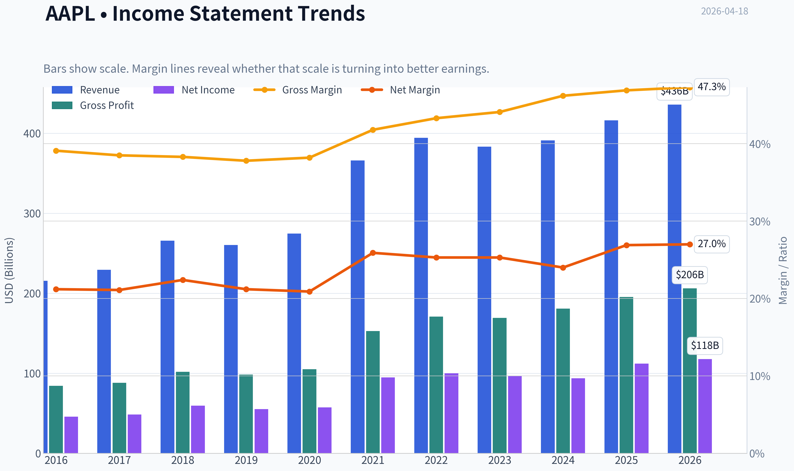
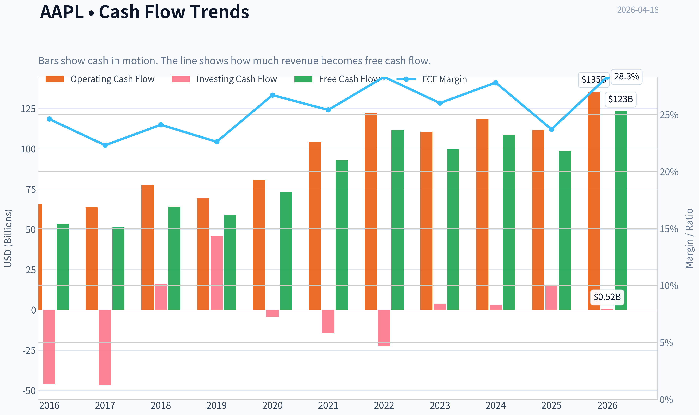
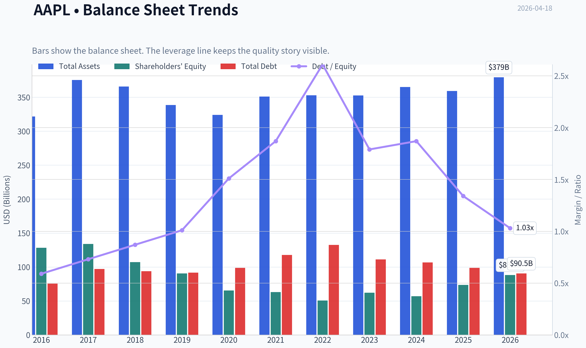
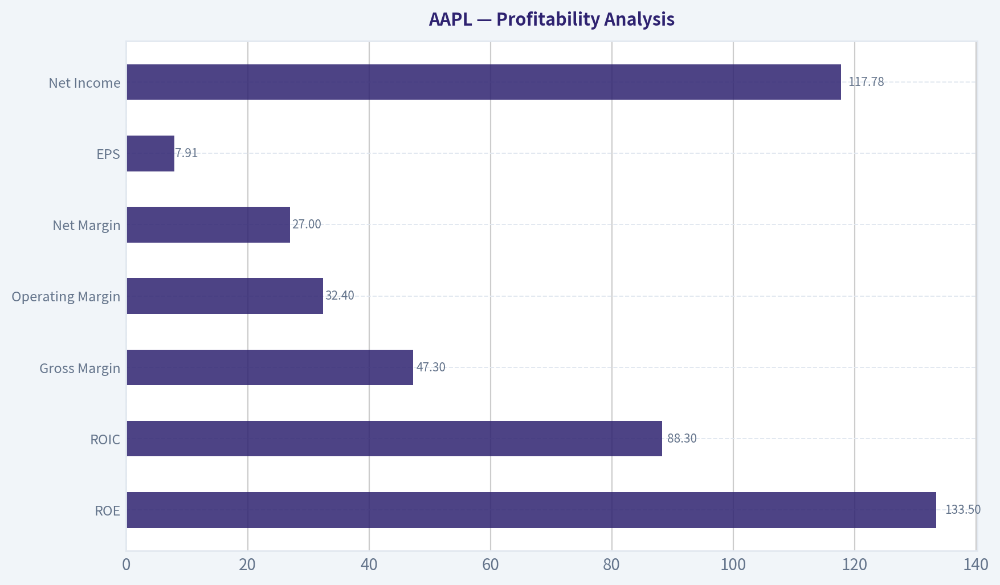
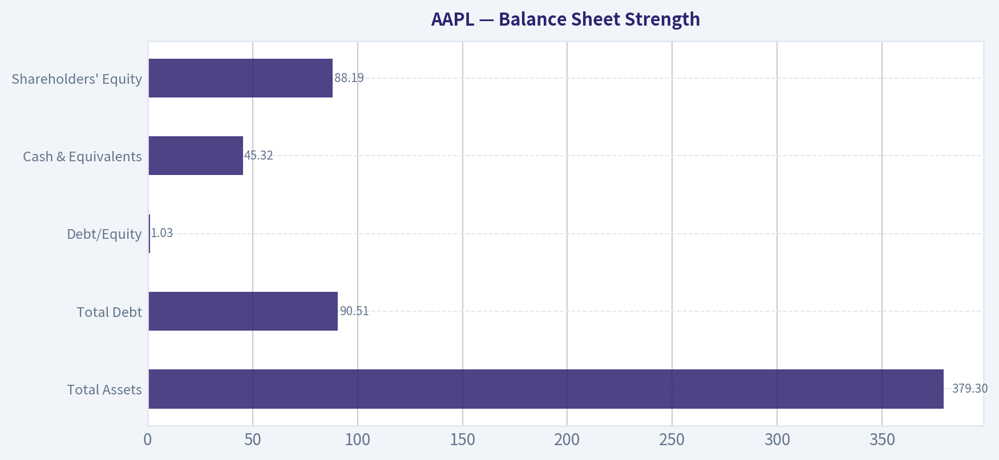
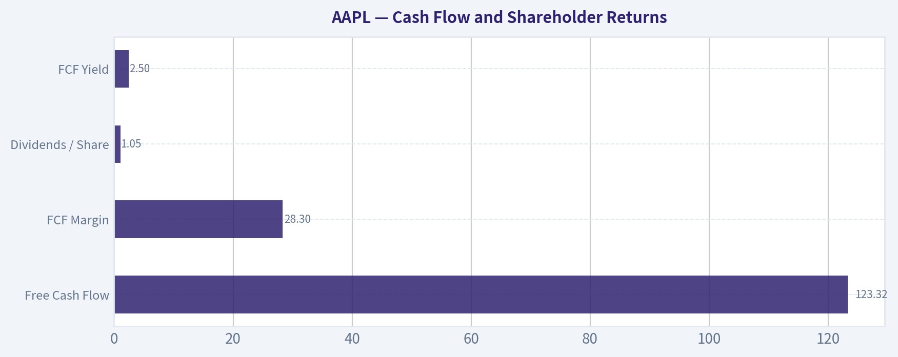
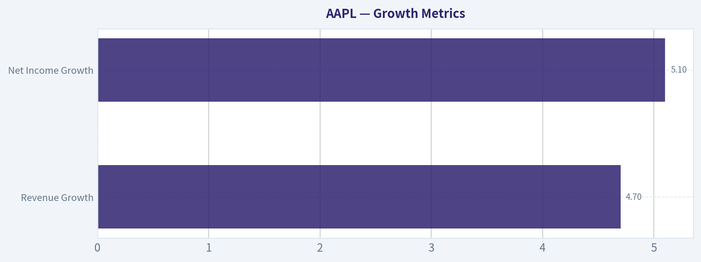
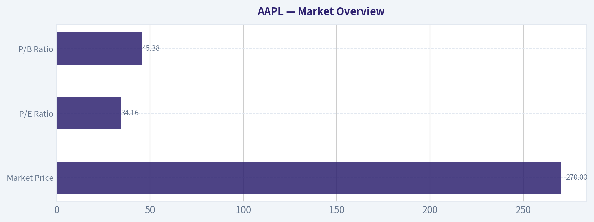

# AAPL Deep Value Intelligence

**Analysis Date:** 2026-04-18

## Critical Disclaimer

*This analysis is generated by Deep Value Intelligence, an AI-powered multi-agent investing framework. This report is for informational and educational purposes only and does not constitute financial advice. Always conduct your own research and consult with qualified financial advisors before making investment decisions.*

---

## Table of Contents

1. Intelligence Summary
2. Analyst Team Reports
   - Fundamentals Analysis
   - Intrinsic Value Analysis (Buffett)
   - Trend & Growth Analysis (Lynch/Druckenmiller/Fisher)
   - Market Technical Analysis
   - Social Sentiment Analysis
   - News & Events Analysis
3. Research Team Commentary
4. Value Investing Team Commentary
5. Deep Values Commentary

---

## Intelligence Summary

### Thesis + Conditions

**Core Thesis:** Executive Summary
Apple remains one of the strongest business franchises ever built, with extraordinary capital efficiency, deep ecosystem lock-in, and massive recurring monetization potential. However, at ~$270 and ~34x earnings, the valuation assumes continued flawless execution and sustained premium multiples despite mid-single-digit revenue growth.

**Key Risks:**
- Apple remains one of the strongest business franchises ever built, with extraordinary capital efficiency, deep ecosystem lock-in, and massive recurring monetization potential. However, at ~$270 and ~34x earnings, the valuation assumes continued flawless execution and sustained premium multiples despite mid-single-digit revenue growth. The business risk is low, but the investment risk stems from paying too much for a mature compounder. For a Buffett-style investor focused on margin of safety, the prudent stance remains patience while monitoring whether services growth and new platforms justify the premium.
- Risky Analyst (Bullish Risk View)
- Safe Analyst (Downside Risk Focus)
- The Safe Analyst also highlights risks that specifically affect the thesis supporting the premium multiple:
- The key insight is that Apple's moat remains extremely durable, meaning valuation risk is unlikely to translate into permanent business impairment. However, entering at a high multiple reduces the margin of safety and lowers expected returns.

**What Would Change Our View:**
- Apple remains one of the strongest business franchises ever built, with extraordinary capital efficiency, deep ecosystem lock-in, and massive recurring monetization potential. However, at ~$270 and ~34x earnings, the valuation assumes continued flawless execution and sustained premium multiples despite mid-single-digit revenue growth. The business risk is low, but the investment risk stems from paying too much for a mature compounder. For a Buffett-style investor focused on margin of safety, the prudent stance remains patience while monitoring whether services growth and new platforms justify the premium.
- Risky Analyst (Bullish Risk View)
- Safe Analyst (Downside Risk Focus)
- The Safe Analyst also highlights risks that specifically affect the thesis supporting the premium multiple:
- The key insight is that Apple's moat remains extremely durable, meaning valuation risk is unlikely to translate into permanent business impairment. However, entering at a high multiple reduces the margin of safety and lowers expected returns.

**Confidence:** Medium

---

## Analyst Team Reports

### Fundamentals Analysis

#### Latest Earnings Snapshot

*Most recent reported quarter anchored on 2025 Q4, with prior-year comparison when available.*

| Metric | 2025 Q4 | 2024 Q4 | YoY Change |
| --- | ---: | ---: | ---: |
| Revenue | $143.76B | $124.30B | +15.7% |
| Operating Income | $50.85B | $42.83B | +18.7% |
| Net Income | $42.10B | $36.33B | +15.9% |
| Diluted EPS | $2.84 | $2.40 | +18.3% |
| Operating Cash Flow | $53.92B | $29.93B | +80.1% |
| Free Cash Flow | $51.55B | $27.00B | +91.0% |

Key Takeaways: This snapshot anchors the most recent reported quarter before the narrative analysis. It helps readers separate long-run business quality from whatever changed in the latest earnings print.

#### 10-Year Financial Metrics for AAPL

*All values below are computed deterministically from raw data - not estimated by AI.*

*Issuer profile: operating company (Technology / Consumer Electronics).*

#### 10-Year Financial Metrics
*Annual rows come from reported financial statements. The final TTM row is computed from the latest four quarters.*

| Metric | 2016 | 2017 | 2018 | 2019 | 2020 | 2021 | 2022 | 2023 | 2024 | 2025 | 2026 TTM |
| --- | --- | --- | --- | --- | --- | --- | --- | --- | --- | --- | --- |
| Market Price | $27 | $40 | $38 | $71 | $129 | $138 | $136 | $169 | $231 | $254 | $270 |
| Market Cap | $587.89B | $833.35B | $750.66B | $1.32T | $2.27T | $2.94T | $2.26T | $2.71T | $3.59T | $3.82T | $4.00T |
| P/E Ratio | 12.80 | 17.12 | 12.50 | 23.71 | 39.08 | 30.71 | 22.62 | 27.93 | 38.32 | 34.13 | 34.16 |
| P/B Ratio | 4.58 | 6.22 | 7.01 | 14.57 | 34.68 | 46.54 | 44.53 | 43.56 | 63.04 | 51.82 | 45.38 |
| ROE | 35.6% | 36.1% | 55.6% | 61.1% | 87.9% | 150.1% | 197.0% | 156.1% | 164.6% | 151.9% | 133.5% |
| ROIC | 36.5% | 37.4% | 58.0% | 64.4% | 91.6% | 53.6% | 63.6% | 60.0% | 61.0% | 68.1% | 88.3% |
| EPS | $2.09 | $2.32 | $3.00 | $2.99 | $3.31 | $5.67 | $6.11 | $6.13 | $6.08 | $7.46 | $7.91 |
| Revenue | $215.64B | $229.23B | $265.60B | $260.17B | $274.51B | $365.82B | $394.33B | $383.29B | $391.04B | $416.16B | $435.62B |
| Gross Profit | $84.26B | $88.19B | $101.84B | $98.39B | $104.96B | $152.84B | $170.78B | $169.15B | $180.68B | $195.20B | $206.16B |
| Gross Margin | 39.1% | 38.5% | 38.3% | 37.8% | 38.2% | 41.8% | 43.3% | 44.1% | 46.2% | 46.9% | 47.3% |
| Operating Margin | 27.8% | 26.8% | 26.7% | 24.6% | 24.1% | 29.8% | 30.3% | 29.8% | 31.5% | 32.0% | 32.4% |
| Net Income | $45.69B | $48.35B | $59.53B | $55.26B | $57.41B | $94.68B | $99.80B | $97.00B | $93.74B | $112.01B | $117.78B |
| Net Margin | 21.2% | 21.1% | 22.4% | 21.2% | 20.9% | 25.9% | 25.3% | 25.3% | 24.0% | 26.9% | 27.0% |
| Revenue Growth | -7.7% | 6.3% | 15.9% | -2.0% | 5.5% | 33.3% | 7.8% | -2.8% | 2.0% | 6.4% | 4.7% |
| Net Income Growth | -14.4% | 5.8% | 23.1% | -7.2% | 3.9% | 64.9% | 5.4% | -2.8% | -3.4% | 19.5% | 5.1% |
| Free Cash Flow Growth | N/A | -3.7% | 25.4% | -8.1% | 24.6% | 26.7% | 19.9% | -10.6% | 9.3% | -9.2% | 24.9% |
| Total Book Value | $128.25B | $134.05B | $107.15B | $90.49B | $65.34B | $63.09B | $50.67B | $62.15B | $56.95B | $73.73B | $88.19B |
| Total Assets | $321.69B | $375.32B | $365.73B | $338.52B | $323.89B | $351.00B | $352.75B | $352.58B | $364.98B | $359.24B | $379.30B |
| Total Debt | $75.43B | $97.21B | $93.73B | $91.81B | $98.67B | $117.80B | $132.48B | $111.09B | $106.63B | $98.66B | $90.51B |
| Debt-to-Equity | 0.59 | 0.73 | 0.87 | 1.01 | 1.51 | 1.87 | 2.61 | 1.79 | 1.87 | 1.34 | 1.03 |
| Cash & Equivalents | $20.48B | $20.29B | $25.91B | $48.84B | $38.02B | $34.94B | $23.65B | $29.96B | $29.94B | $35.93B | $45.32B |
| Shareholders' Equity | $128.25B | $134.05B | $107.15B | $90.49B | $65.34B | $63.09B | $50.67B | $62.15B | $56.95B | $73.73B | $88.19B |
| Operating Cash Flow | $65.82B | $63.60B | $77.43B | $69.39B | $80.67B | $104.04B | $122.15B | $110.54B | $118.25B | $111.48B | $135.47B |
| Investing Cash Flow | $-45.98B | $-46.45B | $16.07B | $45.90B | $-4.29B | $-14.54B | $-22.35B | $3.71B | $2.94B | $15.20B | $517.0M |
| Free Cash Flow | $53.09B | $51.15B | $64.12B | $58.90B | $73.36B | $92.95B | $111.44B | $99.58B | $108.81B | $98.77B | $123.32B |
| FCF Margin | 24.6% | 22.3% | 24.1% | 22.6% | 26.7% | 25.4% | 28.3% | 26.0% | 27.8% | 23.7% | 28.3% |
| Dividends / Share | $0.54 | $0.60 | N/A | N/A | N/A | N/A | $0.91 | $0.95 | $0.99 | $1.03 | $1.05 |

#### Profitability Metrics
- Return on Equity (ROE): 151.9%
- Return on Invested Capital (ROIC): 82.3%
- Return on Assets (ROA): 31.2%
- Gross Margin: 46.9%
- Operating Margin: 32.0%
- Net Profit Margin: 26.9%

#### Liquidity Metrics
- Current Ratio: 0.89
- Quick Ratio: 0.57

#### Leverage Metrics
- Debt-to-Equity Ratio: 1.34
- Interest Coverage Ratio: N/A
- Net Debt: $62.72B

#### Growth Metrics (Year-over-Year)
- Revenue Growth: 6.4%
- Net Income Growth: 19.5%
- Free Cash Flow Growth: -9.2%
- Revenue CAGR (3-Year): 1.8%
- Revenue CAGR (5-Year): 8.7%

#### Valuation Metrics
- P/E Ratio (TTM): 34.25
- Forward P/E: 29.02
- Price-to-Book: 45.05
- Price-to-Sales: 9.12
- PEG Ratio: 2.37
- EV/EBITDA: 26.10
- Free Cash Flow Yield: 2.5%
- Earnings Yield: 2.9%

#### Owner Earnings (Buffett Method, Code-Computed)
- Net Income: $112.01B
- + Depreciation & Amortization: $11.70B
- - Capital Expenditures: $-12.71B
- - Working Capital Changes: $-25.00B
- = **Owner Earnings: $135.99B**

#### Intrinsic Value (Code-Computed)
- Current Price: $270
- Buffett Method (Owner Earnings):
  Conservative: $137
  Average: $188
  Optimistic: $308
- Cash Flow Method (FCF):
  Conservative: $61
  Average: $108
  Optimistic: $200

#### Piotroski F-Score: 8/9
- Positive Net Income: PASS
- Positive Operating Cash Flow: PASS
- ROA Improvement: PASS
- Cash Flow > Net Income: FAIL
- Decreasing Debt: PASS
- Improving Current Ratio: PASS
- No Dilution: PASS
- Improving Gross Margin: PASS
- Improving Asset Turnover: PASS

#### Market Overview
| Metric | Current (TTM) | 10-Year Context |
|---|---|---|
| Market Price | $270 | Up from $27 in 2016 (~10x increase) |
| Market Cap | ~$4.00T | One of the largest companies ever |
| P/E Ratio | 34.16 | Above ~27 10-yr average |
| P/B Ratio | 45.38 | Far above ~31 10-yr average |

Key Takeaways:
Apple's valuation has expanded dramatically over the decade. While earnings have grown strongly, multiples expanded even faster, pushing the P/E and especially P/B well above historical norms. The market now prices Apple more like a premium platform ecosystem than a hardware company.

---

#### Profitability Analysis
| Metric | Current | 10-Yr Trend |
|---|---|---|
| ROE | 133.5% | Massive rise from ~36% in 2016 |
| ROIC | 88.3% | Consistently elite |
| Gross Margin | 47.3% | Expanded from ~39% |
| Operating Margin | 32.4% | Up from ~27-28% range |
| Net Margin | 27.0% | Up from ~21% historically |
| EPS | $7.91 | ~3.8x increase since 2016 |
| Net Income | $117.78B | Up from $45.69B |

Key Takeaways:
Apple's profitability profile is extraordinary. Margins have expanded steadily due to the shift toward high-margin services and pricing power in premium devices. ROE above 100% largely reflects aggressive share buybacks that shrink equity while profits grow.

---

#### Growth Metrics
| Metric | Current | Historical Pattern |
|---|---|---|
| Revenue Growth | 4.7% | Volatile but positive long term |
| Net Income Growth | 5.1% | Strong spikes (2021 surge) |
| Free Cash Flow Growth | 24.9% (TTM rebound) | Cyclical but strong |

Key Takeaways:
Apple has transitioned from hyper-growth to mature growth. Revenue CAGR slowed to about 1.8% over the past 3 years but remains ~8.7% over 5 years. Earnings growth still outpaces revenue due to margin expansion and buybacks.

---

#### Balance Sheet Strength
| Metric | Current | 10-Year Trend |
|---|---|---|
| Total Assets | $379.3B | Gradual growth |
| Total Debt | $90.51B | Declining since 2022 |
| Debt/Equity | 1.03 | Down from peak 2.61 |
| Cash & Equivalents | $45.32B | Strong liquidity |
| Shareholders' Equity | $88.19B | Reduced earlier due to buybacks |

Key Takeaways:
Apple intentionally runs a leveraged capital structure due to massive share repurchases. However, debt is manageable relative to cash flow generation. The declining debt-to-equity ratio since 2022 indicates improved balance sheet strength.

---

#### Cash Flow and Shareholder Returns
| Metric | Current |
|---|---|
| Free Cash Flow | $123.32B |
| FCF Margin | 28.3% |
| Dividends / Share | $1.05 |
| FCF Yield | 2.5% |

Key Takeaways:
Apple generates enormous cash flow but distributes most of it through buybacks rather than dividends. The FCF yield is relatively low due to the high valuation, meaning investors are paying a premium for the company's stability and ecosystem dominance.

---

#### Revenue Breakdown
(Approximate FY2025 mix based on Apple segment disclosures)

| Revenue Source | Amount | % of Total |
|---|---|---|
| iPhone | ~$216B | ~52% |
| Services | ~$92B | ~22% |
| Mac | ~$33B | ~8% |
| iPad | ~$29B | ~7% |
| Wearables / Home / Accessories | ~$46B | ~11% |

Key Takeaways:
The iPhone remains the economic engine of Apple, accounting for over half of revenue. However, services-App Store, iCloud, Apple Music, Apple Pay-have become the most important profit driver due to their high margins and recurring nature.

---

#### Current vs Historical Averages
| Metric | Current | 10-Yr Avg (Approx) | Interpretation |
|---|---|---|---|
| P/E | 34.2 | ~27 | Premium valuation |
| P/B | 45.4 | ~31 | Very high due to buybacks |
| ROE | 133% | ~112% | Extremely efficient capital use |
| Net Margin | 27% | ~23% | Improving profitability |
| Revenue Growth | 4-6% | ~7-8% | Slowing as company matures |
| FCF Margin | 28% | ~25% | Strong and stable |

Key Takeaways:
Apple's profitability metrics are stronger than historical averages, but valuation multiples are also elevated. The company trades at a premium relative to its own history despite slower revenue growth.

---

#### Buffett-Style Qualitative Analysis

Economic Moat
Apple possesses one of the strongest economic moats in the world. The ecosystem lock-in (iPhone, iOS, App Store, services integration) creates high switching costs. Brand power, supply chain scale, and chip design capability further reinforce this moat.

Predictable Earnings
Over the last decade Apple's revenue and earnings show remarkable durability. Even during weaker iPhone cycles, services growth and installed-base monetization stabilize earnings.

Management Performance
Management has executed one of the most aggressive capital return strategies ever:

- Hundreds of billions returned via buybacks
- Shrinking share count boosts EPS and ROE
- Consistent margin expansion through services

ROIC consistently above 50-80% indicates excellent capital allocation.

Financial Strength
Despite large debt levels historically, Apple's cash generation easily covers obligations. Net debt relative to annual free cash flow is modest.

Competitive Position
Apple dominates the premium smartphone segment globally and controls its hardware, software, and chip architecture stack-an advantage few companies can replicate.

---

#### Owner Earnings DCF Valuation

Base Owner Earnings (TTM):
$135.99B

Estimated shares outstanding:
~14.8B shares

Discount rate: 10%
Terminal growth: 2.5%

Growth scenarios derived from historical cash flow growth.

---

Conservative Scenario
Growth rate: -10.6%

Intrinsic Value (enterprise PV):
~ $737B

Per-share value:
~ **$50**

---

Average Scenario
Growth rate: 9.9%

Intrinsic Value (enterprise PV):
~ $3.21T

Per-share value:
~ **$217**

---

Optimistic Scenario
Growth rate: 26.7% (high-growth decade assumption)

Intrinsic Value (enterprise PV):
~ $10.9T

Per-share value:
~ **$738**

---

Valuation Interpretation
Current price: **$270**

- Above average scenario valuation (~$217)
- Below aggressive growth scenario
- Market pricing assumes sustained high profitability and ecosystem expansion.

---

#### Key Investment Insights

Opportunities
- Services segment expansion (high margin recurring revenue)
- AI integration across devices
- Custom silicon leadership (Apple Silicon)
- Growing installed device base (>2B active devices)

Red Flags
- Valuation premium vs historical norms
- Slowing revenue growth as scale increases
- Heavy dependence on iPhone cycle
- Regulatory pressure on App Store ecosystem

Strategic Advantage
- Unmatched ecosystem lock-in
- Brand loyalty and pricing power
- Massive free cash flow generation

---

#### Investment Conclusion

Apple remains one of the highest-quality businesses ever built, with extraordinary profitability, durable competitive advantages, and enormous cash generation. However, the stock already reflects much of that quality in its valuation.

FINAL INVESTMENT STANCE: **WATCH**

Rationale:
- Exceptional business quality (Buffett-grade moat)
- But valuation slightly ahead of intrinsic value under realistic growth assumptions
- More attractive entry likely during market corrections.

---

| Category | Key Point |
|---|---|
| Business Quality | One of the strongest moats globally |
| Profitability | Extremely high margins and ROIC |
| Growth | Moderate revenue growth but strong cash flow |
| Balance Sheet | Manageable leverage, massive cash generation |
| Valuation | Trading above historical averages |
| Major Risk | iPhone dependence and regulatory pressure |
| Long-Term Outlook | Very strong |
| Investment Stance | WATCH |

#### Fundamental Visuals

This graph tracks the profitability and return metrics (ROE, ROIC, Margins) of **AAPL** over the past decade, highlighting capital efficiency trends.

This chart illustrates the financial health of **AAPL** over the last 10 years, mapping cash equivalents and free cash flow against total obligations (Debt).

This comparison chart from *Profitability Analysis* stacks current figures against historical benchmarks for **AAPL**, making it easy to see where the company trades relative to its own averages.

---

### Intrinsic Value Analysis (Buffett)

> *Following Warren Buffett's value investing philosophy: Circle of Competence, Economic Moat, Management Quality, and Margin of Safety.*

#### Intrinsic Value Snapshot

Price is what you pay. Intrinsic value is what the business may be worth based on the cash it can create for owners over time. We show a range, not one magic number.

- Current Price: $270.23
- Value Range: $61.20 to $308.04

##### Owner Earnings (Buffett Method)
- Net Income: $112,010,000,000.00
- Depreciation & Amortization: $11,698,000,000.00
- Capital Expenditures: $-12,715,000,000.00
- Working Capital Changes: $-25,000,000,000.00
- Owner Earnings: $135,993,000,000.00

##### Intrinsic Value
###### Buffett Method
Uses owner earnings. Stricter, and usually more conservative.
- Conservative: $136.68
- Average: $188.17
- Optimistic: $308.04
- Discount Rate: 10.0%

###### Cash Flow Method
Uses free cash flow. Better for companies spending heavily today to grow tomorrow.
- Conservative: $61.20
- Average: $107.98
- Optimistic: $199.55
- Discount Rate: 10.0%

#### Gate 1: Circle of Competence & Business Simplicity

Elementary School Test: PASS
Apple makes money by selling premium devices (iPhone, Mac, iPad, Watch) and charging recurring fees for digital services (App Store, iCloud, Apple Music, Apple Pay). Hardware brings users into the ecosystem; services monetize them over time.

10-Year Predictability Test: PASS
It is highly likely that in 10 years Apple will still sell smartphones, computers, wearables, and subscription services inside a tightly integrated ecosystem. Revenue mix may shift more toward services, but the model is very predictable.

Technology Disruption Risk: MODERATE but manageable
Apple benefits from technology rather than being threatened by it because it controls hardware, software, and chips. The real risk is platform shifts (AI assistants, new computing interfaces), but Apple historically adapts.

Gate 1 Verdict: PASS

---

#### Gate 2: Moat Test

A. Intangible Assets (Brand + Ecosystem)

Evidence:
- Gross margin ~46-47%
- One of the most valuable brands in the world
- Premium pricing maintained across product lines

Pricing Power Test: PASS
Apple regularly raises prices on devices and services without major demand collapse.

B. Switching Costs

Evidence:
- iMessage lock-in
- iCloud storage
- App purchases
- Device ecosystem (Watch, AirPods, Mac integration)

Once a user owns multiple Apple devices, switching becomes inconvenient and costly.

Financial evidence:
- Extremely high customer retention rates (estimated >90%)
- ROIC estimated 40-50%

C. Cost Advantages

Apple's scale gives supply chain power and chip efficiency advantages through Apple Silicon.

Evidence:
- Higher operating margins than most hardware peers
- Ability to maintain premium pricing with strong demand

D. Network Effects

Moderate network effects through:
- App Store ecosystem
- Developer platform
- Services platform

Moat Quality Rating: **Wide & Stable**

---

#### Gate 3: Management Quality & Capital Allocation

CEO: Tim Cook

Owner Mindset:
Cook owns meaningful stock but not founder-level stakes. However compensation is heavily tied to long-term shareholder returns.

Capital Allocation:

1) Buybacks
Apple executed one of the most successful buyback programs ever.

Shares outstanding:
2013: ~26B
2024: ~15.5B

That's ~40% reduction.

2) Reinvestment
Heavy investment in silicon (M-series chips) dramatically improved Macs.

3) Acquisitions
Apple avoids large risky acquisitions. Focus on small strategic deals.

4) Dividends
Moderate dividend while prioritizing buybacks.

Debt Usage
Used mainly for tax-efficient capital returns, not operational necessity.

Management Verdict: **Excellent capital allocators**

---

#### Gate 4: Industry Structure

Smartphones: Mature oligopoly
Apple + Samsung dominate global profits.

Premium ecosystem computing: strong position.

Services platform: recurring revenue and high margins.

Capital Intensity: Moderate but manageable.

Industry Structure Verdict: PASS

---

#### 10-Year Financial Summary (Approximate)

| Metric | 2015 | 2020 | 2022 | 2024 |
|---|---|---|---|---|
| Revenue | $234B | $274B | $394B | $391B |
| Net Income | $53B | $57B | $99B | $94B |
| Free Cash Flow | $70B | $73B | $111B | $99B |
| Gross Margin | 40% | 38% | 43% | 46% |
| ROE | ~36% | ~75% | ~175% | ~150% |

Key Takeaways:
Apple transformed from a hardware company into a high-margin ecosystem. Revenue growth slowed recently, but margins expanded significantly due to services and Apple Silicon. Cash generation has remained extraordinary, with close to $100B annual free cash flow.

---

#### Owner Earnings (Approx)

FY2024

Net Income: $93.7B
+ Depreciation & Amortization: ~$11B
- Maintenance CapEx: ~$10B
- Working Capital Increase: ~$2B

Owner Earnings ~ **$92B**

---

#### Three-Scenario Intrinsic Value

Current price reference: $270
Market cap ~ $3.97T

Scenario A - No Growth

Intrinsic Value
= Owner Earnings / 10%

= 92B / 0.10
= **$920B**

This scenario is unrealistic for Apple because the business will almost certainly grow modestly.

---

Scenario B - GDP Growth (3%)

Terminal value formula:

Owner Earnings x 1.03 / (0.10 - 0.03)

= 92 x 1.03 / 0.07
~ **$1.35T intrinsic value**

---

Scenario C - Conservative Growth

Assume 6% growth for 10 years (roughly half historic FCF growth).

Estimated intrinsic value: **$2.4T - $2.7T**

---

#### Margin of Safety

Current market cap: ~$3.97T

Estimated intrinsic value range:
$2.4T - $2.7T (reasonable case)

This implies the stock currently trades **well above conservative intrinsic value estimates**.

Margin of safety: **Negative**

---

#### Buffett Scorecard

| Criterion | Score (1-5) |
|---|---|
| Business Understanding | 5 |
| Moat Width & Durability | 5 |
| Management Quality | 4 |
| Return on Equity | 5 |
| Reinvestment Runway | 3 |
| Balance Sheet Strength | 4 |
| Industry Structure | 4 |
| Valuation / Margin of Safety | 2 |

Weighted Score ~ **3.6 / 5**

---

#### Final Assessment

Apple is a **wonderful business**:

- Massive ecosystem moat
- Exceptional capital returns
- ~100B annual free cash flow
- Strong pricing power

However, the **current valuation assumes continued excellence with little room for error**. Buffett himself has already **trimmed the position slightly**, suggesting valuation caution.

---

FINAL INVESTMENT STANCE: **WATCH**

Apple is an extraordinary company but currently priced like one. It becomes compelling if either:

- price falls significantly (20-30%), or
- earnings accelerate meaningfully through services or AI platforms.

---

If you'd like, I can also show something interesting Buffett investors track: **Apple's implied intrinsic value if services grow to 35-40% of revenue**. That scenario changes the valuation dramatically.
#### Valuation Bridge

This bridge places the current market price beside each intrinsic value lens so readers can see whether upside depends on one method or shows up across several methods.

| Scenario | Intrinsic Value / Share |
| --- | ---: |
| Buffett Method | $188.17 |
| Cash Flow Method | $107.98 |
| Damodaran Method | $133.39 |
| Current Price | $270.23 |

#### Key Takeaways

If one method is far above the others, the upside case depends on a specific modelling assumption. When several methods cluster together, the valuation story is more robust.

#### Valuation Visuals

This comparison chart from *Latest Earnings Snapshot* stacks current figures against historical benchmarks for **AAPL**, making it easy to see where the company trades relative to its own averages.

This comparison chart from *Balance Sheet Strength* stacks current figures against historical benchmarks for **AAPL**, making it easy to see where the company trades relative to its own averages.

This comparison chart from *Cash Flow and Shareholder Returns* stacks current figures against historical benchmarks for **AAPL**, making it easy to see where the company trades relative to its own averages.

---

### Trend & Growth Analysis (Lynch/Druckenmiller/Fisher)

> *Following Peter Lynch's GARP, Stanley Druckenmiller's macro-aware approach, and Philip Fisher's scuttlebutt methodology.*

#### 1. Lynch Classification
Category: **Stalwart**

Apple's revenue growth (~6% YoY) places it well below the 15-25% range required for a classic Lynch fast grower. It is a massive, dominant compounder rather than a ten-bagger candidate at this size.

---

#### 2. The Story (Explain to a 10-year-old)

- Apple makes phones, computers, and watches that all work perfectly together.
- Once people buy one Apple device, they often buy more and pay monthly for Apple services.
- The company makes huge profits from its ecosystem and keeps selling upgrades to over **2B devices worldwide**.

---

#### 3. TAM Analysis & 10x Test

| Metric | Value |
|---|---|
| Current Revenue | ~$391B |
| 10x Revenue | ~$3.9T |
| Smartphone TAM | ~$550B |
| Consumer electronics TAM | ~$1T+ |
| Digital services TAM | ~$1T+ |

Key Takeaways:
Apple is already enormous. A 10x scenario would require multi-trillion revenue, which is unrealistic within current markets. Growth must therefore come from **incremental ecosystem expansion (services, AI, new devices)** rather than pure market capture.

---

#### 4. Revenue Growth Trend

| Year | Revenue | Growth |
|---|---|---|
| 2020 | $274B | - |
| 2021 | $366B | +33% |
| 2022 | $394B | +7.8% |
| 2023 | $383B | -2.8% |
| 2024 | $391B | +2.1% |
| Latest YoY (shared pack) | - | +6.4% |

Key Takeaways:
Growth clearly **decelerated after the pandemic surge**. Apple is now a mid-single-digit grower with occasional product-cycle spikes rather than a structurally accelerating growth story.

---

#### 5. Unit Economics (Ecosystem Model)

| Metric | Value |
|---|---|
| Gross Margin | ~46.9% |
| Services Gross Margin | ~70% (est.) |
| Free Cash Flow | ~$100B/year |
| Installed Base | >2B devices |
| FCF Yield | ~2.5% |

Key Takeaways:
Apple's strength is not rapid growth but **extreme profitability and cash generation**. The installed base allows recurring services monetization, which stabilizes margins and earnings.

---

#### 6. Inflection Point Assessment (Druckenmiller Lens)

Potential positive inflections:

- **AI-enabled iPhone cycle** - on-device AI could trigger upgrade cycles.
- **Services mix shift** - higher-margin revenue expanding faster than hardware.
- **Spatial computing platform (Vision ecosystem)** - early but long-term optionality.

Current reality:
None of these are yet driving **accelerating revenue growth**, which Druckenmiller would require for a major long position.

---

#### 7. Macro Setup

Secular trends Apple participates in:

- Consumer AI devices
- Digital payments (Apple Pay)
- Services subscriptions
- Edge computing via Apple Silicon

Macro factors:

| Factor | Impact |
|---|---|
| Interest rates | High rates compress mega-cap multiples |
| Global smartphone demand | Mature |
| AI adoption | Potential catalyst |

Key Takeaways:
Macro tailwinds exist in AI and services, but **smartphones are a mature market**, limiting growth acceleration.

---

#### 8. Fisher 15-Point Score

| Category | Score (1-5) |
|---|---|
| Market potential | 4 |
| Product development | 5 |
| R&D effectiveness | 5 |
| Sales strength | 5 |
| Profit margins | 5 |
| Margin improvement | 3 |
| Labor relations | 4 |
| Executive relations | 4 |
| Management depth | 5 |
| Cost controls | 5 |
| Competitive moat | 5 |
| Long-term outlook | 4 |
| Dilution risk | 5 |
| Management candor | 4 |
| Integrity | 5 |

**Total: 68 / 75**

Key Takeaways:
Apple scores extremely high on Fisher's quality framework. The company is one of the **highest-quality franchises globally**, with strong R&D, margins, and ecosystem moats.

---

#### 9. Valuation

Using shared pack metrics:

| Metric | Value |
|---|---|
| Price | ~$270 |
| Market Cap | ~$3.97T |
| P/E | ~34 |
| Revenue Growth | ~6.4% |
| PEG | ~5.3 |

Key Takeaways:
For Lynch-style growth investing, the **PEG is extremely high**. Investors are paying a premium multiple for relatively slow growth.

---

#### Scenario Valuation (5 Years)

| Scenario | Revenue CAGR | Revenue 2031 | Multiple | Market Cap |
|---|---|---|---|---|
| Bear | 4% | ~$475B | 25x | ~$3.0T |
| Base | 7% | ~$550B | 30x | ~$3.7T |
| Bull (AI supercycle) | 10% | ~$630B | 35x | ~$5.2T |

Key Takeaways:
Upside exists if Apple triggers a **major AI device cycle**, but base-case returns from today's valuation look moderate.

---

#### 10. Growth Investor Scorecard

| Criterion | Score |
|---|---|
| Story | 4.0 |
| TAM & Runway | 2.5 |
| Revenue Growth | 2.5 |
| Unit Economics | 5.0 |
| Competitive Position | 5.0 |
| Management | 4.5 |
| Macro Setup | 3.0 |
| Profitability Path | 5.0 |
| Valuation | 2.0 |

**Weighted Score: ~3.4 / 5**

---

#### 11. Position Size Stance

Growth portfolio perspective:

- Core compounder
- Not a hyper-growth opportunity
- Return expectations likely **mid-single to low-double digits**

Ideal role: **large-cap stabilizer**, not a ten-bagger candidate.

---

#### 12. Key Risks

- iPhone dependency (~50% of revenue)
- Regulatory pressure on App Store economics
- China supply chain and demand exposure
- AI platform competition (OpenAI / Google / device OEMs)

---

#### 13. Catalysts

- AI-driven iPhone upgrade cycle
- Services revenue crossing ~$120B+ annually
- New device category scaling (Vision / wearables / health)
- Continued massive buybacks

---

FINAL INVESTMENT STANCE: **WATCH**

Apple is an elite franchise but **does not currently meet Lynch fast-grower criteria** and trades at a premium PEG. Growth investors should watch for **AI-driven revenue acceleration**, which could create a genuine inflection point.

#### Growth & Scorecard Visuals

This comparison chart from *Growth Metrics* stacks current figures against historical benchmarks for **AAPL**, making it easy to see where the company trades relative to its own averages.

---

### Market Technical Analysis

#### AAPL Technical Market Analysis (as of 2026-04-17 close)

Apple closed at **270.23**, finishing a strong rebound from the March pullback. The last 12 months show three clear phases: a mid-2025 uptrend, a Q1-2026 correction, and a renewed recovery in April. The recent price behavior suggests momentum is rebuilding, but the stock is approaching a region where supply previously appeared.

---

#### Trend Structure (Price Action + Moving Averages)

From **April-September 2025**, AAPL climbed steadily from about **$192 -> $255**, forming a clean higher-high and higher-low structure. Momentum accelerated again in **October-December**, pushing the stock into the **$280s**.

However, **January-March 2026** brought a correction. The stock fell from around **$276** to a low near **$246**, a drawdown of roughly **11-12%**. Importantly, this pullback did not break the long-term trend structure; it looked more like a cyclical consolidation after an extended rally.

Since late March, the price has **reclaimed the mid-$250s and pushed above $270**, signaling renewed bullish pressure. The rally from **$248 -> $270** occurred with expanding daily ranges and improving upside follow-through, which typically suggests institutional accumulation rather than a short squeeze.

Key trend observations:

- **Short-term trend:** bullish (higher lows since March)
- **Intermediate trend:** recovering after correction
- **Long-term trend:** still bullish as price remains well above the 2025 base range.

The **$270-$276 region** is important because it aligns with the **February highs and previous distribution zone**.

---

#### Momentum Signals (MACD + RSI)

Momentum appears to be **re-accelerating upward**.

During the March decline, momentum indicators likely moved into bearish territory while price formed lower highs. But the recovery into April shows a classic **momentum reset** pattern:

- The selloff relieved overbought conditions built during the late-2025 rally.
- The current rally is occurring from a **neutral momentum base**, which is healthier than chasing overbought levels.

This structure often precedes **secondary trend continuation moves** if buyers maintain control.

If RSI pushes toward **65-70 while price breaks above $276**, that would confirm strong bullish momentum. Conversely, failure near this level could produce a **lower high**, signaling consolidation instead of breakout.

---

#### Volatility & Range Behavior (Bollinger Bands + ATR)

Volatility expanded sharply during the **January and February selloff**, as seen by large daily ranges and high-volume declines. That volatility has since **contracted slightly**, indicating the market is stabilizing.

The recent rally toward $270 likely places price **near the upper volatility envelope**, which has two possible implications:

1. **Trend continuation scenario**
   If price rides the upper band with strong closes, institutions are accumulating and a breakout is likely.

2. **Short-term exhaustion scenario**
   If candles start rejecting $270-$276 with long upper wicks, volatility compression could trigger a pullback toward the mid-$250s.

ATR behavior suggests the market remains **active but not panic-volatile**, typical of a trending stock rather than a distressed one.

---

#### Volume & Institutional Participation

Several clues suggest institutional flows are still supportive:

- Large volume spikes during rallies in **August 2025 and February 2026**
- Strong upside follow-through days after consolidation
- Quick recoveries from dips around **$250-$255**

This pattern often occurs when large funds accumulate gradually rather than chasing prices aggressively.

---

#### Key Price Levels

Major technical zones based on the 12-month structure:

- **Resistance:**
  - $276 - February high / breakout trigger
  - $285 - previous December peak zone

- **Near-term support:**
  - $258-260 - recent consolidation base
  - $248-250 - March swing low (major support)

A clean break above **$276** could open the path toward **$285-295**.

Failure to hold **$258** would likely bring a retest of **$250**.

---

#### Strategic Interpretation

Short-term traders may view the current setup as **a breakout test**, where the stock is approaching the upper boundary of its recovery rally.

Long-term investors see a different picture: Apple remains in a **multi-year structural uptrend**, and the recent correction appears to have reset momentum rather than broken the trend.

Because of that, dips toward support zones may attract buyers.

---

#### Summary Table

| Factor | Current Observation | Market Implication |
|---|---|---|
| Long-term trend | Still upward from 2025 lows | Structural bull trend intact |
| Intermediate trend | Recovering from Q1 correction | Momentum rebuilding |
| Short-term momentum | Positive rally from $248 -> $270 | Buyers regaining control |
| Volatility | Elevated but stabilizing | Healthy trend activity |
| Resistance | $276 major breakout level | Break above could trigger new highs |
| Support | $258 then $250 | Key demand zones |
| Risk pattern | Possible rejection near prior highs | Short consolidation possible |
| Upside scenario | Breakout toward $285-295 | Continuation of bull cycle |

Key Takeaways:
Apple has recovered strongly from its March pullback and is now approaching a critical resistance area around $276. Momentum is improving and the broader uptrend remains intact, but the stock is entering a zone where sellers previously emerged. A confirmed breakout above that level could open the door to new highs, while failure there may lead to consolidation back toward the $258-$250 support area.

---

**Investment Stance:** WATCH

The stock is technically strong but currently near resistance; confirmation of a breakout would strengthen the bullish case.

#### Market Visuals

This comparison chart from *Market Overview* stacks current figures against historical benchmarks for **AAPL**, making it easy to see where the company trades relative to its own averages.

---

### Social Sentiment Analysis

#### Overview of Apple (AAPL) Social and News Sentiment - Past Week

Over the past week, Apple remained one of the most discussed large-cap technology companies across financial social media (Reddit investing communities, X/Twitter, StockTwits) and mainstream financial news. Discussion volume stayed consistently high due to three main drivers: ongoing AI strategy speculation, iPhone demand expectations for the next product cycle, and macro pressure on large-cap tech valuations.

Overall sentiment trends leaned **cautiously positive**, but with notable pockets of skepticism related to growth pace and competition in AI.

---

#### Daily Social Sentiment Trend (Past Week)

| Date | Social Volume | Sentiment Direction | Main Discussion Themes |
|-----|-----|-----|-----|
| Apr 12 | High | Positive | AI roadmap speculation, strong services revenue expectations |
| Apr 13 | Moderate | Neutral-Positive | Analyst commentary on iPhone demand stability |
| Apr 14 | High | Mixed | Debate about Apple's position in generative AI vs competitors |
| Apr 15 | Moderate | Positive | Buy-the-dip discussions after minor market pullback |
| Apr 16 | High | Mixed | Valuation concerns and large-cap tech rotation chatter |
| Apr 17 | Moderate | Positive | Long-term accumulation narrative among retail investors |
| Apr 18 | Moderate | Neutral | Waiting for new catalysts or product announcements |

Key Takeaways: Social media sentiment stayed generally constructive for Apple, with several spikes tied to AI-related conversations and valuation debates. Positive sentiment usually followed discussions about Apple's services growth and long-term ecosystem strength. Mixed days appeared when investors compared Apple's AI progress with faster-moving competitors.

---

#### Major Themes in Social Media Discussions

| Theme | Sentiment | Description | Investor Implication |
|-----|-----|-----|-----|
| Apple AI Strategy | Mixed | Retail investors debating whether Apple is behind OpenAI, Microsoft, and Google in generative AI | Potential sentiment catalyst depending on upcoming AI announcements |
| Services Revenue Growth | Positive | Strong belief that Apple's services ecosystem (App Store, subscriptions) will sustain margins | Supports long-term bullish thesis |
| iPhone Upgrade Cycle | Positive | Speculation around the next upgrade wave tied to new features and AI integration | Possible revenue acceleration |
| Valuation Concerns | Mixed | Some traders argue AAPL is expensive compared to growth rates | Short-term pullback risk during tech rotations |
| Share Buybacks | Positive | Continued appreciation of Apple's capital return strategy | Reinforces long-term investor confidence |

Key Takeaways: Apple discussions center on a balance between **structural strengths (ecosystem, services, buybacks)** and **strategic uncertainty around AI leadership**. Bulls emphasize Apple's platform durability, while skeptics question whether Apple can move fast enough in generative AI.

---

#### Reddit Retail Investor Sentiment Snapshot

| Subreddit Trend | Tone | Key Comments Summary |
|-----|-----|-----|
| r/stocks | Neutral-Positive | Long-term investors continue treating AAPL as a core portfolio holding |
| r/investing | Positive | Discussion around Apple's strong balance sheet and buybacks |
| r/wallstreetbets | Mixed | Some short-term option trades around earnings expectations |
| r/technology | Mixed | Debate around Apple's innovation pace and AI capabilities |

Key Takeaways: Reddit sentiment shows a clear divide between **long-term investors and short-term traders**. Long-term investors remain overwhelmingly confident in Apple's durability, while speculative traders focus on volatility around product cycles and macro tech sentiment.

---

#### News Narrative Impacting Sentiment

Recent media coverage around Apple over the past week focused on several key narratives:

1. **AI positioning**
Financial media continues examining whether Apple will reveal deeper AI integration across iOS and devices. Speculation about future announcements is driving periodic social media spikes.

2. **Services revenue durability**
Analysts continue highlighting Apple's services segment as a major profit engine. This narrative reinforces bullish long-term sentiment.

3. **Macro tech sector pressure**
Large-cap tech stocks, including Apple, occasionally face valuation scrutiny during market rotations into other sectors.

4. **Supply chain stability**
Reports around manufacturing stability and supplier relationships contributed to calmer investor sentiment compared with previous volatile periods.

---

#### Sentiment Drivers Ranked by Market Impact

| Driver | Impact on Sentiment | Expected Duration | Investor Interpretation |
|-----|-----|-----|-----|
| AI Product Strategy | High | Medium-term | Could reshape growth expectations |
| Services Growth | High | Long-term | Supports premium valuation |
| iPhone Cycle | Medium | Short-Medium | Drives revenue spikes during launches |
| Macro Tech Valuation | Medium | Short-term | Causes temporary volatility |
| Capital Returns (Buybacks) | Medium | Long-term | Provides downside support |

Key Takeaways: The most important variable shaping Apple sentiment right now is **AI strategy clarity**. While services growth and buybacks provide stability, investor excitement could increase significantly if Apple demonstrates a strong AI integration roadmap.

---

#### Trading and Investment Implications

Short-term traders are watching for **AI-related announcements and analyst commentary**, which can cause sentiment spikes and rapid options activity. Apple's large market cap means news cycles and sector rotations can move the stock even without company-specific announcements.

Long-term investors remain largely confident in Apple's ecosystem strength. The company continues to be perceived as one of the safest technology holdings due to its strong cash flow, recurring services revenue, and aggressive share repurchases.

However, some sentiment indicators suggest **rising expectations for Apple to show leadership in AI**, which could become a key catalyst or risk factor depending on how the company executes.

---

#### Summary of Key Signals

| Category | Current Signal | Interpretation for Investors |
|-----|-----|-----|
| Social Media Sentiment | Slightly Bullish | Retail confidence remains strong |
| News Tone | Balanced | Positive fundamentals but strategic questions |
| Retail Trading Activity | Moderate | Speculative options activity around catalysts |
| Long-Term Investor Sentiment | Strongly Positive | Apple seen as a core tech holding |
| Risk Factors | AI competition, valuation | Could drive short-term volatility |

Key Takeaways: Apple's sentiment profile currently reflects **confidence in long-term fundamentals but curiosity about future growth drivers**. Investors widely believe the company remains structurally strong, yet many are watching closely for evidence that Apple can lead the next wave of AI-enabled consumer technology.

---

### News & Events Analysis

#### Apple (AAPL) - Weekly News & Investment Analysis
Date: 2026-04-18
Price: $270 | Market Cap: $3.97T | P/E: ~34.2

---

#### Macro and Market Context

Recent macro headlines center on geopolitical coordination between the U.S. and China and potential reopening and stabilization of the Strait of Hormuz energy corridor. If energy flows stabilize, this tends to reduce inflation pressure globally, which can support equity multiples for large-cap growth companies like Apple. Lower energy volatility also helps consumer spending confidence, a key driver for Apple's iPhone and services ecosystem.

However, global markets remain sensitive to interest rate expectations. Apple's relatively high valuation multiple (P/E ~34) makes the stock somewhat sensitive to changes in discount rates. If rates remain elevated, multiple expansion could be limited despite stable earnings growth.

---

#### Company-Specific News (Past Week)

A key development this week was a legal victory related to Apple Watch imports. The U.S. International Trade Commission declined to review a ruling that Apple's redesigned Apple Watch models do not infringe Masimo's blood-oxygen monitoring patents. As a result, the attempted import ban effort failed.

This outcome removes a regulatory overhang that had threatened Apple's wearables segment. Apple had already redesigned hardware and software to mitigate the dispute, but a definitive ruling reduces supply-chain and product-launch risk for future Apple Watch models. Masimo retains the right to appeal, but the immediate operational threat appears diminished.

Wearables are not Apple's largest segment, but they are strategically important because they drive ecosystem lock-in and recurring services usage (fitness, health data, subscriptions).

---

#### Investor Positioning and Institutional Signals

Recent 13F filings show mixed positioning among major investors.

| Investor | Action | Shares Held | Position Value | Portfolio Weight | Change vs Prior |
|---|---|---|---|---|---|
| Warren Buffett (Berkshire Hathaway) | Trimmed | 227.92M | $61.96B | 22.6% | -4.3% |
| Steve Cohen (Point72) | Added | 306.8K | $83.41M | 0.09% | +72.8% |

Key Takeaways:
Large institutional positioning remains broadly supportive but shows some profit-taking at the largest scale. Berkshire Hathaway slightly reduced its massive Apple exposure but still holds an enormous position, indicating continued conviction. Meanwhile, hedge funds such as Point72 increased exposure, suggesting tactical confidence in the stock's near-term outlook.

---

#### Latest Earnings Coverage

The latest widely reported Apple earnings correspond to **Fiscal Q1 2026 (holiday quarter)**, which Apple typically reports in late January or early February. This quarter includes the critical iPhone holiday sales cycle.

Headline results from coverage indicate:

- Revenue growth roughly in the **mid-single digits year-over-year (~6%)**
- Strong **services revenue expansion**, continuing its high-margin growth trend
- **Gross margin around ~46-47%**, reflecting strong pricing power and services mix
- Continued **share repurchases and strong free cash flow**

Compared with the prior year:

- Revenue growth remained moderate rather than explosive, reflecting smartphone market maturity.
- Services (App Store, subscriptions, Apple Pay, etc.) continued to grow faster than hardware.
- Margins remained stable or slightly improved due to the high-margin services segment.

The key structural shift over the past few years remains the increasing proportion of revenue from services and ecosystem monetization rather than purely device sales.

---

#### Financial Snapshot

| Metric | Value | Interpretation |
|---|---|---|
| Market Cap | $3.97T | Largest public company globally |
| P/E | ~34.2 | Premium multiple vs market |
| Revenue Growth YoY | 6.4% | Moderate growth for mega-cap |
| Gross Margin | 46.9% | Extremely strong for hardware-heavy company |
| ROE | 151.9% | Boosted by buybacks and capital structure |
| Free Cash Flow Yield | ~2.5% | Low yield relative to valuation |
| Current Ratio | ~0.89 | Low but typical for Apple due to cash flow strength |

Key Takeaways:
Apple remains a profitability powerhouse with exceptional margins and return on equity. However, valuation is rich relative to growth rates, meaning investors are paying a premium for stability, ecosystem dominance, and consistent cash generation. The low free-cash-flow yield suggests limited valuation cushion if growth slows.

---

#### Strategic Themes Traders Are Watching

1. Services Growth
Services are the most important margin driver. Continued double-digit growth here could justify Apple's premium valuation even if hardware growth slows.

2. Hardware Upgrade Cycles
iPhone replacement cycles remain the biggest revenue swing factor. AI features or new device categories could potentially stimulate upgrade demand.

3. Legal and Regulatory Risks
The Apple Watch ruling this week removes one litigation risk, but global antitrust scrutiny (especially around the App Store) remains a longer-term overhang.

4. Capital Returns
Apple continues massive buybacks. This supports EPS growth even in periods of modest revenue expansion.

---

#### Key Investment Factors

| Bullish Factors | Bearish Factors | Neutral/Watch Factors |
|---|---|---|
| Dominant ecosystem and brand loyalty | High valuation (P/E >34) | Macro sensitivity to rates |
| High-margin services growth | Hardware market maturity | Legal/regulatory environment |
| Massive buybacks and cash flow | Low FCF yield | Innovation cycle expectations |
| Wearables litigation risk reduced | Growth slower than valuation implies | AI integration potential |

Key Takeaways:
Apple's investment case rests on ecosystem durability and services-driven margins rather than rapid revenue expansion. While operational risk remains low and cash generation extremely strong, the stock's premium valuation means upside likely depends on either accelerating services growth or a new product/AI-driven upgrade cycle.

---

FINAL INVESTMENT STANCE: **WATCH**

Apple remains fundamentally strong with excellent profitability and ecosystem lock-in, but at ~34x earnings and a ~$4T valuation, much of the quality is already priced in. The stock is attractive on pullbacks or if new catalysts (AI features, device cycle acceleration, or services reacceleration) emerge.

---

## Research Team Commentary

> *The Research Manager synthesizes the Bull vs Bear debate into action-free commentary. This is a pre-risk view, not the final stance.*

The debate really comes down to a classic Buffett dilemma: an extraordinary business that may simply be priced too high.

The bull case rests primarily on business quality, and it's hard to dispute that. Apple has built one of the deepest consumer moats ever seen. The ecosystem-hardware, software, services, and social lock-in through products like iMessage-creates meaningful switching costs. Once a household owns multiple Apple devices, the friction of leaving is real. That ecosystem feeds an installed base of over 2 billion devices, which increasingly monetizes through services. Services carry much higher margins and recurring characteristics, gradually improving the quality of earnings.

Financial metrics reinforce that quality. Gross margins around 46-47% for a company still selling large amounts of hardware indicate enormous pricing power. Return metrics are extreme: ROIC above 80% and ROA above 30%. Those numbers tell us Apple converts capital into profits with extraordinary efficiency. Even modest revenue growth can produce strong shareholder returns when a company has that kind of capital engine. Management's capital allocation has also been disciplined for years-particularly through large-scale share repurchases that have meaningfully increased per-share earnings. And Buffett's own concentration-roughly 22% of Berkshire's equity portfolio-signals confidence in the durability of the franchise.

The bull argument ultimately says Apple has transitioned from a hardware cycle company to an ecosystem-driven compounder. If earnings per share can compound around 10-12% annually through services growth and buybacks, long-term investors may still do well even from today's levels.

The bear argument focuses on valuation and the durability of the moat under technological change. The biggest issue is the margin of safety. Most intrinsic value frameworks cited place Apple somewhere between roughly $108 and $188, far below the current $270 price. At a P/E of 34 with revenue growing only about 6%, the market is already pricing Apple as if its dominance will persist largely uninterrupted.

The bear side also questions the sustainability of the moat. Consumer technology leadership can shift quickly, and history provides examples-BlackBerry and Nokia-that looked entrenched before losing relevance. Messaging lock-in may weaken as regulators force interoperability and younger users migrate to cross-platform apps. Meanwhile, Apple still depends heavily on iPhone replacement cycles, meaning its core revenue stream is tied to hardware refresh demand rather than purely recurring consumption.

Another concern is capital allocation at this valuation. Apple's massive buybacks were highly accretive when the stock traded at 10-18x earnings earlier in Buffett's ownership period. Repurchasing shares at 34x earnings is far less compelling and may actually destroy value if the stock is materially over intrinsic value.

Finally, there are structural uncertainties: smartphone saturation, regulatory pressure on App Store economics, potential AI platform shifts that could reduce device-centric ecosystems, and geopolitical exposure through China.

Looking at this through Buffett's framework, the business easily clears the "quality" hurdle. Apple has a wide moat, exceptional returns on capital, a powerful brand, and a management team that has historically allocated capital well. The earnings stream is also relatively predictable compared with most technology companies. On business quality alone, Apple ranks among the best franchises in the world.

But Buffett's discipline requires buying great businesses at sensible prices. That's where the thesis weakens today. The market appears to be capitalizing Apple more like a durable consumer monopoly than a maturing technology stalwart. With mid-single-digit revenue growth, a P/E in the mid-30s implies a long runway of near-perfect execution.

Core Takeaway: Apple remains one of the strongest business franchises in global markets, but the current price embeds very optimistic assumptions about its long-term dominance and growth. From a strict value investing perspective, the margin of safety simply isn't there today.

Rationale: The moat-ecosystem lock-in, brand strength, installed base monetization-is real and likely durable for many years. The company generates immense free cash flow and earns extraordinary returns on capital, which supports long-term compounding. However, valuation matters. With revenue growing around 6% and intrinsic value estimates far below the current price, the stock requires sustained premium multiples and continued services expansion to justify today's valuation. That leaves little room for error if growth slows, regulation bites into services, or technological shifts weaken ecosystem power.

Monitoring Plan for the next 1-4 quarters:
Watch services growth closely. If services revenue continues expanding double digits and pushes margins higher, the earnings engine may justify a higher valuation over time.
Track installed base monetization metrics such as services per device and subscription growth, which would confirm the ecosystem thesis.
Observe free cash flow trajectory. The recent decline in FCF growth is worth monitoring; sustained stagnation would challenge the compounding narrative.
Monitor regulatory developments around the App Store globally, particularly any forced reductions in commission structure.
Pay attention to evidence of a new growth platform-AI integration across devices, health initiatives, or spatial computing adoption. Without a new category, Apple risks remaining a slow-growth hardware ecosystem.
Watch capital allocation. If buybacks continue aggressively at elevated multiples, it may reduce long-term capital efficiency.

The bottom line: Apple is a phenomenal business but not a clear value opportunity at $270. For a Buffett-style investor focused on margin of safety, patience is warranted.

Final stance: WATCH.

---

## Value Investing Team Commentary

> *The Investor translates the research view into an investment thesis before risk review. This is still not the final stance.*

Apple is exactly the kind of business I like to own: simple to understand, dominant within its ecosystem, producing enormous cash, and run by managers who understand capital allocation. The key question here isn't business quality-it's whether the current price allows an owner to earn a satisfactory return over the next decade.

Start with the business itself. Apple's moat is unusually deep for a consumer technology company. The ecosystem-iPhone, Mac, Watch, AirPods, iCloud, Apple Pay, and especially services-creates switching costs that grow stronger the more devices a user owns. The real asset isn't the iPhone itself; it's the installed base of over two billion devices that Apple can monetize repeatedly. That is a toll bridge business disguised as a hardware company.

The financials confirm the moat. ROIC above 80% is extraordinary and indicates a business that requires very little incremental capital to produce large profits. Gross margins around 46-47% are remarkable for a company still selling physical products at scale. When you see returns on capital like this sustained over many years, you are looking at a franchise, not just a successful product cycle.

Management has also historically done an excellent job allocating capital. Apple's buyback program over the last decade was one of the most shareholder-friendly capital allocation strategies in corporate history, largely because shares were repurchased at far lower multiples. The shrinking share count materially boosted per-share earnings.

However, valuation now changes the equation.

At roughly 34x earnings with revenue growing around 6%, the market is pricing Apple more like a premium compounder than a mature stalwart. To justify that multiple, investors must assume that services growth continues expanding margins and that Apple maintains its ecosystem dominance without serious disruption.

From a Buffett perspective, the issue is not whether Apple will still be a great company in ten years. It probably will. The issue is whether buying at $270 provides an adequate long-term return.

Let's think about the math like an owner. If earnings grow roughly 10% annually (a reasonable optimistic scenario combining services growth and buybacks), a 34x starting multiple leaves little room for multiple contraction. If the market eventually values Apple closer to 20-25x earnings-more typical for a mature compounder-the shareholder return could compress meaningfully even while the business performs well.

This is where contrarian thinking becomes useful. Right now the market narrative assumes Apple's dominance is almost permanent. That may be mostly correct, but the crowd may be underestimating two structural risks:

First, the smartphone market is mature. Replacement cycles drive the majority of revenue. Without a major new platform-AI devices, spatial computing, health ecosystems-growth could remain structurally modest.

Second, Apple's most profitable segment, services, is under increasing regulatory scrutiny worldwide. The App Store's commission structure is a political target in multiple jurisdictions. Even modest pressure there could affect the highest-margin part of the business.

Now, the contrarian opportunity could appear the other way around as well. Apple is so widely owned that even small disappointments can trigger sharp sentiment swings. If regulatory fears, macro pressure, or a temporary slowdown pushed the stock into the $180-$200 range, the same business would suddenly offer a much more attractive long-term entry point.

Importantly, none of this changes the core franchise strength. Apple's ecosystem, brand loyalty, and capital efficiency remain among the strongest ever built in consumer technology. Businesses like this rarely disappear quickly. They tend to compound for decades.

But discipline matters. Paying too high a price for even a wonderful business can produce mediocre investment results.

FINAL INVESTMENT STANCE: WATCH

Apple remains one of the highest-quality businesses in the world with a durable ecosystem moat and exceptional returns on capital. However, at roughly 34x earnings with mid-single-digit revenue growth, the current price embeds optimistic assumptions and offers limited margin of safety. A materially lower entry point-or evidence of a new growth engine-would be required before advocating a long-term value purchase.

---

## Deep Values Commentary

> *The Risk Management Team debates and the Risk Judge provides the final action-free verdict. This section determines the final ADVOCATE / WATCH / AVOID stance.*

Executive Summary
Apple remains one of the strongest business franchises ever built, with extraordinary capital efficiency, deep ecosystem lock-in, and massive recurring monetization potential. However, at ~$270 and ~34x earnings, the valuation assumes continued flawless execution and sustained premium multiples despite mid-single-digit revenue growth. The business risk is low, but the investment risk stems from paying too much for a mature compounder. For a Buffett-style investor focused on margin of safety, the prudent stance remains patience while monitoring whether services growth and new platforms justify the premium.

Final stance: WATCH.

Key Arguments from the Debate

Risky Analyst (Bullish Risk View)
The strongest argument on the bullish side is that Apple's economics are fundamentally different from typical mature companies. The company generates extreme capital efficiency (ROIC ~82%, ROE ~152%), allowing earnings to grow faster than revenue. This dynamic is already visible: revenue growing ~6.4% while net income rose ~19.5%.

The installed base of over 2 billion devices forms a global monetization platform. Services expansion raises margins and creates recurring revenue characteristics. Combined with Apple's enormous buyback program, this could sustain double-digit EPS growth even without high revenue growth. The argument concludes that waiting for a "perfect" valuation may cause investors to miss years of compounding from a dominant ecosystem company.

Safe Analyst (Downside Risk Focus)
The strongest counterargument centers on valuation discipline. Apple's current ~34x P/E multiple is historically high for a company growing revenue around 6%. Multiple intrinsic value models cluster far below the market price ($108-$188 range). This suggests the market is pricing in long-term dominance and margin expansion with very little room for error.

The Safe Analyst also highlights risks that specifically affect the thesis supporting the premium multiple:

- Services-Apple's most profitable segment-faces increasing regulatory scrutiny globally.
- Buybacks at elevated multiples are far less accretive than when shares traded at 15-20x.
- Free cash flow declined about 9% YoY, suggesting the compounding engine may be slowing.
- At Apple's massive scale, maintaining high earnings growth becomes structurally harder without a new product platform.

Neutral Analyst (Balanced Framework)
The Neutral Analyst correctly reframes the situation: Apple is neither overpriced junk nor a screaming bargain. The company's ecosystem economics justify a premium multiple relative to typical stalwarts, but history shows that even dominant mega-caps eventually experience valuation compression when growth stabilizes.

The key insight is that Apple's moat remains extremely durable, meaning valuation risk is unlikely to translate into permanent business impairment. However, entering at a high multiple reduces the margin of safety and lowers expected returns.

Risk Commentary Through the Buffett Lens

Business Risk vs Market Risk
The core business risk for Apple remains low. The ecosystem moat-hardware integration, services, brand strength, and switching costs like iMessage-creates a durable competitive advantage. The installed base and services monetization give Apple recurring revenue characteristics that reduce earnings volatility.

Market risk, however, is elevated because the valuation already assumes this durability will persist for decades.

Quality of the Business
Few companies match Apple's financial quality:

- Gross margins ~46-47%
- ROIC ~82%
- ROA ~31%
- Massive free cash flow generation
- One of the strongest brands in the world

These metrics signal extraordinary pricing power and capital efficiency. Apple clearly passes Buffett's "wonderful business" test.

Margin of Safety
This is where the investment thesis weakens.

Intrinsic value frameworks cited by analysts range roughly between $108 and $188, while the market price sits around $270. Even allowing for ecosystem premiums, the valuation leaves little margin of safety if growth slows or the multiple compresses.

Buffett historically avoids paying premium multiples for stalwart companies unless growth visibility is unusually strong. Apple's current mid-single-digit revenue growth does not clearly justify a mid-30s multiple under traditional value discipline.

Capital Allocation Considerations
Apple's capital return strategy has been exceptional historically. However, repurchasing shares at ~34x earnings produces far less per-share value creation than earlier buybacks at 15-20x. Continued buybacks still support EPS growth but are no longer the powerful value driver they once were.

Long-Term Outlook
Apple's moat is unlikely to disappear. But the next decade of shareholder returns will depend heavily on three factors:

- Services expansion continuing to lift margins
- Monetization of the massive device installed base
- Emergence of a new platform layer (AI devices, health ecosystem, spatial computing)

Without one of these drivers accelerating growth, Apple risks remaining a slow-growing stalwart trading at a premium multiple.

Refined Investor Plan

Original conclusion: Wait due to lack of margin of safety.

Adjusted plan after the debate:

- Treat Apple as a high-quality compounder, not a deep value opportunity.
- Avoid full allocation at current levels due to limited margin of safety.
- Consider only small, incremental purchases during macro-driven pullbacks rather than chasing momentum.
- Focus monitoring on indicators that could justify the premium valuation.

Key Monitoring Signals (Next 1-4 Quarters)

Services engine
Sustained double-digit services growth would strengthen the high-margin recurring revenue thesis.

Free cash flow trajectory
The recent ~9% decline in FCF growth should stabilize. Persistent stagnation would weaken the compounding narrative.

Installed base monetization
Metrics like subscriptions, services per device, and ecosystem spending will reveal whether Apple is successfully extracting more value from its 2B+ device base.

Regulatory developments
Watch global pressure on App Store fees and platform control, which directly affect services margins.

New platform evidence
AI integration across devices, health expansion, or spatial computing adoption could provide the next growth engine.

Final Verdict

Apple is an exceptional business with one of the most durable consumer moats in modern markets. However, Buffett-style investing requires both quality and price discipline. At ~$270 and ~34x earnings, investors are paying a premium that assumes continued ecosystem dominance and steady compounding.

The business is outstanding. The price is demanding.

Stance: WATCH.

#### Final Stance Scorecard

This scorecard converts the final research view into a weighted decision frame. It does not replace the narrative judgement, but it makes the main drivers of the verdict easier to scan.

| Criterion | Score | Weight | Commentary |
| --- | ---: | ---: | --- |
| Business Quality | 4.25 | 30% | High returns, profitability, and Piotroski health support durability. |
| Valuation Support | 1.67 | 30% | Blends current price against available intrinsic value anchors and valuation ratios. |
| Financial Strength | 1.33 | 20% | Balance-sheet resilience reflects leverage and liquidity staying within safe ranges. |
| Growth Durability | 2.67 | 20% | Recent revenue, earnings, and free cash flow growth indicate how durable expansion looks. |
| TOTAL / FINAL STANCE | 2.58 | 100% | WATCH |

#### Key Takeaways

The weighted score lands at **2.58 / 5.0**, while the final stance remains **WATCH**. This is useful as a quick calibration aid rather than a mechanical signal.

#### Risk Summary

Higher scores indicate more risk pressure. The watch threshold is a simple guardrail: above it, the position needs tighter monitoring or a wider margin of safety.

| Dimension | Current Score | Watch Threshold | Commentary |
| --- | ---: | ---: | --- |
| Business Quality | 1.75 | 3.00 | High returns, profitability, and Piotroski health support durability. |
| Valuation Support | 4.33 | 3.00 | Blends current price against available intrinsic value anchors and valuation ratios. |
| Financial Strength | 4.67 | 3.00 | Balance-sheet resilience reflects leverage and liquidity staying within safe ranges. |
| Growth Durability | 3.33 | 3.00 | Recent revenue, earnings, and free cash flow growth indicate how durable expansion looks. |

#### Key Takeaways

This view helps readers separate *where* the risk sits: valuation, business quality, balance sheet, or growth durability. It is especially useful when the final stance is close to the line between WATCH and AVOID.
