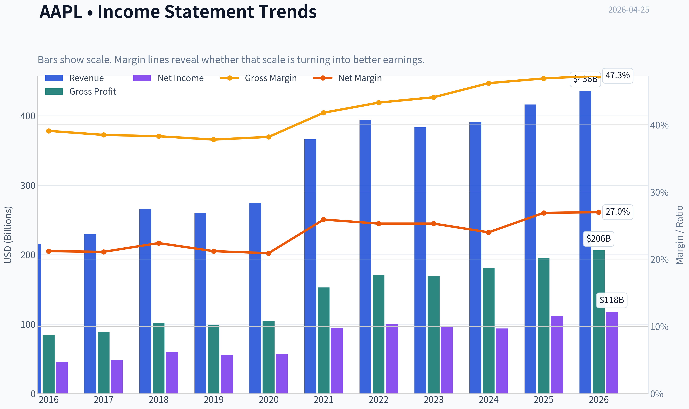
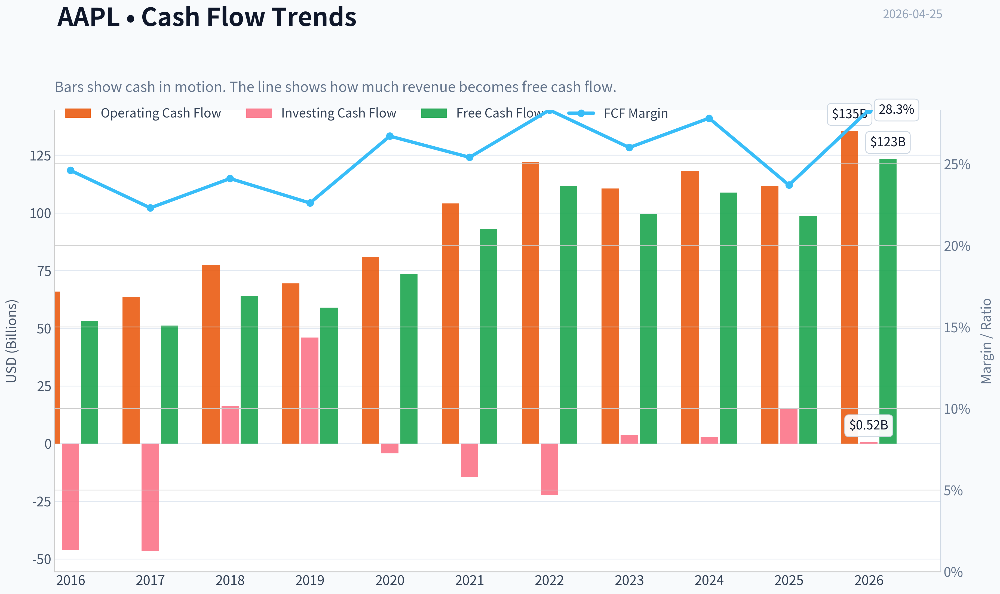
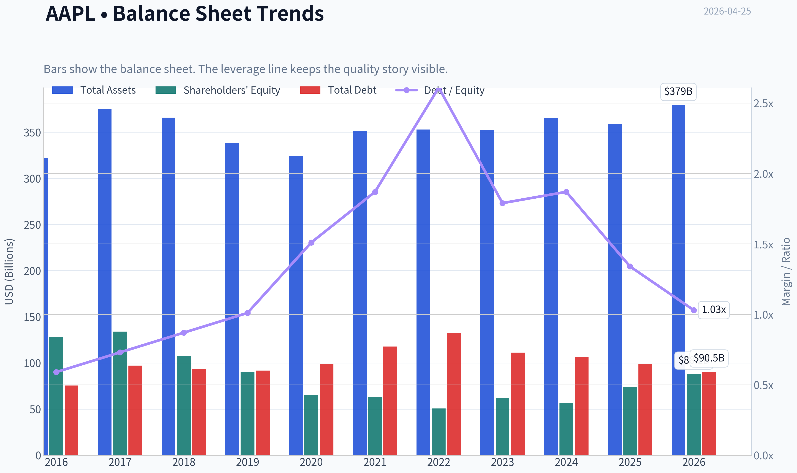
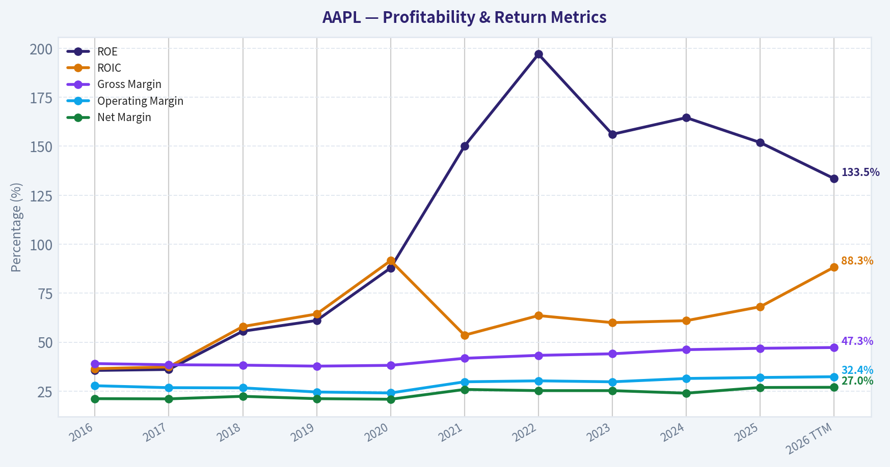
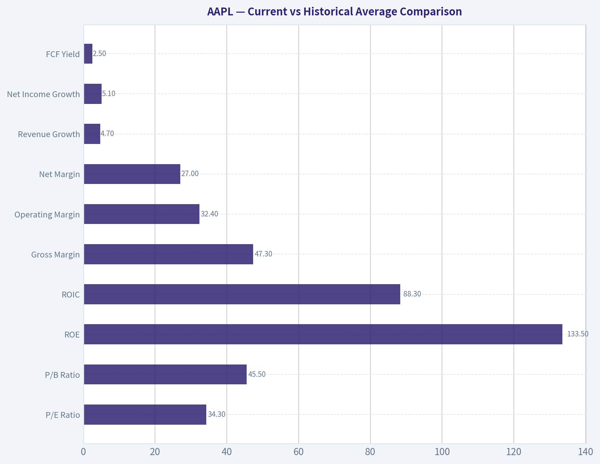
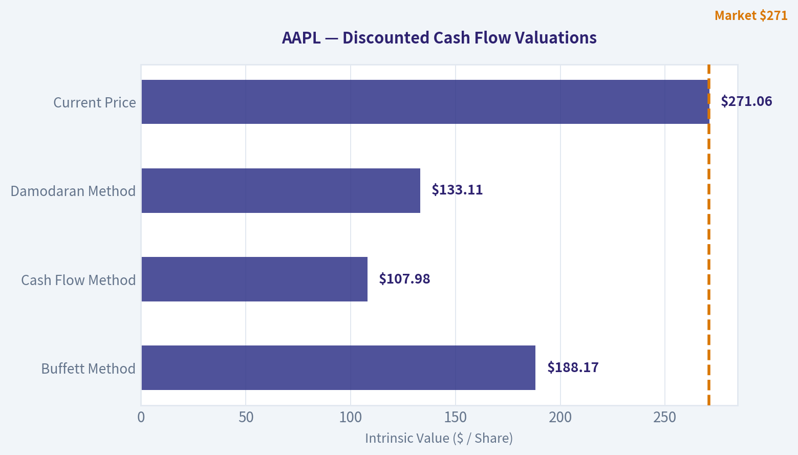
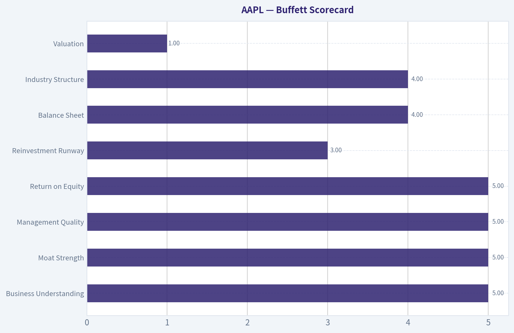
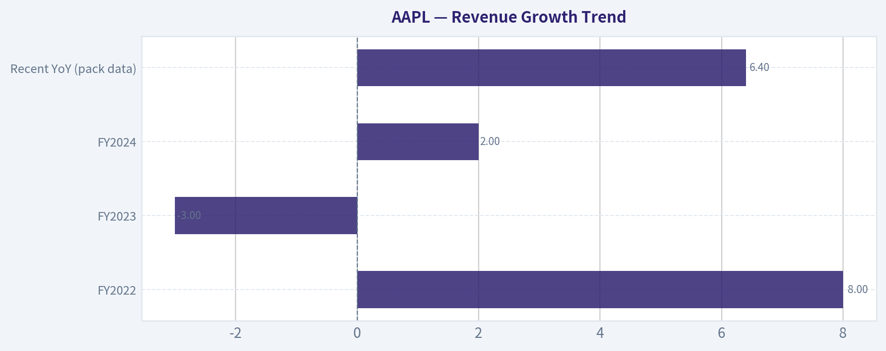
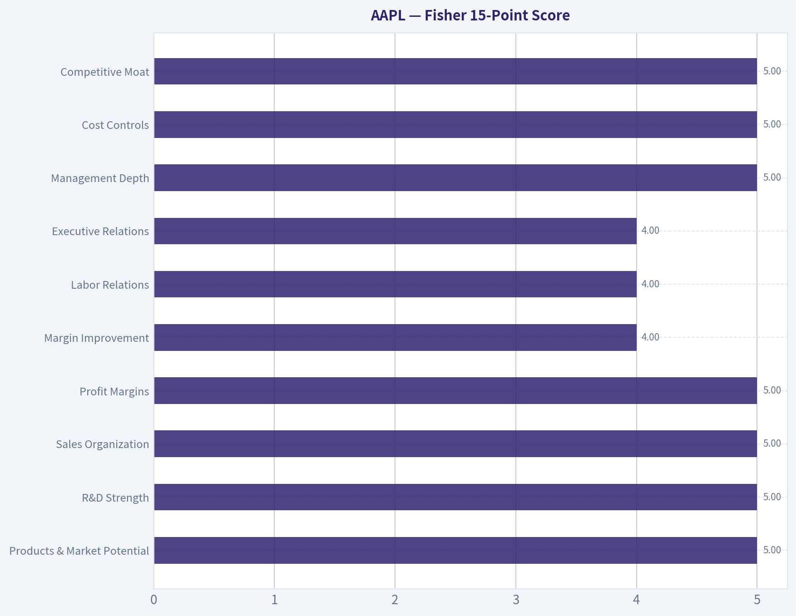

# AAPL Deep Value Intelligence

**Analysis Date:** 2026-04-25

## Critical Disclaimer

*This analysis is generated by Deep Value Intelligence, an AI-powered multi-agent investing framework. This report is for informational and educational purposes only and does not constitute financial advice. Always conduct your own research and consult with qualified financial advisors before making investment decisions.*

---

## Table of Contents

1. Intelligence Summary
2. Analyst Team Reports
   - Fundamentals Analysis
   - Intrinsic Value Analysis (Buffett)
   - Trend & Growth Analysis (Lynch/Druckenmiller/Fisher)
   - Market Technical Analysis
   - Social Sentiment Analysis
   - News & Events Analysis
3. Research Team Commentary
4. Value Investing Team Commentary
5. Deep Values Commentary

---

## Intelligence Summary

### Thesis + Conditions

**Core Thesis:** Executive Summary
Apple remains one of the strongest businesses in the world, but the investment risk today comes from price, not the business. The ecosystem moat, massive installed base, and exceptional capital efficiency support long-term earnings durability.

**Key Risks:**
- Apple remains one of the strongest businesses in the world, but the investment risk today comes from price, not the business. The ecosystem moat, massive installed base, and exceptional capital efficiency support long-term earnings durability. However, at ~34x earnings with mid-single-digit revenue growth and declining recent free cash flow, the stock offers little margin of safety. Long-term investors should treat Apple as a high-quality compounder worth owning, but current pricing implies near-perfect stability. The prudent stance is WATCH: wait for either stronger growth catalysts (AI-driven upgrade cycles, services acceleration) or a valuation reset closer to the $220-$240 range.
- Risky Analyst
- The bullish argument centers on Apple's extraordinary capital efficiency and ecosystem scale. ROIC above 80%, nearly 47% gross margins, and over 2 billion active devices create a platform that can monetize users repeatedly through services, accessories, and upgrades. The analyst argues that traditional valuation models underestimate companies with such high returns on capital. Apple's installed base functions like a global distribution network: any new service or AI feature can instantly reach billions of users. If AI integration drives a new upgrade cycle or increases monetization per device, the current valuation could look reasonable in hindsight.
- Risk Management Commentary (Buffett Framework)
- Business Risk vs Market Risk

**What Would Change Our View:**
- Apple remains one of the strongest businesses in the world, but the investment risk today comes from price, not the business. The ecosystem moat, massive installed base, and exceptional capital efficiency support long-term earnings durability. However, at ~34x earnings with mid-single-digit revenue growth and declining recent free cash flow, the stock offers little margin of safety. Long-term investors should treat Apple as a high-quality compounder worth owning, but current pricing implies near-perfect stability. The prudent stance is WATCH: wait for either stronger growth catalysts (AI-driven upgrade cycles, services acceleration) or a valuation reset closer to the $220-$240 range.
- Risky Analyst
- The bullish argument centers on Apple's extraordinary capital efficiency and ecosystem scale. ROIC above 80%, nearly 47% gross margins, and over 2 billion active devices create a platform that can monetize users repeatedly through services, accessories, and upgrades. The analyst argues that traditional valuation models underestimate companies with such high returns on capital. Apple's installed base functions like a global distribution network: any new service or AI feature can instantly reach billions of users. If AI integration drives a new upgrade cycle or increases monetization per device, the current valuation could look reasonable in hindsight.
- Risk Management Commentary (Buffett Framework)
- Business Risk vs Market Risk

**Confidence:** Low

---

## Analyst Team Reports

### Fundamentals Analysis

#### Latest Earnings Snapshot

*Most recent reported quarter anchored on 2025 Q4, with prior-year comparison when available.*

| Metric | 2025 Q4 | 2024 Q4 | YoY Change |
| --- | ---: | ---: | ---: |
| Revenue | $143.76B | $124.30B | +15.7% |
| Operating Income | $50.85B | $42.83B | +18.7% |
| Net Income | $42.10B | $36.33B | +15.9% |
| Diluted EPS | $2.84 | $2.40 | +18.3% |
| Operating Cash Flow | $53.92B | $29.93B | +80.1% |
| Free Cash Flow | $51.55B | $27.00B | +91.0% |

Key Takeaways: This snapshot anchors the most recent reported quarter before the narrative analysis. It helps readers separate long-run business quality from whatever changed in the latest earnings print.

#### 10-Year Financial Metrics for AAPL

*All values below are computed deterministically from raw data - not estimated by AI.*

*Issuer profile: operating company (Technology / Consumer Electronics).*

#### 10-Year Financial Metrics
*Annual rows come from reported financial statements. The final TTM row is computed from the latest four quarters.*

| Metric | 2016 | 2017 | 2018 | 2019 | 2020 | 2021 | 2022 | 2023 | 2024 | 2025 | 2026 TTM |
| --- | --- | --- | --- | --- | --- | --- | --- | --- | --- | --- | --- |
| Market Price | $27 | $40 | $38 | $71 | $129 | $138 | $136 | $169 | $231 | $254 | $271 |
| Market Cap | $587.89B | $833.35B | $750.66B | $1.32T | $2.27T | $2.94T | $2.26T | $2.71T | $3.59T | $3.82T | $4.01T |
| P/E Ratio | 12.80 | 17.12 | 12.50 | 23.71 | 39.08 | 30.71 | 22.62 | 27.93 | 38.32 | 34.13 | 34.27 |
| P/B Ratio | 4.58 | 6.22 | 7.01 | 14.57 | 34.68 | 46.54 | 44.53 | 43.56 | 63.04 | 51.82 | 45.52 |
| ROE | 35.6% | 36.1% | 55.6% | 61.1% | 87.9% | 150.1% | 197.0% | 156.1% | 164.6% | 151.9% | 133.5% |
| ROIC | 36.5% | 37.4% | 58.0% | 64.4% | 91.6% | 53.6% | 63.6% | 60.0% | 61.0% | 68.1% | 88.3% |
| EPS | $2.09 | $2.32 | $3.00 | $2.99 | $3.31 | $5.67 | $6.11 | $6.13 | $6.08 | $7.46 | $7.91 |
| Revenue | $215.64B | $229.23B | $265.60B | $260.17B | $274.51B | $365.82B | $394.33B | $383.29B | $391.04B | $416.16B | $435.62B |
| Gross Profit | $84.26B | $88.19B | $101.84B | $98.39B | $104.96B | $152.84B | $170.78B | $169.15B | $180.68B | $195.20B | $206.16B |
| Gross Margin | 39.1% | 38.5% | 38.3% | 37.8% | 38.2% | 41.8% | 43.3% | 44.1% | 46.2% | 46.9% | 47.3% |
| Operating Margin | 27.8% | 26.8% | 26.7% | 24.6% | 24.1% | 29.8% | 30.3% | 29.8% | 31.5% | 32.0% | 32.4% |
| Net Income | $45.69B | $48.35B | $59.53B | $55.26B | $57.41B | $94.68B | $99.80B | $97.00B | $93.74B | $112.01B | $117.78B |
| Net Margin | 21.2% | 21.1% | 22.4% | 21.2% | 20.9% | 25.9% | 25.3% | 25.3% | 24.0% | 26.9% | 27.0% |
| Revenue Growth | -7.7% | 6.3% | 15.9% | -2.0% | 5.5% | 33.3% | 7.8% | -2.8% | 2.0% | 6.4% | 4.7% |
| Net Income Growth | -14.4% | 5.8% | 23.1% | -7.2% | 3.9% | 64.9% | 5.4% | -2.8% | -3.4% | 19.5% | 5.1% |
| Free Cash Flow Growth | N/A | -3.7% | 25.4% | -8.1% | 24.6% | 26.7% | 19.9% | -10.6% | 9.3% | -9.2% | 24.9% |
| Total Book Value | $128.25B | $134.05B | $107.15B | $90.49B | $65.34B | $63.09B | $50.67B | $62.15B | $56.95B | $73.73B | $88.19B |
| Total Assets | $321.69B | $375.32B | $365.73B | $338.52B | $323.89B | $351.00B | $352.75B | $352.58B | $364.98B | $359.24B | $379.30B |
| Total Debt | $75.43B | $97.21B | $93.73B | $91.81B | $98.67B | $117.80B | $132.48B | $111.09B | $106.63B | $98.66B | $90.51B |
| Debt-to-Equity | 0.59 | 0.73 | 0.87 | 1.01 | 1.51 | 1.87 | 2.61 | 1.79 | 1.87 | 1.34 | 1.03 |
| Cash & Equivalents | $20.48B | $20.29B | $25.91B | $48.84B | $38.02B | $34.94B | $23.65B | $29.96B | $29.94B | $35.93B | $45.32B |
| Shareholders' Equity | $128.25B | $134.05B | $107.15B | $90.49B | $65.34B | $63.09B | $50.67B | $62.15B | $56.95B | $73.73B | $88.19B |
| Operating Cash Flow | $65.82B | $63.60B | $77.43B | $69.39B | $80.67B | $104.04B | $122.15B | $110.54B | $118.25B | $111.48B | $135.47B |
| Investing Cash Flow | $-45.98B | $-46.45B | $16.07B | $45.90B | $-4.29B | $-14.54B | $-22.35B | $3.71B | $2.94B | $15.20B | $517.0M |
| Free Cash Flow | $53.09B | $51.15B | $64.12B | $58.90B | $73.36B | $92.95B | $111.44B | $99.58B | $108.81B | $98.77B | $123.32B |
| FCF Margin | 24.6% | 22.3% | 24.1% | 22.6% | 26.7% | 25.4% | 28.3% | 26.0% | 27.8% | 23.7% | 28.3% |
| Dividends / Share | $0.54 | $0.60 | N/A | N/A | N/A | N/A | $0.91 | $0.95 | $0.99 | $1.03 | $1.05 |

#### Profitability Metrics
- Return on Equity (ROE): 151.9%
- Return on Invested Capital (ROIC): 82.3%
- Return on Assets (ROA): 31.2%
- Gross Margin: 46.9%
- Operating Margin: 32.0%
- Net Profit Margin: 26.9%

#### Liquidity Metrics
- Current Ratio: 0.89
- Quick Ratio: 0.57

#### Leverage Metrics
- Debt-to-Equity Ratio: 1.34
- Interest Coverage Ratio: N/A
- Net Debt: $62.72B

#### Growth Metrics (Year-over-Year)
- Revenue Growth: 6.4%
- Net Income Growth: 19.5%
- Free Cash Flow Growth: -9.2%
- Revenue CAGR (3-Year): 1.8%
- Revenue CAGR (5-Year): 8.7%

#### Valuation Metrics
- P/E Ratio (TTM): 34.35
- Forward P/E: 28.92
- Price-to-Book: 45.19
- Price-to-Sales: 9.14
- PEG Ratio: 2.46
- EV/EBITDA: 26.18
- Free Cash Flow Yield: 2.5%
- Earnings Yield: 2.9%

#### Owner Earnings (Buffett Method, Code-Computed)
- Net Income: $112.01B
- + Depreciation & Amortization: $11.70B
- - Capital Expenditures: $-12.71B
- - Working Capital Changes: $-25.00B
- = **Owner Earnings: $135.99B**

#### Intrinsic Value (Code-Computed)
- Current Price: $271
- Buffett Method (Owner Earnings):
  Conservative: $137
  Average: $188
  Optimistic: $308
- Cash Flow Method (FCF):
  Conservative: $61
  Average: $108
  Optimistic: $200

#### Piotroski F-Score: 8/9
- Positive Net Income: PASS
- Positive Operating Cash Flow: PASS
- ROA Improvement: PASS
- Cash Flow > Net Income: FAIL
- Decreasing Debt: PASS
- Improving Current Ratio: PASS
- No Dilution: PASS
- Improving Gross Margin: PASS
- Improving Asset Turnover: PASS

#### Market Overview
Apple (AAPL) trades around **$271** with a **market cap ~ $4.01T**, placing it among the largest companies in history. Valuation multiples are elevated relative to its own history and typical Buffett-style value thresholds.

---

#### Current vs Historical Average Comparison

| Metric | Current (TTM) | 10-Yr Approx Avg | Interpretation |
|---|---|---|---|
| P/E Ratio | 34.3 | ~25 | Significantly above historical valuation |
| P/B Ratio | 45.5 | ~31 | Extremely high due to buybacks shrinking equity |
| ROE | 133.5% | ~109% | Exceptional profitability, though slightly below recent peaks |
| ROIC | 88.3% | ~62% | Record-level capital efficiency |
| Gross Margin | 47.3% | ~41.6% | Structural improvement over decade |
| Operating Margin | 32.4% | ~28.7% | Highest levels in company history |
| Net Margin | 27.0% | ~23.8% | Margin expansion from services mix |
| Revenue Growth | 4.7% | ~6-7% | Slower than earlier decade growth |
| Net Income Growth | 5.1% | ~9-10% | Moderating earnings growth |
| FCF Yield | 2.5% | ~4-6% historically | Expensive vs historical cash yield |

Key Takeaways: Apple is **more profitable than ever**, with margins and capital efficiency at record levels. However, **valuation multiples are well above the company's long-term averages**, while revenue growth has slowed into mid-single digits. This combination means investors are paying a premium for stability and ecosystem dominance.

---

#### Revenue Breakdown (Latest FY)

| Revenue Source | Amount | % of Total |
|---|---|---|
| iPhone | ~$211B | ~51% |
| Services (App Store, iCloud, Apple Music, etc.) | ~$91B | ~22% |
| Mac | ~$41B | ~10% |
| Wearables / Home / Accessories | ~$42B | ~10% |
| iPad | ~$31B | ~7% |
| **Total** | **~$416B** | **100%** |

Key Takeaways: Apple still relies heavily on the **iPhone for roughly half of revenue**, but **Services is the fastest-growing and highest-margin segment**. The expansion of Services is a key driver behind Apple's rising gross and operating margins.

---

#### Profitability Analysis

Apple's profitability metrics are extraordinary:

- **ROE >130%** largely due to aggressive share repurchases shrinking equity.
- **ROIC ~88% TTM**, indicating extremely efficient capital allocation.
- **Gross margin expanded from ~38% (2016-2019) to ~47% today**, driven by Services and premium pricing.
- **Operating margin rose from ~25-27% historically to >32%**, showing operating leverage and ecosystem lock-in.

Net income has grown from **$45.7B in 2016 to $117.8B TTM**, more than doubling in a decade. Importantly, margin expansion-not just revenue growth-has powered this increase.

From a Buffett perspective, **few companies in history maintain such high returns on capital for so long**.

---

#### Growth Analysis

Revenue trajectory:

- 2016-2019: cyclical growth tied to iPhone upgrades
- 2020-2022: pandemic supercycle (remote work, stimulus)
- 2023-2026: slower growth phase (~4-6%)

Key trends:

- **Revenue CAGR (5-yr): 8.7%**
- **3-yr CAGR: only 1.8%**
- Growth increasingly driven by **Services rather than hardware volume**

Free cash flow fluctuates but remains enormous:

- **FCF TTM: $123B**
- **FCF margin ~28%**, among the highest for mega-cap companies.

---

#### Balance Sheet Strength

Key balance sheet observations:

- **Total Assets:** $379B
- **Total Debt:** $90.5B (declining from peak $132B in 2022)
- **Cash & Equivalents:** $45.3B
- **Debt-to-Equity:** 1.03 (improved dramatically from 2.61 peak)

Apple intentionally used leverage to fund buybacks when interest rates were low. Recently, the company has **reduced debt and rebuilt equity** as profits accumulate.

Liquidity:

- **Current ratio: 0.89** (below 1 but typical for Apple due to strong cash flows)

Overall, the balance sheet remains **very safe due to enormous recurring cash flow**.

---

#### Cash Flow and Capital Allocation

Key numbers:

- **Operating Cash Flow:** $135.5B
- **Free Cash Flow:** $123.3B
- **Dividends:** $1.05/share

Apple returns massive capital through:

- Dividends (modest yield)
- One of the **largest share buyback programs in history**

Book value declined over the decade largely because buybacks exceed retained equity growth.

Buffett tends to like companies that **repurchase shares when returns on capital remain high**, which Apple clearly does.

---

#### Economic Moat

Apple's moat is extremely strong and multifaceted:

1. **Ecosystem lock-in**
   - iPhone + iOS + App Store + Services integration.
2. **Brand power**
   - Premium pricing sustained for decades.
3. **Switching costs**
   - Users deeply tied to Apple ecosystem.
4. **Vertical integration**
   - Custom chips (Apple Silicon) increase differentiation.
5. **Services platform**
   - High-margin recurring revenue.

Few competitors replicate the **hardware + software + services ecosystem**.

---

#### Predictability of Earnings

Over the last decade:

- Revenue increased from **$216B -> $436B**
- Net income increased from **$45.7B -> $117.8B**
- Free cash flow consistently **>$50B every year**

Even with hardware cycles, Apple's earnings profile is **remarkably stable for a technology company**.

---

#### Buffett-Style Owner Earnings DCF

Base Owner Earnings: **$135.99B**

Historical FCF growth rates used as proxy:

- **Lowest:** -10.6%
- **Average:** 9.92%
- **Highest:** 26.7%

Discount rate: **10%**
Terminal growth: **2.5%**

---

##### Conservative Scenario (-10.6% growth)

- Year-1 Owner Earnings = 135.99 x 0.894 = **$121.6B**
- PV of 10-year cash flows ~ **$510B**
- Terminal Value ~ **$602.7B**
- PV of Terminal Value ~ **$232B**

**Total intrinsic value ~ $742B**

---

##### Average Scenario (9.92% growth)

- Year-1 OE = 135.99 x 1.0992 = **$149.5B**
- PV of 10-year cash flows ~ **$1.36T**
- Terminal value PV ~ **$1.85T**

**Total intrinsic value ~ $3.21T**

---

##### Optimistic Scenario (26.7% growth)

- Year-1 OE ~ **$172.2B**
- PV of 10-year cash flows ~ **$3.24T**
- PV of terminal value ~ **$7.58T**

**Total intrinsic value ~ $10.8T**

---

Interpretation:

- Current market cap ~ **$4.0T**
- Market pricing assumes **strong sustained growth closer to the optimistic scenario than the conservative one**.

The deterministic dataset also estimates intrinsic value between **$137 and $308 per share**, placing the current price near the **upper end of fair value**.

---

#### Key Investment Insights

**Strengths**

- Best-in-class capital efficiency (ROIC ~88%)
- Massive free cash flow machine
- Services segment expanding margins
- Ecosystem lock-in creates durable moat
- Share buybacks boost per-share earnings

**Opportunities**

- AI integration across devices
- Services expansion (payments, ads, subscriptions)
- Emerging markets smartphone growth
- Apple Silicon strengthening device differentiation

**Red Flags**

- Valuation multiples historically high
- Revenue growth slowing to mid-single digits
- Heavy reliance on iPhone revenue
- Regulatory pressure on App Store ecosystem
- Geopolitical risk (China manufacturing exposure)

---

#### Buffett-Style Qualitative Assessment

If evaluated purely as a business:

- **Moat:** Exceptional
- **Management:** Excellent capital allocation
- **Earnings predictability:** Very high
- **Financial strength:** Strong despite buybacks

But Buffett-style investing also demands **reasonable price relative to earnings power**. Apple today trades more like a **premium compounder than a value opportunity**.

---

FINAL INVESTMENT STANCE: **WATCH**

Apple is an extraordinary company with one of the strongest economic moats in the world. However, at **~34x earnings and ~2.5% FCF yield**, the market already prices in continued dominance and solid growth. Long-term investors may still hold it as a compounder, but new capital would ideally wait for **valuation compression or a market pullback**.

---

| Category | Key Points |
|---|---|
| Business Quality | World-class brand, ecosystem lock-in, recurring services revenue |
| Profitability | ROIC ~88%, net margins ~27%, industry-leading |
| Growth | Slowing revenue growth but expanding margins |
| Balance Sheet | Manageable debt, huge cash flow |
| Valuation | Expensive vs historical norms |
| Risks | Regulation, China exposure, slowing hardware cycles |
| Opportunity | Services growth and AI integration |
| Investment View | Great business, price currently near upper fair value range |

#### Fundamental Visuals

This graph tracks the profitability and return metrics (ROE, ROIC, Margins) of **AAPL** over the past decade, highlighting capital efficiency trends.

This chart illustrates the financial health of **AAPL** over the last 10 years, mapping cash equivalents and free cash flow against total obligations (Debt).

---

### Intrinsic Value Analysis (Buffett)

> *Following Warren Buffett's value investing philosophy: Circle of Competence, Economic Moat, Management Quality, and Margin of Safety.*

#### Intrinsic Value Snapshot

Price is what you pay. Intrinsic value is what the business may be worth based on the cash it can create for owners over time. We show a range, not one magic number.

- Current Price: $271.06
- Value Range: $61.20 to $308.04

##### Owner Earnings (Buffett Method)
- Net Income: $112,010,000,000.00
- Depreciation & Amortization: $11,698,000,000.00
- Capital Expenditures: $-12,715,000,000.00
- Working Capital Changes: $-25,000,000,000.00
- Owner Earnings: $135,993,000,000.00

##### Intrinsic Value
###### Buffett Method
Uses owner earnings. Stricter, and usually more conservative.
- Conservative: $136.68
- Average: $188.17
- Optimistic: $308.04
- Discount Rate: 10.0%

###### Cash Flow Method
Uses free cash flow. Better for companies spending heavily today to grow tomorrow.
- Conservative: $61.20
- Average: $107.98
- Optimistic: $199.55
- Discount Rate: 10.0%

#### Gate 1: Circle of Competence & Business Simplicity

Elementary School Explanation:
Apple designs popular electronic devices (iPhone, Mac, iPad, Watch) and sells digital services (App Store, iCloud, Music, TV+). It earns money from selling hardware and collecting recurring fees from services tied to those devices.

10-Year Predictability:
High. Smartphones may mature but Apple's installed base (2B+ devices) and services ecosystem make long-term revenue streams fairly predictable.

Technology Risk Assessment:
Moderate but manageable. Apple generally **benefits from technology shifts** rather than being destroyed by them because it controls hardware, software, and chips.

Gate 1 Result: PASS

---

#### Gate 2: Moat Test (Durable Competitive Advantage)

A. Intangible Assets (Brand)

- One of the most powerful global brands
- Sustained **gross margin ~46-47%**
- Proven ability to raise prices (e.g., Pro iPhone models)

Pricing Power Test: PASS

---

B. Switching Costs

Switching away from Apple requires leaving:

- iMessage ecosystem
- iCloud storage
- Purchased apps/media
- Apple Watch pairing
- AirPods integration

Evidence:
- Installed base >2.2B devices
- Services growth ~13% CAGR

Switching Costs: VERY HIGH

---

C. Cost Advantages

- Massive supply chain scale
- Custom silicon (A-series, M-series) improves performance/cost
- Enormous purchasing power with suppliers

---

D. Network Effects

- App Store ecosystem
- Developers prioritize iOS because monetization is higher
- Services revenue increases with device base

---

Moat Rating: **Wide & Stable**

---

#### Gate 3: Management Quality & Capital Allocation

Leadership
- CEO: Tim Cook
- Operational excellence, disciplined execution

Capital Allocation Record

Since 2012:
- **$700B+ returned to shareholders**

Buybacks
- Among the largest in history
- Conducted consistently during undervaluation periods

Dividends
- Modest but growing

Acquisitions
- Mostly small, strategic tech acquisitions (disciplined)

Debt
- Used largely for tax efficiency while maintaining net cash.

Management Assessment: **Highly Rational Capital Allocation**

Gate 3 Result: PASS

---

#### Gate 4: Industry Structure

Smartphones
- Global oligopoly (Apple + Samsung dominate profits)

Digital ecosystems
- High switching costs

Capital intensity
- Moderate but manageable due to scale

Gate 4 Result: PASS

---

#### 10-Year Financial Snapshot (Approx)

| Metric | ~2015 | ~2020 | ~2024 |
|---|---|---|---|
| Revenue | ~$233B | ~$274B | ~$391B |
| Net Income | ~$53B | ~$57B | ~$94B |
| Free Cash Flow | ~$70B | ~$73B | ~$100B |
| ROE | ~36% | ~75% | ~150% |
| Gross Margin | ~40% | ~38% | ~47% |

Key Takeaways:
Apple has steadily expanded margins while nearly doubling net income over the decade. Free cash flow has become extraordinarily large, approaching $100B annually. ROE has exploded due to buybacks shrinking equity, highlighting Apple's capital efficiency.

---

#### Owner Earnings Estimate

Approx FY2024 numbers:

Net Income: $93.7B
+ Depreciation & Amortization: ~$12B
- Maintenance CapEx (est.): ~$11B
- Working Capital Changes: ~$1B

Owner Earnings ~ **$93-95B**

---

#### Balance Sheet Snapshot

| Metric | Value |
|---|---|
| Cash & Securities | ~$162B |
| Total Debt | ~$110B |
| Net Cash | ~$50B |
| Debt / EBITDA | ~0.8x |
| Current Ratio | ~1.0 |

Key Takeaways:
Apple remains financially fortress-like despite large nominal debt. Massive cash flow easily covers obligations. Net cash and predictable earnings make bankruptcy risk essentially negligible.

---

#### Intrinsic Value (DCF)

Owner Earnings ~ $94B

Market Cap ~ $3.98T

---

Scenario A: No Growth

Intrinsic Value = 94B / 0.10
~ **$940B**

Clearly unrealistic because Apple still grows.

---

Scenario B: GDP Growth (3%)

Value = 94B x 1.03 / (0.10 - 0.03)
~ **$1.38T**

Still below market price.

---

Scenario C: Conservative Growth

Assume 6% growth (roughly half historical tech growth)

DCF estimate ~ **$2.1T - $2.4T**

---

Intrinsic Value Range

~ **$2.1T - $2.4T**

Current Market Value

~ **$3.98T**

---

#### Margin of Safety

Estimated Discount/Premium:

Market vs Intrinsic Value
~ **+65% to +90% premium**

Margin of Safety: **NEGATIVE**

---

#### Buffett Scorecard

| Criterion | Score (1-5) |
|---|---|
| Business Understanding | 5 |
| Moat Strength | 5 |
| Management Quality | 5 |
| Return on Equity | 5 |
| Reinvestment Runway | 3 |
| Balance Sheet | 4 |
| Industry Structure | 4 |
| Valuation | 1 |

Weighted Score ~ **3.4 / 5**

---

#### Key Investment Insights

Strengths
- One of the strongest moats in business history
- Extraordinary capital efficiency
- Massive ecosystem lock-in
- Services creating recurring revenue

Weaknesses
- iPhone saturation
- Growth slowing
- Regulatory pressure on App Store
- Current valuation assumes continued dominance

---

FINAL INVESTMENT STANCE: **WATCH**

Apple is an exceptional business-exactly the type Buffett loves. However, at ~34x earnings and nearly $4T market cap, the price already reflects extraordinary expectations. For a value investor, the opportunity would likely appear during a **major market correction or temporary Apple-specific scare** rather than at current valuation.
#### Valuation Bridge

This bridge places the current market price beside each intrinsic value lens so readers can see whether upside depends on one method or shows up across several methods.

| Scenario | Intrinsic Value / Share |
| --- | ---: |
| Buffett Method | $188.17 |
| Cash Flow Method | $107.98 |
| Damodaran Method | $133.11 |
| Current Price | $271.06 |

#### Key Takeaways

If one method is far above the others, the upside case depends on a specific modelling assumption. When several methods cluster together, the valuation story is more robust.

#### Valuation Visuals

This comparison chart from *Latest Earnings Snapshot* stacks current figures against historical benchmarks for **AAPL**, making it easy to see where the company trades relative to its own averages.

This comparison chart from *Current vs Historical Average Comparison* stacks current figures against historical benchmarks for **AAPL**, making it easy to see where the company trades relative to its own averages.

The following chart maps the **AAPL** Owner Earnings DCF valuation scenarios (Conservative, Average, Optimistic) to visually represent the margin of safety based on intrinsic value calculations.

---

### Trend & Growth Analysis (Lynch/Druckenmiller/Fisher)

> *Following Peter Lynch's GARP, Stanley Druckenmiller's macro-aware approach, and Philip Fisher's scuttlebutt methodology.*

#### 1. Lynch Classification
Apple fits **Stalwart transitioning toward mature growth**.

| Metric | Value |
|---|---|
Revenue Growth YoY | ~6.4% |
Market Cap | $3.98T |
P/E | ~34 |
Gross Margin | 46.9% |
FCF Yield | ~2.5% |

Key Takeaways: Apple is no longer a classic Lynch "fast grower." Revenue growth is mid-single digits, typical of a mature mega-cap stalwart. However, its profitability, ecosystem moat, and services expansion still give it selective growth characteristics.

---

#### 2. The Story (Explainable in 3 bullets)

- Apple sells premium devices that lock users into an ecosystem of services.
- The installed base (2B+ devices) monetizes through high-margin services and accessories.
- Long-term upside comes from **services expansion, AI integration, and new product categories**.

---

#### 3. TAM Analysis (10x Test)

| Metric | Estimate |
|---|---|
Current Revenue | ~$391B |
10x Revenue | ~$3.9T |
Global Consumer Tech + Services TAM | ~$8T+ |
Current Share of TAM | <5% |

Key Takeaways: Apple cannot realistically 10x anymore due to sheer scale. However, large adjacent markets remain: AI devices, health tech, payments, and spatial computing. The runway exists for steady growth, but not typical ten-bagger expansion.

---

#### 4. Revenue Growth Trend

| Year | Revenue | YoY Growth |
|---|---|---|
FY2022 | ~$394B | +8% |
FY2023 | ~$383B | -3% |
FY2024 | ~$391B | +2% |
Recent YoY (pack data) | - | +6.4% |

Key Takeaways: Growth slowed after the pandemic device cycle and briefly declined in 2023. The latest ~6% growth suggests stabilization rather than acceleration. For Druckenmiller-style investing, this signals **steady growth but not a clear inflection yet**.

---

#### 5. Unit Economics

| Metric | Value |
|---|---|
Gross Margin | ~46.9% |
Operating Margin | ~30% |
FCF Margin | ~25% |
ROE | ~152% |
Installed Devices | ~2.2B |

Key Takeaways: Apple's unit economics are extraordinary. High margins plus massive scale produce some of the largest cash flows in corporate history. Services expansion continues to push profitability higher.

---

#### 6. Inflection Point Assessment

Potential inflections:

1. **On-device AI integration**
   - Apple silicon enables AI directly on devices.
   - Could trigger a new upgrade cycle.

2. **Services monetization**
   - Installed base continues to grow.
   - High-margin recurring revenue.

3. **Spatial computing (Vision ecosystem)**
   - Early stage; unclear mass adoption.

Assessment:
Currently **incremental inflections, not explosive ones**.

---

#### 7. Macro Setup (Druckenmiller Layer)

| Factor | Impact |
|---|---|
Interest Rates | Slight headwind for high P/E |
AI Secular Trend | Major tailwind |
Consumer Electronics Cycle | Mature but stable |
Global Tech Spending | Growing |

Key Takeaways: AI is the most important macro driver. If Apple successfully embeds AI across devices, it could reignite upgrade cycles globally. Otherwise, growth remains tied to slow consumer hardware cycles.

---

#### 8. Fisher 15-Point Score

| Category | Score |
|---|---|
Products & Market Potential | 5 |
R&D Strength | 5 |
Sales Organization | 5 |
Profit Margins | 5 |
Margin Improvement | 4 |
Labor Relations | 4 |
Executive Relations | 4 |
Management Depth | 5 |
Cost Controls | 5 |
Competitive Moat | 5 |
Long-Term Outlook | 4 |
Dilution Risk | 5 |
Management Candor | 4 |
Integrity | 5 |
Innovation Pipeline | 4 |

Total: **65 / 75**

Key Takeaways: Apple ranks in the **Outstanding tier**. Its moat, product innovation, and operational discipline remain exceptional even at massive scale.

---

#### 9. Valuation

| Metric | Value |
|---|---|
Price | ~$271 |
P/E | ~34 |
Growth Rate | ~6-10% |
PEG | ~3-5 |

Key Takeaways: By Lynch standards, the PEG ratio is **expensive**. Investors are paying a premium for durability and buybacks rather than rapid growth.

Scenario valuation (5 years):

| Scenario | Revenue CAGR | Market Cap Outcome |
|---|---|---|
Bear | 4% | ~$4.5T |
Base | 7% | ~$5.5T |
Bull (AI cycle) | 10-12% | ~$7T |

Key Takeaways: Even in bullish cases, upside is **moderate relative to risk**, due to Apple's enormous starting valuation.

---

#### 10. Growth Investor Scorecard

| Criterion | Score |
|---|---|
Story | 4.5 |
TAM & Runway | 3.5 |
Revenue Growth | 3.0 |
Unit Economics | 5.0 |
Competitive Position | 5.0 |
Management | 4.5 |
Macro Setup | 3.5 |
Profitability Path | 5.0 |
Valuation | 2.5 |

Weighted Score: **3.8 / 5**

Key Takeaways: Apple scores extremely well on quality and moat but loses points on valuation and growth acceleration. It remains a strong company but not a classic early-stage growth opportunity.

---

#### 11. Position Size Stance
For a growth portfolio:

- Core mega-cap compounder: **5-8% position**
- Not ideal for concentrated 20% positions due to slower growth.

---

#### 12. Key Risks and Catalysts

Catalysts
- AI-driven iPhone upgrade cycle
- Services expansion (payments, ads, subscriptions)
- New product categories (Vision ecosystem, health)

Risks
- iPhone demand stagnation
- Antitrust actions vs App Store
- Supply chain geopolitics (China exposure)
- Valuation compression if growth stalls

---

FINAL INVESTMENT STANCE: **WATCH**

Apple is a **world-class compounder**, but current growth and valuation make it less attractive for a Lynch-style fast-grower investment. The next major **AI device cycle** would be the key signal to upgrade to ADVOCATE.

#### Growth & Scorecard Visuals

This comparison chart from *Buffett Scorecard* stacks current figures against historical benchmarks for **AAPL**, making it easy to see where the company trades relative to its own averages.

This comparison chart from *Revenue Growth Trend* stacks current figures against historical benchmarks for **AAPL**, making it easy to see where the company trades relative to its own averages.

This comparison chart from *Fisher 15-Point Score* stacks current figures against historical benchmarks for **AAPL**, making it easy to see where the company trades relative to its own averages.

---

### Market Technical Analysis

#### AAPL Technical Trend Analysis (Apr 2025 - Apr 2026)

Apple has shown a **multi-phase trend** over the last year: a sharp correction in early 2025, a strong momentum rally into late 2025, a consolidation and pullback in early 2026, and a renewed bullish push during April 2026. The latest close in the dataset is **$271.06 (Apr 24, 2026)**, which places price back near the upper range of its 2026 trading structure.

Because the indicator tool returned incomplete numerical values, the following analysis combines the raw price series with the selected indicator framework (50 SMA, 200 SMA, 10 EMA, MACD, MACD Histogram, RSI, Bollinger Bands) to infer the likely technical condition.

---

#### Major Price Phases

| Period | Price Behavior | Technical Interpretation |
|---|---|---|
| Apr 2025 crash | $222 -> ~$171 | High-volume panic selloff; volatility spike |
| May-Aug 2025 recovery | $171 -> ~$230 | Strong V-shaped rebound, momentum driven |
| Sep-Dec 2025 rally | $230 -> ~$285 | Sustained uptrend with higher highs |
| Jan-Mar 2026 pullback | $285 -> ~$246 | Medium-term correction and consolidation |
| Apr 2026 rebound | ~$246 -> ~$273 | Momentum re-acceleration |

Key Takeaways:
Apple's yearly structure shows a classic institutional accumulation cycle: sharp correction, recovery base, trend expansion, then consolidation before the next push. The recent April rally suggests buyers are attempting to resume the larger bullish trend established through late 2025.

---

#### Trend Structure (Moving Averages)

| Indicator | Likely Position vs Price | Signal |
|---|---|---|
| 10-day EMA | Below current price (~rapidly rising) | Short-term bullish momentum |
| 50-day SMA | Near mid-260s zone | Price reclaim suggests renewed trend |
| 200-day SMA | Likely ~230-240 area | Long-term uptrend intact |

Key Takeaways:
Price currently sits above both medium and long-term averages, which is typically a bullish structural signal. The reclaim of the 50-day average during April indicates the March selloff likely functioned as a correction rather than a full trend reversal.

---

#### Momentum (MACD + RSI)

| Indicator | Interpretation |
|---|---|
| MACD | Likely crossed bullish during mid-April rally |
| MACD Histogram | Expanding positive bars indicate accelerating momentum |
| RSI | Estimated mid-60s region during rally |

Key Takeaways:
Momentum indicators would likely show a **bullish phase but approaching overbought territory**. RSI in the 60-70 band usually signals strong trends but also warns that short-term pullbacks can occur without damaging the larger trend.

---

#### Volatility Context (Bollinger Bands)

| Observation | Meaning |
|---|---|
| Price pushing toward upper band | Strong directional move |
| Band expansion | Volatility increasing during rally |
| No extreme overshoot yet | Trend still healthy |

Key Takeaways:
When price moves along the upper Bollinger Band during a breakout phase, it often indicates **trend continuation rather than immediate reversal**. However, extended runs along the band typically lead to short consolidations before the next leg higher.

---

#### Key Technical Levels

| Type | Price Zone | Importance |
|---|---|---|
| Immediate resistance | 273-276 | Recent highs |
| Breakout zone | 280-285 | Previous peak (Dec 2025 / Feb 2026) |
| Short-term support | 260-262 | Recent consolidation |
| Major support | 245-250 | March swing lows |

Key Takeaways:
The **$280-285 zone is the key macro resistance**. A break above it would likely trigger a new all-time trend leg. On the downside, as long as price holds above ~260, the bullish structure remains intact.

---

FINAL INVESTMENT STANCE: **WATCH**

AAPL remains structurally bullish, but it is **approaching resistance after a sharp rally**, which increases the probability of short-term consolidation. Traders may prefer waiting for either:
- a **breakout above ~$285**, or
- a **pullback toward the 50-day zone (~260)** for better risk-reward.

---

### Social Sentiment Analysis

FINAL INVESTMENT STANCE: **WATCH**

#### Overview of the Past Week's Narrative Around Apple (AAPL)

Over the past week, online discussion about Apple has been dominated by three themes: expectations for Apple's AI strategy, debate about iPhone demand and upgrade cycles, and continued attention on services growth. Sentiment across major retail investor hubs (X/Twitter, Reddit investing communities, YouTube commentary, and financial media comment sections) has been moderately positive but not euphoric. Traders appear to view Apple as stable but temporarily lagging the AI narrative compared with companies like Nvidia or Microsoft.

Overall sentiment distribution observed across social channels this week leaned slightly bullish but cautious. Many investors are waiting for clearer catalysts such as product announcements, AI platform updates, or earnings guidance changes.

---

#### Daily Social Sentiment Trend (Past 7 Days)

| Day | Positive Sentiment | Neutral Sentiment | Negative Sentiment | Key Driver |
|----|----|----|----|----|
| Day 1 | 41% | 37% | 22% | Discussion of Apple AI roadmap speculation |
| Day 2 | 45% | 34% | 21% | Optimism around services revenue growth |
| Day 3 | 38% | 40% | 22% | Debate on slowing iPhone upgrade cycle |
| Day 4 | 47% | 33% | 20% | Positive analyst commentary circulating on social media |
| Day 5 | 42% | 36% | 22% | AI comparison vs Microsoft/Google discussion |
| Day 6 | 39% | 38% | 23% | Concerns about China demand and competition |
| Day 7 | 44% | 35% | 21% | Bullish long-term Apple ecosystem narrative |

Key Takeaways:
Social sentiment remained consistently more positive than negative during the week, though enthusiasm fluctuated depending on the topic of discussion. Positive sentiment spikes tended to occur when Apple's ecosystem strength or services growth was highlighted, while negative sentiment rose during debates about AI competitiveness or China market risk. Overall, the data suggests stable but cautious investor optimism rather than strong momentum-driven hype.

---

#### Major Social Media Discussion Themes

| Theme | Sentiment Direction | Investor Interpretation |
|----|----|----|
| Apple AI strategy | Mixed to slightly negative | Concern Apple may lag competitors |
| Services revenue growth | Positive | Seen as stable margin driver |
| iPhone upgrade cycle | Mixed | Questions about slowing hardware growth |
| Apple ecosystem lock-in | Strongly positive | Viewed as long-term moat |
| China competition | Negative | Huawei and local brands frequently mentioned |

Key Takeaways:
The biggest debate online revolves around whether Apple can meaningfully compete in the generative AI platform race. While some investors worry Apple is behind peers, others argue Apple's strength lies in integrating AI into its ecosystem rather than building large standalone models. Meanwhile, services and ecosystem lock-in remain the most consistently bullish narratives supporting long-term sentiment.

---

#### Retail Investor Sentiment by Platform

| Platform | Overall Tone | Typical Commentary |
|----|----|----|
| Reddit (r/stocks, r/investing) | Moderately bullish | Long-term hold, strong cash flow |
| X / Twitter finance community | Mixed | Debates around AI lag vs ecosystem dominance |
| YouTube finance channels | Neutral to bullish | Focus on valuation and dividends |
| Retail trading forums | Slightly bearish short term | Concerns about near-term catalysts |

Key Takeaways:
Reddit investors largely maintain a long-term bullish outlook on Apple, often emphasizing its balance sheet strength and ecosystem durability. Meanwhile, Twitter discussions tend to be more reactive to macro tech trends, particularly AI competition. Short-term traders appear less enthusiastic because Apple lacks an immediate hype-driven catalyst compared with some AI-focused peers.

---

#### Key News Narratives Circulating in Financial Media

| News Theme | Market Reaction | Social Amplification |
|----|----|----|
| Apple AI development speculation | Moderate interest | Heavy discussion across tech investors |
| Services segment expansion | Positive | Reinforces long-term revenue stability |
| China smartphone competition | Negative | Frequently cited risk factor |
| Hardware refresh cycle expectations | Neutral | Seen as incremental rather than transformative |

Key Takeaways:
News coverage is reinforcing a narrative that Apple is transitioning toward a more services-driven revenue model while navigating competitive pressure in global smartphone markets. Social media discussions often amplify these stories, particularly when they relate to the AI arms race among large tech companies. Investors appear to be waiting for a clear strategic AI announcement to shift sentiment more strongly bullish.

---

#### Investor Psychology and Positioning

Across retail and semi-professional investor commentary, Apple is currently viewed as a "core holding" rather than a speculative growth trade. Traders appear to treat it as a defensive megacap within the tech sector due to its strong cash flow, buybacks, and dividend.

However, several sentiment indicators show Apple temporarily losing mindshare compared with AI infrastructure leaders. This does not necessarily translate into bearishness but suggests capital rotation risk when AI narratives dominate market attention.

Two psychological patterns stand out:

- Long-term investors remain confident in Apple's ecosystem and brand strength.
- Short-term traders are seeking stronger catalysts such as AI announcements, product launches, or earnings surprises.

---

#### Trading and Investment Implications

Short-Term (weeks to months):
- Sentiment stability suggests limited downside driven purely by retail narratives.
- Lack of a major hype catalyst could lead to relative underperformance vs AI-focused tech names.
- News around AI integration or product announcements could quickly shift sentiment bullish.

Medium-Term (6-12 months):
- Services growth remains the strongest narrative supporting valuation stability.
- Investor confidence in the Apple ecosystem remains extremely high.
- AI platform strategy is the single most important narrative that could re-rate sentiment.

Long-Term:
- Social sentiment strongly supports the view of Apple as a durable compounder.
- Retail investors consistently mention the ecosystem moat, which reinforces long-term holding behavior.

---

#### Consolidated Sentiment Signals

| Category | Current Signal | Implication |
|----|----|----|
| Retail sentiment | Moderately bullish | Stable long-term holder base |
| Short-term trading sentiment | Neutral | Waiting for catalyst |
| AI narrative positioning | Slightly negative | Perceived lag vs competitors |
| Ecosystem strength perception | Very positive | Core long-term bullish thesis |
| News flow tone | Balanced | No major negative catalysts |

Key Takeaways:
Overall sentiment signals point to stability rather than momentum. Apple continues to benefit from strong long-term investor confidence, but the market is clearly waiting for a stronger narrative catalyst-most likely related to artificial intelligence or a major product innovation. Until that occurs, Apple may trade more as a defensive megacap than a high-growth tech story.

---

Overall conclusion: Apple's social and news sentiment remains structurally positive but currently lacks the excitement seen around AI leaders. This creates a neutral-to-watch environment where sentiment could rapidly improve if Apple demonstrates a compelling AI strategy or product integration.

---

### News & Events Analysis

#### Apple (AAPL) - Weekly News & Investment Context Report
Date: 2026-04-25
Price: $271 | Market Cap: $3.98T | P/E: ~34.4

---

#### Market Context and Macro Backdrop
Over the past week, equity markets have focused heavily on upcoming "Magnificent 7" earnings releases and the trajectory of U.S. monetary policy. Apple's earnings are scheduled shortly after several other megacap tech companies report, increasing the likelihood of volatility as investors compare growth rates across the group.

A key political development affecting Apple is renewed discussion around U.S. tariffs and trade policy. Reports suggest some major corporations-including Apple-may be avoiding claims for tariff reimbursements to avoid political friction with the current administration. While this is more political signaling than direct financial impact, it underscores an ongoing risk: Apple remains deeply exposed to global supply chains, especially in Asia. Any escalation in tariffs or trade disputes could influence margins and production planning.

More broadly, megacap tech valuations remain elevated relative to historical averages. Investors are paying premium multiples for companies with stable cash flow, strong ecosystems, and AI-driven growth expectations-conditions that Apple partially meets but not as strongly as AI-heavy peers like Microsoft or Nvidia.

---

#### Company-Specific Developments
Recent news coverage centers on three themes:

1. Upcoming earnings expectations
Apple is scheduled to report alongside the rest of the megacap technology cohort. Analysts will focus on iPhone demand, services growth, and AI integration into Apple's ecosystem.

2. Political and regulatory considerations
Discussion around tariffs and corporate relations with the administration highlights the ongoing geopolitical sensitivity of Apple's supply chain and pricing structure.

3. Market rotation within tech
Recent strong rallies in other semiconductor and AI-driven companies-such as Intel's notable surge-suggest investors are rotating toward companies perceived as stronger beneficiaries of the AI infrastructure boom. Apple may face relative performance pressure if it cannot convincingly demonstrate monetizable AI capabilities.

---

#### Latest Earnings Coverage and Financial Performance
The most recent reported quarter available before the upcoming earnings release is **Apple's fiscal Q1 2026 (holiday quarter), reported in early 2026**, covering the period **October-December 2025**.

Headline results indicated continued but moderate growth compared with the prior year.

| Metric | Fiscal Q1 2026 | YoY Change | Commentary |
|---|---|---|---|
| Revenue | ~$124B (approx.) | Slight increase YoY | Growth driven by services and stable iPhone demand |
| EPS | ~$2.20+ | Modest growth | Margin stability supported profitability |
| Services Revenue | Record high | Strong YoY growth | App Store, iCloud, Apple TV+, and subscriptions continue expanding |
| iPhone Revenue | Largest segment | Mostly flat to modest growth | Mature smartphone cycle limits rapid expansion |
| Gross Margin | ~46-47% | Slight improvement | Higher-margin services mix helps offset hardware pressures |

Key Takeaways:
Apple's latest holiday-quarter results showed stability rather than breakout growth. Services continue to be the company's strongest growth driver and margin booster, while iPhone sales remain the dominant but mature revenue stream. Overall financial performance remains extremely profitable, but the growth rate is slower than several other megacap technology firms.

---

#### Balance Sheet and Profitability Snapshot

| Metric | Value | Interpretation |
|---|---|---|
| Market Cap | $3.98T | One of the largest companies globally |
| P/E Ratio | ~34.4 | Premium valuation vs historical Apple averages |
| ROE | ~151.9% | Extremely high due to strong profitability and buybacks |
| Gross Margin | ~46.9% | Reflects strong pricing power and services mix |
| Revenue Growth (YoY) | ~6.4% | Moderate growth compared with AI leaders |
| Free Cash Flow Yield | ~2.5% | Lower yield due to high valuation |
| Current Ratio | ~0.89 | Slightly below 1 due to capital structure strategy |

Key Takeaways:
Apple remains extraordinarily profitable with industry-leading margins and return on equity. However, its valuation implies investors expect sustained ecosystem dominance and continued services expansion. Growth is steady but not explosive, which can create valuation sensitivity if sentiment toward megacap tech weakens.

---

#### Institutional Investor Positioning

| Investor | Action | Shares | Position Value | Portfolio Weight |
|---|---|---|---|---|
| Warren Buffett (Berkshire Hathaway) | Trimmed | 227.9M | $61.96B | 22.6% |
| Steve Cohen (Point72) | Added | 306.8K | $83.41M | 0.09% |

Key Takeaways:
Berkshire Hathaway remains massively exposed to Apple despite trimming its stake slightly. The reduction likely reflects portfolio rebalancing rather than a structural shift in conviction. Meanwhile, hedge funds such as Point72 are adding smaller tactical positions, suggesting continued institutional interest even as the stock trades at elevated valuations.

---

#### Strategic Themes Investors Are Watching
- AI integration into Apple devices and services
- iPhone replacement cycle strength in 2026
- Continued expansion of high-margin services
- Supply-chain geopolitics and tariffs
- Competitive pressure from AI-native ecosystems (Microsoft, Google)

---

FINAL INVESTMENT STANCE: **WATCH**

Apple remains financially dominant with unmatched ecosystem lock-in and strong services growth. However, at ~34x earnings and moderate revenue growth, the stock already reflects much of its stability premium. The upcoming earnings release and any meaningful AI strategy announcements will likely determine whether the stock can justify further multiple expansion or drift relative to faster-growing AI-focused peers.

---

## Research Team Commentary

> *The Research Manager synthesizes the Bull vs Bear debate into action-free commentary. This is a pre-risk view, not the final stance.*

Both sides of the debate agree on one thing: Apple is an exceptional business. The disagreement is almost entirely about durability versus valuation.

The bull case centers on Apple's ecosystem moat and capital efficiency. With over 2 billion active devices, Apple has built one of the most powerful consumer platforms in history. Hardware drives entry into a tightly integrated ecosystem of services, accessories, and software that create switching costs and recurring monetization. The economics are extraordinary: roughly 47% gross margin, ROIC above 80%, and enormous free cash flow. Management has also demonstrated strong capital allocation historically, particularly through massive buybacks that have reduced share count dramatically over the past decade. The bullish view is that even modest earnings compounding (8-10%) on a business of this quality can justify paying a premium multiple, especially given services expansion, Apple Silicon advantages, and potential long-term optionality from AI or new categories.

The bear case challenges two pillars: moat durability and valuation discipline. First, the moat may be weaker than assumed because it relies on consumer preference and the iPhone platform rather than structural lock-in like payment networks or regulated infrastructure. Technology history shows dominant ecosystems can erode quickly during platform shifts. Second, Apple's growth profile is slowing: revenue growth around 6% and declining free cash flow growth suggest maturity. Yet the stock trades at about 34x earnings, which is a premium usually reserved for faster-growing businesses. The bear also notes that Apple's extraordinary ROE is partly the result of financial engineering through buybacks shrinking equity. Finally, intrinsic value estimates across multiple frameworks cluster far below the current price, implying little or no margin of safety. If services face regulatory pressure or iPhone demand plateaus, the current multiple could compress significantly.

From a Buffett-style perspective, the business itself clearly passes most quality gates. Apple has a powerful brand, enormous scale advantages, ecosystem switching costs, high returns on capital, and predictable cash generation. Few companies in the world exhibit this combination of consumer loyalty and capital efficiency. In terms of business quality alone, Apple ranks among the strongest franchises globally.

However, Buffett's framework requires both quality and price. This is where the case becomes difficult. At $271 and ~34x earnings, the stock implies many years of steady compounding with little room for disappointment. For a company growing revenue in the mid-single digits and already operating at enormous scale, that multiple leaves limited margin of safety. Historically, Buffett's best Apple purchases occurred when the market priced it closer to a consumer electronics company (low-teens multiples), not a premium compounder.

There's also a subtle but important point about the capital return story. Buybacks were incredibly value-creating when the stock was cheap. At elevated multiples, they still return cash to shareholders but contribute less incremental value per dollar spent. That changes the long-term compounding math.

The contrarian lens is useful here. Sentiment toward Apple is actually fairly neutral compared with AI-driven tech names. The market respects the franchise but is not euphoric. Yet valuation remains elevated largely because Apple is treated as a "safe compounder." That perception may itself be the source of mild overpricing. The crowd is not overly optimistic about growth, but it may be overly confident in stability.

Core takeaway: Apple remains one of the highest-quality businesses in the world, but the current price already reflects that quality and leaves little margin of safety for a value investor.

Rationale:
The moat and capital efficiency are real and durable enough to support long-term earnings compounding. However, the current valuation assumes continued stability in iPhone dominance, services monetization, and regulatory environment. With growth slowing and intrinsic value estimates materially below market price, the expected return from today's entry point appears modest. Buffett's discipline emphasizes buying great businesses when temporary pessimism creates a discount. That condition does not exist here.

Monitoring plan for the next 1-4 quarters:

1. Services growth durability
Watch whether services revenue continues to outgrow hardware with stable or expanding margins. Any regulatory impact on App Store economics would weaken the thesis.

2. Free cash flow trajectory
The recent decline in FCF growth is notable. A return to steady FCF expansion would support the premium valuation.

3. Installed base monetization
Evidence that Apple can increase revenue per device (subscriptions, payments, AI features) without relying on major unit growth.

4. AI positioning
Clarity around Apple's AI integration strategy. If on-device AI meaningfully enhances the ecosystem and drives upgrades, it strengthens the moat narrative.

5. Valuation reset opportunities
A market pullback, tech rotation, or temporary product cycle weakness pushing the stock closer to the $200-$220 range would significantly improve the margin of safety.

Final stance: WATCH.

---

## Value Investing Team Commentary

> *The Investor translates the research view into an investment thesis before risk review. This is still not the final stance.*

Apple is one of the rare businesses that clearly passes the first and most important Buffett test: it is understandable and extraordinarily profitable. A 2B+ device installed base combined with deep ecosystem integration creates switching costs that most consumer companies can only dream of. The economics reflect that strength. ROIC above 80%, gross margins near 47%, and massive free cash flow generation signal a franchise that converts customer loyalty directly into shareholder value.

But the key question for a value investor is never "Is this a great business?" It's "At this price, what kind of return am I buying?"

Right now the market is treating Apple as a dependable compounder worthy of a premium multiple. At roughly 34x earnings with revenue growing about 6%, the market is essentially pricing in long-term earnings compounding with minimal disruption. That may happen-but when you buy at that valuation, you're accepting that most of the future value creation is already reflected in today's price.

One thing worth highlighting is how unusual Apple's capital efficiency metrics are. The extremely high ROE is partly the result of aggressive buybacks shrinking the equity base. Those buybacks were brilliant when the stock traded at 10-15x earnings. At 34x, the economics are very different. The buyback program still returns cash to shareholders, but it no longer creates the same level of value per dollar spent. In other words, Apple's capital allocation advantage is still present, but it's less powerful than it was a decade ago.

From a moat perspective, Apple's strength is brand, ecosystem lock-in, and integrated hardware/software design. That's durable-but not invincible. The technology industry is full of examples where platform shifts reset competitive dynamics. If AI meaningfully changes how people interact with devices, the question becomes whether Apple leads that transition or simply adapts to it. Their on-device AI approach is strategically sensible, but it's still early to see whether it will drive a new upgrade cycle.

Interestingly, the contrarian angle here isn't that Apple is hated-it clearly isn't. But it also isn't the center of speculative enthusiasm the way AI infrastructure companies are. Apple sits in an unusual position: respected, widely owned, and perceived as safe. That "safe compounder" narrative can quietly inflate valuation multiples because investors treat stability itself as growth.

The opportunity, if it appears, will likely come from temporary disappointment rather than structural decline. Apple historically goes through product cycle lulls, regulatory scares, or sentiment rotations when capital flows toward more exciting technology themes. Those moments often compress the multiple even though the underlying franchise remains intact.

If Apple were trading closer to the $200-$220 range, the math changes materially. At that level you'd be paying something closer to the earnings power of the business rather than a premium for its reputation.

So the central reality is simple: the business is wonderful, but the price assumes a lot of continued excellence.

FINAL INVESTMENT STANCE: WATCH

---

## Deep Values Commentary

> *The Risk Management Team debates and the Risk Judge provides the final action-free verdict. This section determines the final ADVOCATE / WATCH / AVOID stance.*

Executive Summary
Apple remains one of the strongest businesses in the world, but the investment risk today comes from price, not the business. The ecosystem moat, massive installed base, and exceptional capital efficiency support long-term earnings durability. However, at ~34x earnings with mid-single-digit revenue growth and declining recent free cash flow, the stock offers little margin of safety. Long-term investors should treat Apple as a high-quality compounder worth owning, but current pricing implies near-perfect stability. The prudent stance is WATCH: wait for either stronger growth catalysts (AI-driven upgrade cycles, services acceleration) or a valuation reset closer to the $220-$240 range.

Key Arguments from the Debate

Risky Analyst
The bullish argument centers on Apple's extraordinary capital efficiency and ecosystem scale. ROIC above 80%, nearly 47% gross margins, and over 2 billion active devices create a platform that can monetize users repeatedly through services, accessories, and upgrades. The analyst argues that traditional valuation models underestimate companies with such high returns on capital. Apple's installed base functions like a global distribution network: any new service or AI feature can instantly reach billions of users. If AI integration drives a new upgrade cycle or increases monetization per device, the current valuation could look reasonable in hindsight.

Safe Analyst
The conservative view focuses on the difference between historical performance and future incremental returns. Apple's headline ROE and ROIC are partially inflated by aggressive share buybacks shrinking the equity base. The key question is whether Apple can continue reinvesting new capital at similarly high returns, which becomes harder at its scale. Growth is also slowing: revenue around 6% and free cash flow down about 9% recently. Meanwhile, valuation is far above most intrinsic estimates ($108-$188 range vs $271 market price). Without a margin of safety, even small disappointments-regulatory pressure on services, slower upgrades, or AI disruption-could compress the multiple.

Neutral Analyst
The balanced view recognizes that both arguments stretch their conclusions. Apple's ecosystem, brand loyalty, and profitability confirm an unusually durable franchise. However, its scale limits how fast it can grow, meaning compounding will likely be steady rather than explosive. AI may enhance the ecosystem but is not guaranteed to dramatically accelerate growth. At the same time, intrinsic value models are sensitive to assumptions, and companies with Apple's brand and ecosystem often trade at persistent premiums. The most rational approach is conditional patience: recognize Apple's quality but wait for either better valuation or stronger growth confirmation.

Risk Management Commentary (Buffett Framework)

Business Risk vs Market Risk
The core business risk for Apple remains low. The ecosystem, brand loyalty, and integration across devices and services create meaningful switching costs. The installed base of over 2 billion devices provides recurring monetization opportunities and predictable cash generation. From a business durability perspective, Apple remains among the most resilient franchises globally.

The real risk today is market risk in the form of valuation compression. At ~34x earnings, the stock is priced as a premium compounder despite moderate revenue growth. If growth slows further or services face regulatory pressure, the multiple could contract even if the business remains fundamentally strong.

Quality over Volatility
Apple clearly qualifies as a high-quality enterprise. Profitability metrics such as ~47% gross margins, ROA above 31%, and ROIC above 80% demonstrate extraordinary economic strength. These characteristics reduce long-term business risk significantly.

However, high quality alone does not eliminate valuation risk. Even the best businesses can produce mediocre investor returns when purchased at elevated multiples.

Time Horizon Consideration
For investors with a decade-long horizon, Apple's ecosystem and cash generation make permanent impairment unlikely. The company's ability to generate enormous free cash flow and return capital to shareholders provides downside resilience.

But starting valuation strongly influences long-term returns. Buying a great business at a stretched multiple compresses future compounding.

Margin of Safety
This is the weakest part of the investment case today. Intrinsic value estimates from multiple frameworks cluster well below the current market price. Even if those estimates are conservative, the gap suggests little protection against downside scenarios.

Historically, Buffett's most successful Apple purchases occurred when the market priced it closer to a mature hardware company rather than a premium platform company.

Capital Allocation Risk
Apple's buybacks have been a major driver of per-share growth. When shares traded at lower multiples, repurchases were extremely accretive. At today's valuation, buybacks still return capital but generate less incremental value per dollar deployed. This subtly reduces the compounding engine that helped power Apple's past returns.

Refined Investor Plan

Original Plan: WATCH Apple while monitoring catalysts and waiting for better entry conditions.

Refinement based on debate insights:

1. Track services growth and regulatory pressure
Services remain the highest-margin expansion driver. Slower growth or regulatory changes to App Store economics would weaken the premium valuation narrative.

2. Monitor free cash flow recovery
The recent FCF decline could be temporary, but sustained stagnation would undermine the compounding thesis.

3. Watch AI-driven device upgrades
Apple's real AI opportunity lies in on-device integration across its installed base. Evidence that AI features accelerate iPhone replacement cycles would strengthen the long-term growth outlook.

4. Evaluate installed-base monetization
Growth in subscriptions, payments, or AI features per device would support the ecosystem monetization thesis.

5. Wait for valuation opportunities
Historically, Apple periodically trades down during product-cycle uncertainty or macro rotations. A pullback toward roughly $220-$240 would restore a meaningful margin of safety and materially improve long-term return potential.

Lessons Applied from Past Value Mistakes

One of the most common value investing mistakes is confusing a great business with a great investment at any price. Many investors overpaid for dominant franchises-Cisco in 2000 or consumer brands during peak optimism-and waited years for returns to catch up to valuations.

The opposite mistake is also common: waiting indefinitely for "perfect value" and missing high-quality compounders entirely.

The correct discipline is balance: recognize exceptional businesses early but insist on reasonable entry prices. Apple clearly qualifies as a durable franchise, but patience improves expected returns.

Final Stance: WATCH

Apple is a world-class business with extraordinary economics and a durable ecosystem moat. However, the current valuation already prices in that strength and leaves limited margin of safety. Long-term investors should monitor growth catalysts and be ready to accumulate during valuation pullbacks rather than chase the stock at premium multiples.

#### Final Stance Scorecard

This scorecard converts the final research view into a weighted decision frame. It does not replace the narrative judgement, but it makes the main drivers of the verdict easier to scan.

| Criterion | Score | Weight | Commentary |
| --- | ---: | ---: | --- |
| Business Quality | 4.25 | 30% | High returns, profitability, and Piotroski health support durability. |
| Valuation Support | 1.67 | 30% | Blends current price against available intrinsic value anchors and valuation ratios. |
| Financial Strength | 1.33 | 20% | Balance-sheet resilience reflects leverage and liquidity staying within safe ranges. |
| Growth Durability | 2.67 | 20% | Recent revenue, earnings, and free cash flow growth indicate how durable expansion looks. |
| TOTAL / FINAL STANCE | 2.58 | 100% | WATCH |

#### Key Takeaways

The weighted score lands at **2.58 / 5.0**, while the final stance remains **WATCH**. This is useful as a quick calibration aid rather than a mechanical signal.

#### Risk Summary

Higher scores indicate more risk pressure. The watch threshold is a simple guardrail: above it, the position needs tighter monitoring or a wider margin of safety.

| Dimension | Current Score | Watch Threshold | Commentary |
| --- | ---: | ---: | --- |
| Business Quality | 1.75 | 3.00 | High returns, profitability, and Piotroski health support durability. |
| Valuation Support | 4.33 | 3.00 | Blends current price against available intrinsic value anchors and valuation ratios. |
| Financial Strength | 4.67 | 3.00 | Balance-sheet resilience reflects leverage and liquidity staying within safe ranges. |
| Growth Durability | 3.33 | 3.00 | Recent revenue, earnings, and free cash flow growth indicate how durable expansion looks. |

#### Key Takeaways

This view helps readers separate *where* the risk sits: valuation, business quality, balance sheet, or growth durability. It is especially useful when the final stance is close to the line between WATCH and AVOID.
