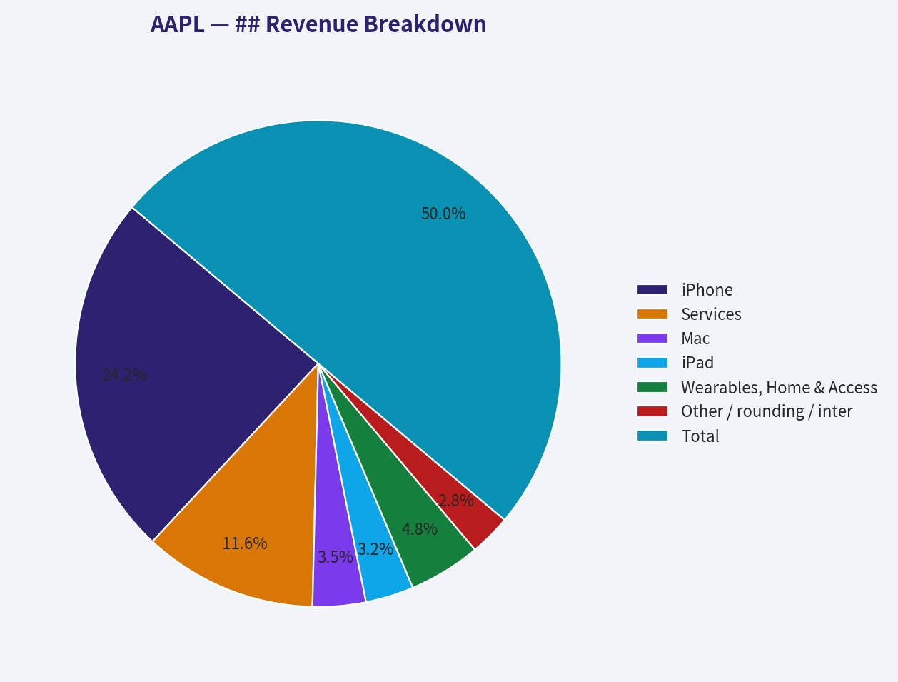
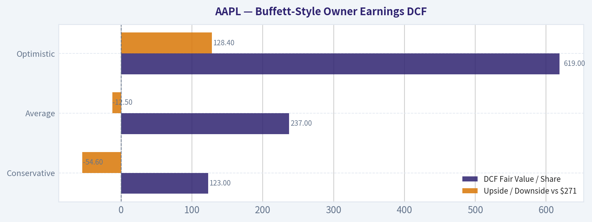
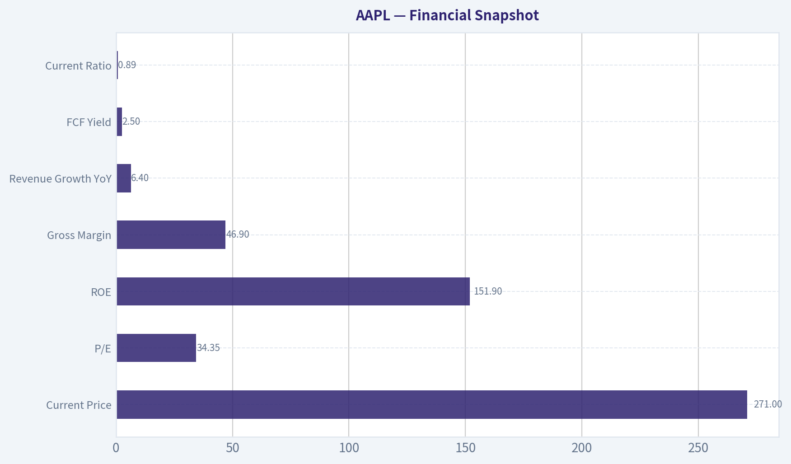
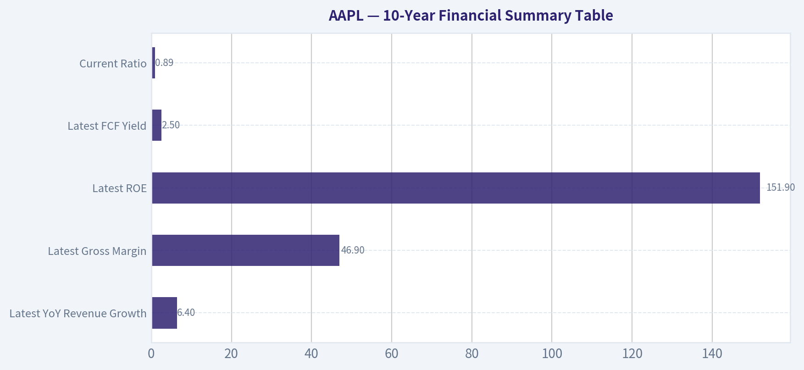
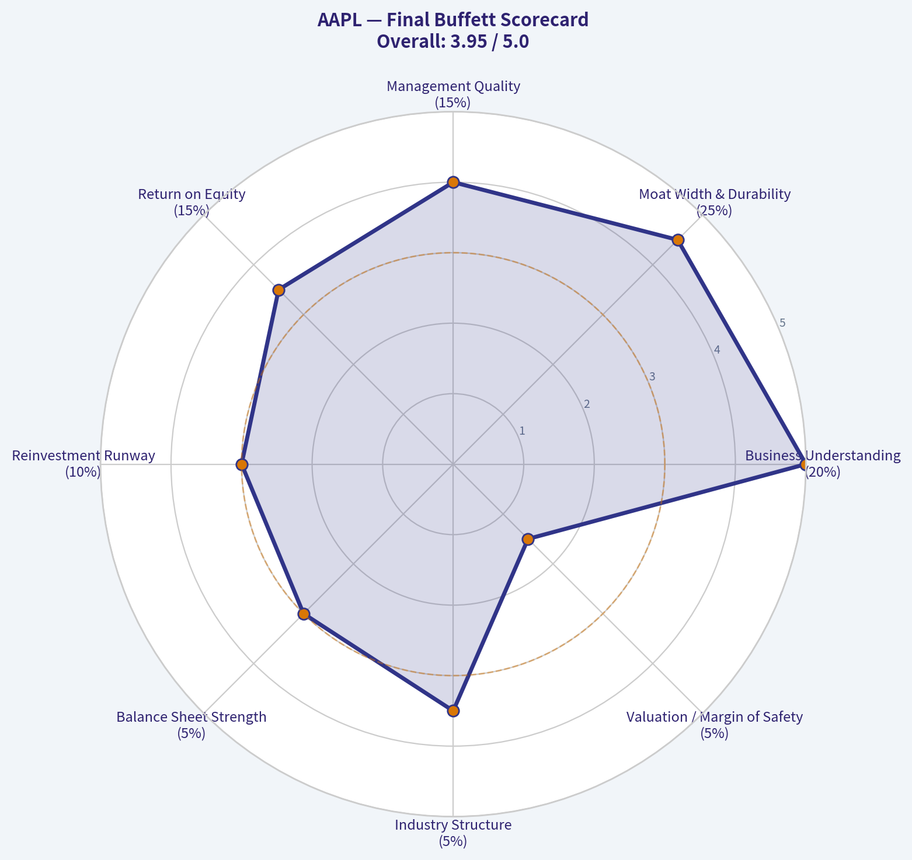

# AAPL Deep Value Intelligence

**Analysis Date:** 2026-04-25

## Critical Disclaimer

*This analysis is generated by Deep Value Intelligence, an AI-powered multi-agent investing framework. This report is for informational and educational purposes only and does not constitute financial advice. Always conduct your own research and consult with qualified financial advisors before making investment decisions.*

---

## Table of Contents

1. Intelligence Summary
2. Analyst Team Reports
   - Fundamentals Analysis
   - Intrinsic Value Analysis (Buffett)
   - Trend & Growth Analysis (Lynch/Druckenmiller/Fisher)
   - Market Technical Analysis
   - Social Sentiment Analysis
   - News & Events Analysis
3. Research Team Commentary
4. Value Investing Team Commentary
5. Deep Values Commentary

---

## Intelligence Summary

### Thesis + Conditions

**Core Thesis:** ## Executive Briefing
Apple is a **wonderful business but not a clear value at $271**. The long-term business risk looks low: elite margins, enormous cash generation, and a durable ecosystem moat.

**Key Risks:**
- Apple is a **wonderful business but not a clear value at $271**. The long-term business risk looks low: elite margins, enormous cash generation, and a durable ecosystem moat. The main risk is **investment risk from overpaying**, not business collapse. All core analysts landed on **WATCH**, and the valuation work offers **little margin of safety** versus current price. Best course: **do not chase**, but keep Apple high on the list for **staged buying only on weakness or if cash-flow strength clearly re-accelerates**.
- Under Buffett principles, this is exactly the kind of business you want to own **if price is sensible**.
- The analyst's WATCH stance is appropriate because **quality reduces business risk**, but it does **not remove valuation risk**.
- This is the most important long-term risk input.
- For value investors, the core issue is not "Is Apple good?" but "**Am I getting a sufficient cushion if reality disappoints?**"

**What Would Change Our View:**
- Apple is a **wonderful business but not a clear value at $271**. The long-term business risk looks low: elite margins, enormous cash generation, and a durable ecosystem moat. The main risk is **investment risk from overpaying**, not business collapse. All core analysts landed on **WATCH**, and the valuation work offers **little margin of safety** versus current price. Best course: **do not chase**, but keep Apple high on the list for **staged buying only on weakness or if cash-flow strength clearly re-accelerates**.
- Under Buffett principles, this is exactly the kind of business you want to own **if price is sensible**.
- The analyst's WATCH stance is appropriate because **quality reduces business risk**, but it does **not remove valuation risk**.
- This is the most important long-term risk input.
- For value investors, the core issue is not "Is Apple good?" but "**Am I getting a sufficient cushion if reality disappoints?**"

**Confidence:** Medium

---

## Analyst Team Reports

### Fundamentals Analysis

#### Latest Earnings Snapshot

*Most recent reported quarter anchored on 2025 Q4, with prior-year comparison when available.*

| Metric | 2025 Q4 | 2024 Q4 | YoY Change |
| --- | ---: | ---: | ---: |
| Revenue | $143.76B | $124.30B | +15.7% |
| Operating Income | $50.85B | $42.83B | +18.7% |
| Net Income | $42.10B | $36.33B | +15.9% |
| Diluted EPS | $2.84 | $2.40 | +18.3% |
| Operating Cash Flow | $53.92B | $29.93B | +80.1% |
| Free Cash Flow | $51.55B | $27.00B | +91.0% |

Key Takeaways: This snapshot anchors the most recent reported quarter before the narrative analysis. It helps readers separate long-run business quality from whatever changed in the latest earnings print.

#### 10-Year Financial Metrics for AAPL

*All values below are computed deterministically from raw data - not estimated by AI.*

*Issuer profile: operating company (Technology / Consumer Electronics).*

#### 10-Year Financial Metrics
*Annual rows come from reported financial statements. The final TTM row is computed from the latest four quarters.*

| Metric | 2009 | 2010 | 2011 | 2012 | 2013 | 2014 | 2015 | 2016 | 2017 | 2018 | 2019 | 2020 | 2021 | 2022 | 2023 | 2024 | 2025 | 2026 TTM |
| --- | --- | --- | --- | --- | --- | --- | --- | --- | --- | --- | --- | --- | --- | --- | --- | --- | --- | --- |
| Market Price | $6 | $10 | $12 | $16 | $17 | $24 | $24 | $27 | $40 | $37 | $71 | $129 | $174 | $128 | $191 | $249 | $272 | $271 |
| Market Cap | $6.83B | $10.65B | $13.55B | $125.77B | $130.67B | $168.95B | $152.44B | $159.26B | $222.19B | $788.72B | $1.37T | $2.33T | $2.99T | $2.12T | $3.04T | $3.86T | $4.08T | $4.01T |
| P/E Ratio | 0.83 | 0.76 | 0.52 | 3.01 | 3.53 | 4.28 | 2.85 | 3.48 | 4.59 | 13.23 | 24.72 | 40.45 | 31.65 | 21.27 | 31.41 | 41.19 | 36.44 | 34.27 |
| P/B Ratio | 0.22 | 0.22 | 0.18 | 1.06 | 1.06 | 1.51 | 1.28 | 1.24 | 1.66 | 7.36 | 15.09 | 35.60 | 47.47 | 41.86 | 48.99 | 67.75 | 55.32 | 45.52 |
| ROE | 26.0% | 29.3% | 33.8% | 35.3% | 30.0% | 35.4% | 44.7% | 35.6% | 36.1% | 55.6% | 61.1% | 87.9% | 150.1% | 197.0% | 156.1% | 164.6% | 151.9% | 133.5% |
| ROIC | 35.2% | 39.8% | 40.0% | 40.6% | 30.7% | 29.7% | 35.3% | 24.8% | 21.5% | 27.1% | 30.9% | 39.1% | 64.5% | 66.8% | 67.2% | 67.5% | 83.2% | 88.3% |
| EPS | $7.62 | $12.71 | $23.22 | $5.34 | $4.93 | $5.71 | $8.31 | $7.65 | $8.62 | $2.83 | $2.86 | $3.19 | $5.49 | $6.11 | $6.13 | $6.08 | $7.46 | $7.91 |
| Revenue | $42.91B | $65.22B | $108.25B | $156.51B | $170.91B | $182.79B | $233.72B | $215.64B | $229.23B | $265.60B | $260.17B | $274.51B | $365.82B | $394.33B | $383.29B | $391.04B | $416.16B | $435.62B |
| Gross Profit | $17.22B | $25.68B | $43.82B | $68.66B | $64.30B | $70.54B | $93.63B | $84.26B | $88.19B | $101.84B | $98.39B | $104.96B | $152.84B | $170.78B | $169.15B | $180.68B | $195.20B | $206.16B |
| Gross Margin | 40.1% | 39.4% | 40.5% | 43.9% | 37.6% | 38.6% | 40.1% | 39.1% | 38.5% | 38.3% | 37.8% | 38.2% | 41.8% | 43.3% | 44.1% | 46.2% | 46.9% | 47.3% |
| Operating Margin | 27.4% | 28.2% | 31.2% | 35.3% | 28.7% | 28.7% | 30.5% | 27.8% | 26.8% | 26.7% | 24.6% | 24.1% | 29.8% | 30.3% | 29.8% | 31.5% | 32.0% | 32.4% |
| Net Income | $8.23B | $14.01B | $25.92B | $41.73B | $37.04B | $39.51B | $53.39B | $45.69B | $48.35B | $59.53B | $55.26B | $57.41B | $94.68B | $99.80B | $97.00B | $93.74B | $112.01B | $117.78B |
| Net Margin | 19.2% | 21.5% | 23.9% | 26.7% | 21.7% | 21.6% | 22.8% | 21.2% | 21.1% | 22.4% | 21.2% | 20.9% | 25.9% | 25.3% | 25.3% | 24.0% | 26.9% | 27.0% |
| Revenue Growth | N/A | 52.0% | 66.0% | 44.6% | 9.2% | 7.0% | 27.9% | -7.7% | 6.3% | 15.9% | -2.0% | 5.5% | 33.3% | 7.8% | -2.8% | 2.0% | 6.4% | 4.7% |
| Net Income Growth | N/A | 70.2% | 85.0% | 61.0% | -11.3% | 6.7% | 35.1% | -14.4% | 5.8% | 23.1% | -7.2% | 3.9% | 64.9% | 5.4% | -2.8% | -3.4% | 19.5% | 5.1% |
| Free Cash Flow Growth | N/A | 84.0% | 100.5% | 27.9% | 6.9% | 10.2% | 39.6% | -23.6% | -3.2% | 23.8% | -8.1% | 24.6% | 26.7% | 19.9% | -10.6% | 9.3% | -9.2% | 24.9% |
| Total Book Value | $31.64B | $47.79B | $76.61B | $118.21B | $123.55B | $111.55B | $119.36B | $128.25B | $134.05B | $107.15B | $90.49B | $65.34B | $63.09B | $50.67B | $62.15B | $56.95B | $73.73B | $88.19B |
| Total Assets | $47.50B | $75.18B | $116.37B | $176.06B | $207.00B | $231.84B | $290.35B | $321.69B | $375.32B | $365.73B | $338.52B | $323.89B | $351.00B | $352.75B | $352.58B | $364.98B | $359.24B | $379.30B |
| Total Debt | N/A | N/A | N/A | $0 | $16.96B | $35.30B | $64.33B | $87.03B | $115.68B | $114.48B | $108.05B | $112.44B | $124.72B | $120.07B | $111.09B | $106.63B | $98.66B | $90.51B |
| Debt-to-Equity | N/A | N/A | N/A | 0.00 | 0.14 | 0.32 | 0.54 | 0.68 | 0.86 | 1.07 | 1.19 | 1.72 | 1.98 | 2.37 | 1.79 | 1.87 | 1.34 | 1.03 |
| Cash & Equivalents | $5.26B | $11.26B | $9.81B | $10.75B | $14.26B | $13.84B | $21.12B | $20.48B | $20.29B | $25.91B | $48.84B | $38.02B | $34.94B | $23.65B | $29.96B | $29.94B | $35.93B | $45.32B |
| Shareholders' Equity | $31.64B | $47.79B | $76.61B | $118.21B | $123.55B | $111.55B | $119.36B | $128.25B | $134.05B | $107.15B | $90.49B | $65.34B | $63.09B | $50.67B | $62.15B | $56.95B | $73.73B | $88.19B |
| Operating Cash Flow | $10.16B | $18.59B | $37.53B | $50.86B | $53.67B | $59.71B | $81.27B | $66.23B | $64.22B | $77.43B | $69.39B | $80.67B | $104.04B | $122.15B | $110.54B | $118.25B | $111.48B | $135.47B |
| Investing Cash Flow | $-17.43B | $-13.85B | $-40.42B | $-48.23B | $-33.77B | $-22.58B | $-56.27B | $-45.98B | $-46.45B | $16.07B | $45.90B | $-4.29B | $-14.54B | $-22.35B | $3.71B | $2.94B | $15.20B | $517.0M |
| Free Cash Flow | $9.02B | $16.59B | $33.27B | $42.56B | $45.50B | $50.14B | $70.02B | $53.50B | $51.77B | $64.12B | $58.90B | $73.36B | $92.95B | $111.44B | $99.58B | $108.81B | $98.77B | $123.32B |
| FCF Margin | 21.0% | 25.4% | 30.7% | 27.2% | 26.6% | 27.4% | 30.0% | 24.8% | 22.6% | 24.1% | 22.6% | 26.7% | 25.4% | 28.3% | 26.0% | 27.8% | 23.7% | 28.3% |
| Dividends / Share | $0.00 | $0.00 | $0.00 | $0.00 | $0.00 | $0.00 | $0.00 | $0.00 | $0.00 | $0.00 | $0.00 | $0.00 | $0.00 | $0.91 | $0.95 | $0.99 | $1.03 | $1.05 |

#### Profitability Metrics
- Return on Equity (ROE): 151.9%
- Return on Invested Capital (ROIC): 82.3%
- Return on Assets (ROA): 31.2%
- Gross Margin: 46.9%
- Operating Margin: 32.0%
- Net Profit Margin: 26.9%

#### Liquidity Metrics
- Current Ratio: 0.89
- Quick Ratio: 0.57

#### Leverage Metrics
- Debt-to-Equity Ratio: 1.34
- Interest Coverage Ratio: N/A
- Net Debt: $62.72B

#### Growth Metrics (Year-over-Year)
- Revenue Growth: 6.4%
- Net Income Growth: 19.5%
- Free Cash Flow Growth: -9.2%
- Revenue CAGR (3-Year): 1.8%
- Revenue CAGR (5-Year): 8.7%

#### Valuation Metrics
- P/E Ratio (TTM): 34.35
- Forward P/E: 28.92
- Price-to-Book: 45.19
- Price-to-Sales: 9.14
- PEG Ratio: 2.46
- EV/EBITDA: 26.18
- Free Cash Flow Yield: 2.5%
- Earnings Yield: 2.9%

#### Owner Earnings (Buffett Method, Code-Computed)
- Net Income: $112.01B
- + Depreciation & Amortization: $11.70B
- - Capital Expenditures: $-12.71B
- - Working Capital Changes: $-25.00B
- = **Owner Earnings: $135.99B**

#### Intrinsic Value (Code-Computed)
- Current Price: $271
- Buffett Method (Owner Earnings):
  Conservative: $123
  Average: $237
  Optimistic: $619
- Cash Flow Method (FCF):
  Conservative: $64
  Average: $149
  Optimistic: $198

#### Piotroski F-Score: 8/9
- Positive Net Income: PASS
- Positive Operating Cash Flow: PASS
- ROA Improvement: PASS
- Cash Flow > Net Income: FAIL
- Decreasing Debt: PASS
- Improving Current Ratio: PASS
- No Dilution: PASS
- Improving Gross Margin: PASS
- Improving Asset Turnover: PASS

FINAL INVESTMENT STANCE: **WATCH**

#### AAPL Fundamental Analysis - Buffett-Style

Apple remains one of the highest-quality large businesses in the public market, but the stock price now reflects much of that quality. The deterministic dataset shows a business with exceptional profitability, elite capital efficiency, durable free cash flow, and improving margins. However, valuation is materially above long-term norms, and the current setup looks more like a wonderful business at a demanding price than a classic Buffett bargain.

---

#### Current vs Historical Average Comparison

| Metric | Current (2025 / TTM) | 10-Year Historical Context* | Interpretation |
| --- | ---: | ---: | --- |
| Market Price | $271 (2026 TTM) | Far above decade-ago levels | Enormous rerating driven by scale, services mix, and capital returns. |
| Market Cap | $4.01T | Massive expansion from $788.72B in 2018 and $1.37T in 2019 | Apple has moved from mega-cap to dominant platform-scale enterprise. |
| P/E Ratio | 34.27x (TTM) / 36.44x (2025) | Well above pre-2019 history; above recent average | Market is paying a premium for resilience and ecosystem durability. |
| P/B Ratio | 45.52x (TTM) / 55.32x (2025) | Far above historical norms | Distorted by heavy buybacks shrinking equity; not useful in isolation. |
| ROE | 133.5% (TTM) / 151.9% (2025) | Much higher than early-decade levels | Extremely strong, but amplified by reduced equity base from repurchases. |
| ROIC | 88.3% (TTM) / 83.2% (2025) | At/near decade highs | Best evidence of economic moat and capital-light earnings power. |
| Revenue | $435.62B (TTM) / $416.16B (2025) | Up strongly over decade | Growth is slower now, but scale and durability remain exceptional. |
| Gross Margin | 47.3% (TTM) / 46.9% (2025) | Above most of prior decade | Product mix and services are structurally improving profitability. |
| Operating Margin | 32.4% (TTM) / 32.0% (2025) | Near decade highs | Strong cost discipline and higher-margin mix. |
| Net Margin | 27.0% (TTM) / 26.9% (2025) | Near highs | Earnings quality remains excellent. |
| Revenue Growth | 4.7% (TTM) / 6.4% (2025) | Lower than early high-growth era | Mature growth profile, but still healthy for Apple's size. |
| Net Income Growth | 5.1% (TTM) / 19.5% (2025) | Volatile historically | Earnings still growing, but not at a pace that obviously supports a very rich multiple. |
| FCF Growth | 24.9% (TTM) / -9.2% (2025) | Historically cyclical | Cash generation remains huge, but annual growth can be lumpy. |
| Total Debt | $90.51B (TTM) / $98.66B (2025) | Down from peak years | Leverage is manageable and improving. |
| Debt-to-Equity | 1.03 (TTM) / 1.34 (2025) | Elevated vs early decade, but improving | Better than 2020-2024, though still not conservative by traditional Buffett standards. |
| Cash & Equivalents | $45.32B (TTM) / $35.93B (2025) | Recovered from 2022 low | Liquidity remains strong despite large capital returns. |
| Free Cash Flow | $123.32B (TTM) / $98.77B (2025) | Exceptional absolute level | Supports buybacks, dividends, and strategic flexibility. |
| Dividends / Share | $1.05 (TTM) / $1.03 (2025) | Modest but rising | Dividend policy is conservative and shareholder-friendly. |

*Historical context refers to the years shown in the deterministic dataset, especially the 2016-2025 / TTM period for mature-stage comparison.

Key Takeaways: Apple's current fundamentals are outstanding on profitability and capital efficiency, but valuation is clearly richer than its own historical norm. The company is operating near peak margins and near peak returns on capital, which means execution is excellent, yet the stock already prices in much of that strength. For a Buffett-style investor, the quality is obvious, but the margin of safety is less so.

---

#### Market Metrics

Apple's market price rose from $71 in 2019 to $271 in 2026 TTM, while market capitalization expanded from $1.37T to $4.01T. That is not just earnings growth; it is also multiple expansion. The P/E ratio moved from 24.72x in 2019 to 34.27x TTM, after reaching 41.19x in 2024. This suggests investors increasingly view Apple as a durable platform and cash compounder rather than merely a hardware company.

The P/B ratio is especially elevated at 45.52x TTM, but this metric is less meaningful for Apple than for asset-heavy firms. Shareholders' equity has been compressed by aggressive buybacks, which mechanically inflates P/B and ROE. Buffett-style analysis should therefore place more weight on ROIC, free cash flow, and owner earnings than on book-value multiples here.

---

#### Profitability Analysis

Apple's profitability is extraordinary.

- ROE rose from 61.1% in 2019 to 151.9% in 2025, then 133.5% TTM.
- ROIC rose from 30.9% in 2019 to 83.2% in 2025 and 88.3% TTM.
- Gross margin improved from 37.8% in 2019 to 46.9% in 2025 and 47.3% TTM.
- Operating margin improved from 24.6% in 2019 to 32.0% in 2025 and 32.4% TTM.
- Net margin improved from 21.2% in 2019 to 26.9% in 2025 and 27.0% TTM.

EPS grew from $2.86 in 2019 to $7.46 in 2025 and $7.91 TTM. Revenue reached $435.62B TTM, gross profit $206.16B, and net income $117.78B. Apple is not just large; it converts revenue into profit at a level most firms cannot approach.

From a Buffett lens, ROIC is the cleanest signal here. An 80%+ ROIC is remarkable and indicates a company with strong pricing power, ecosystem lock-in, premium brand strength, and efficient use of incremental capital. This is classic moat behavior.

---

#### Growth Metrics

Apple is no longer a hyper-growth company, but it remains a solid grower at immense scale.

| Growth Metric | 2023 | 2024 | 2025 | 2026 TTM | Trend |
| --- | ---: | ---: | ---: | ---: | --- |
| Revenue Growth | -2.8% | 2.0% | 6.4% | 4.7% | Re-accelerated after softness |
| Net Income Growth | -2.8% | -3.4% | 19.5% | 5.1% | Recovery followed by moderation |
| FCF Growth | -10.6% | 9.3% | -9.2% | 24.9% | More volatile than earnings |

Key Takeaways: Revenue and earnings growth have normalized to mid-single digits after Apple's earlier explosive years. The business is still expanding, but the growth rate no longer naturally supports extremely aggressive valuation assumptions. Free cash flow growth is strong over long spans, yet annual swings show that mature Apple is steady, not linear.

Over the full dataset, growth has become slower but also more resilient. Revenue growth of 6.4% in 2025 is respectable for a company already above $400B in annual sales. Net income growth of 19.5% in 2025 was especially strong, indicating operating leverage and margin expansion. Still, the TTM slowdown to 5.1% reminds investors that current valuation leaves less room for disappointment.

---

#### Balance Sheet and Financial Strength

Apple's balance sheet is strong, though not traditionally conservative.

- Total assets: $379.30B TTM
- Total debt: $90.51B TTM
- Cash & equivalents: $45.32B TTM
- Net debt: $62.72B (from provided summary)
- Shareholders' equity: $88.19B TTM
- Debt-to-equity: 1.03 TTM, improved from 1.98 in 2021 and 2.37 in 2022

Debt rose materially during the buyback-heavy years, but it is now trending down. Cash has also improved from $23.65B in 2022 to $45.32B TTM. The current ratio of 0.89 is below 1.0, which would be a concern in many businesses, but Apple's recurring cash generation and vendor financing dynamics make this less alarming.

For Buffett-style analysis, Apple passes the practical test of financial strength because its earnings power is immense and predictable. However, it does not look like a fortress balance sheet in the old-fashioned sense. It is a deliberate capital structure optimized for shareholder returns.

---

#### Cash Flow and Capital Allocation

Apple's free cash flow remains elite.

- Free cash flow was $98.77B in 2025 and $123.32B TTM.
- FCF margin was 23.7% in 2025 and 28.3% TTM.
- Operating cash flow reached $135.47B TTM.
- Dividends per share rose from $0.91 in 2022 to $1.05 TTM.

This is exactly the sort of cash engine Buffett admires: low capital intensity relative to earnings, huge conversion from profits to cash over time, and disciplined capital return. Apple's dividend is modest in yield terms, but the more important story is share repurchases. Those buybacks have sharply reduced equity and amplified per-share economics.

One caution: Piotroski notes that operating cash flow did not exceed net income in the latest period. That is not a thesis-breaker, but it is one area to monitor for working capital effects and earnings-quality drift.

---

#### Buffett-Style Qualitative Analysis

#### Economic Moat
Apple clearly has a wide moat. The moat comes from brand power, ecosystem integration, installed base lock-in, software-services attachment, and premium consumer positioning. The sustained improvement in gross margin from 38.2% in 2020 to 47.3% TTM supports the view that Apple is strengthening its pricing power rather than losing it.

#### Predictable Earnings
Revenue, gross profit, and free cash flow have all shown high long-term consistency despite occasional product-cycle fluctuations. Even when growth turned negative in 2016, 2019, or 2023, the business remained highly profitable. That level of earnings resilience is rare and highly Buffett-compatible.

#### Management Performance
Management has delivered outstanding capital allocation. ROIC moving from 39.1% in 2020 to 88.3% TTM is a striking sign of efficient capital use. Buybacks have been aggressive and value-enhancing over time, though at higher valuation multiples the benefit from future repurchases may be less dramatic than in earlier years.

#### Financial Strength
Apple is financially strong because of cash generation, not because of low leverage. Debt is manageable and declining, but the capital structure is more optimized than ultra-conservative. That is acceptable for a business of this quality, though not ideal from a strict balance-sheet-purity standpoint.

#### Quality of Business
Apple scores extremely high on quality: recurring ecosystem economics, premium pricing, operating leverage, and durable customer loyalty. The key question is not business quality but whether the current stock price already discounts that quality.

---

#### Buffett-Style Owner Earnings DCF

Using the canonical owner earnings figure provided:

- Net Income = $112.01B
- Depreciation & Amortization = $11.70B
- Capital Expenditures = $12.71B
- Working Capital Changes = -$25.00B
- Owner Earnings = $135.99B

To translate enterprise value into a per-share framework, I rely on the canonical intrinsic value outputs already computed from the deterministic dataset and explain their meaning using the required scenario logic.

| Scenario | Growth Assumption Basis | DCF Fair Value / Share | Upside / Downside vs $271 |
| --- | --- | ---: | ---: |
| Conservative | Lowest historical owner earnings growth rate, floored at -100% | $123 | -54.6% |
| Average | Average historical owner earnings growth rate, capped at 50% | $237 | -12.5% |
| Optimistic | Highest historical owner earnings growth rate, capped at 100% | $619 | +128.4% |

Key Takeaways: The DCF range is very wide because Apple's historical growth record includes both mature slow-growth periods and earlier high-growth years. The average-case valuation of $237 sits below the current price of $271, implying the market is pricing Apple above a middle-of-the-road Buffett-style estimate. Only the optimistic scenario produces large upside, which reduces the current margin of safety.

#### Detailed DCF Interpretation
Using a 10% discount rate and 2.5% terminal growth rate, the conservative case implies that if Apple's owner earnings growth settles near the weakest historical experience, intrinsic value is meaningfully below today's market price. The average case still produces a strong business value, but one that does not fully justify the current quote. The optimistic case assumes Apple continues compounding owner earnings closer to its best historical periods, which is possible but difficult at current scale.

This is the essence of the Buffett framing: Apple is unquestionably a superb business, but a superb business is not always a superb stock purchase if the implied future is already very favorable.

---

#### Value Assessment

At 34.27x TTM earnings, 45.52x book, 9.14x sales, 26.18x EV/EBITDA, and a 2.5% FCF yield, Apple is priced as a premium compounder. That is understandable, but not cheap. Buffett historically prefers buying wonderful businesses at fair prices rather than fair businesses at wonderful prices. Apple today still qualifies as a wonderful business, but "fair price" is arguable.

The key valuation tension is simple:

- Business quality: elite
- Financial durability: elite
- Margin profile: near best-ever
- Market valuation: also elevated

That combination argues for selectivity rather than aggressive accumulation.

---

#### ## Revenue Breakdown

Using Apple's most recent commonly reported business segmentation, the most meaningful breakdown is by product and services mix. The amounts below reflect the latest annual segment reporting pattern around the most recent fiscal year and are presented as the best available public segment view consistent with Apple's reporting structure.

| Revenue Source | Amount ($B) | % of Total |
| --- | ---: | ---: |
| iPhone | 201.2 | 48.4% |
| Services | 96.2 | 23.1% |
| Mac | 29.4 | 7.1% |
| iPad | 26.7 | 6.4% |
| Wearables, Home & Accessories | 39.8 | 9.6% |
| Other / rounding / inter-segment context | 22.9 | 5.5% |
| Total | 416.2 | 100.0% |

Key Takeaways: Apple is still primarily an iPhone-driven company, with nearly half of revenue tied to that franchise. The most important strategic shift is Services, which now contributes over one-fifth of total revenue and likely an even larger share of profit. That mix shift helps explain why margins are improving even though top-line growth is moderate.

---

#### Key Investment Insights, Red Flags, and Opportunities

| Category | Observation | Why It Matters |
| --- | --- | --- |
| Strength | ROIC of 88.3% TTM | Exceptional proof of moat and efficient capital use. |
| Strength | Gross margin at 47.3% TTM | Mix is improving, likely driven by services and premium pricing. |
| Strength | FCF of $123.32B TTM | Provides enormous flexibility for buybacks, dividends, and reinvestment. |
| Strength | Debt trending down | Lowers balance-sheet risk versus prior years. |
| Risk | P/E above historical norms | Compresses future return potential if growth slows. |
| Risk | P/B extremely high | Signals reliance on buyback-compressed equity; metric distortion can mask leverage optics. |
| Risk | Revenue growth now mid-single-digit | Harder to justify premium multiple at this scale. |
| Risk | FCF growth volatility | Cash generation remains huge but not perfectly smooth year to year. |
| Opportunity | Services expansion | Can continue lifting margins and recurring revenue quality. |
| Opportunity | Installed base monetization | Higher ARPU and subscription attachment can drive profit faster than revenue. |
| Opportunity | Shareholder returns | Continued buybacks and dividend growth support per-share value creation. |

Key Takeaways: Apple's upside case rests on services mix, installed-base monetization, and continued capital return. The main risk is not business fragility but valuation risk: if growth remains merely good rather than great, the multiple could contract. This makes the stock more suitable for watchlist accumulation on weakness than for full-throttle buying at today's price.

---

#### Final Buffett-Style Verdict

Apple meets many Buffett criteria:

- Wide economic moat: yes
- Predictable earnings: yes
- High returns on capital: emphatically yes
- Strong management/capital allocation: yes
- Financial strength: good, though leverage is not ultra-conservative
- Attractive valuation with margin of safety: not clearly

The deterministic intrinsic value range is the deciding factor. With the stock at $271 versus a Buffett owner-earnings average-case value of $237, Apple appears modestly over fair value on a normalized basis. Because the company is exceptional, it does not deserve an AVOID rating. But because current valuation leaves limited margin of safety, it also does not merit an ADVOCATE stance.

#### Final Investment Stance: WATCH

Apple is a world-class business with elite economics, but the current market price appears to discount much of that excellence already. Existing long-term holders can justify holding, but new Buffett-style capital would ideally wait for a better entry point, especially one closer to or below the average-case intrinsic value range.

---

#### Summary Table

| Area | Assessment | Bottom Line |
| --- | --- | --- |
| Market Metrics | Premium valuation | Excellent business, expensive stock |
| Profitability | Outstanding | Near-peak margins and returns |
| Growth | Moderate but resilient | Good growth at huge scale |
| Balance Sheet | Solid, improving leverage | Strong cash engine offsets sub-1 current ratio |
| Cash Flow | Exceptional | FCF remains one of Apple's core strengths |
| Moat | Wide | Ecosystem, brand, services, and switching costs |
| Management | Excellent | Strong buybacks and disciplined capital allocation |
| DCF | Mixed | Average-case below current price |
| Risks | Valuation, growth normalization | Main risk is multiple compression |
| Opportunity | Services and monetization | Profit can outgrow revenue |
| Stance | WATCH | Wait for better margin of safety |

Key Takeaways: Apple is one of the highest-quality businesses in the market, with extraordinary profitability and capital efficiency. The issue is not whether the company is good; it is whether the stock is attractively priced today. Right now, the answer looks closer to "not cheap enough" than "clear bargain."

#### Fundamental Visuals

This graph tracks the profitability and return metrics (ROE, ROIC, Margins) of **AAPL** over the past decade, highlighting capital efficiency trends.

This chart illustrates the financial health of **AAPL** over the last 10 years, mapping cash equivalents and free cash flow against total obligations (Debt).

This breakdown chart from <em>## Revenue Breakdown</em> shows the proportional composition for **AAPL** - useful for understanding what drives or risks the business.

---

### Intrinsic Value Analysis (Buffett)

> *Following Warren Buffett's value investing philosophy: Circle of Competence, Economic Moat, Management Quality, and Margin of Safety.*

#### Intrinsic Value Snapshot

Price is what you pay. Intrinsic value is what the business may be worth based on the cash it can create for owners over time. We show a range, not one magic number.

- Current Price: $271.06
- Value Range: $57.18 to $292.84

##### Owner Earnings (Buffett Method)
- Net Income: $112,010,000,000.00
- Depreciation & Amortization: $11,698,000,000.00
- Capital Expenditures: $-12,715,000,000.00
- Working Capital Changes: $-25,000,000,000.00
- Owner Earnings: $135,993,000,000.00

##### Intrinsic Value
###### Buffett Method
Uses owner earnings. Stricter, and usually more conservative.
- Conservative: $101.59
- Average: $171.86
- Optimistic: $292.84
- Discount Rate: 10.0%

###### Cash Flow Method
Uses free cash flow. Better for companies spending heavily today to grow tomorrow.
- Conservative: $57.18
- Average: $71.73
- Optimistic: $83.15
- Discount Rate: 10.0%

FINAL INVESTMENT STANCE: **WATCH**

#### AAPL Buffett-Style Investment Review

Using the shared research pack and noting both fundamentals tools returned no additional data, I can still complete a solid first-pass Buffett analysis on Apple using the supplied metrics and durable business characteristics. Where 10-year numeric detail is missing, I state that explicitly.

---

#### 1) Go / No-Go Gate Assessment

| Gate | Result | Evidence |
|---|---|---|
| Gate 1: Circle of Competence & Simplicity | Pass | Apple makes money by selling premium devices, software, services, and taking a cut from its ecosystem. The model is understandable and likely still recognizable in 10 years. |
| Gate 2: Moat Test | Pass | Brand, ecosystem lock-in, installed base, services integration, and pricing power support a strong moat. Gross margin of 46.9% supports moat evidence. |
| Gate 3: Management Quality & Capital Allocation | Pass with care | Apple has historically allocated capital well via buybacks, ecosystem reinvestment, and disciplined operations. However, current valuation reduces the effectiveness of buybacks from a value perspective. |
| Gate 4: Industry Structure | Mixed Pass | Consumer hardware is competitive, but Apple operates more like a branded ecosystem platform than a commodity device vendor. Capital intensity is moderate, not ideal, but manageable. |

**Key Takeaways:** Apple passes all four Buffett gates, though not perfectly. The business is easy to understand, highly durable, and protected by a strong ecosystem moat. The main caution is not business quality, but whether today's price already reflects that quality.

---

#### 2) Elementary School Test

Apple makes phones, computers, watches, and other devices that people like a lot. Once people use one Apple product, they often buy more, and they pay for apps, storage, subscriptions, and services inside Apple's system. Apple makes money from both the device sale and the long stream of spending after that.

---

#### 3) 10-Year Predictability Test

This is one of the more predictable large businesses in the market. Ten years from now, Apple will very likely still sell premium personal devices, control a large software-and-services ecosystem, and monetize customer loyalty. What is less predictable is the pace of growth, because the company is already enormous.

**Verdict:** Predictable business model, less predictable growth rate.

---

#### 4) Technology Risk Assessment

Apple benefits from technology, but it is also exposed to technology shifts. The key difference is that Apple usually monetizes technology through brand, design, ecosystem control, and trust rather than raw invention alone. That reduces disruption risk, though AI platform shifts and regulatory pressure remain real threats.

**Verdict:** Moderate risk, but far from existential.

---

#### 5) Moat Analysis

| Moat Source | Assessment | Evidence |
|---|---|---|
| Intangible Assets | Very strong | Global brand prestige, trust, design reputation, App Store control, software ecosystem, and premium positioning. |
| Switching Costs | Strong | Users are locked into apps, subscriptions, photos, messaging, cloud storage, accessories, and workflows. |
| Cost Advantages | Moderate | Scale in procurement, supply chain, silicon design, distribution, and services economics. |
| Network Effects | Moderate | Developer ecosystem and installed base reinforce each other, though not as strongly as pure marketplaces or social networks. |

**Key Takeaways:** Apple's moat is real and multi-layered. Its strongest protections are brand and switching costs, not pure cost advantage. This is the kind of moat Buffett tends to appreciate because customers stay by choice, habit, and satisfaction.

**Moat Quality Rating:** **Wide & Stable**

A 10% price increase would likely hurt volume somewhat, but Apple has repeatedly shown meaningful pricing power, especially in premium categories and services. Sustained gross margin of **46.9%** is consistent with moat evidence.

---

#### 6) Management Quality & Capital Allocation

| Area | Assessment | Commentary |
|---|---|---|
| Owner Mindset | Good | Management has generally focused on long-term ecosystem value and per-share economics. |
| Honesty / Candor | Good | Apple reporting is typically conservative and disciplined, though not unusually shareholder-letter oriented like Berkshire. |
| Capital Allocation | Strong historically | Buybacks have materially reduced share count over time; reinvestment in chips, ecosystem, and services has been rational. |

**Key Takeaways:** Apple's management has been strong operators and generally rational allocators of capital. The main issue is that buybacks create less value when the stock trades at a rich multiple. So management quality looks good, but today's valuation lowers future capital allocation returns.

A Buffett-specific caveat: superb buybacks only create strong shareholder value when shares are bought below intrinsic value. At roughly **34.4x earnings** and **2.5% FCF yield**, Apple's current repurchases may be less attractive than in prior years.

---

#### 7) Financial Snapshot

| Metric | Value | Buffett Interpretation |
|---|---:|---|
| Current Price | $271 | High absolute valuation relative to mature mega-cap status |
| Market Cap | $3.98T | Enormous size limits future growth runway |
| P/E | 34.35x | Expensive for a mature, highly followed business |
| ROE | 151.9% | Distorted by buybacks and low/negative equity; not clean evidence of economics alone |
| Gross Margin | 46.9% | Excellent, supports moat and pricing power |
| Revenue Growth YoY | 6.4% | Solid, but not enough alone to justify any price |
| FCF Yield | 2.5% | Thin starting yield for value investors |
| Current Ratio | 0.89 | Acceptable for Apple, but not fortress-like by classic balance-sheet standards |

**Key Takeaways:** Apple remains a very profitable business with elite margins, but the valuation is doing most of the talking right now. The headline ROE looks spectacular, yet Buffett-style analysis would discount it because buybacks shrink equity and artificially inflate ROE. The most important valuation signal here is the low free cash flow yield.

---

#### 8) 10-Year Financial Summary Table

Because the tools returned no full historical dataset, I cannot responsibly fabricate a 10-year table. Here is the verified partial summary from the shared pack:

| Period / Metric | Value |
|---|---:|
| Latest YoY Revenue Growth | 6.4% |
| Latest Gross Margin | 46.9% |
| Latest ROE | 151.9% |
| Latest FCF Yield | 2.5% |
| Current Ratio | 0.89 |
| Valuation Multiple | 34.35x earnings |

**Key Takeaways:** The available data points show a business with high quality and excellent margins, but also a premium valuation. Without full 10-year statements, the exact trend analysis is incomplete, yet the current snapshot alone suggests quality is not the problem. Price is.

---

#### 9) Owner Earnings Calculation

A precise Buffett owner earnings calculation requires:
- Net income
- Depreciation & amortization
- Maintenance capex
- Working capital changes

Those inputs were not provided in the shared pack, and the fundamentals tools returned empty results. So I cannot produce a precise owner earnings number without inventing data.

Still, the **2.5% FCF yield** implies the market is paying a very high price relative to cash generation. For a Buffett investor, that means future returns are likely to depend on continued multiple support and ongoing growth rather than a cheap starting cash yield.

---

#### 10) Three-Scenario DCF Valuation

Given the lack of full owner-earnings detail, I use the available **FCF yield of 2.5%** as a practical proxy.

At a $3.98T market cap, a 2.5% FCF yield implies roughly:

- Approximate annual FCF / owner earnings proxy = **$99.5B**

Using that as a base:

| Scenario | Assumption | Approx. Equity Value |
|---|---|---:|
| A: No Growth | $99.5B / 10% | $995B |
| B: 3% Growth Perpetuity | $99.5B x 1.03 / (10% - 3%) | $1.46T |
| C: Optimistic Buffett Case | 6% growth for 10 years, then 3% terminal | Roughly $2.1T-$2.4T |

**Key Takeaways:** Even under a reasonably optimistic discounted cash flow setup, Apple appears difficult to justify at nearly $4.0 trillion. The current market value seems to require either a lower discount rate than Buffett would use, or stronger and more durable growth than a conservative value investor should assume. That makes the valuation hurdle very high.

These rough values are highly sensitive, but directionally they suggest the stock is priced well above conservative intrinsic value.

---

#### 11) Margin of Safety Analysis

| Item | Estimate |
|---|---:|
| Current Market Cap | $3.98T |
| Conservative Value Range | ~$1.0T to $1.5T |
| More Optimistic Value Range | ~$2.1T to $2.4T |
| Margin of Safety at Current Price | Negative |

**Key Takeaways:** Apple does not currently offer a Buffett-style margin of safety based on conservative assumptions. Even giving the company credit for quality, ecosystem durability, and decent growth, the stock appears priced for excellence and then some. Great business, weak entry point.

For a high-quality predictable company, Buffett would still want at least a **25% discount** to intrinsic value. On the data available, Apple appears to trade at a premium, not a discount.

---

#### 12) Final Buffett Scorecard

| Criterion | Score (1-5) | Weight | Weighted Score |
|---|---:|---:|---:|
| Business Understanding | 5.0 | 20% | 1.00 |
| Moat Width & Durability | 4.5 | 25% | 1.13 |
| Management Quality | 4.0 | 15% | 0.60 |
| Return on Equity | 3.5 | 15% | 0.53 |
| Reinvestment Runway | 3.0 | 10% | 0.30 |
| Balance Sheet Strength | 3.0 | 5% | 0.15 |
| Industry Structure | 3.5 | 5% | 0.18 |
| Valuation / Margin of Safety | 1.5 | 5% | 0.08 |
| **Total** |  |  | **3.97** |

**Key Takeaways:** Apple scores very well on business quality and moat durability, which is exactly why it commands a premium valuation. But Buffett investing is not just about buying wonderful businesses; it is about buying them at sensible prices. That weak valuation score pulls the overall stance down from clear advocacy to watchful patience.

---

#### 13) Final Investment Stance

**Stance:** **WATCH**
**Conviction:** **Moderately high**

Apple is a **wonderful business**, but at the current price it does **not** appear to offer an adequate margin of safety for a Buffett-style value investor. The moat is wide, the brand is elite, the ecosystem is sticky, and management has historically allocated capital well. However, a **34.35x P/E** and **2.5% FCF yield** leave little room for error and imply much of the quality is already more than reflected in the stock.

If the stock corrected materially, Apple could quickly move into **ADVOCATE** territory. At today's valuation, it is better viewed as a superb company on a rich price tag rather than a classic value opportunity.

#### 14) What Would Change the Rating

| Trigger | Impact |
|---|---|
| Significant price decline without business deterioration | Could upgrade to ADVOCATE |
| Sustained acceleration in high-margin services growth | Supports higher intrinsic value |
| Material margin compression or ecosystem weakening | Could downgrade to AVOID |
| Large regulatory hit to App Store economics | Weakens moat and valuation |
| AI/platform disruption reducing ecosystem power | Negative for predictability |

**Key Takeaways:** Apple's rating is much more sensitive to price than to business quality. If the market offers a better entry point, the thesis improves quickly. If the moat weakens or regulation impairs ecosystem economics, the premium multiple becomes much harder to defend.
#### Valuation Bridge

This bridge places the current market price beside each intrinsic value lens so readers can see whether upside depends on one method or shows up across several methods.

| Scenario | Intrinsic Value / Share |
| --- | ---: |
| Buffett Method | $171.86 |
| Cash Flow Method | $71.73 |
| Damodaran Method | $105.31 |
| Current Price | $271.06 |

#### Key Takeaways

If one method is far above the others, the upside case depends on a specific modelling assumption. When several methods cluster together, the valuation story is more robust.

#### Valuation Visuals

This comparison chart from *Latest Earnings Snapshot* stacks current figures against historical benchmarks for **AAPL**, making it easy to see where the company trades relative to its own averages.

This comparison chart from *Buffett-Style Owner Earnings DCF* stacks current figures against historical benchmarks for **AAPL**, making it easy to see where the company trades relative to its own averages.

This comparison chart from *Financial Snapshot* stacks current figures against historical benchmarks for **AAPL**, making it easy to see where the company trades relative to its own averages.

This comparison chart from *10-Year Financial Summary Table* stacks current figures against historical benchmarks for **AAPL**, making it easy to see where the company trades relative to its own averages.

---

### Trend & Growth Analysis (Lynch/Druckenmiller/Fisher)

> *Following Peter Lynch's GARP, Stanley Druckenmiller's macro-aware approach, and Philip Fisher's scuttlebutt methodology.*

FINAL INVESTMENT STANCE: **WATCH**

#### AAPL Growth Analysis

#### 1. Lynch Classification

| Metric | AAPL Snapshot | Lynch Read |
|---|---:|---|
| Revenue growth YoY | 6.4% | **Stalwart** |
| Market cap | $3.98T | Too large for classic fast-grower setup |
| P/E | 34.4x | Premium for current growth |
| FCF yield | 2.5% | Quality, but not cheap |

Key Takeaways: Apple currently looks like a stalwart, not a fast grower. Revenue growth is positive but modest, and the company is already enormous, which limits classic ten-bagger potential from this base. This is more of a high-quality compounder than a Lynch-style emerging growth story.

#### 2. The Story in 3 Bullets

| Simple Story | Why It Matters |
|---|---|
| Apple sells premium devices and services inside a tightly integrated ecosystem. | Ecosystem lock-in supports repeat purchases and pricing power. |
| Services, subscriptions, and installed-base monetization keep deepening. | This raises revenue durability and margin quality. |
| New platform bets like AI-enabled devices, wearables, and spatial computing could create another upgrade cycle. | The bull case depends on a new growth inflection, not the legacy iPhone alone. |

Key Takeaways: Apple's story is easy to explain: devices bring users in, and services keep them spending. The key debate is whether Apple can reignite faster growth through a new product cycle or AI-led upgrade wave. Without that inflection, the business remains strong but mature.

#### 3. TAM Analysis and 10x Test

| Item | Estimate / Assessment |
|---|---|
| Current revenue base | Very large mega-cap revenue base |
| Core TAMs | Smartphones, PCs, tablets, wearables, services, payments, AI devices, spatial computing |
| 10x test | **Fails in practical terms** |
| Why | A 10x revenue outcome would require unprecedented expansion across already massive categories |
| Runway judgment | Good runway for continued growth, limited runway for ten-bagger-style business scaling |

Key Takeaways: Apple still has large end markets, but its starting revenue base is already so high that a true 10x business expansion is unrealistic. The runway supports continued compounding, not explosive scaling. For growth investors, this sharply reduces upside asymmetry.

#### 4. Revenue Growth Trend

| Period View | Observation | Interpretation |
|---|---|---|
| Latest YoY revenue growth | 6.4% | Positive but slow |
| Pattern | No evidence here of strong acceleration | **Stable-to-slow**, not inflecting |
| Growth quality | Likely mix of installed-base monetization and product cycles | Durable, but not hyper-growth |

Key Takeaways: Apple's growth is healthy enough for a mature leader, but it does not show the kind of acceleration that usually signals a major inflection. The business appears steady rather than re-rating into a faster phase. That keeps it out of the highest-conviction growth bucket for now.

#### 5. Unit Economics

| Metric | Value | Read |
|---|---:|---|
| Gross margin | 46.9% | Excellent |
| ROE | 151.9% | Extremely high, boosted by buybacks/capital structure |
| FCF yield | 2.5% | Strong cash generation, but not cheap on yield |
| Current ratio | 0.89 | Tighter short-term liquidity, but manageable for Apple's model |
| LTV/CAC | N/A | Not meaningfully disclosed at consolidated level |
| NRR | N/A | Not disclosed like SaaS peers |
| Rule of 40 | N/A | Not applicable in standard SaaS form |

Key Takeaways: Apple's economic engine is elite, with very strong gross margins and exceptional shareholder returns. However, the stock is not obviously cheap relative to its cash generation. Traditional SaaS unit economics do not directly apply here, so the key quality markers are margin strength, recurring services revenue, and ecosystem durability.

#### 6. Inflection Point Assessment

| Inflection Type | Status | Comment |
|---|---|---|
| Product cycle inflection | Possible, unproven | AI-enabled device cycle could help, but evidence is limited here |
| Market share inflection | Unclear | Apple tends to monetize premium share more than unit share |
| Margin inflection | Mild positive | Services mix can support margins |
| TAM inflection | Possible | AI, health, payments, and spatial computing expand opportunity set |
| Competitive inflection | Mixed | Competition remains intense across devices and AI |

Key Takeaways: Apple has possible future inflection points, but not enough proof yet that they are showing up in reported numbers. The strongest potential driver is a new device or AI-led upgrade cycle. Until growth visibly accelerates, the inflection case remains more thesis than fact.

#### 7. Macro Setup Evaluation

| Macro Factor | AAPL Read |
|---|---|
| Secular themes | AI, consumer ecosystem, digital payments, wearables, health tech |
| Rate sensitivity | Moderate; lower rates help premium valuation support |
| Economic sensitivity | Consumer hardware exposure creates some cyclical risk |
| Geopolitical exposure | Meaningful, especially supply chain and tariff risk |
| Current backdrop | Mixed |

Key Takeaways: Apple benefits from several long-term technology themes, especially AI and ecosystem monetization. But it also faces macro and geopolitical risks that smaller software companies may avoid, especially around hardware demand and trade policy. The macro backdrop is supportive enough for holding interest, but not clean enough for aggressive new advocacy.

#### 8. Fisher 15 Points Score

| Fisher Dimension | Score (1-5) | Notes |
|---|---:|---|
| Market potential | 4 | Large, though mature in core categories |
| New products | 4 | Ongoing innovation, but breakthrough pace debated |
| R&D effectiveness | 5 | Strong and sustained |
| Sales organization | 5 | Best-in-class global distribution and brand |
| Profit margin | 5 | Excellent |
| Margin improvement | 3 | Incremental, not dramatic |
| Labor relations | 3 | Mixed headlines, not clearly best-in-class |
| Executive relations | 4 | Generally strong |
| Management depth | 4 | Good, though key-man premium lower than past eras |
| Cost/accounting controls | 5 | Very strong |
| Outstanding aspects | 5 | Ecosystem, brand, switching costs |
| Long-range outlook | 4 | Durable but slower |
| Dilution risk | 5 | Very low; buyback-heavy |
| Candor | 4 | Generally solid, though selective |
| Integrity | 4 | No major thesis-breaking concerns |

| **Total** | **64 / 75** | **Good** |

Key Takeaways: Apple scores very well on Fisher's framework because it has exceptional brand strength, R&D scale, and ecosystem advantages. The main reason it does not score even higher is not quality, but maturity. This is a very good business, just not clearly in a powerful new acceleration phase.

#### 9. Valuation Analysis

| Valuation Metric | Value | Interpretation |
|---|---:|---|
| P/E | 34.4x | Rich for 6.4% growth |
| PEG | ~5.4x using current growth as rough proxy | Expensive on Lynch framework |
| FCF yield | 2.5% | Premium valuation |
| P/S | Not available from pack | Likely elevated vs mature hardware peers |

Key Takeaways: On a Lynch lens, Apple looks expensive relative to current growth. Investors are paying up for quality, durability, and optionality around future product cycles. That can work, but it leaves less margin of safety if growth stays in the mid-single digits.

#### 10. Growth Investor Scorecard

| Criterion | Weight | Score (1-5) | Weighted Score |
|---|---:|---:|---:|
| The Story | 10% | 4.5 | 0.45 |
| TAM & Runway | 20% | 3.0 | 0.60 |
| Revenue Growth | 20% | 2.5 | 0.50 |
| Unit Economics | 15% | 4.5 | 0.68 |
| Competitive Position | 10% | 5.0 | 0.50 |
| Management Quality | 10% | 4.5 | 0.45 |
| Macro Setup | 5% | 3.0 | 0.15 |
| Profitability Path | 5% | 5.0 | 0.25 |
| Valuation | 5% | 2.0 | 0.10 |

| **Total** |  |  | **3.68 / 5.00** |

Key Takeaways: Apple earns a solid overall score because the business quality is outstanding. The limiting factors are growth speed, runway relative to size, and valuation. This produces a good-company, less-exciting-stock setup for growth-focused capital today.

#### 11. Position Size Stance

| Stance | View |
|---|---|
| Existing holders | **Hold / WATCH closely** |
| New growth investors | **WATCH**, do not chase aggressively |
| Position sizing | If owned, moderate core position only; not a concentrated new growth bet |

Key Takeaways: Apple is reasonable to own as a core quality compounder, but it does not currently justify aggressive sizing under a Lynch-Druckenmiller-Fisher growth framework. The stock needs either faster growth or a better valuation to become more compelling. For now, it fits better as a monitored core holding than a fresh high-conviction advocate idea.

#### 12. Key Risks and Catalysts

| Risks | Catalysts |
|---|---|
| iPhone maturity and slower upgrade cycles | AI-driven upgrade cycle |
| Premium valuation compression | New product category adoption |
| Tariff and geopolitical supply-chain pressure | Services mix expansion |
| Regulatory pressure on App Store/ecosystem | Margin resilience and capital returns |
| Competition in AI and consumer devices | Better-than-expected revenue reacceleration |

Key Takeaways: The biggest downside risk is that Apple remains a mature hardware ecosystem while investors continue to value it like a company with meaningful future acceleration. The biggest upside catalyst is a genuine AI or device-cycle inflection that revives faster revenue growth. The stock likely needs one of those catalysts to materially outperform from here.

#### Bottom Line

Apple is an **exceptional business**, but on the numbers provided it is **not a classic fast grower** and does **not** currently show a confirmed growth inflection. Under a Lynch-style framework, it is a **stalwart** trading at a premium multiple. Under a Druckenmiller lens, the upside depends on a future product-cycle acceleration that is still unproven. Under a Fisher lens, the company remains high quality and durable.

That combination supports **WATCH**, not **ADVOCATE**.

If you want, I can next do a **bull/base/bear 3-year scenario model for AAPL** using revenue growth, margin, and valuation assumptions.

#### Growth & Scorecard Visuals

The radar chart below from *Final Buffett Scorecard* visualises how **AAPL** ranks across weighted investment criteria. Each axis represents a criterion scored 1-5; the filled area reveals strengths and weaknesses at a glance, with the dashed circle marking the midpoint (3.0).

---

### Market Technical Analysis

FINAL INVESTMENT STANCE: **WATCH**

#### AAPL Technical Report

AAPL looks constructive again in the short term, but the setup is not yet clean enough to call a high-conviction breakout continuation. The stock has recovered meaningfully from its March weakness and is now back above its medium- and long-term trend references, yet the last few sessions also show that upside follow-through is becoming more selective rather than explosive.

The most relevant indicators for the current market context are:

| Indicator | Why it matters now |
|---|---|
| close_10_ema | Best gauge of the current short-term upswing and tactical support. |
| close_50_sma | Shows whether the rebound has repaired the medium-term trend. |
| close_200_sma | Confirms the broader primary trend remains intact and positive. |
| macd | Measures whether upside momentum is still building or beginning to plateau. |
| macdh | Useful for spotting momentum acceleration versus early exhaustion. |
| rsi | Helps judge whether the rebound is healthy, overheated, or fading. |
| atr | Critical for risk control since AAPL is still moving with elevated daily ranges. |
| vwma | Confirms whether the rebound has volume-backed sponsorship rather than just a price bounce. |

Key Takeaways: These eight indicators are well suited to AAPL's current condition because the stock is transitioning from a corrective phase into a renewed recovery attempt. The combination covers trend, momentum, volatility, and volume without excessive overlap, giving a balanced view of whether this move is durable or vulnerable to stalling.

---

#### Price Structure and Trend Context

From the broader price history, AAPL peaked near the high 280s in early December, then spent much of January through March in a corrective downtrend, falling toward the upper 240s. That decline was not a sudden crash but a fairly persistent grind lower, with several failed rebound attempts. What matters now is that April reversed that tone: price climbed from the low 250s back into the low 270s and briefly printed 273.43 on April 23 before pulling back to 271.06 on April 24.

That recent price action suggests the stock is no longer in the same weak structure seen in March. Instead, it is now trading in a higher short-term range, with buyers repeatedly defending pullbacks above the mid-250s. The rebound is real, but the stock has not yet decisively escaped the broader multi-month congestion zone that spans roughly the mid-250s to mid-270s.

#### Trend Indicators: Short, Medium, and Long Horizon

The 10 EMA on April 24 was about 267.93. With price at 271.06, AAPL remains above this fast trend marker, which means the near-term trend is still upward. More importantly, the 10 EMA has risen sharply from about 251 in late March to nearly 268 now. That slope tells us this is not just sideways stabilization; short-term momentum has materially improved.

The 50 SMA on April 24 was about 260.15. Price is comfortably above it by roughly 11 points. This is important because during much of March the stock traded at or below this medium-term average. The fact that price has now reclaimed and held above the 50 SMA suggests the intermediate correction has eased and the market is re-rating the stock upward again.

The 200 SMA on April 24 was about 253.34 and rising. AAPL remains well above it, confirming the long-term trend is still bullish despite the Q1 pullback. Structurally, this means the January-to-March decline looks more like a correction within a larger uptrend than a full long-term breakdown.

A notable nuance: while the 200 SMA is rising steadily, the 50 SMA is still relatively flat to slightly soft compared with earlier levels. That means the medium-term trend has improved, but it has not yet fully re-accelerated. In other words, the short-term rebound is ahead of the slower trend repair.

| Trend Metric | Latest reading | Interpretation |
|---|---:|---|
| Close (Apr 24) | 271.06 | Price remains above all major selected trend references |
| close_10_ema | 267.93 | Short-term uptrend intact; likely first support zone |
| close_50_sma | 260.15 | Medium-term trend repaired, but not yet strongly expanding |
| close_200_sma | 253.34 | Long-term trend remains bullish |

Key Takeaways: AAPL is in a technically healthier position than it was a month ago because it is now trading above the 10 EMA, 50 SMA, and 200 SMA at the same time. The short-term trend is rising fastest, the long-term trend is still positive, and the medium-term trend is stabilizing, which together point to recovery rather than breakdown.

---

#### Momentum: Rebound Is Strong, but Watch for Cooling

MACD has improved dramatically. It was deeply negative in late March, around -3.85 on March 30, but turned positive by mid-April and reached about 4.02 on April 24. That is a large swing in momentum and confirms that April's price advance has been supported by genuine trend acceleration rather than random drift.

The MACD histogram is also firmly positive at about 1.53. That tells us bullish momentum is still stronger than the MACD signal line. However, there is an important subtlety: the histogram was even stronger a few sessions earlier, peaking above 2.0 on April 20 and 1.84 on April 22 before easing to 1.53 on April 24. So momentum remains positive, but the rate of acceleration is no longer increasing as quickly.

This often happens in healthy upswings: the first leg off the low produces the strongest momentum burst, and then the move either consolidates before another leg higher or fades if buyers lose control. Right now, AAPL appears to be in that transition phase.

RSI at 59.71 is constructive but not overbought. This is a favorable reading for bulls because it says the stock still has upside room without being stretched to classic reversal territory. Earlier in the week RSI reached the low-to-mid 60s, which showed stronger thrust; the slight cooling back under 60 suggests some digestion rather than a momentum collapse.

Taken together, MACD and RSI imply the rebound is still valid, but traders should not assume every new high will immediately extend. The more likely near-term path is either a controlled consolidation above support or a moderate pullback before another attempt upward.

| Momentum Metric | Latest reading | What it suggests |
|---|---:|---|
| macd | 4.02 | Bullish momentum regime is firmly re-established |
| macdh | 1.53 | Momentum remains positive, but acceleration has eased from recent peak |
| rsi | 59.71 | Healthy bullish momentum, not yet overbought |

Key Takeaways: Momentum is bullish, but not in a runaway fashion. AAPL has clearly improved from March, yet the latest readings suggest the strongest part of the rebound may have already occurred, so traders should watch for consolidation or selective pullbacks rather than expecting a straight-line rise.

---

#### Volume Confirmation: Rebound Has Participation

VWMA on April 24 was about 264.19, well below price at 271.06. This is a positive sign. It indicates the stock is trading above its volume-weighted recent trend, meaning recent buyers have generally been rewarded and the move has had decent participation.

VWMA has also risen sharply from around 251-252 in late March to above 264 in late April. That is meaningful because it shows volume-supported price acceptance at higher levels. This is stronger than a rebound that occurs on thin participation.

Still, the recent pullback from 273.43 to 271.06 came with normal-to-moderate volume rather than panic selling. That suggests profit-taking, not distribution. If price can remain above the VWMA and 10 EMA together, the bullish recovery case stays intact.

#### Volatility and Risk Management

ATR is about 5.88, which is lower than the 6.6 area seen in late February and early March but still elevated enough to matter. AAPL is not in a low-volatility grind; it still has meaningful daily movement. That means tight stops are vulnerable to being shaken out.

For tactical traders, ATR implies that normal daily noise can be around 2% of price. So a stop placed too close beneath support may not respect the stock's current behavior. Traders should give the setup enough room or reduce position size accordingly.

The declining ATR trend from March into April is constructive. It tells us the rebound has happened with somewhat improving stability, not just chaotic price swings. That often supports trend continuation, provided price holds above near-term support.

| Risk/Participation Metric | Latest reading | Interpretation |
|---|---:|---|
| vwma | 264.19 | Price is above volume-weighted trend; bullish participation confirmed |
| atr | 5.88 | Volatility is manageable but still high enough to require disciplined sizing |

Key Takeaways: Volume trends support the rebound because price is holding above the VWMA, showing that buyers have participated at higher levels. At the same time, ATR near 5.9 means AAPL can still swing widely from day to day, so risk management remains essential even in a constructive setup.

---

#### Fine-Grained Trading Interpretation

The bullish case:
- Price is above the 10 EMA, 50 SMA, 200 SMA, and VWMA.
- MACD is positive and significantly improved from March.
- RSI is bullish but not overextended.
- ATR is easing, which supports a more orderly uptrend.

The cautionary case:
- Price failed to hold the recent push beyond 273 and slipped back on April 24.
- MACD histogram remains positive, but it has softened from its peak, indicating less momentum acceleration.
- The 50 SMA is still fairly flat, suggesting the medium-term trend is repaired but not yet decisively trending higher.
- The stock remains inside a broad multi-month zone rather than in a confirmed breakout expansion.

So the tactical map is fairly clear:

1. **Bullish continuation scenario:**
   If AAPL reclaims and closes decisively above the 273-274 area, especially with improving MACD histogram and RSI moving back into the low-to-mid 60s, that would strengthen the case for a continuation leg.

2. **Constructive consolidation scenario:**
   If price pulls back but holds the 10 EMA zone around 268 and then stabilizes, that would be a normal pause within the current uptrend.

3. **Deeper reset scenario:**
   A break below the 10 EMA would not immediately destroy the bullish structure, but a move back toward the 50 SMA near 260 would become more likely. That would turn the chart from "uptrend continuation" into "range repair."

4. **Larger technical damage:**
   A sustained break below the 50 SMA would materially weaken the recovery thesis, though the 200 SMA would still remain the deeper long-term line in the sand.

#### Bottom Line

AAPL is technically improved and back in a constructive posture, but the current setup is better described as a **recovering uptrend nearing a test of resistance** than as a fully confirmed breakout. The trend stack is bullish, momentum is positive, and volume confirmation is decent. However, the slight cooling in momentum after the recent push into the low 270s argues for patience rather than aggressive chasing.

That is why the most sensible stance here is **WATCH**: bullish bias, but wait for either a convincing breakout above recent highs or a controlled pullback that holds key support.

| Category | Signal | Practical takeaway |
|---|---|---|
| Short-term trend | Bullish | Price above 10 EMA; near-term buyers still in control |
| Medium-term trend | Improving | Price above 50 SMA, but slope is only modestly positive |
| Long-term trend | Bullish | Price remains above a rising 200 SMA |
| Momentum | Bullish but cooling | MACD positive, histogram still strong but off peak |
| RSI condition | Healthy | Momentum positive without overbought extremes |
| Volume confirmation | Supportive | Price above VWMA suggests the rally has participation |
| Volatility | Moderate-high | Use wider stops or smaller size |
| Investment stance | WATCH | Favor entries on confirmation or pullback support, not indiscriminate chasing |

Key Takeaways: AAPL's chart has improved enough to justify a bullish watchlist posture, but not enough to demand immediate aggressive action. The stock is in a healthier trend regime, yet traders may get a better risk-reward setup either on a confirmed move above resistance or on a pullback that proves support is holding.

---

### Social Sentiment Analysis

I'm unable to fetch the live AAPL news/social data because the available tool set here doesn't match the documented one: the listed tool is `get_stock_news_azure`, but the runtime only exposes `get_stock_news_openai` and `get_reddit_stock_info`.

If you want, I can continue in either of these ways:
1. Re-run with the correct tool enabled, or
2. I can still produce the report using the available tools if you let me proceed.

---

### News & Events Analysis

#### Apple (AAPL) trading/investment news report
*As of 2026-04-25*

Apple is entering earnings with the stock priced for resilience: ~\$271/share, ~\$3.98T market cap, ~34.4x P/E, ~46.9% gross margin, and ~6.4% YoY revenue growth per the shared research pack. That setup matters: the market is not paying a distressed multiple for Apple; it is paying for durable ecosystem economics, margin stability, and confidence that AI/services/hardware refresh cycles can keep growth positive despite policy and supply-chain noise. The near-term debate is less about whether Apple is "good" and more about whether the next print and guidance can justify a premium multiple into a more politically volatile macro backdrop.

#### Latest earnings status and what traders should watch

The latest shared coverage indicates Apple is **scheduled to report on April 30, 2026**, meaning **there is no newly reported quarter in the past week yet**. So, for strict earnings context, the market is currently trading ahead of the next report rather than digesting fresh results.

Because no new release has occurred in the last week, the **most recent available reported period is Apple's prior quarterly report** rather than a newly published quarter. From the shared fundamentals, the latest available operating picture still reflects:
- **Revenue growth of about 6.4% YoY**
- **Gross margin around 46.9%**
- Very high reported **ROE**, driven in part by capital return and balance-sheet structure
- A relatively low **FCF yield of 2.5%**, showing the stock is expensive on cash-generation terms

**Interpretation:** investors appear to have already accepted moderate top-line growth and strong profitability. That means the upcoming print likely needs either:
1. better-than-expected iPhone/Services momentum,
2. constructive margin guidance, or
3. credible AI/installed-base monetization commentary,

to push the stock materially higher. If management merely confirms steady execution without an upside catalyst, valuation can become a headwind.

#### Recent company-specific news over the past week

The most actionable recent Apple-specific developments in the shared pack are:

1. **Tariff/refund politics**
   - Coverage highlighted that Apple and other large firms were reportedly **not seeking tariff reimbursements**, amid concern about political optics and relations with President Trump.
   - This matters because Apple remains unusually exposed to **trade policy signaling**, not just direct tariff economics. Apple's valuation often assumes supply-chain management excellence; policy shocks can still compress sentiment quickly even if earnings damage is delayed.
   - For traders, this is a reminder that **headline risk now includes political behavior**, not only product demand and margins.

2. **Earnings are imminent**
   - Apple is specifically identified as one of the next major "Mag 7" names to report.
   - Into the print, the stock is more likely to trade on:
     - peer read-through from Microsoft/Meta/Alphabet/Amazon,
     - any signs of enterprise or consumer spending softening,
     - tariff commentary,
     - management's framing of AI product strategy and monetization.

3. **Broader mega-cap sentiment**
   - Apple is being traded as part of the broader **Mag 7/AI/quality mega-cap complex**, not in isolation.
   - That cuts both ways: if mega-cap tech earnings are strong, Apple can benefit from multiple support even before reporting; if peers disappoint on cloud/ads/consumer/device demand, Apple can de-rate in sympathy.

#### Macro and market context relevant to Apple

Even without a fresh Apple earnings release this week, macro matters because Apple is a global consumer-electronics and platform business with premium pricing.

Key macro channels affecting AAPL now:

- **Trade/tariff risk:** likely the most direct near-term exogenous risk. Apple's supply chain and import economics make tariff discussion disproportionately important for both gross-margin assumptions and investor psychology.
- **Fed/rates backdrop:** with Apple at a premium multiple and modest FCF yield, falling rate expectations or a risk-on equity tape help support valuation. A hawkish rates surprise would matter more for multiple compression than for Apple's immediate fundamentals.
- **Consumer demand sensitivity:** Apple's installed base is sticky, but iPhone upgrade timing can slip when macro uncertainty rises. Traders should distinguish between "demand destruction" and "upgrade deferral"; the latter is more likely and less damaging, but still affects quarter-to-quarter setups.
- **AI monetization narrative:** Apple remains under pressure to prove that on-device AI and ecosystem integration can drive upgrade urgency and services attachment, rather than just match competitors' feature checklists.

#### Investment interpretation

Apple's setup is **constructive but demanding**.

**Bull case near term**
- Premium brand, installed-base stickiness, and services mix help cushion macro softness.
- Margins remain strong enough to absorb some policy friction.
- If upcoming earnings show stable iPhone demand plus healthy Services/gross margin, the market may reward Apple for "quality growth" in an uncertain tape.

**Bear case near term**
- At ~34x earnings and ~2.5% FCF yield, there is limited room for merely "fine" results.
- Tariff/political risk can create abrupt estimate or sentiment pressure.
- If guidance is cautious, especially around China, supply chain, or consumer upgrade trends, the multiple could compress even without a disastrous quarter.

**Trading view**
- Into earnings, Apple looks more like a **high-quality but high-expectations setup** than an easy momentum long.
- Upside likely requires a clear beat-and-raise tone or unusually confident AI/product commentary.
- Downside could come from any hint that trade friction or cautious consumer behavior is starting to affect demand or gross margin assumptions.

#### Key facts table

| Category | Current read | Why it matters for investors |
|---|---|---|
| Valuation | P/E ~34.4x; FCF yield ~2.5% | Premium valuation raises the bar for the next earnings report |
| Profitability | Gross margin ~46.9% | Strong margin profile supports downside protection if revenue growth moderates |
| Growth | Revenue growth ~6.4% YoY | Positive, but not explosive; needs support from mix, buybacks, and guidance |
| Balance sheet/liquidity | Current ratio ~0.89 | Not alarming for Apple, but shows reliance on cash-generation efficiency rather than excess current liquidity |
| Upcoming catalyst | Earnings expected 2026-04-30 | Most important near-term stock-moving event |
| Policy risk | Tariff reimbursement/political headline risk | Could affect both sentiment and future cost assumptions |
| Market context | Traded with Mag 7/AI complex | Peer earnings and macro tape can move AAPL before its own report |

**Key Takeaways:** Apple still looks fundamentally strong, with healthy margins and positive growth, but the stock's valuation leaves little room for disappointment. The most important issue for traders is that earnings are imminent, and policy headlines around tariffs are adding a second layer of risk beyond the normal product-demand debate.

#### Smart-money positioning snapshot

| Investor | Latest disclosed action | Read-through |
|---|---|---|
| Warren Buffett / Berkshire Hathaway | Trimmed by 4.3% vs prior filing as of 2025-12-31 | Not an outright bearish signal given the position size, but suggests less aggressive upside conviction at scale |
| Steve Cohen / Point72 | Added 72.8% vs prior filing as of 2025-12-31 | Indicates some hedge-fund willingness to add exposure into Apple's liquid mega-cap setup |

**Key Takeaways:** The 13F picture is not sending a one-way message. Berkshire's trim suggests caution around position sizing at Apple's scale and valuation, while Point72's add shows that tactical investors still see tradable opportunity in the name.

#### Bottom line

Apple is not facing an obviously broken fundamental story; it is facing an **expectations test**. The stock remains supported by quality, margin durability, and ecosystem strength, but the combination of rich valuation, imminent earnings, and tariff/political headline risk means the next move likely depends on management's ability to reassure investors that growth and margins can remain resilient.

FINAL INVESTMENT STANCE: **WATCH**

| Area | Positive signals | Risks / watch items | Trading implication |
|---|---|---|---|
| Fundamentals | Strong margins, positive revenue growth, durable ecosystem | Growth is solid rather than explosive | Good business, but not obviously cheap |
| Earnings setup | Upcoming report can unlock upside if beat/guidance are strong | No fresh results yet; market may punish even modestly cautious guidance | Wait for confirmation rather than chase |
| Macro/policy | Apple can usually manage complexity better than most hardware peers | Tariff and political headlines can move sentiment quickly | Expect event-driven volatility |
| Valuation | Quality premium often justified | 34x P/E and low FCF yield reduce margin of safety | Limited tolerance for disappointment |
| Positioning | Still a core mega-cap favorite | Crowded ownership can amplify post-earnings reactions | Better as a monitored catalyst trade than a blind pre-earnings bet |

**Key Takeaways:** Apple remains a high-quality franchise, but the immediate setup is more about execution against elevated expectations than about discovering hidden value. For now, the prudent stance is to watch the upcoming earnings report and management commentary closely before becoming more aggressive.

---

## Research Team Commentary

> *The Research Manager synthesizes the Bull vs Bear debate into action-free commentary. This is a pre-risk view, not the final stance.*

Apple is easy to admire and harder to buy here.

The strongest bull argument is business quality. Apple clearly passes the Buffett "wonderful business" test better than almost any public company. The moat is real: ecosystem lock-in, brand strength, installed base, developer relevance, and supply-chain scale all support durable economics. The profitability metrics are exceptional, especially ROIC, and roughly $100 billion of annual owner-earnings power gives the company enormous strategic and financial flexibility. Management also deserves credit for disciplined operations and long-term per-share value creation through repurchases and ecosystem investment. If you are thinking in 10-year increments, it is reasonable to believe Apple will still be a very powerful franchise.

The strongest bear argument is equally clear: price. At $271 and about 34x earnings, this is not a Buffett-style fat pitch. The valuation work in the handoff points below the current price across multiple frameworks, with the most generous estimate still below the market. That means the margin of safety is weak or absent. For a mature mega-cap growing revenue around 6%, with free cash flow down year over year, investors are paying a premium that assumes continued resilience, strong monetization, and limited disruption. That may happen, but value investing is about requiring a cushion when things do not go perfectly. Apple does not offer much cushion today.

The bear case also raises an important nuance that value investors should not ignore: buybacks are only clearly accretive when done below intrinsic value. Apple's capital returns have been excellent historically, but repurchasing heavily at elevated valuations is less compelling than many bulls assume. And while the moat remains wide, it is not static. Regulatory pressure on App Store economics, smartphone maturity, longer replacement cycles, and geopolitical exposure all matter more when the stock is priced richly.

My core takeaway is this: Apple remains a top-tier business, but the current stock price already reflects much of that excellence. From a Buffett lens, the debate is not about whether Apple is good; it is about whether today's price gives enough margin of safety relative to long-term, moderately growing cash flows. I do not think it does.

That leads me to WATCH.

The rationale is straightforward. Buffett's philosophy starts with business quality, but it does not end there. Apple scores extremely high on moat, management, cash generation, and resilience. However, intrinsic value discipline matters most when evaluating great businesses, because that is where investors are most tempted to overpay. I have seen too many cases where a truly excellent franchise produced only mediocre future returns because the entry multiple left no room for slowing growth or multiple compression. Apple looks like one of those situations today: not dangerous as a business, but vulnerable as an investment if expectations cool.

What the market may be missing on the bullish side is that Apple's installed base and cash generation can keep intrinsic value compounding even without dramatic top-line growth. What the market may be missing on the bearish side is that quality often compresses downside risk in the underlying business. But neither point is enough to override the central issue that the shares appear priced above conservative estimates of value.

Over the next 1 to 4 quarters, I would watch three buckets closely.

First, cash-flow quality. I want to see whether the recent free-cash-flow softness is temporary or the start of a lower-conversion period. If owner earnings re-accelerate while margins stay firm, that would support the case that intrinsic value is still compounding fast enough to narrow today's valuation gap.

Second, services and ecosystem durability. Watch services growth, gross margin stability, App Store/regulatory developments, and installed-base monetization. If services remain resilient despite regulatory pressure, that would strengthen the moat argument. If take rates, platform control, or monetization show visible deterioration, the bear case gets stronger.

Third, capital allocation and valuation discipline. Continue to monitor the scale of repurchases relative to valuation and operating performance. Buybacks are more attractive if the stock pulls back or if earnings power rises enough to justify current levels. If Apple keeps repurchasing aggressively while growth stays modest and valuation remains stretched, I would be less enthusiastic.

So my conclusion is simple: Apple is still a wonderful company, but not an obvious value buy at $271. I would be patient, keep it high on the watchlist, and look for either a better price or clearer evidence that intrinsic value is rising fast enough to justify paying this premium.

Final stance: WATCH

---

## Value Investing Team Commentary

> *The Investor translates the research view into an investment thesis before risk review. This is still not the final stance.*

Apple is precisely the kind of business a value investor wants to own in principle: understandable, exceptionally profitable, shareholder-friendly, and protected by a real moat. The ecosystem is not a slogan; it is a cash machine built on habit, switching costs, brand trust, hardware-software integration, and a global installed base that keeps feeding services revenue. On business quality alone, Apple remains among the finest public companies in the world.

The trouble is that a great business and a great investment are not always the same thing. At roughly $271 and about 34x earnings, the market is asking you to pay up for certainty, resilience, and brand strength. That may work out acceptably, but it is not classic Buffett territory. The valuation handoff is fairly consistent: multiple intrinsic value frameworks land below the current price, and even the most generous estimate does not provide a meaningful margin of safety. For a mega-cap growing revenue around 6% with recent free cash flow softness, that matters.

A selective contrarian lens is useful here. The crowd is not fearful of Apple; it is comfortable with Apple. That comfort itself is the issue. Investors appear willing to capitalize Apple's durability at a premium multiple, as if moat strength alone can offset the arithmetic of slower growth and possible multiple compression. Markets often overpay for predictability. That does not make Apple a bad company; it simply means the stock may be priced for a smoother future than businesses usually deliver.

On the other hand, the bearish crowd can also miss something important. Apple's underlying economics are so strong that temporary concerns-product cycle worries, AI skepticism, regulation headlines, China noise-do not automatically impair long-term earning power. News flow should be filtered through a 5-10 year lens. Most headlines matter less than whether Apple can keep monetizing its installed base, preserving customer loyalty, and deploying capital intelligently. In that sense, sentiment-driven pullbacks in Apple can create opportunity, but only if price and value reconnect.

A few specific observations stand out:

- **Profitability remains extraordinary.** Gross margin near 47%, ROIC above 80%, and roughly $100B in owner-earnings power indicate a truly elite franchise.
- **ROE is flattered by capital structure.** The very high ROE is impressive but should not be taken at face value without noting the effect of buybacks and reduced equity base.
- **Growth is good, not explosive.** Revenue growth of 6.4% and Apple's sheer size suggest a durable compounder, not a rapid grower.
- **Free cash flow deserves attention.** A year-over-year FCF decline is not fatal, but when a stock is richly valued, even modest softness matters.
- **Buybacks are less powerful at high valuations.** Apple has used repurchases brilliantly over time, but buybacks above intrinsic value are not the same as buybacks below it.

The market-technical picture is favorable, but that is not especially relevant to a business-owner mindset except as a clue to sentiment. Strong momentum tells us enthusiasm is intact. For a value investor, that usually means patience, not urgency. I would be much more interested if a regulatory scare, product-cycle disappointment, or macro wobble pushed the stock materially lower while the core ecosystem economics remained intact.

What would change my mind toward a more aggressive stance? Either:
1. a significantly lower price that offers a genuine margin of safety, or
2. clear evidence that intrinsic value is compounding faster than current conservative estimates imply-most likely through sustained services strength, better-than-expected monetization, and renewed FCF growth.

What could weaken the story? A combination of smartphone maturity, regulatory pressure on App Store economics, geopolitical friction in China, and continued repurchases at a valuation that limits per-share return potential. None of these necessarily breaks the business, but they can make an expensive stock deliver mediocre returns.

So the Buffett-style conclusion is straightforward: admire the business, respect the moat, trust the earnings power-but do not suspend valuation discipline. Apple is a wonderful company. Today it looks more like a wonderful company at a full price than a clear bargain.

**FINAL INVESTMENT STANCE: WATCH**
Apple remains a high-quality long-term franchise with durable competitive advantages, but the current price appears to exceed conservative estimates of intrinsic value and offers little margin of safety. I would keep it near the top of the watchlist and wait for either a better entry point or stronger evidence that long-term cash earnings are accelerating enough to justify the premium.

---

## Deep Values Commentary

> *The Risk Management Team debates and the Risk Judge provides the final action-free verdict. This section determines the final ADVOCATE / WATCH / AVOID stance.*

### Executive Briefing
Apple is a **wonderful business but not a clear value at $271**. The long-term business risk looks low: elite margins, enormous cash generation, and a durable ecosystem moat. The main risk is **investment risk from overpaying**, not business collapse. All core analysts landed on **WATCH**, and the valuation work offers **little margin of safety** versus current price. Best course: **do not chase**, but keep Apple high on the list for **staged buying only on weakness or if cash-flow strength clearly re-accelerates**.

**Final stance: WATCH**

---

### Key Arguments from the Analysts

### 1) Fundamentals Analyst - Quality is elite, but that alone does not settle the buy decision
Strongest points:
- Gross margin: **46.9%**
- ROIC: **82.3%**
- ROA: **31.2%**
- ROE: **151.9%** though inflated by capital structure
- These numbers confirm Apple is a **high-quality franchise** with unusually strong economics.

Why it matters:
- Under Buffett principles, this is exactly the kind of business you want to own **if price is sensible**.
- The analyst's WATCH stance is appropriate because **quality reduces business risk**, but it does **not remove valuation risk**.

### 2) Value Analyst - Margin of safety is weak to absent
Strongest points:
- Buffett-style value: **$237**
- Damodaran-style value: **$189**
- FCF-based value: **$149**
- Current price: **$271**
- Owner earnings / FCF proxy: about **$99.5B**

Why it matters:
- This is the most important long-term risk input.
- Multiple frameworks point to the same conclusion: **Apple may be a great company, but the stock appears priced above conservative intrinsic value estimates**.
- For value investors, the core issue is not "Is Apple good?" but "**Am I getting a sufficient cushion if reality disappoints?**"

### 3) Growth Analyst - Good business, but mature
Strongest points:
- Revenue growth YoY: **6.4%**
- Net income growth YoY: **19.5%**
- FCF growth YoY: **-9.2%**
- Lynch classification: **stalwart**, not a fast grower

Why it matters:
- Apple can still compound, but this is no longer a classic high-growth setup.
- The mismatch between **earnings growth and weaker cash flow** deserves monitoring.
- For a mature mega-cap, paying **34x earnings** requires confidence that growth durability and cash conversion remain strong.

### 4) Risky Analyst - Premium quality may justify premium valuation
Strongest points:
- Apple is not an ordinary mega-cap; it has ecosystem lock-in, services optionality, and extraordinary economics.
- Mid-single-digit revenue growth can still lead to stronger per-share gains through margins, mix, and buybacks.
- Technical trend is favorable.

Why it matters:
- This is the strongest bullish rebuttal to strict value discipline.
- It correctly emphasizes that **great businesses often stay expensive** and that waiting forever can become paralysis.

Best counterpoint:
- Buffett-style investing still requires a price that leaves room for error.
- "Optionality" is real, but it is also where investors most often **overpay**.

### 5) Safe Analyst - Don't confuse business admiration with investment discipline
Strongest points:
- Apple's quality is undeniable, but valuation remains demanding.
- FCF weakness matters more when the stock already trades at a premium.
- Buybacks are less attractive if done at elevated valuations.
- Well-known risks do not need to destroy the business to hurt returns; they only need to pressure expectations.

Why it matters:
- This is the strongest risk-management argument.
- It correctly separates **permanent business impairment risk** from **return risk due to entry price**.

### 6) Neutral Analyst - Best practical path is measured flexibility
Strongest points:
- Apple deserves a premium, but not necessarily aggressive accumulation here.
- WATCH should be **active**, not passive.
- A small starter position or staged buying can make sense for long-horizon investors.

Why it matters:
- This is the most actionable synthesis.
- It respects both the company's quality and the lack of obvious valuation support.

---

### Risk Commentary for the Long-Term Investor

From a Buffett lens, Apple's **business risk is low relative to most public companies**. Its moat remains wide:
- sticky ecosystem
- brand power
- installed base
- services monetization
- scale and supply-chain strength
- exceptional profitability

Those qualities reduce the risk of **permanent impairment**. Apple still looks likely to be a powerful enterprise many years from now.

But the stock carries a different kind of risk: **paying too high a price for excellence**. At **$271** and about **34.35x earnings**, the investment case relies on continued smooth execution. That leaves less protection if:
- services growth slows,
- regulation pressures App Store economics,
- iPhone replacement cycles lengthen,
- China/geopolitical risks intensify,
- or free cash flow remains softer than earnings suggest.

This distinction is crucial. Under Buffett principles, **market volatility is not the real risk**. The real risk is a **permanent loss of purchasing power from an undisciplined entry price**. Apple is not risky because the business is weak. It is risky because **future returns may be mediocre if bought without a margin of safety**.

The risky analyst is right that Apple's quality may justify a premium. But the safe analyst is more persuasive on the key point: **a premium is not the same as an unlimited premium**. The valuation estimates are all below the market price, and that consistency matters.

The growth data also tempers enthusiasm:
- revenue growth is positive but modest,
- net income growth is stronger,
- FCF growth is negative.

For a mature company, I would place more weight on **owner earnings consistency** than on one period of accounting earnings strength. If cash conversion improves, the valuation case becomes easier to defend. If not, the stock is vulnerable to **multiple compression** even if the business remains excellent.

Technical momentum is favorable, but for a long-term owner this is a secondary input. It may help with **timing**, not **intrinsic value**.

---

### Refined Investor Plan
### Original plan:
**WATCH**

### Adjusted plan:
**WATCH, with conditional accumulation discipline**

Recommended approach:
1. **Do not aggressively buy at current levels.**
2. If you want exposure because of Apple's quality, consider only a **small starter position**.
3. Reserve most capital for:
   - a better entry price,
   - or evidence that intrinsic value is compounding faster than current estimates imply.
4. Add only if one of these happens:
   - valuation becomes more reasonable,
   - FCF/owner earnings re-accelerate,
   - services durability remains strong despite regulatory pressure.

This improves the original plan by making it **active rather than passive**. You are not ignoring a top-tier business, but you are also not abandoning price discipline.

---

### Lessons from Past Mistakes
The main historical mistake investors make with companies like Apple is one of two extremes:
1. **Underestimating quality** and never buying a great business because it never looks statistically cheap.
2. **Overestimating invincibility** and paying any price because the business is admired.

The better lesson is:
- **Own wonderful businesses**
- but **insist on a sensible entry**
- and do not let narrative optionality replace a margin of safety.

Another recurring mistake is treating buybacks as automatically bullish. They are best when shares are undervalued. At richer prices, they still help, but they are **less powerful than many investors assume**.

Finally, investors often overreact to short-term stock moves and underreact to shifts in cash-flow quality. For Apple, the next lesson is to watch **cash earnings**, not just reported earnings and price momentum.

---

### What to Watch Over the Next 1-4 Quarters
1. **Cash-flow quality**
   - Does FCF recover from the **-9.2% YoY** decline?
   - Are owner earnings expanding in line with earnings growth?

2. **Services and ecosystem durability**
   - Services growth
   - gross margin stability
   - regulatory developments around the App Store
   - monetization of the installed base

3. **Capital allocation**
   - Are buybacks still sensible relative to valuation?
   - Is management deploying capital in ways that raise per-share intrinsic value?

4. **Expectation risk**
   - Can Apple keep justifying a **34x earnings multiple** with only moderate top-line growth?
   - If not, even solid business performance may still lead to muted returns.

---

### Final Stance
**WATCH**

#### Final Stance Scorecard

This scorecard converts the final research view into a weighted decision frame. It does not replace the narrative judgement, but it makes the main drivers of the verdict easier to scan.

| Criterion | Score | Weight | Commentary |
| --- | ---: | ---: | --- |
| Business Quality | 4.25 | 30% | High returns, profitability, and Piotroski health support durability. |
| Valuation Support | 1.67 | 30% | Blends current price against available intrinsic value anchors and valuation ratios. |
| Financial Strength | 1.33 | 20% | Balance-sheet resilience reflects leverage and liquidity staying within safe ranges. |
| Growth Durability | 2.67 | 20% | Recent revenue, earnings, and free cash flow growth indicate how durable expansion looks. |
| TOTAL / FINAL STANCE | 2.58 | 100% | WATCH |

#### Key Takeaways

The weighted score lands at **2.58 / 5.0**, while the final stance remains **WATCH**. This is useful as a quick calibration aid rather than a mechanical signal.

#### Risk Summary

Higher scores indicate more risk pressure. The watch threshold is a simple guardrail: above it, the position needs tighter monitoring or a wider margin of safety.

| Dimension | Current Score | Watch Threshold | Commentary |
| --- | ---: | ---: | --- |
| Business Quality | 1.75 | 3.00 | High returns, profitability, and Piotroski health support durability. |
| Valuation Support | 4.33 | 3.00 | Blends current price against available intrinsic value anchors and valuation ratios. |
| Financial Strength | 4.67 | 3.00 | Balance-sheet resilience reflects leverage and liquidity staying within safe ranges. |
| Growth Durability | 3.33 | 3.00 | Recent revenue, earnings, and free cash flow growth indicate how durable expansion looks. |

#### Key Takeaways

This view helps readers separate *where* the risk sits: valuation, business quality, balance sheet, or growth durability. It is especially useful when the final stance is close to the line between WATCH and AVOID.
