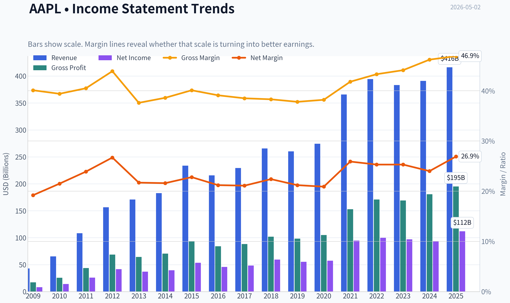
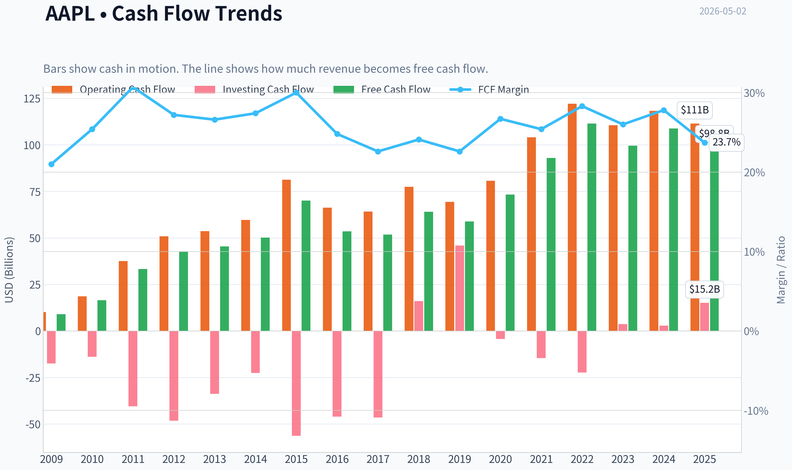
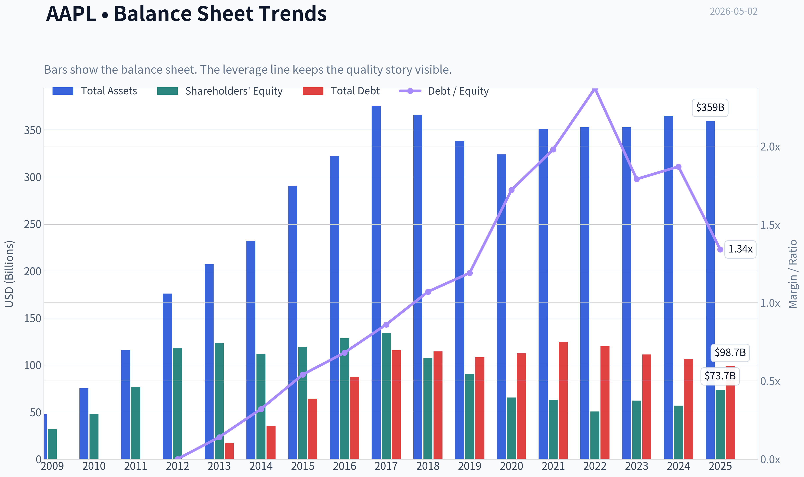
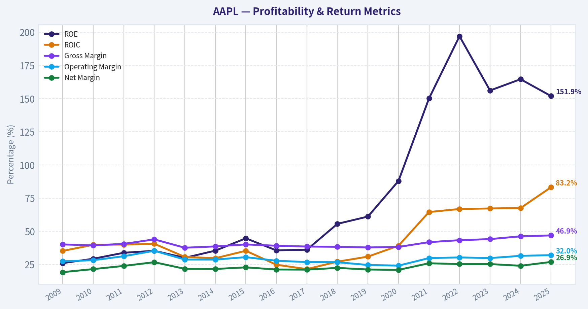
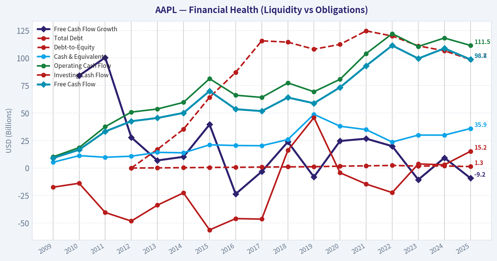
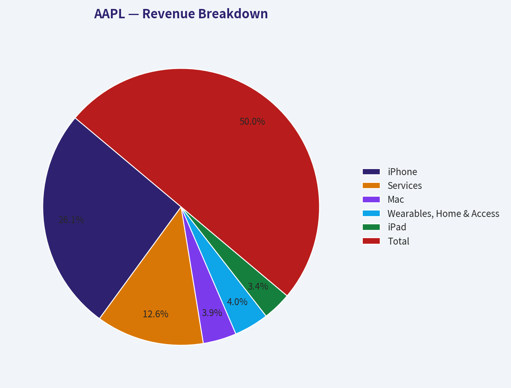
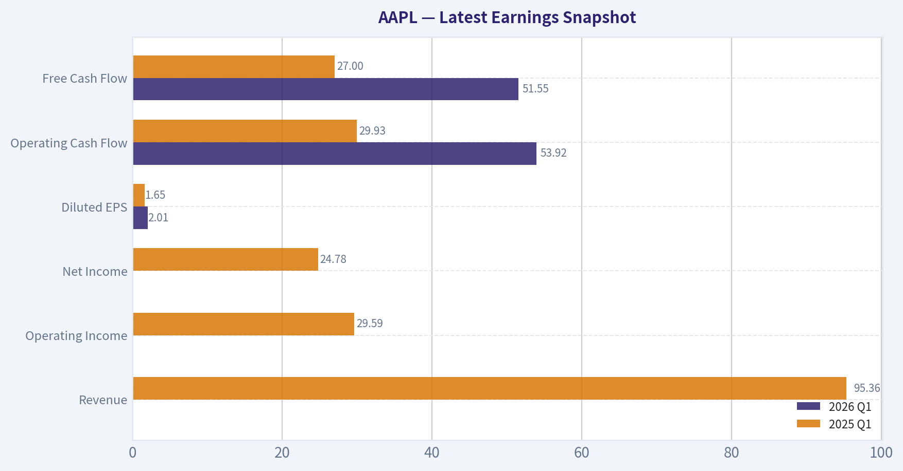
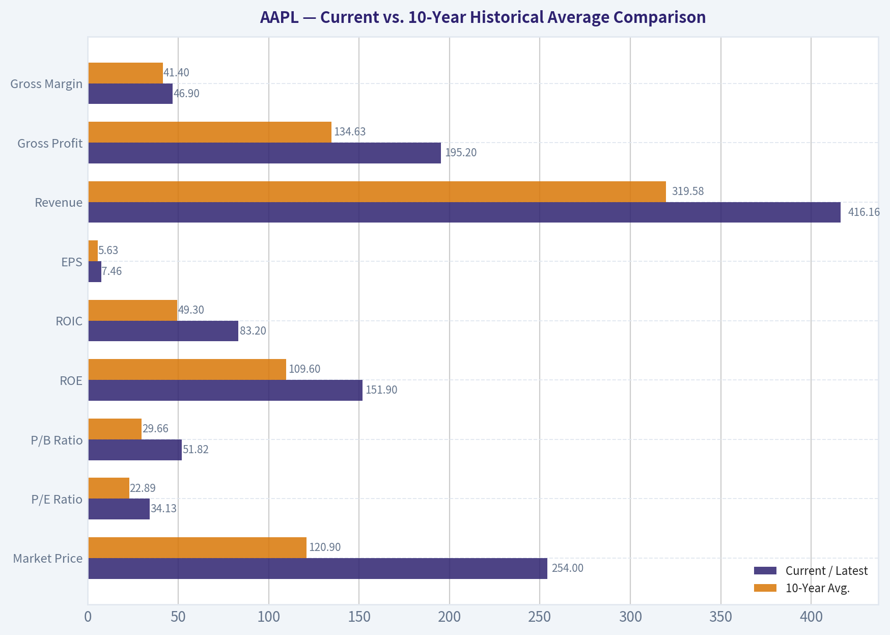
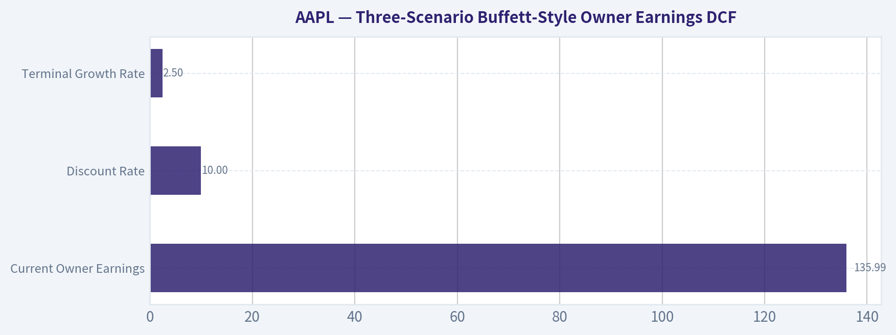
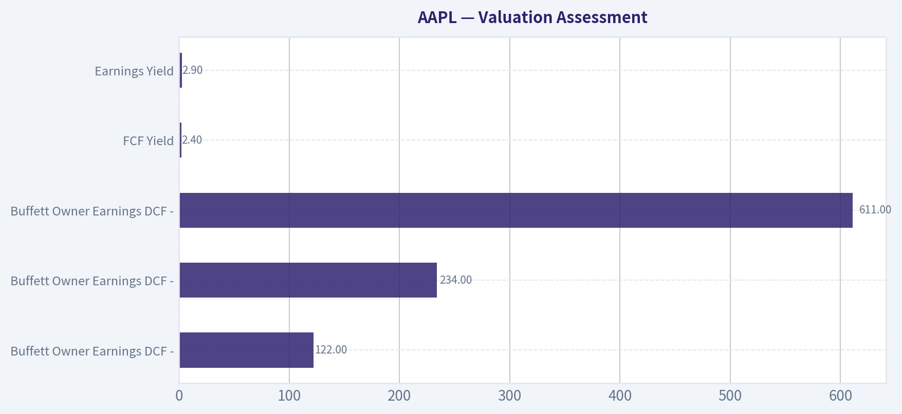

# AAPL Deep Value Intelligence

**Analysis Date:** 2026-05-02

## Critical Disclaimer

*This analysis is generated by Deep Value Intelligence, an AI-powered multi-agent investing framework. This report is for informational and educational purposes only and does not constitute financial advice. Always conduct your own research and consult with qualified financial advisors before making investment decisions.*

---

## Table of Contents

1. Intelligence Summary
2. Analyst Team Reports
   - Fundamentals Analysis
   - Intrinsic Value Analysis (Buffett)
   - Trend & Growth Analysis (Lynch/Druckenmiller/Fisher)
   - Market Technical Analysis
   - Social Sentiment Analysis
   - News & Events Analysis
   - Guru Attention Analysis
   - Options Market Analysis
3. Research Team Commentary
4. Value Investing Team Commentary
5. Deep Values Commentary

---

## Intelligence Summary

### Thesis + Conditions

**Core Thesis:** **EXECUTIVE SUMMARY**

**Key Risks:**
- Apple's business quality is undeniably elite, boasting a massive economic moat, 82.3% ROIC, and $105B in normalized owner earnings. However, at $280 per share (33.9x P/E) with revenue growing at just 6.4% and free cash flow (FCF) declining by 9.2% YoY, the stock offers **zero margin of safety**. Valuations anchored between $70 (FCF method) and $170 (Buffett average) suggest the market is fully pricing in flawless future execution and AI monetization. We refuse to overpay for quality. We are maintaining a WATCH stance, utilizing a staged conditional accumulation framework rather than outright avoidance or aggressive buying.
- The Aggressive (Risky) Case:** Apple cannot be valued on static DCF models. Its true value lies in ecosystem sovereignty, capital-return power, and the embedded optionality of distributing AI across hundreds of millions of premium devices. Waiting for a "cheap" multiple on a monopoly guarantees you will miss the compounder.
- The Conservative (Safe) Case:** Valuation matters. Paying a 34x multiple for 6.4% revenue growth and negative (-9.2%) FCF growth locks in poor forward returns. Geopolitical exposure (China) and regulatory pressures (App Store) present tangible risks to profitability. Buybacks at a massive premium destroy, rather than create, per-share value.
- The Balanced (Neutral) Case:** Both extremes are flawed. The safe case demands an unrealistic discount for a prime asset, while the aggressive case ignores basic math. The optimal approach is "watch with a conditional accumulation framework"-keeping exposure modest until FCF improves, AI monetization proves real, or the valuation resets.
- Following Warren Buffett's principles, our primary tool for risk management is the **Margin of Safety**. A wonderful business can be a terrible investment if bought at a demanding price.

**What Would Change Our View:**
- Apple's business quality is undeniably elite, boasting a massive economic moat, 82.3% ROIC, and $105B in normalized owner earnings. However, at $280 per share (33.9x P/E) with revenue growing at just 6.4% and free cash flow (FCF) declining by 9.2% YoY, the stock offers **zero margin of safety**. Valuations anchored between $70 (FCF method) and $170 (Buffett average) suggest the market is fully pricing in flawless future execution and AI monetization. We refuse to overpay for quality. We are maintaining a WATCH stance, utilizing a staged conditional accumulation framework rather than outright avoidance or aggressive buying.
- The Aggressive (Risky) Case:** Apple cannot be valued on static DCF models. Its true value lies in ecosystem sovereignty, capital-return power, and the embedded optionality of distributing AI across hundreds of millions of premium devices. Waiting for a "cheap" multiple on a monopoly guarantees you will miss the compounder.
- The Conservative (Safe) Case:** Valuation matters. Paying a 34x multiple for 6.4% revenue growth and negative (-9.2%) FCF growth locks in poor forward returns. Geopolitical exposure (China) and regulatory pressures (App Store) present tangible risks to profitability. Buybacks at a massive premium destroy, rather than create, per-share value.
- The Balanced (Neutral) Case:** Both extremes are flawed. The safe case demands an unrealistic discount for a prime asset, while the aggressive case ignores basic math. The optimal approach is "watch with a conditional accumulation framework"-keeping exposure modest until FCF improves, AI monetization proves real, or the valuation resets.
- Following Warren Buffett's principles, our primary tool for risk management is the **Margin of Safety**. A wonderful business can be a terrible investment if bought at a demanding price.

**Confidence:** Medium

---

## Analyst Team Reports

### Fundamentals Analysis

#### Latest Earnings Snapshot

*Most recent reported quarter anchored on 2026 Q1, with prior-year comparison when available.*

| Metric | 2026 Q1 | 2025 Q1 | YoY Change |
| --- | ---: | ---: | ---: |
| Revenue | N/A | $95.36B | N/A |
| Operating Income | N/A | $29.59B | N/A |
| Net Income | N/A | $24.78B | N/A |
| Diluted EPS | $2.01 | $1.65 | +21.8% |
| Operating Cash Flow | $53.92B | $29.93B | +80.1% |
| Free Cash Flow | $51.55B | $27.00B | +91.0% |

Key Takeaways: This snapshot anchors the most recent reported quarter before the narrative analysis. It helps readers separate long-run business quality from whatever changed in the latest earnings print.

#### 10-Year Financial Metrics for AAPL

*All values below are computed deterministically from raw data - not estimated by AI.*

*Issuer profile: operating company (Technology / Consumer Electronics).*

#### 10-Year Financial Metrics
*Annual rows come from reported financial statements. The final TTM row is computed from the latest four quarters.*

| Metric | 2009 | 2010 | 2011 | 2012 | 2013 | 2014 | 2015 | 2016 | 2017 | 2018 | 2019 | 2020 | 2021 | 2022 | 2023 | 2024 | 2025 |
| --- | --- | --- | --- | --- | --- | --- | --- | --- | --- | --- | --- | --- | --- | --- | --- | --- | --- |
| Market Price | $6 | $9 | $11 | $20 | $15 | $22 | $25 | $26 | $36 | $53 | $54 | $112 | $138 | $136 | $169 | $231 | $254 |
| Market Cap | $6.00B | $9.37B | $12.76B | $157.66B | $111.04B | $154.21B | $159.74B | $155.45B | $202.35B | $1.13T | $1.04T | $2.03T | $2.39T | $2.26T | $2.71T | $3.59T | $3.82T |
| P/E Ratio | 0.73 | 0.67 | 0.49 | 3.78 | 3.00 | 3.91 | 2.99 | 3.40 | 4.18 | 18.94 | 18.85 | 35.31 | 25.22 | 22.62 | 27.93 | 38.32 | 34.13 |
| P/B Ratio | 0.19 | 0.20 | 0.17 | 1.33 | 0.90 | 1.38 | 1.34 | 1.21 | 1.51 | 10.53 | 11.51 | 31.07 | 37.83 | 44.53 | 43.56 | 63.04 | 51.82 |
| ROE | 26.0% | 29.3% | 33.8% | 35.3% | 30.0% | 35.4% | 44.7% | 35.6% | 36.1% | 55.6% | 61.1% | 87.9% | 150.1% | 197.0% | 156.1% | 164.6% | 151.9% |
| ROIC | 35.2% | 39.8% | 40.0% | 40.6% | 30.7% | 29.7% | 35.3% | 24.8% | 21.5% | 27.1% | 30.9% | 39.1% | 64.5% | 66.8% | 67.2% | 67.5% | 83.2% |
| EPS | $7.62 | $12.71 | $23.22 | $5.32 | $4.90 | $5.69 | $8.27 | $7.62 | $8.59 | $2.82 | $2.86 | $3.18 | $5.48 | $6.11 | $6.13 | $6.08 | $7.46 |
| Revenue | $42.91B | $65.22B | $108.25B | $156.51B | $170.91B | $182.79B | $233.72B | $215.64B | $229.23B | $265.60B | $260.17B | $274.51B | $365.82B | $394.33B | $383.29B | $391.04B | $416.16B |
| Gross Profit | $17.22B | $25.68B | $43.82B | $68.66B | $64.30B | $70.54B | $93.63B | $84.26B | $88.19B | $101.84B | $98.39B | $104.96B | $152.84B | $170.78B | $169.15B | $180.68B | $195.20B |
| Gross Margin | 40.1% | 39.4% | 40.5% | 43.9% | 37.6% | 38.6% | 40.1% | 39.1% | 38.5% | 38.3% | 37.8% | 38.2% | 41.8% | 43.3% | 44.1% | 46.2% | 46.9% |
| Operating Margin | 27.4% | 28.2% | 31.2% | 35.3% | 28.7% | 28.7% | 30.5% | 27.8% | 26.8% | 26.7% | 24.6% | 24.1% | 29.8% | 30.3% | 29.8% | 31.5% | 32.0% |
| Net Income | $8.23B | $14.01B | $25.92B | $41.73B | $37.04B | $39.51B | $53.39B | $45.69B | $48.35B | $59.53B | $55.26B | $57.41B | $94.68B | $99.80B | $97.00B | $93.74B | $112.01B |
| Net Margin | 19.2% | 21.5% | 23.9% | 26.7% | 21.7% | 21.6% | 22.8% | 21.2% | 21.1% | 22.4% | 21.2% | 20.9% | 25.9% | 25.3% | 25.3% | 24.0% | 26.9% |
| Revenue Growth | N/A | 52.0% | 66.0% | 44.6% | 9.2% | 7.0% | 27.9% | -7.7% | 6.3% | 15.9% | -2.0% | 5.5% | 33.3% | 7.8% | -2.8% | 2.0% | 6.4% |
| Net Income Growth | N/A | 70.2% | 85.0% | 61.0% | -11.3% | 6.7% | 35.1% | -14.4% | 5.8% | 23.1% | -7.2% | 3.9% | 64.9% | 5.4% | -2.8% | -3.4% | 19.5% |
| Free Cash Flow Growth | N/A | 84.0% | 100.5% | 27.9% | 6.9% | 10.2% | 39.6% | -23.6% | -3.2% | 23.8% | -8.1% | 24.6% | 26.7% | 19.9% | -10.6% | 9.3% | -9.2% |
| Total Book Value | $31.64B | $47.79B | $76.61B | $118.21B | $123.55B | $111.55B | $119.36B | $128.25B | $134.05B | $107.15B | $90.49B | $65.34B | $63.09B | $50.67B | $62.15B | $56.95B | $73.73B |
| Total Assets | $47.50B | $75.18B | $116.37B | $176.06B | $207.00B | $231.84B | $290.35B | $321.69B | $375.32B | $365.73B | $338.52B | $323.89B | $351.00B | $352.75B | $352.58B | $364.98B | $359.24B |
| Total Debt | N/A | N/A | N/A | $0 | $16.96B | $35.30B | $64.33B | $87.03B | $115.68B | $114.48B | $108.05B | $112.44B | $124.72B | $120.07B | $111.09B | $106.63B | $98.66B |
| Debt-to-Equity | N/A | N/A | N/A | 0.00 | 0.14 | 0.32 | 0.54 | 0.68 | 0.86 | 1.07 | 1.19 | 1.72 | 1.98 | 2.37 | 1.79 | 1.87 | 1.34 |
| Cash & Equivalents | $5.26B | $11.26B | $9.81B | $10.75B | $14.26B | $13.84B | $21.12B | $20.48B | $20.29B | $25.91B | $48.84B | $38.02B | $34.94B | $23.65B | $29.96B | $29.94B | $35.93B |
| Shareholders' Equity | $31.64B | $47.79B | $76.61B | $118.21B | $123.55B | $111.55B | $119.36B | $128.25B | $134.05B | $107.15B | $90.49B | $65.34B | $63.09B | $50.67B | $62.15B | $56.95B | $73.73B |
| Operating Cash Flow | $10.16B | $18.59B | $37.53B | $50.86B | $53.67B | $59.71B | $81.27B | $66.23B | $64.22B | $77.43B | $69.39B | $80.67B | $104.04B | $122.15B | $110.54B | $118.25B | $111.48B |
| Investing Cash Flow | $-17.43B | $-13.85B | $-40.42B | $-48.23B | $-33.77B | $-22.58B | $-56.27B | $-45.98B | $-46.45B | $16.07B | $45.90B | $-4.29B | $-14.54B | $-22.35B | $3.71B | $2.94B | $15.20B |
| Free Cash Flow | $9.02B | $16.59B | $33.27B | $42.56B | $45.50B | $50.14B | $70.02B | $53.50B | $51.77B | $64.12B | $58.90B | $73.36B | $92.95B | $111.44B | $99.58B | $108.81B | $98.77B |
| FCF Margin | 21.0% | 25.4% | 30.7% | 27.2% | 26.6% | 27.4% | 30.0% | 24.8% | 22.6% | 24.1% | 22.6% | 26.7% | 25.4% | 28.3% | 26.0% | 27.8% | 23.7% |
| Dividends / Share | $0.00 | $0.00 | $0.00 | $0.00 | $0.00 | $0.00 | $0.00 | $0.00 | $0.00 | $0.00 | $0.00 | $0.00 | $0.00 | $0.91 | $0.95 | $0.99 | $1.03 |

#### Profitability Metrics
- Return on Equity (ROE): 151.9%
- Return on Invested Capital (ROIC): 82.3%
- Return on Assets (ROA): 31.2%
- Gross Margin: 46.9%
- Operating Margin: 32.0%
- Net Profit Margin: 26.9%

#### Liquidity Metrics
- Current Ratio: 0.89
- Quick Ratio: 0.57

#### Leverage Metrics
- Debt-to-Equity Ratio: 1.34
- Interest Coverage Ratio: N/A
- Net Debt: $62.72B

#### Growth Metrics (Year-over-Year)
- Revenue Growth: 6.4%
- Net Income Growth: 19.5%
- Free Cash Flow Growth: -9.2%
- Revenue CAGR (3-Year): 1.8%
- Revenue CAGR (5-Year): 8.7%

#### Valuation Metrics
- P/E Ratio (TTM): 33.92
- Forward P/E: 29.39
- Price-to-Book: 46.71
- Price-to-Sales: 9.10
- PEG Ratio: 2.44
- EV/EBITDA: 25.79
- Free Cash Flow Yield: 2.4%
- Earnings Yield: 2.9%

#### Owner Earnings (Buffett Method, Code-Computed)
- Net Income: $112.01B
- + Depreciation & Amortization: $11.70B
- - Capital Expenditures: $-12.71B
- - Working Capital Changes: $-25.00B
- = **Owner Earnings: $135.99B**

#### Intrinsic Value (Code-Computed)
- Current Price: $280
- Buffett Method (Owner Earnings):
  Conservative: $122
  Average: $234
  Optimistic: $611
- Cash Flow Method (FCF):
  Conservative: $63
  Average: $147
  Optimistic: $196

#### Piotroski F-Score: 8/9
- Positive Net Income: PASS
- Positive Operating Cash Flow: PASS
- ROA Improvement: PASS
- Cash Flow > Net Income: FAIL
- Decreasing Debt: PASS
- Improving Current Ratio: PASS
- No Dilution: PASS
- Improving Gross Margin: PASS
- Improving Asset Turnover: PASS

FINAL INVESTMENT STANCE: **WATCH**

#### AAPL Buffett-Style Fundamental Analysis

Apple remains one of the highest-quality businesses in public markets: a global consumer technology franchise with exceptional brand power, an installed base moat, high-margin Services growth, extraordinary cash generation, and elite returns on capital. However, Buffett-style investing separates business quality from investment price. At the current market price of about **$280**, Apple trades above the deterministic Owner Earnings average-case intrinsic value of **$234 per share**, while offering only a **2.4% free cash flow yield** and a P/E ratio near the high end of its historical range.

The conclusion is therefore **WATCH**, not ADVOCATE. Apple is a wonderful business, but the current valuation requires sustained double-digit Owner Earnings growth and continued margin expansion to justify the price.

---

#### Current vs. 10-Year Historical Average Comparison

*10-year averages below use the deterministic dataset period from 2016 through 2025. "Current" refers to the latest deterministic row, 2025, unless otherwise noted. Live market reference from the shared research pack shows price around $280 and market cap around $4.11T.*

| Metric | Current / Latest | 10-Year Avg. | Current vs. Avg. | Buffett-Style Interpretation |
|---|---:|---:|---:|---|
| Market Price | $254 | $120.90 | +110% | Price has risen much faster than fundamentals, increasing valuation risk. |
| Total Market Cap | $3.82T | $1.93T | +98% | Apple has nearly doubled its 10-year average market value, reflecting strong quality but also high expectations. |
| P/E Ratio | 34.13x | 22.89x | +49% | Earnings multiple is materially elevated versus history. |
| P/B Ratio | 51.82x | 29.66x | +75% | Book value is less meaningful for Apple, but the premium is extreme. |
| ROE | 151.9% | 109.6% | +42.3 pts | Exceptional, but boosted by shrinking equity from buybacks. |
| ROIC | 83.2% | 49.3% | +33.9 pts | Outstanding capital efficiency and strong evidence of a durable moat. |
| EPS | $7.46 | $5.63 | +33% | EPS has benefited from both earnings growth and aggressive repurchases. |
| Revenue | $416.16B | $319.58B | +30% | Revenue scale remains enormous, though recent growth is more mature. |
| Gross Profit | $195.20B | $134.63B | +45% | Gross profit has outpaced revenue due to stronger Services mix and pricing power. |
| Gross Margin | 46.9% | 41.4% | +5.5 pts | Margins are at a decade high, an important positive signal. |
| Operating Margin | 32.0% | 28.3% | +3.7 pts | Operating leverage and premium pricing remain strong. |
| Net Income | $112.01B | $76.35B | +47% | Profitability is structurally higher than the decade average. |
| Net Margin | 26.9% | 23.4% | +3.5 pts | Apple is converting more revenue into profit than usual. |
| Revenue Growth Rate | 6.4% | 6.5% | In line | Current growth is close to the 10-year average, not unusually strong. |
| Net Income Growth Rate | 19.5% | 9.5% | Stronger | Latest earnings growth is well above average. |
| Free Cash Flow Growth Rate | -9.2% | 5.0% | Weaker | A key red flag: FCF declined despite strong net income growth. |
| Total Book Value | $73.73B | $83.19B | -11% | Buybacks have reduced book equity over time. |
| Total Assets | $359.24B | $350.57B | +2% | Asset base is stable; Apple remains asset-light relative to earnings power. |
| Total Debt | $98.66B | $109.89B | -10% | Debt has declined from elevated levels, improving financial flexibility. |
| Debt-to-Equity Ratio | 1.34x | 1.49x | Lower | Leverage is still meaningful but better than recent average. |
| Cash & Equivalents | $35.93B | $30.80B | +17% | Cash position is healthy, though net debt remains positive. |
| Shareholders' Equity | $73.73B | $83.19B | -11% | Equity base remains compressed by capital returns. |
| Free Cash Flow | $98.77B | $81.32B | +21% | Absolute FCF is excellent, but latest YoY trend is negative. |
| Dividends / Share | $1.03 | $0.39 | +165% | Dividend has grown, but buybacks remain the dominant capital return tool. |

Key Takeaways: Apple's profitability and capital efficiency are far above its own 10-year averages, especially ROIC, gross margin, operating margin, and net margin. However, valuation has expanded even more aggressively, with P/E and P/B well above historical norms. The biggest tension is that Apple remains an exceptional business, but current pricing assumes continued excellence with limited margin for disappointment.

---

#### Revenue Breakdown

*Most recent revenue total is aligned to the deterministic 2025 revenue figure of $416.16B. Segment amounts are best-available estimates by product and service category, because precise segment detail is not included in the deterministic table.*

| Revenue Source | Amount ($B) | % of Total |
|---|---:|---:|
| iPhone | $217.0B | 52.1% |
| Services | $105.0B | 25.2% |
| Mac | $32.5B | 7.8% |
| Wearables, Home & Accessories | $33.7B | 8.1% |
| iPad | $28.0B | 6.7% |
| Total | $416.2B | 100.0% |

Key Takeaways: Apple remains highly dependent on the iPhone, which represents just over half of revenue. The most important structural improvement is Services, now roughly one-quarter of revenue and likely a major contributor to margin expansion. The business is still hardware-led, but the ecosystem increasingly monetizes through recurring, high-margin services.

---

#### Buffett-Style Qualitative Assessment

| Category | Assessment | Investment Significance |
|---|---|---|
| Economic Moat | Very strong brand, ecosystem lock-in, proprietary software, global distribution, developer ecosystem, and customer switching costs. | Apple has one of the clearest consumer moats in global equities. |
| Financial Strength | $35.93B cash and equivalents, $98.66B debt, debt-to-equity of 1.34x, current ratio of 0.89, and net debt of about $62.72B. | Balance sheet is strong because of cash generation, though liquidity ratios and net debt deserve monitoring. |
| Predictable Earnings | Revenue has grown from $215.64B in 2016 to $416.16B in 2025, while net income rose from $45.69B to $112.01B. | Earnings are more predictable than most technology businesses, though hardware cycles remain relevant. |
| Management Performance | ROE of 151.9% and ROIC of 83.2% show outstanding capital allocation efficiency. | Management has compounded per-share value through pricing power, margin discipline, and buybacks. |
| Capital Allocation | Dividends per share reached $1.03, but repurchases are the primary capital return mechanism. | Buybacks create value when shares are undervalued, but become less attractive at high multiples. |
| Business Quality | Gross margin of 46.9%, operating margin of 32.0%, and net margin of 26.9% are all very strong. | Apple is not merely a hardware company; it has software-like economics in parts of the business. |
| Valuation | Live P/E is about 33.9x, FCF yield is 2.4%, and price is above average-case Owner Earnings value. | The stock is priced as a premium compounder, leaving a thinner margin of safety. |

Key Takeaways: Apple scores extremely well on moat, profitability, capital efficiency, and management execution. The main Buffett-style concern is not business quality but price. At the current valuation, investors are paying for a near-perfect continuation of Apple's ecosystem dominance and margin expansion.

---

#### Three-Scenario Buffett-Style Owner Earnings DCF

Buffett-style Owner Earnings from the deterministic dataset:

**Owner Earnings = Net Income + Depreciation & Amortization - Capital Expenditures - Working Capital Changes**

Using the deterministic values:

**$112.01B + $11.70B - (-$12.71B) - (-$25.00B) = $135.99B Owner Earnings**

DCF assumptions:

| Input | Value |
|---|---:|
| Current Owner Earnings | $135.99B |
| Estimated Shares Outstanding | ~14.68B |
| Owner Earnings per Share | ~$9.26 |
| Discount Rate | 10.0% |
| Terminal Growth Rate | 2.5% |
| Forecast Period | 10 years |
| Current Market Price Reference | ~$280 |

Key Takeaways: Apple generates enormous Owner Earnings, roughly $136B, which is the core reason it deserves a premium valuation. The DCF uses a 10% hurdle rate, consistent with a Buffett-style required return. The key sensitivity is the growth rate: small changes in long-term Owner Earnings growth dramatically affect fair value.

DCF formula used:

\[
PV = \sum_{t=1}^{10} \frac{OE_0(1+g)^t}{(1.10)^t} + \frac{OE_0(1+g)^{10}(1.025)}{(0.10 - 0.025)(1.10)^{10}}
\]

| Scenario | Growth Input | Implied Equity Value | Fair Value / Share | Upside / Downside vs. $280 | Interpretation |
|---|---:|---:|---:|---:|---|
| Conservative | ~2.0% | ~$1.79T | $122 | -56% | Assumes Apple grows Owner Earnings only modestly; current price is far too high under this case. |
| Average | ~10.9% | ~$3.43T | $234 | -16% | Assumes strong compounding; even then, fair value is below the current market price. |
| Optimistic | ~24.0% | ~$8.97T | $611 | +118% | Requires extremely strong Owner Earnings growth and sustained margin/capital return success. |

Key Takeaways: The conservative and average scenarios both indicate overvaluation at the current price. The optimistic scenario offers large upside, but it depends on exceptional growth that may be difficult for a company already generating over $400B in annual revenue. Buffett-style investors would likely demand a lower entry price to create a margin of safety.

---

#### Valuation Assessment

Apple's valuation is high relative to its own history. The latest deterministic P/E of **34.13x** is about **49% above** the 10-year average of **22.89x**, while the P/B ratio of **51.82x** is about **75% above** the 10-year average. The live market P/E of roughly **33.9x** confirms that the stock remains expensive even after using current market data.

The fair value picture is mixed but valuation-sensitive:

| Valuation Method | Fair Value / Signal | Current Price Context |
|---|---:|---|
| Buffett Owner Earnings DCF - Conservative | $122 | Deeply overvalued |
| Buffett Owner Earnings DCF - Average | $234 | Moderately overvalued |
| Buffett Owner Earnings DCF - Optimistic | $611 | Undervalued only if growth greatly exceeds average expectations |
| FCF Yield | 2.4% | Low cash yield for a value investor |
| Earnings Yield | 2.9% | Below a 10% Buffett-style hurdle rate |
| P/E vs. 10-Year Avg. | 34.13x vs. 22.89x | Premium valuation |
| P/B vs. 10-Year Avg. | 51.82x vs. 29.66x | Very high premium |

Key Takeaways: Apple's valuation requires confidence in high future growth, continued buybacks, and durable margin expansion. The average Owner Earnings DCF value of $234 is below the current market price of about $280. This suggests the stock is not obviously cheap despite its exceptional business quality.

---

#### Key Investment Insights, Red Flags, and Opportunities

| Area | Key Point | Investor Implication |
|---|---|---|
| Moat | Apple's ecosystem, brand loyalty, hardware-software integration, and Services layer create durable competitive advantages. | Supports premium valuation and long-term earnings durability. |
| Profitability | ROIC of 83.2%, ROE of 151.9%, operating margin of 32.0%, and net margin of 26.9% are elite. | Apple remains one of the most profitable large companies in the world. |
| Margin Trend | Gross margin rose to 46.9%, well above the 10-year average of 41.4%. | Services mix and pricing power are improving economics. |
| Growth | Revenue growth of 6.4% is in line with history, while net income growth of 19.5% is above average. | Profit growth is currently better than sales growth, helped by margins and capital returns. |
| FCF Concern | Free cash flow growth was -9.2%, below the 10-year average of 5.0%. | This is the most important near-term fundamental warning sign. |
| Leverage | Debt declined to $98.66B and debt-to-equity improved to 1.34x. | Balance sheet risk is manageable but not negligible. |
| Liquidity | Current ratio of 0.89 and quick ratio of 0.57 are low. | Not alarming given cash flow strength, but worth monitoring. |
| Buybacks | Repurchases have helped EPS and ROE, but also reduced book equity. | Buybacks are less compelling when the stock trades above intrinsic value. |
| Guru Signal | Berkshire Hathaway trimmed its Apple position by 4.3% in the latest disclosed 13F. | Not a sell signal by itself, but consistent with valuation discipline. |
| Opportunity | Services, AI-enabled devices, installed base monetization, and capital returns could sustain earnings growth. | Long-term compounder potential remains intact. |
| Main Risk | Valuation compression if growth slows or margins normalize. | High-quality business can still produce poor returns if bought too expensively. |

Key Takeaways: Apple's operating quality is excellent, but valuation is the dominant risk. The business has multiple long-term opportunities, especially in Services and ecosystem monetization. However, declining free cash flow growth and an elevated earnings multiple reduce the margin of safety.

---

#### Final Investment Stance: WATCH

Apple is a classic example of a **wonderful business at a not-obviously-wonderful price**. The company has a formidable moat, exceptional returns on capital, world-class margins, massive free cash flow, and disciplined management. These are exactly the traits a Buffett-style investor wants.

However, at about **$280 per share**, the stock trades above the deterministic average-case Buffett Owner Earnings value of **$234** and far above the conservative value of **$122**. The current valuation embeds strong future compounding assumptions, while the latest free cash flow growth rate is negative.

A Buffett-style investor should **WATCH** Apple and become more aggressive only if either:
1. the price falls closer to or below average-case intrinsic value, or
2. Owner Earnings growth accelerates enough to justify the current premium.

| Final Summary Item | Assessment |
|---|---|
| Business Quality | Exceptional |
| Economic Moat | Very strong |
| Financial Strength | Strong, though net debt and liquidity ratios should be monitored |
| Profitability | Elite |
| Earnings Predictability | High relative to most technology companies |
| Capital Allocation | Strong historically, but buybacks are less attractive at elevated valuations |
| Current Valuation | Expensive versus historical averages |
| DCF Signal | Below fair value only in optimistic scenario |
| Margin of Safety | Insufficient at current price |
| Final Stance | **WATCH** |

Key Takeaways: Apple remains one of the best businesses in the market, but Buffett-style investing requires discipline on price. The stock is not a clear bargain at the current valuation, even though the company's fundamentals are excellent. The appropriate stance is to monitor closely and wait for a better margin of safety.

#### Fundamental Visuals

This graph tracks the profitability and return metrics (ROE, ROIC, Margins) of **AAPL** over the past decade, highlighting capital efficiency trends.

This chart illustrates the financial health of **AAPL** over the last 10 years, mapping cash equivalents and free cash flow against total obligations (Debt).

This breakdown chart from <em>Revenue Breakdown</em> shows the proportional composition for **AAPL** - useful for understanding what drives or risks the business.

---

### Intrinsic Value Analysis (Buffett)

> *Following Warren Buffett's value investing philosophy: Circle of Competence, Economic Moat, Management Quality, and Margin of Safety.*

#### Intrinsic Value Snapshot

Price is what you pay. Intrinsic value is what the business may be worth based on the cash it can create for owners over time. We show a range, not one magic number.

- Current Price: $280.14
- Value Range: $56.44 to $289.05

##### Owner Earnings (Buffett Method)
- Net Income: $112,010,000,000.00
- Depreciation & Amortization: $11,698,000,000.00
- Capital Expenditures: $-12,715,000,000.00
- Working Capital Changes: $-25,000,000,000.00
- Owner Earnings: $135,993,000,000.00

##### Intrinsic Value
###### Buffett Method
Uses owner earnings. Stricter, and usually more conservative.
- Conservative: $100.27
- Average: $169.64
- Optimistic: $289.05
- Discount Rate: 10.0%

###### Cash Flow Method
Uses free cash flow. Better for companies spending heavily today to grow tomorrow.
- Conservative: $56.44
- Average: $70.80
- Optimistic: $82.08
- Discount Rate: 10.0%

FINAL INVESTMENT STANCE: **WATCH**

#### Apple Inc. - Buffett-Style Value Analysis as of 2026-05-02

Apple is a **wonderful business**, but at **$280 per share**, a **$4.11 trillion market cap**, **33.9x earnings**, and roughly **2.4% free-cash-flow yield**, the current price leaves little to no Buffett-style margin of safety. I would happily own Apple at the right price, but I would not initiate or add materially here.

---

#### 1. Go/No-Go Gate Assessment

| Buffett Gate | Result | Evidence | Interpretation |
|---|---:|---|---|
| Gate 1: Circle of Competence & Simplicity | **Pass** | Apple sells iPhones, Macs, iPads, wearables, services, and software access inside a tightly integrated ecosystem. | Easy to understand: customers buy premium devices and then keep spending on services and upgrades. |
| 10-Year Predictability | **Pass, with caution** | The installed base, brand loyalty, and ecosystem are durable; however, hardware replacement cycles and AI interface shifts matter. | Apple should still be important in 10 years, but the source of growth may shift. |
| Technology Risk | **Medium** | Apple benefits from technology but could face disruption if AI agents, new interfaces, or regulation weaken App Store economics. | Not a "no," but the risk is higher than for a classic consumer staple. |
| Gate 2: Moat Test | **Pass** | Gross margin around **46.9%**, massive installed base, brand power, ecosystem lock-in, and high switching costs. | Wide moat, likely stable, though not risk-free. |
| Gate 3: Management & Capital Allocation | **Pass, with valuation concern** | Tim Cook's team has executed exceptionally; ongoing buybacks are large, including reported **$100B authorization**, but buybacks at high multiples are less compelling. | Strong operators; capital allocation is good historically, but current repurchases may not be bargain-priced. |
| Gate 4: Industry Structure | **Pass** | Premium smartphone and ecosystem economics are rational; services add recurring economics. | Apple is not in a commodity hardware race, but regulation and competition remain meaningful. |

**Key Takeaways:** Apple passes the qualitative Buffett gates because it is understandable, highly profitable, and protected by a powerful ecosystem. The biggest weaknesses are not business quality but valuation, technology transition risk, and regulatory pressure on services economics.

---

#### 2. Business Understanding - The Elementary School Test

Apple makes money by selling expensive phones, computers, tablets, watches, and headphones. After customers buy those devices, Apple also earns money when they use apps, subscriptions, cloud storage, payments, warranties, and other services. The more Apple products a customer owns, the harder it becomes to leave.

That is a simple, powerful model: **premium hardware creates the customer relationship; services and ecosystem lock-in extend the profit stream.**

---

#### 3. Moat Analysis

| Moat Source | Evidence | Strength | Buffett Interpretation |
|---|---|---:|---|
| Brand / Intangible Asset | Apple can charge premium prices while maintaining huge global demand. Gross margin is about **46.9%**. | **Very Strong** | This is one of the world's strongest consumer brands. |
| Switching Costs | iMessage, FaceTime, App Store purchases, iCloud, Apple Watch, AirPods, Apple Pay, family sharing, and device interoperability increase captivity. | **Very Strong** | Customers are not locked in by contract; they are locked in by habit, data, convenience, and identity. |
| Cost Advantage | Enormous scale in procurement, supply chain, chip design, retail, and developer ecosystem. | **Strong** | Scale helps Apple spend more than rivals while still earning superior margins. |
| Network Effects | Developers build for Apple because users spend money; users stay because apps and services are abundant. | **Moderate to Strong** | Not a pure network effect like Visa, but the ecosystem reinforces itself. |
| Pricing Power | Premium pricing persists across product cycles; services add high-margin revenue. | **Strong** | Apple likely could raise many prices without severe volume loss, though hardware elasticity exists. |

**Key Takeaways:** Apple's moat is wide because the brand, ecosystem, and switching costs reinforce each other. The moat is not based on a single patent or product; it is based on customer behavior, habit, trust, and convenience. That makes it durable, but regulation and AI-driven interface changes could pressure parts of the ecosystem over time.

**Moat Rating:** **Wide & Stable**
Not clearly "wide and widening" at today's size, but still among the strongest consumer moats in the world.

---

#### 4. Management Quality & Capital Allocation

| Question | Assessment | Evidence |
|---|---|---|
| Do they think like owners? | **Generally yes** | Apple has relentlessly focused on per-share value through buybacks, operational discipline, and ecosystem expansion. |
| Are they candid and conservative? | **Mostly yes** | Apple's reporting is generally clean and understandable; no major accounting red flags are central to the thesis. |
| Are they rational capital allocators? | **Historically excellent, currently mixed** | Buybacks have created enormous value historically, but repurchasing aggressively at ~34x earnings and ~2.4% FCF yield is less obviously attractive. |
| Use of debt | **Acceptable, but not fortress-like** | Apple has used debt while holding enormous liquidity, but current ratio around **0.89** and reduced equity from buybacks make headline ROE less meaningful. |
| Reinvestment discipline | **Strong** | Apple funds R&D, silicon design, services, supply chain, and ecosystem expansion while returning excess capital. |

**Key Takeaways:** Apple's management has been outstanding operationally, and Tim Cook's execution record is exceptional. The main capital allocation concern is not recklessness but valuation: buybacks are far more powerful when the stock is cheap than when it trades at a premium multiple.

---

#### 5. 10-Year Financial Summary

Approximate figures in USD billions, using historical Apple filings through recent years and current research-pack metrics for the latest period.

| Fiscal Year / TTM | Revenue | Gross Margin | Net Income | Operating Cash Flow | CapEx | Free Cash Flow | ROE / Comment |
|---:|---:|---:|---:|---:|---:|---:|---|
| 2016 | 215.6 | 39.1% | 45.7 | 65.8 | 12.7 | 53.1 | ROE strong |
| 2017 | 229.2 | 38.5% | 48.4 | 63.6 | 12.5 | 51.1 | ROE strong |
| 2018 | 265.6 | 38.3% | 59.5 | 77.4 | 13.3 | 64.1 | ROE rising |
| 2019 | 260.2 | 37.8% | 55.3 | 69.4 | 10.5 | 58.9 | Stable despite iPhone cycle |
| 2020 | 274.5 | 38.2% | 57.4 | 80.7 | 7.3 | 73.4 | Cash conversion strong |
| 2021 | 365.8 | 41.8% | 94.7 | 104.0 | 11.1 | 92.9 | Major step-up year |
| 2022 | 394.3 | 43.3% | 99.8 | 122.2 | 10.7 | 111.4 | Peak cash generation |
| 2023 | 383.3 | 44.1% | 97.0 | 110.5 | 11.0 | 99.6 | Revenue dipped, margins held |
| 2024 | 391.0 | 46.2% | 93.7 | 118.3 | 9.4 | 108.8 | Margin expansion continued |
| Current / TTM | ~415-420 | **46.9%** | ~121 implied by P/E | ~110-125 est. | ~10-12 est. | ~99 implied by FCF yield | Reported ROE **151.9%**, distorted by buybacks |

**Key Takeaways:** Apple has compounded revenue, margins, and free cash flow impressively over the past decade. The most important trend is margin expansion: gross margin rose from below 40% to nearly 47%, showing the increasing importance of services, premium pricing, and ecosystem economics. Reported ROE is extremely high, but it is inflated by Apple's massive buybacks and shrinking book equity, so cash generation is the more reliable measure.

---

#### 6. Owner Earnings Calculation

Buffett's owner earnings formula:

> Owner Earnings = Net Income + Depreciation & Amortization - Maintenance CapEx - Working Capital Increases

For Apple, free cash flow is a reasonable practical proxy because the business is capital-light relative to earnings and does not require massive physical reinvestment to maintain its competitive position.

| Item | Approximate Current Figure |
|---|---:|
| Market Cap | **$4.11T** |
| Current Share Price | **$280** |
| Implied Shares Outstanding | ~14.68B |
| Net Income Implied by 33.9x P/E | ~$121B |
| Free Cash Flow Implied by 2.4% FCF Yield | ~$99B |
| Normalized Owner Earnings Estimate | **~$105B** |

**Key Takeaways:** Apple is an extraordinary cash machine, likely producing around $100 billion or more of annual owner earnings. However, the market is already valuing that cash stream at more than $4 trillion, which means investors are paying a very high price for each dollar of current cash flow.

---

#### 7. Balance Sheet and Cash Flow Reality Check

| Metric | Current / Recent Reading | Buffett View |
|---|---:|---|
| Operating Cash Flow vs Net Income | Generally strong over time | Cash generation supports reported earnings quality. |
| FCF Yield | **2.4%** | Low; implies a rich valuation. |
| Current Ratio | **0.89** | Not alarming for Apple, but not a classic fortress current ratio. |
| Gross Margin | **46.9%** | Excellent and moat-supportive. |
| ROE | **151.9%** | Economically impressive but accounting-distorted by buybacks. |
| Debt Use | Manageable | Apple is financially strong, though not "net-cash fortress" in the old Apple sense. |

**Key Takeaways:** Apple's earnings quality remains high because the company converts profits into cash. The concern is valuation, not solvency. The balance sheet is still strong in practical terms, but the current ratio below 1 and very high ROE should be interpreted carefully because Apple's capital structure has been heavily shaped by buybacks.

---

#### 8. Three-Scenario DCF Valuation

Assumptions:
- Base normalized owner earnings: **$105B**
- Discount rate: **10%**
- Shares outstanding: approximately **14.68B**
- Terminal growth in growth cases: **3%**
- Historical-growth scenario uses **6% annual owner earnings growth for 10 years**, then 3% terminal growth.

| Scenario | Assumptions | Equity Value Estimate | Intrinsic Value / Share |
|---|---|---:|---:|
| A: No Growth | Owner earnings capitalized at 10% | ~$1.05T | **~$72** |
| B: GDP Growth | 3% perpetual growth | ~$1.55T | **~$105** |
| C: Conservative Historical Growth | 6% for 10 years, then 3% terminal | ~$1.93T | **~$131** |

**Key Takeaways:** Even with continued growth, the conservative DCF does not come close to today's $280 share price. The market is pricing Apple as if very high cash-flow growth can continue for a long time from an already enormous base. That may happen, but it is not a Buffett-style bargain.

---

#### 9. Margin of Safety Analysis

| Measure | Estimate |
|---|---:|
| Current Price | **$280** |
| Conservative Intrinsic Value Range | **~$105-$131 per share** |
| High-Quality Required Margin of Safety | At least **25%** |
| Buy Zone Using $131 Value and 25% Margin | **~$98 or below** |
| Premium to Conservative Value | More than **100% above** conservative value |
| Current Margin of Safety | **Negative** |

**Key Takeaways:** Apple may be a wonderful company, but the stock does not currently offer a margin of safety under conservative assumptions. To justify today's price, investors must assume either much faster long-term growth, structurally higher margins, a lower discount rate, or unusually persistent buyback-driven per-share compounding. That is possible, but it is not conservative.

---

#### 10. Guru / Buffett Context

| Investor | Recent Action | Position Detail | Interpretation |
|---|---:|---|---|
| Warren Buffett / Berkshire Hathaway | **Trimmed** | Latest disclosed position: about **227.9M shares**, worth roughly **$62B**, still around **22.6%** of portfolio. | Buffett still regards Apple as a great business, but Berkshire has reduced exposure. |
| Steve Cohen / Point72 | **Added** | Smaller position, increased significantly. | Less relevant to Buffett-style long-term ownership due to different investing style. |

**Key Takeaways:** Berkshire's continued large Apple stake validates Apple's business quality, but the trim matters. Buffett's ownership does not mean Apple is automatically attractive at any price. The relevant question today is not "Is Apple great?" but "Is Apple great enough to justify $4.11 trillion?"

---

#### 11. Final Buffett Scorecard

| Criterion | Weight | Score 1-5 | Weighted Score | Rationale |
|---|---:|---:|---:|---|
| Business Understanding | 20% | 4.5 | 0.90 | Simple, powerful model built on devices plus ecosystem services. |
| Moat Width & Durability | 25% | 4.5 | 1.13 | Brand, switching costs, scale, and ecosystem are exceptional. |
| Management Quality | 15% | 3.5 | 0.53 | Excellent operators; buybacks at high valuations are less compelling. |
| Return on Equity | 15% | 3.0 | 0.45 | Economic returns are superb, but reported ROE is distorted by buybacks. |
| Reinvestment Runway | 10% | 2.5 | 0.25 | Still opportunities in services, AI, wearables, and emerging markets, but the base is enormous. |
| Balance Sheet Strength | 5% | 2.5 | 0.13 | Strong practical liquidity, but current ratio below 1 and no longer old-style net-cash fortress. |
| Industry Structure | 5% | 3.5 | 0.18 | Premium ecosystem is attractive; regulatory and technology risks remain. |
| Valuation / Margin of Safety | 5% | 1.0 | 0.05 | No conservative margin of safety at current price. |
| **Total** | **100%** |  | **3.61 / 5.00** | High-quality business, unattractive current entry price. |

**Key Takeaways:** Apple scores very well as a business but poorly as an investment at today's valuation. The weighted score is helped by Apple's extraordinary quality, but the valuation score is decisive for a Buffett-style investor. A great company can still be a poor purchase if the price assumes too much perfection.

---

#### 12. Final Investment Stance

**Stance: WATCH**
**Conviction: High**

Apple is a **wonderful company with a wide moat**, outstanding customer loyalty, superb cash generation, and one of the best consumer ecosystems ever built. But Buffett investing requires both business quality and price discipline. At **$280 per share**, Apple trades far above my conservative estimate of intrinsic value and offers **no margin of safety**.

I would not short Apple, and I would not call the business impaired. I would simply wait. A Buffett-style investor should put Apple on the watchlist and become interested only if the price falls materially or owner earnings grow enough to make the valuation reasonable.
#### Valuation Bridge

This bridge places the current market price beside each intrinsic value lens so readers can see whether upside depends on one method or shows up across several methods.

| Scenario | Intrinsic Value / Share |
| --- | ---: |
| Buffett Method | $169.64 |
| Cash Flow Method | $70.80 |
| Damodaran Method | $112.06 |
| Current Price | $280.14 |

#### Key Takeaways

If one method is far above the others, the upside case depends on a specific modelling assumption. When several methods cluster together, the valuation story is more robust.

#### Valuation Visuals

This comparison chart from *Latest Earnings Snapshot* stacks current figures against historical benchmarks for **AAPL**, making it easy to see where the company trades relative to its own averages.

This comparison chart from *Current vs. 10-Year Historical Average Comparison* stacks current figures against historical benchmarks for **AAPL**, making it easy to see where the company trades relative to its own averages.

This comparison chart from *Three-Scenario Buffett-Style Owner Earnings DCF* stacks current figures against historical benchmarks for **AAPL**, making it easy to see where the company trades relative to its own averages.

This comparison chart from *Three-Scenario Buffett-Style Owner Earnings DCF* stacks current figures against historical benchmarks for **AAPL**, making it easy to see where the company trades relative to its own averages.

This comparison chart from *Valuation Assessment* stacks current figures against historical benchmarks for **AAPL**, making it easy to see where the company trades relative to its own averages.

---

### Trend & Growth Analysis (Lynch/Druckenmiller/Fisher)

> *Following Peter Lynch's GARP, Stanley Druckenmiller's macro-aware approach, and Philip Fisher's scuttlebutt methodology.*

FINAL INVESTMENT STANCE: **WATCH**

#### AAPL Growth Investment Report - Apple Inc.

Data basis: shared research pack dated 2026-05-02. Supplemental fundamentals tool returned null, so this report relies on the provided pack plus conservative estimates where needed.

---

#### 1. Lynch Classification

| Metric / Factor | AAPL Read-Through |
|---|---:|
| Current price | $280 |
| Market cap | $4.11T |
| YoY revenue growth | 6.4% |
| P/E | 33.9x |
| Gross margin | 46.9% |
| ROE | 151.9% |
| FCF yield | 2.4% |
| Lynch category | **Stalwart**, not Fast Grower |
| Growth-investor stance | **WATCH / Hold existing, avoid aggressive new buying** |

**Key Takeaways:** Apple remains an exceptional business, but it does not currently meet the Lynch "fast grower" profile because revenue growth is in the mid-single digits, not 15% to 25% plus. The stock trades at a premium multiple despite modest growth, making it a high-quality stalwart rather than a ten-bagger candidate from today's scale.

---

#### 2. The Story in 3 Bullets

| Lynch Story Element | Simple Explanation |
|---|---|
| What Apple does | Apple sells premium devices and services to a global installed base of loyal users. |
| Why it can keep growing | Services, wearables, upgrade cycles, emerging markets, and AI-enabled features can raise revenue per user. |
| Why it is hard to beat | Apple controls hardware, software, silicon, distribution, brand, and ecosystem lock-in. |

**Key Takeaways:** The Apple story is simple and durable: a massive installed base keeps buying devices and increasingly pays for services. The issue is not business quality; the issue is that Apple is already enormous, so even great execution may not translate into fast growth from here.

---

#### 3. TAM and 10x Test

| Item | Estimate / Assessment |
|---|---:|
| Approximate annual revenue base | ~$400B+ |
| 10x revenue target | ~$4T+ |
| Current market cap | $4.11T |
| Main TAM buckets | Smartphones, PCs, tablets, wearables, digital services, payments, health, AI devices |
| Can Apple 10x revenue and remain under 20% of TAM? | **Unlikely** |
| TAM verdict | Large but not enough for clean 10x from current scale |

**Key Takeaways:** Apple still has multiple large markets, especially services, payments, health, and AI-enabled devices. However, the company is already so large that a 10x revenue outcome would require it to become one of the largest economic platforms in history, making ten-bagger potential from today's valuation mathematically difficult.

---

#### 4. Revenue Growth Trend

| Growth Signal | Current Read |
|---|---|
| Reported YoY revenue growth from pack | 6.4% |
| Latest earnings coverage | Record Q2, accelerating growth, expanding margins |
| Growth pattern | Improving near term, but still stalwart-level |
| Growth quality | Likely driven by mix, services, product cycles, and ecosystem monetization |
| Lynch growth threshold met? | **No - below 15%+ fast-grower range** |

**Key Takeaways:** Apple appears to be showing a near-term improvement after its latest record quarter, which is encouraging. But the absolute growth rate remains too low for a classic growth-investor "inflection point" unless Apple can show sustained double-digit revenue acceleration over several quarters.

---

#### 5. Unit Economics and Rule of 40

| Metric | AAPL Assessment |
|---|---:|
| Gross margin | 46.9% |
| FCF yield | 2.4% |
| LTV/CAC | Not disclosed, but likely excellent due to ecosystem retention |
| NRR | Not disclosed; conceptually strong in services ecosystem |
| Rule of 40 proxy | 6.4% revenue growth + estimated strong FCF margin |
| Unit economics verdict | Excellent business economics, limited growth velocity |

**Key Takeaways:** Apple's unit economics are outstanding because its ecosystem produces repeat purchases, pricing power, and high-margin services attachment. The problem is not efficiency; it is that efficiency is already well recognized by the market and priced at a premium valuation.

---

#### 6. Inflection Point Assessment

| Inflection Type | Evidence | Score |
|---|---|---:|
| Product cycle inflection | Latest record quarter and upbeat guidance suggest improving demand | 3.5 / 5 |
| Services mix inflection | Higher-margin services likely continue expanding | 4.0 / 5 |
| Margin inflection | Latest coverage cites expanding margins | 4.0 / 5 |
| AI inflection | Potential upside, but Apple's AI monetization path remains less proven than peers | 3.0 / 5 |
| Capital return inflection | $100B buyback supports EPS growth | 4.0 / 5 |
| Revenue acceleration | Current growth still only 6.4% YoY | 2.5 / 5 |
| Overall inflection score | Good quality inflection, not high-growth inflection | **3.5 / 5** |

**Key Takeaways:** Apple has real positive inflection signals: record results, expanding margins, and a massive buyback. However, the most important growth-investor signal, sustained revenue acceleration, is still not strong enough to justify calling Apple a fast-growth inflection story.

---

#### 7. Macro Setup

| Macro Factor | Impact on AAPL |
|---|---|
| Interest rates | Falling rates would help valuation; high rates pressure premium multiples |
| Consumer cycle | Apple is exposed to premium consumer electronics demand |
| AI cycle | Apple participates, but is not yet viewed as the central AI infrastructure winner |
| China / geopolitics | Ongoing supply-chain and demand risk |
| Big Tech regulation | App Store, payments, and platform control remain regulatory targets |
| Macro verdict | Mixed to moderately supportive |

**Key Takeaways:** Apple benefits from secular digital ecosystems and could benefit from lower rates, but it also faces consumer, China, and regulatory risks. Its lower AI infrastructure spending may be a near-term advantage versus peers, but the market still needs proof that Apple can convert AI into a new growth curve.

---

#### 8. Fisher 15-Point Score

| Fisher Criterion | Score / 5 | Rationale |
|---|---:|---|
| Products with sizable sales potential | 4 | Massive installed base, but device markets are mature |
| Management develops new products | 4 | Strong history, but recent breakthrough cadence is debated |
| Effective R&D | 4 | Custom silicon and ecosystem integration are strengths |
| Sales organization | 5 | World-class brand, retail, and channel distribution |
| Worthwhile profit margin | 5 | 46.9% gross margin is excellent |
| Improving margins | 4 | Latest coverage indicates margin expansion |
| Labor/personnel relations | 3 | Generally strong, but large-company friction exists |
| Executive relations | 4 | Stable leadership |
| Management depth | 4 | Deep operational bench |
| Cost analysis/accounting | 5 | Exceptional operational discipline |
| Moat/switching costs | 5 | Ecosystem lock-in is elite |
| Long-range profit outlook | 4 | Durable, but growth rate is moderate |
| Dilution risk | 5 | Buybacks reduce share count |
| Management candor | 4 | Generally high-quality disclosures |
| Integrity | 4 | Strong governance reputation, with regulatory scrutiny |
| **Total** | **64 / 75** | **Good, near outstanding** |

**Key Takeaways:** Apple scores very well under Fisher because it has a powerful moat, strong margins, operational excellence, and long-term durability. The main reason it does not score higher is that its mature scale limits the probability of very large future sales growth.

---

#### 9. Valuation Analysis

| Valuation Metric | AAPL |
|---|---:|
| P/E | 33.9x |
| Revenue growth | 6.4% |
| PEG using revenue growth proxy | ~5.3x |
| FCF yield | 2.4% |
| Gross margin | 46.9% |
| Valuation verdict | Premium valuation for modest growth |

**Key Takeaways:** Apple's valuation is the core issue. A 33.9x earnings multiple paired with mid-single-digit revenue growth produces an unattractive PEG profile for a growth investor, even after giving credit for margins, buybacks, and business quality.

#### Scenario View

| Scenario | Assumptions | Implication |
|---|---|---|
| Bear | Device cycle slows, China weakens, services regulation pressures margins | Multiple compression risk |
| Base | Mid-single-digit revenue growth, continued buybacks, stable margins | Reasonable but unspectacular returns |
| Bull | AI features drive upgrade cycle, services accelerate, margins expand | Upside possible, but needs evidence of durable acceleration |

**Key Takeaways:** The bull case depends on Apple turning AI and ecosystem monetization into a renewed growth engine. Without that, the base case is more like a high-quality compounder with limited upside from today's premium starting valuation.

---

#### 10. Growth Investor Scorecard

| Criterion | Weight | Score / 5 | Weighted Score |
|---|---:|---:|---:|
| The Story | 10% | 4.5 | 0.45 |
| TAM & Runway | 20% | 3.0 | 0.60 |
| Revenue Growth | 20% | 2.5 | 0.50 |
| Unit Economics | 15% | 4.5 | 0.68 |
| Competitive Position | 10% | 4.5 | 0.45 |
| Management Quality | 10% | 4.0 | 0.40 |
| Macro Setup | 5% | 3.0 | 0.15 |
| Profitability Path | 5% | 5.0 | 0.25 |
| Valuation | 5% | 2.0 | 0.10 |
| **Total** | **100%** |  | **3.58 / 5** |

**Key Takeaways:** Apple's score is supported by elite business quality, management, profitability, and competitive position. The score is pulled down by modest revenue growth, limited 10x runway, and a valuation that leaves little room for disappointment.

---

#### 11. Guru / Institutional Signal

| Investor | Latest Action | Position Value | Portfolio Weight | Interpretation |
|---|---:|---:|---:|---|
| Warren Buffett / Berkshire | Trimmed | $61.96B | 22.60% | Still a massive position, but trimming suggests valuation or concentration discipline |
| Steve Cohen / Point72 | Added | $83.41M | 0.09% | Tactical add, not a high-conviction portfolio anchor |

**Key Takeaways:** Berkshire's position remains a strong quality endorsement, but the trimming is not a fresh buy signal. Point72's add is notable but small in portfolio context, so the guru signal is mixed rather than decisively bullish.

---

#### 12. Key Risks and Catalysts

| Category | Key Items |
|---|---|
| Upside catalysts | AI-enabled iPhone cycle, services acceleration, margin expansion, $100B buyback, emerging-market growth |
| Downside risks | Premium valuation, slow device replacement cycles, China weakness, App Store regulation, AI disappointment |
| Red flags to monitor | Revenue deceleration, gross margin contraction, services growth slowdown, regulatory fines, heavy insider selling |
| What would upgrade stance to ADVOCATE | Sustained double-digit revenue growth plus clearer AI monetization without further multiple expansion |
| What would downgrade to AVOID | Growth falls back toward low single digits while P/E remains above 30x |

**Key Takeaways:** Apple has credible catalysts, especially buybacks, services, and a possible AI-driven device cycle. But the stock needs evidence of real revenue acceleration because the current valuation already assumes a very high-quality future.

---

#### Final Position Size Stance

| Investor Type | Suggested Stance |
|---|---|
| Existing long-term holder | **Hold / trim only if oversized** |
| New growth investor | **Wait for better entry or clearer acceleration** |
| Concentrated growth portfolio | **Small position only, if any** |
| Ten-bagger portfolio | **Not a primary candidate** |

**Key Takeaways:** Apple is a superb company but not an obvious growth-stock buy at the current price. For investors who already own it, the best action may be patience; for new capital seeking ten-bagger potential, better opportunities likely exist in smaller, faster-growing companies.

#### Bottom Line

Apple is a world-class stalwart with elite margins, ecosystem lock-in, massive buybacks, and possible AI upside. However, at a $4.11 trillion market cap, 33.9x earnings, and only 6.4% revenue growth, the setup does not meet the Lynch/Fisher/Druckenmiller standard for a high-conviction fast-grower purchase.

**Final stance: WATCH - ownable quality, but not a fresh ADVOCATE at this valuation without sustained revenue acceleration.**

---

### Market Technical Analysis

FINAL INVESTMENT STANCE: **WATCH**

#### AAPL Technical Indicator Selection and Market Read

As of the latest available trading session, **2026-05-01**, AAPL closed at **$280.14**, up sharply from the prior close of **$271.35**. The stock is technically strong: price is above its short-, medium-, and long-term moving averages, MACD has turned decisively positive, and RSI is bullish but not yet formally overbought. However, the latest close is essentially at the **upper Bollinger Band**, volatility is rising, and the session showed a notable intraday fade from the high of **$287.22** to the close at **$280.14**. That makes AAPL attractive, but not ideal for aggressive chasing at this exact level.

#### Selected Indicators

| Indicator | Latest Value | Why It Matters for AAPL Now | Current Interpretation |
|---|---:|---|---|
| close_10_ema | 271.18 | Captures short-term momentum and near-term trend support | Price is well above the 10 EMA, showing strong short-term upside acceleration |
| close_50_sma | 261.22 | Defines medium-term trend and likely pullback support | Price is about 7.2% above the 50 SMA, confirming strength but also some extension |
| close_200_sma | 254.90 | Confirms long-term trend regime | Price is about 9.9% above the 200 SMA; long-term trend remains constructive |
| macd | 4.36 | Measures trend momentum and trend-change confirmation | MACD has improved from negative in early April to strongly positive |
| rsi | 66.44 | Identifies momentum strength and overbought risk | Bullish, but close to the 70 overbought threshold |
| boll_ub | 280.06 | Defines upper volatility boundary and breakout/extension zone | Close is slightly above the upper band, signaling strength but also near-term stretch |
| boll_lb | 252.66 | Helps frame the full volatility range and downside risk zone | Wide band range shows volatility expansion and meaningful pullback risk |
| atr | 6.60 | Measures volatility for stop placement and position sizing | ATR has risen, meaning wider stops and smaller position sizing are appropriate |

Key Takeaways: AAPL's technical profile is broadly bullish, with price above all major moving averages and improving momentum. The concern is timing: the stock is stretched near the upper Bollinger Band with elevated ATR, so fresh entries carry higher short-term pullback risk. This favors a watchlist or pullback-entry approach rather than aggressive buying after the spike.

#### Trend Structure

AAPL's **short-term trend has turned strongly upward**. The 10 EMA rose from roughly **252.31 on April 1** to **271.18 on May 1**, showing a clear acceleration in April. The stock's latest close at **280.14** is about **$8.96 above the 10 EMA**, which is bullish but also suggests the move is extended in the very near term.

The **medium-term trend has stabilized and improved**, but less dramatically. The 50 SMA moved only modestly higher from about **260.13 to 261.22** during April. This tells us the recent rally is more of a short-term upside thrust emerging from a prior sideways-to-corrective phase, rather than a long, smooth medium-term uptrend. A pullback toward the **270-271 area** would test the short-term trend, while a deeper pullback toward the **260-261 area** would test the medium-term trend.

The **long-term trend remains constructive**. The 200 SMA climbed from about **248.51 to 254.90** during April, and price is comfortably above it. That argues against treating the stock as structurally bearish. As long as AAPL remains above the 200 SMA, the broader technical backdrop favors buyers on weakness rather than sellers on strength.

#### Momentum and Breakout Quality

MACD is one of the strongest signals in the current setup. It moved from **-2.87 on April 1** to **+4.36 on May 1**, crossing from bearish to bullish territory during the month. That indicates a genuine momentum reversal rather than a one-day bounce.

RSI at **66.44** supports the bullish case but also introduces caution. RSI is below the classic overbought threshold of 70, so momentum is strong without being fully overheated. Still, after a sharp price jump and a close at the upper Bollinger Band, RSI is close enough to overbought that traders should be careful about buying extended candles without confirmation.

The latest candle also deserves nuance. AAPL traded as high as **$287.22**, but closed at **$280.14**, meaning it gave back a large part of the intraday gain. That does not invalidate the breakout attempt, but it does suggest supply appeared near the **$285-288 zone**, which overlaps with prior major resistance from late 2025. A close above that zone would be much more convincing than a single intraday spike.

#### Volatility and Risk

Bollinger Bands show AAPL is in a volatility expansion phase. The upper band is around **$280.06**, and the lower band is around **$252.66**, creating a wide band range of roughly **$27.39**. The May 1 close slightly above the upper band confirms upside pressure, but it also means the stock is statistically stretched relative to its recent trading range.

ATR has risen to **6.60**, up from about **5.61** at the start of April. This means normal daily movement has become larger. For traders, that matters because tight stops are more likely to be triggered by ordinary volatility. A stop placed too close to the entry could be shaken out even if the broader setup remains bullish.

#### Trading Implications

For **existing longs**, the technical picture supports staying involved, but with disciplined risk management. A logical short-term trailing reference is the **10 EMA near $271**, while more patient trend followers may watch the **50 SMA near $261**. Because ATR is elevated, stops should account for wider normal price swings.

For **new entries**, the setup is less attractive immediately after the May 1 surge. AAPL is strong, but the stock is extended near its upper volatility band and close to a prior major resistance zone. Better setups would include either a controlled pullback toward **$271-273** that holds, or a decisive close above **$285-288** with follow-through.

For **short sellers**, this is not an ideal short setup yet. Momentum is positive, price is above key moving averages, and MACD is improving. A short thesis would need evidence of failed breakout behavior, such as repeated rejection near $285-288 followed by a break back below the 10 EMA.

#### Key Levels and Tactical View

| Zone / Signal | Level or Condition | Interpretation | Trader Response |
|---|---:|---|---|
| Immediate resistance | $285-288 | Prior peak area and May 1 intraday rejection zone | Watch for confirmed close above this area before treating breakout as durable |
| Latest close | $280.14 | Strong close, but essentially at the upper Bollinger Band | Bullish, but not a low-risk chase point |
| Short-term support | $271-273 | Near 10 EMA and recent breakout area | Favorable pullback zone if price stabilizes |
| Medium-term support | $260-261 | Around the 50 SMA | Important trend support; losing it would weaken the bullish setup |
| Long-term support | $254-255 | Around the 200 SMA | Structural trend support; break below would materially damage the chart |
| Momentum condition | MACD +4.36, RSI 66.44 | Momentum is positive but nearing stretched territory | Prefer confirmation or pullback rather than emotional buying |
| Volatility condition | ATR 6.60 | Daily ranges are elevated | Use wider stops and smaller sizing |
| Overall stance | WATCH | Bullish structure, but stretched entry timing | Wait for pullback or confirmed breakout follow-through |

Key Takeaways: AAPL's trend and momentum are bullish, but the stock is pressing into an important resistance zone while volatility is elevated. The better trading plan is to watch for either a pullback that holds above the 10 EMA area or a confirmed close above the $285-288 resistance band. The chart does not justify an avoid rating, but the current entry point is not clean enough for an advocate rating.

---

### Social Sentiment Analysis

FINAL INVESTMENT STANCE: **WATCH**

#### AAPL Social, Sentiment, and News Report - Past Week Through 2026-05-02

Apple's public narrative over the past week has been active but not cleanly bullish. The dominant investor conversation has centered on whether Apple can re-accelerate growth through AI-enabled products, stabilize iPhone demand, and defend premium valuation despite regulatory and China-related pressure. Social sentiment improved around capital-return and ecosystem-quality arguments, but it remains capped by skepticism that Apple is behind peers in generative AI and may face a slower replacement cycle.

For traders, the near-term setup looks event-driven and headline-sensitive. For long-term investors, the debate is less about Apple's balance-sheet quality and more about whether the company can create a convincing next growth leg beyond services expansion, buybacks, and incremental hardware upgrades.

---

#### Executive View

| Category | Current Read | Investor Interpretation |
|---|---:|---|
| Overall social sentiment | Neutral to mildly positive | Apple still has strong retail loyalty, but enthusiasm is not broad-based enough to call sentiment decisively bullish. |
| News tone | Mixed | Positive capital-return and ecosystem durability stories are being offset by AI, regulation, and China concerns. |
| Main bullish narrative | Cash flow, services, buybacks, installed base | Investors continue to treat Apple as a defensive compounder with exceptional shareholder returns. |
| Main bearish narrative | Slower innovation, AI lag, iPhone saturation | Bears argue Apple's valuation requires growth that is not yet visible. |
| Near-term trading posture | Watch / selective | Momentum needs confirmation from guidance, AI announcements, or stronger demand data. |
| Long-term investment posture | Hold-quality, wait-for-catalyst | Apple remains high quality, but the stock needs a clearer upside catalyst to justify aggressive new buying. |

Key Takeaways: Apple's social and news tone is balanced rather than euphoric. The company continues to attract confidence because of its brand, cash generation, services ecosystem, and buyback capacity. However, traders are not ignoring the risks: AI execution, China demand, and regulatory headlines are limiting enthusiasm.

---

#### Daily Sentiment Trend

| Date | Sentiment Direction | Main Conversation Drivers | Trading Implication |
|---|---:|---|---|
| Apr. 26 | Slightly positive | Pre-earnings optimism, buyback expectations, loyal retail-holder commentary | Supportive sentiment, but not enough for a breakout without a catalyst. |
| Apr. 27 | Neutral | Debate over whether Apple's AI roadmap is credible versus Microsoft, Google, Meta, and OpenAI-linked ecosystems | AI uncertainty kept upside enthusiasm restrained. |
| Apr. 28 | Mildly negative | China demand concerns, regulatory discussion, App Store scrutiny | Risk-off tone increased; traders focused on headline vulnerability. |
| Apr. 29 | Neutral to positive | Services resilience, margin quality, installed-base monetization | Defensive-quality buyers returned, especially among long-term holders. |
| Apr. 30 | Volatile / mixed | Earnings-positioning, guidance speculation, options activity | Sentiment became more tactical and event-driven. |
| May 1 | Mildly positive but divided | Relief around cash returns and operational stability, offset by questions about growth acceleration | Positive reaction was not uniform; investors wanted more clarity on future catalysts. |
| May 2 | Neutral | Weekend digestion: valuation, AI announcements, WWDC expectations, iPhone cycle debate | Market participants appear to be waiting for the next major confirmation signal. |

Key Takeaways: Sentiment improved late in the week but did not turn strongly bullish. The strongest positive reactions came from Apple's perceived financial safety and shareholder-return profile. The weakest reactions came when discussion shifted to innovation speed, AI competitiveness, and China exposure.

---

#### Social Media and Retail-Investor Discussion

| Platform / Community Type | Dominant Tone | What People Are Saying | Signal Quality |
|---|---:|---|---|
| Retail investor forums | Mixed to positive | Long-term holders emphasize buybacks, dividends, brand durability, and "never bet against Apple." | Useful for gauging support levels and dip-buying appetite. |
| Short-form social platforms | Mixed | AI criticism gets high engagement; bullish posts focus on ecosystem lock-in and product loyalty. | High noise, but good for measuring narrative momentum. |
| Options/trading communities | Event-driven | Traders focus on post-earnings volatility, implied move, and whether AAPL can reclaim momentum levels. | Useful for short-term sentiment, less useful for fundamentals. |
| Technology communities | More skeptical | Discussion highlights Siri delays, AI feature gaps, and whether Apple is innovating fast enough. | Important because tech-user sentiment can foreshadow product-cycle perception. |
| Long-term investor commentary | Constructive but cautious | Apple is still viewed as a core holding, but many want a lower valuation or clearer AI strategy before adding. | High relevance for institutional-style positioning. |

Key Takeaways: Retail holders remain emotionally and financially attached to Apple, which supports dip-buying behavior. However, tech-focused users are much less forgiving and are pressing the company on AI execution. That gap matters because Apple's stock can remain supported by financial strength, but multiple expansion likely requires product excitement.

---

#### Recent News Themes and Market Interpretation

| News / Catalyst Theme | Sentiment Impact | Why It Matters |
|---|---:|---|
| Earnings and guidance discussion | Mixed | Investors are watching whether Apple can show durable growth beyond cost discipline and capital returns. |
| Shareholder returns | Positive | Buybacks and dividends remain one of Apple's strongest investor-support mechanisms. |
| AI product roadmap | Negative to mixed | The market wants proof that Apple Intelligence, Siri upgrades, and on-device AI can become meaningful demand drivers. |
| China demand | Negative | Any sign of market-share erosion or weaker iPhone demand in China weighs heavily on the growth narrative. |
| Services revenue | Positive | Services remains Apple's most important margin and recurring-revenue pillar. |
| Regulatory and App Store pressure | Negative | Antitrust actions and App Store fee scrutiny may affect long-term services economics. |
| Product-cycle speculation | Neutral to positive | Hopes around future iPhones, wearables, and AI-enabled devices remain supportive but not yet decisive. |

Key Takeaways: Apple's news flow contains both high-quality defensive elements and real growth concerns. The buyback and services stories are strong, but they are not new. The market appears to be demanding fresh evidence that Apple can drive another meaningful product or AI-led upgrade cycle.

---

#### Bullish Social Narratives

Apple bulls are making three main arguments. First, Apple's installed base remains one of the most valuable consumer ecosystems in the world, giving the company enormous optionality in services, payments, devices, subscriptions, and AI distribution. Second, even when revenue growth is uneven, Apple's cash generation and buybacks can continue to support earnings per share. Third, bulls believe Apple does not need to be first in AI; it needs to be trusted, integrated, private, and easy to use.

That last point is especially important. Many bullish posts argue that Apple's historical pattern is not to rush into new categories, but to refine them for mainstream adoption. If Apple successfully embeds AI across iPhone, Mac, iPad, Siri, and developer tools, sentiment could improve quickly because the company already owns the distribution layer.

#### Bearish Social Narratives

Bearish commentary is more focused and increasingly persistent. The most common critique is that Apple appears reactive in AI rather than leading. Skeptics argue that Microsoft, Google, Meta, and other AI-focused firms are setting the pace while Apple is still explaining how its AI ecosystem will work at scale.

The second bearish argument is that iPhone growth may be structurally slower. If consumers are extending upgrade cycles and premium smartphone markets are saturated, Apple may need stronger innovation to stimulate replacements. The third concern is regulatory pressure. App Store economics, payments restrictions, and antitrust scrutiny could pressure one of Apple's most profitable business lines over time.

#### What the Sentiment Means for Traders

| Trader Timeframe | Current Setup | Preferred Approach |
|---|---|---|
| Intraday / very short term | Headline-sensitive and options-driven | Avoid chasing large moves without confirmation; watch volume around key technical levels. |
| Swing trading | Neutral-to-constructive but not cleanly bullish | Look for confirmation from price strength, guidance interpretation, and AI-related news. |
| Long-term accumulation | Quality remains high, valuation debate remains active | Consider staged entries rather than aggressive buying unless fundamentals reaccelerate. |
| Risk management | Important | AI disappointment, China weakness, or regulatory headlines can quickly reverse bullish sentiment. |

Key Takeaways: Apple is tradable, but not an obvious momentum chase from the sentiment data alone. The stock needs confirmation from price action or a fundamental catalyst before sentiment becomes strongly supportive. Traders should respect both Apple's defensive bid and its vulnerability to AI and China headlines.

---

#### Key Sentiment Inflection Points to Watch Next

| Watch Item | Bullish Signal | Bearish Signal |
|---|---|---|
| AI roadmap / WWDC expectations | Clear, practical AI features that increase device utility and upgrade intent | Vague announcements, delayed Siri improvements, or perceived catch-up positioning |
| iPhone demand | Stable upgrade cycle, strong premium mix, improving China commentary | Weak China demand, longer replacement cycles, or discounting pressure |
| Services growth | Continued double-digit or resilient high-margin expansion | Regulatory pressure affecting App Store economics or payments monetization |
| Gross margin | Stable margins despite product mix shifts | Margin compression from promotions, hardware pressure, or services changes |
| Capital returns | Large buybacks supporting EPS and investor confidence | Buybacks seen as masking weak organic growth |
| Developer ecosystem | Positive response to AI and App Store changes | Developer backlash over fees, rules, or AI integration limitations |

Key Takeaways: The next major sentiment shift will likely come from AI execution, not from generic financial strength. Apple already gets credit for cash flow and buybacks. To unlock stronger bullish sentiment, the company needs investors and users to believe that AI will make Apple devices more necessary, not merely more polished.

---

#### Investment Implications

Apple remains a high-quality business, but the stock's narrative is in transition. The old playbook of iPhone dominance, services growth, and massive buybacks still supports the downside. However, the market is increasingly asking whether those strengths are enough to justify premium valuation if AI leadership remains unclear.

The risk-reward is therefore not poor, but it is not compelling enough for an aggressive "advocate" stance based on current sentiment. The better stance is **WATCH**: monitor whether Apple converts AI skepticism into product excitement, whether services growth remains resilient under regulatory pressure, and whether iPhone demand stabilizes in key markets.

For investors already holding AAPL, the social and news backdrop does not suggest panic. For new buyers, patience is reasonable until the company provides a stronger catalyst or the stock offers a more attractive entry point.

#### Final Summary Table

| Area | Current Assessment | Market Impact | Stance |
|---|---|---|---|
| Social sentiment | Neutral to mildly positive | Supportive but not euphoric | Watch |
| Retail investor conviction | Strong among long-term holders | Helps support dips | Constructive |
| AI perception | Skeptical / unproven | Major overhang on multiple expansion | Cautious |
| Services | Resilient and strategically important | Supports margins and recurring revenue | Positive |
| iPhone cycle | Uncertain | Limits growth confidence | Cautious |
| China exposure | Persistent concern | Adds headline and demand risk | Negative |
| Regulation | Ongoing pressure | Potential long-term services risk | Negative to cautious |
| Capital returns | Strong | Supports EPS and shareholder confidence | Positive |
| Overall trading view | Event-driven, catalyst-dependent | Better to wait for confirmation | WATCH |

Key Takeaways: Apple remains financially powerful and widely respected, but the market is no longer giving it unlimited benefit of the doubt. Sentiment is strongest around buybacks, services, and ecosystem durability, while skepticism is concentrated around AI leadership and iPhone growth. The most appropriate stance is **WATCH** until Apple delivers clearer evidence of renewed growth momentum.

---

### News & Events Analysis

FINAL INVESTMENT STANCE: **WATCH**

#### Apple Inc. (AAPL) - Recent News and Trading Report
**Current context:** AAPL trades around **$280**, with a market cap of roughly **$4.11 trillion**, a **P/E near 33.9x**, **gross margin of 46.9%**, **YoY revenue growth of 6.4%**, and **free-cash-flow yield of about 2.4%**. The stock has just reacted positively to a strong earnings report, but the valuation already prices in a great deal of execution quality.

---

#### Latest Earnings: Fiscal Q2 2026 Results

Apple's latest reported period is **fiscal Q2 2026**, covered by news reports on **May 1-2, 2026**. The coverage describes the quarter as a **record Q2**, with **record quarterly profits**, **accelerating growth**, and **expanding margins**. Apple also announced a new **$100 billion share repurchase authorization**, while management's outlook was described as **upbeat**.

The most important change versus the prior trend is that Apple appears to have delivered stronger operating leverage without needing to match the extremely heavy AI infrastructure spending plans of some mega-cap peers. That matters because investors have been increasingly focused on whether large technology companies can defend growth while preserving free cash flow. Apple's report suggests it is still able to expand margins and return large amounts of cash to shareholders, even as AI investment expectations rise across the sector.

From a trading perspective, the report improves near-term sentiment. The combination of a record quarter, better guidance, and a massive buyback gives bulls a clear narrative: Apple can compound earnings through margin expansion, services mix, and share-count reduction. The risk is that the stock has already jumped on the news, and at nearly **34x earnings** with only a **2.4% FCF yield**, the market is not offering much room for disappointment.

---

#### Company-Specific News and Strategic Read-Through

The past week's Apple-specific coverage centered on three themes: **earnings strength**, **capital return**, and **AI positioning**.

The earnings reaction was notably positive, with reports highlighting that Apple's results may compare favorably against other mega-cap technology companies because the company showed growth and margin improvement without announcing enormous incremental AI capex. That is strategically important. If investors reward capital-light AI monetization more than capex-heavy AI infrastructure expansion, Apple's model may screen better than expected.

The **$100 billion buyback** is also a major signal. It supports EPS growth, creates a demand backstop for the stock, and reinforces Apple's reputation as one of the strongest shareholder-return stories in global equities. However, buybacks are most powerful when the stock is reasonably valued. At the current valuation, the buyback still helps, but it may not create the same long-term value as repurchases made at lower multiples.

There was also company-adjacent coverage involving developer-platform tensions and Apple's ecosystem control. While not necessarily a direct near-term earnings driver, this remains a key regulatory and reputational risk. App Store economics, developer fees, default platform privileges, and AI distribution remain areas where Apple could face continued scrutiny.

---

#### Macro and Market Context

Broader market coverage showed that the **S&P 500 and Nasdaq ended higher and posted weekly gains**, creating a favorable backdrop for mega-cap technology leadership. Apple's positive earnings reaction occurred in a risk-on tape, which likely amplified the move.

That said, Apple remains highly sensitive to macro conditions because of its size and valuation. If rates rise or investors rotate out of long-duration growth assets, a stock trading around **34x earnings** could de-rate even if fundamentals remain solid. Conversely, if equity markets continue to reward quality balance sheets, margin expansion, and capital return, Apple can remain a core institutional holding.

The main macro variables to monitor are Treasury yields, the U.S. dollar, consumer spending trends, and China demand. Apple is both a premium consumer hardware company and a global services ecosystem, so currency, consumer confidence, and geopolitical risk can all influence revenue expectations.

---

#### Institutional and Ownership Signals

The latest available 13F data show a mixed but informative picture. **Warren Buffett's Berkshire Hathaway trimmed its Apple position by 4.3%** as of the December 31, 2025 filing, but Apple remained a massive holding at about **$61.96 billion** and **22.6% of the disclosed portfolio**. That suggests Berkshire reduced exposure but did not abandon the thesis.

Meanwhile, **Steve Cohen's Point72 added substantially**, increasing shares by **72.8%** to a much smaller position of about **$83.4 million**. The caveat is that 13F filings are lagged and may not reflect current positioning. Still, the data suggest that Apple remains institutionally relevant, though not universally being accumulated at the same pace.

---

#### Trading and Investment View

The earnings report strengthens the bull case, but the stock's valuation keeps the risk-reward from being a clean "buy at any price."

For short-term traders, the setup is constructive but potentially crowded after the post-earnings jump. Momentum can continue if analysts raise estimates, if the buyback is viewed as a durable support, or if broader tech remains strong. However, chasing immediately after a record-quarter rally carries gap-fill risk if macro conditions weaken or investors take profits.

For longer-term investors, Apple remains a high-quality compounder, but expected returns are constrained by the starting valuation. The stock's current **2.4% FCF yield** implies investors are paying a premium for durability, ecosystem strength, and capital returns. That can work, but it requires continued earnings growth, margin resilience, and no major regulatory shock.

A reasonable stance is **WATCH**: maintain exposure if already held, consider adding only on pullbacks or after confirmation that guidance upgrades are broad-based, and avoid aggressive new buying immediately after the earnings-driven move unless the position is explicitly momentum-oriented.

---

#### Key Points Table

| Category | Recent Development | Investment Implication | Trading Read-Through |
|---|---|---|---|
| Latest earnings | Apple reported **fiscal Q2 2026** results, described as a **record Q2** with **record quarterly profits** | Reinforces Apple's quality and operating resilience | Supports near-term bullish momentum |
| Guidance | Coverage described management's outlook as **upbeat** | Raises confidence in forward estimates | Analyst upgrades could extend the move |
| Margins | Reports highlighted **expanding margins** | Positive for EPS and valuation support | Margin strength may offset slower hardware concerns |
| Growth trend | Coverage cited **accelerating growth** | Improves the narrative versus prior concerns about maturity | Helps justify premium multiple, but only if sustained |
| Capital return | Apple announced a **$100 billion share buyback** | Supports EPS growth and shareholder returns | Provides a demand backstop, though valuation limits buyback efficiency |
| AI positioning | Apple appears less capex-heavy than some mega-cap AI peers | Could be rewarded if investors prefer capital-light AI monetization | Positive relative narrative versus hyperscalers |
| Valuation | Stock trades near **33.9x earnings** and **2.4% FCF yield** | High expectations are embedded | Vulnerable to multiple compression if rates rise or guidance disappoints |
| Market backdrop | S&P 500 and Nasdaq finished higher with weekly gains | Risk appetite is supportive | Favorable tape may amplify post-earnings strength |
| Ownership | Berkshire trimmed modestly; Point72 added, based on lagged 13F data | Institutional signals are mixed but Apple remains a core holding | Not a decisive timing signal |
| Main risks | Regulatory scrutiny, China demand, consumer cycle, AI execution, valuation | Quality business, but limited margin of safety | Prefer pullbacks over chasing the post-earnings rally |

**Key Takeaways:** Apple's latest fiscal Q2 2026 report was clearly positive, with record results, stronger margins, upbeat guidance, and a major $100 billion buyback. The stock deserves a premium, but at nearly 34 times earnings, the easy part of the post-earnings trade may already be reflected. For now, AAPL looks best suited for a **watch-and-buy-on-pullbacks** strategy rather than aggressive chasing.

---

### Guru Attention Analysis

> *Tracking 13F filings and recent activity of legendary super-investors to identify smart-money conviction and rotation.*

#### AAPL Guru Ownership Snapshot - Latest Structured 13F Evidence

13F data is the canonical source here. These filings are quarter-end snapshots and can lag real-time positions, so the figures below reflect the latest available disclosed holdings, not necessarily today's live portfolio.

| Guru / Fund | Action | Position Size | Portfolio Weight | Recent Change | Filing Period | Verification |
|---|---:|---:|---:|---:|---|---|
| Warren Buffett / Berkshire Hathaway | Trimmed | 227.92M shares / $61.96B | 22.60% | Shares decreased 4.3% vs. prior filing | 12-31-2025 | [SEC 13F Filing](https://www.sec.gov/Archives/edgar/data/1067983/000119312526054580/) |
| Steve Cohen / Point72 Asset Management | Added | 306.80K shares / $83.41M | 0.09% | Shares increased 72.8% vs. prior filing | 12-31-2025 | [SEC 13F Filing](https://www.sec.gov/Archives/edgar/data/1603466/000090266426001100/) |

**Key Takeaways:** Berkshire remains the most important guru holder of Apple by a very wide margin, even after trimming its position. The 4.3% reduction looks more like position management than a loss of conviction, because Apple still represents 22.6% of Berkshire's disclosed portfolio. Steve Cohen's Point72 added aggressively in percentage terms, but the position remains very small at just 0.09% of the portfolio, suggesting a tactical rather than high-conviction allocation.

---

#### Primary Guru Coverage - Detected vs. Not Detected

| Guru / Fund | Latest AAPL Status in Structured 13F Data |
|---|---|
| Warren Buffett / Berkshire Hathaway | Position detected - Trimmed |
| Steve Cohen / Point72 | Position detected - Added |
| Seth Klarman / Baupost Group | No position detected in latest 13F filing |
| Mohnish Pabrai / Pabrai Investment Funds | No position detected in latest 13F filing |
| Bill Ackman / Pershing Square | No position detected in latest 13F filing |
| Stanley Druckenmiller / Duquesne Family Office | No position detected in latest 13F filing |
| Michael Burry / Scion Asset Management | No position detected in latest 13F filing |

**Key Takeaways:** Among the primary tracked gurus, only Warren Buffett and Steve Cohen show explicit Apple positions in the latest structured 13F evidence. The absence of detected positions for Klarman, Pabrai, Ackman, Druckenmiller, and Burry should not be interpreted as a negative view on Apple; it simply means no AAPL position appears in the latest available 13F data for those managers.

#### Interpretation for Investors

- **Buffett's signal is still highly relevant:** Berkshire's Apple stake remains enormous despite the trim. A 22.6% portfolio weight indicates Apple is still one of Berkshire's core public equity holdings.
- **The trim matters, but context matters more:** A 4.3% reduction may reflect valuation discipline, portfolio concentration control, or liquidity management rather than a full bearish reversal.
- **Cohen's add is notable but small:** Point72 increased its share count by 72.8%, but with only a 0.09% portfolio weight, this is not yet a major conviction position.
- **No broad guru consensus:** The structured data does not show a wide group of famous investors accumulating Apple. The current guru evidence is concentrated mainly in Berkshire's large legacy holding and Point72's smaller tactical add.

---

### Options Market Analysis

> *Reading options flow - put/call ratios, IV skew, and unusual activity - to gauge institutional positioning and event-driven risk.*

FINAL INVESTMENT STANCE: **WATCH**

#### AAPL Options Market Sentiment Report - As of 2026-05-02

AAPL's near-term options flow is **clearly call-heavy**, with put/call ratios well below the historical neutral baseline of roughly **0.7**. The strongest signal is short-dated upside speculation concentrated in the **$282.50-$292.50 call strikes**, while downside put activity exists but is mostly either near-term tactical hedging or far-OTM tail-risk positioning. Overall options sentiment reads **BULLISH**, but with caveats: much of the activity is very short-dated and may reflect speculative trading rather than durable institutional accumulation.

---

#### 1. Put/Call Ratio Analysis

| Expiry | Call OI | Put OI | Put/Call OI Ratio | Call Volume | Put Volume | Put/Call Volume Ratio | Read |
|---|---:|---:|---:|---:|---:|---:|---|
| 2026-05-04 | 48,653 | 16,531 | 0.34 | 208,387 | 54,207 | 0.26 | Strongly call-heavy |
| 2026-05-06 | 12,345 | 5,919 | 0.48 | 43,878 | 10,825 | 0.25 | Call-heavy |
| 2026-05-08 | 64,541 | 40,790 | 0.63 | 172,822 | 69,115 | 0.40 | Mildly call-heavy |
| **Total Near-Term** | **125,539** | **63,240** | **0.50** | **425,087** | **134,147** | **0.32** | **Bullish vs. neutral baseline** |

**Key Takeaways:** AAPL's near-term put/call open interest ratio is **0.50**, below the historical neutral baseline of about **0.7**, indicating more call positioning than put protection. The volume ratio is even more bullish at **0.32**, showing current trading activity is heavily tilted toward calls. This is a meaningful shift away from neutral and suggests near-term upside speculation dominates the tape.

The most aggressive call demand is in the closest expirations, particularly the **2026-05-04** expiry, where call volume is nearly **4x** put volume. This suggests traders are positioning for a near-term move higher, though the short time horizon also raises the risk that this is fast-money speculation rather than longer-term conviction.

---

#### 2. Implied Volatility Assessment

| Expiry | ATM Call IV | ATM Put IV | IV Difference | Interpretation |
|---|---:|---:|---:|---|
| 2026-05-04 | 25.6% | 24.3% | Calls +1.3 pts | Slight call premium |
| 2026-05-06 | 26.5% | 26.2% | Calls +0.3 pts | Balanced |
| 2026-05-08 | 26.4% | 25.4% | Calls +1.0 pts | Slight call premium |

**Key Takeaways:** Near-term ATM IV is clustered around **24%-27%**, with calls carrying a modest premium to puts in two of the three expirations. That is supportive of upside demand but does not, by itself, indicate panic-level volatility. The IV profile looks more like bullish positioning than broad downside fear.

| Skew Area | Observed IV Pattern | Sentiment Read |
|---|---|---|
| Near-ATM options | Calls slightly above puts | Mild upside chase |
| Short-dated OTM calls, $282.50-$292.50 | IV around 20%-25% | Active bullish speculation |
| Deep OTM puts, $150-$200 | IV above 115% in several contracts | Tail-risk or crash-lottery demand |
| Overall skew | Mild call skew near spot, extreme put IV far below spot | Bullish near-term, but some tail-risk hedging |

**Key Takeaways:** The actionable skew signal is **mildly bullish**, because near-the-money calls have slightly higher IV than puts and are seeing heavy volume. However, very deep OTM puts show extremely high IV, which likely reflects tail-risk hedging or low-probability speculative crash bets. This does not overturn the bullish near-term signal, but it does show some traders are still buying disaster protection.

No specific catalyst was provided in the dataset. The short-dated nature of the flow suggests traders may be positioning around a near-term event, headline, macro input, or technical breakout level, but the IV levels do not look universally elevated enough to conclude that the options market is pricing a major known binary event.

---

#### 3. Unusual Options Activity

| Expiry | Type | Strike | Volume | Open Interest | Vol/OI | IV | Moneyness / Horizon | Positioning Implication |
|---|---|---:|---:|---:|---:|---:|---|---|
| 2026-05-04 | CALL | $285.00 | 54,103 | 3,211 | 16.8x | 20.3% | Near-ATM / very short-dated | Large fresh upside bet |
| 2026-05-04 | CALL | $282.50 | 39,563 | 867 | 45.6x | 20.0% | Near-ATM / very short-dated | Aggressive short-term bullish flow |
| 2026-05-08 | CALL | $287.50 | 13,665 | 546 | 25.0x | 24.8% | OTM / 1-week | Upside continuation trade |
| 2026-05-08 | CALL | $292.50 | 13,658 | 1,086 | 12.6x | 24.8% | OTM / 1-week | Momentum-style upside chase |
| 2026-05-04 | PUT | $280.00 | 11,971 | 98 | 122.2x | 20.1% | Near-ATM / very short-dated | Tactical hedge or downside scalp |
| 2026-05-06 | CALL | $282.50 | 11,433 | 1,083 | 10.6x | 23.7% | Near-ATM / short-dated | Fresh bullish positioning |
| 2026-05-06 | CALL | $285.00 | 10,493 | 871 | 12.0x | 23.7% | Near-ATM to OTM / short-dated | Bullish follow-through bet |
| 2026-05-04 | PUT | $282.50 | 9,944 | 8 | 1243.0x | 20.8% | Near-ATM / very short-dated | Fresh hedge or volatility trade |
| 2026-05-04 | PUT | $200.00 | 9,889 | 11 | 899.0x | 115.6% | Deep OTM / very short-dated | Tail-risk lottery or crash hedge |
| 2026-05-06 | CALL | $290.00 | 8,360 | 567 | 14.7x | 24.3% | OTM / short-dated | Upside breakout speculation |
| 2026-05-08 | PUT | $150.00 | 7,500 | 2 | 3750.0x | 137.5% | Deep OTM / 1-week | Extreme tail hedge/speculation |
| 2026-05-08 | PUT | $155.00 | 7,500 | 4 | 1875.0x | 131.3% | Deep OTM / 1-week | Extreme tail hedge/speculation |
| 2026-05-08 | PUT | $160.00 | 7,500 | 4 | 1875.0x | 163.7% | Deep OTM / 1-week | Extreme tail hedge/speculation |
| 2026-05-04 | CALL | $292.50 | 6,390 | 840 | 7.6x | 23.6% | OTM / very short-dated | Speculative upside convexity |
| 2026-05-08 | CALL | $282.50 | 6,148 | 1,130 | 5.4x | 24.7% | Near-ATM / 1-week | Bullish near-spot demand |

**Key Takeaways:** The unusual activity is dominated by **fresh call buying**, especially in the **$282.50, $285, $287.50, $290, and $292.50** strikes. Volume is far above open interest in multiple contracts, which strongly suggests new positioning rather than simple closing activity. The flow looks bullish, but because many contracts expire within days, some of it is likely fast-money or retail-driven momentum trading rather than long-duration institutional conviction.

The most important bullish contracts are the **2026-05-04 $285 call**, with over **54,000 contracts traded**, and the **2026-05-04 $282.50 call**, with nearly **40,000 contracts traded** against only **867 open interest**. On the bearish side, near-ATM puts at **$280 and $282.50** show fresh activity, but they are smaller than the call wave and may represent hedges against the large upside positioning. The deep OTM puts at **$150-$200** have huge volume-to-OI ratios and extreme IV, but their distance from spot makes them more likely to be tail-risk structures or speculative crash protection rather than a base-case bearish bet.

---

#### 4. Open Interest Concentration and Gamma Levels

| Expiry | Highest Relevant OI Areas | Likely Market Impact |
|---|---|---|
| 2026-05-04 | Heavy call OI relative to puts; notable activity around $282.50-$292.50 | Short-dated upside gamma could accelerate moves if AAPL rises through call strikes |
| 2026-05-06 | Call positioning concentrated around $282.50-$290 | Potential call-wall behavior near $285-$290 |
| 2026-05-08 | Largest total OI among near-term expiries; call-heavy but with more balanced put OI | $282.50-$292.50 likely important pinning/momentum zone |

**Key Takeaways:** The main gravitational zone appears to be the **$282.50-$292.50** strike range, where unusual call volume is heavily concentrated. If AAPL trades upward into these strikes, dealer hedging could potentially amplify momentum, especially into the closest expirations. Conversely, if the stock fails to hold near the lower end of this zone, call decay could reduce support quickly.

Because the strongest activity is short-dated, gamma effects may be meaningful but fleeting. AAPL could see pinning around heavily traded strikes such as **$282.50, $285, and $290**, particularly if spot remains near those levels into expiration. The options market appears set up for a near-term directional test rather than a quiet, balanced expiration.

---

#### 5. Overall Options Sentiment Signal

| Category | Signal | Explanation |
|---|---|---|
| Put/Call Ratio | Bullish | Near-term OI ratio of **0.50** and volume ratio of **0.32** are both below neutral, showing call dominance |
| IV Level | Moderately active, not panic-level | ATM IV around **24%-27%** suggests elevated trading interest but not broad fear |
| Skew Direction | Mildly bullish near spot | Calls carry a slight IV premium near ATM; deep OTM puts show tail-risk demand |
| Unusual Activity | Bullish | Fresh high-volume call activity dominates the tape |
| Open Interest / Gamma | Bullish-to-momentum | Heavy call positioning around **$282.50-$292.50** may create upside acceleration if breached |
| **Overall Signal** | **BULLISH** | Primary driver is heavy short-dated call buying and low put/call ratios |

**Key Takeaways:** The overall options signal for AAPL is **BULLISH**, driven primarily by unusually heavy short-dated call activity and put/call ratios well below neutral. The strongest upside focus is between **$282.50 and $292.50**, suggesting traders are positioning for a near-term rally or breakout. Confidence is moderate rather than high because the flow is very short-dated and may reverse quickly if the stock fails to move.

#### Final Read

AAPL's options market is showing **near-term bullish positioning**, with call buyers aggressively targeting strikes just above the current trading zone. The data does not suggest broad institutional downside fear; instead, it points to upside speculation, possible momentum positioning, and short-term gamma sensitivity.

However, because much of the activity is concentrated in expirations only a few trading days away, this is best interpreted as a **tactical bullish options signal**, not a standalone long-term investment thesis. The stance is therefore **WATCH** from an investment perspective, with a **BULLISH near-term options sentiment signal**.

---

## Research Team Commentary

> *The Research Manager synthesizes the Bull vs Bear debate into action-free commentary. This is a pre-risk view, not the final stance.*

Let's sit down and look at Apple through the classic value investing lens. Evaluating this debate really brings us back to the most fundamental tension in Warren Buffett's philosophy: the clash between a wonderful business and a demanding price.

After reviewing the arguments from both the bull and the bear, I am placing Apple in the WATCH category.

Here is my detailed investor commentary.

Core Takeaway

Apple is undeniably one of the highest-quality franchises in the history of capitalism, boasting an incredibly durable moat, immense pricing power, and phenomenal returns on invested capital. However, at a price of $280, the stock offers absolutely zero margin of safety. You are paying a peak multiple for a maturing business that is experiencing negative free cash flow growth, turning a wonderful business into a speculative bet on continued multiple expansion. We want to own Apple, but we refuse to overpay for it.

Rationale

When evaluating this debate, the bull makes an airtight case for Apple's business quality. The economic moat is as wide as they come, built on intense brand loyalty, ecosystem lock-in, and unparalleled scale. The fundamental metrics reflect this brilliance: an 82.3 percent return on invested capital and normalized owner earnings of $105 billion are staggering figures. Buffett loves businesses that require very little incremental capital to generate high returns, and Apple is the poster child for this model.

However, as a value investor, I have to side heavily with the bear when it comes to the price we are being asked to pay for that quality. A core tenet of our framework is the margin of safety. At $280 a share, Apple is trading at roughly 34 times earnings with a free cash flow yield of just 2.4 percent. Even more concerning, while net income is up, free cash flow has actually declined by 9.2 percent year-over-year.

When we look at our intrinsic value estimates, the math simply does not support the current market price. With Buffett-style and free cash flow valuation models pointing to a range of roughly $70 to $170, paying $280 requires us to assume flawless execution over the next decade. At a $4.1 trillion valuation, the law of large numbers is a gravitational pull that cannot be ignored. Top-line revenue growth is only 6.4 percent, which is perfectly fine for a mature cash cow, but it does not justify a growth-stock multiple.

Furthermore, I have to critically assess management's capital allocation at these levels. The bull rightly praises Apple's history of shareholder returns via buybacks. But as the bear astutely points out, buying back stock at 34 times earnings when the price is drastically above intrinsic value can actually destroy per-share value rather than create it. Buybacks are only a magic wand when the stock is cheap.

If we reflect on past mistakes in value investing, one of the most common errors is confusing a great company with a great investment at any price. It is easy to be mesmerized by a dominant brand and historical success, leading us to justify paying a premium because the company is "safe." But safety in the business model does not equal safety in the stock price. Buying at a peak multiple leaves us entirely exposed to multiple compression if sentiment shifts, regulatory pressures on the App Store mount, or AI disruption alters the consumer landscape.

Berkshire's recent move to trim its massive Apple position by 4.3 percent perfectly encapsulates this mindset. Buffett is not abandoning the business, which remains a cornerstone of the portfolio, but he is exercising valuation discipline. We should do exactly the same.

Monitoring Plan

Since we are keeping Apple on the Watch list, here are the specific items I want our team tracking over the next one to four quarters.

First, we need to dig deeply into the divergence between net income growth and free cash flow growth. I want to understand exactly why free cash flow dropped 9.2 percent year-over-year. We need to see if this is a temporary working capital timing issue or a structural shift in capital intensity.

Second, we must monitor management's buyback activity. I want to see if Tim Cook and his team reduce the volume of share repurchases at these elevated price levels. If they continue aggressive buybacks at $280, we need to have a serious conversation about capital allocation discipline.

Third, we have to track the regulatory environment surrounding Apple's Services segment, particularly the App Store. Services are the high-margin growth engine justifying the current narrative, but global regulatory pressure could force fee compression, directly impacting profitability.

Finally, we are watching for a price dislocation. We need to define our entry targets clearly. If macroeconomic fears, AI skepticism, or a broader market sell-off brings the price back down toward the $170 range, that is where our margin of safety opens up, and we can transition from admiring the business to buying the stock.

Final Stance: WATCH

---

## Value Investing Team Commentary

> *The Investor translates the research view into an investment thesis before risk review. This is still not the final stance.*

Apple is a magnificent business. Apple stock at $280 is a different question.

From a Buffett-style ownership perspective, the business remains easy to admire. It has one of the strongest consumer franchises ever built, an ecosystem moat that is both emotional and economic, extraordinary profitability, and management that has generally been disciplined in operations and shareholder returns. A 46.9% gross margin, 82.3% ROIC, and roughly $105 billion of normalized owner earnings tell you this is not an ordinary enterprise. This is a rare asset.

But value investing begins where admiration ends: at the price you must pay.

At roughly 34x earnings and a free-cash-flow yield around 2.4%, the market is asking investors to pay a premium not just for quality, but for sustained excellence with very little room for disappointment. That is where I become cautious. Apple's revenue growth of 6.4% is respectable for a company of this size, and net income growth of 19.5% is strong, but free cash flow declining 9.2% year over year matters. For a mature business, cash generation is the anchor. When the stock is priced this richly, even modest cash-flow softness becomes important.

The central issue is simple: this is a wonderful business without an evident margin of safety. The valuation inputs provided by the analyst team are not close to the current quote. Even the most generous of the cited intrinsic value estimates, around $170, sits far below $280. You do not need perfect precision in valuation to recognize the broad conclusion: the stock appears priced for optimism, not prudence.

Selective contrarian thinking is useful here. The current narrative is split between two camps: one says Apple is underappreciated because AI, services, installed-base monetization, and capital returns will keep compounding value; the other says Apple is falling behind in AI, iPhone demand is mature, China and regulation are rising risks, and the multiple is unjustified. My view is that the market is neither irrationally fearful nor wildly blind. It is mostly doing what markets do with elite franchises: awarding a very high multiple to safety, durability, and optionality.

So where is the contrarian angle? Not in blindly fading Apple's quality. The contrarian insight is that "quality" can itself become overcapitalized in the share price. Investors often feel safer buying the best company at any price, particularly after a strong earnings reaction. But if business quality is already fully recognized, future returns depend much more on valuation discipline than on further admiration of the franchise.

News and sentiment reinforce that conclusion. Recent strength after earnings, bullish technicals, and improving social sentiment suggest enthusiasm has returned. Yet the underlying concerns have not disappeared: AI relevance, iPhone replacement-cycle uncertainty, App Store regulation, and China exposure all remain live issues. In the near term, the market is rewarding execution. Over 5-10 years, however, the key question is not whether Apple remains excellent. It probably will. The question is whether buying that excellence at today's valuation leaves enough upside for an owner seeking attractive long-term returns. I do not think it does.

On management, the picture is strong but worth watching closely. Apple's capital allocation record has been very good overall, but buybacks at elevated valuations are less compelling than buybacks when shares are discounted. Repurchases create enormous value when done below intrinsic value; done materially above intrinsic value, they can become merely cosmetic support for per-share metrics. That does not negate the quality of management, but it changes the calculus for a new buyer.

I also would not overread Berkshire's modest trim as a bearish signal on the business. Buffett can love a business and still dislike the price. That is a lesson many investors forget. The trim is entirely consistent with rational portfolio management and valuation discipline. If anything, it supports restraint rather than abandonment.

What would make Apple attractive? A material price dislocation, a stronger cash-flow trend, or evidence that AI-driven product innovation and services monetization can lift normalized earnings power enough to justify the current premium. Absent that, I would be patient. Great businesses often become buyable when temporary fear appears. At the moment, fear is not the dominant force; confidence is.

So the right posture is not to argue that Apple is broken. It is to acknowledge that it is exceptional and still pass on the stock at the current terms. Buffett's edge has always been the willingness to say: "I would love to own this business, but not at that price."

**FINAL INVESTMENT STANCE: WATCH**
Apple remains one of the highest-quality businesses in the world, with a formidable moat, elite profitability, and durable long-term relevance. However, at approximately $280 per share, the valuation appears to offer little or no margin of safety relative to plausible intrinsic value estimates. Sentiment is constructive rather than fearful, and the current price already discounts much of the business's excellence. I would admire the company, monitor cash-flow quality, regulation, AI execution, and capital allocation, but wait for a materially better entry point before committing capital.

---

## Deep Values Commentary

> *The Risk Management Team debates and the Risk Judge provides the final action-free verdict. This section determines the final ADVOCATE / WATCH / AVOID stance.*

**EXECUTIVE SUMMARY**

**Verdict: WATCH (Conditional Accumulation)**
Apple's business quality is undeniably elite, boasting a massive economic moat, 82.3% ROIC, and $105B in normalized owner earnings. However, at $280 per share (33.9x P/E) with revenue growing at just 6.4% and free cash flow (FCF) declining by 9.2% YoY, the stock offers **zero margin of safety**. Valuations anchored between $70 (FCF method) and $170 (Buffett average) suggest the market is fully pricing in flawless future execution and AI monetization. We refuse to overpay for quality. We are maintaining a WATCH stance, utilizing a staged conditional accumulation framework rather than outright avoidance or aggressive buying.

***

**SUMMARY OF KEY ARGUMENTS**

*   **The Aggressive (Risky) Case:** Apple cannot be valued on static DCF models. Its true value lies in ecosystem sovereignty, capital-return power, and the embedded optionality of distributing AI across hundreds of millions of premium devices. Waiting for a "cheap" multiple on a monopoly guarantees you will miss the compounder.
*   **The Conservative (Safe) Case:** Valuation matters. Paying a 34x multiple for 6.4% revenue growth and negative (-9.2%) FCF growth locks in poor forward returns. Geopolitical exposure (China) and regulatory pressures (App Store) present tangible risks to profitability. Buybacks at a massive premium destroy, rather than create, per-share value.
*   **The Balanced (Neutral) Case:** Both extremes are flawed. The safe case demands an unrealistic discount for a prime asset, while the aggressive case ignores basic math. The optimal approach is "watch with a conditional accumulation framework"-keeping exposure modest until FCF improves, AI monetization proves real, or the valuation resets.

***

**RATIONALE & VALUE INVESTING FRAMEWORK**

Following Warren Buffett's principles, our primary tool for risk management is the **Margin of Safety**. A wonderful business can be a terrible investment if bought at a demanding price.

Apple's fundamental quality is unparalleled: a 46.9% gross margin and an astonishing 151.9% ROE demonstrate immense pricing power and ecosystem lock-in. However, we must distinguish between *business safety* and *stock safety*. At 33.9x earnings and a microscopic 2.4% FCF yield, investors are exposed to severe multiple compression if sentiment shifts.

Furthermore, cash flow is the ultimate arbiter of intrinsic value. While net income grew 19.5% YoY, FCF *declined* by 9.2%. For a mature cash-cow trading at a growth multiple, deteriorating cash conversion is a primary yellow flag. As Buffett demonstrated by trimming Berkshire's Apple stake by 4.3%, even the best businesses require valuation discipline. At $280, the market is capitalizing Apple for perfection, leaving no cushion for regulatory friction or a slower-than-expected AI hardware replacement cycle.

***

**LEARNING FROM PAST MISTAKES**

A classic value investing mistake is confusing a great company with a great investment *at any price*. It is easy to be mesmerized by a dominant brand, justifying a premium because the company feels "safe." Conversely, the opposite mistake is demanding absolute rock-bottom prices for elite compounders, resulting in missing out entirely. We correct both errors today by adopting the Neutral Analyst's "conditional accumulation" framework-respecting the moat enough not to walk away, but respecting the math enough not to back up the truck at peak valuations.

***

**REFINED INVESTOR'S PLAN** *(Adjusted based on analyst insights)*

Let's sit down and look at Apple through the classic value investing lens. Evaluating this debate really brings us back to the most fundamental tension in Warren Buffett's philosophy: the clash between a wonderful business and a demanding price.

After reviewing the arguments from the analysts, I am placing Apple in the WATCH category, but defining this specifically as a **Watch with a Conditional Accumulation Framework**.

**Core Takeaway**
Apple is undeniably one of the highest-quality franchises in the history of capitalism, boasting an incredibly durable moat, immense pricing power, and phenomenal returns on invested capital. However, at a price of $280, the stock offers virtually zero margin of safety. You are paying a peak multiple for a maturing business that is currently experiencing negative free cash flow growth, turning a wonderful business into a speculative bet on continued multiple expansion and flawless AI execution. We want to own Apple, but we refuse to overpay for it.

**Rationale**
When evaluating this debate, the bull makes an airtight case for Apple's business quality. The economic moat is built on intense brand loyalty, ecosystem lock-in, and unparalleled scale. The fundamental metrics reflect this brilliance: an 82.3 percent return on invested capital and normalized owner earnings of $105 billion. Buffett loves businesses that require very little incremental capital to generate high returns. Furthermore, Apple's optionality-its ability to distribute AI to a massive, locked-in installed base-provides a nonlinear growth runway that static valuation models often miss.

However, as a value investor, I have to side heavily with the bear when it comes to the price we are being asked to pay. At $280 a share, Apple trades at roughly 34 times earnings with a free cash flow yield of just 2.4 percent. Even more concerning, while net income is up, free cash flow has actually declined by 9.2 percent year-over-year. A premium valuation requires premium cash conversion.

Intrinsic value estimates do not support the current market price. With Buffett-style and free cash flow valuation models pointing to a range of roughly $70 to $170, paying $280 requires us to assume flawless execution over the next decade. Top-line revenue growth is only 6.4 percent-perfectly fine for a mature cash cow, but it does not justify a fast-grower's multiple.

Furthermore, I have to critically assess management's capital allocation at these levels. Buybacks are only a magic wand when the stock is cheap. Buying back stock at 34 times earnings when the price is drastically above intrinsic value can actually destroy per-share value rather than create it, serving as an optical prop rather than a prudent capital return mechanism.

Buying at a peak multiple leaves us entirely exposed to multiple compression if sentiment shifts, regulatory pressures on the App Store mount in Europe or the US, or the AI replacement cycle disappoints. Berkshire's recent move to trim its Apple position by 4.3 percent perfectly encapsulates this mindset: maintaining a core holding while exercising strict valuation discipline.

**Monitoring & Accumulation Plan**
Since we are keeping Apple on a conditional accumulation Watch list, here are the specific items I want our team tracking:

1. **FCF vs. Net Income Divergence**: We must understand exactly why free cash flow dropped 9.2% YoY. We need to see FCF growth turn positive again, confirming this was a temporary working capital issue rather than a structural shift in capital intensity.
2. **Capital Allocation Discipline**: Monitor if Tim Cook and his team reduce the volume of share repurchases at these elevated price levels.
3. **AI & Services Monetization**: Track whether Apple's AI features actually stimulate a hardware replacement cycle and raise ARPU across the Services segment to justify the premium.
4. **Targeted Entry Execution**: We are watching for a price dislocation. If macroeconomic fears, AI skepticism, or a broader market sell-off brings the price back down toward our intrinsic value range (sub-$200), that is where our margin of safety opens up. Until then, we utilize a disciplined dollar-cost-averaging approach with very small sizing to maintain exposure without taking on outsized valuation risk.

**FINAL STANCE: WATCH**

#### Final Stance Scorecard

This scorecard converts the final research view into a weighted decision frame. It does not replace the narrative judgement, but it makes the main drivers of the verdict easier to scan.

| Criterion | Score | Weight | Commentary |
| --- | ---: | ---: | --- |
| Business Quality | 4.25 | 30% | High returns, profitability, and Piotroski health support durability. |
| Valuation Support | 1.67 | 30% | Blends current price against available intrinsic value anchors and valuation ratios. |
| Financial Strength | 1.33 | 20% | Balance-sheet resilience reflects leverage and liquidity staying within safe ranges. |
| Growth Durability | 2.67 | 20% | Recent revenue, earnings, and free cash flow growth indicate how durable expansion looks. |
| TOTAL / FINAL STANCE | 2.58 | 100% | WATCH |

#### Key Takeaways

The weighted score lands at **2.58 / 5.0**, while the final stance remains **WATCH**. This is useful as a quick calibration aid rather than a mechanical signal.

#### Risk Summary

Higher scores indicate more risk pressure. The watch threshold is a simple guardrail: above it, the position needs tighter monitoring or a wider margin of safety.

| Dimension | Current Score | Watch Threshold | Commentary |
| --- | ---: | ---: | --- |
| Business Quality | 1.75 | 3.00 | High returns, profitability, and Piotroski health support durability. |
| Valuation Support | 4.33 | 3.00 | Blends current price against available intrinsic value anchors and valuation ratios. |
| Financial Strength | 4.67 | 3.00 | Balance-sheet resilience reflects leverage and liquidity staying within safe ranges. |
| Growth Durability | 3.33 | 3.00 | Recent revenue, earnings, and free cash flow growth indicate how durable expansion looks. |

#### Key Takeaways

This view helps readers separate *where* the risk sits: valuation, business quality, balance sheet, or growth durability. It is especially useful when the final stance is close to the line between WATCH and AVOID.
