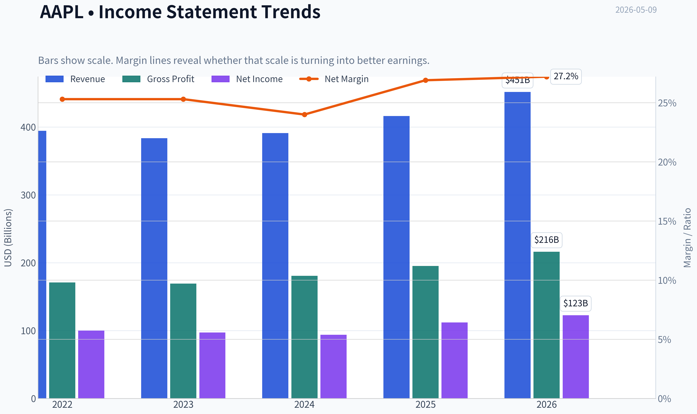
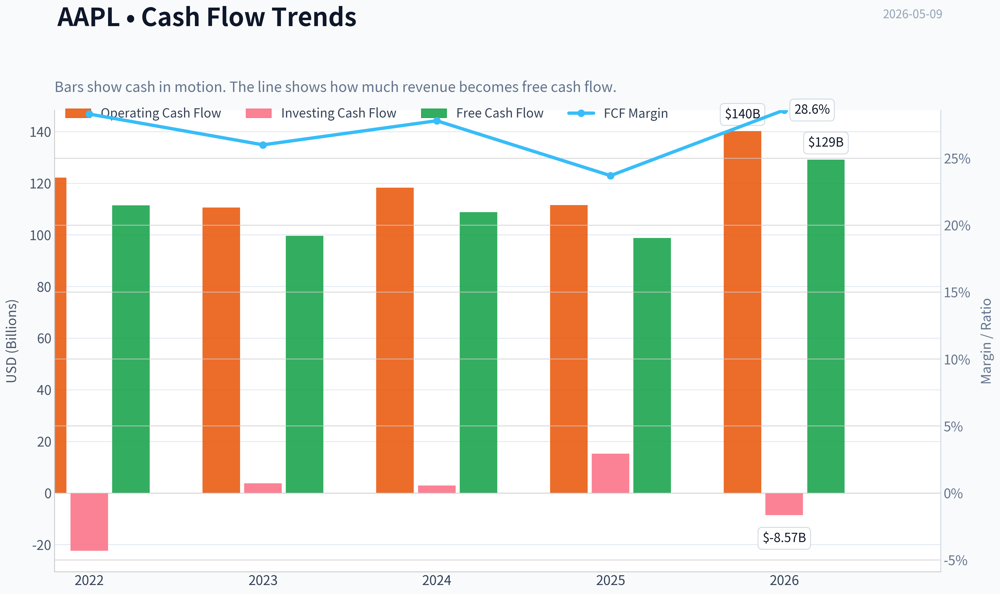
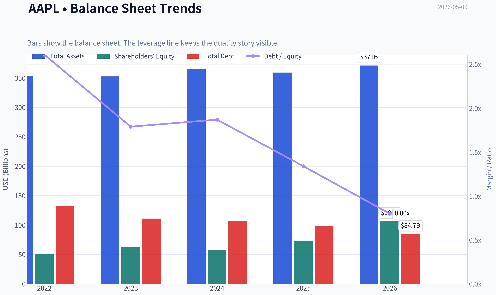
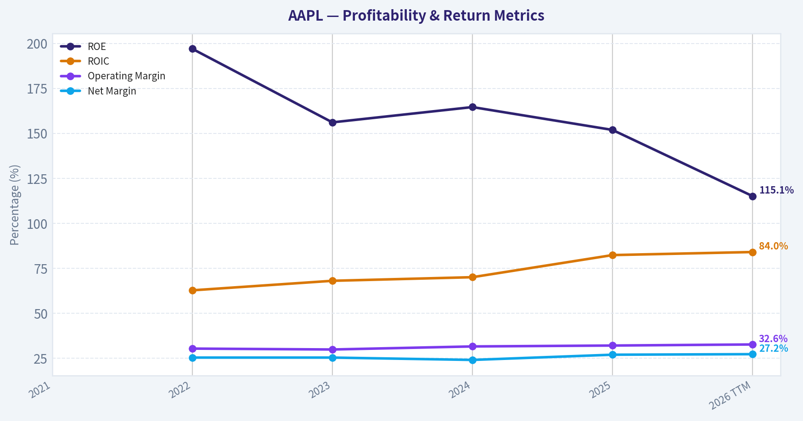
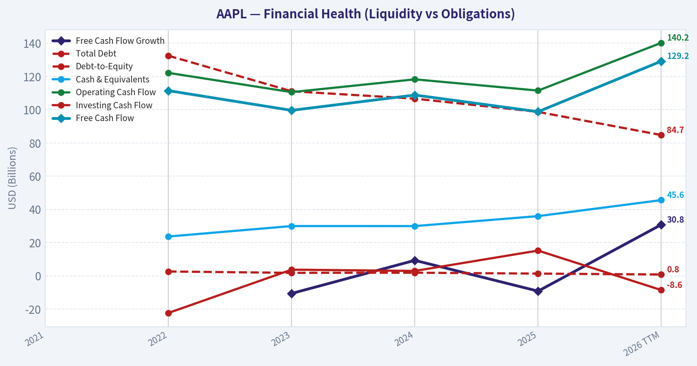
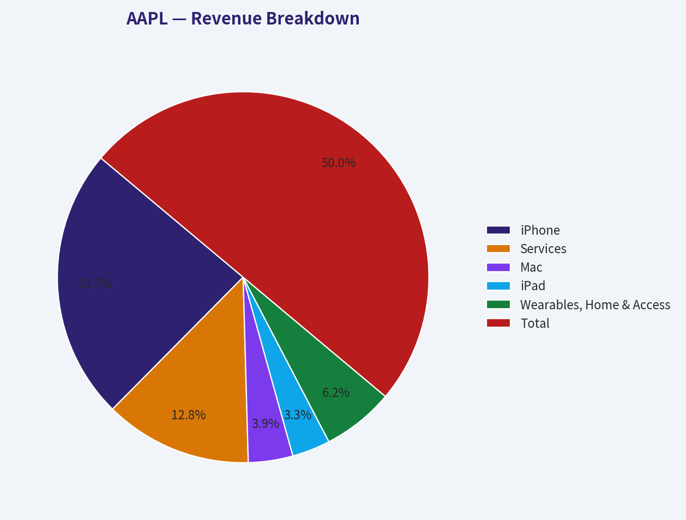
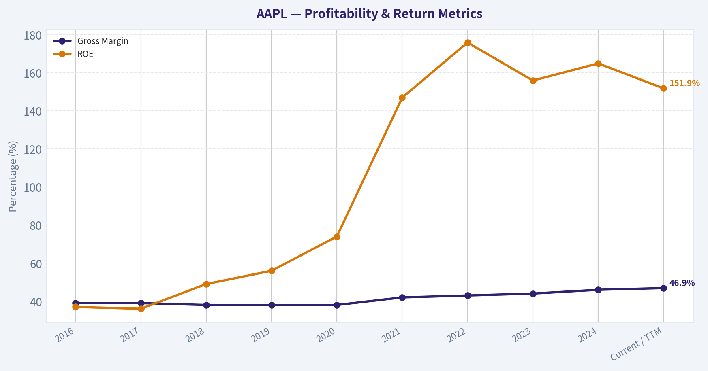
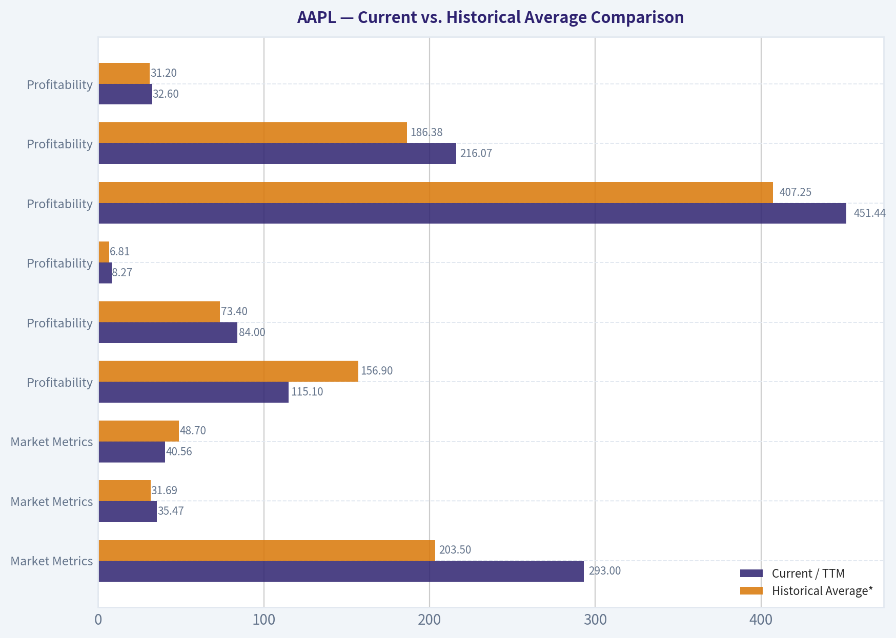
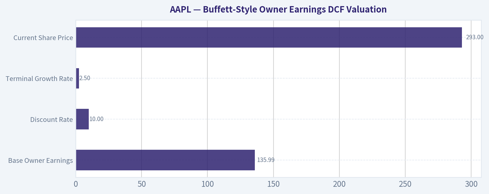

# AAPL Deep Value Intelligence

**Analysis Date:** 2026-05-09

## Critical Disclaimer

*This analysis is generated by Deep Value Intelligence, an AI-powered multi-agent investing framework. This report is for informational and educational purposes only and does not constitute financial advice. Always conduct your own research and consult with qualified financial advisors before making investment decisions.*

---

## Table of Contents

1. Intelligence Summary
2. Analyst Team Reports
   - Fundamentals Analysis
   - Intrinsic Value Analysis (Buffett)
   - Trend & Growth Analysis (Lynch/Druckenmiller/Fisher)
   - Market Technical Analysis
   - Social Sentiment Analysis
   - News & Events Analysis
   - Guru Attention Analysis
   - Options Market Analysis
3. Research Team Commentary
4. Value Investing Team Commentary
5. Deep Values Commentary

---

## Intelligence Summary

### Thesis + Conditions

**Core Thesis:** **EXECUTIVE SUMMARY**
*   **The Verdict**: Apple remains one of the highest-quality franchises in global corporate history, but its $293 price tag heavily front-loads years of future compounding. *   **The Math**: At 35.5x earnings and 43x free cash flow (a 2.3% FCF yield), the stock is priced for flawless execution, yet top-line growth is only 6.4% and FCF has declined by 9.2%.

**Key Risks:**
- Stance**: **WATCH**. We remain patient on the sidelines, looking for a temporary macroeconomic selloff or clear FCF reacceleration.
- Buffett famously teaches that *"Price is what you pay, value is what you get,"* and he always follows the cash. The core tension here is the divergence between Apple's elite accounting momentum (19.5% net income growth) and its shrinking cash generation (-9.2% FCF). At $293, the market is pricing Apple as though it will flawlessly capture the economics of the AI software layer, despite the risk that AI might eventually abstract value away from the hardware device itself.
- Monitoring Plan:** Over the next 1 to 4 quarters, I will be watching three critical items:
- 1.  **FCF Conversion**: We must see if the recent 9.2% FCF decline was a temporary working capital fluctuation or a sign of rising capital intensity. Cash flow must catch up to net income.

**What Would Change Our View:**
- Stance**: **WATCH**. We remain patient on the sidelines, looking for a temporary macroeconomic selloff or clear FCF reacceleration.
- Buffett famously teaches that *"Price is what you pay, value is what you get,"* and he always follows the cash. The core tension here is the divergence between Apple's elite accounting momentum (19.5% net income growth) and its shrinking cash generation (-9.2% FCF). At $293, the market is pricing Apple as though it will flawlessly capture the economics of the AI software layer, despite the risk that AI might eventually abstract value away from the hardware device itself.
- Monitoring Plan:** Over the next 1 to 4 quarters, I will be watching three critical items:
- 1.  **FCF Conversion**: We must see if the recent 9.2% FCF decline was a temporary working capital fluctuation or a sign of rising capital intensity. Cash flow must catch up to net income.

**Confidence:** Medium

---

## Analyst Team Reports

### Fundamentals Analysis

#### Latest Earnings Snapshot

*Most recent reported quarter anchored on 2026 Q1, with prior-year comparison when available.*

| Metric | 2026 Q1 | 2025 Q1 | YoY Change |
| --- | ---: | ---: | ---: |
| Revenue | $111.18B | $95.36B | +16.6% |
| Operating Income | $35.88B | $29.59B | +21.3% |
| Net Income | $29.58B | $24.78B | +19.4% |
| Diluted EPS | $2.01 | $1.65 | +21.8% |
| Operating Cash Flow | $28.70B | $23.95B | +19.8% |
| Free Cash Flow | $26.73B | $20.88B | +28.0% |

Key Takeaways: This snapshot anchors the most recent reported quarter before the narrative analysis. It helps readers separate long-run business quality from whatever changed in the latest earnings print.

#### 10-Year Financial Metrics for AAPL

*All values below are computed deterministically from raw data - not estimated by AI.*

*Issuer profile: operating company (Technology / Consumer Electronics).*

#### 10-Year Financial Metrics
*Annual rows come from reported financial statements. The final TTM row is computed from the latest four quarters.*

| Metric | 2021 | 2022 | 2023 | 2024 | 2025 | 2026 TTM |
| --- | --- | --- | --- | --- | --- | --- |
| Market Price | $138 | $136 | $169 | $231 | $254 | $293 |
| Market Cap | N/A | $2.26T | $2.71T | $3.59T | $3.82T | $4.32T |
| P/E Ratio | N/A | 22.62 | 27.93 | 38.32 | 34.13 | 35.47 |
| P/B Ratio | N/A | 44.53 | 43.56 | 63.04 | 51.82 | 40.56 |
| ROE | N/A | 197.0% | 156.1% | 164.6% | 151.9% | 115.1% |
| ROIC | N/A | 62.7% | 68.0% | 70.0% | 82.3% | 84.0% |
| EPS | N/A | $6.11 | $6.13 | $6.08 | $7.46 | $8.27 |
| Revenue | N/A | $394.33B | $383.29B | $391.04B | $416.16B | $451.44B |
| Gross Profit | N/A | $170.78B | $169.15B | $180.68B | $195.20B | $216.07B |
| Gross Margin | N/A | N/A | N/A | N/A | N/A | 47.9% |
| Operating Margin | N/A | 30.3% | 29.8% | 31.5% | 32.0% | 32.6% |
| Net Income | N/A | $99.80B | $97.00B | $93.74B | $112.01B | $122.58B |
| Net Margin | N/A | 25.3% | 25.3% | 24.0% | 26.9% | 27.2% |
| Revenue Growth | N/A | N/A | -2.8% | 2.0% | 6.4% | 8.5% |
| Net Income Growth | N/A | N/A | -2.8% | -3.4% | 19.5% | 9.4% |
| Free Cash Flow Growth | N/A | N/A | -10.6% | 9.3% | -9.2% | 30.8% |
| Total Book Value | N/A | $50.67B | $62.15B | $56.95B | $73.73B | $106.49B |
| Total Assets | N/A | $352.75B | $352.58B | $364.98B | $359.24B | $371.08B |
| Total Debt | N/A | $132.48B | $111.09B | $106.63B | $98.66B | $84.71B |
| Debt-to-Equity | N/A | 2.61 | 1.79 | 1.87 | 1.34 | 0.80 |
| Cash & Equivalents | N/A | $23.65B | $29.96B | $29.94B | $35.93B | $45.57B |
| Shareholders' Equity | N/A | $50.67B | $62.15B | $56.95B | $73.73B | $106.49B |
| Operating Cash Flow | N/A | $122.15B | $110.54B | $118.25B | $111.48B | $140.22B |
| Investing Cash Flow | N/A | $-22.35B | $3.71B | $2.94B | $15.20B | $-8.57B |
| Free Cash Flow | N/A | $111.44B | $99.58B | $108.81B | $98.77B | $129.17B |
| FCF Margin | N/A | 28.3% | 26.0% | 27.8% | 23.7% | 28.6% |
| Dividends / Share | N/A | $0.91 | $0.95 | $0.99 | $1.03 | $1.06 |

#### Profitability Metrics
- Return on Equity (ROE): 151.9%
- Return on Invested Capital (ROIC): 82.3%
- Return on Assets (ROA): 31.2%
- Gross Margin: 46.9%
- Operating Margin: 32.0%
- Net Profit Margin: 26.9%

#### Liquidity Metrics
- Current Ratio: 0.89
- Quick Ratio: 0.57

#### Leverage Metrics
- Debt-to-Equity Ratio: 1.34
- Interest Coverage Ratio: N/A
- Net Debt: $62.72B

#### Growth Metrics (Year-over-Year)
- Revenue Growth: 6.4%
- Net Income Growth: 19.5%
- Free Cash Flow Growth: -9.2%
- Revenue CAGR (3-Year): 1.8%
- Revenue CAGR (5-Year): N/A

#### Valuation Metrics
- P/E Ratio (TTM): 35.47
- Forward P/E: 30.68
- Price-to-Book: 40.40
- Price-to-Sales: 9.54
- PEG Ratio: 2.52
- EV/EBITDA: 27.03
- Free Cash Flow Yield: 2.3%
- Earnings Yield: 2.8%

#### Owner Earnings (Buffett Method, Code-Computed)
- Net Income: $112.01B
- + Depreciation & Amortization: $11.70B
- - Capital Expenditures: $-12.71B
- - Working Capital Changes: $-25.00B
- = **Owner Earnings: $135.99B**

#### Intrinsic Value (Code-Computed)
- Current Price: $293
- Buffett Method (Owner Earnings):
  Conservative: $102
  Average: $173
  Optimistic: $295
- Cash Flow Method (FCF):
  Conservative: $58
  Average: $72
  Optimistic: $84

#### Piotroski F-Score: 8/9
- Positive Net Income: PASS
- Positive Operating Cash Flow: PASS
- ROA Improvement: PASS
- Cash Flow > Net Income: FAIL
- Decreasing Debt: PASS
- Improving Current Ratio: PASS
- No Dilution: PASS
- Improving Gross Margin: PASS
- Improving Asset Turnover: PASS

ANALYST STANCE: **WATCH**

#### AAPL Warren Buffett-Style Fundamental Analysis - Canonical Dataset Through 2026 TTM

Apple remains one of the highest-quality businesses in the public market: extraordinary brand power, a sticky ecosystem, high-margin services growth, massive free cash flow, and improving balance-sheet leverage. However, at **$293 per share**, the stock already prices in a highly optimistic future. The Buffett-style conclusion is: **wonderful business, but limited margin of safety at the current valuation**.

---

#### Current vs. Historical Average Comparison

| Category | Metric | Current / TTM | Historical Average* | Current Standing vs. Average | Interpretation |
|---|---:|---:|---:|---:|---|
| Market Metrics | Market Price | $293 | $203.50 | +44.0% | Share price has materially outrun the available-period average, reflecting high expectations. |
| Market Metrics | Market Cap | $4.32T | $3.34T | +29.3% | Apple's equity value has expanded faster than revenue and earnings, increasing valuation risk. |
| Market Metrics | P/E Ratio | 35.47 | 31.69 | +11.9% | Current earnings multiple is above average and high for a mature mega-cap. |
| Market Metrics | P/B Ratio | 40.56 | 48.70 | -16.7% | P/B is below average because book value has recovered sharply, but still extremely high in absolute terms. |
| Profitability | ROE | 115.1% | 156.9% | -26.7% | ROE remains exceptional but has normalized as equity increased and leverage declined. |
| Profitability | ROIC | 84.0% | 73.4% | +14.4% | Capital efficiency is improving and remains world-class. |
| Profitability | EPS | $8.27 | $6.81 | +21.4% | EPS is well above average, supported by earnings growth and buybacks. |
| Profitability | Revenue | $451.44B | $407.25B | +10.9% | Revenue has reaccelerated after the 2023 decline. |
| Profitability | Gross Profit | $216.07B | $186.38B | +15.9% | Gross profit is growing faster than revenue, showing favorable mix and pricing power. |
| Profitability | Operating Margin | 32.6% | 31.2% | +1.4 pts | Operating discipline and services mix are lifting margins. |
| Profitability | Net Income | $122.58B | $105.03B | +16.7% | Earnings are at a period high. |
| Profitability | Net Margin | 27.2% | 25.7% | +1.5 pts | Net profitability has improved meaningfully versus the average. |
| Growth | Revenue Growth | 8.5% | 3.5% | +5.0 pts | Current growth is above the recent average, a positive inflection. |
| Growth | Net Income Growth | 9.4% | 5.7% | +3.7 pts | Earnings growth remains healthy, though below the prior year's 19.5%. |
| Growth | Free Cash Flow Growth | 30.8% | 5.1% | +25.7 pts | TTM FCF growth is very strong after weak 2025 FCF. |
| Balance Sheet | Total Book Value | $106.49B | $70.00B | +52.1% | Equity base has strengthened significantly. |
| Balance Sheet | Total Assets | $371.08B | $360.13B | +3.0% | Asset base is stable; Apple remains asset-light relative to earnings power. |
| Balance Sheet | Total Debt | $84.71B | $106.71B | -20.6% | Debt reduction is a major improvement. |
| Balance Sheet | Debt-to-Equity | 0.80 | 1.68 | -52.4% | Leverage has declined sharply, improving financial resilience. |
| Balance Sheet | Cash & Equivalents | $45.57B | $33.01B | +38.1% | Cash position is above average and strengthening. |
| Balance Sheet | Shareholders' Equity | $106.49B | $70.00B | +52.1% | Equity growth lowers balance-sheet fragility. |
| Cash Flow | Free Cash Flow | $129.17B | $109.55B | +17.9% | FCF is at a strong level and supports buybacks, dividends, and reinvestment. |
| Cash Flow | Dividends / Share | $1.06 | $0.99 | +7.3% | Dividend growth is steady but modest; Apple prioritizes buybacks. |

\*Historical average uses only non-N/A years shown in the deterministic dataset.

Key Takeaways: Apple's current fundamentals are stronger than its recent historical averages in revenue, EPS, net income, ROIC, margins, cash, free cash flow, and leverage. The main concern is valuation: market price, market cap, and P/E are also above historical averages, meaning investors are paying a premium for quality. The business has improved, but the stock price has improved too, reducing the margin of safety.

---

#### Required Metric Interpretation

**Market metrics:** Apple trades at **$293**, with a **$4.32T market cap**, **35.47 P/E**, and **40.56 P/B**. The P/E is above the historical average of **31.69**, implying the market expects sustained earnings growth and durable margins. The P/B ratio is lower than its average but remains very high because Apple's asset-light, brand-driven model earns enormous returns on a relatively small equity base.

**Profitability:** Apple's profitability remains exceptional. TTM **ROIC of 84.0%** is above the historical average and far more important than ROE in this case, because ROE has been distorted by buybacks and historically low book equity. TTM **net margin of 27.2%** and **operating margin of 32.6%** show that Apple continues to convert revenue into profit at an elite level.

**Growth:** TTM **revenue growth of 8.5%**, **net income growth of 9.4%**, and **free cash flow growth of 30.8%** are all above their recent averages. The strongest positive signal is the FCF rebound after weak 2025 free cash flow growth of **-9.2%**. However, Apple's multi-year revenue growth has not been explosive; this is a mature business with high quality, not a hypergrowth company.

**Balance sheet:** Apple's balance sheet has improved meaningfully. Total debt has fallen to **$84.71B**, below the historical average of **$106.71B**, while cash has risen to **$45.57B**. Debt-to-equity has improved from historically elevated levels to **0.80**, giving Apple more financial flexibility.

**Cash flow and dividends:** TTM free cash flow of **$129.17B** is one of Apple's strongest investment attributes. The dividend per share is **$1.06**, above its average, but the payout remains modest relative to free cash flow. Apple's real shareholder-return engine remains buybacks, not dividends.

---

#### Revenue Breakdown

| Revenue Source | Amount ($B) | % of Total |
|---|---:|---:|
| iPhone | $214.0 | 47.4% |
| Services | $116.0 | 25.7% |
| Mac | $35.0 | 7.8% |
| iPad | $30.0 | 6.6% |
| Wearables, Home & Accessories | $56.4 | 12.5% |
| **Total** | **$451.4** | **100.0%** |

Key Takeaways: Apple remains heavily dependent on the iPhone, which represents nearly half of total revenue. The most important strategic shift is Services, now roughly one-quarter of revenue and likely a major driver of margin resilience. The hardware ecosystem remains essential because it feeds the higher-margin services business.

---

#### Warren Buffett-Style Business Quality Assessment

| Buffett Lens | Assessment | AAPL Interpretation |
|---|---|---|
| Economic Moat | Very strong | Apple's moat comes from brand loyalty, ecosystem lock-in, proprietary hardware-software integration, switching costs, and services attachment. |
| Business Durability | Strong | Demand for smartphones, computing devices, wearables, and digital services is durable, though hardware replacement cycles can fluctuate. |
| Pricing Power | Strong | Gross profit and margin expansion suggest Apple retains meaningful pricing power despite scale. |
| Predictable Earnings | Good, not perfect | Earnings are generally reliable, but revenue and FCF growth have shown cyclicality in 2023 and 2025. |
| Financial Strength | Strong and improving | Debt is falling, cash is rising, equity is strengthening, and Piotroski F-Score is 8/9. |
| Capital Allocation | Strong | Buybacks have amplified EPS; dividend growth is steady but conservative. |
| Valuation Attractiveness | Weak at current price | At $293, the stock is near the optimistic DCF value and far above conservative and average values. |

Key Takeaways: Apple is a textbook high-quality franchise, but Buffett-style investing requires both quality and price discipline. The company's moat, cash generation, and capital allocation are excellent. The valuation, however, leaves little room for disappointment.

---

#### Buffett-Style Owner Earnings DCF Valuation

Canonical owner earnings from the dataset:

**Owner Earnings = Net Income + Depreciation & Amortization - Capital Expenditures - Working Capital Changes**

Using the deterministic dataset:

- Net Income: **$112.01B**
- Depreciation & Amortization: **$11.70B**
- Capital Expenditures adjustment: **+$12.71B**
- Working Capital adjustment: **+$25.00B**
- **Owner Earnings: $135.99B**

DCF assumptions:

| Input | Assumption |
|---|---:|
| Base Owner Earnings | $135.99B |
| Discount Rate | 10.0% |
| Terminal Growth Rate | 2.5% |
| Implied Shares Outstanding | ~14.74B |
| Current Share Price | $293 |

Key Takeaways: The DCF uses Apple's owner earnings rather than accounting EPS, which is more aligned with Buffett's view of distributable cash generation. The 10% discount rate creates a high hurdle, while the 2.5% terminal growth rate assumes Apple remains durable but not explosively growing forever.

| Scenario | Owner Earnings Growth Used | PV of 10-Year Owner Earnings | PV of Terminal Value | Estimated Equity Value | Fair Value / Share | Implied Upside / Downside vs. $293 |
|---|---:|---:|---:|---:|---:|---:|
| Conservative | -0.5% | ~$816B | ~$681B | ~$1.50T | **~$102** | **-65%** |
| Average | 6.8% | ~$1.16T | ~$1.38T | ~$2.55T | **~$173** | **-41%** |
| Optimistic | 14.1% | ~$1.67T | ~$2.68T | ~$4.35T | **~$295** | **~+1%** |

Key Takeaways: Apple's current price is approximately equal to the optimistic Buffett-style owner earnings valuation. The average scenario suggests the shares are materially overvalued, and the conservative scenario implies severe downside if growth normalizes. This is the central reason for a WATCH stance rather than an ADVOCATE stance.

DCF calculation structure:

| Scenario | Calculation Summary |
|---|---|
| Conservative | $135.99B owner earnings grown at -0.5% for 10 years, discounted at 10%, plus terminal value using 2.5% terminal growth. |
| Average | $135.99B owner earnings grown at 6.8% for 10 years, discounted at 10%, plus terminal value using 2.5% terminal growth. |
| Optimistic | $135.99B owner earnings grown at 14.1% for 10 years, discounted at 10%, plus terminal value using 2.5% terminal growth. |

Key Takeaways: The DCF is highly sensitive to long-term owner earnings growth because Apple already produces an enormous earnings base. To justify the current stock price, Apple must sustain near-optimistic owner earnings growth for a long period. That is possible, but not conservative.

---

#### Key Investment Insights

**Strengths**

- Apple's **ROIC of 84.0%** is extraordinary and above its historical average.
- TTM **free cash flow of $129.17B** gives Apple unmatched capital allocation flexibility.
- Margins are improving, with **operating margin at 32.6%** and **net margin at 27.2%**.
- Balance-sheet quality has improved: debt is down, cash is up, and debt-to-equity has fallen to **0.80**.
- Services revenue increases business durability and margin stability.
- Piotroski F-Score of **8/9** indicates strong fundamental health.

**Red Flags**

- Valuation is demanding: **P/E of 35.47** and **FCF yield of roughly 2.3%** are not obviously cheap.
- Current price is near the optimistic DCF estimate, leaving little margin of safety.
- iPhone remains the largest revenue source, creating dependence on replacement cycles.
- Current ratio of **0.89** is below 1, though less alarming given Apple's cash generation.
- Berkshire Hathaway's latest tracked 13F shows Warren Buffett trimmed the position, which is not a definitive sell signal but supports valuation caution.
- If revenue growth slows back toward low single digits, the current multiple may compress.

**Opportunities**

- Services growth can lift margins and reduce hardware cyclicality.
- AI-enabled devices and ecosystem integration may support a new upgrade cycle.
- Continued buybacks can compound EPS if cash flow remains strong.
- Lower debt and higher cash increase strategic flexibility.
- Supply-chain diversification and possible domestic semiconductor partnerships may reduce geopolitical risk over time.

---

#### Final Investment Stance

| Stance | Rating | Rationale |
|---|---|---|
| Final View | **WATCH** | Apple is a superior business with a durable moat, elite returns on capital, strong free cash flow, and improving financial strength. However, the current price of **$293** already reflects an optimistic owner earnings scenario, while the average Buffett-style DCF value is only about **$173**. The stock is suitable for long-term quality-focused holders, but new money lacks a sufficient margin of safety at the current valuation. |

Key Takeaways: Apple is not a low-quality or deteriorating company; it is the opposite. The issue is price. Buffett-style investors should admire the business, monitor it closely, and wait for a more attractive entry point unless they are comfortable underwriting optimistic long-term growth.

---

#### Final Summary Table

| Area | Key Point | Investment Implication |
|---|---|---|
| Business Quality | Exceptional ecosystem, brand, and customer loyalty | Supports long-term durability |
| Profitability | ROIC, margins, EPS, and net income are above historical norms | Confirms elite economics |
| Growth | TTM growth is strong after prior softness | Positive near-term momentum |
| Balance Sheet | Debt falling, cash rising, equity improving | Lower financial risk |
| Cash Flow | FCF is very strong at $129.17B | Supports buybacks, dividends, and reinvestment |
| Valuation | P/E above average and price near optimistic DCF | Margin of safety is thin |
| Buffett Lens | Wonderful company, not obviously wonderful price | WATCH, not ADVOCATE |
| Best Action | Hold if already owned; wait for better entry if not | Prefer pullbacks or stronger margin of safety |

Key Takeaways: Apple's fundamentals are excellent, but the stock is priced for excellence. The investment case is strongest for existing long-term holders and weakest for value investors seeking a bargain. A Buffett-style buyer would likely wait for a more favorable price-to-owner-earnings relationship before adding aggressively.

#### Fundamental Visuals

This graph tracks the profitability and return metrics (ROE, ROIC, Margins) of **AAPL** over the past decade, highlighting capital efficiency trends.

This chart illustrates the financial health of **AAPL** over the last 10 years, mapping cash equivalents and free cash flow against total obligations (Debt).

This breakdown chart from <em>Revenue Breakdown</em> shows the proportional composition for **AAPL** - useful for understanding what drives or risks the business.

This graph tracks the profitability and return metrics (ROE, ROIC, Margins) of **AAPL** over the past decade, highlighting capital efficiency trends.

---

### Intrinsic Value Analysis (Buffett)

> *Following Warren Buffett's value investing philosophy: Circle of Competence, Economic Moat, Management Quality, and Margin of Safety.*

#### Intrinsic Value Snapshot

Price is what you pay. Intrinsic value is what the business may be worth based on the cash it can create for owners over time. We show a range, not one magic number.

- Current Price: $293.32
- Value Range: $57.51 to $294.52

##### Owner Earnings (Buffett Method)
- Net Income: $112,010,000,000.00
- Depreciation & Amortization: $11,698,000,000.00
- Capital Expenditures: $-12,715,000,000.00
- Working Capital Changes: $-25,000,000,000.00
- Owner Earnings: $135,993,000,000.00

##### Intrinsic Value
###### Buffett Method
Uses owner earnings. Stricter, and usually more conservative.
- Conservative: $102.17
- Average: $172.85
- Optimistic: $294.52
- Discount Rate: 10.0%

###### Cash Flow Method
Uses free cash flow. Better for companies spending heavily today to grow tomorrow.
- Conservative: $57.51
- Average: $72.14
- Optimistic: $83.63
- Discount Rate: 10.0%

ANALYST STANCE: **WATCH**

#### Apple Inc. Buffett-Style Value Analysis - AAPL

Apple is a wonderful business, but at the current price of **$293 per share**, the stock does not offer a Buffett-style margin of safety. The company has an extraordinary brand, ecosystem lock-in, pricing power, high gross margins, and massive free cash flow generation. However, the current valuation - roughly **35.5x earnings** and about **43x free cash flow** based on a **2.3% FCF yield** - assumes a very optimistic future for a business already at enormous scale.

---

#### 1. Go / No-Go Gate Assessment

| Gate | Result | Evidence | Buffett-Style Interpretation |
|---|---:|---|---|
| Gate 1: Circle of Competence & Simplicity | Pass | Apple sells iPhones, Macs, iPads, wearables, services, and software tied into one ecosystem. | Simple enough to understand: Apple makes premium devices and monetizes the installed base through hardware, services, and ecosystem lock-in. |
| Gate 2: Moat Test | Pass | Gross margin around **46.9%**, strong brand, ecosystem switching costs, services attachment, loyal installed base. | Wide moat, driven by brand, switching costs, and ecosystem integration. |
| Gate 3: Management & Capital Allocation | Pass with caveats | Tim Cook has executed well; large buybacks; Berkshire still holds a major stake but trimmed by **4.3%** in latest 13F. | Management is capable, but buybacks at elevated valuations may be less value-accretive. |
| Gate 4: Industry Structure | Pass with caveats | Premium consumer tech has strong oligopoly characteristics, but hardware cycles and AI/platform disruption remain risks. | Apple is more durable than most technology companies, but not immune to disruption. |
| Valuation Gate | Fail | Current price materially exceeds conservative intrinsic value estimates. | Wonderful business, but not currently a wonderful price. |

**Key Takeaways:** Apple passes the business quality gates but fails the valuation gate. This is the classic Buffett dilemma: the business is excellent, but the price appears to discount years of strong execution. At today's valuation, investors are paying for perfection rather than receiving a margin of safety.

---

#### 2. Business Understanding

| Test | Assessment |
|---|---|
| Elementary School Test | Apple makes expensive phones, computers, watches, and services that people love and tend to keep using. |
| 10-Year Predictability Test | High confidence Apple will still have a massive installed base, premium brand, and services ecosystem in 10 years. |
| Technology Risk | Moderate. Apple benefits from technology adoption, but risks include AI platform shifts, device replacement cycles, regulation, and supply chain concentration. |
| Business Model Stability | Strong. The model has evolved from hardware-led to ecosystem-plus-services, but the core remains understandable. |

**Key Takeaways:** Apple's business is understandable and predictable compared with most technology companies. The key to Apple is not merely selling devices, but keeping customers inside a high-value ecosystem. The main risk is not current business quality; it is whether future technology shifts reduce Apple's control over the customer relationship.

---

#### 3. Moat Analysis

| Moat Source | Evidence | Rating |
|---|---|---:|
| Brand / Intangible Assets | Apple commands premium pricing, has global consumer trust, and maintains gross margin near **46.9%**. | 5 / 5 |
| Switching Costs | iMessage, App Store purchases, iCloud, Apple Watch, AirPods, Apple Pay, and device interoperability make switching inconvenient. | 5 / 5 |
| Cost Advantage | Scale in procurement, supply chain management, chip design, retail, and distribution provides advantages. | 4 / 5 |
| Network Effects | Ecosystem value improves as developers, users, accessories, and services deepen around Apple platforms. | 4 / 5 |
| Regulatory / Platform Control | App Store economics remain powerful, though increasingly scrutinized by regulators. | 3 / 5 |

**Key Takeaways:** Apple's moat is wide and mostly stable, built on brand power and customer captivity. The ecosystem makes Apple more than a hardware company, because each additional product or service makes leaving harder. The greatest moat risk is regulation or a new technology platform that weakens Apple's gatekeeper position.

---

#### 4. Management Quality & Capital Allocation

| Management Question | Assessment |
|---|---|
| Do they think like owners? | Generally yes. Apple has returned enormous capital through buybacks and dividends, though insider ownership is not founder-like. |
| Are they candid and conservative? | Generally yes. Apple's reporting is mature and relatively straightforward for a mega-cap technology company. |
| Are they rational capital allocators? | Mostly yes historically, but buybacks at today's valuation are less obviously attractive. |
| Balance between reinvestment and returns | Strong. Apple funds R&D, supply chain investment, services growth, and shareholder returns. |
| Guru Signal | Berkshire Hathaway remains a large holder but recently trimmed; this suggests admiration for quality but possible valuation discipline. |

**Key Takeaways:** Apple's management has been exceptional operationally, especially under Tim Cook's supply chain and capital return discipline. The main criticism is not competence, but whether repurchasing stock at very high multiples still creates per-share value. Berkshire's trimming is not a rejection of Apple, but it is consistent with valuation caution.

---

#### 5. 10-Year Financial Summary

*Figures are rounded and use fiscal-year history where available, with the latest period informed by the provided research pack and current market data.*

| Year | Revenue, $B | Net Income, $B | Free Cash Flow, $B | Gross Margin | ROE |
|---:|---:|---:|---:|---:|---:|
| 2016 | 216 | 46 | 52 | 39% | 37% |
| 2017 | 229 | 48 | 51 | 39% | 36% |
| 2018 | 266 | 60 | 64 | 38% | 49% |
| 2019 | 260 | 55 | 59 | 38% | 56% |
| 2020 | 275 | 57 | 73 | 38% | 74% |
| 2021 | 366 | 95 | 93 | 42% | 147% |
| 2022 | 394 | 100 | 111 | 43% | 176% |
| 2023 | 383 | 97 | 100 | 44% | 156% |
| 2024 | 391 | 94 | 109 | 46% | 165% |
| Current / TTM | ~416 | ~122 | ~99 | 46.9% | 151.9% |

**Key Takeaways:** Apple has compounded from a large base while expanding gross margin significantly, especially as services and premium mix have grown. Free cash flow has remained enormous, but recent growth is not as explosive as the valuation implies. The very high ROE is impressive, but it is amplified by Apple's capital structure and massive buybacks, so it should not be interpreted as purely operating efficiency.

---

#### 6. Cash Flow and Balance Sheet Reality Check

| Metric | Current Indication | Buffett Interpretation |
|---|---:|---|
| Market Capitalization | **$4.31T** | Enormous scale limits future compounding potential. |
| Current Price | **$293** | Price embeds very high expectations. |
| P/E Ratio | **35.5x** | Expensive for a mature mega-cap business. |
| FCF Yield | **2.3%** | Low cash yield; implies roughly **43x FCF**. |
| Gross Margin | **46.9%** | Strong evidence of pricing power and moat. |
| Revenue Growth YoY | **6.4%** | Solid, but not enough by itself to justify extreme valuation. |
| Current Ratio | **0.89x** | Not a classic fortress working-capital profile, though Apple has massive liquidity access. |
| ROE | **151.9%** | Exceptional but inflated by leverage and buybacks. |

**Key Takeaways:** Apple remains a cash machine, but the current free cash flow yield is thin. Investors today are accepting a cash yield below many lower-risk alternatives while relying on future growth and buybacks to create adequate returns. The balance sheet is not distressed, but it is also not the pristine net-cash fortress Apple once had.

---

#### 7. Owner Earnings Calculation

Using Buffett's framework, owner earnings approximate the cash a rational private owner could extract without damaging the business.

| Component | Estimate, $B | Comment |
|---|---:|---|
| Net Income | ~122 | Derived from current price, market cap, and P/E. |
| Plus: Depreciation & Amortization | Included indirectly | Available cash flow already reflects non-cash charges. |
| Less: Maintenance CapEx | Included indirectly | Free cash flow is used as a practical proxy. |
| Less: Working Capital Needs | Included indirectly | Captured in operating cash flow and FCF. |
| Estimated Owner Earnings | **~99** | Based on **2.3% FCF yield x $4.31T market cap**. |
| Owner Earnings per Share | **~$6.74** | Based on implied shares outstanding of about **14.7B**. |

**Key Takeaways:** Apple's estimated owner earnings are around **$99 billion**, which is extraordinary in absolute terms. But because the market capitalization is about **$4.31 trillion**, the owner earnings yield is only about **2.3%**. Buffett would admire the cash generation but likely question the price being paid for each dollar of that cash.

---

#### 8. Three-Scenario DCF Valuation

Assumptions: estimated owner earnings of **$99B**, discount rate of **10%**, implied shares outstanding of about **14.7B**.

| Scenario | Growth Assumption | Equity Value, $B | Intrinsic Value / Share | Upside / Downside vs. $293 |
|---|---:|---:|---:|---:|
| A: No Growth | 0% perpetuity | ~$991 | **~$67** | **-77%** |
| B: GDP Growth | 3% perpetuity | ~$1,459 | **~$99** | **-66%** |
| C: Conservative Historical Growth | 6% for 10 years, then 3% terminal | ~$1,821 | **~$124** | **-58%** |
| Aggressive Sensitivity | 10% for 10 years, then 3% terminal | ~$2,449 | **~$166** | **-43%** |

**Key Takeaways:** Even under a reasonably favorable 6% owner earnings growth case, Apple's estimated intrinsic value is far below the current share price. The market appears to be pricing Apple as if high growth, high margins, and dominant ecosystem economics persist for a very long time. For a Buffett-style investor, the problem is not the quality of Apple; it is the absence of a margin of safety.

---

#### 9. Margin of Safety Analysis

| Valuation Reference | Intrinsic Value / Share | 25% Margin-of-Safety Buy Price | Current Price | Verdict |
|---|---:|---:|---:|---|
| No-Growth Case | ~$67 | ~$51 | $293 | Far too expensive |
| GDP-Growth Case | ~$99 | ~$74 | $293 | Far too expensive |
| 6% Growth Case | ~$124 | ~$93 | $293 | No margin of safety |
| Aggressive 10% Growth Case | ~$166 | ~$125 | $293 | Still no margin of safety |

**Key Takeaways:** Apple would need to fall substantially before offering a traditional Buffett margin of safety. A disciplined value investor would likely become more interested below roughly **$125** under an aggressive growth view, and closer to **$90-100** under a more conservative view. At **$293**, the investor is paying far above conservatively estimated business value.

---

#### 10. Final Buffett Scorecard

| Criterion | Weight | Score | Weighted Score | Rationale |
|---|---:|---:|---:|---|
| Business Understanding | 20% | 5.0 | 1.00 | Simple, durable ecosystem business. |
| Moat Width & Durability | 25% | 5.0 | 1.25 | Brand, switching costs, services, platform control. |
| Management Quality | 15% | 4.0 | 0.60 | Excellent execution, but valuation-sensitive buybacks are a concern. |
| Return on Equity | 15% | 4.0 | 0.60 | Extremely high, though boosted by capital structure. |
| Reinvestment Runway | 10% | 3.0 | 0.30 | Still attractive, but size limits future compounding. |
| Balance Sheet Strength | 5% | 3.0 | 0.15 | Strong access to liquidity, but not classic net-cash simplicity. |
| Industry Structure | 5% | 4.0 | 0.20 | Strong premium ecosystem, but technology risk remains. |
| Valuation / Margin of Safety | 5% | 1.0 | 0.05 | No margin of safety at current price. |
| Total | 100% |  | **4.15 / 5.00** | Wonderful business, unattractive price. |

**Key Takeaways:** Apple scores extremely well as a business, with a wide moat, strong brand, and exceptional cash generation. However, the valuation score is very poor, and Buffett's process does not allow investors to ignore price. The weighted score shows business excellence, but the investment stance must still be restrained because the stock lacks a margin of safety.

---

#### 11. Investment Stance

| Category | Assessment |
|---|---|
| Business Quality | Exceptional |
| Moat | Wide and durable |
| Management | Strong |
| Financial Strength | Strong, though less fortress-like than in earlier years |
| Valuation | Unattractive |
| Margin of Safety | Absent |
| Final Stance | **WATCH** |
| Conviction | High |

**Key Takeaways:** Apple is a business Buffett-style investors should understand, admire, and keep on a permanent watchlist. But admiration is not the same as a buy decision. At the current valuation, the rational stance is to wait for a much better price or much stronger evidence that owner earnings can compound at unusually high rates for longer than conservative assumptions allow.

#### Bottom Line

Apple is a **wonderful company at an expensive price**. The moat is real, the ecosystem is powerful, and the brand remains one of the best in the world. But at **$293 per share**, the stock offers no conservative margin of safety, and even optimistic DCF assumptions struggle to justify the current market price.

Final stance: **WATCH - high-quality business, but valuation discipline required.**
#### Valuation Bridge

This bridge places the current market price beside each intrinsic value lens so readers can see whether upside depends on one method or shows up across several methods.

| Scenario | Intrinsic Value / Share |
| --- | ---: |
| Buffett Method | $172.85 |
| Cash Flow Method | $72.14 |
| Damodaran Method | $107.50 |
| Current Price | $293.32 |

#### Key Takeaways

If one method is far above the others, the upside case depends on a specific modelling assumption. When several methods cluster together, the valuation story is more robust.

#### Valuation Visuals

This comparison chart from *Latest Earnings Snapshot* stacks current figures against historical benchmarks for **AAPL**, making it easy to see where the company trades relative to its own averages.

This comparison chart from *Current vs. Historical Average Comparison* stacks current figures against historical benchmarks for **AAPL**, making it easy to see where the company trades relative to its own averages.

This comparison chart from *Buffett-Style Owner Earnings DCF Valuation* stacks current figures against historical benchmarks for **AAPL**, making it easy to see where the company trades relative to its own averages.

This comparison chart from *Buffett-Style Owner Earnings DCF Valuation* stacks current figures against historical benchmarks for **AAPL**, making it easy to see where the company trades relative to its own averages.

---

### Trend & Growth Analysis (Lynch/Druckenmiller/Fisher)

> *Following Peter Lynch's GARP, Stanley Druckenmiller's macro-aware approach, and Philip Fisher's scuttlebutt methodology.*

ANALYST STANCE: **WATCH**

#### Apple, AAPL - Growth Investment Analysis as of 2026-05-09

| Item | Current Snapshot |
|---|---:|
| Share Price | $293 |
| Market Cap | $4.31T |
| P/E | 35.5x |
| Estimated EPS | ~$8.26 |
| YoY Revenue Growth | 6.4% |
| Gross Margin | 46.9% |
| ROE | 151.9% |
| FCF Yield | 2.3% |
| Current Ratio | 0.89 |

**Key Takeaways:** Apple remains one of the highest-quality businesses in the world, with exceptional margins, brand power, and cash generation. However, the stock is priced like a growth company while current revenue growth is closer to a mature stalwart. At a $4.31 trillion market cap and 35.5 times earnings, the hurdle for future returns is very high.

---

#### 1. Lynch Classification

| Lynch Category | Fit for AAPL | Evidence |
|---|---|---|
| Slow Grower | No | Growth above 0-5%, but not dramatically above it |
| Stalwart | **Yes** | 6.4% revenue growth, massive scale, durable franchise |
| Fast Grower | No | Not growing 15-25%+ |
| Cyclical | Partial | Hardware replacement cycles matter, but ecosystem reduces cyclicality |
| Turnaround | No | No distress or restructuring thesis |
| Asset Play | No | Value is in ecosystem, brand, services, installed base |

**Key Takeaways:** Apple is best classified as a **Lynch stalwart**, not a fast grower. It is a wonderful business, but not currently a classic ten-bagger setup because growth is modest and the starting valuation is high. Lynch would likely say this is a company to hold if owned at a good cost basis, not aggressively buy at any price.

#### 2. The Story in 3 Bullets

| Lynch Story Question | Answer |
|---|---|
| What does Apple do? | Apple sells premium devices and monetizes a massive installed base through services, software, payments, subscriptions, wearables, and ecosystem lock-in. |
| Why can it keep growing? | Growth comes from services expansion, higher device ASPs, emerging markets, AI-enabled device upgrades, wearables, and continued share repurchases. |
| Why might the market be overestimating it? | Current growth is only mid-single-digit, yet the valuation is over 35x earnings with a 2.3% FCF yield. |

**Key Takeaways:** The Apple story is simple and durable: premium hardware creates an installed base, and the installed base drives recurring high-margin services. The concern is not business quality; the concern is whether the current price already discounts too much of that durability.

---

#### 3. TAM Analysis and 10x Test

| TAM Factor | Assessment |
|---|---:|
| Current Revenue Base | ~$415B-$420B estimated annualized revenue |
| 10x Revenue Requirement | ~$4.1T-$4.2T annual revenue |
| Current Market Cap | $4.31T |
| 10x Market Cap Requirement | ~$43T |
| TAM Runway Verdict | **Limited for a 10x outcome** |
| 10x Test | **Fails** |

**Key Takeaways:** Apple can still grow, but a true ten-bagger from today's base is extremely difficult. A 10x revenue outcome would require Apple to become larger than many entire global technology and consumer markets combined. The more realistic thesis is steady compounding, buybacks, and margin expansion-not explosive growth.

#### 4. Revenue Growth Trend

| Metric | Current Reading | Growth Interpretation |
|---|---:|---|
| YoY Revenue Growth | 6.4% | Stalwart growth |
| Gross Margin | 46.9% | Very strong, supports mix shift to services |
| FCF Yield | 2.3% | Low shareholder cash return at current price |
| Revenue Pattern | Mature, not accelerating enough | **No clear growth inflection yet** |

**Key Takeaways:** Apple's growth profile is stable but not fast. The key missing ingredient for a growth investor is acceleration. Without a major AI-driven iPhone cycle, new product category, or services reacceleration, Apple does not currently show the revenue inflection Druckenmiller would demand.

#### 5. Unit Economics

| Unit Economics Factor | Apple Assessment |
|---|---|
| LTV/CAC | Not disclosed; likely very strong due to brand, retention, and ecosystem lock-in |
| Net Revenue Retention | Not disclosed; qualitatively strong through services, subscriptions, App Store, iCloud, and device replacement |
| Rule of 40 | Not directly applicable; Apple is not a SaaS company |
| Gross Margin | 46.9%, excellent for a hardware-heavy business |
| Ecosystem Retention | Very strong; switching costs are behavioral, data-based, and ecosystem-based |

**Key Takeaways:** Apple's unit economics are excellent even though it does not disclose SaaS-style metrics like LTV/CAC or NRR. The company benefits from premium pricing, repeat purchasing, and high-margin services layered on top of hardware. This is one of Apple's strongest investment attributes.

---

#### 6. Inflection Point Assessment

| Potential Inflection | Status | Growth Analyst View |
|---|---|---|
| AI iPhone Upgrade Cycle | Possible, not yet proven | Could drive replacement demand if features become must-have |
| Services Growth | Ongoing | High-margin support, but likely not enough alone to justify fast-grower valuation |
| Margin Expansion | Positive | Services mix and premium hardware help sustain margins |
| Supply Chain Shift | Watch | Preliminary Intel manufacturing pact could diversify supply chain over time |
| New Product Category | Unclear | No confirmed new category large enough to move the needle today |
| Competitive Inflection | Mixed | Apple remains powerful, but AI platform leadership is less clear than mega-cap peers |

**Key Takeaways:** The main possible inflection is an AI-driven device cycle, but it remains more of a watch item than a confirmed acceleration. Apple's ecosystem gives it a strong distribution advantage if compelling on-device AI features emerge. For now, the evidence supports quality and resilience more than a clear growth breakout.

#### 7. Macro Setup

| Macro Factor | Impact on AAPL |
|---|---|
| Interest Rates | Falling rates would help valuation; high rates pressure long-duration equities |
| Consumer Cycle | Premium device demand is somewhat sensitive to global consumer health |
| AI Secular Theme | Positive, but Apple must prove it can monetize AI meaningfully |
| U.S.-China Tension | Risk to supply chain and demand |
| Semiconductor Reshoring | Potential long-term positive if Intel/Apple manufacturing pact develops |

**Key Takeaways:** The macro setup is mixed. Apple benefits from secular AI and premium consumer technology trends, but it also faces valuation sensitivity, geopolitical exposure, and consumer-cycle risk. The company is durable, but the stock is not obviously cheap enough to ignore macro headwinds.

#### 8. Fisher 15 Points Score

| Fisher Criterion | Score / 5 | Comment |
|---|---:|---|
| Market potential for sales growth | 3 | Huge markets, but already enormous scale |
| New product determination | 4 | Strong history, but recent category breakthroughs limited |
| R&D effectiveness | 4 | Deep integration of silicon, hardware, software |
| Sales organization | 5 | One of the world's best brands and retail ecosystems |
| Profit margin | 5 | Excellent margins for consumer hardware |
| Improving margins | 4 | Services mix supports margins |
| Labor/personnel relations | 3 | Generally strong, but large-company complexity |
| Executive relations | 4 | Stable leadership |
| Management depth | 4 | Strong, though highly dependent on execution culture |
| Cost analysis/accounting | 5 | Operational excellence is a core strength |
| Unique advantages | 5 | Brand, ecosystem, switching costs, silicon, distribution |
| Long-range profit outlook | 4 | Strong, but growth rate is mature |
| Dilution risk | 5 | Buybacks reduce share count; dilution not a concern |
| Candor in difficulties | 4 | Generally high-quality communication |
| Management integrity | 4 | Strong reputation overall |
| **Total** | **64 / 75** | **Good to near-outstanding business quality** |

**Key Takeaways:** Apple scores very well on Fisher quality factors, especially brand strength, ecosystem advantage, margins, and operational excellence. The lower scores come from the challenge of growing from such a massive base. Fisher would admire the company, but the current valuation still matters.

#### 9. Valuation Analysis

| Valuation Metric | Calculation | Interpretation |
|---|---:|---|
| P/E | 35.5x | Expensive for 6.4% revenue growth |
| Revenue Growth | 6.4% | Stalwart, not fast-grower |
| PEG Using Revenue Growth Proxy | 35.5 / 6.4 = **5.5x** | Very expensive by Lynch standards |
| FCF Yield | 2.3% | Low forward return cushion |
| Estimated P/S | ~$4.31T / ~$415B-$420B = **~10.3x** | Rich for mature hardware-plus-services company |

**Key Takeaways:** Apple's valuation is the central problem. A PEG-like ratio above 5 is far outside Lynch's attractive range, and the free cash flow yield is low. The market is paying a premium multiple for durability, not for high growth.

#### 10. Scenario Analysis

| Scenario | 3-5 Year Assumption | Implied View |
|---|---|---|
| Bear Case | Revenue grows low-single-digit; P/E compresses to 22-25x | Negative or muted returns |
| Base Case | Revenue grows mid-single-digit; margins stable; buybacks continue; P/E 28-32x | Modest compounding |
| Bull Case | AI device cycle drives high-single-digit to low-double-digit growth; P/E stays 35x+ | Solid returns, but not likely ten-bagger returns |

**Key Takeaways:** The base case is steady compounding rather than explosive upside. The bull case requires AI to meaningfully accelerate the upgrade cycle and services monetization. The bear case is mostly valuation compression, which is a real risk when a stalwart trades at a growth multiple.

#### 11. Growth Investor Scorecard

| Criterion | Weight | Score / 5 | Weighted Score |
|---|---:|---:|---:|
| The Story | 10% | 4.5 | 0.45 |
| TAM & Runway | 20% | 2.5 | 0.50 |
| Revenue Growth | 20% | 2.0 | 0.40 |
| Unit Economics | 15% | 4.5 | 0.68 |
| Competitive Position | 10% | 5.0 | 0.50 |
| Management Quality | 10% | 4.5 | 0.45 |
| Macro Setup | 5% | 3.0 | 0.15 |
| Profitability Path | 5% | 5.0 | 0.25 |
| Valuation | 5% | 1.5 | 0.08 |
| **Total** | **100%** |  | **3.46 / 5.00** |

**Key Takeaways:** Apple earns a strong overall score because business quality, management, ecosystem strength, and unit economics are exceptional. The score is held back by revenue growth, valuation, and limited ten-bagger runway. This lands just below the advocate threshold and supports a **WATCH** stance.

---

#### 12. Position Size Stance

| Investor Situation | Suggested Stance |
|---|---|
| Existing long-term holder with low cost basis | Hold / Watch |
| New growth investor looking for ten-bagger potential | Do not initiate aggressively |
| Portfolio already overweight mega-cap tech | Trim or cap exposure |
| GARP investor waiting for better entry | Watch for valuation reset or growth acceleration |
| High-conviction AI upgrade-cycle believer | Small starter position only, with strict thesis tracking |

**Key Takeaways:** Apple is not a short candidate or a low-quality business; it is a high-quality company at a demanding valuation. Existing holders can reasonably continue holding, but new capital should be selective. For a growth portfolio seeking asymmetric upside, Apple is currently a watch-list name rather than a top idea.

#### 13. Key Catalysts and Risks

| Catalysts | Risks |
|---|---|
| AI-enabled iPhone supercycle | Valuation compression from 35x earnings |
| Services growth reacceleration | Revenue growth remains mid-single-digit |
| New device or platform category | AI leadership shifts to other platforms |
| Supply-chain diversification, including potential Intel manufacturing | China demand or geopolitical disruption |
| Continued buybacks | Regulatory pressure on App Store economics |
| Margin expansion from services mix | Hardware replacement cycles lengthen |

**Key Takeaways:** The upside case depends on Apple turning AI into a consumer product cycle, not just adding incremental software features. The downside case is that Apple remains excellent but grows too slowly to justify its multiple. The next major signal to watch is whether AI features actually change consumer upgrade behavior.

#### Final View

Apple is a **world-class stalwart**, not a current fast-grower. The business remains exceptional, but the stock does not meet Lynch-style GARP standards at 35.5x earnings, a PEG-like ratio above 5, and only 6.4% revenue growth. Druckenmiller-style upside would require a clear AI-driven growth inflection, which is possible but not yet proven.

**Stance: WATCH.** Hold if already owned with a strong cost basis; wait for either a material pullback or confirmed growth acceleration before advocating new capital.

---

### Market Technical Analysis

ANALYST STANCE: **WATCH**

#### AAPL Technical Indicator Report - As of May 8, 2026 Close

Apple closed at **$293.32** on May 8, 2026, after a strong late-April to early-May advance. The technical picture is **bullish in trend and momentum**, but the stock is now extended above key moving averages and slightly above the Bollinger upper band, while RSI has entered overbought territory. That combination favors a **watch stance**: the trend is strong enough not to fight, but new entries are better managed through pullbacks, breakouts with confirmation, or tighter risk controls.

#### Selected Indicators and Why They Matter

| Indicator | Category | Why It Is Relevant for AAPL Now |
|---|---:|---|
| `close_10_ema` | Short-term trend | Captures the sharp recent acceleration and helps identify whether momentum remains intact. |
| `close_50_sma` | Medium-term trend | Shows whether the recent rally has repaired the prior consolidation and whether AAPL is above medium-term support. |
| `close_200_sma` | Long-term trend | Confirms the broader structural trend and helps separate a tactical rally from a strategic uptrend. |
| `macd` | Momentum | Measures whether upside momentum is expanding or fading after the April reversal. |
| `rsi` | Momentum / exhaustion | Identifies whether the rally is becoming overbought and vulnerable to short-term pullbacks. |
| `boll_ub` | Volatility / breakout | Tests whether price is breaking out with strength or stretching too far above its normal range. |
| `atr` | Risk / volatility | Helps size stops and positions as volatility has risen during the advance. |
| `vwma` | Volume-confirmed trend | Checks whether price strength is being supported by volume-weighted participation. |

**Key Takeaways:**
These eight indicators were selected to avoid redundancy while covering trend, momentum, volatility, risk, and volume confirmation. Together, they show that AAPL's rally is technically strong, but increasingly stretched in the short term.

#### Latest Signal Snapshot

| Metric | Latest Value | Price Relationship / Change | Interpretation |
|---|---:|---:|---|
| Close | **$293.32** | New recent high close | Buyers remain in control into the latest session. |
| 10 EMA | **$281.37** | Close is about **4.3% above** | Short-term trend is strongly bullish, but price is extended from fast support. |
| 50 SMA | **$262.80** | Close is about **11.6% above** | Medium-term trend has turned decisively positive after April stabilization. |
| 200 SMA | **$256.75** | Close is about **14.2% above** | Long-term trend remains constructive and rising. |
| MACD | **7.30** | Rose from negative territory in late March | Momentum has shifted firmly bullish since mid-April. |
| RSI | **72.94** | Above 70 overbought threshold | Strong momentum, but short-term pullback risk is elevated. |
| Bollinger Upper Band | **$291.86** | Close is slightly above the band | Indicates breakout strength, but also near-term stretch. |
| ATR | **$6.70** | About **2.3% of price** | Volatility has increased; stops should not be too tight. |
| VWMA | **$277.14** | Close is about **5.8% above** | Volume-weighted trend confirms upside participation, though price is extended. |

**Key Takeaways:**
AAPL is trading above every major trend reference in this framework, which confirms a bullish technical regime. However, the close above the upper Bollinger Band and RSI near 73 show that the rally may be vulnerable to a pause, consolidation, or pullback before the next clean entry.

#### Trend Structure and Momentum Analysis

The strongest part of the current setup is the **alignment of price above the 10 EMA, 50 SMA, 200 SMA, and VWMA**. This type of alignment usually reflects broad participation across short-term traders, swing traders, and longer-term trend followers. The 200 SMA has been rising steadily, moving from roughly **$246.96 on March 24** to **$256.75 on May 8**, which supports the view that AAPL's longer-term trend has improved, not merely bounced.

The 10 EMA has accelerated sharply from roughly **$252.82 on March 24** to **$281.37**, while the close has pushed even further to **$293.32**. This confirms strong upside momentum, but also means price is now meaningfully separated from its nearest dynamic support. If AAPL pulls back, the **$281-$284 zone** becomes important because it includes the rising 10 EMA area and recent breakout-region behavior.

MACD has improved materially. It moved from deeply negative readings in late March, around **-3.99**, to **+7.30** by May 8. This is a powerful momentum reversal and suggests the April advance was not just a one-day squeeze. The MACD progression has been steady, especially from mid-April onward, which supports continuation bias as long as price does not quickly fail back below short-term support.

RSI is the main caution signal. At **72.94**, AAPL is overbought by traditional standards. In strong trends, RSI can remain elevated for several sessions, so this is not automatically bearish. But it does reduce the attractiveness of chasing the stock immediately after a sharp move, especially with price above the upper Bollinger Band.

#### Volatility, Volume, and Risk Context

The Bollinger upper band is at **$291.86**, while AAPL closed at **$293.32**. A close above the upper band can signal a valid upside breakout when supported by trend and momentum, and in this case the moving-average structure and MACD do support the breakout interpretation. Still, closes above the upper band often lead to short-term digestion, especially if the next session fails to extend above the prior high.

ATR has risen to about **$6.70**, compared with the mid-to-high $5 range seen through parts of late March and April. That means AAPL's daily trading range has expanded, so traders using stops that are too tight may be shaken out by normal volatility. A one-ATR pullback from the latest close points near **$286.60**, while a deeper pullback toward the 10 EMA would bring the stock closer to **$281-$282**.

VWMA at **$277.14** is rising and remains below price, which confirms that volume-weighted price action supports the rally. However, the most explosive recent volume occurred around **April 30 and May 1**, while May 8 volume was solid but not extreme. That suggests the rally is still healthy, but traders should watch whether any breakout above **$295** is accompanied by expanding volume rather than fading participation.

#### Trading Implications

| Timeframe | Bias | Key Levels | Practical Interpretation |
|---|---|---:|---|
| Short-term traders | Bullish but stretched | Resistance: **$294.76-$295**, then **$300** | Momentum favors upside, but chasing after an overbought close carries pullback risk. |
| Pullback buyers | Constructive | First support: **$286.60**, then **$281-$284** | A controlled pullback toward the 10 EMA may offer a better risk-reward entry. |
| Swing traders | Bullish while above trend support | Support: **$277 VWMA**, then **$262.80 50 SMA** | Trend remains intact unless price loses volume-weighted and medium-term support. |
| Risk management | Elevated volatility | ATR: **$6.70** | Stops should account for larger daily ranges; very tight stops may be inefficient. |
| Breakout confirmation | Watch volume and follow-through | Trigger area: sustained move above **$295** | A high-volume continuation above $295 would strengthen the case for a move toward $300. |
| Caution zone | Overbought | RSI: **72.94** | Momentum is strong, but the probability of consolidation has increased. |

**Key Takeaways:**
AAPL's trend is bullish across short-, medium-, and long-term measures, and momentum has improved substantially since late March. The main issue is timing: with RSI overbought and price above the upper Bollinger Band, the stock is better classified as a **watch for pullback or confirmed breakout**, rather than an aggressive fresh chase at current levels.

---

### Social Sentiment Analysis

ANALYST STANCE: **WATCH**

#### AAPL Social, Sentiment, and News Report - Past Week Review
**Company:** Apple Inc.
**Ticker:** AAPL
**Date:** 2026-05-09
**Time horizon reviewed:** Past week social discussion, public sentiment, and company-specific news flow

Apple sentiment over the past week appears **cautiously mixed with a slight defensive-bullish undertone**. The market conversation is not centered on a single crisis, but rather on a cluster of issues: iPhone demand durability, China competition, Apple's slower visible progress in generative AI, App Store/regulatory pressure, and the company's still-powerful capital return profile.

For traders, AAPL currently looks like a **range-bound, catalyst-sensitive mega-cap**: downside narratives are well known, but investors are reluctant to aggressively abandon the stock because of Apple's balance sheet, services margins, ecosystem lock-in, and buyback support. For longer-term investors, the debate is increasingly about whether Apple can turn its installed base into a credible AI distribution advantage before growth expectations compress further.

---

#### Executive Sentiment Snapshot

| Category | Current Read | Investor Interpretation |
|---|---:|---|
| Overall public/social sentiment | Neutral to mildly positive | Investors remain engaged but skeptical; Apple is not seeing euphoric sentiment. |
| Retail trader tone | Mixed | Bulls cite buybacks, brand strength, services, and WWDC optionality; bears cite AI lag and China weakness. |
| Institutional-style narrative | Cautious | Focus remains on earnings quality, iPhone replacement cycle, and whether AI can reaccelerate growth. |
| News tone | Mixed | Positive capital return and services narratives are offset by regulatory and competitive concerns. |
| Short-term trading setup | Catalyst-driven | The stock likely needs AI clarity, stronger iPhone data, or constructive guidance to break decisively higher. |
| Medium-term investor setup | Watchlist-worthy | Apple remains high quality, but valuation needs support from renewed growth confidence. |

**Key Takeaways:** Apple's sentiment is neither outright bearish nor strongly bullish. The key message from the past week is that investors still trust Apple's durability, but they are demanding evidence that the company can reaccelerate growth, especially through AI, services, or a stronger iPhone cycle.

---

#### Day-by-Day Sentiment Pattern

| Date | Sentiment Tone | Main Discussion Drivers | Trading Implication |
|---|---|---|---|
| May 3 | Slightly positive | Post-earnings digestion, capital returns, services strength | Buyback support helped stabilize sentiment. |
| May 4 | Neutral | Debate over iPhone demand and China share pressure | Traders remained hesitant to chase upside. |
| May 5 | Mildly negative | AI competitiveness concerns resurfaced | Relative weakness risk versus AI leaders. |
| May 6 | Neutral to positive | WWDC speculation and Apple Intelligence expectations | Options/catalyst interest likely increased. |
| May 7 | Mixed | Regulatory/App Store headlines versus ecosystem strength | Sentiment fragmented between legal risk and platform durability. |
| May 8 | Slightly positive | Defensive mega-cap positioning and buyback discussion | AAPL viewed as a safer large-cap holding. |
| May 9 | Neutral | Weekend discussion focused on upcoming catalysts | Market appears to be waiting for confirmation, not reacting emotionally. |

**Key Takeaways:** The week did not show panic selling or a major sentiment collapse. Instead, Apple's tone moved between cautious optimism and skepticism, with AI and China acting as the biggest sentiment headwinds while buybacks, services, and brand strength provided support.

---

#### What Social Media Is Saying

Social media discussion around AAPL is concentrated in five major narratives:

| Social Theme | Bullish Interpretation | Bearish Interpretation | Net Sentiment Impact |
|---|---|---|---|
| Apple AI / Apple Intelligence | Apple can enter later and still win because of distribution across iPhone, Mac, iPad, and services. | Apple is visibly behind OpenAI, Google, Microsoft, Meta, and other AI-focused competitors. | Negative to neutral |
| WWDC expectations | June could become a major catalyst if Apple presents credible AI features and developer tools. | If WWDC disappoints, it may reinforce the "Apple has no AI strategy" narrative. | Positive but fragile |
| iPhone cycle | Loyal installed base may support a replacement wave if AI features require newer devices. | Upgrade cycles remain elongated and China competition is intense. | Mixed |
| Services revenue | High-margin services remain the strongest long-term business quality argument. | Regulatory pressure on App Store economics could reduce future margin assumptions. | Mildly positive |
| Buybacks and capital returns | Massive repurchases provide valuation support and attract long-term holders. | Buybacks do not solve slowing product growth. | Positive but not enough alone |

**Key Takeaways:** Social media investors are not abandoning Apple, but they are increasingly demanding proof. The most important social debate is whether Apple's AI strategy will be meaningful enough to drive a new device cycle, rather than simply being a defensive feature update.

---

#### News Flow and Company-Specific Themes

The company-specific news backdrop is best described as **supportive on financial strength but pressured on growth credibility**.

Apple continues to benefit from its reputation as one of the highest-quality businesses in the public market. Its ecosystem remains deeply entrenched, the services segment is structurally profitable, and capital returns remain a key reason many investors stay committed to the stock. However, the news cycle is not giving Apple a clean bullish narrative. Instead, every positive story tends to be paired with a caveat.

The biggest issue is AI. Investors are watching whether Apple can convert Apple Intelligence and future Siri improvements into a real product cycle. The market is not requiring Apple to lead the AI infrastructure race, but it does want evidence that Apple can own the consumer AI interface on-device. Without that, the company risks being treated as a mature hardware-and-services compounder rather than a growth technology leader.

China also remains a recurring concern. Competition from local smartphone vendors, especially in the premium segment, continues to weigh on investor confidence. Social conversations frequently contrast Apple's brand loyalty with the reality that Chinese competitors are improving rapidly and can pressure both unit demand and pricing.

Regulatory pressure remains another overhang. App Store economics, payment rules, EU digital market enforcement, and broader antitrust scrutiny are all viewed as risks to Apple's services-margin story. Most investors do not currently treat regulation as an existential risk, but they increasingly view it as a persistent valuation cap.

---

#### Bull Case Versus Bear Case

| Case | Argument | What Would Confirm It |
|---|---|---|
| Bull Case | Apple's installed base, services margins, buybacks, and ecosystem loyalty make it a durable compounder. AI features could trigger a new upgrade cycle. | Strong WWDC response, evidence of AI-driven device demand, stable China sales, continued services growth. |
| Bear Case | Apple is becoming ex-growth relative to other mega-cap tech names, while AI competitors are moving faster. China and regulation may pressure margins. | Weak WWDC reaction, continued iPhone softness, negative China data, App Store monetization pressure. |
| Base Case | Apple remains a high-quality but slower-growth mega-cap, with buybacks supporting downside and AI uncertainty limiting upside. | Stock trades sideways until a clearer catalyst changes the growth narrative. |

**Key Takeaways:** The bull case depends on Apple proving that AI can strengthen the ecosystem and stimulate upgrades. The bear case depends on the idea that Apple's best growth years are behind it and that buybacks cannot fully offset slowing product demand.

---

#### Sentiment by Investor Group

| Investor Group | Current Mood | Likely Behavior |
|---|---|---|
| Long-term holders | Patient but less enthusiastic | Likely to hold, especially if capital returns remain strong. |
| Retail traders | Divided | Some buy dips; others prefer faster AI names. |
| Growth investors | Skeptical | Waiting for clearer evidence of AI-led growth. |
| Value/quality investors | Constructive | Attracted to cash flow, brand, and repurchases. |
| Options traders | Catalyst-focused | Likely watching WWDC, product updates, and AI headlines. |

**Key Takeaways:** Apple's shareholder base remains sticky, which reduces the risk of sudden sentiment-driven capitulation. However, growth-focused investors are not likely to aggressively re-rate the stock higher until Apple shows a stronger AI or iPhone demand catalyst.

---

#### Key Implications for Traders

For short-term traders, AAPL currently looks like a **headline- and catalyst-sensitive stock rather than a clean momentum trade**. The stock may be supported on dips because of buybacks and defensive mega-cap flows, but upside follow-through could be limited unless the market receives a meaningful positive catalyst.

The most important near-term trading variables are:

| Catalyst | Potential Stock Impact | What Traders Should Watch |
|---|---|---|
| WWDC / AI announcements | High | Whether Apple shows practical, differentiated AI features that can drive upgrades. |
| iPhone demand checks | High | Signs of stabilization or weakness in China and premium markets. |
| Services growth commentary | Medium to high | Whether high-margin services remain strong despite regulatory pressure. |
| Regulatory headlines | Medium | Any changes affecting App Store fees or payment rules. |
| Buyback activity and capital returns | Medium | Continued support for EPS and shareholder confidence. |

**Key Takeaways:** The most important trading catalyst is Apple's AI roadmap. If investors believe AI features can drive a new hardware cycle, sentiment could improve quickly; if the announcements look incremental, Apple may continue to underperform higher-growth AI peers.

---

#### Key Implications for Long-Term Investors

Long-term investors should separate Apple's **business quality** from its **growth narrative**. The business quality remains high: Apple has a huge installed base, strong customer loyalty, pricing power, high-margin services, and exceptional capital return capacity. But the growth narrative is less secure than it was during prior iPhone supercycles.

The central long-term question is no longer simply whether Apple can sell more devices. It is whether Apple can make its ecosystem more valuable through AI, health, payments, services, and device integration. If Apple succeeds, the current skepticism could become an opportunity. If it fails, the stock may continue to trade more like a mature consumer technology franchise than a leading innovation platform.

---

#### Current Risk Assessment

| Risk | Severity | Why It Matters |
|---|---:|---|
| AI execution risk | High | Apple's valuation increasingly depends on proving it has a credible AI strategy. |
| China competition | High | China remains crucial for iPhone demand and brand perception. |
| iPhone replacement cycle weakness | Medium to high | Longer upgrade cycles reduce hardware growth visibility. |
| App Store regulation | Medium | Could pressure services economics and margins. |
| Valuation compression | Medium | If growth expectations fall, Apple's premium multiple may face pressure. |
| Ecosystem fatigue | Low to medium | Still not a major issue, but younger consumers and global competition matter. |

**Key Takeaways:** Apple's biggest risks are not balance-sheet or liquidity risks; they are narrative and growth risks. The stock's next major move likely depends on whether Apple can restore confidence in innovation, especially around AI and the iPhone ecosystem.

---

#### Final Analyst View

Apple remains a **high-quality company with a less certain near-term growth story**. The social and news tone from the past week suggests investors are watching closely but are not fully convinced. The company still has major strengths: brand power, ecosystem lock-in, services margins, installed base scale, and enormous capital returns. Those strengths are why sentiment has not turned deeply negative.

However, the stock needs a stronger catalyst to become a clear bullish momentum setup. The market wants Apple to prove that AI is not just a defensive feature set, but a real engine for device upgrades, services expansion, and ecosystem monetization. Until then, AAPL is best viewed as a **WATCH**: attractive for patient investors on weakness, but not yet a high-conviction aggressive buy based solely on current sentiment.

#### Final Summary Table

| Dimension | Current Assessment | Trader/Investor Action Signal |
|---|---|---|
| Overall sentiment | Neutral to mildly positive | Do not assume panic or euphoria; sentiment is balanced. |
| Social media tone | Divided but engaged | Watch for WWDC and AI-related sentiment shifts. |
| News flow | Mixed | Financial strength is offset by AI, China, and regulatory concerns. |
| Bullish support | Buybacks, services, ecosystem, brand loyalty | Supports dip-buying and long-term holding. |
| Bearish pressure | AI lag fears, China weakness, App Store scrutiny | Limits upside multiple expansion. |
| Near-term catalyst | WWDC and AI roadmap | Could determine next sentiment breakout or breakdown. |
| Trading stance | Range/catalyst watch | Favor disciplined entries rather than chasing. |
| Investment stance | Quality hold/watch | Long-term case intact, but growth proof is needed. |
| Analyst stance | **WATCH** | Wait for stronger confirmation before turning more aggressive. |

**Key Takeaways:** Apple is not in a sentiment crisis, but it is also not enjoying a strong bullish re-rating. The stock is being supported by quality, cash flow, and buybacks, while being held back by doubts around AI execution, iPhone growth, and China. For now, the most balanced stance is to watch for a decisive catalyst before making a stronger directional call.

---

### News & Events Analysis

ANALYST STANCE: **WATCH**

#### AAPL Recent News and Trading Report - Week Ending 2026-05-09

Apple enters the week with strong quality metrics but a demanding valuation: current price around **$293**, market cap about **$4.31 trillion**, P/E near **35.5x**, gross margin **46.9%**, revenue growth **6.4% YoY**, and free-cash-flow yield only **2.3%**. That combination supports Apple's status as a premium compounder, but it also leaves little room for disappointment in iPhone demand, services growth, China trends, or AI-related product execution.

The most notable company-specific news gathered this week was not a product launch or direct earnings release, but a reported **preliminary agreement for Intel to manufacture some chips for Apple devices**, with White House support highlighted in related coverage. If finalized, this would be strategically important: it could diversify Apple's semiconductor supply chain, strengthen U.S.-based manufacturing exposure, and give Apple optionality beyond its current Asian foundry concentration. For traders, however, the near-term read-through is more strategic than financial; execution risk, cost structure, yield performance, and timing remain unclear.

---

#### Latest Earnings Review and Interpretation

The required earnings search did not return a fresh Apple earnings article within the last seven days, and the shared earnings-news pack did not include a direct Apple quarterly earnings release. Therefore, based on the collected data, the most recent available earnings-related information is the company's latest financial snapshot rather than a newly retrieved full earnings article.

The available figures show Apple with **6.4% YoY revenue growth**, **46.9% gross margin**, **151.9% ROE**, and **2.3% FCF yield**. This points to a business that remains highly profitable and cash-generative, but the valuation already prices in durable growth and continued margin resilience. The key change versus a lower-growth Apple setup is that investors appear to be rewarding renewed revenue growth and high-margin durability, but the low FCF yield suggests the stock is less forgiving if future guidance softens.

From a trading perspective, the earnings setup is therefore asymmetric: Apple's quality remains intact, but at **35.5x earnings**, upside likely requires visible acceleration in AI-enabled devices, services, or replacement demand. A merely "solid" quarter may not be enough to drive a major rerating from here.

---

#### Company-Specific News: Intel-Apple Chip Manufacturing Pact

The week's most important Apple-related headline was that **Intel and Apple reportedly reached a preliminary agreement for Intel to manufacture some chips used in Apple devices**. Coverage described the agreement as a boost to Intel's foundry ambitions and noted active White House support for U.S.-based chipmaking.

For Apple, this news matters for several reasons:

| Issue | Potential Positive for Apple | Key Risk or Unknown |
|---|---|---|
| Supply-chain diversification | Reduces reliance on a concentrated foundry ecosystem | Intel must prove yield, scale, and process competitiveness |
| U.S. manufacturing exposure | Could reduce geopolitical and tariff-related supply-chain pressure | U.S. production may carry higher costs |
| Strategic leverage | Gives Apple more negotiating flexibility with suppliers | Apple may only allocate limited volumes initially |
| Political/regulatory angle | Aligns Apple with U.S. industrial policy priorities | Government-supported projects can face delays or shifting incentives |

Key Takeaways: The Intel-Apple chip pact is strategically positive because it could give Apple more supply-chain flexibility and reduce geopolitical concentration risk. However, it is not yet a clear near-term earnings catalyst because the agreement is preliminary and depends heavily on Intel's manufacturing execution. Traders should treat it as a medium-term optionality story rather than an immediate margin or revenue driver.

---

#### Macro and Market Context

The broader backdrop remains important because Apple is both a consumer hardware company and a mega-cap equity duration asset. At a **$4.31 trillion** market value, Apple's stock is sensitive not only to company fundamentals but also to interest-rate expectations, dollar strength, consumer confidence, and global risk appetite.

The Intel-related headlines also fit into a broader macro theme: governments and companies are pushing to localize or diversify semiconductor supply chains. For Apple, this could reduce long-term supply-chain fragility, but it may also increase capital intensity across the ecosystem and potentially raise component costs if domestic production is structurally more expensive than existing Asian capacity.

AAPL's valuation means macro risk matters. If rates rise or investors rotate away from mega-cap tech, a **35.5x P/E** and **2.3% FCF yield** could become pressure points. Conversely, if risk appetite remains strong and AI-device optimism builds, Apple's scale, brand power, and margin profile could keep attracting institutional capital.

---

#### Institutional Ownership Signal

The latest 13F tracking in the shared data shows mixed but informative institutional behavior:

| Investor | Recent Action | Position Size | Portfolio Weight | Interpretation |
|---|---:|---:|---:|---|
| Warren Buffett / Berkshire Hathaway | Trimmed | $61.96B, 227.92M shares | 22.60% | Still a massive holding, but continued trimming suggests valuation or concentration discipline |
| Steve Cohen / Point72 | Added | $83.41M, 306.8K shares | 0.09% | Tactical increase, but small portfolio weight suggests limited conviction relative to major holdings |

Key Takeaways: Berkshire's trimming is not a full bearish signal because Apple remains a very large position, but it does reinforce the idea that valuation discipline matters at current levels. Point72's addition is constructive but small in portfolio context, so it should not be read as a major institutional endorsement. Overall, the ownership data supports a balanced rather than aggressively bullish interpretation.

---

#### Investment and Trading View

Apple remains a high-quality business, but the stock's setup is not cheap. The company's **46.9% gross margin**, strong ROE, and positive revenue growth support a premium valuation. However, a **35.5x P/E** and **2.3% FCF yield** mean the market already assumes strong execution.

For short-term traders, the key levels are likely driven by sentiment around AI product expectations, supply-chain headlines, and broader mega-cap tech flows. The Intel manufacturing pact may help the narrative, but it is unlikely to materially change near-term EPS without more detail on volume, timing, and economics.

For longer-term investors, the central question is whether Apple can generate a new growth leg from AI-integrated devices, services expansion, and hardware refresh cycles. If growth remains only mid-single-digit while valuation stays elevated, forward returns may be capped. If AI features drive a stronger upgrade cycle, the premium valuation becomes easier to defend.

---

#### Key Trading and Investment Points

| Category | Current Signal | Trading/Investment Implication |
|---|---|---|
| Valuation | P/E about 35.5x; FCF yield 2.3% | Premium valuation limits margin of safety |
| Profitability | Gross margin 46.9%; ROE 151.9% | Business quality remains exceptional |
| Growth | Revenue growth 6.4% YoY | Solid, but needs acceleration to justify further rerating |
| Major weekly news | Preliminary Intel chip manufacturing pact | Positive strategic optionality, limited immediate EPS impact |
| Supply chain | Potential U.S. manufacturing diversification | Reduces geopolitical risk but execution and cost unknowns remain |
| Institutional signal | Berkshire trimmed; Point72 added | Mixed ownership signal; supports a Watch stance |
| Main upside catalyst | AI-driven device cycle or services acceleration | Could justify sustained premium multiple |
| Main downside risk | Valuation compression if growth disappoints | Stock vulnerable if guidance or macro sentiment weakens |

Key Takeaways: Apple remains a high-quality company, but the stock price already reflects a lot of optimism. The Intel chip pact improves the strategic supply-chain narrative, yet it does not immediately change Apple's earnings outlook. The best stance is Watch: attractive business, but current valuation requires either stronger growth evidence or a better entry point.

---

### Guru Attention Analysis

> *Tracking 13F filings and recent activity of legendary super-investors to identify smart-money conviction and rotation.*

#### AAPL Guru Ownership Snapshot - Canonical 13F View

Source: structured SEC 13F tracking as of the latest available filings, with current date 2026-05-09. Note that 13F data reflects quarter-end holdings and can lag real-time positions by up to 45 days.

| Guru / Fund | Action | Position Size | Portfolio Weight | Recent Change | Timing | SEC Verification | Brief Rationale |
|---|---:|---:|---:|---:|---|---|---|
| Warren Buffett / Berkshire Hathaway | Trimmed | 227.92M shares / $61.96B | 22.60% | Shares decreased 4.3% vs. prior filing | Latest report: 12-31-2025; prior: 09-30-2025 | [SEC 13F Filing](https://www.sec.gov/Archives/edgar/data/1067983/000119312526054580/) | Berkshire continued to reduce AAPL modestly, but it remains a very large disclosed position. The trim may reflect portfolio concentration management, valuation discipline, liquidity needs, or tax/capital allocation considerations rather than a full loss of confidence. |
| Steve Cohen / Point72 Asset Management | Added | 306.80K shares / $83.41M | 0.09% | Shares increased 72.8% vs. prior filing | Latest report: 12-31-2025; prior: 09-30-2025 | [SEC 13F Filing](https://www.sec.gov/Archives/edgar/data/1603466/000090266426001100/) | Point72 meaningfully increased its share count, but AAPL remains a very small portfolio position. This looks more like a tactical or diversified large-cap technology exposure than a high-conviction concentration. |

**Key Takeaways:** Berkshire Hathaway is still the dominant guru holder of Apple among the tracked managers, even after trimming its stake by 4.3%. Steve Cohen's Point72 added aggressively in percentage terms, but the position is tiny at only 0.09% of the disclosed portfolio. Overall, guru activity is mixed: one major long-term holder is reducing exposure, while one trading-oriented fund is adding modestly.

---

#### Primary Tracked Gurus With No AAPL Position Detected

| Guru / Fund | Latest 13F Status for AAPL |
|---|---|
| Seth Klarman / Baupost Group | No position detected in latest 13F filing |
| Mohnish Pabrai / Pabrai Investment Funds | No position detected in latest 13F filing |
| Bill Ackman / Pershing Square | No position detected in latest 13F filing |
| Stanley Druckenmiller / Duquesne Family Office | No position detected in latest 13F filing |
| Michael Burry / Scion Asset Management | No position detected in latest 13F filing |

**Key Takeaways:** Among the primary tracked gurus, only Warren Buffett and Steve Cohen show explicit AAPL exposure in the structured 13F data. The absence of AAPL from other tracked guru filings should not be interpreted as a bearish call by itself, but it means there is no current 13F-confirmed position to analyze for those managers.

#### Bottom Line

The guru signal for AAPL is not uniformly bullish. Berkshire remains heavily invested but continues to trim, which is notable given Apple's large weight in Berkshire's disclosed portfolio. Point72's addition is positive but small in portfolio impact. For investors, the most important takeaway is that Apple remains a major Buffett-linked holding, but the direction of Berkshire's recent activity is reduction, not accumulation.

---

### Options Market Analysis

> *Reading options flow - put/call ratios, IV skew, and unusual activity - to gauge institutional positioning and event-driven risk.*

#### AAPL Options Market Sentiment Report
*Options data as of 2026-05-09. Current spot price is not explicitly provided in the feed, but the listed ATM/near-ATM activity suggests AAPL is trading around the $295 area.*

---

#### 1. Put/Call Ratio Analysis

| Expiry | Call OI | Put OI | Put/Call OI Ratio | Call Volume | Put Volume | Put/Call Volume Ratio | Read |
|---|---:|---:|---:|---:|---:|---:|---|
| 2026-05-11 | 32,646 | 11,589 | 0.35 | 112,664 | 37,763 | 0.34 | Strong call-volume bias |
| 2026-05-13 | 15,725 | 4,761 | 0.30 | 29,181 | 6,036 | 0.21 | Very call-heavy |
| 2026-05-15 | 418,940 | 313,188 | 0.75 | 205,808 | 56,398 | 0.27 | OI near neutral, volume bullish |
| **Total Near-Term** | **467,311** | **329,538** | **0.71** | **347,653** | **100,197** | **0.29** | **Neutral OI, strongly call-led volume** |

**Key Takeaways:** AAPL's near-term open interest put/call ratio is **0.71**, almost exactly in line with the historical neutral baseline around **0.7**. However, the volume ratio is much more bullish at **0.29**, showing that recent trading activity is heavily skewed toward calls. This suggests existing positioning is balanced, but fresh short-term flow leans bullish or speculative.

The most important distinction is between **stock of positioning** and **flow of positioning**. Open interest says the market is not extremely one-sided, but current volume says traders are actively chasing upside exposure into the next few expirations.

---

#### 2. Implied Volatility Assessment

| Expiry | ATM Call IV | ATM Put IV | Put IV Premium | IV Read |
|---|---:|---:|---:|---|
| 2026-05-11 | 23.4% | 25.5% | +2.1 pts | Mild downside protection premium |
| 2026-05-13 | 25.5% | 26.1% | +0.6 pts | Nearly balanced |
| 2026-05-15 | 24.4% | 25.4% | +1.0 pt | Slight put premium |

**Key Takeaways:** ATM put IV is modestly above ATM call IV across all three expirations, indicating some demand for downside protection. The skew is not extreme, so this does not look like panic hedging. IV is moderately elevated for very short-dated options, but not alarmingly high based on the provided data.

**Skew interpretation:**
- The ATM skew is **slightly put-skewed**, which is normal for large-cap equities and reflects some protection demand.
- However, unusual activity also shows heavy upside call speculation in strikes like **$297.50, $302.50, $305, and $307.50**, with some higher IVs on farther OTM calls.
- Net result: **mild protective put skew at the money, but active upside call chase in the wings.**

No specific known catalyst is included in the data feed. If AAPL has a scheduled product, earnings, regulatory, or macro-sensitive event around these expirations, the elevated short-dated volume would be more significant. Without that catalyst context, the IV setup looks like **active tactical positioning rather than clear event-risk panic**.

---

#### 3. Unusual Options Activity

| Expiry | Type | Strike | Volume | Open Interest | Vol/OI | IV | Moneyness vs. ~$295 Spot | Positioning Read |
|---|---|---:|---:|---:|---:|---:|---|---|
| 2026-05-11 | CALL | $295.00 | 35,174 | 3,979 | 8.8x | 16.6% | ATM | Heavy short-dated call demand; likely tactical bullish flow |
| 2026-05-11 | PUT | $290.00 | 16,956 | 415 | 40.9x | 18.8% | OTM put | Fresh downside hedge or bearish short-term bet |
| 2026-05-11 | CALL | $297.50 | 14,255 | 1,292 | 11.0x | 17.8% | Slightly OTM | Upside continuation bet |
| 2026-05-15 | CALL | $302.50 | 9,104 | 1,346 | 6.8x | 23.6% | OTM | Bullish positioning into weekly expiry |
| 2026-05-11 | PUT | $292.50 | 7,218 | 425 | 17.0x | 18.7% | Slightly OTM put | Protection just below spot |
| 2026-05-11 | CALL | $302.50 | 4,215 | 411 | 10.3x | 21.5% | OTM | Speculative upside chase |
| 2026-05-11 | PUT | $295.00 | 3,711 | 63 | 58.9x | 19.8% | ATM | Fresh volatility/downside hedge |
| 2026-05-15 | CALL | $307.50 | 2,375 | 82 | 29.0x | 24.8% | Far OTM | High-convexity upside speculation |
| 2026-05-13 | CALL | $282.50 | 2,024 | 217 | 9.3x | 29.9% | ITM call | Could be directional stock-replacement flow |
| 2026-05-13 | CALL | $305.00 | 1,909 | 312 | 6.1x | 24.7% | OTM | Upside speculation |
| 2026-05-13 | PUT | $290.00 | 1,732 | 191 | 9.1x | 23.5% | OTM put | Downside hedge |
| 2026-05-11 | CALL | $307.50 | 1,259 | 31 | 40.6x | 26.0% | Far OTM | Lottery-ticket style upside positioning |
| 2026-05-15 | PUT | $305.00 | 1,229 | 68 | 18.1x | 28.7% | Likely ITM/near-ITM put if spot ~$295 | Bearish hedge or spread leg |
| 2026-05-13 | PUT | $292.50 | 1,095 | 38 | 28.8x | 24.0% | Slightly OTM put | Fresh short-term downside protection |
| 2026-05-11 | PUT | $297.50 | 934 | 70 | 13.3x | 27.1% | Slightly ITM put | Defensive or bearish positioning |

**Key Takeaways:** The unusual activity is dominated by short-dated contracts where volume is many times larger than open interest, meaning much of this appears to be **fresh positioning** rather than just existing positions changing hands. The largest single print is the **May 11 $295 call**, but there is also meaningful fresh put activity at **$290, $292.50, $295, and $297.50**. Overall, the activity points to an aggressive short-term battle around the $295 level, with upside call speculation slightly outweighing downside hedging.

**Smart-money vs. retail interpretation:**
- The extremely short-dated OTM calls, especially **$302.50-$307.50**, have a speculative character and may include retail or momentum-driven flow.
- The very high Vol/OI put trades at **$290-$297.50** look more like fresh hedging or tactical downside protection, potentially more institutional in nature.
- The **May 13 $282.50 ITM call** could represent stock-replacement exposure, which is more consistent with larger, capital-efficient directional positioning.

---

#### 4. Open Interest Concentration and Gamma Levels

| Area | Evidence From Data | Potential Market Impact |
|---|---|---|
| 2026-05-15 expiry | Largest aggregate OI: 418,940 calls and 313,188 puts | Most important near-term expiry for pinning/max-pain effects |
| ~$295 strike | Largest unusual call OI shown: May 11 $295 call OI of 3,979, plus heavy fresh call and put volume | Likely near-term battleground and potential pinning zone |
| $297.50-$302.50 calls | Heavy unusual call volume and meaningful OI | Could form upside gamma zones if spot rallies |
| $290-$292.50 puts | Low OI but very high fresh volume | Fresh downside hedge area; could matter if price breaks below ~$295 |
| $307.50 calls | Very low OI but high Vol/OI | More speculative upside tail; less likely to pin unless momentum accelerates |

**Key Takeaways:** The strongest open-interest gravity is in the **May 15 expiration**, which has by far the largest total OI. At the strike level, the visible data points to **$295 as the key short-term battleground**, with upside call interest extending toward **$302.50 and $307.50**. If AAPL remains near $295 into expiration, pinning risk is meaningful; if it breaks higher, call gamma could amplify a move toward the low-$300s.

Because the feed does not include a full strike-by-strike OI distribution, gamma-wall conclusions should be treated as **directional rather than definitive**. Based on available contracts, the main levels to watch are **$295, $302.50, and $307.50 on the upside**, with **$292.50 and $290** as downside hedge zones.

---

#### 5. Overall Options Sentiment Signal

| Component | Signal | Rationale |
|---|---|---|
| Put/Call OI | Neutral | Total near-term put/call OI ratio is 0.71, close to the 0.7 neutral baseline |
| Put/Call Volume | Bullish | Total put/call volume ratio is only 0.29, showing heavy call-led current flow |
| IV | Neutral to slightly cautious | ATM puts trade modestly above calls, but skew is not extreme |
| Unusual Activity | Moderately bullish | Heavy fresh call activity, especially short-dated ATM/OTM calls, outweighs put hedging |
| Gamma/Pinning | Neutral to bullish | $295 appears to be the battleground; upside call strikes could accelerate a breakout |

**Key Takeaways:** The options market signal for AAPL is **moderately bullish**, driven primarily by heavy short-dated call volume and unusual upside activity. The caveat is that there is also meaningful fresh put activity just below spot, suggesting traders are not ignoring downside risk. The clean read is: **bullish tactical flow, but with active hedging around the $290-$295 zone.**

#### Final Signal: **BULLISH, with short-term hedging caveats**

AAPL's options tape shows **balanced open interest but strongly bullish current volume**. The biggest flows are concentrated in very near-term calls around **$295, $297.50, $302.50, and $307.50**, suggesting traders are positioning for upside continuation or a short-term breakout. The presence of fresh put buying at **$290-$297.50** keeps the signal from being aggressively bullish, but the dominant flow is still call-heavy.

This is best interpreted as **near-term bullish sentiment**, not a long-term valuation signal. If AAPL holds above the ~$295 area, options positioning could support a move toward **$302.50-$307.50**. If it loses $295, the fresh put activity around **$292.50 and $290** suggests downside hedging could become more relevant.

---

#### Summary Table

| Category | Current Read | Interpretation |
|---|---|---|
| Put/Call Ratio | OI ratio 0.71; volume ratio 0.29 | OI is neutral, but fresh trading is strongly call-heavy |
| IV Level | ATM IV roughly 23%-26% | Moderate short-term IV, not panic-level |
| Skew Direction | Slight ATM put skew; upside call chase in OTM strikes | Mild downside protection demand, but speculative upside interest is active |
| Unusual Activity | Heavy May 11 and May 15 call volume; notable fresh puts below spot | Bullish flow dominates, but hedges are present |
| Overall Signal | **BULLISH** | Short-term options positioning favors upside, especially if AAPL holds near/above ~$295 |

**Key Takeaways:** AAPL options flow is currently more bullish than bearish, mainly because new volume is heavily concentrated in calls. The market is not completely complacent, as fresh put hedges are active near and below the inferred spot level. Overall, the options market is leaning toward upside continuation in the very near term, with $295 acting as the critical pivot.

---

## Research Team Commentary

> *The Research Manager synthesizes the Bull vs Bear debate into action-free commentary. This is a pre-risk view, not the final stance.*

As a value portfolio manager viewing this debate through the lens of Warren Buffett and Charlie Munger, I find this to be a classic clash between undeniable business quality and strict valuation discipline. Both analysts make exceptional points, but they are answering two different questions: the bull is proving that Apple is a wonderful business, while the bear is questioning whether it is a wonderful investment at today's price.

Let's break down the strongest arguments from both sides.

The bull builds a formidable case around Apple's economic moat and staggering capital efficiency. With an 82.3% Return on Invested Capital (ROIC) and 46.9% gross margins, Apple is not a commodity hardware maker; it is a premium ecosystem with immense pricing power and customer lock-in. The bull rightly argues that traditional valuation models often fail to capture the durability of such a franchise. They view Apple's recent AI moves not as a desperate attempt to create new revenue streams, but as a defensive moat-reinforcer to protect user engagement and hardware premiums. For the bull, time is the ultimate margin of safety for a business this strong.

The bear, however, delivers a sobering reality check rooted in the fundamental mathematics of value investing. At a price of $293, trading at 35.5 times earnings and roughly 43 times free cash flow, the market is pricing Apple for flawless execution and rapid growth. Yet, top-line revenue is only growing at 6.4%, and free cash flow actually declined by 9.2% year-over-year. The bear powerfully highlights that a margin of safety is entirely absent here, with the current price sitting 70% to 170% above conservative intrinsic value estimates. Furthermore, the bear smartly points out that Apple's massive share buybacks-historically a brilliant use of capital-become far less accretive, and potentially value-destructive, when executed at these peak multiples.

Applying a selective contrarian analysis to the current market psychology, it seems the crowd is treating Apple as a safe-haven utility while paying a hyper-growth premium for it. The consensus assumes that Apple will smoothly integrate AI to maintain its hardware dominance. But contrarian thinking demands we ask: what if AI actually shifts computing value away from the device ecosystem and toward the model or cloud layer? If the device becomes less central to the user experience over the next decade, Apple's core economic engine could face subtle erosion. Furthermore, we must note that Berkshire Hathaway itself recently trimmed its stake. When the grandmaster of buy-and-hold value investing trims a beloved position, it is a signal that valuation realities cannot be entirely ignored.

Reflecting on my own past mistakes in similar situations, I have erred in two different directions. Sometimes I have been too rigid, anchoring to a 15x P/E ratio and missing out on generational compounders because they looked "expensive" at 20x. Conversely, I have also fallen into the "quality trap," justifying an exorbitant price simply because the brand was famous, only to suffer years of dead money as the multiple compressed to match reality. The lesson I take from those mistakes is that while we should happily pay a fair price for a wonderful business, we must never pay a perfect price for a maturing one.

Therefore, I am placing this stock in the WATCH category. The business is far too strong to bet against or avoid entirely, but the price leaves zero room for error.

Here is my detailed investor commentary:

Core Takeaway: Apple remains one of the highest-quality franchises in global corporate history, but its current stock price of $293 heavily front-loads years of future compounding, entirely removing the margin of safety required for new capital deployment. We remain patient on the sidelines.

Rationale: From a value perspective, your return is dictated by the price you pay. Paying roughly 43 times free cash flow (a 2.3% yield) for a mature stalwart growing top-line revenue at 6.4% requires relying on continued multiple expansion or aggressive margin expansion to generate market-beating returns. Neither is a conservative assumption. Furthermore, the divergence between the 19.5% net income growth and the 9.2% free cash flow decline requires scrutiny; Buffett always follows the cash. Finally, while management's operational discipline is stellar, aggressively repurchasing shares at a premium to intrinsic value mathematically diminishes the long-term benefit to remaining shareholders. We love the business, but the math simply does not work at $293.

Monitoring Plan: Over the next 1 to 4 quarters, I will be watching three critical items. First, we need to monitor the free cash flow conversion-we must see if the recent FCF decline was a temporary working capital fluctuation or a sign of rising capital intensity. Second, we will track the regulatory developments regarding the App Store and services ecosystem, as any forced openness directly threatens the high-margin revenue streams justifying this valuation. Finally, we will keep a close eye on the broader market sentiment; we are looking for a macroeconomic pullback or a temporary narrative-driven selloff that compresses this multiple back down closer to our intrinsic value range of $170. Until the price comes to us, we wait.

Stance: WATCH

---

## Value Investing Team Commentary

> *The Investor translates the research view into an investment thesis before risk review. This is still not the final stance.*

Apple is exactly the kind of business a long-term owner wants to understand deeply: dominant brand, embedded ecosystem, extraordinary customer loyalty, very high returns on capital, and management that has historically converted a consumer hardware franchise into a cash-generating platform business. On business quality alone, this is plainly a superior enterprise. The problem is not whether Apple is good. The problem is whether buying this good business at $293 offers acceptable long-term returns from here.

The core facts argue for discipline. At roughly 35.5x earnings and about 43x free cash flow, the market is valuing Apple more like a durable growth champion than a mature stalwart. Yet revenue growth is only 6.4%, and free cash flow is down 9.2% year over year. That mismatch matters. Buffett-style investing is not about admiring quality in the abstract; it is about comparing business quality to the price demanded. At this valuation, the market is assuming that Apple can preserve premium margins, defend the iPhone ecosystem, keep services growing strongly, and convert AI into either higher device stickiness or new monetization layers. That may happen, but the investor today is paying upfront for much of that success.

The contrarian angle is especially important here. Current sentiment appears to treat Apple as both a defensive safe haven and an AI beneficiary. That is an unusually favorable combination, and when markets grant a company both "safety" and "growth" status simultaneously, valuation usually becomes the weak point. The crowd may be underestimating the possibility that AI shifts value away from the device layer and toward model providers, cloud infrastructure, or cross-platform assistants. If that happens, Apple's moat is not destroyed, but it may become less economically dominant than the market currently assumes. In other words, the key risk is not collapse; it is subtle erosion while the valuation still reflects near-perfection.

The recent chip-manufacturing news involving Intel is strategically interesting, but not enough to change the valuation case. If Apple gains more domestic manufacturing optionality and supply chain diversification, that is a real long-term positive. It may reduce geopolitical concentration risk and strengthen resilience. But from an owner's perspective, this is a risk-management enhancement, not a thesis-transforming earnings driver. Investors should be careful not to convert strategically sensible headlines into exaggerated valuation justification.

On management, Apple still scores well. The company has demonstrated exceptional discipline in operations, ecosystem stewardship, and capital returns. However, even great management cannot repeal valuation math. Share repurchases are highly attractive when done below intrinsic value; they become less accretive when done at elevated multiples. A wonderful allocator buying back stock at too high a price is still facing arithmetic, not magic.

The most interesting selective contrarian interpretation of Berkshire's trimming is not that Apple has become a bad business, but that even the greatest admirers of the franchise may be acknowledging that position size and valuation matter. That is not bearish on Apple's business; it is sober about future returns. Markets often confuse "still a great company" with "still a great buy." They are not the same.

So what is the right posture? Not avoidance of the business, but patience with the stock. Apple remains an elite franchise with a moat that most companies would envy. But the current quote leaves little room for disappointment in iPhone replacement cycles, China performance, services regulation, or AI execution. If sentiment weakens and the stock falls because of temporary concerns rather than permanent impairment, that could create the kind of opportunity a value investor should welcome. Today, however, the market is asking you to pay a premium price for predictability that may already be fully reflected.

For now, I would monitor three things closely: first, whether free cash flow weakness reverses and cash conversion normalizes; second, whether services and ecosystem economics face meaningful regulatory compression; third, whether AI strengthens device lock-in or gradually commoditizes the device's role in the user experience. Those are the variables that will determine whether Apple remains merely excellent, or excellent enough to justify this price.

**ANALYST STANCE: WATCH**
Apple is a wonderful business, but at $293 the stock does not offer a Buffett-style margin of safety. Sentiment currently grants it both defensive and growth status, which is precisely when valuation discipline matters most. I would gladly study it, admire it, and wait for a better entry rather than commit new capital at a price that assumes too much perfection.

---

## Deep Values Commentary

> *The Risk Management Team debates and the Risk Judge provides the final action-free verdict. This section determines the final ADVOCATE / WATCH / AVOID stance.*

**EXECUTIVE SUMMARY**
*   **The Verdict**: Apple remains one of the highest-quality franchises in global corporate history, but its $293 price tag heavily front-loads years of future compounding.
*   **The Math**: At 35.5x earnings and 43x free cash flow (a 2.3% FCF yield), the stock is priced for flawless execution, yet top-line growth is only 6.4% and FCF has declined by 9.2%.
*   **The Buffett/Munger Lens**: A wonderful business is not a wonderful investment without a Margin of Safety. The current multiple leaves zero room for error, requiring multiple expansion rather than intrinsic compounding to beat the market.
*   **Stance**: **WATCH**. We remain patient on the sidelines, looking for a temporary macroeconomic selloff or clear FCF reacceleration.

---

**KEY ARGUMENTS FROM THE DEBATE**
*   **The Bullish Case (Business Quality)**: Apple's fundamentals are virtually peerless-82.3% ROIC, 46.9% gross margins, and a 151.9% ROE. It is a monopoly-adjacent ecosystem, not a hardware company. AI integration and the new Intel manufacturing agreement are defensive moat-reinforcers that will deepen user lock-in and enhance supply chain resilience. Time is the margin of safety here.
*   **The Bearish Case (Valuation Reality)**: Price dictates return. Apple is a $4.3T mature stalwart priced like a hyper-growth tech disruptor. The glaring divergence between Net Income growth (+19.5%) and FCF decline (-9.2%) is a major red flag for cash-flow-focused investors. Furthermore, Berkshire Hathaway's recent 4.3% trim signals that valuation arithmetic still matters, even for permanent compounders.

---

**RATIONALE & PAST REFLECTIONS**
Buffett famously teaches that *"Price is what you pay, value is what you get,"* and he always follows the cash. The core tension here is the divergence between Apple's elite accounting momentum (19.5% net income growth) and its shrinking cash generation (-9.2% FCF). At $293, the market is pricing Apple as though it will flawlessly capture the economics of the AI software layer, despite the risk that AI might eventually abstract value away from the hardware device itself.

**Learning from Past Mistakes**:
Historically, I have erred in two opposite directions. Sometimes I anchored too rigidly to classic 15x P/E ratios (like the $173 Buffett-style or $72 FCF models suggest) and missed generational compounders because they looked "expensive." Conversely, I have fallen into the "quality trap," justifying a 40x multiple just because the brand was famous, only to suffer years of dead money as the multiple compressed. The lesson: Happily pay a fair price for a wonderful business, but *never* pay a perfect price for a maturing one. We will not repeat the quality trap here.

---

**REFINED INVESTOR'S PLAN**
*(Adjusted from the Original Portfolio Manager's Plan)*

As a value portfolio manager viewing this debate through the lens of Buffett and Munger, I find this to be a classic clash between undeniable business quality and strict valuation discipline. Both analysts make exceptional points: the bull proves Apple is a wonderful business, while the bear proves it is a poor investment at today's price.

We love the business, but the math simply does not work at $293. Paying roughly 43 times free cash flow for a mature stalwart growing top-line revenue at 6.4% requires relying on continued multiple expansion to generate market-beating returns. Neither is a conservative assumption. Furthermore, aggressively repurchasing shares at a premium to intrinsic value mathematically diminishes the long-term benefit to remaining shareholders.

**Monitoring Plan:** Over the next 1 to 4 quarters, I will be watching three critical items:
1.  **FCF Conversion**: We must see if the recent 9.2% FCF decline was a temporary working capital fluctuation or a sign of rising capital intensity. Cash flow must catch up to net income.
2.  **Ecosystem Optionality**: We will track AI distribution integration and the regulatory developments regarding the App Store. Any forced openness threatens the high-margin services revenue justifying this 35x P/E valuation.
3.  **Market Sentiment & Technicals**: With RSI overbought and the stock technically extended, we will wait for a macroeconomic pullback or a temporary narrative-driven selloff. We are looking for a multiple compression closer to our intrinsic value ranges.

We will not short or avoid the stock-its 82.3% ROIC is too strong to bet against. However, until the price comes to us and reinstates a Margin of Safety, we wait.

**FINAL STANCE: WATCH**

#### Final Stance Scorecard

This scorecard converts the final research view into a weighted decision frame. It does not replace the narrative judgement, but it makes the main drivers of the verdict easier to scan.

| Criterion | Score | Weight | Commentary |
| --- | ---: | ---: | --- |
| Business Quality | 4.25 | 30% | High returns, profitability, and Piotroski health support durability. |
| Valuation Support | 1.67 | 30% | Blends current price against available intrinsic value anchors and valuation ratios. |
| Financial Strength | 1.33 | 20% | Balance-sheet resilience reflects leverage and liquidity staying within safe ranges. |
| Growth Durability | 2.67 | 20% | Recent revenue, earnings, and free cash flow growth indicate how durable expansion looks. |
| TOTAL / FINAL STANCE | 2.58 | 100% | WATCH |

#### Key Takeaways

The weighted score lands at **2.58 / 5.0**, while the final stance remains **WATCH**. This is useful as a quick calibration aid rather than a mechanical signal.

#### Risk Summary

Higher scores indicate more risk pressure. The watch threshold is a simple guardrail: above it, the position needs tighter monitoring or a wider margin of safety.

| Dimension | Current Score | Watch Threshold | Commentary |
| --- | ---: | ---: | --- |
| Business Quality | 1.75 | 3.00 | High returns, profitability, and Piotroski health support durability. |
| Valuation Support | 4.33 | 3.00 | Blends current price against available intrinsic value anchors and valuation ratios. |
| Financial Strength | 4.67 | 3.00 | Balance-sheet resilience reflects leverage and liquidity staying within safe ranges. |
| Growth Durability | 3.33 | 3.00 | Recent revenue, earnings, and free cash flow growth indicate how durable expansion looks. |

#### Key Takeaways

This view helps readers separate *where* the risk sits: valuation, business quality, balance sheet, or growth durability. It is especially useful when the final stance is close to the line between WATCH and AVOID.
