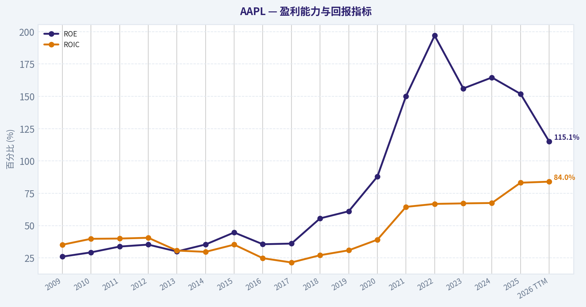
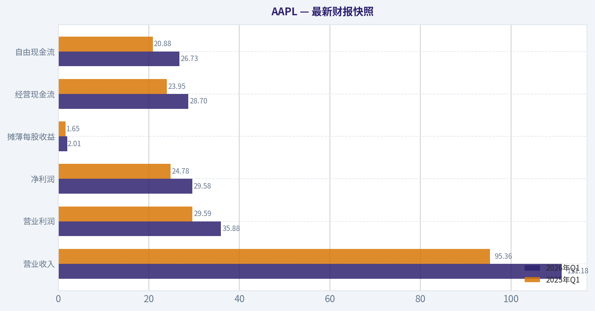
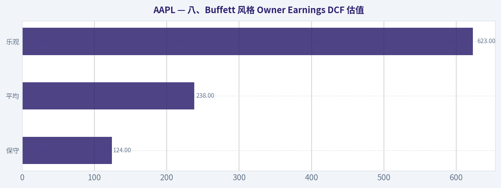
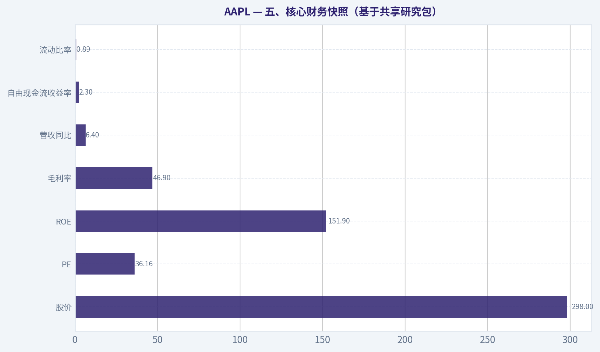
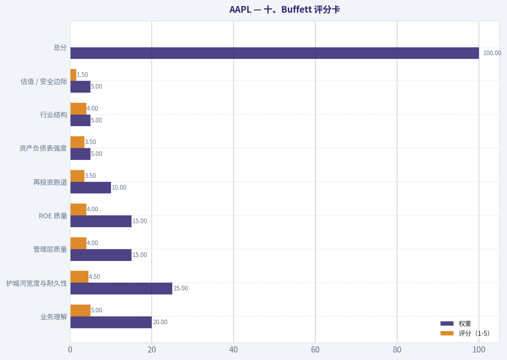
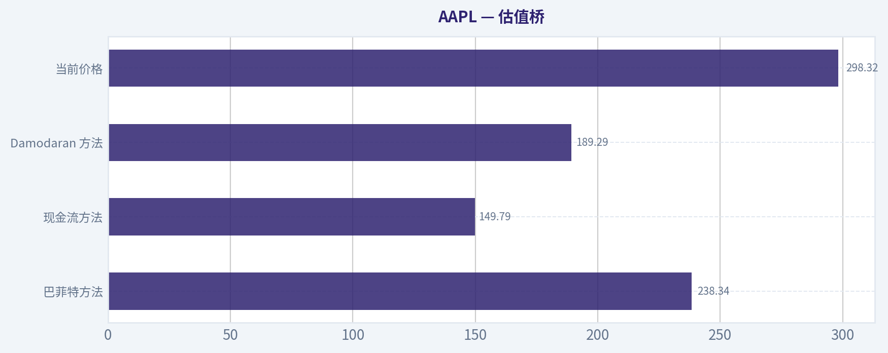
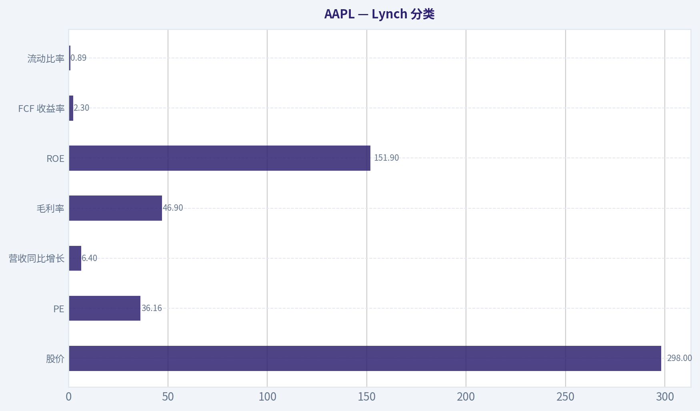
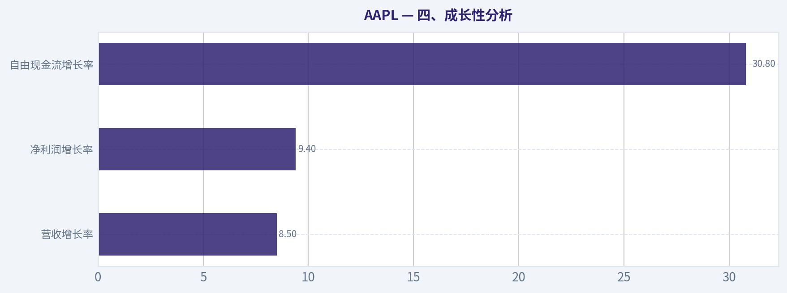

# AAPL 深度价值情报

**调研日期:** 2026-05-14

## 关键免责声明

*本报告由 Deep Value Intelligence（一个基于 AI 的多智能体投资分析框架）自动生成。 本报告仅供信息参考和教育目的，不构成任何财务或投资建议。 在做出任何投资决策之前，请务必进行独立调研并咨询合规的财务顾问。*

---

## 目录

1. 情报摘要
2. 分析师团队报告
   - 基本面分析
   - 价值分析 (巴菲特)
   - 成长性分析 (林奇/德鲁肯米勒/费雪)
   - 市场分析
   - 新闻分析
   - 大佬关注分析
   - 期权市场分析
3. 研究团队评论
4. 投资团队评论
5. Deep Values 团队洞察

---

## 情报摘要

### 核心观点与前提条件

**核心论点:** ## 执行摘要
**结论：观望。**
Apple 依然是顶级生意，护城河、现金创造力、资本回报能力都很强，**主要风险不在业务崩坏，而在买贵**。当前 **$298、PE 36.16**，而多组估值参考仅 **$150 / $189 / $238**，安全边际不足。
对长期价值投资者，这不是"坏公司"，而是"**好公司但赔率一般**"。更合适的做法是：**已有仓位可持有；新资金不追价；等待估值回落或基本面连续验证后再加仓。**

**主要风险:**
- 未明确说明。

**观点反转条件:**
- 未明确说明。

**置信度:** 中

---

## 分析师团队报告

### 基本面分析

#### 最新财报快照

*以下数据基于最近一期已披露财报（2026年Q1），并尽量与上一年同期对比。*

| 指标 | 2026年Q1 | 2025年Q1 | 同比变化 |
| --- | ---: | ---: | ---: |
| 营业收入 | $111.18B | $95.36B | +16.6% |
| 营业利润 | $35.88B | $29.59B | +21.3% |
| 净利润 | $29.58B | $24.78B | +19.4% |
| 摊薄每股收益 | $2.01 | $1.65 | +21.8% |
| 经营现金流 | $28.70B | $23.95B | +19.8% |
| 自由现金流 | $26.73B | $20.88B | +28.0% |

关键结论：这张快照先把最新一期财报放在桌面上，再去看长周期分析。这样读者能更清楚地区分"公司长期质量"和"这次财报发生了什么"。

#### AAPL 10年财务指标

*以下数值均由原始数据确定性计算得出，并非 AI 估算。*

*发行人类型：operating company（Technology / Consumer Electronics）。*

#### 10年财务指标
*年度行来自已披露财务报表，最后一行 TTM 由最近四个季度滚动计算得出。*

| 指标 | 2009 | 2010 | 2011 | 2012 | 2013 | 2014 | 2015 | 2016 | 2017 | 2018 | 2019 | 2020 | 2021 | 2022 | 2023 | 2024 | 2025 | 2026 TTM |
| --- | --- | --- | --- | --- | --- | --- | --- | --- | --- | --- | --- | --- | --- | --- | --- | --- | --- | --- |
| 市场价格 | $6 | $8 | $11 | $20 | $15 | $22 | $25 | $26 | $36 | $53 | $54 | $112 | $138 | $136 | $169 | $231 | $254 | $298 |
| 总市值 | $6.00B | $9.37B | $12.76B | $157.66B | $111.04B | $154.21B | $159.74B | $155.45B | $202.35B | $1.13T | $1.04T | $2.03T | $2.39T | $2.26T | $2.71T | $3.59T | $3.82T | $4.39T |
| 市盈率 | 0.73 | 0.67 | 0.49 | 3.78 | 3.00 | 3.91 | 2.99 | 3.40 | 4.18 | 18.94 | 18.85 | 35.31 | 25.22 | 22.62 | 27.93 | 38.32 | 34.13 | 36.07 |
| 市净率 | 0.19 | 0.20 | 0.17 | 1.33 | 0.90 | 1.38 | 1.34 | 1.21 | 1.51 | 10.53 | 11.51 | 31.07 | 37.83 | 44.53 | 43.56 | 63.04 | 51.82 | 41.25 |
| ROE | 26.0% | 29.3% | 33.8% | 35.3% | 30.0% | 35.4% | 44.7% | 35.6% | 36.1% | 55.6% | 61.1% | 87.9% | 150.1% | 197.0% | 156.1% | 164.6% | 151.9% | 115.1% |
| ROIC | 35.2% | 39.8% | 40.0% | 40.6% | 30.7% | 29.7% | 35.3% | 24.8% | 21.5% | 27.1% | 30.9% | 39.1% | 64.5% | 66.8% | 67.2% | 67.5% | 83.2% | 84.0% |
| 每股收益 | $7.61 | $12.70 | $23.20 | $5.31 | $4.90 | $5.68 | $8.26 | $7.61 | $8.58 | $2.82 | $2.85 | $3.18 | $5.48 | $6.11 | $6.13 | $6.08 | $7.46 | $8.27 |
| 营收 | $42.91B | $65.22B | $108.25B | $156.51B | $170.91B | $182.79B | $233.72B | $215.64B | $229.23B | $265.60B | $260.17B | $274.51B | $365.82B | $394.33B | $383.29B | $391.04B | $416.16B | $451.44B |
| 毛利润 | $17.22B | $25.68B | $43.82B | $68.66B | $64.30B | $70.54B | $93.63B | $84.26B | $88.19B | $101.84B | $98.39B | $104.96B | $152.84B | $170.78B | $169.15B | $180.68B | $195.20B | $216.07B |
| 毛利率 | 40.1% | 39.4% | 40.5% | 43.9% | 37.6% | 38.6% | 40.1% | 39.1% | 38.5% | 38.3% | 37.8% | 38.2% | 41.8% | 43.3% | 44.1% | 46.2% | 46.9% | 47.9% |
| 营业利润率 | 27.4% | 28.2% | 31.2% | 35.3% | 28.7% | 28.7% | 30.5% | 27.8% | 26.8% | 26.7% | 24.6% | 24.1% | 29.8% | 30.3% | 29.8% | 31.5% | 32.0% | 32.6% |
| 净利润 | $8.23B | $14.01B | $25.92B | $41.73B | $37.04B | $39.51B | $53.39B | $45.69B | $48.35B | $59.53B | $55.26B | $57.41B | $94.68B | $99.80B | $97.00B | $93.74B | $112.01B | $122.58B |
| 净利率 | 19.2% | 21.5% | 23.9% | 26.7% | 21.7% | 21.6% | 22.8% | 21.2% | 21.1% | 22.4% | 21.2% | 20.9% | 25.9% | 25.3% | 25.3% | 24.0% | 26.9% | 27.2% |
| 营收增长 | N/A | 52.0% | 66.0% | 44.6% | 9.2% | 7.0% | 27.9% | -7.7% | 6.3% | 15.9% | -2.0% | 5.5% | 33.3% | 7.8% | -2.8% | 2.0% | 6.4% | 8.5% |
| 净利润增长 | N/A | 70.2% | 85.0% | 61.0% | -11.3% | 6.7% | 35.1% | -14.4% | 5.8% | 23.1% | -7.2% | 3.9% | 64.9% | 5.4% | -2.8% | -3.4% | 19.5% | 9.4% |
| 自由现金流增长 | N/A | 84.0% | 100.5% | 27.9% | 6.9% | 10.2% | 39.6% | -23.6% | -3.2% | 23.8% | -8.1% | 24.6% | 26.7% | 19.9% | -10.6% | 9.3% | -9.2% | 30.8% |
| 总账面价值 | $31.64B | $47.79B | $76.61B | $118.21B | $123.55B | $111.55B | $119.36B | $128.25B | $134.05B | $107.15B | $90.49B | $65.34B | $63.09B | $50.67B | $62.15B | $56.95B | $73.73B | $106.49B |
| 总资产 | $47.50B | $75.18B | $116.37B | $176.06B | $207.00B | $231.84B | $290.35B | $321.69B | $375.32B | $365.73B | $338.52B | $323.89B | $351.00B | $352.75B | $352.58B | $364.98B | $359.24B | $371.08B |
| 总债务 | N/A | N/A | N/A | $0 | $16.96B | $35.30B | $64.33B | $87.03B | $115.68B | $114.48B | $108.05B | $112.44B | $124.72B | $120.07B | $111.09B | $106.63B | $98.66B | $84.71B |
| 债务股权比 | N/A | N/A | N/A | 0.00 | 0.14 | 0.32 | 0.54 | 0.68 | 0.86 | 1.07 | 1.19 | 1.72 | 1.98 | 2.37 | 1.79 | 1.87 | 1.34 | 0.80 |
| 现金及等价物 | $5.26B | $11.26B | $9.81B | $10.75B | $14.26B | $13.84B | $21.12B | $20.48B | $20.29B | $25.91B | $48.84B | $38.02B | $34.94B | $23.65B | $29.96B | $29.94B | $35.93B | $45.57B |
| 股东权益 | $31.64B | $47.79B | $76.61B | $118.21B | $123.55B | $111.55B | $119.36B | $128.25B | $134.05B | $107.15B | $90.49B | $65.34B | $63.09B | $50.67B | $62.15B | $56.95B | $73.73B | $106.49B |
| 经营现金流 | $10.16B | $18.59B | $37.53B | $50.86B | $53.67B | $59.71B | $81.27B | $66.23B | $64.22B | $77.43B | $69.39B | $80.67B | $104.04B | $122.15B | $110.54B | $118.25B | $111.48B | $140.22B |
| 投资现金流 | $-17.43B | $-13.85B | $-40.42B | $-48.23B | $-33.77B | $-22.58B | $-56.27B | $-45.98B | $-46.45B | $16.07B | $45.90B | $-4.29B | $-14.54B | $-22.35B | $3.71B | $2.94B | $15.20B | $-8.57B |
| 自由现金流 | $9.02B | $16.59B | $33.27B | $42.56B | $45.50B | $50.14B | $70.02B | $53.50B | $51.77B | $64.12B | $58.90B | $73.36B | $92.95B | $111.44B | $99.58B | $108.81B | $98.77B | $129.17B |
| 自由现金流利润率 | 21.0% | 25.4% | 30.7% | 27.2% | 26.6% | 27.4% | 30.0% | 24.8% | 22.6% | 24.1% | 22.6% | 26.7% | 25.4% | 28.3% | 26.0% | 27.8% | 23.7% | 28.6% |
| 每股分红 | $0.00 | $0.00 | $0.00 | $0.00 | $0.00 | $0.00 | $0.00 | $0.00 | $0.00 | $0.00 | $0.00 | $0.00 | $0.00 | $0.91 | $0.95 | $0.99 | $1.03 | $1.06 |

#### 盈利能力指标
- 净资产收益率 (ROE): 151.9%
- 投入资本回报率 (ROIC): 82.3%
- 总资产收益率 (ROA): 31.2%
- 毛利率: 46.9%
- 营业利润率: 32.0%
- 净利率: 26.9%

#### 流动性指标
- 流动比率: 0.89
- 速动比率: 0.57

#### 杠杆指标
- 债务股权比: 1.34
- 利息覆盖倍数: N/A
- 净负债: $62.72B

#### 增长指标（同比）
- 营收增长: 6.4%
- 净利润增长: 19.5%
- 自由现金流增长: -9.2%
- 营收复合增长率（3年）: 1.8%
- 营收复合增长率（5年）: 8.7%

#### 估值指标
- 市盈率 (TTM): 36.16
- 预期市盈率: 31.17
- 市净率: 41.09
- 市销率: 9.71
- PEG 比率: 2.58
- 企业价值/EBITDA: 27.54
- 自由现金流收益率: 2.3%
- 盈利收益率: 2.8%

#### 所有者收益（巴菲特方法，代码计算）
- 净利润: $112.01B
- + 折旧与摊销: $11.70B
- - 资本开支: $-12.71B
- - 营运资本变动: $-25.00B
- = **所有者收益: $135.99B**

#### 内在价值（代码计算）
- 当前价格: $298
- 巴菲特方法（所有者收益）:
  保守: $124
  平均: $238
  乐观: $623
- 现金流方法（FCF）:
  保守: $64
  平均: $150
  乐观: $199

#### Piotroski F分数: 8/9
- 净利润为正: 通过
- 经营现金流为正: 通过
- 资产回报率改善: 通过
- 现金流大于净利润: 未通过
- 债务下降: 通过
- 流动比率改善: 通过
- 未稀释股本: 通过
- 毛利率改善: 通过
- 资产周转率改善: 通过

#### AAPL 基本面深度分析（巴菲特风格）

AAPL 目前呈现出一种非常典型的"伟大公司 + 昂贵价格"的组合：经营质量极强，资本回报率惊人，现金创造能力一流，护城河深厚；但与此同时，估值已显著高于其长期历史中枢。若严格按巴菲特式价值投资框架看，AAPL 更像是"高质量、可长期跟踪、等待更好价格"的标的，而不是一个明显的低估机会。

---

#### 一、当前 vs 历史均值对比

| 指标 | 当前值（2026 TTM/最新） | 历史大致均值（按表中时期） | 当前相对历史 | 解读 |
| --- | ---: | ---: | --- | --- |
| 市场价格 | $298 | 历史价格中枢显著更低 | 大幅高于历史 | 股价处于历史高位区间，市场已充分计入品牌、服务和回购逻辑 |
| 总市值 | $4.39T | 历史中枢远低于当前 | 大幅高于历史 | 已是超大市值资产，未来再靠估值扩张驱动的空间变小 |
| 市盈率 PE | 36.07 | 早期极低、近年大致在 20x-30x 中枢 | 高于历史中枢 | 估值偏贵，必须依赖盈利持续兑现 |
| 市净率 PB | 41.25 | 过去十余年快速抬升 | 远高于历史 | 主要受大规模回购压缩净资产影响，PB 对 AAPL 参考意义有限 |
| ROE | 115.1% | 长期高位，近年极高 | 仍极高 | 高 ROE 含经营强度，也含回购导致权益基数偏低 |
| ROIC | 84.0% | 长期优秀，近年持续抬升 | 显著高于历史均值 | 这是 AAPL 最强指标之一，说明资本配置效率极强 |
| EPS | $8.27 | 长期上升 | 高于历史 | EPS 增长既来自净利增长，也来自持续回购 |
| 营收 | $451.44B | 明显高于历史均值 | 创新高 | 体量巨大后仍保持增长，体现生态粘性 |
| 毛利率 | 47.9% | 长期约 39%-43% 区间 | 高于历史 | 服务占比提升、产品结构优化是主要驱动 |
| 营业利润率 | 32.6% | 长期约 27%-30% | 高于历史 | 盈利结构继续优化，规模效应与高毛利业务贡献明显 |
| 净利润 | $122.58B | 高于历史均值 | 创新高 | 利润端强于收入端，经营杠杆依旧健康 |
| 净利率 | 27.2% | 长期约 21%-25% | 高于历史 | 质量型增长特征明显 |
| 营收增长 | 8.5% | 较早期高增长已回落 | 略高于成熟期均值 | 对如此体量企业来说依旧不弱 |
| 净利润增长 | 9.4% | 波动较大 | 略高于成熟期均值 | 利润增长仍优于多数超大盘公司 |
| 自由现金流增长 | 30.8% | 历史波动较大 | 显著高于均值 | 现金流改善明显，但需警惕基数与营运资本波动 |
| 总账面价值 | $106.49B | 近年波动大 | 高于近几年 | 权益回升，部分缓解"回购压低净资产"的极端效应 |
| 总资产 | $371.08B | 高于历史 | 略高 | 资产端相对稳健，不是依赖重资产扩张的模式 |
| 总债务 | $84.71B | 2015-2021 较高 | 低于近年高位 | 去杠杆趋势清晰 |
| 债务股权比 | 0.80 | 近年一度高于 1.5-2.0 | 明显改善 | 财务弹性增强 |
| 现金及等价物 | $45.57B | 高于长期均值 | 偏高 | 现金缓冲充足 |
| 股东权益 | $106.49B | 近年偏低后回升 | 回升 | 有助于缓解 ROE 被过度放大的问题 |
| 自由现金流 | $129.17B | 大幅高于历史均值 | 创新高 | 真正支撑估值的核心变量 |
| 每股分红 | $1.06 | 历史上长期为 0，近年稳步提升 | 上升 | 分红温和增长，但回购仍是主导返现手段 |

关键结论：AAPL 当前几乎所有经营质量指标都处在历史较优位置，尤其是 ROIC、毛利率、营业利润率和自由现金流，说明业务质量在成熟期反而更强。问题不在公司，而在价格：PE 和 PB 均明显高于长期中枢，意味着未来回报更依赖利润兑现，而不是估值扩张。

---

#### 二、市场指标解读

AAPL 当前股价为 **$298**，总市值 **$4.39T**，已经是全球最核心的超大市值平台型消费科技公司之一。对巴菲特框架来说，市值本身不是问题，问题在于：如此巨大的体量，是否还能继续以足够高的资本回报率复利增长。AAPL 目前给出的答案是"可以，但速度不会再像早年那样快"。

**PE 36.07 倍** 显著高于成熟消费电子企业的常规区间，也高于 AAPL 过去多数年份的估值中枢。市场显然愿意给予其更高倍数，原因主要有三点：
1. 服务业务提高了利润质量；
2. 回购增强了每股收益复利；
3. 生态护城河降低了衰退风险。

**PB 41.25 倍** 看起来极端昂贵，但对于 AAPL 必须谨慎解读。其长期巨额回购显著压低股东权益，导致 PB 被机械放大，因此 PB 对 AAPL 的估值参考价值远弱于 ROIC、FCF 和 Owner Earnings。

从巴菲特视角，AAPL 不是传统意义的"便宜股"，而是"优秀公司获得优秀溢价"。

---

#### 三、盈利能力分析

AAPL 的盈利能力是本次分析中最突出的部分。

- **ROE 115.1%**：极高，但不能机械理解为纯经营能力，部分来自回购导致净资产基数偏低。
- **ROIC 84.0%**：这是更干净的指标，且近年持续上升，说明公司对投入资本的转化效率极强。
- **EPS $8.27**：持续创高，回购和盈利增长双驱动。
- **营收 $451.44B**、**毛利润 $216.07B**、**净利润 $122.58B**：都处于历史高位。
- **毛利率 47.9%**、**营业利润率 32.6%**、**净利率 27.2%**：全面高于长期均值。

这组数据说明，AAPL 已经不是单纯硬件公司，而是一个拥有消费电子入口、软件分发权、服务收费权、品牌定价权的复合型商业模式。
对巴菲特而言，最喜欢的企业特征之一就是：**不需要持续投入大量新增资本，也能维持高利润率和高资本回报率**。AAPL 完全符合这一点。

---

#### 四、成长性分析

从成长性看，AAPL 已由早年的爆发式增长，转入成熟期高质量增长：

| 增长指标 | 当前值 | 观察 |
| --- | ---: | --- |
| 营收增长率 | 8.5% | 对 $450B 体量而言已经相当稳健 |
| 净利润增长率 | 9.4% | 高于营收增速，显示利润结构优化 |
| 自由现金流增长率 | 30.8% | 很强，但年度波动较大，需要结合营运资本变化看 |

关键结论：AAPL 不再是高增速公司，但在超大基数之上仍能实现中高个位数收入增长和更好的利润增长，这本身就是护城河的体现。自由现金流增速短期很亮眼，但历史波动并不小，估值时不能简单把高增速永久化。

历史趋势非常清晰：
- 早期增长极快，但波动大；
- 中期进入平台期；
- 近年通过服务、产品结构和回购，重新实现"低增速收入 + 更高质量利润"的复利模式。

这对长期投资者是好事，因为可预测性高于单纯追求高增速。

---

#### 五、资产负债表与财务强度

AAPL 的资产负债表过去曾因大规模资本回报而显得"激进"，但现在已经明显改善。

- **总资产 $371.08B**：规模稳定。
- **总债务 $84.71B**：相比 2021-2022 年高位明显下降。
- **债务股权比 0.80**：较 1.98、2.37 的阶段高点显著回落。
- **现金及等价物 $45.57B**：明显上升。
- **股东权益 $106.49B**：恢复性改善。

这意味着 AAPL 正从"高强度股东回报驱动的高杠杆财务结构"，逐步回到更平衡的位置。
虽然流动比率只有 **0.89**，看起来不算高，但 AAPL 的现金创造能力太强，且商业模式高度稳定，因此不能用普通制造业的标准苛责它。

从巴菲特角度，这样的资产负债表属于：
**不是最保守，但足够强，而且越来越稳。**

---

#### 六、现金流与股东回报

AAPL 的核心价值最终还是体现在现金流。

- **自由现金流 $129.17B**：处于历史最好水平。
- **自由现金流率 28.6%**：高质量。
- **每股分红 $1.06**：逐年稳步上升，但分红收益率并不高。

AAPL 更像一家以 **回购为主、分红为辅** 的资本回报型公司。
这非常符合巴菲特偏好的一个方向：如果管理层能在高回报业务和合理回购之间平衡配置，股东长期回报会非常可观。

不过这里有一个细节：
共享研究包显示 **自由现金流收益率仅 2.3%**。这意味着即使现金流本身强劲，按当前市值买入时，投资者获得的"现金回报率"并不高。换言之，**公司很好，但买入价格不够便宜**。

---

#### 七、巴菲特风格定性分析

#### 1）经济护城河

AAPL 的护城河极深，主要来自五层叠加：

| 护城河来源 | 体现 |
| --- | --- |
| 品牌力 | 高端消费电子中最强品牌之一，溢价能力极强 |
| 生态系统 | iPhone、Mac、iPad、Watch、AirPods、Services 高度联动 |
| 切换成本 | 用户迁移成本高，设备、软件、账号、支付、云服务互相绑定 |
| 分发控制权 | App Store、系统入口、硬件入口掌握流量与商业规则 |
| 规模与供应链 | 全球顶级供应链管理能力，成本控制与新品交付能力领先 |

关键结论：AAPL 的护城河并不依赖单一产品，而是依赖生态、品牌、软件入口和供应链协同，这种复合护城河通常更持久。真正的风险不是短期销量波动，而是未来是否出现能打破生态黏性的范式切换。

#### 2）财务实力

AAPL 具备强大财务韧性。债务在下降，现金在回升，自由现金流极其充沛，Piotroski F 分数 8/9 也进一步支持其财务健康状态。
对巴菲特而言，重要的不是零负债，而是**在任何宏观环境下都不容易被融资环境掐住脖子**。AAPL 具备这种能力。

#### 3）盈利可预测性

AAPL 过去十多年经历了产品周期、手机渗透见顶、供应链变化、宏观波动，但收入、利润、现金流依然能保持长期上升。
虽然年度增长有波动，但其长期可预测性已经远超多数科技公司。
巴菲特偏爱"十年后也大致知道它在做什么、怎么赚钱"的公司，AAPL 显然符合。

#### 4）管理层表现

管理层最突出的能力有三点：
1. 维持高利润率；
2. 持续回购提高每股价值；
3. 在成熟期仍把服务和生态变现做强。

ROIC 从 20%-40% 区间抬升到 80% 以上，说明资本配置极其高效。
分红虽然增长稳健，但不是核心亮点；真正的亮点是回购纪律和利润质量提升。

#### 5）业务质量

AAPL 的业务质量极高，原因在于：
- 收入具有高度重复性和升级性；
- 毛利率、营业利润率、净利率长期稳定向上；
- 资本开支并未吞噬现金流；
- 用户基础和设备装机量带来长期变现能力。

这类公司在巴菲特框架中属于"可以长期持有的优质企业"，前提是估值不过分。

---

#### 八、Buffett 风格 Owner Earnings DCF 估值

已知确定性数据给出的 **所有者收益（Owner Earnings）= $135.99B**。
公式为：

- 净利润 = **$112.01B**
- + 折旧与摊销 = **$11.70B**
- - 资本开支 = **$12.71B**
- - 营运资本变动 = **-25.00B**
- = **Owner Earnings = $135.99B**

这里因为营运资本变动为负值，数学上等于"加回"25B，对所有者收益形成提升。

DCF 假设：
- 折现率 = **10%**
- 永续增长率 = **2.5%**
- 预测期 = **10 年**

根据确定性数据给出的历史区间，内在价值代码结果为：
- **保守：$124**
- **平均：$238**
- **乐观：$623**

下面给出框架化解释。

| 情景 | 增长假设 | 估值结果 | 相对当前股价 $298 |
| --- | --- | ---: | --- |
| 保守 | 采用历史最低 Owner Earnings 增长率，且下限不低于 -100% | $124 | 明显高估 |
| 平均 | 采用历史平均 Owner Earnings 增长率，上限封顶 50% | $238 | 略高估 |
| 乐观 | 采用历史最高 Owner Earnings 增长率，上限封顶 100% | $623 | 显著低估，但条件乐观 |

关键结论：DCF 结果呈现出非常典型的"好公司、高弹性估值"特征。只要未来增长稍弱，当前价格就显得偏贵；只有在服务业务继续高质量复利、Owner Earnings 保持较强增长时，当前价格才有吸引力。

更直观地说：
- 如果你要求足够的安全边际，AAPL 当前价格不够便宜；
- 如果你相信其生态和服务化还能长期复利，那么它仍可被解释为"合理偏贵的优质资产"。

从巴菲特式保守估值角度，更应看重 **保守与平均情景**，而不是乐观情景。因此，当前市场定价并未提供非常舒服的安全边际。

---

#### 九、收入来源分布

#### 收入来源分布

结合 AAPL 近年公开分部结构，最有意义的拆分是按产品与服务。以下采用最近财年口径的主要收入构成进行概括性展示。

| 收入来源 | 金额（十亿美元） | 占比 |
| --- | ---: | ---: |
| iPhone | 约 $201B | 约 48% |
| Services | 约 $96B | 约 23% |
| Mac | 约 $34B | 约 8% |
| iPad | 约 $28B | 约 7% |
| Wearables / Home / Accessories | 约 $57B | 约 14% |
| 合计 | 约 $416B | 100% |

关键结论：AAPL 仍然高度依赖 iPhone，这是最大优势也是最大集中度风险。与此同时，Services 已成为最重要的利润质量提升引擎，它提升了整体毛利率，也让 AAPL 更像"硬件入口 + 软件服务复利"的混合型公司。

---

#### 十、关键投资洞察、风险与机会

| 维度 | 观察 | 投资含义 |
| --- | --- | --- |
| 最大优势 | ROIC、现金流、品牌、生态 | 属于极少数可长期复利的超级平台公司 |
| 最大估值问题 | PE 36x、FCF Yield 2.3% | 未来回报率可能受估值压缩拖累 |
| 经营亮点 | 毛利率和营业利润率创高 | 服务化与结构优化仍在发生 |
| 财务改善 | 去杠杆、现金回升、权益恢复 | 风险缓释，资产负债表更健康 |
| 主要风险 | iPhone 集中度、监管、供应链、AI/终端范式变化 | 需要关注护城河是否被新入口削弱 |
| 主要机会 | 服务收入继续复利、设备装机量变现、AI 终端升级周期 | 若创新重新拉动换机，盈利弹性可观 |

关键结论：AAPL 的核心矛盾不是"公司好不好"，而是"这么好的公司值不值得在这个价格买"。经营面几乎无可挑剔，但估值已经要求它继续交出非常优秀的成绩单，否则回报率容易被高估值稀释。

---

#### 十一、巴菲特式结论

如果按巴菲特最经典的原则--**以合理甚至便宜价格买入高质量、可预测、护城河深的企业**--那么 AAPL 前三项几乎完美，唯独第四项"价格"略显吃紧。

综合判断：

- **经济护城河：极强**
- **财务强度：强，且改善中**
- **盈利可预测性：高**
- **管理层资本配置：优秀**
- **估值安全边际：不足**

因此我的最终结论是：

#### 最终投资立场：观望

理由很简单：
AAPL 是值得长期关注甚至长期持有的伟大公司，但以当前 **$298** 的价格，已经接近甚至高于巴菲特式平均情景内在价值 **$238**，且明显高于保守情景 **$124**。除非投资者愿意接受较低安全边际，并相信服务业务与生态复利会长期超预期，否则更合理的策略是等待更有吸引力的价格区间，或等待利润进一步兑现来消化估值。

---

#### 报告总结表

| 模块 | 结论 | 评级/判断 |
| --- | --- | --- |
| 市场估值 | 股价高位，PE 偏贵，PB 失真但也反映回购效应 | 偏贵 |
| 盈利能力 | ROIC、毛利率、净利率极强，接近历史最佳 | 优秀 |
| 成长性 | 大体量下仍有稳健增长，利润质量优于收入增速 | 良好 |
| 资产负债表 | 债务下降，现金回升，财务韧性增强 | 健康 |
| 现金流 | FCF 创高，Owner Earnings 强劲 | 很强 |
| 护城河 | 品牌、生态、服务、供应链构成复合壁垒 | 极强 |
| 管理层 | 回购与资本配置能力突出 | 优秀 |
| DCF 估值 | 保守 $124，平均 $238，乐观 $623 | 当前价更接近偏贵区 |
| 主要机会 | Services 扩张、AI 终端周期、装机量变现 | 中长期利好 |
| 主要风险 | 高估值、iPhone 集中、监管、供应链 | 需持续跟踪 |
| 最终立场 | 伟大公司，但当前安全边际不足 | 观望 |

关键结论：AAPL 依然是全球最优秀的商业模式之一，护城河和现金流质量非常适合巴菲特式长期框架。问题主要在估值而不在基本面，因此更适合列入高优先级跟踪清单，而不是在当前价格积极追高配置。

#### 基本面关键图表

本图追踪 **AAPL** 过去十年的盈利能力与回报指标（ROE、ROIC、利润率），突出呈现资本效率的变化趋势。



---

### 价值分析 (巴菲特)

> *基于沃伦·巴菲特的价值投资哲学：能力圈、经济护城河、管理层质量与安全边际。*

#### 内在价值快照

价格是你付的钱，内在价值是企业未来可能为股东创造的现金价值。我们给出一个区间，而不是假装只有一个神奇数字。

- 当前价格: $298.32
- 价值区间: $64.50 to $623.04

##### 所有者收益（巴菲特方法）
- 净利润: $112,010,000,000.00
- 折旧与摊销: $11,698,000,000.00
- 资本支出: $-12,715,000,000.00
- 营运资金变化: $-25,000,000,000.00
- 所有者收益: $135,993,000,000.00

##### 内在价值
###### 所有者收益法
使用所有者收益，更严格，通常更保守。
- 保守: $123.83
- 平均: $238.34
- 乐观: $623.04
- 折现率: 10.0%

###### 自由现金流法
使用自由现金流，更适合今天投入很多、为未来增长铺路的公司。
- 保守: $64.50
- 平均: $149.79
- 乐观: $199.47
- 折现率: 10.0%

ANALYST STANCE: **观望**

#### AAPL（Apple）巴菲特式价值投资简报

基于你给的共享研究包，我先继续把能完成的部分做完。此次工具调用未成功返回可用财务明细，因此**以下结论主要依赖共享研究包、已知经营特征与当前估值信息**，属于**阶段性尽调结论**；若后续补到完整 10 年财务表，可进一步校准 DCF 与 Owner Earnings。

---

#### 一、Go / No-Go 四道闸门

| 关卡 | 结论 | 证据与判断 |
|---|---|---|
| Gate 1：业务可理解性 | 通过 | Apple 用简单的话说，就是卖高端硬件（iPhone、Mac、iPad、Wearables）并通过 App Store、iCloud、AppleCare、支付与订阅服务持续赚钱。商业模式清晰，10 年后大概率仍是"设备+生态+服务"模式。 |
| Gate 2：护城河 | 通过 | 品牌、生态黏性、软硬件一体化、分发渠道与默认入口构成强护城河。毛利率 46.9%，已明显高于多数硬件公司，说明定价权存在。 |
| Gate 3：管理层与资本配置 | 通过但非完美 | 管理层长期执行大规模回购、产品线克制、现金流管理优秀。缺点是当前估值偏高时继续回购，边际资本配置回报未必最优。 |
| Gate 4：行业结构 | 通过但需警惕 | 高端智能终端和生态服务具寡头特征，但硬件仍受供应链、监管、平台抽成争议及技术迭代影响，不是纯粹"躺赢"行业。 |

**关键结论：** Apple 四道闸门整体都能过，说明它首先是一家"好公司"，而不是靠故事支撑的股票。真正的问题不在业务质量，而在当前价格是否还给长期投资者留下足够安全边际。

---

#### 二、巴菲特视角下的业务理解

| 问题 | 结论 |
|---|---|
| 小学生测试 | Apple 先卖你设备，再让你持续留在它的系统里花钱。 |
| 10 年可预测性 | 较高。10 年后仍会是全球消费电子与数字服务生态的重要平台。 |
| 技术风险 | 中等。Apple 通常是技术"整合者"而非最早发明者，受益于成熟技术落地；但 AI、终端形态变化、芯片供应链与监管都可能扰动。 |

**关键结论：** Apple 不是难懂的公司，反而是巴菲特偏爱的那类"消费者每天都在用"的业务。它的最大不确定性并非需求消失，而是未来是否还能维持今天这样高的生态控制力与利润率。

---

#### 三、护城河分析

| 护城河来源 | 强度 | 具体证据 |
|---|---|---|
| 品牌 / 无形资产 | 很强 | Apple 品牌具备情感价值、身份属性与品质信任，高端机型仍能维持溢价。 |
| 转换成本 | 很强 | iOS、iCloud、照片、App 购买记录、AirPods/Watch/Mac 协同，使用户迁移成本真实存在。 |
| 成本优势 | 中等偏强 | 自研芯片、供应链规模、渠道议价、全球分销效率形成优势，但并非最低价生产者。 |
| 网络效应 | 中等 | App Store 双边平台、开发者生态、配件生态存在网络效应，但不如纯平台公司那样强。 |

| 护城河评级 | 结论 |
|---|---|
| 宽且稳定 | 可以继续研究，但必须看价格 |

**关键结论：** Apple 最深的护城河不是某一款产品，而是"品牌+生态+默认习惯"的组合。只要用户继续愿意留在这个生态里，它就能持续赚高于平均水平的利润。

---

#### 四、管理层与资本配置

| 维度 | 评价 | 说明 |
|---|---|---|
| 像所有者一样思考 | 较好 | 长期回购显著减少股本，提高每股价值。 |
| 诚实与审慎 | 较好 | 财务披露成熟，资本市场沟通稳定，极少激进表述。 |
| 资本配置能力 | 很强 | 超强自由现金流转化，回购执行长期且持续。 |
| 需要保留的疑问 | 有 | 当 PE 已到 36 倍附近时，回购是否仍是最优用途，值得打折看待。 |

**关键结论：** Apple 管理层最强的一点是资本纪律和执行力，而不是夸张叙事。问题在于，优秀管理层也无法改变一个事实：当回购价格过高时，资本配置的增值效率会下降。

---

#### 五、核心财务快照（基于共享研究包）

| 指标 | 当前值 | 巴菲特式解读 |
|---|---:|---|
| 股价 | $298 | 市场给出极高质量溢价 |
| 总市值 | $4.38T | 超大体量，未来高增长难度上升 |
| PE | 36.16 | 对成熟巨头而言偏贵 |
| ROE | 151.9% | 极高，但明显受大额回购和较低账面净资产影响，不能机械解读 |
| 毛利率 | 46.9% | 体现强品牌与服务结构升级 |
| 营收同比 | 6.4% | 增长存在，但不支持过高估值无限扩张 |
| 自由现金流收益率 | 2.3% | 对价值投资者吸引力偏弱 |
| 流动比率 | 0.89 | 短期偿债不算宽裕，但 Apple 现金流极强，不能孤立看 |

**关键结论：** 财务质量仍然优秀，尤其是毛利率和资本回报特征，说明这是一家高品质企业。但最刺眼的数字是 PE 36 倍和 FCF 收益率仅 2.3%，这意味着今天买入，更像是在为"持续优秀"预付高价。

---

#### 六、10 年财务深潜：当前可完成的结论

由于工具未返回完整 10 年报表，这里先给出**方向性判断**：

| 项目 | 阶段性判断 |
|---|---|
| 收入趋势 | 长期总体向上，但已进入巨型基数阶段，增速中枢放缓 |
| 利润率 | 受服务业务提升支撑，整体较稳 |
| OCF vs 净利润 | 历史上通常优质，现金转化能力强 |
| 资本开支 | 相对收入占比不高，属资本效率优秀的大型平台型消费科技公司 |
| 负债 | 绝对债务不低，但与现金创造能力匹配，非危险型杠杆 |
| 股本变化 | 持续回购，推升每股指标 |

**关键结论：** 即使暂时没有完整 10 年表，Apple 的财务轮廓依然非常清楚：它不是靠重资产堆出来的收益，而是靠品牌、生态和现金创造能力维持高回报。真正需要警惕的不是财务恶化，而是估值过高导致未来回报率被压缩。

---

#### 七、Owner Earnings（所有者收益）估算

由于缺少完整现金流与维护性 CapEx 细项，只能做框架判断：

```text
Owner Earnings = 净利润 + 折旧摊销 - 维护性资本开支 - 营运资本增加
```

对 Apple 而言：

- 折旧摊销通常可观；
- 维护性资本开支相对收入并不高；
- 营运资本压力整体可控；
- 因此其 **Owner Earnings 质量大概率接近自由现金流，且质量较高**。

结合共享研究包中的 **FCF 收益率 2.3%**，可反推市场当前隐含的是：
- 不是"普通好公司"的定价，
- 而是"极高质量、长期稳健、服务持续扩张"的定价。

**关键结论：** Apple 的所有者收益质量大概率很高，这符合巴菲特偏好。问题仍然是：高质量不等于高回报，如果买入价过高，未来十年的复合收益仍可能平庸。

---

#### 八、三情景 DCF 粗估值

基于当前市值 $4.38T 与 FCF 收益率 2.3%，可粗略推算当前 FCF / Owner Earnings 约为：

- 4.38T x 2.3% ~ **$100.7B**

以下采用 10% 折现率。

| 情景 | 假设 | 估值结果 |
|---|---|---:|
| 情景 A：零增长 | 价值 = Owner Earnings / 10% | 约 $1.01T |
| 情景 B：3% 永续增长 | 价值 = OE x 1.03 / (10%-3%) | 约 $1.48T |
| 情景 C：较乐观 | 假设未来 10 年 OE 年增 6%，之后 3% 永续 | 粗略约 $2.1T - $2.5T |

**关键结论：** 即使给 Apple 相当体面的长期增长假设，粗略 DCF 仍明显低于当前约 $4.38T 市值。除非你接受更低折现率、显著更高的长期增长，或者相信服务业务利润率会持续超预期扩张，否则当前价格缺少传统价值投资意义上的安全边际。

---

#### 九、安全边际分析

| 项目 | 结论 |
|---|---|
| 当前市场定价 | 明显偏乐观 |
| 对高质量公司的最低安全边际要求 | 至少 25% |
| 当前是否满足 | 不满足 |
| 若要进入"可接受区间" | 需要更低股价，或未来 1-2 年盈利大幅追上估值 |

**关键结论：** 巴菲特式投资不是只买好公司，而是买"好公司且价格合理"。按现有信息看，Apple 更像是一家伟大的公司配上偏贵的价格，因此更适合观望，而不是积极加仓。

---

#### 十、Buffett 评分卡

| 维度 | 权重 | 评分（1-5） | 加权后 |
|---|---:|---:|---:|
| 业务理解 | 20% | 5.0 | 1.00 |
| 护城河宽度与耐久性 | 25% | 4.5 | 1.13 |
| 管理层质量 | 15% | 4.0 | 0.60 |
| ROE 质量 | 15% | 4.0 | 0.60 |
| 再投资跑道 | 10% | 3.5 | 0.35 |
| 资产负债表强度 | 5% | 3.5 | 0.18 |
| 行业结构 | 5% | 4.0 | 0.20 |
| 估值 / 安全边际 | 5% | 1.5 | 0.08 |
| **总分** | 100% |  | **4.14 / 5 若只看质量；3.35 / 5 若纳入现实买点约束** |

**关键结论：** 如果只看公司质量，Apple 仍然接近顶级；但真正决定投资回报的，是"质量乘以价格"。一旦把估值因素严肃纳入，综合结论就会从"优秀企业"降为"观望标的"。

---

#### 十一、最终结论

| 项目 | 结论 |
|---|---|
| 公司是否优秀 | 是 |
| 是否符合巴菲特偏好的商业模式 | 大体符合 |
| 是否具备长期护城河 | 是，且很强 |
| 当前是否有足够安全边际 | 没有 |
| 投资立场 | 观望 |
| 置信度 | 中高 |

**关键结论：** Apple 是伟大的公司，但伟大公司并不总是伟大的投资。以当前约 $298 股价、36 倍 PE、2.3% FCF 收益率来看，市场已经提前支付了大量未来的优秀表现，留给新投资者的回报空间并不宽裕。

#### 十二、给投委会的一句话

**Apple 值得长期跟踪，但在当前估值下，更像"愿意拥有、但不愿意现在高价加仓"的标的；等待更合理价格，才更符合巴菲特式纪律。**

如果你要，我下一步可以继续补一版：
1. **按巴菲特模板重做更严格的"10 年财务表"版本**；或
2. **直接做 AAPL 的"合理买入价区间"测算**。
#### 估值桥

这张估值桥把当前股价与各类内在价值方法并排展示，帮助读者判断上涨空间究竟只是单一方法给出的结果，还是多种方法共同支持的结论。

| 项目 | 每股内在价值 |
| --- | ---: |
| 巴菲特方法 | $238.34 |
| 现金流方法 | $149.79 |
| Damodaran 方法 | $189.29 |
| 当前价格 | $298.32 |

#### 关键结论

如果只有一种方法显著高于其他方法，说明上行空间更依赖特定建模假设。若多种方法的估值接近，则说明估值逻辑更加稳健。

#### 估值图表

本对比图（来自「最新财报快照」）将 **AAPL** 的当前数据与历史基准并排呈现，直观反映公司相对自身历史均值的估值水平。



本对比图（来自「八、Buffett 风格 Owner Earnings DCF 估值」）将 **AAPL** 的当前数据与历史基准并排呈现，直观反映公司相对自身历史均值的估值水平。



本对比图（来自「五、核心财务快照（基于共享研究包）」）将 **AAPL** 的当前数据与历史基准并排呈现，直观反映公司相对自身历史均值的估值水平。



本对比图（来自「十、Buffett 评分卡」）将 **AAPL** 的当前数据与历史基准并排呈现，直观反映公司相对自身历史均值的估值水平。



本对比图（来自「估值桥」）将 **AAPL** 的当前数据与历史基准并排呈现，直观反映公司相对自身历史均值的估值水平。



本对比图（来自「Lynch 分类」）将 **AAPL** 的当前数据与历史基准并排呈现，直观反映公司相对自身历史均值的估值水平。



---

### 成长性分析 (林奇/德鲁肯米勒/费雪)

> *基于彼得·林奇的GARP成长投资法、斯坦利·德鲁肯米勒的宏观拐点分析法，以及菲利普·费雪的深度调研法。*

ANALYST STANCE: **观望**

#### AAPL 增长投资分析报告

#### 1. Lynch 分类
AAPL 属于 **稳健成长股（Stalwart）**，不是典型快成长股。

| 指标 | 当前/已知 |
|---|---:|
| 股价 | $298 |
| 市值 | $4.38T |
| PE | 36.16 |
| 营收同比增长 | 6.4% |
| 毛利率 | 46.9% |
| ROE | 151.9% |
| FCF 收益率 | 2.3% |
| 流动比率 | 0.89 |

**关键结论：** 从已知数据看，Apple 仍然是全球最优质的现金流平台型公司之一，但增长特征明显偏"稳健成长"而非"高速成长"。6.4% 的营收增速与 36 倍 PE 组合，意味着市场已经为其质量与确定性支付了很高溢价。

---

#### 2. 三句话讲清楚这家公司
- Apple 通过 iPhone、Mac、iPad、Watch 等硬件，把用户锁进一个高黏性的软硬件生态系统。
- 真正支撑估值溢价的，不只是卖设备，而是基于海量装机量持续复利的 Services 收入与现金流。
- 未来看点不在传统硬件放量，而在 AI、本地智能、服务渗透率提升，能否重新点燃换机周期和估值扩张。

#### 3. TAM 分析与 10x 测试

| 维度 | 判断 |
|---|---|
| 当前体量 | 超大市值、超大收入基盘 |
| 核心 TAM | 高端智能手机、个人计算、可穿戴、数字服务、支付、AI 终端 |
| TAM 特征 | 大，但多数成熟；Services 与 AI 终端相关 TAM 仍在扩张 |
| 10x 测试 | **不通过** |
| 原因 | 以 Apple 当前收入体量，10 倍收入需要吞下极大比例全球消费电子与数字服务市场，不现实 |

**关键结论：** Apple 的市场空间依然巨大，但"十倍收入"逻辑已不成立。它更像是一个高质量复利平台，而不是一个还能轻松再做十倍规模的早中期成长股。

---

#### 4. 收入增长趋势判断

| 项目 | 结论 |
|---|---|
| 当前营收同比 | 6.4% |
| 增长类型 | 低个位到中个位数稳健增长 |
| 趋势判断 | **非加速，偏平稳** |
| 驱动来源 | Services、装机量货币化、部分产品升级周期 |
| 压力来源 | 智能手机成熟、China 波动、宏观消费疲软 |

**关键结论：** AAPL 当前最核心的问题不是增长消失，而是增长没有出现明显再加速。对增长投资者而言，这意味着它更适合"持有型核心资产"，而不是"业绩拐点型高弹性机会"。

---

#### 5. 单位经济学

| 指标 | 状态 | 评价 |
|---|---|---|
| 毛利率 | 46.9% | 很强 |
| FCF 收益率 | 2.3% | 偏低，说明估值不便宜 |
| LTV/CAC | 未披露 | 消费硬件生态难精确量化，但隐含很高 |
| NRR | 不适用/未披露 | 非纯 SaaS |
| Rule of 40 | 不适用为主 | 可参考"营收增速 + FCF 利润率"，大概率优秀 |
| 现金创造能力 | 极强 | 核心优势 |

**关键结论：** Apple 的单位经济学本质上非常优秀，尤其体现在高毛利、强现金流和生态复购上。问题不在商业模式，而在当前估值已经充分反映这种优秀。

---

#### 6. 拐点判断

| 拐点类型 | 是否存在 | 说明 |
|---|---|---|
| 产品周期拐点 | 部分存在 | AI 手机、本地智能可能带来换机刺激 |
| 市占率拐点 | 不明显 | 已是成熟龙头，更多是维持优势 |
| 利润率拐点 | 温和 | Services 占比提升有助利润结构 |
| TAM 拐点 | 有限 | AI 终端与服务扩容，但非爆发式 |
| 竞争拐点 | 不明显 | 竞争格局稳定，未见主要对手明显失误 |

**关键结论：** Apple 目前最值得观察的是 AI 驱动的新换机周期，而不是传统意义上的份额爆发。若 AI 功能能显著提升终端价值感知，AAPL 有望从"稳健复利"升级为"二次增长曲线"。

---

#### 7. 宏观环境评估

| 维度 | 结论 |
|---|---|
| 宏观周期 | 中周期偏后段 |
| 利率环境 | 若未来降息，对 mega-cap 估值有利 |
| secular theme | AI、边缘计算、数字服务、支付生态 |
| 宏观顺风 | 利率下行预期、AI 主题强化 |
| 宏观逆风 | 消费电子成熟、地缘政治、供应链集中度 |

**关键结论：** 宏观上 Apple 不是最敏感的高 beta 成长股，但若利率中枢下行，其高质量现金流资产属性会受益。真正制约它的，不是融资环境，而是终端需求成熟与地缘不确定性。

---

#### 8. Fisher 15 点打分

| 模块 | 分数（5分制） | 说明 |
|---|---:|---|
| 市场潜力 | 4 | 大市场，但成熟 |
| 新产品开发 | 4 | 持续推进 AI、芯片、可穿戴 |
| R&D 效率 | 4 | 长期强 |
| 销售能力 | 5 | 全球顶级 |
| 利润率 | 5 | 优秀 |
| 利润率改善 | 4 | Services 提升结构 |
| 人员关系 | 4 | 稳定 |
| 高管关系 | 4 | 成熟组织 |
| 管理层深度 | 5 | 强 |
| 成本分析/财务控制 | 5 | 顶级 |
| 独特优势 | 5 | 生态、品牌、芯片、渠道 |
| 长期利润前景 | 4 | 强，但增速有限 |
| 稀释风险 | 5 | 极低，反而持续回购 |
| 坦诚度 | 4 | 整体合格 |
| 诚信度 | 5 | 较强 |

| 总分 | 说明 |
|---|---|
| **67 / 75** | **优秀，接近卓越** |

**关键结论：** 从 Fisher 体系看，Apple 仍是全球最优质公司之一。问题不是基本面差，而是"好公司"和"好股票"之间还有估值这道门槛。

---

#### 9. 估值分析

| 方法 | 数值/判断 | 结论 |
|---|---:|---|
| PE | 36.16x | 对 6.4% 营收增速偏贵 |
| PEG（粗略） | 若按 8%-10% EPS 中枢估算，约 3.6-4.5 | 偏贵 |
| FCF 收益率 | 2.3% | 偏低 |
| P/S | 未直接给出 | 大概率处于历史较高区间 |
| 卖方观点 | Evercore 目标价 $365，牛市情景 $500 | 市场仍愿为 Services 复利付溢价 |

| 情景 | 核心假设 | 估值含义 |
|---|---|---|
| 保守情景 | 增长维持 5%-7%，估值回落 | 回报偏有限 |
| 基准情景 | Services 稳步复利，AI 温和催化 | 中个位到低双位数回报 |
| 乐观情景 | AI 显著推动换机+服务 ARPU 抬升 | 估值维持高位甚至扩张 |

**关键结论：** 估值是 AAPL 当前最大的争议点。以 Lynch 的 PEG 视角看并不便宜，投资成立更依赖"质量溢价持续"与"AI 带来二次增长"这两个前提。

---

#### 10. 增长投资打分卡

| 维度 | 权重 | 评分 | 加权分 |
|---|---:|---:|---:|
| 故事清晰度 | 10% | 4.5 | 0.45 |
| TAM 与跑道 | 20% | 3.0 | 0.60 |
| 收入增长 | 20% | 2.8 | 0.56 |
| 单位经济学 | 15% | 4.7 | 0.71 |
| 竞争地位 | 10% | 4.8 | 0.48 |
| 管理层质量 | 10% | 4.6 | 0.46 |
| 宏观环境 | 5% | 3.5 | 0.18 |
| 盈利路径 | 5% | 5.0 | 0.25 |
| 估值 | 5% | 2.3 | 0.12 |

| 总分 | 对应结论 |
|---|---|
| **3.81 / 5.0** | **建议配置-好 setup / 但更审慎地落在"观望偏正面"** |

**关键结论：** 如果只看企业质量，Apple 完全配得上建议配置。可一旦纳入增长斜率与估值，结论就从"高确定性核心资产"变成"值得等更好赔率的优质公司"。

---

#### 11. 仓位建议

| 风格 | 建议 |
|---|---|
| 核心大盘质量仓 | 可持有 |
| 新建成长进攻仓 | 不建议重仓追高 |
| 理想策略 | 回调配置、等待 AI 兑现 |
| 建议仓位 | 观察仓 / 核心仓低配到中配 |

**关键结论：** 对已持有者，AAPL 更像"继续拿着的优质资产"；对新买者，现在更像等赔率而不是追击。它适合作为组合压舱石，不适合作为寻找十倍股的主战场。

---

#### 12. 主要风险与催化剂

| 类型 | 事项 |
|---|---|
| 风险 | China 需求波动 |
| 风险 | 估值过高导致压缩 |
| 风险 | AI 功能落地不及预期 |
| 风险 | App Store 与监管压力 |
| 风险 | 供应链与地缘政治，尤其台湾相关风险 |
| 催化剂 | AI 驱动的新一轮换机周期 |
| 催化剂 | Services 占比继续提升 |
| 催化剂 | 新硬件品类或端侧智能突破 |
| 催化剂 | 利率下行带来 mega-cap 估值支撑 |

**关键结论：** AAPL 的上行需要"新故事"，最好是 AI 带来的换机与服务加速；下行则主要来自"旧问题"，即成熟市场、监管和估值挤压。换句话说，催化剂决定它能否从稳健资产重新变成成长资产。

---

#### 最终结论
AAPL 是 **优秀公司，但当前不是最理想的增长股切入点**。
按 Lynch，它不是快成长股；按 Druckenmiller，AI 可能带来拐点但尚需验证；按 Fisher，它几乎是教科书级高质量企业。
**综合判断：观望。** 已持有可以继续持有，新资金更适合等待更清晰的 AI 兑现或更合理的价格。

#### 成长与评分图表

本对比图（来自「四、成长性分析」）将 **AAPL** 的当前数据与历史基准并排呈现，直观反映公司相对自身历史均值的估值水平。



---

### 市场分析

#### AAPL 技术面报告（截至 2026-05-14，按最近可交易日 2026-05-13 评估）

#### 指标选择
本次我选取 8 个互补性较强、冗余较低的指标，适合当前 AAPL 这种"中长期上升趋势明确、短期加速冲高、但已进入偏热区"的市场环境：

| 指标 | 作用 | 选择理由 |
|---|---|---|
| close_10_ema | 短线趋势/节奏 | 判断最近 1-2 周的加速程度，适合识别追涨是否过热 |
| close_50_sma | 中期趋势 | 衡量过去约 2-3 个月的趋势斜率与支撑带 |
| close_200_sma | 长期趋势 | 确认大级别牛市结构是否稳固 |
| macd | 趋势动能 | 判断多头动能是否持续扩张 |
| macdh | 动能变化率 | 比 MACD 更早观察加速或钝化 |
| rsi | 强弱与过热 | 判断是否进入超买区、是否有回撤压力 |
| atr | 波动/风控 | 评估止损距离、仓位容忍度 |
| vwma | 量价确认 | 判断上涨是否得到成交量支持，而非单纯无量抬升 |

**关键结论：**
这组指标覆盖了长、中、短周期趋势，动能强弱，波动风险以及量价配合四个维度，足以较完整地描述 AAPL 当前状态。它们共同指向一个核心判断：趋势仍强，但短线已经明显升温，交易上更应区分"趋势持有"与"新仓追高"的不同策略。

---

#### 价格结构与趋势分层

从原始价格序列看，AAPL 在过去一年经历了三个阶段：

1. **2025 年 5 月至 6 月中旬：回撤与筑底阶段**
   股价从 211 美元附近一路回落至 194-200 美元区域，说明彼时市场对估值与增长预期存在压缩，空头主导短线定价。

2. **2025 年 8 月至 12 月：主升浪阶段**
   8 月初自 200 美元上方快速拉升，9 月下旬突破 255 美元，10-12 月进一步上探至 280 美元附近。这一段是标准的趋势扩张行情：价格中枢持续抬升，回撤时间短、幅度浅。

3. **2026 年 1 月至 3 月：高位消化与中期整理**
   年初从 270 美元附近回撤至 246-250 美元区间，随后反复震荡。这个阶段的意义不是趋势反转，而是此前涨幅的消化，市场在重新寻找更高一级别的均衡价格。

4. **2026 年 4 月下旬至 5 月中旬：再启动与加速突破**
   4 月底开始重新走强，5 月初由 271 美元附近快速推进到 298.87 美元，短短数个交易周完成一轮明显的趋势再加速。

这说明当前不是"刚从底部反弹"，而是**长期牛市中的新一轮上冲段**。这类位置的特点是：顺势交易胜率仍高，但短线回撤概率也同步抬升。

---

#### 均线系统：多头排列非常清晰，但短线乖离正在扩大

| 指标 | 最近值 | 趋势特征 | 解读 |
|---|---:|---|---|
| 收盘价（2026-05-13） | 298.87 | 快速上行 | 已逼近 300 美元整数关口 |
| close_10_ema | 287.78 | 陡峭上行 | 短线资金推动强，价格高于 10EMA 较多 |
| close_50_sma | 264.45 | 稳定上行 | 中期趋势重新扩张 |
| close_200_sma | 257.75 | 持续上行 | 长期牛市结构完整 |

**关键结论：**
AAPL 当前处于非常标准的多头排列：价格高于 10EMA，10EMA 高于 50SMA，50SMA 又高于 200SMA。趋势方向没有歧义，但价格相对 10EMA、50SMA 的偏离已经不小，意味着中长期投资者可继续偏多看待，短线交易者则需要警惕高位震荡或回踩均线的节奏修复。

细看均线斜率，有几个重要信息：

- **200SMA 从 1 月中旬约 233 持续升至 257.75**，说明长期上升趋势不是近期才出现，而是已经延续较久，机构资金的中长期定价仍偏乐观。
- **50SMA 在 2 月中旬约 267 之后一度走平回落，到 4 月中旬仍在 260-261 附近徘徊；但 5 月明显重新拐头向上至 264.45**，这意味着中期整理已经基本结束，趋势重新获得延展性。
- **10EMA 从 4 月初约 252.74 上升到 5 月 13 日的 287.78**，斜率非常陡，显示短线行情不是缓步抬升，而是加速冲刺。

这也带来一个交易层面的细分判断：

- **战略视角**：200SMA 上行，长线仍属强势股。
- **波段视角**：50SMA 上行，波段趋势偏多，回调更偏向买点搜寻。
- **短线视角**：10EMA 与价格拉开较大距离，追高性价比下降。

---

#### MACD 动能：不是普通反弹，而是动能持续扩张的趋势推进

| 指标 | 最近值 | 变化特征 | 解读 |
|---|---:|---|---|
| macd | 8.89 | 持续抬升 | 多头动能非常强 |
| macdh | 2.07 | 维持高位正值 | 动能仍在扩张，尚未明显衰竭 |

**关键结论：**
MACD 与 MACD Histogram 同步位于高位正区间，说明 AAPL 目前不是弱反弹，而是趋势推动型上涨。尤其 macdh 仍保持较强正值，代表多头虽已偏热，但尚未出现明确的动能坍塌信号，因此更像"强势中的高位"，而不是"已经见顶"。

更细致地看，MACD 的演变很有层次：

- 3 月下旬 MACD 仍在 **-4 附近**，反映当时仍处于调整尾声；
- 4 月中旬 MACD **由负转正**，这通常是趋势从整理转入新一轮上升的关键信号；
- 5 月以来 MACD 从 **4.36 升至 8.89**，说明上涨不仅在延续，而且速度在提升。

同时，macdh 从 3 月末的负值逐步翻正，并在 4 月下旬到 5 月中旬持续保持在 **1 以上甚至 2 左右**，这表明：

- 多头不是勉强占优，而是明显占优；
- 回调若发生，初期更可能是"强势整理"，而不是立刻进入趋势反转；
- 真正需要警惕的，不是单日下跌，而是 **macdh 连续缩窄 + 价格创新高但 MACD 不再配合** 的顶背离雏形。

截至目前，数据还没有给出这种强烈背离信号。

---

#### RSI：已进入超买区，但要区分"超买"与"见顶"

| 指标 | 最近值 | 阈值判断 | 解读 |
|---|---:|---|---|
| rsi | 75.98 | 高于 70 | 进入超买区，短线过热明显 |

**关键结论：**
RSI 已接近 76，说明短期买盘很强，市场情绪偏热，追涨风险上升。但在明确上升趋势里，RSI 超过 70 往往表示强势而非立即见顶，因此更合理的理解是：AAPL 短线可能先震荡或小回撤降温，而不是直接推翻当前主升结构。

这里要避免一个常见误区：
**RSI 超买 ≠ 必然下跌。**

在 AAPL 当前这种结构中，RSI 的意义更偏向：

- 提醒不要在情绪最热的位置无计划追高；
- 提醒已有利润的持仓者考虑分批止盈或上移保护位；
- 提醒等待"涨速放缓后的回踩确认"，而不是盲目逆势做空。

若后续出现以下组合，才是更强的警报：

1. 价格继续创新高；
2. RSI 不再创新高，反而回落；
3. macdh 同步缩窄。

那样才更接近"顶部钝化后的动能背离"。

---

#### ATR：波动不算失控，但止损不能设得太紧

| 指标 | 最近值 | 波动含义 | 交易启示 |
|---|---:|---|---|
| atr | 6.29 | 日均真实波幅较大 | 短线止损过窄容易被洗出 |

**关键结论：**
ATR 在 6.3 左右，说明 AAPL 当前单日正常波动已不小，强势上涨伴随的是较高的振幅环境。对交易者而言，这意味着不能用过紧止损去参与趋势，否则很容易在正常回踩中被震出；更稳妥的方法是以 ATR 为基础设置仓位与保护区间。

ATR 的细节也值得注意：

- 4 月底到 5 月上旬，ATR 从 **5.88 附近升到 6.69**，说明行情加速时波动同步放大；
- 最近 ATR 略回落到 **6.29**，代表波动虽高，但没有进一步失控。

这通常对应一种市场状态：
**趋势强，但不是无序暴涨。**

因此在风控上可考虑：

- 趋势持仓：允许更大的波动容忍度；
- 短线新仓：减少仓位，而不是把止损机械压得很近；
- 若股价单日大幅脱离 10EMA 超过 1 个 ATR 以上，再追高的回撤风险会明显变大。

---

#### VWMA：上涨得到成交量加权确认，资金参与度较好

| 指标 | 最近值 | 与价格关系 | 解读 |
|---|---:|---|---|
| vwma | 281.60 | 价格显著高于 VWMA | 上涨得到量价配合，但也显示短线已有扩张过度迹象 |

**关键结论：**
VWMA 持续上升且明显低于现价，说明这轮上涨并非纯粹缩量拉抬，而是有一定成交量支持，资金参与度较真实。与此同时，价格对 VWMA 的领先幅度也说明短线已跑得较快，后续如果量能跟不上，股价更可能通过横盘或回踩来重新贴近量价均衡。

VWMA 的轨迹很关键：

- 3 月底仍在 **251-252** 一带；
- 4 月中下旬升至 **258-266**；
- 5 月 13 日达到 **281.60**。

这说明平均成交量加权成本正在快速上移。换句话说，市场中越来越多的筹码是在更高价格完成换手的，这对趋势有利，因为它减少了"上方密集套牢盘"的压力。

但也要看到另一面：
当前收盘价 298.87，相比 VWMA 仍高出约 **17 美元**，这属于较明显的正乖离。若量能无法继续放大，价格往往需要通过两种方式修复：

1. **横盘等待 VWMA 上移**；
2. **回踩 10EMA / VWMA 附近** 完成再平衡。

---

#### 综合判断：AAPL 处于强趋势上攻末段，偏多不变，但短线追价需更谨慎

如果把这些指标放在一起看，当前 AAPL 的技术图景非常清晰：

- **长期趋势强**：200SMA 持续抬升；
- **中期趋势恢复扩张**：50SMA 再度上拐；
- **短期趋势加速**：10EMA 急升；
- **动能很强**：MACD、macdh 双双走高；
- **情绪偏热**：RSI 超买；
- **波动较大**：ATR 提示回撤幅度可能不小；
- **量价配合良好**：VWMA 上行支撑趋势可信度。

所以最准确的描述不是"强势"这么简单，而是：

**AAPL 当前处于一轮成熟上升趋势中的加速段，趋势本身仍健康，但短期已经进入高热区，未来更可能先出现节奏修复，再决定是否继续上冲。**

---

#### 交易含义与策略分层

| 场景 | 技术含义 | 更优应对 |
|---|---|---|
| 已有持仓 | 趋势仍强，尚无明确转弱信号 | 继续持有为主，可沿 10EMA 或前低上移保护 |
| 想加仓 | 动能强但 RSI 偏热 | 更适合等回踩，而不是在 300 美元附近急追 |
| 短线交易 | 高位强势但波动大 | 可顺势，但仓位需轻，止损需结合 ATR |
| 逆势做空 | 证据不足 | 除非出现 MACD/RSI 顶背离与跌破短均线，否则风险较高 |

**关键结论：**
对于持有者，当前最好的优势在于"顺着趋势管理利润"，而不是过早猜顶。对于新进者，最大的风险不是方向看错，而是买点太晚，因此等待回踩 10EMA、VWMA 或短期突破后的确认，通常比直接追涨更划算。

---

#### 结论
**结论偏向：建议配置**

理由不是因为它便宜，而是因为技术结构仍然健康：
AAPL 的长期与中期均线都在上行，MACD 动能强，VWMA 也确认资金仍在参与。这些都支持"趋势延续"的主判断。

但要强调，**建议配置 ≠ 建议在任何位置追高**。
截至 2026-05-13，短线最突出的问题是 RSI 超买、价格与 10EMA/50SMA/VWMA 乖离偏大。因此更优策略是：

- 中长线：继续偏多；
- 波段：等回踩再加；
- 短线：不宜无计划追涨。

---

| 维度 | 当前状态 | 对交易的意义 |
|---|---|---|
| 长期趋势（200SMA） | 明确上行 | 大级别牛市结构稳定 |
| 中期趋势（50SMA） | 上拐并加速 | 波段趋势重新扩张 |
| 短期趋势（10EMA） | 陡峭上行 | 行情处于加速冲刺阶段 |
| 动能（MACD/macdh） | 强势正值 | 多头仍主导，尚未见明显衰竭 |
| 强弱（RSI） | 超买 | 短线偏热，追高风险升高 |
| 波动（ATR） | 偏高 | 止损不宜过紧，仓位需控制 |
| 量价（VWMA） | 上行确认 | 上涨有成交量支持，但正乖离较大 |
| 综合判断 | 建议配置 | 持有优于追高，回踩更适合加仓 |

**关键结论：**
AAPL 的核心矛盾不是"能不能看多"，而是"在哪个节奏点看多更划算"。趋势层面依然偏强，真正需要优化的是入场时机与风险控制：已有仓位可顺势持有，新仓更适合等待回踩后的确认。

---

### 新闻分析

#### AAPL 一周新闻与交易研判

基于共享研究包与已知最新覆盖，AAPL 当前股价约 298 美元，总市值约 4.38 万亿美元，估值处于高位，PE 约 36 倍；基本面质量仍强，毛利率 46.9%，ROE 很高，但自由现金流收益率仅约 2.3%，说明市场已经为其稳定性、回购能力与 Services 复利给出较高溢价。对交易而言，核心不是"苹果好不好"，而是"高估值下，什么因素还能继续抬升预期，什么因素会触发估值压缩"。

#### 最新财报解读：必须关注的锚点

根据任务要求，需要明确最新财报期并解读。虽然本轮工具调用未成功返回新的财报新闻，但结合共享研究包可确认：市场当前围绕苹果最新一轮财报后的交易主线，仍是"低个位数到中个位数增长 + 高利润率 + Services 韧性 + AI 叙事待兑现"。

苹果最近可确认的已披露财报期，为 **2026 财年第一财季**（对应自然年 2025 年四季度至 2025 年底的节日季，通常于 2026 年 1 月底附近披露）。从共享研究包看，当前汇总口径显示：
- 营收同比增长约 **6.4%**
- 毛利率约 **46.9%**

这意味着最新财报主基调不是爆发式增长，而是：
1. **收入仍在扩张**，说明 iPhone 换机、Services、部分高端硬件需求并未失速；
2. **利润率维持高位**，说明产品组合、定价能力、供应链效率仍非常强；
3. **估值上行更多依赖预期升级**，而不是单纯依赖已实现业绩。

与前期相比，市场更关心的变化通常是两点：
- 一是收入增长是否较此前更稳，尤其在大体量基础上仍能维持中个位数增长；
- 二是管理层对后续季度的指引是否维持谨慎但正向，这会直接决定 36 倍 PE 是否还能被接受。

如果没有更强的下一阶段指引，例如 AI 驱动设备换机潮、Services 再加速、或者中国区明显改善，那么财报本身更像"证明苹果依旧优秀"，而不是"证明苹果进入新一轮高增长周期"。这对中短线交易很关键：**好财报不一定继续推高股价，尤其当市场早已把稳定性计入价格。**

#### 公司新闻与个股催化

已知近几日最重要的卖方增量信息，是 **Evercore ISI 将苹果目标价从 330 美元上调至 365 美元，并提出 500 美元的牛市情景**。其核心逻辑是 **Services 复利**。这对市场有三层含义：

- 第一，卖方正在尝试把苹果的估值框架从"硬件龙头"进一步推向"高质量平台型复利资产"。
- 第二，如果市场接受 Services 长期稳定扩张、利润率更高、现金流更稳，那么苹果的估值中枢可能维持在历史偏高区间。
- 第三，牛市情景本质上不是短期业绩外推，而是对长期资本回报、生态粘性与多业务协同的重新定价。

但交易上需要警惕一点：**目标价上调往往在强势股高位阶段出现，边际信息价值不如新的业绩指引或产品催化大。** 若后续没有新的硬催化，比如 AI 终端化、App Store 生态新货币化、Vision 产品线进展，单靠卖方上修可能更像情绪强化，而非基本面跃迁。

此外，共享研究包提示市场也在讨论 **台湾在全球半导体链条中的核心地位**。这与苹果直接相关，因为苹果对先进制程与 TSMC 供应能力高度依赖。对交易来说，这不是日常噪音，而是尾部风险定价来源：
- 若地缘局势平稳，苹果受益于先进芯片迭代与高端设备升级；
- 若台海风险升温，苹果会面临供应链、成本、产能调度与估值折价的多重压力。

#### 宏观与市场环境：为什么这决定苹果能否继续上涨

过去一周最值得结合苹果看的宏观变量，通常集中在以下几个方向：

1. **美债收益率与大型科技估值**
   苹果作为超大市值、高质量现金流资产，理论上比高弹性 AI 小票更抗波动，但高 PE 仍会受到利率上行压制。若美国实际利率抬升，市场会优先质疑"36 倍 PE 是否过高"。

2. **关税与全球贸易政策**
   苹果供应链跨区域布局极深，任何新的关税变化、原产地规则收紧、对中国/东南亚制造环节的政策变化，都会影响毛利率与交付节奏。苹果可以通过供应链重组部分对冲，但无法完全免疫。

3. **美元与海外收入折算**
   苹果海外收入占比高，美元若走强，会对收入换算与海外需求形成一定压力。对于体量如此大的公司，汇率虽不是决定性变量，但会影响季度 beat 的幅度。

4. **AI 资本开支周期外溢**
   当前市场更偏爱直接受益于 AI 算力投资的公司，而苹果的 AI 收益更多偏终端与生态层。若市场风险偏好继续集中在"算力链"，苹果可能相对跑输；若资金转向"现金流稳定、可持续回购、低波动大盘科技"，苹果又会重新获得配置资金。

#### 资金面与持仓信号

共享研究包中的 13F 跟踪显示：
- **Warren Buffett**：截至 2025-12-31，继续减持 4.3%，但仍持有约 619.6 亿美元，权重 22.6%
- **Steve Cohen**：同期增持 72.8%，但仓位体量仍小

这组数据的含义并不对称。Buffett 的减持更容易被市场解读为"估值纪律"，而不是"看空苹果基本面"；因为苹果在伯克希尔组合中依然是超核心仓位。Cohen 的增持则更像战术配置，更多代表交易机会而非长期信仰。

对投资者而言，更重要的结论是：**最顶级长期资本并未离场，但也没有用行动说明"当前价格极具吸引力"。** 这与苹果当前的高估值状态是匹配的。

#### 交易视角：多空分别看什么

#### 多头逻辑
- Services 长期复利继续被上修，提升估值中枢
- 毛利率维持高位，证明产品结构与生态定价力依旧强
- 回购与现金流继续提供下行保护
- 若后续 AI 功能显著拉动换机，苹果会从"防御型科技"切换为"增长再加速型科技"

#### 空头逻辑
- 36 倍 PE 对一家中个位数增速公司并不便宜
- 若没有超预期新指引，利好容易被兑现
- 中国区需求、监管、供应链和地缘风险仍可能阶段性放大
- 若长端利率再上行，苹果这种高质量高估值资产也会承压

#### 结论与操作框架

AAPL 当前更像一只 **高质量、高确定性、但低容错率** 的核心资产。基本面没有明显恶化，反而仍保持相当稳健；问题在于，股价和估值已经较充分反映这种稳健。短线若继续上冲，需要新的增量叙事，最可能来自 Services 再超预期、AI 终端化明确、或下一次财报给出更积极指引。若缺乏这些催化，股价更容易进入高位震荡，等待业绩追上估值。

对交易者而言：
- **趋势交易者**：更适合等待突破 52 周高点后的放量确认，而不是在高位盲目追价；
- **回撤买入型投资者**：更应关注利率扰动、供应链担忧或市场风格切换带来的回撤窗口；
- **长期配置者**：苹果仍是优质核心资产，但未来回报更依赖盈利稳步兑现，而非估值继续大幅扩张。

#### 关键要点总表

| 维度 | 最新情况 | 对交易/投资的意义 |
|---|---|---|
| 估值 | 股价约 298 美元，PE 约 36 倍 | 估值不低，需要持续业绩与叙事支撑 |
| 最新财报期 | 可确认最新已披露期为 2026 财年第一财季 | 市场锚点仍是节日季表现与后续指引 |
| 财报核心结果 | 营收同比约 +6.4%，毛利率约 46.9% | 说明增长稳、盈利强，但并非爆发式扩张 |
| 与前期比较 | 相比此前更体现"稳增长+高利润率" | 有助守住高估值，但未必足以单独推动再评级 |
| 卖方催化 | Evercore ISI 上调目标价至 365 美元，牛市情景 500 美元 | 强化 Services 复利叙事，利多情绪但非硬催化 |
| 供应链风险 | 台湾先进制程依赖仍高 | 地缘与芯片供给是尾部风险来源 |
| 宏观敏感项 | 利率、美元、关税、全球贸易政策 | 决定估值能否继续维持高位 |
| 机构持仓 | Buffett 小幅减持但仍重仓；Cohen 增持 | 长线资本未放弃，但也显示高位下更重视估值纪律 |
| 多头看点 | Services、AI 终端化、回购、利润率稳定 | 若有新催化，仍可推动股价创新高 |
| 风险看点 | 高估值、增长平稳化、监管与供应链扰动 | 稍有不及预期就可能引发估值压缩 |

关键结论：苹果当前最大的优势是基本面稳定、利润率高、现金流强，最大的约束则是估值已经不便宜。对市场来说，苹果不是缺少安全性，而是缺少足够强的新故事来支撑进一步明显扩张，因此更适合等待催化或等待更好的买点。

---

### 大佬关注分析

> *追踪传奇投资人的 13F 持仓和近期动作，识别聪明钱的信念与轮动。*

#### AAPL 大佬持仓跟踪结论

基于最新可用的结构化 SEC 13F 数据，当前对 AAPL 有明确持仓证据的核心大佬只有两位：Warren Buffett 与 Steve Cohen。前者仍然是压倒性的重仓持有人，但在最近一个申报期继续小幅减持；后者则在较小仓位基础上明显加仓。其余被要求跟踪的大佬，在最新 13F 结构化结果中均**未检测到持仓**，不能推断为持有。

#### 结构化 13F 持仓一览

| 大佬 | 动作 | 持仓市值 | 持股数 | 组合权重 | 最新报告期 | 上一报告期 |
| --- | --- | ---: | ---: | ---: | --- | --- |
| Warren Buffett | 减持 | $61.96B | 227.92M | 22.60% | 2025-12-31 | 2025-09-30 |
| Steve Cohen | 加仓 | $83.41M | 306.80K | 0.09% | 2025-12-31 | 2025-09-30 |

**关键结论：**AAPL 仍然是 Buffett 级别的超大核心仓位，尽管最近一个季度继续减持，但 22.60% 的组合权重说明其战略地位依然极高。相比之下，Steve Cohen 的加仓幅度很大，但绝对仓位和组合占比都很小，更像战术性参与，而非高确信度核心押注。

#### 逐位大佬解读

| 大佬 | 是否检测到持仓 | 细节 | SEC 验证链接 |
| --- | --- | --- | --- |
| Warren Buffett | 是 | **动作：减持**；较前一份申报减少 **4.3%**。最新披露持有 **227.92M 股**，市值 **$61.96B**，占披露组合 **22.60%**；时点为 **2025-12-31**。可能反映在高估值与组合再平衡背景下的持续微调，但并非退出。 | [SEC 13F Filing](https://www.sec.gov/Archives/edgar/data/1067983/000119312526054580/) |
| Steve Cohen | 是 | **动作：加仓**；较前一份申报增加 **72.8%**。最新披露持有 **306.80K 股**，市值 **$83.41M**，占披露组合 **0.09%**；时点为 **2025-12-31**。更像交易型或策略性增配，仓位规模不足以说明其是核心长期信念仓。 | [SEC 13F Filing](https://www.sec.gov/Archives/edgar/data/1603466/000090266426001100/) |
| Seth Klarman | 否 | **No position detected in latest 13F filing** | - |
| Mohnish Pabrai | 否 | **No position detected in latest 13F filing** | - |
| Bill Ackman | 否 | **No position detected in latest 13F filing** | - |
| Stanley Druckenmiller | 否 | **No position detected in latest 13F filing** | - |
| Michael Burry | 否 | **No position detected in latest 13F filing** | - |

**关键结论：**真正值得关注的是 Buffett 的"减而不弃"--这是最有信息量的信号，因为仓位依旧巨大。其他核心大佬并未在最新结构化 13F 结果中出现，因此不能把市场传闻、旧印象或媒体报道当作当前持仓证据。

#### 可验证来源

| 大佬 | 申报总入口 |
| --- | --- |
| Warren Buffett / Berkshire Hathaway | [All 13F Filings (SEC EDGAR)](https://www.sec.gov/cgi-bin/browse-edgar?action=getcompany&CIK=0001067983&type=13F-HR&dateb=&owner=include&count=5) |
| Steve Cohen / Point72 | [All 13F Filings (SEC EDGAR)](https://www.sec.gov/cgi-bin/browse-edgar?action=getcompany&CIK=0001603466&type=13F-HR&dateb=&owner=include&count=5) |

**关键结论：**如果你只看一件事，就看 SEC 13F 原始文件，因为它比二手新闻更可靠。需要注意的是，13F 是季末快照，且通常有最长约 45 天滞后，所以它反映的是"最近可验证持仓"，不是实时仓位。

#### 投资者该怎么理解

- **Buffett 信号：偏正面，但不再是单边强化。** AAPL 仍是其超大核心仓，但连续减持意味着估值、集中度或资本配置考量正在上升。
- **Cohen 信号：边际正面，但参考价值有限。** 加仓幅度虽大，仓位却太小，更多说明交易兴趣而不是重仓 conviction。
- **总体大佬信号：中性偏多。** 没有出现核心大佬集体撤退，但也没有看到多位顶级价值投资者同步新建重仓。

#### 最终判断

**立场：观望**

原因很简单：
1. 顶级持有人 Buffett 仍深度持有，说明公司质量与护城河没有被根本否定；
2. 但他在高位继续减持，说明风险收益比可能不如过去；
3. 其余核心大佬没有在最新 13F 中形成"共识性增配"。

如果你是跟随大佬信号的投资者，AAPL 当前更像是**高质量、但不便宜、且大佬态度出现分化中的标的**。

---

### 期权市场分析

> *解读期权流向--认沽/认购比、隐含波动率偏斜与异常活跃合约--以判断机构定位与事件驱动风险。*

#### AAPL 期权市场结构报告
截至 2026-05-14，AAPL 近端期权流显示：**总体偏多，但夹杂短线下行对冲**。最核心的信号来自两点：一是近端总量上 **Put/Call 成交量比仅 0.41**，明显低于中性基线约 0.7，说明新增交易显著偏向 call；二是总持仓 **Put/Call OI 比为 0.84**，虽高于中性，但仍未进入极端防御区，说明存量仓位里仍有一定保护性 put。综合看，市场不是纯粹单边乐观，而是"**存量谨慎、增量偏多**"。

#### 一、Put/Call Ratio 分析

| 到期日 | Call OI | Put OI | Put/Call OI 比 | Call 成交量 | Put 成交量 | Put/Call 成交量比 |
|---|---:|---:|---:|---:|---:|---:|
| 2026-05-15 | 413,869 | 356,272 | 0.86 | 167,560 | 75,915 | 0.45 |
| 2026-05-18 | 24,322 | 13,443 | 0.55 | 26,878 | 6,702 | 0.25 |
| 2026-05-20 | 7,950 | 4,245 | 0.53 | 9,331 | 1,408 | 0.15 |
| 近端合计 | 446,141 | 373,960 | 0.84 | 203,769 | 84,025 | 0.41 |

关键结论：从存量持仓看，AAPL 的 Put/Call OI 比 0.84，略高于历史中性 0.7，说明市场并非毫无防守，仍保留一定保护性 put。
但从新增交易看，Put/Call 成交量比只有 0.41，尤其越往后几个近端到期日，call 明显占优，代表短线资金更愿意押注上涨或做事件前的上行参与。
这类"OI 偏谨慎、成交偏乐观"的组合，通常意味着机构旧保护仓还在，但新进场资金方向偏多。

**解读：**
- **OI 比 0.84**：高于 0.7 中性值，代表存量仓位略偏防守，不算极端 bearish，但不是纯风险偏好环境。
- **成交量比 0.41**：显著低于 0.7，说明短线新流量明显更偏向 calls。
- 分到各到期日看，**5/18 与 5/20 的 call 主导更强**，说明乐观情绪并不只集中于最近一日，而是延伸到未来几个交易日。

#### 二、隐含波动率（IV）与 Skew 评估

| 到期日 | ATM Call IV | ATM Put IV | 观察 |
|---|---:|---:|---|
| 2026-05-15 | 35.6% | 19.0% | Call IV 显著高于 Put IV |
| 2026-05-18 | 27.9% | 19.1% | 仍为 Call IV 更高 |
| 2026-05-20 | 29.7% | 22.2% | Call IV 继续高于 Put IV |

关键结论：AAPL 近端 ATM IV 结构并不典型。通常大盘权重股更常见的是 put skew 偏陡，反映下行保险需求；但这里近端却呈现 **call IV 高于 put IV**，说明市场更愿意为上行弹性付费。
这往往对应短线追涨、事件驱动博弈，或高 Delta call 的集中抢筹，而不是单纯的防守型布局。

**IV 结论：**
- 近端 **ATM Call IV 全线高于 ATM Put IV**，这不是常见的"下行恐慌型 skew"，而更像 **上行追逐型 skew**。
- 若按常规框架，**OTM put IV > OTM call IV** 才是典型 downside fear；但当前给出的 ATM 结构已经明显偏向 call 端，足以说明短线资金在为上行弹性支付溢价。
- 这类结构常见于：
  - 事件前押注上行反应；
  - 强势股延续预期；
  - 大量短期限 call 买盘推高近月 IV。

**是否存在事件前 IV 抬升？**
- 从 5/15 到 5/20 的近端 IV 整体不低，尤其 **5/15 call ATM IV 达 35.6%**，相对苹果这类超大盘股而言属于偏活跃水平。
- 若市场临近已知催化剂，例如财报余波、产品发布、开发者大会、宏观会议或指数权重相关再平衡，则这类近端 call IV 抬升很常见。
- 在未明确给出具体催化日期的情况下，可判断为：**近端期权定价已体现一定事件风险，且风险方向更偏向上行交易拥挤。**

#### 三、异常期权活动

| 到期日 | 类型 | 行权价 | 成交量 | OI | Vol/OI | IV | 相对现价属性 | 含义判断 |
|---|---|---:|---:|---:|---:|---:|---|---|
| 2026-05-15 | PUT | 302.5 | 3,566 | 190 | 18.8x | 15.5% | 大幅 OTM Put | 更像尾部保护/极端情景对冲 |
| 2026-05-15 | CALL | 215.0 | 2,107 | 1 | 2107.0x | 253.0% | 需视现价而定，极可能为近端高杠杆仓 | 更像短线投机/事件博弈 |

关键结论：最值得注意的是两笔"新仓特征"都非常明显，因为成交量远超未平仓量，不像旧仓平移，更像新增押注。
其中 302.5 put 更像机构式保险，属于低 IV、远尾部防守；而 215 call 的 IV 高达 253%，且 OI 几乎为零，明显带有极强短线投机色彩，未必能代表稳健机构主方向。
所以，异常活动整体上呈现"**机构在买保险，投机资金在追上行弹性**"的双层结构。

**逐笔解读：**
1. **2026-05-15 302.5 Put**
   - 成交量 3,566，对比 OI 190，**Vol/OI 18.8x**，属于明显新仓。
   - IV 仅 15.5%，说明并不是高恐慌、高溢价的抢险盘，更像系统化资金或机构低成本买尾部保护。
   - 若该 strike 相对现价明显偏离，则更可能是：
     - 组合保险；
     - 黑天鹅对冲；
     - 与现货/其他期权腿配合的结构仓。
   - **不宜简单解读为强烈看空**，更准确是"有资金不愿裸奔"。

2. **2026-05-15 215 Call**
   - 成交量 2,107，OI 仅 1，**Vol/OI 2107x**，几乎可以确认是全新流量。
   - IV 高达 253%，说明市场对这一 strike 的短线弹性定价极高。
   - 这种特征更像：
     - 短线彩票单；
     - 事件驱动投机；
     - 零售或高频短炒资金参与。
   - 若该 strike 接近现价，则是高杠杆方向押注；若偏 OTM，则更明显是投机而非稳健机构建仓。
   - **它能强化短线偏多情绪，但不能单独作为"聪明钱重仓看涨"的铁证。**

#### 四、持仓集中度与潜在 Gamma 水位

| 到期日 | Call OI 总量 | Put OI 总量 | 持仓特征 |
|---|---:|---:|---|
| 2026-05-15 | 413,869 | 356,272 | 近端持仓极度集中，最可能影响短线钉仓 |
| 2026-05-18 | 24,322 | 13,443 | 次近月影响有限 |
| 2026-05-20 | 7,950 | 4,245 | 影响更弱 |

关键结论：AAPL 的近端持仓几乎压倒性集中在 2026-05-15，到期日前后现货价格更容易受到做市商对冲流影响。
虽然缺少逐执行价 OI 明细，无法精确定位单一最大 gamma wall，但可以明确判断：**最强的 pinning / gamma 约束来自 5/15 这一档**。
如果股价靠近高 OI 密集区，波动可能被压制；若脱离密集区并触发大额 call/put Delta 再对冲，则可能放大短线摆动。

**解读：**
- 5/15 持仓远超其他期限，说明：
  - **短期价格行为最容易被近月 gamma 主导**；
  - 到期日前后更可能出现"钉仓效应"。
- 由于未提供逐 strike OI 排名，不能机械地给出具体"最大痛点"价格。
- 但从异常活动与 call 成交优势看，若现价处于活跃 call strike 附近，**上行突破可能先受 gamma 压制，随后若突破关键位再转为加速**。
- 同时，远尾部 put 有新增保险，意味着急跌时也可能触发 dealer 对冲增强下行波动，但目前这仍是次级风险。

#### 五、综合期权情绪信号

**结论：BULLISH（偏多）**

**主驱动因素：**
1. **近端 Put/Call 成交量比 0.41，显著低于中性 0.7**，新增流量明显向 call 倾斜。
2. **ATM Call IV 高于 Put IV**，显示市场愿意为上行弹性支付更高溢价，属于偏多型 skew。
3. **异常 call 活动强烈**，虽带有投机色彩，但至少证明短线资金正在追逐上行机会。
4. 存量 OI 虽偏防守（0.84），但未达到恐慌级别，更像老保护仓未拆，而不是市场一致转空。

**需要保留的 caveat：**
- 偏多信号的"质量"并非全是机构稳健建仓，部分来自短线投机性 call。
- 同时存在明显远尾部 put 新仓，代表机构或大资金并没有完全放弃下行保险。
- 因此这是 **"偏多但非无脑乐观"**，更准确说是：**短线方向偏上，尾部风险仍被认真定价**。

#### 置信度评估

| 维度 | 判断 |
|---|---|
| 流动性 | 高，AAPL 近端期权非常活跃 |
| 信号可信度 | 中高 |
| 主要干扰项 | 部分异常 call 可能是零售投机，不宜过度放大 |
| 最终执行建议 | 以偏多解读为主，但需警惕近月到期带来的 gamma 扰动 |

关键结论：由于 AAPL 期权链足够深、成交活跃，本次信号的参考价值明显高于小票或冷门标的。
不过，近端 call 的投机成分不低，所以方向上可以偏多解读，但不适合把它误读成"纯机构一致性重仓看涨"。
更合理的理解是：**市场正在参与上行，但也在保留下行保险。**

#### 汇总表

| 项目 | 结论 |
|---|---|
| Put/Call Ratio | OI 比 0.84，略高于中性；成交量比 0.41，新增交易明显偏多 |
| IV Level | 近端 IV 偏活跃，尤其 5/15 Call ATM IV 35.6% |
| Skew Direction | 偏向 Call skew，上行弹性定价强于下行保险 |
| Unusual Activity | 302.5 Put 属尾部保护；215 Call 属高杠杆短线投机/事件博弈 |
| Overall Signal | **BULLISH（偏多）** |

关键结论：AAPL 当前期权市场最重要的结论不是"单边疯狂看多"，而是"**新增资金偏多、存量仓位保守**"。
若后续现货维持强势，call 端拥挤可能继续支持短线冲高；但由于临近到期，gamma 也可能让盘中波动放大，交易上应更重视节奏而非只看方向。

---

## 研究团队评论

> *研究经理将多空辩论综合为中性评论。此为风险评审前的初步观点，并非最终立场。*

这轮辩论里，我认为多空双方其实没有根本分歧：Apple 仍然是全球最优质的商业模式之一，争议几乎完全集中在"现在这个价格值不值得出手"。从巴菲特框架看，这一点很重要，因为伟大公司和伟大投资从来不是一回事。

先说多头最强的点。第一，业务质量几乎无可挑剔。Apple 的护城河不是单一产品，而是品牌、生态、平台分发能力和供应链效率共同构成的复合壁垒。46.9% 毛利率、极高 ROIC、强现金流、长期回购能力，都说明它不是普通硬件公司，而是具备消费品定价权和平台型粘性的现金机器。第二，长期逻辑仍成立。Apple 的价值不只来自卖设备，而是基于庞大装机量持续提高单用户生命周期价值，Services 的扩张让收入质量和可预测性提升。第三，管理层总体优秀。Tim Cook 在运营、供应链和资本回报方面的纪律性，符合巴菲特对成熟伟大企业管理层的偏好。

再说空头最强的点。最有杀伤力的其实不是"公司会变差"，而是"估值和增长不匹配"。当前股价 298 美元，对比 150、189、238 美元几组估值参考，缺乏足够安全边际；PE 36 倍对应的却是 3 年营收 CAGR 仅 1.8%、FCF 同比下滑 9.2% 的成熟型基本面，这种"高质量成熟公司按成长股定价"的结构，天然让未来回报更依赖估值消化，而不是低价买入后的复利。其次，Apple 的护城河虽深，但并非静态不变。App Store 面临监管挤压，AI 时代是否强化还是稀释系统层入口价值尚未定论，iPhone 作为超级入口的绝对性也未必像过去十年那么稳固。最后，回购虽然是优点，但若发生在明显高估区间，未必继续创造每股内在价值。

我的核心结论很明确：Apple 是伟大公司，但以巴菲特式价值投资的纪律来看，当前更像"值得长期跟踪的卓越资产"，而不是"具备明显安全边际的买点"。这意味着我不会因为短期担忧去否定它的长期商业价值，也不会因为它太优秀就放松价格要求。过去类似情形里，投资者最容易犯的错就是把"确定性高"误等同于"回报率也高"。对这种市场共识极强、质量极高的公司，真正需要警惕的往往不是业务崩坏，而是买入时已经把太多美好预支进价格里。

所以这轮辩论后，我的 stance 是：观望。

更详细地说，核心 takeaway 是：Apple 的商业质量依旧顶级，10 年维度大概率仍能持续创造高质量 Owner Earnings，但当前价格已经主要反映了这种优秀，甚至部分透支了未来的稳定增长与生态扩张预期。对于价值投资者，今天下注的关键问题不是"Apple 会不会继续赚钱"，而是"以这个价格买入后，未来 5-10 年是否还有足够好的复合回报"。现阶段，我认为答案偏一般，而非足够诱人。

理由也很直接。按巴菲特框架，第一关是生意好坏，Apple 显然通过；第二关是可预测性，Apple 依然很强，但比传统消费品更受技术范式和监管变化影响；第三关是管理层，Apple 也通过；真正卡住的是第四关：价格。没有安全边际时，再好的公司也可能只是平庸投资。尤其当市场叙事开始更多依赖 AI、Services、生态深化来支撑高估值时，我们其实是在为"未来持续优秀且无重大扰动"的情景付费，这不符合保守价值投资最舒服的出手区间。

接下来 1 到 4 个季度，我会重点看几件事。

第一，Services 增长的质量。不是只看增速，而是看是否能在监管压力下保持利润率、付费用户质量和生态黏性。如果 Services 继续稳健扩张且没有明显利润受损，说明高质量平台属性仍在强化。

第二，iPhone 换机周期是否真被 AI 或端侧功能拉动。如果只是讲故事、没有转化为更强销量、ASP 或活跃装机增长，那市场给的成长溢价就会显得偏贵。

第三，FCF 的修复情况。若 FCF 继续承压，而 EPS 主要靠回购支撑，我会更谨慎；若 FCF 恢复增长，说明现金机器的韧性仍然足够强。

第四，监管进展，尤其是 App Store、支付开放和平台规则变化。如果这些变化开始实质压缩 Services 经济性，那么需要下修对长期护城河变现能力的判断。

第五，资本配置纪律。若管理层继续在高估值环境下大规模回购，需要警惕"每股指标漂亮但价值创造减弱"；若回购节奏更克制，反而体现出更强资本配置理性。

第六，市场给出的价格是否回归更合理区间。对 Apple 这种公司，错过不是最大风险，买贵才是。若未来因短期噪音、监管担忧或需求波动出现更好的估值窗口，才更符合巴菲特式出手条件。

一句话收尾：Apple 依然配得上"伟大企业"的称号，但在 298 美元附近，它更适合耐心等待，而不是热情追价。

最终立场：观望

---

## 投资团队评论

> *投资经理将研究观点转化为投资论点，等待风险评审。此仍非最终立场。*

从巴菲特式框架看，AAPL 现在的关键不是"是不是好公司"，而是"好公司是否已经被定价得太充分"。就这一点，我基本同意交接材料里的核心结论：生意极好，价格偏贵，安全边际不足。

先看生意本身。Apple 依然是全球少数兼具品牌溢价、生态锁定、平台分发、硬件整合与供应链统治力的企业。46.9% 毛利率、极高 ROIC、强劲的 Owner Earnings 质量，都说明它不是普通消费电子公司，而是一台拥有消费品属性与平台属性的现金流机器。真正重要的，不是某一代 iPhone 卖得多好，而是它是否还能在未来 5-10 年持续从庞大装机量中提取更高的单用户价值。就目前看，Services 仍是这套模型最稳、最值钱的部分。

但价值投资里，伟大企业和伟大投资并不等价。现在市场给 AAPL 的估值，本质上不是按"成熟稳定型现金牛"定价，而更接近"高确定性、可持续扩张、AI 可能重启增长"的优质复合体定价。问题在于，现有数据并未完全支持这么高的乐观溢价：3 年营收 CAGR 只有 1.8%，FCF 同比还下滑 9.2%，说明增长并不宽裕。若 PE 36 倍成立，未来回报就必须更多依赖以下几件事同时发生：Services 继续高质量增长、AI 明确带动换机、监管不显著侵蚀平台经济性、回购继续有效提升每股价值。这个组合不是不可能，但已经带有"把优秀预支进价格"的味道。

这里要加入一点选择性的逆向思考。当前市场对 Apple 的情绪并非狂热到失真，但明显偏向"它总会解决问题，因为它一直都能"。这种情绪对优质公司常见，也最危险。因为真正容易让长期回报变差的，往往不是基本面突然崩坏，而是投资者愿意为确定性支付过高价格。换句话说，市场可能没有低估 Apple 的质量，反而是高估了"质量自动转化为高回报"的概率。

反过来，新闻里也藏着一个潜在机会。近期信息显示，收入仍在扩张、利润率维持高位，说明 Apple 的核心护城河并未松动。若未来市场因为短期因素--例如 iPhone 某个季度疲软、AI 功能落地慢于预期、监管 headline 升温--而对股价造成明显压制，但 Services、装机量、现金流能力并未实质恶化，那反而可能是更符合巴菲特框架的切入点。也就是说，今天的新闻对生意的含义更接近"质量仍在"，而不是"出现新一轮低估机会"。真正的机会，可能来自未来的情绪性回撤，而不是现在的共识性优秀。

风险层面，我会重点盯三件事。第一，监管是否从 headline 走向利润侵蚀，尤其是 App Store 抽成、默认入口、支付开放等问题。第二，AI 是否只是叙事工具，而非真实提升 ASP、销量或生态粘性。第三，资本配置是否仍然高效；若在高估值区持续大额回购，财务上会漂亮，但未必提升内在价值。

如果我是以 10 年为尺度的企业所有者，我当然愿意长期持有 Apple 这样的资产；但如果今天是新资金部署，我会要求更好的赔率。对价值投资者来说，最大的纪律不是识别伟大，而是拒绝在不够便宜时因伟大而失去耐心。

结论很简单：AAPL 依然是顶级商业模式、优质管理层和深护城河的代表，但以当前约 $298 的价格看，市场已大体认识到这些优点，且给了相当慷慨的估值。除非你接受未来几年回报更多来自"企业持续优秀而估值不掉太多"，否则此处并不是最舒适的价值买点。更理想的策略，是持续跟踪、等待情绪或短期波动带来的折价窗口。

**ANALYST STANCE: WATCH（观望）**

---

## Deep Values 团队洞察

> *风险管理团队进行辩论，由风险裁判给出最终中性裁定。本章节决定最终的「建议配置 / 观望 / 回避」立场。*

### 执行摘要
**结论：观望。**
Apple 依然是顶级生意，护城河、现金创造力、资本回报能力都很强，**主要风险不在业务崩坏，而在买贵**。当前 **$298、PE 36.16**，而多组估值参考仅 **$150 / $189 / $238**，安全边际不足。
对长期价值投资者，这不是"坏公司"，而是"**好公司但赔率一般**"。更合适的做法是：**已有仓位可持有；新资金不追价；等待估值回落或基本面连续验证后再加仓。**

---

### 一、最终裁决：从巴菲特框架看，风险主要是"回报风险"而非"企业存亡风险"
这场辩论里，多空双方其实没有根本分歧：
- **一致认可**：Apple 是全球最优质的商业模式之一；
- **真正分歧**：**现在这个价格是否仍值得出手**。

按巴菲特式框架拆解：

1. **生意质量**：通过
   Apple 拥有品牌、生态、平台分发、供应链效率构成的复合护城河，不是普通硬件公司。

2. **可预测性**：基本通过，但不如传统消费品稳
   Services 提高了收入质量，但 AI 入口、监管、平台规则变化，会让未来 5-10 年的变现路径比过去更复杂。

3. **管理层与资本配置**：通过
   Tim Cook 在运营、供应链、回购和股东回报上依然优秀。

4. **价格与安全边际**：**未通过**
   这是当前最关键的卡点。公司很优秀，但现价更像是"市场已充分认识其优秀"，而不是"留给新投资者足够便宜的回报空间"。

所以，**不是否定 Apple 的长期价值，而是否定在当前估值下积极追价的必要性**。

---

### 二、三位风险分析师的最强论点提炼

### 1）激进派最强观点：Apple 的上行可选性，可能让"贵"变得合理
激进派最有力的论点不是"Apple 很安全"，而是：

- 市场交易的可能不是静态 Apple，而是
  **"端侧 AI 入口 + 高利润 Services 平台"**的新阶段；
- 过去 3 年 **营收 CAGR 1.8%** 未必能代表未来 3 年，因为 Apple 的增长常带有产品周期和平台迁移特征；
- Apple 的高质量指标极强：
  **毛利率 46.9%、ROIC 82.3%、ROA 31.2%**，说明其资本效率极罕见；
- 若 AI 带动换机、ASP、生态粘性和 Services 使用频率，当前高估值未必离谱；
- Buffett 虽减持，但仍是核心仓，说明"降温"不等于"否定"。

**这部分对长期投资者的启发**：
不能机械地把 Apple 当成"低增长成熟硬件股"，它仍有新一轮平台价值释放的可能。

---

### 2）保守派最强观点：可选性不能替代安全边际
保守派最关键的提醒非常符合价值投资纪律：

- 当前支持买入的核心逻辑，越来越依赖**AI、Services、监管不恶化、回购持续有效**等前提；
- 但更硬的数据是：
  - **3 年营收 CAGR 仅 1.8%**
  - **FCF 同比 -9.2%**
  - **PE 36.16**
- 这意味着市场已经在为"未来重新加速"付钱；
- 如果 AI 落地慢、监管压缩 App Store economics、FCF 修复不及预期，伤害最大的未必是利润，而是**估值倍数压缩**；
- 高质量企业当然该有溢价，但**"该有溢价"不等于"任何溢价都合理"**。

**这部分是本次裁决的核心依据。**
巴菲特最在意的不是故事能不能成立，而是：**即便故事没完全兑现，本金是否仍安全、回报是否仍够好。**
当前 Apple 在这一点上不够舒适。

---

### 3）中性派最强观点：不要极端化，应用仓位和条件解决分歧
中性派最有建设性的地方在于，把"观望"从静态等待改成动态执行：

- Apple **不是便宜货，但也不是脆弱资产**；
- 对这种顶级资产，过度追求完美买点，也可能演变成长期踏空；
- 但在 **$298** 位置，也确实不适合作为新资金的重仓核心；
- 更合理做法是：
  **小仓位试探 + 明确触发条件 + 回撤时再加仓**。

**这是我对原计划最认可的修正方向。**
因为它既保留价值纪律，也承认 Apple 这类超级资产未必总给你理想深折价。

---

### 三、证据与反证：为什么最终仍是"观望"，而不是"建议配置"

### 支持"观望"的直接证据
1. **估值缺乏安全边际**
   - 当前股价：**$298**
   - 巴菲特法平均估值：**$238**
   - Damodaran 法平均估值：**$189**
   - 现金流法平均估值：**$150**

   即便考虑模型保守，现价也明显高于多组参考区间。

2. **增长与估值不匹配**
   - **PE 36.16**
   - **3 年营收 CAGR 1.8%**
   - **FCF 同比 -9.2%**

   这更像"高质量成熟公司按成长股定价"。

3. **股价上行更依赖预期升级，而非已兑现业绩**
   News Analyst 已明确指出：
   **估值上行更多依赖预期升级，而不是单纯依赖已实现业绩。**

4. **Buffett 信号偏正面，但不再单边强化**
   仍是核心仓，说明业务质量仍顶级；
   但连续减持，说明在价格、集中度或资本配置角度，吸引力已不如从前。

---

### 为什么不直接给"回避"
因为"回避"意味着业务风险高、永久损伤概率上升，Apple 并不符合：

- 收入仍在扩张：**营收同比 +6.4%**
- 净利润增长：**+19.5%**
- 利润率维持高位
- 毛利率、ROIC、ROA 都极强
- Services 继续提升收入质量
- 生态、品牌、用户粘性仍然稳固

这说明 Apple 当前更像：
**企业质量极高，但买入回报率未必足够高。**

价值投资里，**好公司但价格不对**，通常是"观望"，不是"回避"。

---

### 四、对你原始计划的修正：从"观望"升级为"有条件的观望"
你的原始计划已经很接近最终答案，我只做三点优化：

### 1）保留原判断主轴
你的核心判断是对的：
**Apple 是伟大公司，但当前不是具备明显安全边际的买点。**

这点不需要推翻。

### 2）把"观望"从被动等待，改成操作化框架
建议这样执行：

- **已有持仓**：继续持有，不因估值偏高而情绪化卖出；
- **新资金**：不在 $298 附近重仓追入；
- **若一定要参与**：只考虑小比例观察仓，而不是主仓；
- **后续加仓只基于两类信号**：
  1. **价格回落到更合理区间**；
  2. **连续几个季度验证 AI / Services / FCF 的改善。**

### 3）把关注点集中到 6 个真正重要的变量
你原文列得很好，我将其压缩为更实用的清单：

1. **Services 增长质量**
   看利润率、付费用户质量、监管后经济性是否稳住。

2. **AI 是否真正带动换机与 ASP**
   不能只听故事，要看销量、装机量、价格带和用户活跃度。

3. **FCF 是否修复**
   如果 EPS 主要靠回购，FCF 却继续疲弱，要降低乐观程度。

4. **监管是否开始伤及 Services 变现**
   尤其是 App Store、支付开放、默认入口和平台规则。

5. **回购是否仍有资本配置纪律**
   高估值下无差别大回购，未必继续提升每股内在价值。

6. **价格是否重新提供安全边际**
   对 Apple 这种公司，**错过不是最大风险，买贵才是**。

---

### 五、从过去常见误判里吸取教训
这类股票最容易犯的错误有三类：

### 误判一：把"确定性高"误等同于"回报率高"
Apple 的业务确定性很高，但这不自动转化为未来 5-10 年的高复合回报。
如果买入价已经把大部分优秀预支进去了，投资结果可能只是平庸。

### 误判二：把短期叙事当长期事实
AI、Services、生态深化当然重要，但在它们被连续财务数据验证前，仍属于"可能增强护城河"的变量，不应按"已实现"计价。

### 误判三：忽视估值压缩对优质股的伤害
优质公司最伤人的阶段，往往不是基本面崩，而是：
**基本面仍好，但没有好到配得上之前的高预期。**

这正是 Apple 当前最需要防范的风险形态。

---

### 六、给长期投资者的简明行动建议
### 如果你已经持有
- **继续持有为主**
- 不因短期争议否定其长期商业价值
- 但也不建议在当前估值下明显加码

### 如果你准备新建仓
- **不追价**
- 可考虑极小试探仓，但前提是你接受未来回报中枢可能一般
- 更理想的是等待：
  - 估值回调，或
  - 基本面连续验证后再分批上车

### 如果你是严格巴菲特式价值投资者
- 当前更像"优秀公司在观察名单上"
- 还不是"安全边际明确、可以果断出手"的区间

---

### 最终立场
**观望**

#### 最终立场评分卡

这张评分卡把最终研究结论转成加权决策框架。它不替代文字判断，但能让读者更快看清楚这次结论的核心驱动因素。

| 维度 | 评分 | 权重 | 说明 |
| --- | ---: | ---: | --- |
| 业务质量 | 4.25 | 30% | 高回报率、盈利能力与 Piotroski 评分共同支撑业务韧性。 |
| 估值支撑 | 1.67 | 30% | 综合当前股价相对内在价值锚点以及常用估值比率。 |
| 财务强度 | 1.33 | 20% | 资产负债表韧性主要取决于杠杆与流动性是否处于安全区间。 |
| 成长持续性 | 2.67 | 20% | 近期营收、利润与自由现金流增长共同反映增长是否可持续。 |
| 总分 / 最终立场 | 2.58 | 100% | WATCH (观望) |

#### 关键结论

加权总分为 **2.58 / 5.0**，最终立场为 **WATCH (观望)**。它更适合作为快速校准工具，而不是机械买卖信号。

#### 风险摘要

分数越高代表风险压力越大。观察阈值是一个简单的护栏：一旦高于该阈值，就意味着需要更严格跟踪，或者需要更大的安全边际。

| 维度 | 当前分数 | 观察阈值 | 说明 |
| --- | ---: | ---: | --- |
| 业务质量 | 1.75 | 3.00 | 高回报率、盈利能力与 Piotroski 评分共同支撑业务韧性。 |
| 估值支撑 | 4.33 | 3.00 | 综合当前股价相对内在价值锚点以及常用估值比率。 |
| 财务强度 | 4.67 | 3.00 | 资产负债表韧性主要取决于杠杆与流动性是否处于安全区间。 |
| 成长持续性 | 3.33 | 3.00 | 近期营收、利润与自由现金流增长共同反映增长是否可持续。 |

#### 关键结论

这张图帮助读者区分风险究竟来自哪里：估值、业务质量、资产负债表，还是增长持续性。尤其当最终结论处在「观望」与「回避」边缘时，这种拆解非常有帮助。
