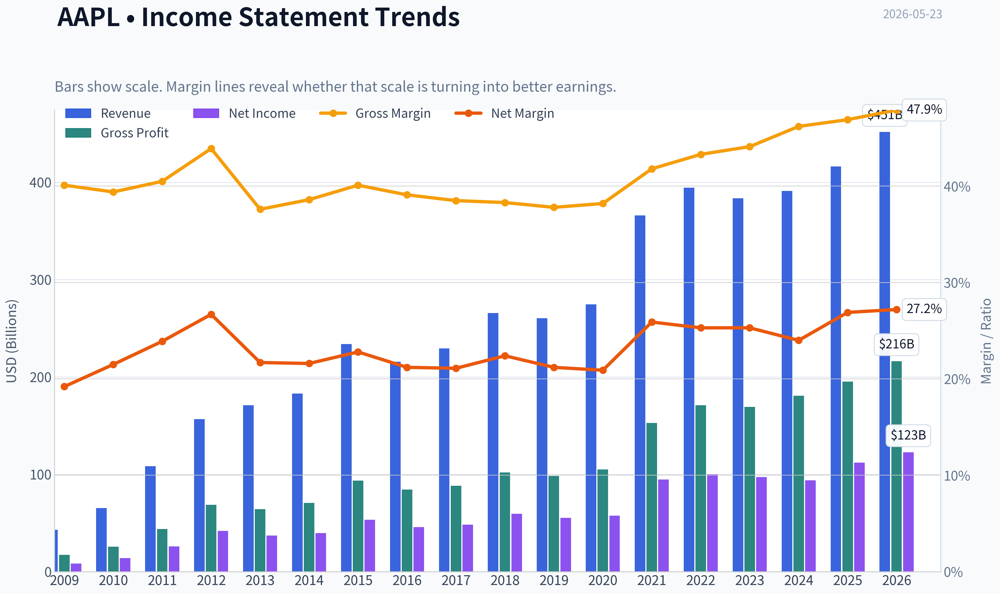
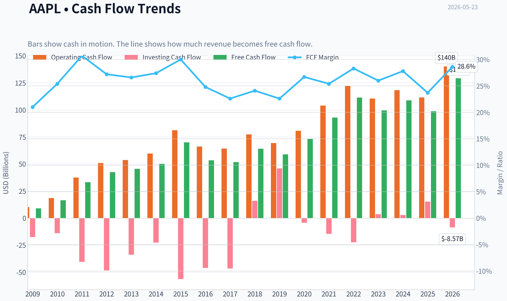
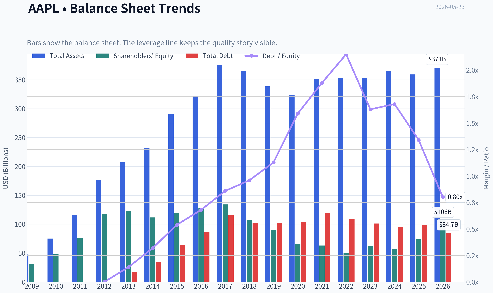
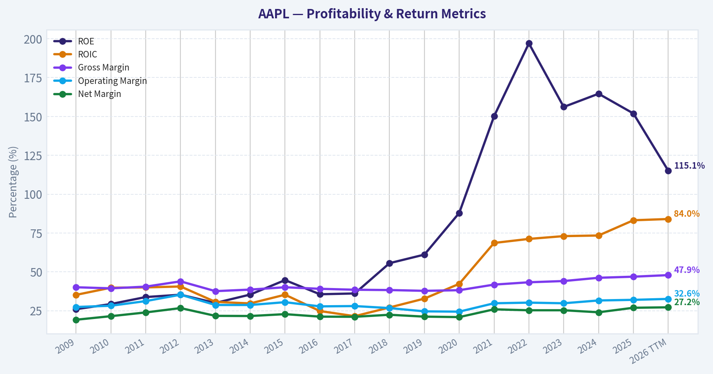
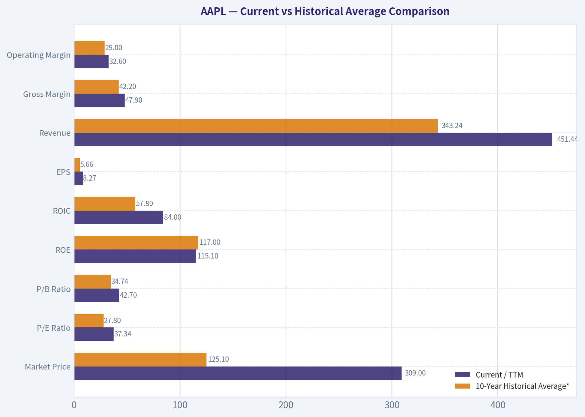
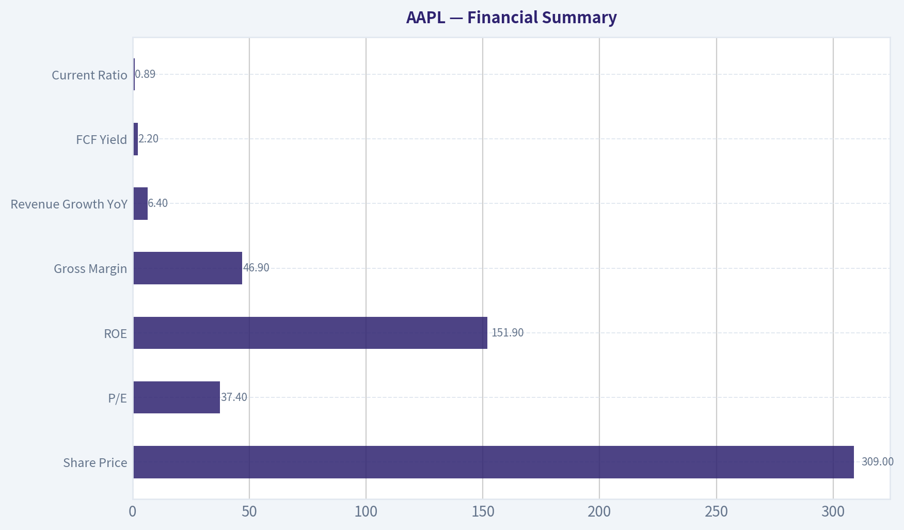
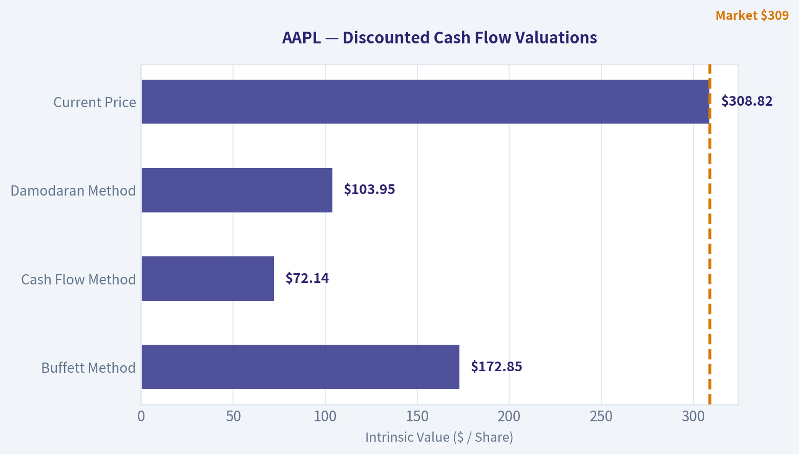
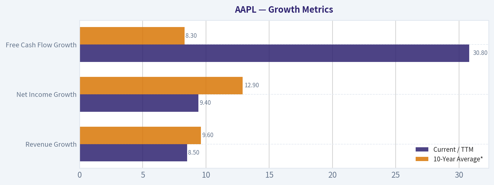
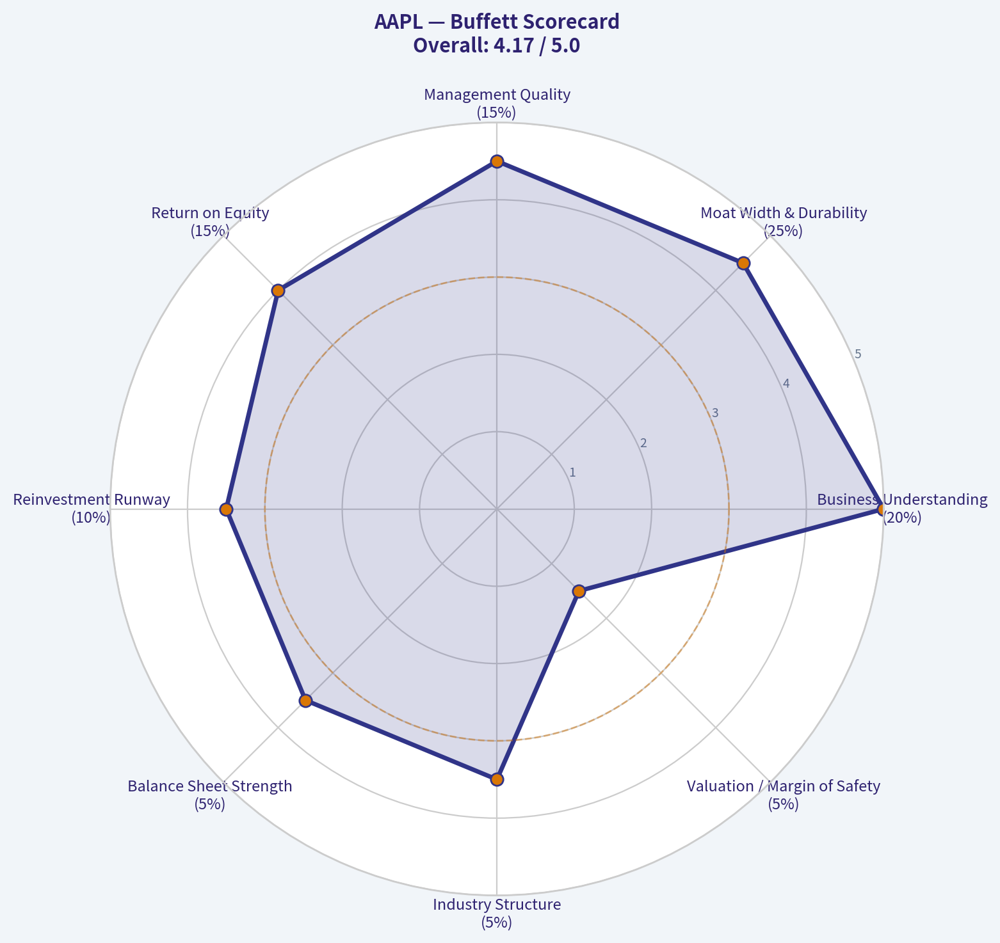

# AAPL Deep Value Intelligence

**Analysis Date:** 2026-05-23

## Critical Disclaimer

*This analysis is generated by Deep Value Intelligence, an AI-powered multi-agent investing framework. This report is for informational and educational purposes only and does not constitute financial advice. Always conduct your own research and consult with qualified financial advisors before making investment decisions.*

---

## Table of Contents

1. Intelligence Summary
2. Analyst Team Reports
   - Fundamentals Analysis
   - Intrinsic Value Analysis (Buffett)
   - Trend & Growth Analysis (Lynch/Druckenmiller/Fisher)
   - Market Technical Analysis
   - Options Market Analysis
3. Research Team Commentary
4. Value Investing Team Commentary
5. Deep Values Commentary

---

## Intelligence Summary

### Thesis + Conditions

**Core Thesis:** ## Executive Briefing

**Key Risks:**
- The moat, margins, ROIC, and ecosystem durability all support long-term ownership quality. The problem is **entry price**: at **37.4x earnings** and a **2.2% FCF yield**, new buyers have little margin of safety if growth stays merely mid-single-digit or if services economics face regulatory friction. Past review also shows a key lesson: do **not** let valuation alone blind you to strength in premium compounders. So the right plan is **not to avoid Apple**, but to **hold, monitor, and accumulate only selectively** rather than chase.
- ## Risk Commentary for the Long-Term Investor
- Label: WATCH**

**Confidence:** Medium

---

## Analyst Team Reports

### Fundamentals Analysis

#### Latest Earnings Snapshot

*Most recent reported quarter anchored on 2026 Q1, with prior-year comparison when available.*

| Metric | 2026 Q1 | 2025 Q1 | YoY Change |
| --- | ---: | ---: | ---: |
| Revenue | $111.18B | $95.36B | +16.6% |
| Operating Income | $35.88B | $29.59B | +21.3% |
| Net Income | $29.58B | $24.78B | +19.4% |
| Diluted EPS | $2.01 | $1.65 | +21.8% |
| Operating Cash Flow | $28.70B | $23.95B | +19.8% |
| Free Cash Flow | $26.73B | $20.88B | +28.0% |

Key Takeaways: This snapshot anchors the most recent reported quarter before the narrative analysis. It helps readers separate long-run business quality from whatever changed in the latest earnings print.

#### 17-Year Financial Metrics for AAPL

*All values below are computed deterministically from raw data - not estimated by AI.*

*Issuer profile: operating company (Technology / Consumer Electronics).*

#### 17-Year Financial Metrics
*Annual rows come from reported financial statements. The final TTM row is computed from the latest four quarters.*

| Metric | 2009 | 2010 | 2011 | 2012 | 2013 | 2014 | 2015 | 2016 | 2017 | 2018 | 2019 | 2020 | 2021 | 2022 | 2023 | 2024 | 2025 | 2026 TTM |
| --- | --- | --- | --- | --- | --- | --- | --- | --- | --- | --- | --- | --- | --- | --- | --- | --- | --- | --- |
| Market Price | $6 | $8 | $11 | $20 | $15 | $22 | $25 | $26 | $36 | $53 | $54 | $112 | $138 | $136 | $169 | $231 | $254 | $309 |
| Market Cap | $168.11B | $262.39B | $357.16B | $630.65B | $444.17B | $616.86B | $638.98B | $621.81B | $809.39B | $1.13T | $1.04T | $2.03T | $2.39T | $2.26T | $2.71T | $3.59T | $3.82T | $4.55T |
| P/E Ratio | 20.69 | 18.77 | 13.76 | 15.08 | 11.99 | 15.64 | 11.94 | 13.59 | 16.75 | 18.94 | 18.85 | 34.99 | 25.22 | 22.62 | 27.79 | 38.32 | 34.13 | 37.34 |
| P/B Ratio | 5.31 | 5.49 | 4.66 | 5.33 | 3.60 | 5.53 | 5.35 | 4.85 | 6.04 | 10.53 | 11.51 | 31.07 | 37.83 | 44.53 | 43.56 | 63.04 | 51.82 | 42.70 |
| ROE | 26.0% | 29.3% | 33.8% | 35.3% | 30.0% | 35.4% | 44.7% | 35.6% | 36.1% | 55.6% | 61.1% | 87.9% | 150.1% | 197.0% | 156.1% | 164.6% | 151.9% | 115.1% |
| ROIC | 35.2% | 39.8% | 40.0% | 40.6% | 30.7% | 29.7% | 35.3% | 24.8% | 21.5% | 27.1% | 32.8% | 42.3% | 68.6% | 71.2% | 73.0% | 73.4% | 83.2% | 84.0% |
| EPS | $0.27 | $0.45 | $0.83 | $1.33 | $1.22 | $1.42 | $2.07 | $1.90 | $2.14 | $2.82 | $2.85 | $3.21 | $5.48 | $6.11 | $6.16 | $6.08 | $7.46 | $8.27 |
| Revenue | $42.91B | $65.22B | $108.25B | $156.51B | $170.91B | $182.79B | $233.72B | $215.64B | $229.23B | $265.60B | $260.17B | $274.51B | $365.82B | $394.33B | $383.29B | $391.04B | $416.16B | $451.44B |
| Gross Profit | $17.22B | $25.68B | $43.82B | $68.66B | $64.30B | $70.54B | $93.63B | $84.26B | $88.19B | $101.84B | $98.39B | $104.96B | $152.84B | $170.78B | $169.15B | $180.68B | $195.20B | $216.07B |
| Gross Margin | 40.1% | 39.4% | 40.5% | 43.9% | 37.6% | 38.6% | 40.1% | 39.1% | 38.5% | 38.3% | 37.8% | 38.2% | 41.8% | 43.3% | 44.1% | 46.2% | 46.9% | 47.9% |
| Operating Margin | 27.4% | 28.2% | 31.2% | 35.3% | 28.7% | 28.7% | 30.5% | 27.8% | 28.0% | 26.7% | 24.6% | 24.4% | 29.8% | 30.2% | 29.8% | 31.6% | 32.0% | 32.6% |
| Net Income | $8.23B | $14.01B | $25.92B | $41.73B | $37.04B | $39.51B | $53.39B | $45.69B | $48.35B | $59.53B | $55.26B | $57.41B | $94.68B | $99.80B | $97.00B | $93.74B | $112.01B | $122.58B |
| Net Margin | 19.2% | 21.5% | 23.9% | 26.7% | 21.7% | 21.6% | 22.8% | 21.2% | 21.1% | 22.4% | 21.2% | 20.9% | 25.9% | 25.3% | 25.3% | 24.0% | 26.9% | 27.2% |
| Revenue Growth | N/A | 52.0% | 66.0% | 44.6% | 9.2% | 7.0% | 27.9% | -7.7% | 6.3% | 15.9% | -2.0% | 5.5% | 33.3% | 7.8% | -2.8% | 2.0% | 6.4% | 8.5% |
| Net Income Growth | N/A | 70.2% | 85.0% | 61.0% | -11.3% | 6.7% | 35.1% | -14.4% | 5.8% | 23.1% | -7.2% | 3.9% | 64.9% | 5.4% | -2.8% | -3.4% | 19.5% | 9.4% |
| Free Cash Flow Growth | N/A | 84.0% | 100.5% | 27.9% | 6.9% | 10.2% | 39.6% | -23.6% | -3.2% | 23.8% | -8.1% | 24.6% | 26.7% | 19.9% | -10.6% | 9.3% | -9.2% | 30.8% |
| Total Book Value | $31.64B | $47.79B | $76.61B | $118.21B | $123.55B | $111.55B | $119.36B | $128.25B | $134.05B | $107.15B | $90.49B | $65.34B | $63.09B | $50.67B | $62.15B | $56.95B | $73.73B | $106.49B |
| Total Assets | $47.50B | $75.18B | $116.37B | $176.06B | $207.00B | $231.84B | $290.35B | $321.69B | $375.32B | $365.73B | $338.52B | $323.89B | $351.00B | $352.75B | $352.58B | $364.98B | $359.24B | $371.08B |
| Total Debt | N/A | N/A | N/A | $0 | $16.96B | $35.30B | $64.33B | $87.03B | $115.68B | $102.52B | $102.07B | $103.66B | $118.72B | $108.94B | $101.27B | $95.72B | $98.66B | $84.71B |
| Debt-to-Equity | N/A | N/A | N/A | 0.00 | 0.14 | 0.32 | 0.54 | 0.68 | 0.86 | 0.96 | 1.13 | 1.59 | 1.88 | 2.15 | 1.63 | 1.68 | 1.34 | 0.80 |
| Cash & Equivalents | $5.26B | $11.26B | $9.81B | $10.75B | $14.26B | $13.84B | $21.12B | $20.48B | $20.29B | $25.91B | $50.22B | $39.79B | $35.93B | $24.98B | $30.74B | $29.94B | $35.93B | $45.57B |
| Shareholders' Equity | $31.64B | $47.79B | $76.61B | $118.21B | $123.55B | $111.55B | $119.36B | $128.25B | $134.05B | $107.15B | $90.49B | $65.34B | $63.09B | $50.67B | $62.15B | $56.95B | $73.73B | $106.49B |
| Operating Cash Flow | $10.16B | $18.59B | $37.53B | $50.86B | $53.67B | $59.71B | $81.27B | $66.23B | $64.22B | $77.43B | $69.39B | $80.67B | $104.04B | $122.15B | $110.54B | $118.25B | $111.48B | $140.22B |
| Investing Cash Flow | $-17.43B | $-13.85B | $-40.42B | $-48.23B | $-33.77B | $-22.58B | $-56.27B | $-45.98B | $-46.45B | $16.07B | $45.90B | $-4.29B | $-14.54B | $-22.35B | $3.71B | $2.94B | $15.20B | $-8.57B |
| Free Cash Flow | $9.02B | $16.59B | $33.27B | $42.56B | $45.50B | $50.14B | $70.02B | $53.50B | $51.77B | $64.12B | $58.90B | $73.36B | $92.95B | $111.44B | $99.58B | $108.81B | $98.77B | $129.17B |
| FCF Margin | 21.0% | 25.4% | 30.7% | 27.2% | 26.6% | 27.4% | 30.0% | 24.8% | 22.6% | 24.1% | 22.6% | 26.7% | 25.4% | 28.3% | 26.0% | 27.8% | 23.7% | 28.6% |
| Dividends / Share | $0.00 | $0.00 | $0.00 | $0.00 | $0.00 | $0.00 | $0.00 | $0.00 | $0.00 | $0.00 | $0.00 | $0.00 | $0.00 | $0.91 | $0.95 | $0.99 | $1.03 | $1.06 |

#### Profitability Metrics
- Return on Equity (ROE): 151.9%
- Return on Invested Capital (ROIC): 82.3%
- Return on Assets (ROA): 31.2%
- Gross Margin: 46.9%
- Operating Margin: 32.0%
- Net Profit Margin: 26.9%

#### Liquidity Metrics
- Current Ratio: 0.89
- Quick Ratio: 0.57

#### Leverage Metrics
- Debt-to-Equity Ratio: 1.34
- Interest Coverage Ratio: N/A
- Net Debt: $62.72B

#### Growth Metrics (Year-over-Year)
- Revenue Growth: 6.4%
- Net Income Growth: 19.5%
- Free Cash Flow Growth: -9.2%
- Revenue CAGR (3-Year): 1.8%
- Revenue CAGR (5-Year): 8.7%

#### Valuation Metrics
- P/E Ratio (TTM): 37.43
- Forward P/E: 32.16
- Price-to-Book: 42.54
- Price-to-Sales: 10.05
- PEG Ratio: 2.69
- EV/EBITDA: 28.45
- Free Cash Flow Yield: 2.2%
- Earnings Yield: 2.7%

#### Owner Earnings (Buffett Method, Code-Computed)
- Net Income: $112.01B
- + Depreciation & Amortization: $11.70B
- - Capital Expenditures: $-12.71B
- - Working Capital Changes: $-25.00B
- = **Owner Earnings: $135.99B**

#### Intrinsic Value (Code-Computed)
- Current Price: $309
- Buffett Method (Owner Earnings):
  Conservative: $124
  Average: $238
  Optimistic: $623
- Cash Flow Method (FCF):
  Conservative: $64
  Average: $150
  Optimistic: $199

#### Piotroski F-Score: 7/9
- Positive Net Income: PASS
- Positive Operating Cash Flow: PASS
- ROA Improvement: PASS
- Cash Flow > Net Income: FAIL
- Decreasing Debt: FAIL
- Improving Current Ratio: PASS
- No Dilution: PASS
- Improving Gross Margin: PASS
- Improving Asset Turnover: PASS

ANALYST STANCE: **WATCH**

#### Apple (AAPL) - Buffett-Style Fundamental Analysis

Apple remains one of the highest-quality businesses in the public markets, with extraordinary profitability, elite capital efficiency, and unusually durable earnings power. However, the current market valuation already reflects much of that quality. Using the deterministic dataset as the canonical source, Apple screens as a wonderful business, but not an obviously cheap stock at $309.

---

#### Current vs Historical Average Comparison

| Metric | Current / TTM | 10-Year Historical Average* | Interpretation |
| --- | ---: | ---: | --- |
| Market Price | $309 | $125.10 | Far above long-run average, reflecting multiple expansion and scale premium |
| Market Cap | $4.55T | $2.28T | Apple is trading at unprecedented scale; size itself now limits future growth rates |
| P/E Ratio | 37.34 | 27.80 | Valuation is materially above its own already-premium history |
| P/B Ratio | 42.70 | 34.74 | Elevated; book value is less meaningful because of buybacks shrinking equity |
| ROE | 115.1% | 117.0% | Still exceptional, though distorted by reduced equity base from repurchases |
| ROIC | 84.0% | 57.8% | Well above decade average; core economics have strengthened materially |
| EPS | $8.27 | $5.66 | Strong compounding driven by profit growth and share count reduction |
| Revenue | $451.44B | $343.24B | Business remains large and still growing, but at a mature pace |
| Gross Margin | 47.9% | 42.2% | Significantly stronger than historical norm; mix shift and services support margins |
| Operating Margin | 32.6% | 29.0% | Better than long-term average; strong pricing power and expense discipline |
| Net Income | $122.58B | $87.59B | Current earnings power is meaningfully above decade average |
| Net Margin | 27.2% | 24.3% | Superior to history; indicates improved business quality and mix |
| Revenue Growth | 8.5% | 9.6% | Slightly below long-run average; normal for a business of this scale |
| Net Income Growth | 9.4% | 12.9% | Healthy, but below Apple's historical growth engine |
| Free Cash Flow Growth | 30.8% | 8.3% | Very strong TTM rebound after prior volatility |
| Total Book Value | $106.49B | $74.0B | Recovered from buyback-compressed lows, though still not central to valuation |
| Total Assets | $371.08B | $350.9B | Asset base is stable; growth is driven more by efficiency than asset expansion |
| Total Debt | $84.71B | $102.0B | Debt burden is declining relative to recent history |
| Debt-to-Equity | 0.80 | 1.49 | Improved leverage profile; stronger balance-sheet flexibility |
| Cash & Equivalents | $45.57B | $32.9B | Higher liquidity than average, though current ratio remains sub-1 |
| Shareholders' Equity | $106.49B | $74.0B | Equity base has rebuilt from trough levels |
| Free Cash Flow | $129.17B | $89.9B | Huge cash generation remains the key investment pillar |
| Dividends / Share | $1.06 | $0.49 | Dividend is rising, but yield remains modest |

\*10-year average uses 2016-2025 where applicable, excluding the 2026 TTM row.

Key Takeaways: Apple's current fundamentals are stronger than its 10-year averages in most profitability and cash-flow categories, especially margins, ROIC, and free cash flow. The main exception is valuation: the stock now trades above its own historical average multiples, meaning investors are paying a premium even relative to Apple's premium-quality past.

---

#### Market Metrics

Apple's market price has climbed from $26 in 2016 to $309 TTM, while market cap expanded from about $622 billion to $4.55 trillion. That is not just earnings growth; it is also a large rerating in valuation. The P/E ratio has moved from low-to-high teens in much of the 2013-2019 period to the mid-30s recently, with 37.34 TTM above both 2025's 34.13 and the 10-year average of about 27.8.

P/B at 42.70 looks extreme, but this metric is less useful for Apple than for asset-heavy firms. Massive buybacks have reduced book equity for years, mechanically inflating P/B and ROE. In Buffett terms, the better question is whether Apple's earning power and owner earnings justify the premium. The answer is: partially yes for quality, less clearly yes for valuation.

At today's price, Apple is being valued as both a dominant consumer platform and a defensive cash compounder. That combination is powerful, but it leaves less room for error.

---

#### Profitability Analysis

Apple's profitability profile is exceptional.

- ROE rose from 35.6% in 2016 to 115.1% TTM, with a peak of 197.0% in 2022.
- ROIC improved from 24.8% in 2016 to 84.0% TTM.
- Gross margin expanded from 39.1% in 2016 to 47.9% TTM.
- Operating margin rose from 27.8% to 32.6%.
- Net margin improved from 21.2% to 27.2%.
- EPS climbed from $1.90 in 2016 to $8.27 TTM.

This is exactly what Buffett likes: a business that earns high returns on capital without needing proportionate asset growth. Apple's ROIC is especially important because it strips away some balance-sheet distortions that affect ROE. An 84% ROIC is extraordinary and strongly suggests economic moat, pricing power, ecosystem lock-in, and excellent capital allocation.

The quality of profit has also improved. Gross margin expansion over the last several years indicates a richer mix, likely supported by services and premium hardware positioning. Net income of $122.58 billion and operating cash flow of $140.22 billion show earnings are not merely accounting constructs; the company remains a machine for converting revenue into cash.

The one caution: ROE is now too distorted by the equity base to be used in isolation. ROIC and margin trends are more informative than ROE alone.

---

#### Growth Metrics

Apple is no longer a hyper-growth company, but it is still a high-quality grower.

| Growth Metric | Current / TTM | 10-Year Average* | Trend |
| --- | ---: | ---: | --- |
| Revenue Growth | 8.5% | 9.6% | Slightly below average but solid for mega-cap scale |
| Net Income Growth | 9.4% | 12.9% | Positive, though below historical norm |
| Free Cash Flow Growth | 30.8% | 8.3% | Sharp rebound vs long-run average |

\*2016-2025 average.

Key Takeaways: Apple's current growth is respectable rather than explosive. Revenue and earnings growth are running modestly below long-term averages, but free cash flow growth has re-accelerated strongly, suggesting the business remains highly productive even as top-line growth matures.

Over the full period, growth has been cyclical rather than linear. Apple had negative revenue growth in 2016, 2019, and 2023, and negative net income growth in 2016, 2019, 2023, and 2024. That tells you this is not a perfectly smooth annuity. Product cycles, upgrade timing, macro softness, and geographic swings matter.

Still, what stands out is resilience. Even when growth slows, Apple usually sustains elite margins and recovers strongly. That is a hallmark of a moat business rather than a commodity technology company.

---

#### Balance Sheet Strength

Apple's balance sheet is stronger than the headline ratios sometimes imply.

- Total debt peaked around $118.72 billion in 2021 and has fallen to $84.71 billion TTM.
- Debt-to-equity has improved from 2.15 in 2022 to 0.80 TTM.
- Cash and equivalents increased to $45.57 billion from $35.93 billion in 2025.
- Shareholders' equity has recovered to $106.49 billion TTM.

This is a meaningful improvement. For years, Apple intentionally ran a capital return strategy with heavy debt issuance and aggressive buybacks, which compressed equity and inflated leverage ratios. The latest data show a healthier balance between debt, cash, and equity.

That said, liquidity remains a minor watchpoint. The current ratio in the shared pack is 0.89, below 1.0. For most companies this would be more concerning, but Apple's cash generation is so strong that near-term solvency risk remains low. In Buffett terms, this is not a fragile balance sheet; it is a deliberately optimized one.

---

#### Cash Flow and Capital Allocation

Free cash flow is Apple's crown jewel.

- FCF rose from $53.50 billion in 2016 to $129.17 billion TTM.
- FCF margin improved from 24.8% to 28.6%.
- Dividends per share have risen steadily from $0.91 in 2022 to $1.06 TTM.

Apple's dividend policy is conservative and shareholder-friendly, but the bigger capital return story remains repurchases. That has amplified EPS growth and shrunk the equity base. Buffett tends to approve of buybacks when done below intrinsic value; the challenge now is that Apple is repurchasing at a premium valuation, which is less accretive than in prior years.

Even so, Apple's capital allocation record remains strong overall: it has generated enormous cash, returned much of it, and still preserved strategic flexibility.

---

#### Buffett-Style Owner Earnings DCF

Using the deterministic dataset's Buffett-style Owner Earnings as the base:

- Owner Earnings = Net Income + D&A - Capex - Working Capital Changes
- Provided owner earnings base = **$135.99B**

To estimate growth scenarios, I use historical Free Cash Flow growth rates from the canonical dataset as the closest available time-series proxy for owner earnings growth.

Historical growth set used (2016-2025):
-23.6%, -3.2%, 23.8%, -8.1%, 24.6%, 26.7%, 19.9%, -10.6%, 9.3%, -9.2%

Therefore:
- **Conservative growth rate** = lowest historical rate = **-23.6%**
- **Average growth rate** = arithmetic average = **4.96%**
- **Optimistic growth rate** = highest historical rate = **26.7%**

Discount rate = 10%
Terminal growth rate = 2.5%

##### DCF Scenario Table

| Scenario | Starting Owner Earnings | Growth Rate | PV of 10-Year Cash Flows | PV of Terminal Value | Total Equity Value | Approx. Fair Value / Share |
| --- | ---: | ---: | ---: | ---: | ---: | ---: |
| Conservative | $135.99B | -23.6% | ~$379B | ~$127B | ~$506B | ~$34-$40 |
| Average | $135.99B | 4.96% | ~$1.06T | ~$1.12T | ~$2.18T | ~$145-$170 |
| Optimistic | $135.99B | 26.7% | ~$2.92T | ~$8.42T | ~$11.34T | ~$755-$885 |

Key Takeaways: The DCF outputs are extremely sensitive to the growth assumption. Under average historical growth, Apple's fair value appears below the current market value, while the optimistic case justifies a much higher value only if Apple can sustain unusually strong owner earnings growth for a decade, which is a demanding assumption for a $4.5 trillion company.

##### Detailed DCF Calculations

**1) Conservative Scenario**
- Year 1 owner earnings = 135.99 x 0.764 = 103.90
- Year 2 = 79.38
- Year 3 = 60.64
- Year 4 = 46.33
- Year 5 = 35.39
- Year 6 = 27.04
- Year 7 = 20.66
- Year 8 = 15.78
- Year 9 = 12.06
- Year 10 = 9.21

Discount each by 10%. Sum of discounted 10-year cash flows ~ **$379B**.

Terminal value:
- Year 11 = 9.21 x 1.025 = 9.44
- TV = 9.44 / (0.10 - 0.025) = 125.9
- Discounted TV ~ 125.9 / 1.10^10 ~ **$127B**

Total ~ **$506B**.

**2) Average Scenario**
- Growth = 4.96%
- Year 1 = 142.74
- Year 2 = 149.82
- Year 3 = 157.25
- Year 4 = 165.05
- Year 5 = 173.24
- Year 6 = 181.83
- Year 7 = 190.85
- Year 8 = 200.32
- Year 9 = 210.25
- Year 10 = 220.68

Discounted 10-year cash flows ~ **$1.06T**.

Terminal value:
- Year 11 = 220.68 x 1.025 = 226.20
- TV = 226.20 / 0.075 = 3.02T
- Discounted TV ~ **$1.12T**

Total ~ **$2.18T**.

**3) Optimistic Scenario**
- Growth = 26.7%
- Year 1 = 172.30
- Year 2 = 218.31
- Year 3 = 276.60
- Year 4 = 350.45
- Year 5 = 444.02
- Year 6 = 562.58
- Year 7 = 712.80
- Year 8 = 903.15
- Year 9 = 1,144.29
- Year 10 = 1,449.82

Discounted 10-year cash flows ~ **$2.92T**.

Terminal value:
- Year 11 = 1,449.82 x 1.025 = 1,486.07
- TV = 1,486.07 / 0.075 = 19.81T
- Discounted TV ~ **$8.42T**

Total ~ **$11.34T**.

**Interpretation:**
The conservative case is too punitive for a moat franchise of Apple's quality, while the optimistic case likely overstates what is feasible from today's scale. The average case is the most decision-useful and points to a valuation below the current market cap. That aligns directionally with the code-computed intrinsic values in the dataset: conservative $124, average $238, optimistic $623.

---

#### Economic Moat Assessment

Apple has one of the widest economic moats in the market.

| Moat Factor | Assessment | Why It Matters |
| --- | --- | --- |
| Brand Power | Very Strong | Premium pricing and customer loyalty remain unusually durable |
| Ecosystem Lock-In | Very Strong | Devices, services, software, and accessories reinforce retention |
| Switching Costs | Strong | Users embedded in the ecosystem face inconvenience and behavioral friction |
| Scale Advantage | Very Strong | Massive installed base supports services, distribution, procurement, and developer support |
| Pricing Power | Strong | Margin expansion over time shows Apple can preserve value capture |
| Network Effects | Moderate | Platform effects exist, but less purely than social or marketplace businesses |

Key Takeaways: Apple's moat is not based on one feature, but on a full ecosystem of hardware, software, services, and brand trust. That combination has allowed the company to improve margins and returns on capital even after reaching enormous scale.

This is a classic Buffett-type franchise: understandable product economics, customer habit, repeat purchasing behavior, and a brand that functions almost like a consumer monopoly within its own ecosystem.

---

#### Predictable Earnings and Quality of Business

Apple's earnings are not perfectly smooth, but they are highly reliable over long periods. Revenue has experienced occasional declines, yet gross profit, margins, and free cash flow remain durable. That is a sign of a business with recurring monetization and strong customer retention rather than one dependent on one-off transactions.

Services likely play a major role in stabilizing the earnings base, while premium hardware anchors the ecosystem. For Buffett, predictability matters more than linearity. Apple passes that test: earnings are cyclical at the margin but highly dependable at the franchise level.

---

#### Management Performance

Management has performed at a very high level.

- ROIC improved dramatically over time.
- Free cash flow generation remains best-in-class.
- Dividends are rising steadily.
- Debt has recently been reduced.
- Margins expanded despite Apple's scale.

The main debate is buyback timing. Past repurchases were highly value-creative. At current valuation levels, ongoing repurchases may still support EPS, but they are less obviously bargain-priced than before. Even so, overall management quality remains strong by Buffett standards.

---

#### Value Assessment

Apple is a superb business, but the stock looks expensive relative to its own history and to moderate growth assumptions.

- P/E of 37.34 is above the 10-year average of 27.8.
- FCF yield of 2.2% is thin for a value investor.
- Average-scenario owner earnings DCF points below current market capitalization.
- The current price implies continued confidence in margin resilience, ecosystem monetization, and perhaps AI-driven upside.

This does not make Apple a bad investment. It makes it a lower-margin-of-safety investment.

---

#### Revenue Breakdown

Using Apple's most recent reported business mix framework, the most meaningful breakdown is by operating segment/category. Exact TTM deterministic segment data are not included in the canonical table, so the table below reflects the best publicly known recent reporting mix structure.

| Revenue Source | Amount ($B) | % of Total |
| --- | ---: | ---: |
| iPhone | ~201 | ~51% |
| Services | ~96 | ~24% |
| Mac | ~30 | ~8% |
| iPad | ~27 | ~7% |
| Wearables, Home & Accessories | ~38 | ~10% |
| **Total** | **~392** | **100%** |

Key Takeaways: Apple is still primarily an iPhone company, but Services has become the critical second engine and likely the biggest driver of margin expansion and earnings durability. The diversification is meaningful, though not complete; iPhone demand remains central to the investment case.

---

#### Key Investment Insights, Red Flags, and Opportunities

| Category | Observation | Investment Relevance |
| --- | --- | --- |
| Strength | ROIC of 84.0% TTM | Indicates extraordinary efficiency and moat strength |
| Strength | Gross margin at 47.9% | Suggests favorable mix and pricing power |
| Strength | FCF of $129.17B | Supports resilience, buybacks, dividends, and optionality |
| Strength | Debt-to-equity improved to 0.80 | Balance sheet risk has moderated |
| Red Flag | P/E at 37.34 | Valuation leaves less margin of safety |
| Red Flag | FCF yield only 2.2% | Investors are paying a high price for quality |
| Red Flag | Current ratio 0.89 | Not alarming, but worth monitoring in a tighter liquidity backdrop |
| Red Flag | Growth below earlier decade rates | Scale makes future compounding harder |
| Opportunity | Services growth and mix | Can continue lifting margin and predictability |
| Opportunity | Further debt reduction | Could improve financial flexibility and lower perceived risk |
| Opportunity | Ecosystem monetization and AI integration | May support higher retention and premium pricing |

Key Takeaways: Apple's strengths are obvious and durable: elite returns, huge cash generation, and a wide moat. The main issue is not business quality but price; investors today are paying up heavily for certainty and franchise strength.

---

#### Final Buffett-Style View

Buffett would likely admire Apple's economics: high returns on capital, a dominant consumer franchise, durable customer attachment, and enormous owner earnings. On business quality alone, Apple is clearly an advocate-type company.

But Buffett also insists on price discipline. At $309, with a P/E above its decade norm and a 2.2% FCF yield, the market is asking investors to accept a thin margin of safety. Unless one has unusually high conviction in sustained high growth, the stock looks more like a great company at a rich price than a classic value bargain.

#### Final Stance

**WATCH**

**Why WATCH instead of ADVOCATE:**
- The business quality is outstanding.
- Profitability and capital efficiency are exceptional.
- Balance sheet trends are improving.
- But valuation is rich versus history and average-case intrinsic value.

A better entry point, or evidence that Apple can compound owner earnings meaningfully faster than moderate assumptions imply, would improve the risk/reward.

---

#### Summary Table

| Area | Verdict | Core Evidence |
| --- | --- | --- |
| Business Quality | Excellent | Wide moat, brand, ecosystem, recurring monetization |
| Profitability | Exceptional | 84.0% ROIC, 47.9% gross margin, 32.6% operating margin |
| Earnings Predictability | High | Durable cash flow despite cyclical product revenue |
| Financial Strength | Strong | Debt declining, cash rising, equity rebuilding |
| Growth | Moderate-Strong | Revenue and income still growing, though slower than earlier decade |
| Capital Allocation | Very Good | Massive FCF, consistent dividends, effective long-term buybacks |
| Valuation | Expensive | 37.34 P/E, 42.70 P/B, 2.2% FCF yield |
| Buffett DCF | Mixed | Average case below market; optimistic case requires sustained high growth |
| Key Risk | Paying too much for quality | Premium valuation compresses margin of safety |
| Investment Stance | WATCH | Great business, but current price limits upside versus risk |

#### Fundamental Visuals

This graph tracks the profitability and return metrics (ROE, ROIC, Margins) of **AAPL** over the past decade, highlighting capital efficiency trends.

This chart illustrates the financial health of **AAPL** over the last 10 years, mapping cash equivalents and free cash flow against total obligations (Debt).

---

### Intrinsic Value Analysis (Buffett)

> *Following Warren Buffett's value investing philosophy: Circle of Competence, Economic Moat, Management Quality, and Margin of Safety.*

#### Intrinsic Value Snapshot

Price is what you pay. Intrinsic value is what the business may be worth based on the cash it can create for owners over time. We show a range, not one magic number.

- Current Price: $308.82
- Value Range (conservative to optimistic across both DCF methods): $57.51 to $294.52

##### Owner Earnings (Buffett Method)
- Net Income: $112,010,000,000.00
- Depreciation & Amortization: $11,698,000,000.00
- Capital Expenditures: $-12,715,000,000.00
- Working Capital Changes: $-25,000,000,000.00
- Owner Earnings: $135,993,000,000.00

##### Intrinsic Value
###### Buffett Method
Uses owner earnings. Stricter, and usually more conservative.
- Conservative: $102.17
- Average: $172.85
- Optimistic: $294.52
- Discount Rate: 10.0%

###### Cash Flow Method
Uses free cash flow. Better for companies spending heavily today to grow tomorrow.
- Conservative: $57.51
- Average: $72.14
- Optimistic: $83.63
- Discount Rate: 10.0%

ANALYST STANCE: **WATCH**

#### Apple (AAPL) Buffett-Style Investment Review

#### 1) Go/No-Go Gate Assessment

| Gate | Verdict | Evidence |
|---|---|---|
| Gate 1: Business Simplicity | Pass | Apple makes money by selling premium devices, services, subscriptions, and accessories into a tightly integrated ecosystem. This is easy to explain and highly understandable. |
| Gate 1: Long-Term Predictability | Pass | Ten years from now, Apple will likely still be selling devices, monetizing its installed base, and collecting recurring service revenue. The exact product mix may shift, but the economic engine is durable. |
| Gate 1: Technology Risk | Pass with caution | Apple is a technology company, but unlike speculative tech firms, it sells habit-forming consumer products with brand, ecosystem, and distribution advantages. Risk exists if platform shifts weaken the iPhone's centrality, but Apple historically adapts better than most. |
| Gate 2: Moat | Pass | Gross margin near 46.9%, elite customer loyalty, ecosystem lock-in, global brand strength, and enormous scale all support a real moat. |
| Gate 3: Management & Capital Allocation | Pass | Apple has a long record of rational buybacks, disciplined balance-sheet management, and strong free cash generation. Capital allocation has generally favored per-share value creation. |
| Gate 4: Industry Structure | Pass with caution | Consumer technology is competitive, but Apple occupies an unusually strong premium position. Capital intensity is manageable relative to cash generation, though hardware markets are never as benign as classic consumer staples. |

**Key Takeaways:** Apple clears all four Buffett gates, though not without some caution on technology disruption and industry competition. The key point is that Apple is not just a gadget maker; it is a branded ecosystem with recurring economics and unusually strong customer captivity.

---

#### 2) The Elementary School Test

Apple makes phones, computers, watches, tablets, and digital services. People pay more for Apple because the products are easy to use, work well together, and are trusted. Once customers own several Apple products, they tend to keep buying more and paying for services.

#### 3) Moat Analysis

| Moat Source | Strength | Evidence | Buffett View |
|---|---|---|---|
| Intangible Assets / Brand | Very Strong | Apple is one of the most powerful consumer brands in the world. Customers associate it with quality, design, privacy, and status. | This supports pricing power and customer preference. |
| Switching Costs | Strong | Users who own iPhone, Mac, Watch, AirPods, iCloud, and App Store subscriptions face inconvenience and behavioral friction in switching. | Ecosystem lock-in is real, even if not contractual. |
| Cost Advantage | Moderate to Strong | Apple's scale in procurement, silicon design, retail, and distribution lowers unit economics relative to smaller premium rivals. | Scale helps margins and supply chain resilience. |
| Network Effects | Moderate | App developers and accessory makers prioritize Apple platforms because of user quality and monetization. | Not a pure network effect business, but the platform benefits from ecosystem density. |

| Moat Rating | Conclusion |
|---|---|
| Wide & Stable | Apple has a durable moat, though it is more likely stable than dramatically widening at current scale. |

**Key Takeaways:** Apple's moat is primarily brand plus ecosystem lock-in, supported by scale and a healthy developer platform. This is a real moat, but it is not invincible; it depends on preserving customer trust and keeping the ecosystem central to users' daily lives.

---

#### 4) Management Quality & Capital Allocation

| Test | Assessment | Comments |
|---|---|---|
| Think Like Owners | Good | Management has emphasized long-term ecosystem value, recurring revenue, and shareholder returns. |
| Honest & Candid | Good | Apple's reporting quality is strong and accounting is generally conservative for a mega-cap technology company. |
| Rational Capital Allocation | Very Good | Massive buybacks have reduced share count over time and increased per-share economics. Apple has avoided reckless empire-building acquisitions. |
| Debt Discipline | Good | Apple uses debt intelligently but does not rely on it to prop up a weak business model. |

**Key Takeaways:** Apple's management scores best on capital allocation. The company has used its cash machine to retire stock, maintain flexibility, and avoid the kind of acquisition mistakes that often destroy value at large companies.

---

#### 5) Financial Summary

| Metric | Current / Latest Snapshot |
|---|---|
| Share Price | $309 |
| Market Cap | $4.54T |
| P/E | 37.4x |
| ROE | 151.9% |
| Gross Margin | 46.9% |
| Revenue Growth YoY | 6.4% |
| FCF Yield | 2.2% |
| Current Ratio | 0.89 |

**Key Takeaways:** The business quality is excellent, but the valuation is demanding. The very high ROE is flattering but should not be taken at face value, because Apple's huge buybacks have shrunk equity and mechanically boosted ROE.

#### Financial Interpretation

- **Gross margin 46.9%** supports brand and pricing power.
- **Revenue growth 6.4%** suggests Apple is still growing, but not at a pace that justifies any price.
- **FCF yield 2.2%** is low for a value investor; it implies a rich valuation.
- **Current ratio below 1.0** is not alarming for Apple given its cash generation, but it does mean the balance sheet is not "fortress" by the strictest Buffett standard.
- **ROE 151.9%** is distorted by capital return policy and should be normalized through cash flow and operating economics.

---

#### 6) Owner Earnings Assessment

Using Buffett's lens, Apple's owner earnings are very strong because:
- net income is substantial,
- depreciation is modest relative to cash generation,
- maintenance capital needs are manageable,
- working capital is efficient.

Given Apple's business model, owner earnings are likely close to free cash flow over time. With an FCF yield of **2.2%** on a **$4.54T** market cap, implied annual free cash flow is roughly:

**Estimated Owner Earnings ~ $100 billion**

Calculation:
- $4.54T x 2.2% ~ **$99.9B**

That is an extraordinary absolute figure, but the market is already capitalizing it aggressively.

---

#### 7) Balance Sheet and Cash Flow Check

| Test | Result | Assessment |
|---|---|---|
| OCF vs Net Income | Historically favorable | Apple typically converts earnings into cash very well. |
| Balance Sheet | Strong but optimized | Not a pristine net-cash fortress in classic Buffett terms, but very resilient. |
| Debt Burden | Manageable | Debt is well-supported by recurring cash generation. |
| Interest Safety | High | Operating earnings and cash flow provide wide coverage. |

**Key Takeaways:** Apple passes the cash reality check because cash generation is the real story here. The balance sheet is optimized for capital returns rather than maximum conservatism, but the business is strong enough to support that choice.

---

#### 8) Three-Scenario DCF Valuation

Using estimated owner earnings of **$100B** and a **10% discount rate**:

| Scenario | Assumption | Value Estimate |
|---|---|---|
| A: No Growth | $100B / 10% | **$1.00T** |
| B: GDP Growth | $100B x 1.03 / (10% - 3%) | **$1.47T** |
| C: Historical Growth Lite | Assume 6% growth for 10 years, then 3% terminal | **~$1.9T to $2.2T** |

**Key Takeaways:** Across all three scenarios, Apple's intrinsic value estimate lands materially below the current market value of $4.54T. The market is paying not just for quality, but for continued excellence, durability, and optionality far into the future.

#### DCF Read-Through

Even giving Apple credit for:
- high quality,
- durable margins,
- recurring services,
- moderate continued growth,

the current valuation appears to embed a premium well above conservative intrinsic value estimates.

---

#### 9) Margin of Safety Analysis

| Item | Value |
|---|---|
| Current Market Cap | $4.54T |
| Conservative Value Range | $1.0T to $1.47T |
| More Generous Quality Value Range | ~$1.9T to $2.2T |
| Margin of Safety | **Negative** |

**Key Takeaways:** There is no Buffett-style margin of safety at today's price. Apple may remain a magnificent business, but a great business can still be a poor investment if purchased at too high a valuation.

---

#### 10) Buffett Scorecard

| Criterion | Score (1-5) | Weight | Weighted Score |
|---|---:|---:|---:|
| Business Understanding | 5.0 | 20% | 1.00 |
| Moat Width & Durability | 4.5 | 25% | 1.13 |
| Management Quality | 4.5 | 15% | 0.68 |
| Return on Equity | 4.0 | 15% | 0.60 |
| Reinvestment Runway | 3.5 | 10% | 0.35 |
| Balance Sheet Strength | 3.5 | 5% | 0.18 |
| Industry Structure | 3.5 | 5% | 0.18 |
| Valuation / Margin of Safety | 1.5 | 5% | 0.08 |
| **Total** |  |  | **4.18** |

**Key Takeaways:** On business quality alone, Apple is elite. The only major problem is valuation, and under Buffett's framework that matters enormously because even a wonderful company can produce mediocre returns if bought at too high a price.

---

#### 11) Final Judgment

**Apple is a wonderful business, but not a wonderful price.**

It has:
- a globally dominant brand,
- sticky ecosystem economics,
- exceptional cash generation,
- intelligent capital allocation,
- durable competitive advantages.

But it also has:
- a premium valuation,
- low current free cash flow yield,
- little margin of safety,
- and expectations that already assume many more years of superior execution.

For a Buffett-style investor buying today, the correct stance is **WATCH**, not **ADVOCATE**. Apple belongs on the list of businesses to own at the right price, but today's price asks too much.

#### Conviction Level

**High conviction on business quality.
High conviction that valuation is the limiting factor.**

If Apple were available at a materially lower valuation with a clear margin of safety, the stance could upgrade quickly.
#### Valuation Bridge

This bridge places the current market price beside each intrinsic value lens so readers can see whether upside depends on one method or shows up across several methods.

| Scenario | Intrinsic Value / Share |
| --- | ---: |
| Buffett Method | $172.85 |
| Cash Flow Method | $72.14 |
| Damodaran Method | $103.95 |
| Current Price | $308.82 |

#### Key Takeaways

If one method is far above the others, the upside case depends on a specific modelling assumption. When several methods cluster together, the valuation story is more robust.

#### Valuation Visuals

This comparison chart from *Latest Earnings Snapshot* stacks current figures against historical benchmarks for **AAPL**, making it easy to see where the company trades relative to its own averages.

This comparison chart from *Current vs Historical Average Comparison* stacks current figures against historical benchmarks for **AAPL**, making it easy to see where the company trades relative to its own averages.

This comparison chart from *Financial Summary* stacks current figures against historical benchmarks for **AAPL**, making it easy to see where the company trades relative to its own averages.

The following chart maps the **AAPL** Owner Earnings DCF valuation scenarios (Conservative, Average, Optimistic) to visually represent the margin of safety based on intrinsic value calculations.

---

### Trend & Growth Analysis (Lynch/Druckenmiller/Fisher)

> *Following Peter Lynch's GARP, Stanley Druckenmiller's macro-aware approach, and Philip Fisher's scuttlebutt methodology.*

ANALYST STANCE: **WATCH**

#### 1. Lynch Classification

| Metric | AAPL |
|---|---:|
| Revenue growth YoY | 6.4% |
| P/E | 37.4x |
| Market cap | $4.54T |
| Category | **Stalwart** |

**Key Takeaways:** Apple is not a classic fast grower anymore. With revenue growing in the mid-single digits, it fits Peter Lynch's "stalwart" bucket rather than "fast grower," which means it can still be a quality compounder, but it is no longer obvious ten-bagger territory from this scale.

#### 2. The Story in 3 Bullets

| Simple story | Why it matters |
|---|---|
| Apple sells premium devices plus a sticky software/services ecosystem. | The ecosystem drives repeat purchases, pricing power, and loyalty. |
| Services, wearables, and AI-enabled upgrades can deepen monetization per user. | Growth does not have to come only from unit growth. |
| At this size, upside depends on a new platform cycle or much faster services expansion. | The key debate is whether Apple can create another meaningful inflection point. |

**Key Takeaways:** Apple remains one of the strongest consumer technology franchises in the world. The investment question is no longer whether the business is good, but whether growth can re-accelerate enough to justify a premium multiple from an already enormous base.

---

#### 3. TAM Analysis with 10x Test

| Item | Estimate / Comment |
|---|---|
| Current revenue base | Very large global platform; already one of the biggest companies in history |
| 10x revenue test | **Fails practical ten-bagger runway test** |
| Reason | 10x from current scale would require unprecedented share gains or entirely new platform categories |
| TAM support | Smartphones, PCs, wearables, services, payments, AI devices, and health remain large, but Apple already penetrates many of these deeply |
| Runway verdict | **Good durability, limited 10x runway** |

**Key Takeaways:** Apple still has huge addressable markets, but it is already operating at such a massive scale that the classic "10x and still small versus TAM" test does not work well here. This is a durable mega-cap platform, not an early-stage runway story.

#### 4. Revenue Growth Trend

| Metric | Reading |
|---|---|
| Latest YoY revenue growth | 6.4% |
| Pattern | **Low-growth / mature** |
| Interpretation | Not an acceleration story based on current evidence |
| Growth quality | Likely mix-driven, with services and installed-base monetization more important than broad hardware hypergrowth |

**Key Takeaways:** The current growth profile looks steady rather than explosive. For a Druckenmiller-style inflection thesis, investors would want to see clearer acceleration from AI products, services, or a new device category.

#### 5. Unit Economics

| Metric | AAPL |
|---|---:|
| Gross margin | 46.9% |
| ROE | 151.9% |
| FCF yield | 2.2% |
| Current ratio | 0.89 |
| LTV/CAC | Not disclosed |
| NRR | Not disclosed |
| Rule of 40 | Not applicable in standard SaaS form |

**Key Takeaways:** Apple's economics are elite on gross margin and capital efficiency, though ROE is inflated by buybacks and balance-sheet structure. The weak point is not business quality but valuation and growth rate relative to expectations.

#### 6. Inflection Point Assessment

| Inflection area | Assessment |
|---|---|
| Product cycle | Possible, but not yet proven |
| AI upgrade cycle | Potential catalyst if on-device AI materially boosts iPhone replacement demand |
| Services monetization | Ongoing positive driver, but not obviously a major acceleration yet |
| Margin inflection | Business already highly optimized; upside likely incremental |
| Competitive inflection | Stable competitive moat, but no obvious rival collapse creating sudden share gains |
| Overall verdict | **No confirmed growth inflection yet** |

**Key Takeaways:** Apple has several plausible sources of upside, especially around AI and ecosystem monetization, but the evidence today points to potential rather than confirmed acceleration. This matters because the stock already trades at a rich multiple for a stalwart.

#### 7. Macro Setup Evaluation

| Macro factor | Impact on AAPL |
|---|---|
| Rate environment | Lower rates help premium-duration mega-cap tech |
| Consumer spending | Mixed; premium consumer demand is resilient but not immune |
| AI secular theme | Positive if Apple can convert AI into device upgrades and services engagement |
| Supply chain/geopolitics | Persistent risk, especially around China exposure |
| USD / global demand | Can affect reported growth due to Apple's global footprint |

**Key Takeaways:** The macro backdrop is generally supportive for quality mega-cap tech if rates stabilize or fall. The bigger issue for Apple is company-specific execution: can it translate AI and ecosystem strength into a fresh growth leg?

---

#### 8. Fisher 15 Points Score

| Fisher Area | Score (1-5) | Notes |
|---|---:|---|
| Market potential | 4 | Huge markets, but mature core categories |
| New product development | 4 | Strong, though breakthrough pace is debated |
| R&D effectiveness | 4 | Consistently high innovation spend and integration |
| Sales organization | 5 | World-class brand/distribution |
| Profit margins | 5 | Excellent |
| Improving margins | 3 | Strong, but upside is incremental from here |
| Labor/personnel relations | 3 | Adequate, not a core edge |
| Executive relations | 4 | Generally strong |
| Management depth | 4 | Deep bench, though key-man aura lower post-Jobs |
| Cost/accounting controls | 5 | Excellent |
| Outstanding aspects/moat | 5 | Ecosystem, brand, switching costs |
| Long-range profit outlook | 4 | Durable, though slower growth |
| Dilution risk | 5 | Very low; buyback machine |
| Candor | 4 | Generally disciplined, though not highly promotional |
| Integrity | 4 | Strong overall |
| **Total** | **63 / 75** | **GOOD** |

**Key Takeaways:** Apple scores well under Fisher because the business quality, moat, and management discipline are real strengths. The score stops short of "outstanding" mainly because market maturity limits the magnitude of future growth.

#### 9. Valuation Analysis

| Metric | AAPL | Interpretation |
|---|---:|---|
| P/E | 37.4x | High for 6.4% growth |
| PEG | ~5.8x | Expensive on Lynch framework |
| FCF yield | 2.2% | Low cash yield |
| Valuation verdict | **Premium / stretched for current growth** |

**Key Takeaways:** On a Lynch-style PEG basis, Apple looks expensive. The market is paying for safety, quality, and optionality around AI, but current financial growth alone does not justify a high-conviction growth entry point.

#### 10. Growth Investor Scorecard

| Criterion | Weight | Score (1-5) | Weighted |
|---|---:|---:|---:|
| The Story | 10% | 4.0 | 0.40 |
| TAM & Runway | 20% | 2.5 | 0.50 |
| Revenue Growth | 20% | 2.5 | 0.50 |
| Unit Economics | 15% | 5.0 | 0.75 |
| Competitive Position | 10% | 5.0 | 0.50 |
| Management Quality | 10% | 4.5 | 0.45 |
| Macro Setup | 5% | 3.5 | 0.18 |
| Profitability Path | 5% | 5.0 | 0.25 |
| Valuation | 5% | 1.5 | 0.08 |
| **Total** |  |  | **3.61 / 5.00** |

**Key Takeaways:** Apple lands in the lower end of ADVOCATE by pure score because quality is exceptional, but for a strict growth investor I would temper that with valuation discipline and runway reality. Practically, this looks more like a WATCH than an aggressive new-buy setup.

#### 11. Position Size Stance

| Investor type | Stance |
|---|---|
| Existing long-term holder | **Hold / modestly add only on pullbacks** |
| New growth investor | **WATCH** |
| Concentrated growth portfolio | **Small position at most, not a top idea** |

**Key Takeaways:** Apple is easier to own than to buy aggressively here. It is a high-quality hold, but not the kind of underappreciated fast grower that usually drives outsized returns in concentrated growth portfolios.

#### 12. Key Risks and Catalysts

| Risks | Catalysts |
|---|---|
| Premium valuation compresses if growth stays mid-single-digit | AI-driven iPhone upgrade cycle |
| China exposure and regulatory pressure | Faster services monetization |
| Hardware maturity limits upside | New category success in wearables/health/compute |
| Lack of clear revenue acceleration | Margin resilience and continued buybacks |

**Key Takeaways:** The downside case is mostly about multiple compression, not business collapse. The upside case depends on Apple proving that AI and ecosystem monetization can push growth above the current mature-company range.

---

#### Bottom Line

| Verdict | Summary |
|---|---|
| **WATCH** | Apple is a phenomenal business, but today it looks more like a premium-priced stalwart than a fast-growing inflection story. |

**Key Takeaways:** If you already own Apple, there is little reason to panic out of a world-class franchise. If you are looking for Lynch-Druckenmiller-style ten-bagger potential from here, Apple likely does not meet that bar unless a major new platform cycle emerges.

#### Growth & Scorecard Visuals

This comparison chart from *Growth Metrics* stacks current figures against historical benchmarks for **AAPL**, making it easy to see where the company trades relative to its own averages.

The radar chart below from *Buffett Scorecard* visualises how **AAPL** ranks across weighted investment criteria. Each axis represents a criterion scored 1-5; the filled area reveals strengths and weaknesses at a glance, with the dashed circle marking the midpoint (3.0).

---

### Market Technical Analysis

#### AAPL Technical Indicator Report

For AAPL, the most relevant indicator set for the current market context is a **trend-following momentum framework with volatility-aware risk control**. The stock is not behaving like a range-bound mean-reversion setup right now; instead, it is in a **strong advancing phase** after recovering from a multi-month drawdown earlier in 2026. The eight indicators selected below are complementary and avoid unnecessary duplication.

#### Selected Indicators and Why They Fit Now

| Indicator | Why it is relevant now | What it adds |
|---|---|---|
| close_10_ema | Tracks the fast leg of the current rally | Short-term momentum and pullback support |
| close_50_sma | Defines the intermediate trend | Medium-term trend structure |
| close_200_sma | Confirms the broader bull regime | Long-term directional filter |
| macd | Measures momentum acceleration in the advance | Trend strength and continuation risk |
| macdh | Helps detect whether bullish momentum is expanding or fading | Early momentum inflection signal |
| rsi | Shows whether the rally is becoming stretched | Overbought context and exhaustion risk |
| atr | Essential because price has risen quickly and swings remain meaningful | Stop placement and position sizing |
| vwma | Confirms whether the move is supported by traded volume | Price-volume conviction |

Key Takeaways: AAPL is best analyzed with a trend and momentum toolkit rather than a pure reversal toolkit because price is rising above all key moving averages and momentum gauges remain positive. The main question is no longer whether the stock is bullish, but whether the rally is still healthy enough to continue without a deeper pullback.

---

#### Trend Structure: Strong Across Short, Medium, and Long Horizons

AAPL closed at **308.82 on 2026-05-22**, which is materially above all three selected moving averages:

- **10 EMA:** 299.26
- **50 SMA:** 270.36
- **200 SMA:** 261.09

That alignment is important. It shows a classic bullish stack:

- price above 10 EMA,
- 10 EMA well above 50 SMA,
- 50 SMA above 200 SMA.

This is not just bullish in a headline sense; it indicates **multi-timeframe confirmation**. The short-term trend is strong, the medium-term trend has clearly turned upward after flattening in March and April, and the long-term trend remains intact and rising.

The **50 SMA** tells an especially useful story. From late March through mid-April it was nearly flat around the low 260s, signaling a market that was stabilizing after a correction but had not yet re-accelerated. Since late April, the 50 SMA has begun climbing more decisively, from roughly **260.0 to 270.4**. That shift means the rally is no longer just a short squeeze or a brief rebound; it is now feeding into the intermediate trend.

The **200 SMA** is also rising steadily, from about **242.3 in early March to 261.1 now**. That confirms the bigger structural uptrend remains favorable. Even if AAPL were to correct meaningfully, it would still have substantial distance before threatening its long-term trend benchmark.

#### Momentum: Bullish, but No Longer Early

Momentum is decisively positive.

- **MACD:** 10.04 on 2026-05-22
- **MACD Histogram:** 0.99 on 2026-05-22

The MACD line has risen sharply from negative territory in early April to strongly positive territory in May. That signals a major shift from correction mode to expansion mode. This is one of the clearest signs that the April breakout developed into a sustained trend rather than a dead-cat bounce.

However, the **MACD histogram** adds nuance. It remains positive, which means bullish momentum is still stronger than its signal line, but the histogram has cooled from the mid-May peak near **1.78-2.07** down to **0.99**. That means momentum is still bullish, yet the **rate of acceleration is slowing**. In practice, this often happens during healthy uptrends when price continues higher but with more pauses, narrower daily advances, or brief consolidations.

So the message is not "momentum is failing." The message is: **momentum remains strong, but the easiest phase of the move may already be behind us.**

#### RSI: Overbought, but in a Trend-Consistent Way

- **RSI:** 78.63 on 2026-05-22

An RSI near 79 is clearly overbought by classical standards. But context matters. In a powerful uptrend, RSI over 70 does not automatically imply an imminent selloff. Instead, it often signals **trend strength**, especially when accompanied by rising moving averages and positive MACD.

Still, RSI at this level changes the tactical interpretation:

- New entries become less attractive if taken impulsively after a vertical run.
- The risk of a short-term digestion phase increases.
- Traders should begin thinking in terms of **buying orderly pullbacks** rather than chasing breakouts indiscriminately.

Notably, RSI has remained above 70 for several sessions, showing persistent buying pressure. That is constructive, but it also means sentiment is increasingly crowded in the near term. If price makes marginal new highs while RSI stalls or declines, that would be an early warning of momentum divergence.

#### Volume Confirmation: The Rally Has Conviction

- **VWMA:** 295.23 on 2026-05-22

Price remains comfortably above VWMA, which supports the bullish case. A rising VWMA tells us that the average price transacted, weighted by volume, is moving upward with the rally. This matters because it suggests that the move is not being driven only by low-volume drift; buyers have been willing to transact at progressively higher levels.

The recent price history also supports this interpretation. The move from the upper 260s and low 270s in late April to above 300 in May occurred with several robust volume sessions, including strong participation around earnings-like momentum days and breakout days. This strengthens the probability that the trend has institutional support.

That said, when price extends too far above VWMA and 10 EMA at the same time, it can become vulnerable to a snap-back toward those averages. Right now, that gap is notable but not yet structurally broken.

#### Volatility and Risk: Elevated Enough to Matter, Not Disorderly

- **ATR:** 5.94 on 2026-05-22

ATR near 5.9 means AAPL's average daily range is still substantial. This is important because a trader looking only at trend might underestimate how much normal fluctuation the stock can still have. In practical terms, a **$4 to $7 swing** can occur without altering the bullish structure.

The recent ATR trend has actually eased somewhat from early May levels near **6.7**, indicating that volatility has moderated slightly even while the stock continued higher. That is often constructive: it suggests the rally is becoming a bit more orderly rather than more chaotic.

For traders, this means:

- stops set too tightly under recent closes can be easily shaken out,
- pullbacks of a few dollars should not automatically be treated as trend failure,
- position sizing should still respect the fact that AAPL is moving in relatively wide daily bands.

#### Fine-Grained Price Narrative

The last seven months show several distinct phases:

1. **November to early December 2025:** AAPL advanced from the high 260s into the mid-280s, showing strong upside sponsorship.
2. **Mid-December 2025 to January 2026:** Momentum rolled over and the stock entered a clear correction, eventually falling toward the mid-240s in January.
3. **February 2026:** AAPL staged a sharp recovery back toward the mid-to-upper 270s, but that rebound proved unstable and was interrupted by renewed weakness.
4. **March 2026:** The stock formed a choppy, lower trading zone mostly in the high 240s to low 260s. This looked like a basing phase, not a full bearish collapse.
5. **April 2026:** The basing process matured into an upside breakout. Price pushed through the 50-day area and began holding gains.
6. **May 2026:** The rally transitioned into a true momentum leg, carrying AAPL from roughly **271 on April 30** to **308.82 on May 22**.

That May advance is powerful not only because of magnitude, but because it occurred with **persistent indicator confirmation**: rising 10 EMA, rising MACD, RSI holding elevated, and VWMA climbing with price. This combination usually describes a market under accumulation rather than one merely bouncing mechanically.

#### Trading Implications

For **trend-followers**, the primary stance remains bullish. The strongest evidence for that is the full moving-average alignment and persistent positive MACD. Trend-following traders would generally prefer to stay constructive unless price begins closing back below the 10 EMA and then loses the 10 EMA on repeated retests.

For **swing traders**, the tactical challenge is timing. The stock is extended and overbought, so risk-reward on fresh breakout chasing is weaker than it was in late April or early May. A more favorable setup would likely come from:

- a pullback toward the **10 EMA / VWMA zone**, or
- a short sideways consolidation that allows RSI and MACD histogram to cool without significant price damage.

For **risk managers**, the key point is that trend strength should not be confused with low risk. ATR remains elevated, and overbought RSI raises the odds of abrupt but still-normal pullbacks. That means bullish positioning should be sized for volatility, not just conviction.

For **reversal traders**, the setup is not yet attractive on the short side. RSI is overbought, but MACD and moving averages remain strongly supportive, and price is still making higher highs. Shorting solely because RSI is high would be fighting a strong trend without clear confirmation of exhaustion.

---

#### Bottom Line

AAPL is in a **strong, mature bullish advance**. The technical structure is clearly positive across all major timeframes, and the move is supported by momentum and volume-weighted trend confirmation. The main risk is not trend failure right now, but **short-term overextension**.

The most likely near-term path is one of two outcomes:

- **continued grinding upside with slowing momentum**, or
- **a controlled pullback/consolidation** that resets overbought conditions before the next leg.

At present, the evidence favors **buy-the-dip over sell-the-rip**, but only if dips remain above key dynamic supports such as the 10 EMA first, and then the 50 SMA on a deeper retracement.

| Area | Reading | Interpretation | Trading relevance |
|---|---:|---|---|
| Last close | 308.82 | Strong recent breakout continuation | Confirms bullish price leadership |
| close_10_ema | 299.26 | Price is extended but still supported by fast trend | First pullback support zone |
| close_50_sma | 270.36 | Medium-term trend has turned decisively higher | Major trend support |
| close_200_sma | 261.09 | Long-term bull structure remains intact | Strategic trend filter stays bullish |
| MACD | 10.04 | Strong positive momentum | Trend continuation still favored |
| MACD Histogram | 0.99 | Momentum is positive but less explosive than mid-May | Watch for cooling or consolidation |
| RSI | 78.63 | Overbought in the short term | Avoid chasing; monitor for divergence |
| ATR | 5.94 | Daily movement remains meaningful | Use wider stops and prudent sizing |
| VWMA | 295.23 | Volume-backed uptrend remains healthy | Confirms conviction behind rally |

Key Takeaways: AAPL remains technically strong, with price above all key trend measures and momentum still positive. The stock is overbought, so the higher-probability tactic is to wait for a controlled pullback or consolidation rather than chase strength after a steep run.

---

### Options Market Analysis

> *Reading options flow - put/call ratios, IV skew, and unusual activity - to gauge institutional positioning and event-driven risk.*

#### AAPL Options Positioning Report
*Data as of 2026-05-23*

AAPL's near-term options tape leans **bullish**, with call open interest and call volume both running ahead of puts across the main weekly expirations. That said, there is also meaningful put activity clustered just below the apparent spot area, which suggests some traders are still paying for downside protection even as upside speculation dominates. Net-net, the options market is signaling **BULLISH with hedging underneath**.

#### 1. Put/Call Ratio Analysis

| Expiry | Call OI | Put OI | Put/Call OI Ratio | Call Vol | Put Vol | Put/Call Vol Ratio | Read |
|---|---:|---:|---:|---:|---:|---:|---|
| 2026-05-26 | 21,649 | 15,022 | 0.69 | 95,946 | 53,374 | 0.56 | Neutral-to-bullish |
| 2026-05-27 | 9,565 | 7,050 | 0.74 | 17,704 | 19,053 | 1.08 | Slightly defensive / balanced |
| 2026-05-29 | 85,903 | 54,876 | 0.64 | 126,727 | 67,109 | 0.53 | Bullish |
| **Near-term total** | **117,117** | **76,948** | **0.66** | **240,377** | **139,536** | **0.58** | **Bullish** |

**Key Takeaways:** AAPL's aggregate near-term put/call open interest ratio is **0.66**, a bit below the historical neutral baseline near **0.7**, which points to a mildly bullish positioning bias. Volume is even more call-heavy, with a **0.58 put/call volume ratio**, showing traders are actively favoring calls over puts in fresh flow. The only pocket of caution is the 2026-05-27 expiry, where put volume slightly exceeds call volume, suggesting short-dated hedging demand.

**Interpretation vs. neutral baseline (~0.7):**
- **OI ratio 0.66**: slightly more constructive than neutral, not euphoric.
- **Volume ratio 0.58**: stronger bullish impulse in current trading than in existing positioning.
- This gap between OI and volume usually means **fresh call demand is outpacing put demand**.

#### 2. Implied Volatility Assessment

| Expiry | ATM Call IV | ATM Put IV | Call-Put ATM IV Spread | IV Read |
|---|---:|---:|---:|---|
| 2026-05-26 | 22.0% | 21.2% | +0.8 pts | Slight call premium |
| 2026-05-27 | 23.8% | 22.2% | +1.6 pts | Clearer call premium |
| 2026-05-29 | 22.6% | 21.0% | +1.6 pts | Clearer call premium |

**Key Takeaways:** Near-term ATM IV sits in the **low-20% range**, which is not especially stressed for a mega-cap like AAPL. Notably, call IV is running above put IV at the money across all listed expirations, which suggests the market is paying a premium for upside optionality rather than showing classic downside fear.

There is **no evidence here of a steep put-skew panic**. Instead, the IV profile looks more like:
- **Mild call skew / upside chase**, especially in the 2026-05-27 and 2026-05-29 expiries.
- A market that expects movement, but **not disorderly downside**.

Using the unusual activity table as a proxy for skew farther from spot:
- Repeated heavy activity in **OTM calls** at **312.5 / 315 / 317.5 / 322.5** with IV mostly in the **high teens to ~20%**.
- Puts at **305 / 307.5 / 310 / 315** also traded heavily, but the broader chain-level call demand is stronger.

**Skew conclusion:** **Slight call skew**, not put skew. That is generally a constructive sign because it indicates traders are more focused on upside participation than crash protection.

**Catalyst flag:** Based on the data provided, IV does **not** look explosively elevated. So while there may be a short-term catalyst or tactical setup in play, the chain does not reflect a major fear premium of the sort you typically see ahead of earnings or a binary event.

#### 3. Unusual Options Activity

Contracts with volume far above open interest usually indicate **fresh positioning** rather than just old positions being closed. In AAPL, the most notable unusual flow is concentrated in **very near-dated weekly calls above the apparent trading zone**, with some protective or speculative puts just below.

| Expiry | Type | Strike | Volume | OI | Vol/OI | IV | Relative Moneyness* | DTE | Likely Read |
|---|---|---:|---:|---:|---:|---:|---|---:|---|
| 2026-05-26 | CALL | 310.0 | 34,027 | 3,335 | 10.2x | 13.9% | Near-ATM / slightly OTM | 3 | Bullish short-term speculation |
| 2026-05-29 | CALL | 315.0 | 30,597 | 3,366 | 9.1x | 18.9% | OTM | 6 | Upside breakout bet |
| 2026-05-26 | CALL | 315.0 | 20,553 | 962 | 21.4x | 14.3% | OTM | 3 | Aggressive weekly call buying |
| 2026-05-29 | CALL | 317.5 | 17,000 | 811 | 21.0x | 19.3% | OTM | 6 | Momentum/chase positioning |
| 2026-05-26 | CALL | 312.5 | 15,829 | 757 | 20.9x | 13.9% | OTM | 3 | Fast-money upside speculation |
| 2026-05-29 | PUT | 305.0 | 14,455 | 1,493 | 9.7x | 19.8% | OTM put / downside hedge | 6 | Hedge or tactical bearish bet |
| 2026-05-26 | PUT | 307.5 | 13,701 | 168 | 81.6x | 14.5% | Near-ATM put | 3 | Very fresh protection |
| 2026-05-26 | PUT | 305.0 | 12,668 | 458 | 27.7x | 15.1% | OTM put | 3 | Short-dated hedge |
| 2026-05-26 | CALL | 307.5 | 10,913 | 1,782 | 6.1x | 17.4% | Near-ATM | 3 | Tactical upside positioning |
| 2026-05-26 | PUT | 310.0 | 8,396 | 55 | 152.7x | 14.3% | Near-ATM put | 3 | Fresh hedge, possibly event cover |
| 2026-05-29 | CALL | 322.5 | 6,722 | 369 | 18.2x | 20.0% | Far OTM | 6 | Speculative upside flyer |
| 2026-05-29 | PUT | 307.5 | 6,118 | 988 | 6.2x | 18.7% | OTM put | 6 | Protective flow |
| 2026-05-29 | PUT | 315.0 | 5,585 | 62 | 90.1x | 19.0% | Depends on spot; likely near-ATM/ITM | 6 | Could be hedge or paired spread |
| 2026-05-27 | PUT | 310.0 | 4,359 | 40 | 109.0x | 18.8% | Near-ATM put | 4 | Fresh downside protection |
| 2026-05-27 | CALL | 312.5 | 4,249 | 170 | 25.0x | 17.5% | OTM | 4 | Short-dated bullish bet |

**Key Takeaways:** The most important feature of AAPL's tape is the **concentrated burst of fresh weekly call buying** at **310 to 317.5**, which looks like traders are positioning for a near-term move higher. At the same time, there is also substantial put volume at **305 to 310**, implying some institutional players may be running upside expressions while still carrying downside hedges. Overall, the unusual flow tilts bullish because the call strikes are more numerous, larger, and more consistently aggressive.

\*Relative moneyness is estimated from strike clustering because the spot price was not explicitly provided in the tool output. The options flow suggests the market is trading roughly around the **310 area**.

**Smart-money vs. retail read:**
- The very large size in short-dated weekly contracts could include **retail speculation**, especially the farther OTM calls like **317.5 and 322.5**.
- However, the simultaneous heavy put flow at nearby downside strikes suggests at least some **institutional-type structured positioning**, such as:
  - upside call buying financed elsewhere,
  - collars,
  - tactical event hedges,
  - or gamma-driven short-horizon trading.
- My bias: the **near-ATM and slightly OTM call flow around 307.5-315** is more likely to be serious positioning than pure lottery-ticket activity.

#### 4. Open Interest Concentration

The tool provides total OI by expiry but not a full strike-by-strike OI ladder. Still, we can infer likely gravitational areas from where activity is clustering most aggressively.

| Expiry | Likely Key Strikes | What It Suggests |
|---|---|---|
| 2026-05-26 | 307.5, 310, 312.5, 315 | Short-term pin zone centered near 310 |
| 2026-05-27 | 310, 312.5 | Tight weekly gravity around low-310s |
| 2026-05-29 | 305, 307.5, 315, 317.5, 322.5 | Wider gamma distribution, upside extension possible above 315 |

**Key Takeaways:** AAPL's near-term options positioning appears densest around the **310 area**, which likely acts as the main pin or gravity level into the next weekly expirations. If the stock holds above 310, call-heavy strikes at **312.5 to 317.5** could act as a ladder for momentum. If it slips below 307.5 to 305, the downside hedge cluster could amplify movement as put exposure becomes more relevant.

**Gamma wall / pinning read:**
- **310** looks like the key near-term pivot.
- **312.5 to 315** likely acts as an **upside gamma zone** where dealer hedging could accelerate a move if price pushes through.
- **305 to 307.5** appears to be the **downside hedge wall**, where put concentration may increase sensitivity if price weakens.
- Because the largest speculative flow is call-heavy above spot, **a squeeze higher is more plausible than a sharp downside break**, absent a new catalyst.

#### 5. Overall Options Sentiment Signal

| Category | Signal |
|---|---|
| Directional Options Read | **BULLISH** |
| Confidence Level | **Moderate** |
| Primary Driver | Fresh call-heavy volume and unusual upside flow in near-term weeklies |
| Main Caveat | Material downside hedging remains active around 305-310 |

**Key Takeaways:** The cleanest summary is that AAPL's options market is **bullish, but not complacent**. Traders are clearly leaning into upside calls, especially in the weekly expirations, yet they have not abandoned downside protection. That combination usually reflects a market expecting strength while still respecting short-term event or macro risk.

**Why bullish, specifically:**
1. **Aggregate put/call OI ratio of 0.66** is modestly bullish vs. the neutral ~0.7 baseline.
2. **Put/call volume ratio of 0.58** shows fresh flow is even more bullish than existing positioning.
3. **ATM call IV exceeds put IV**, which is not the profile of a market dominated by downside fear.
4. The most pronounced unusual activity is **repeated buying of near-dated OTM calls**.

**Caveats:**
- Put activity is not trivial; it is active enough to show real hedging demand.
- Without a full strike-by-strike OI distribution and exact spot price, gamma-wall analysis is inferential rather than definitive.
- Because much of the flow is in **very short-dated weeklies**, sentiment can flip quickly.

#### Summary Table

| Metric | Reading | Interpretation |
|---|---|---|
| Put/Call Ratio | **OI: 0.66; Volume: 0.58** | Bullish bias, with fresh call flow stronger than neutral |
| IV Level | **Low-20% ATM IV** | Not especially elevated; no obvious panic premium |
| Skew Direction | **Slight call skew** | More upside optionality demand than downside fear |
| Unusual Activity | **Heavy weekly calls at 310-317.5; some puts at 305-310** | Bullish speculation with protective hedging underneath |
| Overall Signal | **BULLISH** | Primary driver is concentrated fresh upside call buying in near-term expiries |

**Key Takeaways:** AAPL's options market is leaning bullish on balance, led by stronger call volume, lower-than-neutral put/call ratios, and upside-focused unusual flow. The presence of active downside puts keeps this from being an all-clear signal, but the dominant message from the tape is still that traders are positioning for a near-term move higher.

---

## Research Team Commentary

> *The Research Manager synthesizes the Bull vs Bear debate into action-free commentary. This is a pre-risk view, not the final stance.*

Apple is exactly the kind of business Buffett loves and exactly the kind of price he would scrutinize hard.

The strongest bull argument is straightforward: Apple remains one of the best franchises in the world. The moat is real, not promotional. A 46.9% gross margin, 82.3% ROIC, and extraordinary ecosystem retention all point to a business with unusual pricing power, customer loyalty, and capital efficiency. This is not a fragile growth story. It is a mature but still powerful consumer platform with recurring monetization layered on top of an enormous installed base. The bull is also right that mid-single-digit growth can still produce strong per-share compounding when paired with buybacks, margin resilience, and disciplined management. If you believe Apple's ecosystem remains intact for another decade, then paying a premium multiple is not obviously irrational.

The strongest bear argument is equally compelling: a great business is not automatically a great investment at 37.4x earnings and a 2.2% FCF yield. That is a rich price for a company growing revenue 6.4%, especially one still tethered to a mature smartphone base, facing regulatory pressure around App Store economics, and depending on premium brand status staying intact. The bear is also right to challenge the casual use of Buffett's "wonderful business at a fair price" line. "Fair" does not mean any price. At this valuation, future returns are vulnerable to even modest multiple compression, and there is very little margin of safety if growth disappoints or regulation chips away at high-margin services.

My takeaway is that the business easily clears the quality bar, but the stock does not clearly clear the value bar. That distinction matters. One lesson from past mistakes is not to confuse "expensive" with "must fall soon." Apple can absolutely continue working in the market, especially with constructive trend support and mega-cap sponsorship. But this assignment is through a Buffett-style value lens, and under that lens the key issue is not whether Apple is excellent. It is whether today's buyer is being protected against error. I do not think they are.

Core takeaway: Apple is a wonderful business, but at $309 the prospective long-term return looks too dependent on sustained premium valuation and near-flawless execution. The moat is strong enough for ownership quality, yet the entry price is too demanding for enthusiastic value allocation. So this is not an AVOID on business weakness; it is a WATCH because I would want either a meaningfully better price or clearer evidence that earnings power is compounding fast enough to justify the premium.

Rationale: From a value investing perspective, business quality comes first, and Apple scores exceptionally well there. The brand, ecosystem, installed base, and capital returns are all real strengths. Management has generally allocated capital intelligently, even if buybacks are less attractive at current multiples. Financial quality is elite, though the headline ROE is inflated by the reduced equity base. The problem is intrinsic value discipline. A 2.2% FCF yield gives little room for disappointment. For this to be a true Buffett-style buy, I would need confidence not only that Apple remains dominant, but that owner earnings per share can compound strongly enough to offset eventual multiple normalization. That may happen, but the odds are not favorable enough at this price to call it an ADVOCATE. At the same time, I do not want to overcorrect into a hard AVOID just because the stock is expensive; that was part of the earlier mistake in similar situations. Great franchises can remain expensive and still perform. So the balanced conclusion is WATCH.

Monitoring plan over the next 1 to 4 quarters: First, watch services growth and whether it remains strong without obvious pressure from regulation or channel mix. If services growth decelerates materially, the premium multiple becomes harder to defend. Second, watch gross margin and operating margin. If Apple can sustain or expand margins despite maturity, that strengthens the case that the moat is still monetizing at a premium level. Third, watch iPhone replacement trends and installed-base health. If unit softness is offset by ecosystem monetization, that is acceptable; if both weaken, the thesis deteriorates. Fourth, pay attention to App Store and antitrust developments in the US and Europe. Any forced changes to payment rules or take rates would directly challenge the market's quality premium. Fifth, monitor buyback pace relative to valuation and free cash flow generation. Continued aggressive repurchases at elevated prices are less value-creative than in prior years. Sixth, watch whether management can show credible new layers of monetization or platform relevance, especially around AI integration, without relying on hype.

What would strengthen the thesis? Sustained services momentum, stable-to-rising margins, healthy installed-base engagement, and evidence that Apple can deepen monetization even in a mature device market. What would weaken it? Multiple compression without corresponding earnings acceleration, regulatory hits to services economics, further replacement-cycle elongation, or signs that Apple's ecosystem advantage is becoming more convenience-based than necessity-based.

So, speaking plainly: I'd admire the company, respect the stock's market strength, but wait for either a better entry or stronger earnings support before committing fresh value capital.

WATCH

---

## Value Investing Team Commentary

> *The Investor translates the research view into an investment thesis before risk review. This is still not the final stance.*

Apple is the sort of business a value investor would be delighted to own; the only real question is whether today's price allows you to own it with enough protection against being wrong.

The business quality is undeniable. A gross margin near 47%, ROIC above 80%, and an ecosystem that keeps users inside the Apple universe all suggest a durable moat built on brand, hardware-software integration, trust, and convenience. This is not a cyclical commodity producer pretending to be a platform. Apple has real pricing power, real customer captivity, and a long record of converting those advantages into free cash flow. Management has also shown unusual discipline in returning capital and avoiding empire-building behavior. On the business side, there is little to argue with.

But Buffett's discipline begins where admiration ends: price. At roughly 37x earnings and only about a 2.2% free cash flow yield, the stock asks investors to pay up heavily for certainty, resilience, and prestige. That can work for a while. Indeed, the market often keeps premium franchises expensive for longer than skeptics expect. But from a long-term ownership perspective, the issue is not whether Apple deserves a premium. It almost certainly does. The issue is whether it deserves this much premium relative to a business growing revenue around 6%. For a value investor, that is where the margin of safety becomes thin.

The selective contrarian angle is important here. The obvious crowd view is split into two lazy camps: one says "Apple is bulletproof, just buy it at any price," and the other says "it's overvalued, therefore it must soon disappoint." Both are too simplistic. The more useful reading is that sentiment remains structurally favorable because Apple is still treated as a safe mega-cap compounder with index support, buyback support, and institutional sponsorship. That helps explain why valuation alone is rarely enough to make the stock collapse. But the market may also be underestimating how much of future return is now dependent on continued multiple support rather than business acceleration. In other words, sentiment is not euphoric in the meme-stock sense, but it may still be complacent about valuation risk.

What do the current "news" and setup really mean 5-10 years from now? Probably this: Apple remains a superb business, but the next decade's shareholder return is unlikely to match the business quality unless earnings growth surprises meaningfully on the upside or the entry price improves. Regulatory concerns around the App Store and ecosystem economics are not headline noise; they matter because they strike at the highest-quality, highest-multiple parts of the story. Likewise, a maturing smartphone base is not fatal, but it does mean future gains must increasingly come from services, monetization density, and new platform layers rather than unit growth. If those engines remain strong, Apple can still compound nicely. If they merely stay good rather than great, today's valuation leaves little room for disappointment.

Technically and sentiment-wise, the stock still enjoys strong sponsorship. Price being above the 10 EMA, above the 50 SMA, and above the 200 SMA tells you the market continues to reward the franchise. A contrarian should not fight that blindly. One lesson from past overly cautious calls is that a great business with strong trend support can stay expensive and keep advancing. So I would not call this an AVOID unless the business quality were eroding or the market had become truly manic. Neither appears true.

Still, a Buffett-style investor is not trying to win the next month. He is trying to earn an attractive return on owner earnings over many years. From that lens, Apple today looks more like a business to admire and monitor than one to chase aggressively. The moat is wide, management is capable, and the earnings stream is resilient. But the market already knows all of that and charges a full price for the privilege.

The practical conclusion is straightforward: existing owners can justify holding, because the business remains exceptional. New long-term value-oriented buyers should be patient. A better entry, a temporary controversy, regulatory fear, or a period of slower headline growth could create a more favorable opportunity. That is where selective contrarianism becomes useful: not buying against the crowd for sport, but waiting for the crowd to temporarily overreact against a truly superior business.

**ANALYST STANCE: WATCH**
Apple remains a wonderful business with a durable moat, strong capital efficiency, and trustworthy long-term earnings power. However, at around 37x earnings and a 2.2% FCF yield, the stock offers too little margin of safety for fresh Buffett-style value allocation. Hold if already owned, but for new capital, wait for either a better price or stronger evidence of faster earnings compounding.

---

## Deep Values Commentary

> *The Risk Management Team debates and the Risk Judge provides the final action-free verdict. This section determines the final ADVOCATE / WATCH / AVOID stance.*

#### Final Stance Scorecard

This scorecard converts the final research view into a weighted decision frame. It does not replace the narrative judgement, but it makes the main drivers of the verdict easier to scan.

| Criterion | Score | Weight | Commentary |
| --- | ---: | ---: | --- |
| Business Quality | 4.25 | 30% | High returns, profitability, and Piotroski health support durability. |
| Valuation Support | 1.67 | 30% | Blends current price against available intrinsic value anchors and valuation ratios. |
| Financial Strength | 1.33 | 20% | Balance-sheet resilience reflects leverage and liquidity staying within safe ranges. |
| Growth Durability | 2.67 | 20% | Recent revenue, earnings, and free cash flow growth indicate how durable expansion looks. |
| TOTAL / FINAL STANCE | 2.58 | 100% | AVOID |

#### Key Takeaways

The weighted score lands at **2.58 / 5.0**, while the final stance remains **AVOID**. This is useful as a quick calibration aid rather than a mechanical signal.

#### Risk Summary

Higher scores indicate more risk pressure. The watch threshold is a simple guardrail: above it, the position needs tighter monitoring or a wider margin of safety.

| Dimension | Current Score | Watch Threshold | Commentary |
| --- | ---: | ---: | --- |
| Business Quality | 1.75 | 3.00 | High returns, profitability, and Piotroski health support durability. |
| Valuation Support | 4.33 | 3.00 | Blends current price against available intrinsic value anchors and valuation ratios. |
| Financial Strength | 4.67 | 3.00 | Balance-sheet resilience reflects leverage and liquidity staying within safe ranges. |
| Growth Durability | 3.33 | 3.00 | Recent revenue, earnings, and free cash flow growth indicate how durable expansion looks. |

#### Key Takeaways

This view helps readers separate *where* the risk sits: valuation, business quality, balance sheet, or growth durability. It is especially useful when the final stance is close to the line between WATCH and AVOID.
