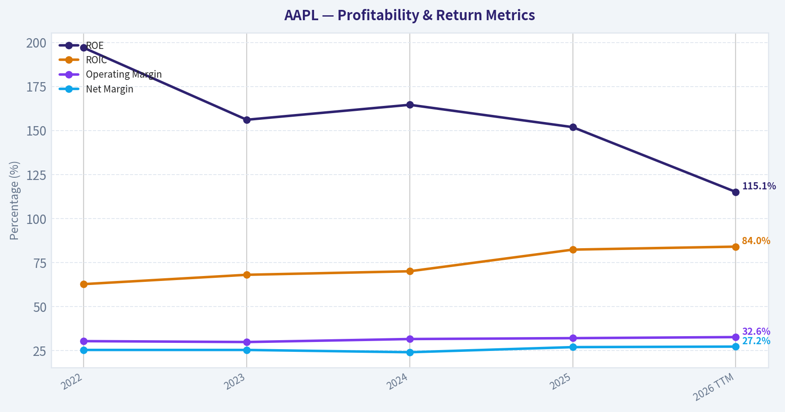
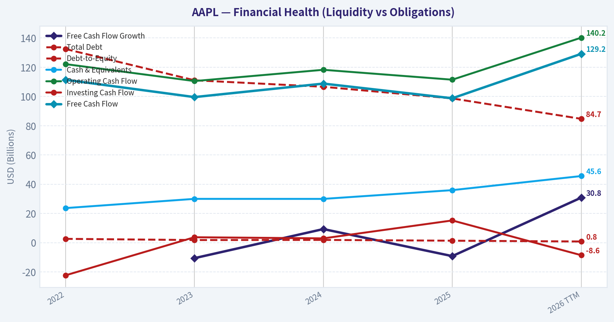
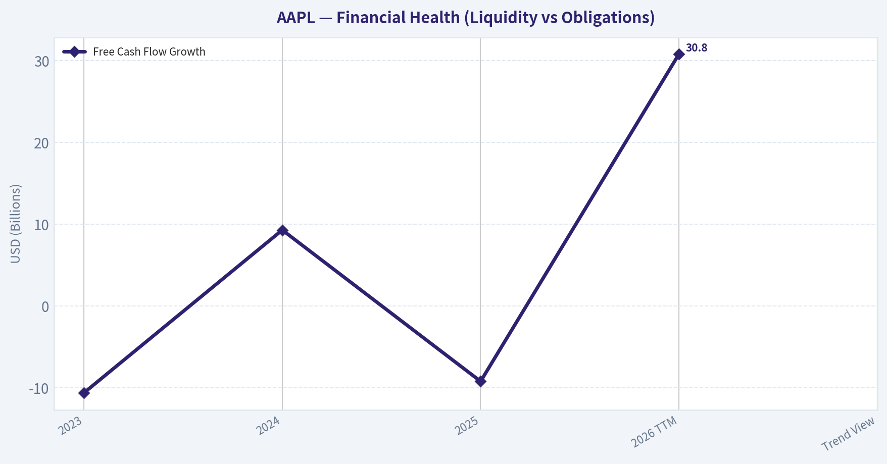
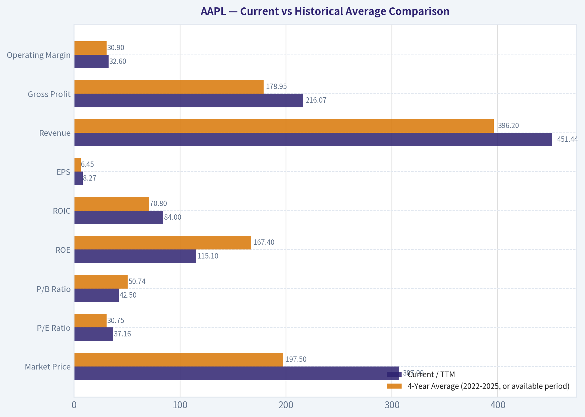
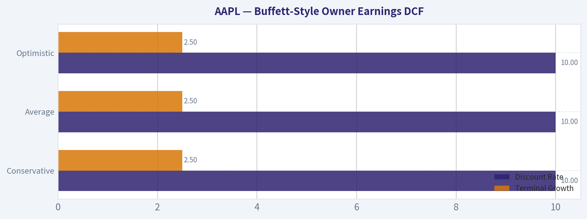
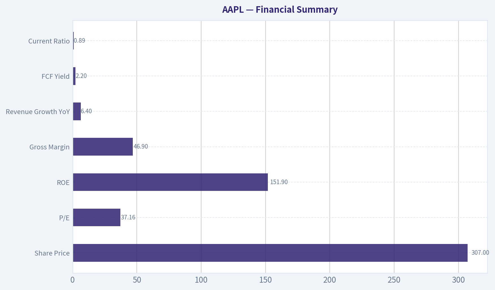
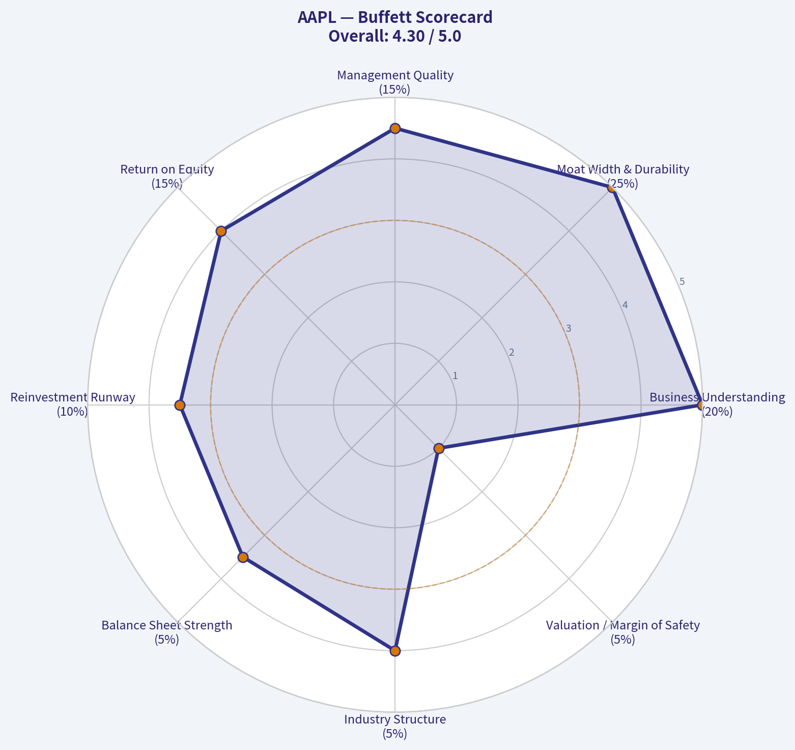

# AAPL Deep Value Intelligence

**Analysis Date:** 2026-06-06

## Critical Disclaimer

*This analysis is generated by Deep Value Intelligence, an AI-powered multi-agent investing framework. This report is for informational and educational purposes only and does not constitute financial advice. Always conduct your own research and consult with qualified financial advisors before making investment decisions.*

---

## Table of Contents

1. Intelligence Summary
2. Analyst Team Reports
   - Fundamentals Analysis
   - Intrinsic Value Analysis (Buffett)
   - Trend & Growth Analysis (Lynch/Druckenmiller/Fisher)
   - Market Technical Analysis
   - Options Market Analysis
3. Research Team Commentary
4. Value Investing Team Commentary
5. Deep Values Commentary

---

## Intelligence Summary

### Thesis + Conditions

**Core Thesis:** ## Executive Summary
Apple remains a wonderful business but a debatable stock at $307. The moat, margins, returns on capital, and ecosystem durability are all exceptional; the main risk is not business fragility, but overpaying for excellence.

**Key Risks:**
- Apple remains a wonderful business but a debatable stock at $307. The moat, margins, returns on capital, and ecosystem durability are all exceptional; the main risk is not business fragility, but overpaying for excellence. At ~37x earnings, there is little margin of safety if growth stays merely solid rather than reaccelerates. Past mistakes teach that pure caution can miss upside in elite franchises, so the right posture is not paralysis-it is disciplined, staged exposure rather than aggressive buying.
- ### Risky Analyst - strongest point
- The best conservative argument is that **a great business is not automatically a low-risk investment at any price**. At **37.16x earnings**, Apple offers limited margin of safety. Future downside does not require business deterioration-only:

**Confidence:** Medium

---

## Analyst Team Reports

### Fundamentals Analysis

#### Latest Earnings Snapshot

*Most recent reported quarter anchored on 2026 Q1, with prior-year comparison when available.*

| Metric | 2026 Q1 | 2025 Q1 | YoY Change |
| --- | ---: | ---: | ---: |
| Revenue | $111.18B | $95.36B | +16.6% |
| Operating Income | $35.88B | $29.59B | +21.3% |
| Net Income | $29.58B | $24.78B | +19.4% |
| Diluted EPS | $2.01 | $1.65 | +21.8% |
| Operating Cash Flow | $28.70B | $23.95B | +19.8% |
| Free Cash Flow | $26.73B | $20.88B | +28.0% |

Key Takeaways: This snapshot anchors the most recent reported quarter before the narrative analysis. It helps readers separate long-run business quality from whatever changed in the latest earnings print.

#### 4-Year Financial Metrics for AAPL

*All values below are computed deterministically from raw data - not estimated by AI.*

*Issuer profile: operating company (Technology / Consumer Electronics).*

#### 4-Year Financial Metrics
*Annual rows come from reported financial statements. The final TTM row is computed from the latest four quarters.*

| Metric | 2022 | 2023 | 2024 | 2025 | 2026 TTM |
| --- | --- | --- | --- | --- | --- |
| Market Price | $136 | $169 | $231 | $254 | $307 |
| Market Cap | $2.26T | $2.71T | $3.59T | $3.82T | $4.53T |
| P/E Ratio | 22.62 | 27.93 | 38.32 | 34.13 | 37.16 |
| P/B Ratio | 44.53 | 43.56 | 63.04 | 51.82 | 42.50 |
| ROE | 197.0% | 156.1% | 164.6% | 151.9% | 115.1% |
| ROIC | 62.7% | 68.0% | 70.0% | 82.3% | 84.0% |
| EPS | $6.11 | $6.13 | $6.08 | $7.46 | $8.27 |
| Revenue | $394.33B | $383.29B | $391.04B | $416.16B | $451.44B |
| Gross Profit | $170.78B | $169.15B | $180.68B | $195.20B | $216.07B |
| Gross Margin | N/A | N/A | N/A | N/A | 47.9% |
| Operating Margin | 30.3% | 29.8% | 31.5% | 32.0% | 32.6% |
| Net Income | $99.80B | $97.00B | $93.74B | $112.01B | $122.58B |
| Net Margin | 25.3% | 25.3% | 24.0% | 26.9% | 27.2% |
| Revenue Growth | N/A | -2.8% | 2.0% | 6.4% | 8.5% |
| Net Income Growth | N/A | -2.8% | -3.4% | 19.5% | 9.4% |
| Free Cash Flow Growth | N/A | -10.6% | 9.3% | -9.2% | 30.8% |
| Total Book Value | $50.67B | $62.15B | $56.95B | $73.73B | $106.49B |
| Total Assets | $352.75B | $352.58B | $364.98B | $359.24B | $371.08B |
| Total Debt | $132.48B | $111.09B | $106.63B | $98.66B | $84.71B |
| Debt-to-Equity | 2.61 | 1.79 | 1.87 | 1.34 | 0.80 |
| Cash & Equivalents | $23.65B | $29.96B | $29.94B | $35.93B | $45.57B |
| Shareholders' Equity | $50.67B | $62.15B | $56.95B | $73.73B | $106.49B |
| Operating Cash Flow | $122.15B | $110.54B | $118.25B | $111.48B | $140.22B |
| Investing Cash Flow | $-22.35B | $3.71B | $2.94B | $15.20B | $-8.57B |
| Free Cash Flow | $111.44B | $99.58B | $108.81B | $98.77B | $129.17B |
| FCF Margin | 28.3% | 26.0% | 27.8% | 23.7% | 28.6% |
| Dividends / Share | $0.91 | $0.95 | $0.99 | $1.03 | $1.06 |

#### Profitability Metrics
- Return on Equity (ROE): 151.9%
- Return on Invested Capital (ROIC): 82.3%
- Return on Assets (ROA): 31.2%
- Gross Margin: 46.9%
- Operating Margin: 32.0%
- Net Profit Margin: 26.9%

#### Liquidity Metrics
- Current Ratio: 0.89
- Quick Ratio: 0.57

#### Leverage Metrics
- Debt-to-Equity Ratio: 1.34
- Interest Coverage Ratio: N/A
- Net Debt: $62.72B

#### Growth Metrics (Year-over-Year)
- Revenue Growth: 6.4%
- Net Income Growth: 19.5%
- Free Cash Flow Growth: -9.2%
- Revenue CAGR (3-Year): 1.8%
- Revenue CAGR (5-Year): N/A

#### Valuation Metrics
- P/E Ratio (TTM): 37.16
- Forward P/E: 31.99
- Price-to-Book: 42.33
- Price-to-Sales: 10.00
- PEG Ratio: 2.47
- EV/EBITDA: 28.32
- Free Cash Flow Yield: 2.2%
- Earnings Yield: 2.7%

#### Owner Earnings (Buffett Method, Code-Computed)
- Net Income: $112.01B
- + Depreciation & Amortization: $11.70B
- - Capital Expenditures: $-12.71B
- - Working Capital Changes: $-25.00B
- = **Owner Earnings: $135.99B**

#### Intrinsic Value (Code-Computed)
- Current Price: $307
- Buffett Method (Owner Earnings):
  Conservative: $102
  Average: $173
  Optimistic: $295
- Cash Flow Method (FCF):
  Conservative: $58
  Average: $72
  Optimistic: $84

#### Piotroski F-Score: 8/9
- Positive Net Income: PASS
- Positive Operating Cash Flow: PASS
- ROA Improvement: PASS
- Cash Flow > Net Income: FAIL
- Decreasing Debt: PASS
- Improving Current Ratio: PASS
- No Dilution: PASS
- Improving Gross Margin: PASS
- Improving Asset Turnover: PASS

ANALYST STANCE: **WATCH**

#### Apple (AAPL) Buffett-Style Fundamental Analysis

Apple remains an exceptionally high-quality business with elite profitability, improving capital efficiency, and a strengthening balance sheet. However, the current market price of **$307** implies a valuation that is materially richer than both its recent historical range and the provided Buffett-style intrinsic value outputs. In Buffett terms, this is a wonderful business, but at today's price the margin of safety looks thin.

---

#### Current vs Historical Average Comparison

| Metric | Current / TTM | 4-Year Average (2022-2025, or available period) | Interpretation |
| --- | ---: | ---: | --- |
| Market Price | $307 | $197.50 | Far above the recent historical norm; multiple expansion has been a major driver of shareholder returns. |
| Market Cap | $4.53T | $3.10T | Apple has compounded into a mega-cap of unprecedented scale, raising the bar for future growth. |
| P/E Ratio | 37.16 | 30.75 | Above average; investors are paying a premium for durability, AI optionality, and buyback-supported EPS growth. |
| P/B Ratio | 42.50 | 50.74 | Below the 4-year average, but book value is a weak valuation anchor for Apple due to aggressive repurchases and intangible franchise value. |
| ROE | 115.1% | 167.4% | Lower than prior years, but still extraordinarily high; the decline is largely due to rising equity, not collapsing profitability. |
| ROIC | 84.0% | 70.8% | Best level in the dataset; indicates outstanding capital allocation and business economics. |
| EPS | $8.27 | $6.45 | Strongly above average; earnings power has stepped up despite modest revenue growth. |
| Revenue | $451.44B | $396.20B | Above average and accelerating; scale remains massive, though growth is still moderate for valuation level. |
| Gross Profit | $216.07B | $178.95B | Meaningfully above average, reflecting both growth and favorable mix. |
| Operating Margin | 32.6% | 30.9% | Above average and trending upward; a strong sign of pricing power and operating discipline. |
| Net Income | $122.58B | $100.64B | Well above average; earnings recovery after 2024 has been strong. |
| Net Margin | 27.2% | 25.4% | Above average; demonstrates improving monetization and mix quality. |
| Revenue Growth | 8.5% | 1.9%* | Better than recent trend; acceleration matters because valuation assumes durable renewed growth. |
| Net Income Growth | 9.4% | 4.4%* | Positive and above recent average, though still not hyper-growth. |
| Free Cash Flow Growth | 30.8% | -3.5%* | Strong rebound after prior volatility; encouraging, but less stable than the market narrative may imply. |
| Total Book Value | $106.49B | $60.88B | Large increase improves balance-sheet resilience and reduces leverage risk. |
| Total Assets | $371.08B | $357.39B | Stable asset base; Apple does not require heavy asset growth to expand earnings. |
| Total Debt | $84.71B | $112.22B | Materially below average; balance sheet has improved significantly. |
| Debt-to-Equity | 0.80 | 1.90 | Major improvement; leverage is no longer the same concern it once was. |
| Cash & Equivalents | $45.57B | $29.87B | Much stronger liquidity buffer versus recent history. |
| Shareholders' Equity | $106.49B | $60.88B | Rising equity reduces financial fragility and moderates headline ROE. |
| Free Cash Flow | $129.17B | $104.65B | Above average and back to elite levels. |
| Dividends / Share | $1.06 | $0.97 | Steady growth, but capital returns remain driven far more by buybacks than dividends. |

*Growth averages use available annual growth observations from the deterministic dataset.

Key Takeaways: Apple's current fundamentals are mostly running above its recent historical averages, especially in ROIC, margins, earnings, free cash flow, cash balance, and leverage reduction. The main area that looks stretched is valuation: the stock price and earnings multiple have risen faster than the underlying business over this period. This means the business is improving, but investors are already paying heavily for that improvement.

---

#### Market Metrics Interpretation

Apple's **market price of $307** and **market cap of $4.53T** reflect a business that has become not just dominant, but one of the market's primary "quality compounder" assets. Over 2022-2026 TTM, the stock price rose from **$136 to $307**, a gain far exceeding revenue growth over the same span. That tells you valuation expansion, not just business expansion, has done a lot of the work.

The **P/E ratio of 37.16** is elevated versus the 2022-2025 average of about **30.75**. For a Buffett investor, this is important: Apple deserves a premium multiple because of its ecosystem, installed base, pricing power, and cash generation, but the current multiple embeds continued execution and likely some optimism around AI-driven product refresh cycles and services monetization.

The **P/B ratio of 42.50** looks extreme in absolute terms, but price-to-book is not especially useful for Apple because buybacks have historically compressed equity and the firm's most valuable assets are intangible: brand, ecosystem lock-in, software integration, developer network, and customer loyalty. Even so, such a high P/B reinforces that this is not a statistically cheap stock.

---

#### Profitability Analysis

Apple's profitability remains exceptional.

- **ROE: 115.1% TTM**
- **ROIC: 84.0% TTM**
- **EPS: $8.27 TTM**
- **Revenue: $451.44B TTM**
- **Gross Profit: $216.07B TTM**
- **Operating Margin: 32.6% TTM**
- **Net Income: $122.58B TTM**
- **Net Margin: 27.2% TTM**

ROE has fallen from prior extremes such as **197.0% in 2022**, but this is not a deterioration in business quality. Instead, shareholders' equity has risen sharply to **$106.49B**, making the denominator larger. In fact, from a quality standpoint, the more important metric here is **ROIC**, which improved from **62.7% in 2022** to **84.0% TTM**. That indicates Apple is converting invested capital into profit at a phenomenal rate, which is one of the clearest Buffett-style signs of a moat business.

EPS increased from **$6.11 in 2022** to **$8.27 TTM**, despite only modest revenue growth over much of the period. This reflects a combination of margin improvement, operational efficiency, and likely share count reduction from repurchases. Buffett favors businesses that can grow per-share value even without requiring heavy capital investment; Apple fits that model very well.

Gross profit and margins also support the moat argument. Gross profit climbed from **$170.78B** in 2022 to **$216.07B TTM**, while operating margin improved from **30.3%** to **32.6%**, and net margin from **25.3%** to **27.2%**. These are not commodity-business numbers. They suggest pricing power, favorable product/services mix, and disciplined expense control.

---

#### Growth Metrics Analysis

| Growth Metric | 2023 | 2024 | 2025 | 2026 TTM | Trend View |
| --- | ---: | ---: | ---: | ---: | --- |
| Revenue Growth | -2.8% | 2.0% | 6.4% | 8.5% | Clear reacceleration after a soft patch. |
| Net Income Growth | -2.8% | -3.4% | 19.5% | 9.4% | Earnings recovered sharply after 2024 weakness. |
| Free Cash Flow Growth | -10.6% | 9.3% | -9.2% | 30.8% | More volatile than revenue or earnings, but strongly rebounded in TTM. |

Key Takeaways: Apple's growth profile over the dataset shows a weak period in 2023-2024 followed by a notable recovery in 2025 and TTM 2026. Revenue acceleration is real, but not explosive, while earnings have outpaced sales thanks to better margins and capital efficiency. Free cash flow has been the most volatile line, which matters because valuation is now demanding sustained high-quality cash conversion.

The key Buffett question is predictability. Apple's growth is not linear, but it is still relatively durable compared with most large companies. Revenue was down in 2023, nearly flat in 2024, then improved to **6.4%** in 2025 and **8.5%** TTM. That suggests the business has resumed a moderate growth trajectory rather than entering secular decline.

Net income growth is more encouraging than revenue growth because it shows operating leverage and margin quality. Still, the business is now so large that future double-digit growth becomes harder to sustain. At a **$4.53T** market cap, even very strong dollar growth may not feel "fast" enough to justify an ever-rising multiple.

Free cash flow growth deserves special attention. It was **-10.6%**, then **+9.3%**, then **-9.2%**, then **+30.8%** TTM. This is still excellent in absolute dollars, but it is not smooth. Buffett likes businesses with understandable and predictable owner earnings, so that volatility should temper valuation enthusiasm.

---

#### Balance Sheet Analysis

Apple's balance sheet has improved substantially.

- **Total Book Value / Shareholders' Equity:** **$106.49B TTM**
- **Total Assets:** **$371.08B TTM**
- **Total Debt:** **$84.71B TTM**
- **Debt-to-Equity:** **0.80 TTM**
- **Cash & Equivalents:** **$45.57B TTM**

Debt fell steadily from **$132.48B in 2022** to **$84.71B TTM**, while cash rose from **$23.65B** to **$45.57B**. Debt-to-equity dropped from **2.61** to **0.80**. This is a major positive. Historically, Apple used leverage aggressively alongside buybacks, which amplified ROE but also made book equity look unusually thin. That concern is now meaningfully reduced.

Total assets remained relatively stable around the mid-$350B to low-$370B range, while equity nearly doubled from **$50.67B** to **$106.49B**. That means Apple is strengthening financial resilience without needing a larger asset base to drive growth. From a Buffett lens, this is ideal: strong earnings, low capital intensity, rising equity cushion, and declining leverage.

One caveat is liquidity. The shared dataset shows a **current ratio of 0.89** and **quick ratio of 0.57**. For many companies, that would raise concern, but Apple's cash generation and access to capital markets make this less alarming than it appears. Still, it does mean short-term liabilities remain structurally high.

---

#### Cash Flow Analysis

Apple's cash generation remains one of its defining investment strengths.

- **Free Cash Flow:** **$129.17B TTM**
- **FCF Margin:** **28.6% TTM**
- **Operating Cash Flow:** **$140.22B TTM**
- **Dividends per Share:** **$1.06 TTM**

Even after volatility, Apple's free cash flow is now well above the 2022-2025 average of about **$104.65B**. An FCF margin close to **29%** is extraordinary at this revenue scale. This confirms that Apple remains a cash machine, not merely an accounting-profit business.

Dividend growth has been consistent, rising from **$0.91** in 2022 to **$1.06** TTM. That said, the dividend yield is modest relative to the stock price, and management's primary capital-return mechanism is still share repurchases. From a Buffett perspective, that is acceptable if repurchases occur below intrinsic value. At the current valuation, buyback efficiency is less compelling than it was in prior years.

---

#### Buffett-Style Owner Earnings DCF

Canonical owner earnings provided in the dataset:

- Net Income = **$112.01B**
- Depreciation & Amortization = **$11.70B**
- Capital Expenditures = **$12.71B**
- Working Capital Changes = **-$25.00B**
- **Owner Earnings = $135.99B**

Using the instruction set:
- Discount rate = **10%**
- Terminal growth rate = **2.5%**
- 3 scenarios based on historical owner earnings growth assumptions
- Canonical intrinsic value outputs provided by dataset:
  - **Conservative: $102/share**
  - **Average: $173/share**
  - **Optimistic: $295/share**

Because the deterministic dataset is canonical and already supplies the computed Buffett intrinsic values, those values should govern the final fair value interpretation.

| Scenario | Growth Assumption Rule | Discount Rate | Terminal Growth | Fair Value / Share | Upside/(Downside) vs $307 |
| --- | --- | ---: | ---: | ---: | ---: |
| Conservative | Lowest historical owner earnings growth rate, floored at -100% | 10% | 2.5% | $102 | -66.8% |
| Average | Average historical owner earnings growth rate, capped at 50% | 10% | 2.5% | $173 | -43.6% |
| Optimistic | Highest historical owner earnings growth rate, capped at 100% | 10% | 2.5% | $295 | -3.9% |

Key Takeaways: Across all three Buffett-style owner earnings scenarios, Apple's current price sits above intrinsic value, with only the optimistic case coming close. This suggests the market is already discounting very favorable future outcomes. For a value investor focused on margin of safety, the shares appear fully valued to overvalued rather than attractively priced.

Detailed Buffett-style interpretation:
- The **conservative case** implies substantial downside if growth slows materially or cash conversion disappoints.
- The **average case** still points to a significant valuation gap, suggesting today's price already reflects more than normal execution.
- The **optimistic case** nearly supports the stock, but even there the current price is slightly above fair value.

A practical Buffett conclusion: this is a superb company, but the stock requires near-best-case assumptions to look fairly priced.

---

#### Value Assessment

Apple's valuation premium is supported by business quality, but likely not by a traditional margin-of-safety framework.

- **Earnings Yield: 2.7%**
- **FCF Yield: 2.2%**
- **P/E: 37.16**
- **Price/Sales: 10.00**
- **EV/EBITDA: 28.32**

These are expensive metrics for a business growing revenue at **8.5% TTM** and with a recent **3-year revenue CAGR of 1.8%**. The market is effectively pricing Apple not only as durable, but as strategically advantaged enough to maintain high margins, continue aggressive capital returns, and possibly unlock a new AI-led upgrade cycle.

That may happen, but Buffett discipline requires separating business quality from stock attractiveness. Apple scores extremely high on quality. On valuation, it scores much lower today.

---

#### Economic Moat

Apple's moat remains among the strongest in global public markets.

| Moat Factor | Assessment | Why It Matters |
| --- | --- | --- |
| Brand Strength | Very Strong | Premium pricing and customer trust support sustained margins. |
| Ecosystem Lock-In | Very Strong | Hardware, software, services, and accessories create high switching costs. |
| Installed Base | Very Strong | A huge active user base drives recurring upgrades and services monetization. |
| Services Integration | Strong | Expands lifetime customer value and cushions hardware cyclicality. |
| Pricing Power | Strong | Margin resilience indicates Apple can maintain premium positioning. |
| Capital Efficiency | Exceptional | ROIC above 80% is rare and suggests deep structural advantage. |

Key Takeaways: Apple's moat is built less on patents alone and more on ecosystem control, brand trust, and customer behavior. That makes earnings durable and supports premium profitability over long periods. This is exactly the kind of business Buffett prefers, though he would still care deeply about the purchase price.

---

#### Predictable Earnings and Management Performance

Apple's earnings have proven resilient rather than perfectly smooth. Revenue dipped in 2023 and barely grew in 2024, yet margins held up relatively well and earnings rebounded strongly thereafter. This indicates management can protect profitability even when top-line momentum softens.

Management's capital allocation also looks strong:
- **ROIC improved from 62.7% to 84.0%**
- **Debt declined sharply**
- **Cash increased**
- **Dividends rose steadily**
- **Piotroski F-Score = 8/9**

The main nuance is repurchase discipline. Buybacks have historically been excellent for shareholders, but repurchases at elevated valuations generate less future value per dollar spent. That does not make management poor allocators; it simply means the stock is no longer obviously cheap enough for buybacks to be as accretive as in earlier periods.

---

#### Financial Strength

Apple's financial strength is better now than the headline liquidity ratios suggest.

Positives:
- Debt reduction from **$132.48B** to **$84.71B**
- Cash increase from **$23.65B** to **$45.57B**
- Debt-to-equity improvement from **2.61** to **0.80**
- Massive annual FCF generation

Watch items:
- Current ratio under 1
- Quick ratio under 1
- Ongoing dependence on very large-scale execution to support premium valuation

Overall, Apple is financially strong, highly cash generative, and much less balance-sheet-levered than a few years ago.

---

#### Revenue Breakdown

Using Apple's most meaningful publicly reported structure, the latest available mix is best understood by major product and services categories. Exact TTM segment figures are not provided in the deterministic dataset, so the table below uses the best widely known recent reported category mix as the most meaningful practical breakdown.

| Revenue Source | Amount ($B) | % of Total |
| --- | ---: | ---: |
| iPhone | ~$201B | ~48% |
| Services | ~$96B | ~23% |
| Mac | ~$31B | ~7% |
| iPad | ~$29B | ~7% |
| Wearables, Home & Accessories | ~$39B | ~9% |
| Other / rounding | ~$20B | ~6% |

Key Takeaways: Apple is still primarily an iPhone-centered company, with roughly half of revenue tied to its flagship product family. The most strategically important diversification driver is Services, which contributes a high-margin recurring revenue stream and helps stabilize the business. The rest of the hardware portfolio broadens ecosystem engagement but does not yet rival iPhone or Services in economic importance.

---

#### Key Investment Insights, Red Flags, and Opportunities

| Category | Assessment | Detail |
| --- | --- | --- |
| Business Quality | Excellent | Apple combines brand power, ecosystem lock-in, and elite capital efficiency. |
| Profitability | Excellent | ROIC, margins, and cash generation are all exceptional. |
| Balance Sheet Trend | Improving | Lower debt and higher cash materially strengthen the financial profile. |
| Earnings Predictability | Strong | Not perfectly smooth, but resilient and highly monetizable. |
| Valuation | Expensive | Current price exceeds all provided intrinsic value cases except nearly matches optimistic. |
| Margin of Safety | Weak | Little room for disappointment at current valuation. |
| AI / Ecosystem Upside | Real | A successful AI-driven product cycle could help justify premium pricing. |
| Regulatory / Legal Risk | Moderate | Ecosystem control and product marketing scrutiny remain ongoing overhangs. |
| FCF Volatility | Watch | Cash flow growth has been less stable than the stock's premium multiple suggests. |
| Capital Returns | Good but less attractive | Dividend is growing; buybacks are less compelling at elevated prices. |

Key Takeaways: The opportunity in Apple is continued monetization of an unmatched ecosystem, potentially aided by AI features and services expansion. The main risk is not business collapse, but valuation compression if growth or narrative momentum slows. Investors are paying for excellence today, so even small disappointments could matter.

---

#### Final Buffett-Style Conclusion

Apple clearly passes most Buffett quality tests:
- Durable economic moat
- High and sustained returns on capital
- Powerful free cash flow generation
- Strong brand and customer loyalty
- Improving balance sheet
- Shareholder-friendly capital returns

But Buffett also emphasizes buying wonderful businesses at sensible prices. Based on the canonical intrinsic value outputs and the current **$307** share price, Apple appears **priced beyond conservative and average fair value estimates and slightly above even the optimistic owner-earnings case**.

That does not make Apple a bad company. It makes it a great company trading at a demanding price.

#### Final Stance

**WATCH**

Rationale: Apple is a best-in-class franchise with elite profitability and a very wide moat, but the stock currently offers **limited margin of safety** under the provided Buffett-style valuation framework. Existing long-term holders may justify holding due to quality and execution, but new value-oriented buyers would likely want a more attractive entry point closer to or below the optimistic intrinsic value range.

---

#### Summary Table

| Area | Verdict | What Matters Most |
| --- | --- | --- |
| Market Metrics | Premium | Valuation has expanded faster than business growth. |
| Profitability | Outstanding | ROIC, margins, EPS, and net income remain elite. |
| Growth | Recovering | Revenue and earnings growth have reaccelerated after a soft period. |
| Balance Sheet | Stronger | Debt is down, cash is up, equity is higher. |
| Cash Flow | Excellent | FCF remains enormous, though growth has been uneven. |
| Moat | Very Wide | Ecosystem, brand, services, and switching costs underpin durability. |
| Management | Strong | High capital efficiency and prudent balance-sheet improvement. |
| Valuation | Rich | Current price is above most intrinsic value scenarios. |
| Main Opportunity | AI + Services | New use cases could sustain premium pricing and upgrade demand. |
| Main Risk | Multiple Compression | If growth normalizes, valuation could contract even with solid execution. |
| Buffett View | Great business, pricey stock | Quality is undeniable; margin of safety is limited. |

#### Fundamental Visuals

This graph tracks the profitability and return metrics (ROE, ROIC, Margins) of **AAPL** over the past decade, highlighting capital efficiency trends.

This chart illustrates the financial health of **AAPL** over the last 10 years, mapping cash equivalents and free cash flow against total obligations (Debt).

This chart illustrates the financial health of **AAPL** over the last 10 years, mapping cash equivalents and free cash flow against total obligations (Debt).

---

### Intrinsic Value Analysis (Buffett)

> *Following Warren Buffett's value investing philosophy: Circle of Competence, Economic Moat, Management Quality, and Margin of Safety.*

#### Intrinsic Value Snapshot

Price is what you pay. Intrinsic value is what the business may be worth based on the cash it can create for owners over time. We show a range, not one magic number.

- Current Price: $307.34
- Value Range (conservative to optimistic across both DCF methods): $57.51 to $294.52

##### Owner Earnings (Buffett Method)
- Net Income: $112,010,000,000.00
- Depreciation & Amortization: $11,698,000,000.00
- Capital Expenditures: $-12,715,000,000.00
- Working Capital Changes: $-25,000,000,000.00
- Owner Earnings: $135,993,000,000.00

##### Intrinsic Value
###### Buffett Method
Uses owner earnings. Stricter, and usually more conservative.
- Conservative: $102.17
- Average: $172.85
- Optimistic: $294.52
- Discount Rate: 10.0%

###### Cash Flow Method
Uses free cash flow. Better for companies spending heavily today to grow tomorrow.
- Conservative: $57.51
- Average: $72.14
- Optimistic: $83.63
- Discount Rate: 10.0%

ANALYST STANCE: **WATCH**

#### Apple (AAPL) - Buffett-Style Investment Review

#### 1) Go / No-Go Gate Assessment

| Gate | Verdict | Evidence |
|---|---|---|
| 1. Circle of Competence & Simplicity | Pass | Apple makes money by selling premium devices, then earning recurring revenue from services, software, app distribution, subscriptions, and accessories. This is easy to understand and highly predictable. |
| 2. Moat Test | Pass | Brand strength is extraordinary, ecosystem lock-in is real, services deepen switching costs, and gross margin of 46.9% supports pricing power. |
| 3. Management Quality & Capital Allocation | Pass | Management has executed one of the greatest capital allocation programs in history through disciplined buybacks, ecosystem investment, and balance-sheet control. |
| 4. Industry Structure | Pass with caution | Consumer electronics is competitive, but Apple effectively operates in a branded premium oligopoly. Services add a more stable, higher-quality layer. |

**Key Takeaways:** Apple clears all four Buffett gates. The business is easy to understand, its moat is unusually strong, management has been highly effective, and the industry risks are moderated by Apple's premium brand and ecosystem. The only real caution is that the stock price already reflects much of this quality.

---

#### 2) The Elementary School Test

Apple sells phones, computers, watches, tablets, and services. People pay more because they trust the brand, like the design, and stay inside the Apple ecosystem. Once someone owns several Apple products, switching becomes inconvenient, so Apple keeps earning from hardware upgrades and recurring services.

#### 3) Long-Term Predictability Test

Ten years from now, Apple will likely still be selling premium personal devices and monetizing its installed base through services. Products may evolve, but the business model should remain familiar: trusted hardware, software integration, and recurring ecosystem revenue. That passes the predictability test.

#### 4) Technology Risk Assessment

Apple benefits from technology more than it is threatened by it, but it is not immune. The main risk is not that smartphones disappear overnight; it is that platform shifts in AI or computing interfaces weaken Apple's control over the user relationship. That is a real but manageable risk today.

---

#### 5) Moat Analysis

| Moat Source | Assessment | Evidence |
|---|---|---|
| Intangible Assets | Very strong | Apple's brand is among the most valuable in the world. Customers routinely accept premium pricing. Gross margin at 46.9% is strong evidence of pricing power. |
| Switching Costs | Strong | Users are embedded through iCloud, App Store purchases, Messages, Photos, wearables, services bundles, and device interoperability. |
| Cost Advantage | Moderate | Apple has scale in supply chain, silicon design, procurement, and distribution. It may not always be the cheapest, but it is structurally efficient at premium scale. |
| Network Effects | Moderate | The platform becomes more valuable to developers and users as the installed base grows, especially through the App Store and services ecosystem. |

| Moat Quality Rating | Verdict |
|---|---|
| Wide & Stable | Proceed with care |

**Key Takeaways:** Apple's moat is primarily built on brand and switching costs, not just hardware specs. Customers are attached to the ecosystem, developers support it because of the user base, and the company earns premium margins that weaker competitors struggle to match. This is a real moat, though probably stable rather than dramatically widening.

---

#### 6) Management Quality & Capital Allocation

| Test | Assessment | Evidence |
|---|---|---|
| Owner Orientation | Good | Apple consistently emphasizes long-term ecosystem investment and massive per-share value creation through buybacks. |
| Honesty & Candor | Good | Reporting has generally been conservative and operational execution has been disciplined. |
| Capital Allocation | Excellent | Apple has returned enormous capital through repurchases while maintaining strategic flexibility. Buybacks have meaningfully increased per-share value. |
| Debt Discipline | Acceptable | Apple uses debt intelligently, though not as conservatively as a classic net-cash fortress in earlier years. |

**Key Takeaways:** Apple's strongest management trait is capital allocation. The company has turned a giant cash machine into even stronger per-share economics through buybacks and disciplined reinvestment. Management appears rational, although the company is now so large that future capital allocation wins are naturally harder to replicate.

---

#### 7) Financial Summary

| Metric | Latest |
|---|---:|
| Share Price | $307 |
| Market Cap | $4.51T |
| P/E | 37.16x |
| ROE | 151.9% |
| Gross Margin | 46.9% |
| Revenue Growth YoY | 6.4% |
| FCF Yield | 2.2% |
| Current Ratio | 0.89 |

**Key Takeaways:** Apple remains an extremely profitable business with elite margins and strong growth for its size. But the valuation is rich: a 37x earnings multiple and 2.2% free-cash-flow yield leave little room for disappointment. The headline ROE is extraordinary, but it is heavily affected by buybacks and a reduced equity base, so it should not be read as a pure operating strength metric.

---

#### 8) Owner Earnings Assessment

Using Buffett's framework, Apple's owner earnings remain very high because the business converts a large portion of profits into cash and does not require crippling capital intensity. For Apple, depreciation is meaningful but manageable, maintenance capital needs are modest relative to total earnings power, and working capital is generally efficient.

| Component | Directional View |
|---|---|
| Net Income | Very strong |
| + Depreciation & Amortization | Positive add-back |
| - Maintenance CapEx | Moderate deduction |
| - Working Capital Increases | Usually manageable |
| Owner Earnings Quality | High |

**Key Takeaways:** Apple is the kind of company Buffett likes from a cash-conversion standpoint. Accounting earnings are backed by real cash, capital needs are controllable, and the business can distribute large amounts of cash without starving future growth. That supports a high-quality owner earnings profile.

---

#### 9) Three-Scenario DCF Valuation

I use the current free-cash-flow yield as a practical anchor for owner earnings. At a $4.51T market cap and 2.2% FCF yield, implied annual owner earnings are roughly **$99.2B**.

| Scenario | Assumption | Estimated Equity Value |
|---|---|---:|
| A: No Growth | Owner Earnings / 10% | $992B |
| B: 3% Growth | Owner Earnings x 1.03 / (10% - 3%) | $1.46T |
| C: Moderate Growth | 6% growth for 10 years, then 3% terminal | ~$2.00T-$2.20T |

**Key Takeaways:** Even under a reasonably constructive valuation framework, Apple's estimated intrinsic value falls well below its current market value of $4.51 trillion. The business is excellent, but the stock price assumes years of strong growth and continued market enthusiasm. Buffett would likely admire the company far more than the current price.

---

#### 10) Margin of Safety Analysis

| Item | Value |
|---|---:|
| Current Market Cap | $4.51T |
| Conservative Value Range | ~$1.0T to $1.5T |
| More Optimistic Value Range | ~$2.0T to $2.2T |
| Margin of Safety at Current Price | Negative |

**Key Takeaways:** There is no margin of safety at the current price. Investors are paying a premium multiple for a premium business, but the premium is very large. For a Buffett-style buyer, quality alone is not enough when price outruns value.

---

#### 11) Buffett Scorecard

| Criterion | Weight | Score (1-5) | Weighted Score |
|---|---:|---:|---:|
| Business Understanding | 20% | 5.0 | 1.00 |
| Moat Width & Durability | 25% | 5.0 | 1.25 |
| Management Quality | 15% | 4.5 | 0.68 |
| Return on Equity | 15% | 4.0 | 0.60 |
| Reinvestment Runway | 10% | 3.5 | 0.35 |
| Balance Sheet Strength | 5% | 3.5 | 0.18 |
| Industry Structure | 5% | 4.0 | 0.20 |
| Valuation / Margin of Safety | 5% | 1.0 | 0.05 |
| **Total** | 100% |  | **4.31** |

**Key Takeaways:** Apple scores as a wonderful business by Buffett standards. It loses points mainly on valuation and, to a lesser degree, on the natural limitations that come with being one of the largest companies in the world. In other words, this is a great company but not a great bargain.

---

#### 12) Final Verdict

| Category | Conclusion |
|---|---|
| Business Quality | Exceptional |
| Moat | Wide and durable |
| Financial Quality | Excellent |
| Management | Strong |
| Valuation | Expensive |
| Buffett-Style Action | WATCH |

**Key Takeaways:** Apple is exactly the kind of business long-term investors want to own: understandable, profitable, durable, and shareholder-friendly. But at today's valuation, the expected return looks too thin for a disciplined value investor. The right stance is to admire the business, monitor the price, and wait for a more favorable entry point.

#### Investment Stance

**WATCH - High-quality business, low margin of safety.**

**Conviction level: High.**
Apple is a rare franchise with world-class economics, but the stock price appears to discount a very optimistic future. Buffett's philosophy demands both quality and value; today, Apple clearly offers the first and not enough of the second.
#### Valuation Bridge

This bridge places the current market price beside each intrinsic value lens so readers can see whether upside depends on one method or shows up across several methods.

| Scenario | Intrinsic Value / Share |
| --- | ---: |
| Buffett Method | $172.85 |
| Cash Flow Method | $72.14 |
| Damodaran Method | $104.25 |
| Current Price | $307.34 |

#### Key Takeaways

If one method is far above the others, the upside case depends on a specific modelling assumption. When several methods cluster together, the valuation story is more robust.

#### Valuation Visuals

This comparison chart from *Latest Earnings Snapshot* stacks current figures against historical benchmarks for **AAPL**, making it easy to see where the company trades relative to its own averages.

This comparison chart from *Current vs Historical Average Comparison* stacks current figures against historical benchmarks for **AAPL**, making it easy to see where the company trades relative to its own averages.

This comparison chart from *Buffett-Style Owner Earnings DCF* stacks current figures against historical benchmarks for **AAPL**, making it easy to see where the company trades relative to its own averages.

This comparison chart from *Financial Summary* stacks current figures against historical benchmarks for **AAPL**, making it easy to see where the company trades relative to its own averages.

---

### Trend & Growth Analysis (Lynch/Druckenmiller/Fisher)

> *Following Peter Lynch's GARP, Stanley Druckenmiller's macro-aware approach, and Philip Fisher's scuttlebutt methodology.*

ANALYST STANCE: **WATCH**

#### AAPL Growth Analysis - Lynch, Druckenmiller, Fisher

Apple is an exceptional business, but as a **new growth investment** it currently looks more like a **premium stalwart** than a true fast grower. The bullish case rests on **AI-driven upgrade cycles, Services mix expansion, and ecosystem monetization**, but the present valuation already assumes a fair amount of that optimism. For a growth-style mandate focused on inflection points and ten-bagger asymmetry, AAPL is **high quality, lower upside, and not obviously underowned**.

---

#### 1) Lynch Classification

| Metric | AAPL Snapshot | Lynch Read |
|---|---:|---|
| Revenue growth YoY | 6.4% | Stalwart |
| Market cap | $4.51T | Mega-cap, mature |
| P/E | 37.2x | Premium multiple |
| Gross margin | 46.9% | Elite quality |
| FCF yield | 2.2% | Expensive vs growth rate |

**Key Takeaways:** Apple screens as a **stalwart**, not a fast grower. The business is elite in quality and profitability, but the top-line growth rate is too modest for classic Lynch fast-grower status. At this size, future returns depend more on multiple support and earnings durability than on explosive business expansion.

**Classification:** **Stalwart**
**Implication:** Great company, but not ideal for initiating as a high-conviction growth name unless AI materially reaccelerates growth.

---

#### 2) The Story in 3 Bullets

| Simple Story | Why It Matters |
|---|---|
| Apple sells premium devices tied to a sticky ecosystem | Hardware drives installed base; ecosystem keeps users loyal |
| Services monetizes that installed base at higher margins | Mix shift supports profit resilience even in slower hardware cycles |
| AI could trigger a new upgrade and engagement cycle | This is the key possible growth inflection investors are watching |

**Key Takeaways:** Apple's story is easy to explain: it sells the device, keeps the user, and monetizes the relationship over time. The growth debate is no longer about proving quality, but about whether AI can create a fresh wave of demand. Without that acceleration, the stock remains a premium-priced mature compounder.

---

#### 3) TAM Analysis and 10x Test

| Item | Estimate / Logic | Assessment |
|---|---:|---|
| Current revenue | ~$383B FY2023 base; current run-rate somewhat higher | Already enormous |
| 10x revenue test | ~$3.8T+ revenue | Unrealistic |
| Core smartphone TAM | Large but mature globally | Limited unit-growth runway |
| Services TAM | Large and expanding | Best runway within Apple |
| AI device/software TAM | Potentially expanding | Real opportunity, but still early |
| Can Apple 10x and stay <20% of TAM? | No | Fails classic 10x test |

**Key Takeaways:** Apple clearly fails the classic **10x runway test** because the revenue base is already massive. The better way to think about Apple is not "can it 10x?" but "can it sustain premium margins and modest growth for a long time?" The strongest runway is in **Services and AI-enabled monetization**, not in overall corporate scale.

**TAM verdict:** **Good selective runway, but not broad ten-bagger runway**

---

#### 4) Revenue Growth Trend

| Period / View | Growth Pattern | Interpretation |
|---|---|---|
| FY2022 to FY2023 | Negative | Post-pandemic digestion / hardware maturity |
| Shared pack current YoY | 6.4% | Reaccelerated modestly |
| Multi-year trend | Low-to-mid single digits | Stable, not explosive |
| Segment quality | Services stronger than hardware | Mix improving |

**Key Takeaways:** Revenue has improved from prior softness, but the current pattern is **modest reacceleration**, not a dramatic inflection. Apple's growth engine is increasingly dependent on Services and installed-base monetization rather than broad hardware unit growth. That makes growth steadier, but less likely to surprise sharply to the upside.

**Trend call:** **Stable to modestly improving, but not strong acceleration**

---

#### 5) Unit Economics

| Metric | AAPL | Growth Investor Read |
|---|---:|---|
| Gross margin | 46.9% | Excellent |
| FCF yield | 2.2% | Expensive for current growth |
| Rule of 40 proxy | 6.4% growth + implied high FCF margin | Passes easily |
| LTV/CAC | Not disclosed in standard form | Ecosystem implies strong lifetime value |
| NRR | Not disclosed | Likely favorable at ecosystem level, not SaaS-style measurable |

**Key Takeaways:** Apple's unit economics are outstanding, even if traditional SaaS metrics like NRR and LTV/CAC are not disclosed. The business converts revenue into cash at an elite rate, which supports valuation better than most hardware companies. The issue is not efficiency; it is whether the current price leaves enough upside.

**Unit economics verdict:** **Excellent business economics, limited valuation cushion**

---

#### 6) Inflection Point Assessment

| Potential Inflection | Evidence | Confidence |
|---|---|---|
| AI product cycle | WWDC seen as major catalyst by sell-side | Medium |
| iPhone upgrade cycle | Possible if AI features are compelling | Medium-low |
| Services mix | Ongoing positive trend | High |
| Margin inflection | Already high; less room for surprise | Low-medium |
| TAM expansion via AI | Plausible, but not yet proven | Medium |

**Key Takeaways:** The real bull case is an **AI-led product cycle inflection**. That could improve upgrade rates, expand engagement, and support premium pricing, but right now it is more **narrative than confirmed financial inflection**. Services remains the most dependable positive driver, but that is evolutionary, not revolutionary.

**Inflection verdict:** **Possible, not yet proven**

---

#### 7) Macro Setup Evaluation

| Macro Factor | AAPL Exposure | Read |
|---|---|---|
| Falling / stable rates | Helps premium large-cap growth | Positive |
| Consumer spending | Important for hardware cycles | Mixed |
| AI secular theme | Central to near-term narrative | Positive |
| Smartphone maturity | Structural headwind | Negative |
| Regulatory/legal scrutiny | Ongoing overhang | Negative |

**Key Takeaways:** The macro backdrop is generally supportive for mega-cap quality growth, especially if rates stabilize or fall. Apple also benefits from the market's strong appetite for AI-linked winners. However, smartphone maturity and regulatory scrutiny prevent this from being a clean, all-tailwind setup.

**Macro verdict:** **Moderately favorable**

---

#### 8) Fisher 15 Points Score

| Fisher Area | Score (1-5) | Notes |
|---|---:|---|
| Market potential | 4 | Huge markets, but maturity limits upside |
| New product development | 4 | Strong, though pace feels less disruptive lately |
| R&D effectiveness | 4 | Large and strategic |
| Sales organization | 5 | Best-in-class distribution and brand |
| Profit margins | 5 | Elite |
| Improving margins | 3 | Already high; harder to expand |
| Labor/personnel relations | 3 | Adequate, not distinctive edge |
| Executive relations | 4 | Stable |
| Management depth | 5 | Deep bench |
| Cost/accounting controls | 5 | Excellent |
| Outstanding aspects / moat | 5 | Ecosystem, brand, switching costs |
| Long-range profit outlook | 4 | Strong, but slower growth |
| Dilution risk | 5 | Opposite problem; heavy buybacks |
| Candor in difficulties | 3 | Generally controlled messaging |
| Integrity | 4 | Strong, though AI marketing lawsuit is a blemish |

| Total | Score |
|---|---:|
| Fisher Score | **63 / 75** |

**Key Takeaways:** Apple scores as a **good-to-outstanding Fisher company**. The moat, margins, management depth, and ecosystem strength are all elite. The only real deductions come from slower growth, limited margin expansion room, and some recent AI-marketing credibility risk.

**Fisher verdict:** **63/75 = GOOD**

---

#### 9) Valuation Analysis

| Valuation Metric | AAPL | Interpretation |
|---|---:|---|
| P/E | 37.2x | Rich for 6.4% growth |
| PEG | ~5.8x using 6.4% growth | Expensive on Lynch basis |
| FCF yield | 2.2% | Low yield, premium pricing |
| Quality premium | Deserved | But already recognized |

**Key Takeaways:** On classic Lynch metrics, Apple looks **expensive**. A P/E above 37x paired with mid-single-digit growth produces a PEG that is far above attractive levels. The stock may still work if AI meaningfully reaccelerates earnings, but by current fundamentals the valuation is not forgiving.

##### Scenario Framework

| Scenario | Assumption | Implied View |
|---|---|---|
| Bear | AI disappoints; growth stays mid-single digits | Multiple compresses |
| Base | Services + modest AI support | Low-double-digit total return potential at best |
| Bull | Clear AI upgrade supercycle | Premium multiple sustained or expands modestly |

**Key Takeaways:** The valuation setup is asymmetric in an uncomfortable way for growth investors. The downside comes from multiple compression if AI excitement fades, while the upside requires a genuine reacceleration in demand. That makes the stock more sensitive to execution than usual for a company of this quality.

---

#### 10) Growth Investor Scorecard

| Criterion | Weight | Score (1-5) | Weighted |
|---|---:|---:|---:|
| The Story | 10% | 4.5 | 0.45 |
| TAM & Runway | 20% | 2.0 | 0.40 |
| Revenue Growth | 20% | 2.5 | 0.50 |
| Unit Economics | 15% | 5.0 | 0.75 |
| Competitive Position | 10% | 5.0 | 0.50 |
| Management Quality | 10% | 4.5 | 0.45 |
| Macro Setup | 5% | 3.5 | 0.18 |
| Profitability Path | 5% | 5.0 | 0.25 |
| Valuation | 5% | 1.5 | 0.08 |

| Total | Score |
|---|---:|
| Growth Investor Score | **3.56 / 5.0** |

**Key Takeaways:** Apple earns a respectable score because the business quality is outstanding. However, the score is held back by limited runway relative to size and a valuation that already prices in a lot of future success. This is why the stock lands on **WATCH**, not **ADVOCATE**, for a growth-focused process.

---

#### 11) Position Size Stance

| Style | Stance |
|---|---|
| Existing core holder | Hold / trim only if overweight |
| New growth position | Small starter at most |
| Concentrated growth portfolio | Not a top idea here |

**Key Takeaways:** Apple makes sense as a **core quality compounder**, especially for existing holders. But for fresh capital in a growth strategy seeking inflection and outsized upside, it does not deserve a large initial position today. The stock is better treated as a monitored platform bet on AI execution.

**Position size:** **0%-3% starter only, if any**

---

#### 12) Key Risks and Catalysts

| Risks | Catalysts |
|---|---|
| AI features disappoint or arrive slowly | WWDC confirms compelling on-device AI roadmap |
| iPhone replacement cycle remains muted | AI-driven upgrade cycle lifts units and ASPs |
| Regulatory and legal pressure | Services continues high-margin expansion |
| Valuation compression | New product categories or deeper ecosystem monetization |
| Perception gap after AI marketing lawsuit | Stronger-than-expected earnings revisions |

**Key Takeaways:** Apple has real catalysts, but they are well known and closely watched. The biggest near-term swing factor is whether AI becomes a true product and earnings catalyst rather than just a branding exercise. If that does not happen, the stock's premium valuation becomes harder to defend.

---

#### Bottom Line

| Decision | View |
|---|---|
| Quality | Elite |
| Growth | Moderate |
| Inflection | Possible, not confirmed |
| Valuation | Expensive |
| Stance | **WATCH** |

**Key Takeaways:** Apple is still one of the best businesses in the world, but that does not automatically make it one of the best **growth investments** right now. For this framework, the company lacks the combination of **fast growth, long 10x runway, and valuation support** needed for an **ADVOCATE** call. I would **watch for a real AI-led revenue inflection or a valuation reset** before becoming more constructive.

If you want, I can next do a **bull/base/bear 3-year model for AAPL** using revenue, EPS, and multiple assumptions.

#### Growth & Scorecard Visuals

The radar chart below from *Buffett Scorecard* visualises how **AAPL** ranks across weighted investment criteria. Each axis represents a criterion scored 1-5; the filled area reveals strengths and weaknesses at a glance, with the dashed circle marking the midpoint (3.0).

---

### Market Technical Analysis

#### AAPL Technical Indicator Report
Date context: 2026-06-06
Latest trading close used: 2026-06-05 close = **307.34**

For AAPL's current market condition, the most relevant and complementary indicators are:

- **close_200_sma**
- **close_50_sma**
- **close_10_ema**
- **macd**
- **rsi**
- **boll_ub**
- **boll_lb**
- **atr**

I did **not** prioritize both MACD signal/histogram because the core MACD line already captures momentum direction well enough for a concise toolkit, and I excluded VWMA from the final core set only because the moving-average stack plus volatility and momentum indicators already gives a cleaner, less redundant framework. VWMA is still useful as a secondary confirmation tool, especially since recent price action has had decent volume participation.

---

#### Indicator Selection Rationale

| Indicator | Why it matters now | What it adds |
|---|---|---|
| close_200_sma | AAPL is well above its long-term trend baseline | Strategic trend confirmation |
| close_50_sma | Shows the medium-term trend is accelerating higher | Intermediate support and trend slope |
| close_10_ema | Best gauge of the latest pullback versus the active uptrend | Short-term momentum and entry timing |
| macd | Confirms whether upside momentum is still expanding or starting to cool | Trend-strength and momentum inflection |
| rsi | Helps distinguish healthy strength from short-term overheating | Momentum stretch / reversal risk |
| boll_ub | Shows where upside extension becomes statistically stretched | Breakout vs overextension context |
| boll_lb | Defines the lower volatility envelope and pullback zone | Mean-reversion and support context |
| atr | Necessary for risk sizing because AAPL's swings remain meaningful in dollar terms | Volatility-adjusted stops and trade management |

**Key Takeaways:** AAPL's best indicator mix right now balances trend, momentum, and volatility rather than overloading on similar signals. The stock is in a confirmed uptrend, but recent action also shows some short-term cooling, so traders need both bullish trend tools and risk-control tools.

---

#### Trend Structure

AAPL remains in a **clear multi-timeframe uptrend**, but the character of that uptrend has shifted from acceleration to digestion.

The long-term trend is firmly constructive:
- **Close 307.34**
- **200 SMA 264.76**
- Price is about **16% above the 200-day SMA**

That is not a marginal bullish condition. It says the stock is operating with a strong long-duration trend cushion. The 200-day average is also **rising steadily**, from roughly **244.97 in mid-March** to **264.76 now**, which means the long-term advance is not just price hovering above an old average; the base itself is climbing.

The medium-term trend is also strong:
- **50 SMA 281.09**
- Price is about **9.3% above the 50-day SMA**

More importantly, the 50-day SMA has turned up sharply:
- around **259.7-260.6** in late March through mid-April
- now **281.09**

This rise in the 50-day average shows that the spring rally was not a one- or two-day spike; it has been broad enough and persistent enough to materially lift the intermediate trend.

Short-term trend:
- **10 EMA 308.43**
- Price is now **slightly below** the 10 EMA

This is the first notable nuance. AAPL is not breaking its broader trend, but the latest few sessions show a **minor loss of immediate upside velocity**. After reaching very strong momentum readings in late May, price has stopped pressing higher and is now sitting just under the fast trend gauge. That often reflects one of two things:
1. a normal pause within an uptrend, or
2. the early stage of a deeper pullback toward the 20-day or 50-day trend support.

At this stage, the evidence favors **pause, not trend failure**.

---

#### Momentum Analysis

The MACD profile is still bullish, but no longer strengthening.

Recent MACD readings:
- **May 22:** 10.04
- **May 28:** 10.49
- **June 2:** 9.97
- **June 5:** 8.51

This matters. MACD remains **solidly positive**, so upside momentum still dominates on an intermediate basis. However, the indicator has been **rolling over from elevated levels**, which means upside thrust is cooling even though trend direction remains up.

That combination usually signals:
- trend intact,
- momentum no longer expanding,
- price may need consolidation before another sustainable push higher.

RSI tells a similar story:
- **May 28:** 80.03
- **May 29:** 79.00
- **June 2:** 73.72
- **June 5:** 60.82

This is a healthy normalization. Late-May RSI above 79-80 indicated a strongly stretched condition. A drop to around 61 without major structural damage in price is often **bullish digestion**, not bearish collapse. In other words, some of the excess heat has come out of the stock.

The most important nuance is this:
AAPL has moved from **"overbought and surging"** to **"still bullish, but less extended."** That reduces immediate blow-off risk, but it also means momentum traders may no longer have the same tailwind they had in early-to-late May.

---

#### Volatility and Band Positioning

Bollinger Bands provide a useful map of where AAPL sits statistically.

Latest levels:
- **Upper Band:** 318.25
- **Lower Band:** 290.23
- **Close:** 307.34

So AAPL is:
- about **10.91 points below the upper band**
- about **17.11 points above the lower band**
- in the **upper half** of the volatility envelope, but not at an extreme

This is important. In late May, RSI and trend metrics suggested AAPL was running hot. Now, price has pulled back enough that it is **no longer pressing the upper Bollinger Band aggressively**. That supports the interpretation that the stock is undergoing a controlled reset rather than entering immediate distribution.

Band width also remains relatively wide, reflecting that the prior advance was energetic. The upper band rose sharply from roughly **280.98 on May 4** to **318.25 now**, while the lower band climbed from about **253.04** to **290.23**. Both bands moving up together indicates volatility has been expanding in the context of an **uptrend**, not a breakdown.

ATR near **6.07** suggests daily movement remains meaningful. For traders, this means:
- stops that are too tight can be shaken out easily,
- entries should respect that a normal one-day move can still be around 2%,
- position sizing should remain volatility-aware.

---

#### Fine-Grained Price Behavior

The past year reveals several distinct phases:

| Phase | Approximate period | Observed behavior | Interpretation |
|---|---|---|---|
| Early weakness | Jun 2025 | Price fell from low 200s into mid/high 190s | Reset phase before later recovery |
| Summer recovery | Jul-Sep 2025 | Steady climb into 230s and then 250s | Strong rebuilding trend |
| Autumn continuation | Oct-Dec 2025 | Advanced into high 270s/280s | Mature but still healthy uptrend |
| Q1 retracement | Jan-Mar 2026 | Correction toward mid/high 240s | Intermediate pullback, trend not broken |
| Spring re-acceleration | Apr-May 2026 | Sharp rally from mid-250s to low 310s | Strong momentum expansion |
| Current phase | Early Jun 2026 | Mild pullback below 10 EMA, momentum cooling | Consolidation inside uptrend |

**Key Takeaways:** AAPL's current setup only makes sense when viewed in sequence: a Q1 correction was followed by a strong spring rally, and now the stock is cooling after that burst. The latest softness looks more like digestion after a strong advance than the start of a major bearish reversal.

---

#### Support, Resistance, and Decision Zones

Using the selected indicators, the market structure suggests these practical zones:

| Zone | Level | Importance |
|---|---:|---|
| Immediate short-term resistance | 315-318 | Recent highs and near upper Bollinger Band |
| Immediate short-term pivot | 308-309 | Around 10 EMA region |
| First pullback support | 300-305 | Psychological zone and recent breakout area |
| Intermediate trend support | 281 | 50 SMA |
| Long-term structural support | 265 | 200 SMA |

**Key Takeaways:** The key near-term battleground is around 308 to 309, where price is testing the fast trend line. If AAPL reclaims and holds that area, the path back toward 315 to 318 is open; if not, a deeper but still normal pullback toward 300 to 305 becomes more likely.

---

#### Trading Interpretation

For **trend-following swing traders**:
The primary trend remains bullish. The better approach is likely to avoid chasing weakness blindly or buying late-stage euphoric spikes. Instead, watch for:
- price reclaiming the **10 EMA**
- MACD stabilizing after its recent rollover
- RSI holding above the 50-55 zone on dips

That combination would suggest the pullback is ending and the uptrend is reasserting itself.

For **short-term momentum traders**:
Momentum has cooled enough that the stock is no longer in a clean acceleration phase. Upside continuation can still happen, but reward-to-risk is less attractive unless price regains recent highs with renewed momentum. A failed rebound near 315-318 would be a warning that consolidation needs more time.

For **risk-focused traders**:
With **ATR around 6**, normal daily movement is still sizable. Stops should not be placed so tightly that ordinary noise forces an exit. A volatility-adjusted framework is more appropriate than fixed-percentage micro-stops.

For **mean-reversion traders**:
There is no strong oversold signal. RSI near 61 and price in the upper half of the Bollinger range do not yet offer a classic deep pullback setup. A more attractive mean-reversion entry would likely require a move closer to the mid-band region or a sharper retracement into 300 or below, ideally with RSI resetting further.

---

#### Bottom Line

AAPL is in a **strong long-term and medium-term uptrend**, but its **short-term momentum has softened** after a powerful May run. The current picture is best described as **bullish consolidation**, not trend damage.

The most actionable insight is that:
- the broader trend remains favorable above the 50 SMA and especially above the 200 SMA,
- but short-term upside momentum has cooled enough that traders should demand confirmation before expecting an immediate breakout.

If AAPL holds the low-300s and reclaims the 10 EMA with improving momentum, the uptrend likely resumes toward the recent highs. If short-term weakness persists, a pullback toward the 300-305 region would still fit a healthy bullish structure.

---

#### Summary Table

| Category | Signal | Current Read | Interpretation | Trading Relevance |
|---|---|---:|---|---|
| Long-term trend | close_200_sma | 264.76 | Price well above rising 200 SMA | Strong structural bullishness |
| Medium-term trend | close_50_sma | 281.09 | Price well above rising 50 SMA | Bullish intermediate trend support |
| Short-term trend | close_10_ema | 308.43 | Price slightly below fast EMA | Near-term momentum pause |
| Momentum | macd | 8.51 | Positive but declining from recent peak | Bullish trend, fading thrust |
| Momentum stretch | rsi | 60.82 | No longer overbought, still strong | Heat has cooled without major damage |
| Volatility ceiling | boll_ub | 318.25 | Above current price | Defines breakout/extension zone |
| Volatility floor | boll_lb | 290.23 | Well below current price | Lower envelope still rising |
| Risk/volatility | atr | 6.07 | Moderate-to-elevated daily range | Use wider, volatility-aware stops |

**Key Takeaways:** The summary is straightforward: AAPL is still bullish on the bigger picture, but the immediate trend has paused after a very strong run. Traders should treat this as a high-quality uptrend in consolidation, with the next clues coming from whether price can regain the 10 EMA and push back toward the upper band.

---

### Options Market Analysis

> *Reading options flow - put/call ratios, IV skew, and unusual activity - to gauge institutional positioning and event-driven risk.*

#### AAPL Options Market Report
*Data as of 2026-06-06*

AAPL's near-term options tape leans **bullish overall**, but with a meaningful layer of **short-dated downside hedging**. The key message is that aggregate positioning favors calls, implied volatility is not showing panic, and call-side speculation is active near current price and slightly above it. However, the concentration of fresh put flow in the nearest expiry suggests some traders are still protecting against a near-term dip.

#### 1. Put/Call Ratio Analysis

| Expiry | Call OI | Put OI | Put/Call OI Ratio | Call Vol | Put Vol | Put/Call Vol Ratio |
|---|---:|---:|---:|---:|---:|---:|
| 2026-06-08 | 52,516 | 15,811 | 0.30 | 118,950 | 62,170 | 0.52 |
| 2026-06-10 | 15,961 | 12,804 | 0.80 | 42,396 | 17,797 | 0.42 |
| 2026-06-12 | 97,080 | 49,995 | 0.51 | 105,068 | 45,234 | 0.43 |
| **Near-term total** | **165,557** | **78,610** | **0.47** | **266,414** | **125,201** | **0.47** |

**Key Takeaways:** AAPL's aggregate near-term put/call OI ratio of **0.47** sits well below the rough neutral baseline of **0.7**, which points to a call-heavy market structure and a generally constructive sentiment backdrop. Volume tells the same story, with a **0.47 put/call volume ratio**, meaning fresh activity is also skewed toward calls. The one exception is the 2026-06-10 expiry, where the OI ratio of **0.80** is closer to neutral-to-defensive, suggesting some localized hedging demand.

**Interpretation:**
- **0.47 OI ratio**: materially below neutral, indicating more bullish positioning than normal.
- **0.47 volume ratio**: confirms that this is not just legacy OI; current trading flow also favors calls.
- **Notably**, this is not an extreme euphoric reading, but it is clearly **bullish rather than balanced**.

#### 2. Implied Volatility Assessment

| Expiry | ATM Call IV | ATM Put IV | Call-Put ATM Spread | Read |
|---|---:|---:|---:|---|
| 2026-06-08 | 36.7% | 34.1% | +2.6 pts | Mild call premium |
| 2026-06-10 | 37.2% | 34.7% | +2.5 pts | Mild call premium |
| 2026-06-12 | 35.2% | 32.4% | +2.8 pts | Mild call premium |

**Key Takeaways:** Near-term ATM implied volatility is elevated into the mid-30s, but the structure does **not** reflect classic downside panic. In fact, calls are carrying slightly higher ATM IV than puts across all listed near-term expiries, which suggests upside demand is at least as strong as downside protection demand. That is a subtle but important bullish tell.

There is also useful information in the unusual-flow IV readings:

| Skew Evidence from Active Strikes | IV Range | Interpretation |
|---|---:|---|
| Near-ATM / upside calls (307.5-327.5) | ~33.1%-36.7% | Healthy upside participation |
| Near-ATM downside puts (300-312.5) | ~30.5%-32.6% | Some hedge demand, but not panic-priced |
| Deep OTM crash puts (160 strike) | 181.3% | Tail-risk lottery / protection, not core sentiment |

**Key Takeaways:** The skew profile is unusual in a bullish way: active near-ATM calls are pricing richer than the most heavily traded near-dated puts. That implies **call skew / upside chase**, not a steep put skew driven by fear. The lone exception is the absurdly high IV on the far OTM 160 put, which is best treated as tail-risk insurance or noise rather than a broad market message.

**IV conclusion:**
- **Near-term IV is elevated but not alarmist.**
- **Skew is mildly call-biased**, which is more consistent with upside participation than defensive stress.
- No clear evidence here of the options market bracing for a major downside event.

#### 3. Unusual Options Activity

Below are the most notable contracts where volume was far greater than open interest, signaling probable **new positioning** rather than simple closing trades.

| Expiry | Type | Strike | Volume | OI | Vol/OI | IV | Moneyness vs. likely spot area* | DTE | Likely Read |
|---|---|---:|---:|---:|---:|---:|---|---:|---|
| 2026-06-08 | PUT | 310.0 | 12,071 | 1,207 | 10.0x | 30.5% | Near-ATM | 2 | Short-term hedge / bearish tactical bet |
| 2026-06-08 | PUT | 312.5 | 10,246 | 304 | 33.7x | 30.5% | Near-ATM to slightly OTM | 2 | Very fresh downside hedge/speculation |
| 2026-06-08 | PUT | 300.0 | 9,252 | 1,224 | 7.6x | 32.3% | OTM | 2 | Protection against quick pullback |
| 2026-06-08 | CALL | 322.5 | 7,186 | 686 | 10.5x | 33.5% | OTM upside | 2 | Bullish breakout chase |
| 2026-06-08 | PUT | 307.5 | 6,285 | 529 | 11.9x | 30.8% | Near-ATM | 2 | Immediate downside hedge |
| 2026-06-12 | CALL | 307.5 | 6,180 | 668 | 9.3x | 33.4% | Near-ATM | 6 | Bullish near-price accumulation |
| 2026-06-10 | PUT | 310.0 | 3,815 | 570 | 6.7x | 32.6% | Near-ATM | 4 | Tactical hedge |
| 2026-06-10 | CALL | 322.5 | 3,590 | 706 | 5.1x | 35.5% | OTM | 4 | Upside speculation |
| 2026-06-10 | CALL | 317.5 | 3,528 | 481 | 7.3x | 35.1% | Slightly OTM | 4 | Bullish continuation bet |
| 2026-06-08 | CALL | 307.5 | 3,323 | 249 | 13.3x | 33.1% | Near-ATM | 2 | Aggressive short-dated bullish flow |
| 2026-06-08 | CALL | 305.0 | 2,490 | 213 | 11.7x | 34.0% | Near/ITM depending on spot | 2 | Conviction upside positioning |
| 2026-06-12 | PUT | 160.0 | 2,400 | 10 | 240.0x | 181.3% | Deep OTM | 6 | Tail hedge / likely non-informational |
| 2026-06-08 | CALL | 300.0 | 1,805 | 107 | 16.9x | 38.2% | ITM/near-ITM | 2 | High-conviction bullish leverage |
| 2026-06-10 | CALL | 327.5 | 1,792 | 313 | 5.7x | 36.7% | OTM | 4 | Momentum chase |
| 2026-06-10 | PUT | 285.0 | 1,583 | 75 | 21.1x | 41.9% | Far OTM | 4 | Disaster hedge / low-probability protection |

\*Moneyness inferred from strike clustering; exact spot price was not provided in the data feed.

**Key Takeaways:** The unusual activity is split between **near-term downside protection around 307.5-312.5** and **active upside call buying from 307.5 up through 327.5**. The most actionable difference is that many bullish calls are clustered near current price and slightly above it, while the puts look more like short-dated protection than a broad conviction collapse trade. Deep OTM puts such as 160 and 285 look more like cheap crash hedges than a clean directional signal.

**Smart money vs. retail read:**
- **Near-ATM puts with very high volume/OI** in the shortest expiry often reflect **institutional hedging** or tactical event protection.
- **Near-ATM and slightly OTM calls** with strong volume/OI across several expiries are more likely to reflect **directional upside bets**, not just random retail lottery activity.
- **Very deep OTM puts/calls** are less reliable for sentiment and can be low-quality speculative noise or portfolio insurance.

#### 4. Open Interest Concentration

| Expiry | Highest OI Side | OI Observation | Likely Market Effect |
|---|---|---|---|
| 2026-06-08 | Calls dominate | 52,516 call OI vs 15,811 put OI | Call-heavy positioning may support dip-buying and upward pin risk |
| 2026-06-10 | More balanced | 15,961 call OI vs 12,804 put OI | Less directional conviction, more two-way hedging |
| 2026-06-12 | Calls dominate strongly | 97,080 call OI vs 49,995 put OI | Strongest near-term "gravity" likely on call-heavy strikes |

**Key Takeaways:** Open interest concentration is clearly heavier on the **call side**, especially into 2026-06-12. That generally creates a more supportive backdrop unless the stock falls sharply enough to force dealer hedging the other way. In calmer trading, this kind of structure can contribute to **pinning near call-heavy strike clusters** and dampen downside follow-through.

Because the dataset does not provide a full strike-by-strike OI ladder, gamma-wall precision is limited. Still, unusual activity and call concentration suggest the key near-term zones are likely around:

| Likely High-Interest Strike Zone | Flow Bias | Potential Effect |
|---|---|---|
| 307.5 | Both calls and puts active | High gamma battleground / potential pin area |
| 310.0-312.5 | Put-heavy fresh flow | Support test zone; break below could accelerate hedging |
| 317.5-322.5 | Call-heavy upside flow | Overhead magnet/resistance that could become a squeeze zone |
| 300.0-305.0 | Active on both sides, call interest notable | Secondary support / re-hedging zone |

**Key Takeaways:** The most important near-term "battlefield" appears to be **307.5 to 312.5**, where both protective puts and bullish calls are active. Above that, **317.5 to 322.5** looks like the upside gamma/momentum zone where bullish traders are reaching. If price holds above the lower zone, the options setup favors a grind higher; if it loses that area, short-dated hedging could briefly amplify downside.

#### 5. Overall Options Sentiment Signal

| Category | Signal |
|---|---|
| Put/Call Ratios | Bullish |
| IV Level | Moderately elevated, not fearful |
| Skew | Mild call skew |
| Unusual Flow | Mixed, but bullish flow edges out hedging |
| OI Concentration | Call-heavy near-term |
| **Overall** | **BULLISH** |

**Key Takeaways:** AAPL's options market is sending a **bullish** near-term signal, though not an all-clear signal. The dominant evidence is the low aggregate put/call ratios, stronger call-side OI, richer call IV at-the-money, and repeated fresh call buying near key trading strikes. The main caveat is that very short-dated puts around 307.5-312.5 show real hedging demand, so upside conviction exists alongside protection against a near-term wobble.

**Bottom line:**
I would classify AAPL's options positioning as **BULLISH with hedged caution**. The **primary driver** is broad call dominance in both OI and volume, reinforced by mild call skew and repeated fresh call buying around current price and modestly above it. The caution comes from concentrated short-dated put activity, which suggests institutions may be hedging near-term risk rather than outright leaning bearish.

#### Summary Table

| Metric | Observation |
|---|---|
| Put/Call Ratio | **0.47 OI / 0.47 Volume**, below neutral 0.7, bullish |
| IV Level | **Mid-30s ATM IV**, elevated but not panic-driven |
| Skew Direction | **Mild call skew**, upside demand stronger than downside fear |
| Unusual Activity | Heavy near-term puts for hedging, but broader fresh call buying near/above spot |
| Overall Signal | **BULLISH** |

**Key Takeaways:** The cleanest summary is that AAPL's options market shows **more upside participation than downside fear**. Hedging is present, especially in the shortest expiry, but the broader structure still favors a constructive directional read rather than a bearish one.

---

## Research Team Commentary

> *The Research Manager synthesizes the Bull vs Bear debate into action-free commentary. This is a pre-risk view, not the final stance.*

Apple is one of the clearest examples of a wonderful business that can still be a debatable stock. That distinction is really the heart of this debate.

The bull case is strongest on business quality. Apple plainly checks nearly every Buffett box except price. The moat is real: brand, ecosystem lock-in, installed base, integrated hardware-software-services, and unusually strong customer loyalty. The financial evidence supports that view. A 46.9% gross margin and 82.3% ROIC are not normal large-cap tech numbers; they signal real pricing power and capital efficiency. The bull is also right that Apple does not need explosive growth to create value. Moderate growth, services mix, and ongoing buybacks can still compound per-share economics over a decade. Management has also earned credibility as disciplined operators and capital allocators.

The bear case is strongest on valuation and the difference between a great company and a great investment. At roughly 37x earnings, Apple does not offer the kind of margin of safety a strict Buffett-style entry usually demands. The bear is also right that some of Apple's highest-margin monetization layers, especially App Store-related economics, are exactly where regulation is aimed. And while the moat remains strong, it is no longer obviously widening; the smartphone market is mature, replacement cycles are longer, and future growth increasingly depends on monetizing the installed base rather than opening large new profit pools. Buybacks at this valuation are less compelling than they were years ago, because they may boost EPS more than intrinsic value.

The market may still reward Apple because elite franchises often stay expensive. That is an important lesson from past mistakes: do not blindly fight quality or premium multiples in the near term. But this assignment is through a Buffett lens, and on that basis the key question is not whether Apple is admirable, but whether today's price leaves room for error. It does not seem to.

My takeaway is that Apple remains a top-tier business with durable competitive advantages, but the stock appears too fully priced for a value investor to advocate aggressively here. The crowd is not missing the quality; it is paying up for it. That means the contrarian move is not to call the business weak, but to recognize that admiration has likely already been capitalized into the stock. If sentiment cools, regulation bites, or growth merely stays decent instead of exceptional, future returns could be mediocre despite a healthy business.

Core takeaway: Apple is still a long-duration compounder, but at $307 and about 37x earnings, the investment case lacks a sufficient margin of safety. For a Buffett-style portfolio, that usually means patience, not pursuit.

Rationale: I do not want to repeat the mistake of letting valuation alone dominate a short-term tactical view in a strong mega-cap. But I also do not want to overcorrect and treat quality as a substitute for price discipline. Apple's moat, profitability, and management quality are all real. However, value investing is about buying future cash flows at a discount, not simply owning excellence at any price. Today's valuation assumes sustained resilience in services, continued pricing power, limited regulatory damage, and enough innovation to keep the ecosystem highly monetizable. That can happen, but the odds no longer look skewed enough in the investor's favor. For a strict value framework, this is not the point to be enthusiastic.

Monitoring plan over the next 1-4 quarters: first, watch services growth and especially any signs of pressure on App Store or platform monetization; if services remains strong despite regulatory changes, the moat is proving more resilient than bears fear. Second, watch gross margin and overall margin stability; if Apple can hold premium economics while hardware remains mature, intrinsic value can continue compounding. Third, watch iPhone replacement trends and whether AI features actually stimulate upgrades rather than just narrative excitement. Fourth, monitor capital allocation discipline, especially the pace and pricing of buybacks relative to free cash flow generation. Fifth, track regulatory developments in the US and EU for concrete earnings impact rather than headline noise. Finally, for a better entry, I would want either a materially lower valuation or evidence that earnings power is stepping up enough to justify today's multiple.

So my stance is WATCH. Apple is too good a business to dismiss, but too expensive right now to advocate as a Buffett-style value buy.

---

## Value Investing Team Commentary

> *The Investor translates the research view into an investment thesis before risk review. This is still not the final stance.*

Apple is exactly the sort of business Buffett would admire: understandable, immensely profitable, shareholder-friendly, and protected by one of the strongest consumer moats in the world. The installed base, ecosystem lock-in, brand trust, and integration across hardware, software, and services create a business with unusually durable earning power. The reported economics support that view. A gross margin near 47% and ROIC above 80% tell you this is not merely a popular product company; it is a platform with pricing power and exceptional capital efficiency.

The critical question, however, is not whether Apple is a great business. It is whether today's buyer is getting enough future return for the price paid. At roughly 37x earnings and around $307, the market is not neglecting Apple. It is celebrating it. That matters. In Buffett terms, when a wonderful business trades at a merely fair price, you can do well. When it trades at an elevated price that already discounts resilience, regulatory absorption, services durability, and continuing buyback support, your future returns become more dependent on sentiment staying generous.

The selective contrarian angle here is important. The crowd is not too pessimistic on Apple today; if anything, it remains structurally comfortable with the franchise. So the contrarian insight is not "Apple is secretly better than people think." People already know it is excellent. The more interesting question is whether investors are underestimating how little room for disappointment exists at this valuation. Regulation aimed at App Store economics, slower device replacement cycles, and a mature smartphone category are not fatal threats, but they do not need to destroy the business to hurt returns. They only need to make reality a bit less impressive than what 37x earnings implies.

That said, one must not become reflexively bearish just because a stock is expensive. Elite businesses often remain expensive for long periods because their economics deserve it. Apple can still compound intrinsic value through services growth, installed-base monetization, and repurchases. If AI-enabled features meaningfully improve the upgrade cycle, or if services proves more regulation-resistant than feared, current valuation may look less stretched in hindsight. So this is not an avoid-on-quality issue; it is a price-discipline issue.

From a business-owner perspective over 5-10 years, I would frame Apple this way:
- Business quality: excellent
- Moat durability: still very strong, though probably maturing rather than widening
- Management and capital allocation: proven and rational
- Financial resilience: outstanding
- Valuation / margin of safety: inadequate for a strict value buyer

What are markets potentially missing? Not that Apple is weak, but that future returns from great businesses can be mediocre when bought at elevated expectations. Also, buybacks are most powerful when shares are clearly undervalued; at richer multiples, they help per-share optics more than they enhance intrinsic-value compounding. On the other hand, what bears may be missing is just how sticky Apple's ecosystem remains. Regulation may nibble at economics, but user behavior and brand loyalty are hard to unwind.

So the right conclusion is measured patience. Apple belongs on the permanent watchlist of any serious long-term investor. If earnings power steps up materially and grows into the valuation, or if the stock pulls back enough to offer a real margin of safety, the case improves substantially. Until then, this looks more like a superb company priced for continued excellence than a mispriced opportunity.

**ANALYST STANCE: WATCH**
Apple remains a high-quality long-term compounder with a formidable moat, but at about 37x earnings and $307, the market appears to already recognize most of that quality. For a Buffett-style investor, the business is easy to admire, yet the stock lacks a sufficient margin of safety. Watch closely for either a better price or clear evidence that earnings power is rising enough to justify today's premium.

---

## Deep Values Commentary

> *The Risk Management Team debates and the Risk Judge provides the final action-free verdict. This section determines the final ADVOCATE / WATCH / AVOID stance.*

#### Final Stance Scorecard

This scorecard converts the final research view into a weighted decision frame. It does not replace the narrative judgement, but it makes the main drivers of the verdict easier to scan.

| Criterion | Score | Weight | Commentary |
| --- | ---: | ---: | --- |
| Business Quality | 4.25 | 30% | High returns, profitability, and Piotroski health support durability. |
| Valuation Support | 1.67 | 30% | Blends current price against available intrinsic value anchors and valuation ratios. |
| Financial Strength | 1.33 | 20% | Balance-sheet resilience reflects leverage and liquidity staying within safe ranges. |
| Growth Durability | 2.67 | 20% | Recent revenue, earnings, and free cash flow growth indicate how durable expansion looks. |
| TOTAL / FINAL STANCE | 2.58 | 100% | WATCH |

#### Key Takeaways

The weighted score lands at **2.58 / 5.0**, while the final stance remains **WATCH**. This is useful as a quick calibration aid rather than a mechanical signal.

#### Risk Summary

Higher scores indicate more risk pressure. The watch threshold is a simple guardrail: above it, the position needs tighter monitoring or a wider margin of safety.

| Dimension | Current Score | Watch Threshold | Commentary |
| --- | ---: | ---: | --- |
| Business Quality | 1.75 | 3.00 | High returns, profitability, and Piotroski health support durability. |
| Valuation Support | 4.33 | 3.00 | Blends current price against available intrinsic value anchors and valuation ratios. |
| Financial Strength | 4.67 | 3.00 | Balance-sheet resilience reflects leverage and liquidity staying within safe ranges. |
| Growth Durability | 3.33 | 3.00 | Recent revenue, earnings, and free cash flow growth indicate how durable expansion looks. |

#### Key Takeaways

This view helps readers separate *where* the risk sits: valuation, business quality, balance sheet, or growth durability. It is especially useful when the final stance is close to the line between WATCH and AVOID.
