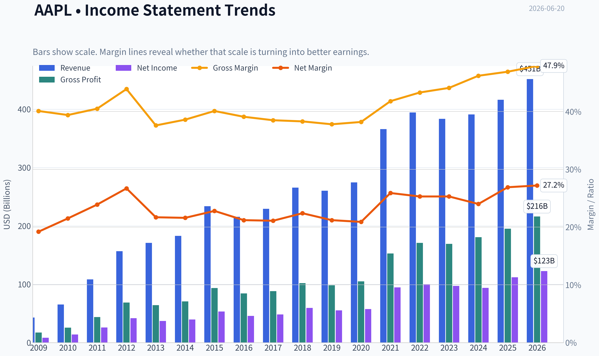
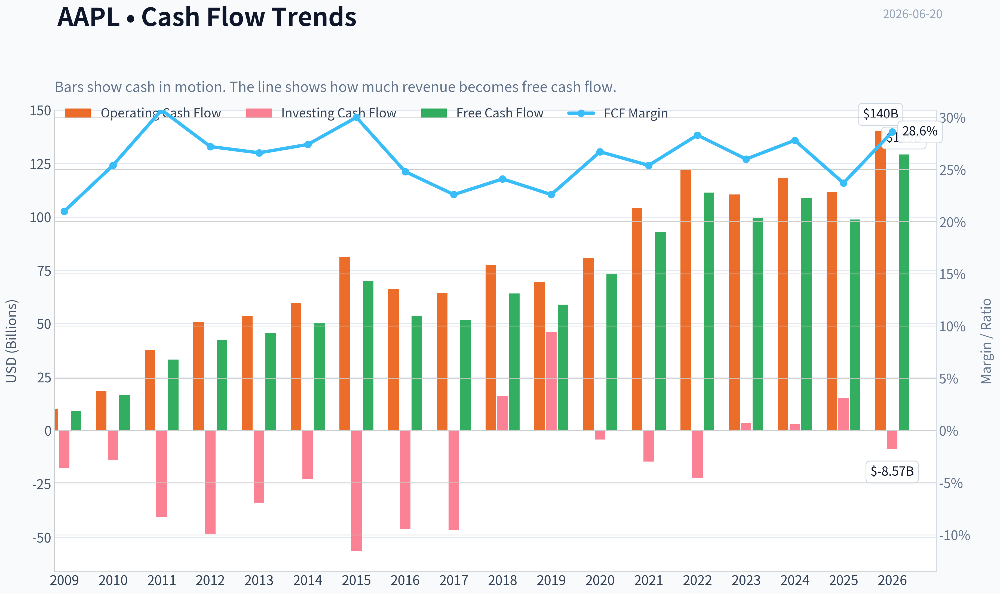
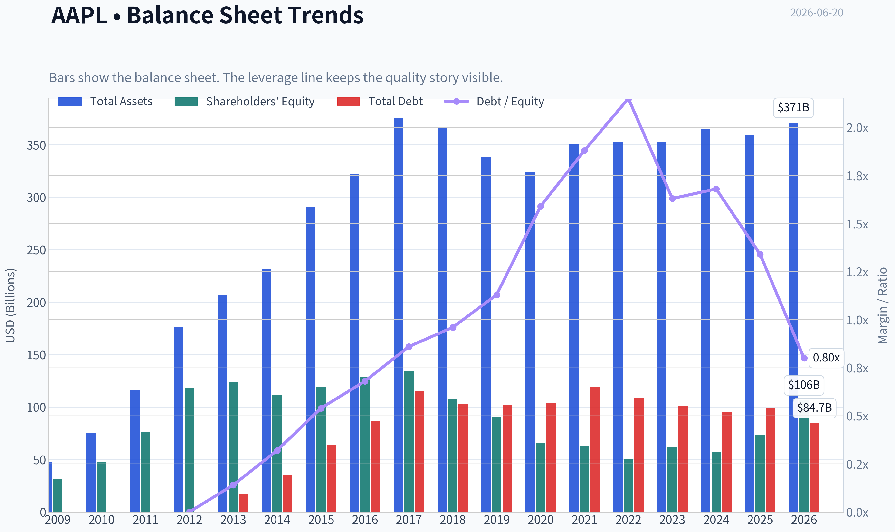
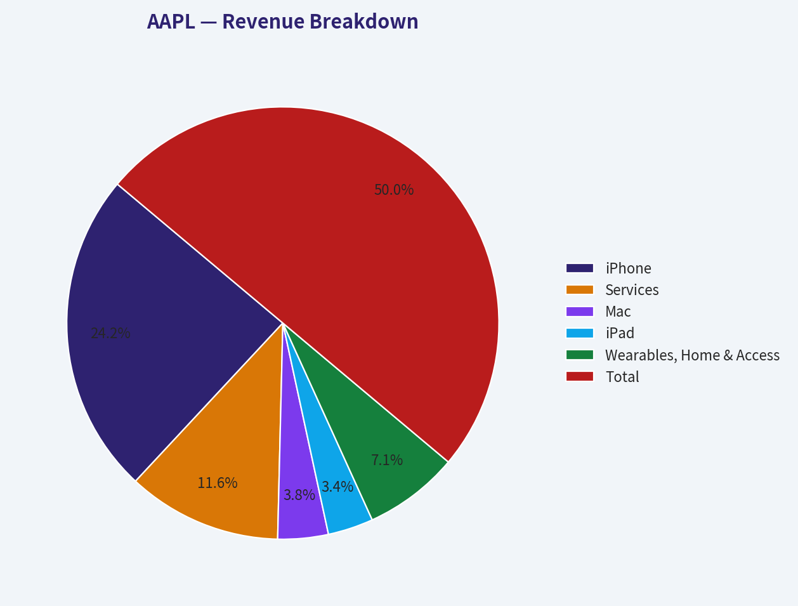
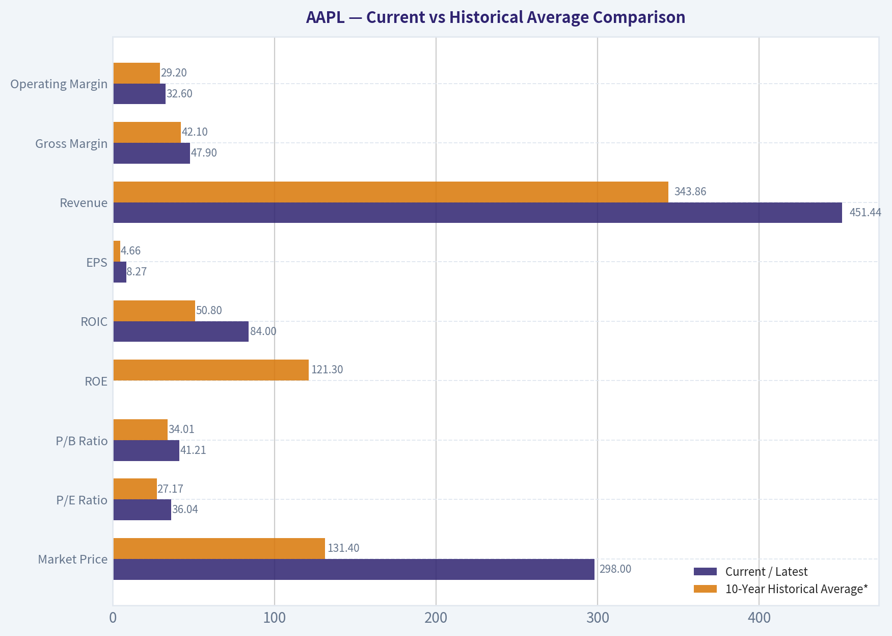
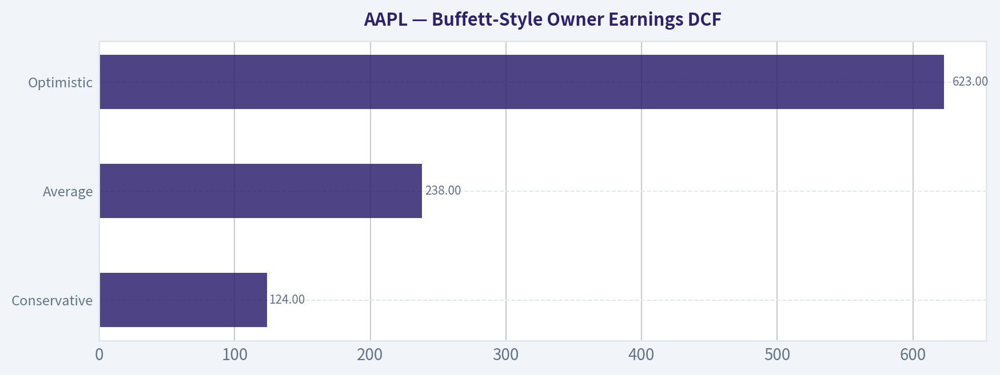
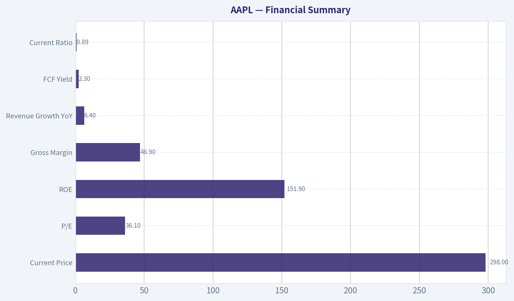
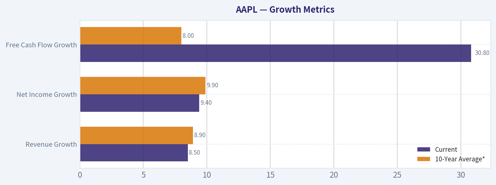

# AAPL Deep Value Intelligence

**Analysis Date:** 2026-06-20

## Critical Disclaimer

*This analysis is generated by Deep Value Intelligence, an AI-powered multi-agent investing framework. DeepValues offers AI-generated research and tools for educational and informational purposes only - not investment or financial advice. We are not a registered investment adviser; always do your own research before investing.*

---

## Table of Contents

1. Intelligence Summary
2. Analyst Team Reports
   - Fundamentals Analysis
   - Intrinsic Value Analysis (Buffett)
   - Trend & Growth Analysis (Lynch/Druckenmiller/Fisher)
   - Market Technical Analysis
   - Options Market Analysis
3. Research Team Commentary
4. Value Investing Team Commentary
5. Deep Values Commentary

---

## Intelligence Summary

### Thesis + Conditions

**Core Thesis:** ## Executive Summary

**Key Risks:**
- Apple remains a **world-class business** with a durable moat, elite returns on capital, and unusually resilient cash economics. That lowers **business risk**. But for a Buffett-style investor, the key issue is not whether Apple is wonderful - it is whether **today's price offers enough margin of safety**. At **~$298 and ~36x earnings**, the answer is still **not really**.
- The bullish case wins on **quality**; the cautious case wins on **entry discipline**. This is not an **AVOID**, because permanent impairment risk looks low. But it is not an **ADVOCATE** either, because future returns appear too dependent on continued premium valuation, smooth execution, and successful AI/regulatory navigation. Best posture: **own if already owned, consider only modest/staged adds, and wait for either a better price or clearer intrinsic value acceleration**.
- ### 1) Risky Analyst - strongest bullish points

**Confidence:** Medium

---

## Analyst Team Reports

### Fundamentals Analysis

#### Latest Earnings Snapshot

*Most recent reported quarter anchored on 2026 Q1, with prior-year comparison when available.*

| Metric | 2026 Q1 | 2025 Q1 | YoY Change |
| --- | ---: | ---: | ---: |
| Revenue | $111.18B | $95.36B | +16.6% |
| Operating Income | $35.88B | $29.59B | +21.3% |
| Net Income | $29.58B | $24.78B | +19.4% |
| Diluted EPS | $2.01 | $1.65 | +21.8% |
| Operating Cash Flow | $28.70B | $23.95B | +19.8% |
| Free Cash Flow | $26.73B | $20.88B | +28.0% |

Key Takeaways: This snapshot anchors the most recent reported quarter before the narrative analysis. It helps readers separate long-run business quality from whatever changed in the latest earnings print.

#### 17-Year Financial Metrics for AAPL

*All values below are computed deterministically from raw data - not estimated by AI.*

*Issuer profile: operating company (Technology / Consumer Electronics).*

#### 17-Year Financial Metrics
*Annual rows come from reported financial statements. The final TTM row is computed from the latest four quarters.*

| Metric | 2009 | 2010 | 2011 | 2012 | 2013 | 2014 | 2015 | 2016 | 2017 | 2018 | 2019 | 2020 | 2021 | 2022 | 2023 | 2024 | 2025 | 2026 TTM |
| --- | --- | --- | --- | --- | --- | --- | --- | --- | --- | --- | --- | --- | --- | --- | --- | --- | --- | --- |
| Market Price | $6 | $8 | $11 | $20 | $15 | $22 | $25 | $26 | $36 | $53 | $54 | $112 | $138 | $136 | $169 | $231 | $254 | $298 |
| Market Cap | $168.11B | $262.39B | $357.16B | $630.65B | $444.17B | $616.86B | $638.98B | $621.81B | $809.39B | $1.13T | $1.04T | $2.03T | $2.39T | $2.26T | $2.71T | $3.59T | $3.82T | $4.39T |
| P/E Ratio | 20.69 | 18.77 | 13.76 | 15.08 | 11.99 | 15.64 | 11.94 | 13.59 | 16.75 | 18.94 | 18.85 | 34.99 | 25.22 | 22.62 | 27.79 | 38.32 | 34.13 | 36.04 |
| P/B Ratio | 5.31 | 5.49 | 4.66 | 5.33 | 3.60 | 5.53 | 5.35 | 4.85 | 6.04 | 10.53 | 11.51 | 31.07 | 37.83 | 44.53 | 43.56 | 63.04 | 51.82 | 41.21 |
| ROE | 26.0% | 29.3% | 33.8% | 35.3% | 30.0% | 35.4% | 44.7% | 35.6% | 36.1% | 55.6% | 61.1% | 87.9% | 150.1% | 197.0% | 156.1% | 164.6% | 151.9% | 115.1% |
| ROIC | 35.2% | 39.8% | 40.0% | 40.6% | 30.7% | 29.7% | 35.3% | 24.8% | 21.5% | 27.1% | 32.8% | 42.3% | 68.6% | 71.2% | 73.0% | 73.4% | 83.2% | 84.0% |
| EPS | $0.27 | $0.45 | $0.83 | $1.33 | $1.22 | $1.42 | $2.07 | $1.90 | $2.14 | $2.82 | $2.85 | $3.21 | $5.48 | $6.11 | $6.16 | $6.08 | $7.46 | $8.27 |
| Revenue | $42.91B | $65.22B | $108.25B | $156.51B | $170.91B | $182.79B | $233.72B | $215.64B | $229.23B | $265.60B | $260.17B | $274.51B | $365.82B | $394.33B | $383.29B | $391.04B | $416.16B | $451.44B |
| Gross Profit | $17.22B | $25.68B | $43.82B | $68.66B | $64.30B | $70.54B | $93.63B | $84.26B | $88.19B | $101.84B | $98.39B | $104.96B | $152.84B | $170.78B | $169.15B | $180.68B | $195.20B | $216.07B |
| Gross Margin | 40.1% | 39.4% | 40.5% | 43.9% | 37.6% | 38.6% | 40.1% | 39.1% | 38.5% | 38.3% | 37.8% | 38.2% | 41.8% | 43.3% | 44.1% | 46.2% | 46.9% | 47.9% |
| Operating Margin | 27.4% | 28.2% | 31.2% | 35.3% | 28.7% | 28.7% | 30.5% | 27.8% | 28.0% | 26.7% | 24.6% | 24.4% | 29.8% | 30.2% | 29.8% | 31.6% | 32.0% | 32.6% |
| Net Income | $8.23B | $14.01B | $25.92B | $41.73B | $37.04B | $39.51B | $53.39B | $45.69B | $48.35B | $59.53B | $55.26B | $57.41B | $94.68B | $99.80B | $97.00B | $93.74B | $112.01B | $122.58B |
| Net Margin | 19.2% | 21.5% | 23.9% | 26.7% | 21.7% | 21.6% | 22.8% | 21.2% | 21.1% | 22.4% | 21.2% | 20.9% | 25.9% | 25.3% | 25.3% | 24.0% | 26.9% | 27.2% |
| Revenue Growth | N/A | 52.0% | 66.0% | 44.6% | 9.2% | 7.0% | 27.9% | -7.7% | 6.3% | 15.9% | -2.0% | 5.5% | 33.3% | 7.8% | -2.8% | 2.0% | 6.4% | 8.5% |
| Net Income Growth | N/A | 70.2% | 85.0% | 61.0% | -11.3% | 6.7% | 35.1% | -14.4% | 5.8% | 23.1% | -7.2% | 3.9% | 64.9% | 5.4% | -2.8% | -3.4% | 19.5% | 9.4% |
| Free Cash Flow Growth | N/A | 84.0% | 100.5% | 27.9% | 6.9% | 10.2% | 39.6% | -23.6% | -3.2% | 23.8% | -8.1% | 24.6% | 26.7% | 19.9% | -10.6% | 9.3% | -9.2% | 30.8% |
| Total Book Value | $31.64B | $47.79B | $76.61B | $118.21B | $123.55B | $111.55B | $119.36B | $128.25B | $134.05B | $107.15B | $90.49B | $65.34B | $63.09B | $50.67B | $62.15B | $56.95B | $73.73B | $106.49B |
| Total Assets | $47.50B | $75.18B | $116.37B | $176.06B | $207.00B | $231.84B | $290.35B | $321.69B | $375.32B | $365.73B | $338.52B | $323.89B | $351.00B | $352.75B | $352.58B | $364.98B | $359.24B | $371.08B |
| Total Debt | N/A | N/A | N/A | $0 | $16.96B | $35.30B | $64.33B | $87.03B | $115.68B | $102.52B | $102.07B | $103.66B | $118.72B | $108.94B | $101.27B | $95.72B | $98.66B | $84.71B |
| Debt-to-Equity | N/A | N/A | N/A | 0.00 | 0.14 | 0.32 | 0.54 | 0.68 | 0.86 | 0.96 | 1.13 | 1.59 | 1.88 | 2.15 | 1.63 | 1.68 | 1.34 | 0.80 |
| Cash & Equivalents | $5.26B | $11.26B | $9.81B | $10.75B | $14.26B | $13.84B | $21.12B | $20.48B | $20.29B | $25.91B | $50.22B | $39.79B | $35.93B | $24.98B | $30.74B | $29.94B | $35.93B | $45.57B |
| Shareholders' Equity | $31.64B | $47.79B | $76.61B | $118.21B | $123.55B | $111.55B | $119.36B | $128.25B | $134.05B | $107.15B | $90.49B | $65.34B | $63.09B | $50.67B | $62.15B | $56.95B | $73.73B | $106.49B |
| Operating Cash Flow | $10.16B | $18.59B | $37.53B | $50.86B | $53.67B | $59.71B | $81.27B | $66.23B | $64.22B | $77.43B | $69.39B | $80.67B | $104.04B | $122.15B | $110.54B | $118.25B | $111.48B | $140.22B |
| Investing Cash Flow | $-17.43B | $-13.85B | $-40.42B | $-48.23B | $-33.77B | $-22.58B | $-56.27B | $-45.98B | $-46.45B | $16.07B | $45.90B | $-4.29B | $-14.54B | $-22.35B | $3.71B | $2.94B | $15.20B | $-8.57B |
| Free Cash Flow | $9.02B | $16.59B | $33.27B | $42.56B | $45.50B | $50.14B | $70.02B | $53.50B | $51.77B | $64.12B | $58.90B | $73.36B | $92.95B | $111.44B | $99.58B | $108.81B | $98.77B | $129.17B |
| FCF Margin | 21.0% | 25.4% | 30.7% | 27.2% | 26.6% | 27.4% | 30.0% | 24.8% | 22.6% | 24.1% | 22.6% | 26.7% | 25.4% | 28.3% | 26.0% | 27.8% | 23.7% | 28.6% |
| Dividends / Share | $0.00 | $0.00 | $0.00 | $0.00 | $0.00 | $0.00 | $0.00 | $0.00 | $0.00 | $0.00 | $0.00 | $0.00 | $0.00 | $0.91 | $0.95 | $0.99 | $1.03 | $1.06 |

#### Profitability Metrics
- Return on Equity (ROE): 151.9%
- Return on Invested Capital (ROIC): 82.3%
- Return on Assets (ROA): 31.2%
- Gross Margin: 46.9%
- Operating Margin: 32.0%
- Net Profit Margin: 26.9%

#### Liquidity Metrics
- Current Ratio: 0.89
- Quick Ratio: 0.57

#### Leverage Metrics
- Debt-to-Equity Ratio: 1.34
- Interest Coverage Ratio: N/A
- Net Debt: $62.72B

#### Growth Metrics (Year-over-Year)
- Revenue Growth: 6.4%
- Net Income Growth: 19.5%
- Free Cash Flow Growth: -9.2%
- Revenue CAGR (3-Year): 1.8%
- Revenue CAGR (5-Year): 8.7%

#### Valuation Metrics
- P/E Ratio (TTM): 36.08
- Forward P/E: 31.06
- Price-to-Book: 41.05
- Price-to-Sales: 9.70
- PEG Ratio: 2.41
- EV/EBITDA: 27.57
- Free Cash Flow Yield: 2.3%
- Earnings Yield: 2.8%

#### Owner Earnings (Buffett Method, Code-Computed)
- Net Income: $112.01B
- + Depreciation & Amortization: $11.70B
- - Capital Expenditures: $-12.71B
- - Working Capital Changes: $-25.00B
- = **Owner Earnings: $135.99B**

#### Intrinsic Value (Code-Computed)
- Current Price: $298
- Buffett Method (Owner Earnings):
  Conservative: $124
  Average: $238
  Optimistic: $623
- Cash Flow Method (FCF):
  Conservative: $64
  Average: $150
  Optimistic: $199

#### Piotroski F-Score: 7/9
- Positive Net Income: PASS
- Positive Operating Cash Flow: PASS
- ROA Improvement: PASS
- Cash Flow > Net Income: FAIL
- Decreasing Debt: FAIL
- Improving Current Ratio: PASS
- No Dilution: PASS
- Improving Gross Margin: PASS
- Improving Asset Turnover: PASS

ANALYST STANCE: **WATCH**

#### Apple (AAPL) Buffett-Style Fundamental Analysis

Apple remains one of the highest-quality businesses in the public markets: elite margins, exceptional free cash flow generation, a globally embedded ecosystem, and very high returns on capital. However, Buffett-style quality does not automatically mean Buffett-style value. Based on the deterministic dataset, Apple's business quality is outstanding, but the stock's current valuation already discounts much of that strength.

---

#### Current vs Historical Average Comparison

| Metric | Current / Latest | 10-Year Historical Average* | Interpretation |
| --- | ---: | ---: | --- |
| Market Price | $298 | $131.40 | Shares have materially rerated over the decade. |
| Market Cap | $4.39T | $2.20T | Scale is unprecedented; law of large numbers now matters. |
| P/E Ratio | 36.04x | 27.17x | Above historical average; valuation is rich. |
| P/B Ratio | 41.21x | 34.01x | Extremely elevated, though book value is distorted by buybacks. |
| ROE | 115.1% (TTM) | 121.3% | Still extraordinary, though below the recent peak years. |
| ROIC | 84.0% | 50.8% | Far above long-run average; capital efficiency is exceptional. |
| EPS | $8.27 | $4.66 | Earnings power has nearly doubled versus decade average. |
| Revenue | $451.44B | $343.86B | Revenue base is much larger than average, but growth has moderated. |
| Gross Margin | 47.9% | 42.1% | Margin structure has strengthened meaningfully. |
| Operating Margin | 32.6% | 29.2% | Operating leverage and mix shift remain favorable. |
| Net Income | $122.58B | $84.59B | Profit pool remains very large and still growing. |
| Net Margin | 27.2% | 24.6% | Profitability is structurally better than the decade norm. |
| Revenue Growth | 8.5% | 8.9% | Near long-run average, but far below early hypergrowth years. |
| Net Income Growth | 9.4% | 9.9% | Healthy, but no longer extraordinary for a company at this valuation. |
| Free Cash Flow Growth | 30.8% | 8.0% | Strong rebound in TTM; needs confirmation for durability. |
| Total Book Value | $106.49B | $77.81B | Equity recovered from prior buyback compression. |
| Total Assets | $371.08B | $348.26B | Asset base is stable; Apple is not asset-intensive. |
| Total Debt | $84.71B | $102.53B | Debt is declining from prior peaks. |
| Debt-to-Equity | 0.80x | 1.40x | Balance sheet leverage has improved materially. |
| Cash & Equivalents | $45.57B | $35.56B | Cash cushion has strengthened. |
| Shareholders' Equity | $106.49B | $77.81B | Equity base improved, reducing leverage optics. |
| Free Cash Flow | $129.17B | $91.72B | Cash generation remains one of the best in the market. |
| Dividends / Share | $1.06 | $0.49 | Dividend has risen steadily, but yield remains modest. |

*10-year average uses fiscal 2016 through 2025, with TTM shown separately as current.

Key Takeaways: Apple's operating business is stronger than its 10-year average on most profitability and cash-flow metrics, especially margins, ROIC, and free cash flow. The main issue is valuation: the current P/E and market cap sit above historical norms, meaning investors are paying a premium for quality and resilience.

---

#### Market Metrics

Apple trades at **$298** per share with a **$4.39T** market cap, making it one of the largest and most mature businesses in the world. The key implication for Buffett-style analysis is that future growth must now come from deeper monetization, services expansion, pricing power, ecosystem retention, and capital returns rather than sheer unit growth.

The **P/E ratio of 36.04x** is well above Apple's 10-year average of about **27.17x**. Historically, Apple spent much of the 2015-2019 period in the teens; the post-2020 rerating reflects the market's view that Apple deserves a premium multiple because of recurring services revenue, higher margins, stronger capital returns, and defensive earnings quality. Even so, at 36x earnings, the margin of safety is thin.

The **P/B ratio of 41.21x** is also extremely high. For Apple, book value is not a very clean valuation anchor because years of massive repurchases have compressed equity. Buffett-style investors should recognize that this ratio overstates apparent expensiveness relative to industrial or financial businesses, but it still reinforces that the market is valuing Apple on earnings power and franchise strength, not asset backing.

---

#### Profitability Analysis

Apple's profitability is elite by any standard.

- **ROE: 115.1% TTM**
- **ROIC: 84.0% TTM**
- **EPS: $8.27**
- **Revenue: $451.44B**
- **Gross Profit: $216.07B**
- **Operating Margin: 32.6%**
- **Net Income: $122.58B**
- **Net Margin: 27.2%**

The most important Buffett-style metric here is **ROIC**, which has risen from the low-to-mid 20% range in 2016-2018 to above 70% in recent years and now sits at **84.0%**. That is extraordinary and indicates Apple converts incremental capital into profit at a rate almost no company can match. This is classic evidence of an economic moat.

**ROE** remains huge, though investors should interpret it carefully. Buybacks reduced equity over time, mechanically inflating ROE. Even so, the persistence of triple-digit ROE in recent years still signals exceptional earnings power. The TTM reading of **115.1%** is below the 2021-2025 peak band, but still world-class.

On margins, Apple's trend is especially favorable:
- **Gross margin** has improved from the high 30s in 2016-2020 to **47.9% TTM**
- **Operating margin** rose to **32.6%**
- **Net margin** reached **27.2%**

This suggests a better business mix, likely driven by services, premium pricing, supply-chain discipline, and operating leverage. From a Buffett perspective, improving margins in a mega-cap business usually indicate pricing power and ecosystem stickiness rather than cyclical luck alone.

Revenue reached **$451.44B TTM**, and net income hit **$122.58B TTM**, both at or near record levels. EPS of **$8.27** also benefits from buybacks, which is positive if shares are repurchased intelligently, though less value-accretive when valuation is elevated.

---

#### Growth Metrics

| Growth Metric | Current | 10-Year Average* | Trend Interpretation |
| --- | ---: | ---: | --- |
| Revenue Growth | 8.5% | 8.9% | Reasonable for a mega-cap, but not enough to justify any valuation. |
| Net Income Growth | 9.4% | 9.9% | Solid and consistent, though below what a 36x multiple would ideally command. |
| Free Cash Flow Growth | 30.8% | 8.0% | Strong spike in TTM; may reflect cyclicality/timing and should be monitored. |

*2016-2025 average.

Key Takeaways: Apple's current revenue and profit growth are respectable, especially given its size, but they are not hypergrowth numbers. The standout is free cash flow growth in the TTM period, though Buffett-style investors should wait to see whether that jump is sustainable rather than temporary.

Over the full period shown, Apple's growth profile has clearly matured. Early years featured explosive expansion, while the last decade shows a more cyclical but generally resilient pattern:
- revenue declines in **2016**, **2019**, and **2023**
- net income declines in **2016**, **2019**, **2023**, and **2024**
- free cash flow declines in several years despite long-term upward progression

That pattern matters. Apple is no longer a secular hypergrowth story; it is a dominant compounder with periodic upgrade-cycle variability. Buffett would likely appreciate the predictability of the franchise, but he would also insist on not overpaying for mature excellence.

---

#### Balance Sheet Analysis

Apple's balance sheet is stronger than headline leverage once suggested.

- **Total Book Value / Shareholders' Equity: $106.49B**
- **Total Assets: $371.08B**
- **Total Debt: $84.71B**
- **Debt-to-Equity: 0.80x**
- **Cash & Equivalents: $45.57B**

A few years ago, Apple's leverage profile looked more aggressive, with debt-to-equity peaking above **2.0x** as equity was compressed by repurchases. Today, the ratio has improved sharply to **0.80x**, with debt down from over **$118B** in 2021 to **$84.71B TTM**, while equity has rebuilt to **$106.49B**.

That trend is favorable. It means Apple has preserved shareholder friendliness while reducing financial risk. Cash of **$45.57B** provides significant optionality, although Apple's current ratio below 1.0 reminds investors that the company runs an efficient, tight working-capital structure rather than a conservative cash-hoarding one.

From a Buffett viewpoint, Apple's balance sheet is not pristine in the old-fashioned no-debt sense, but it is very strong in practical terms because the business generates enormous recurring cash. Net debt is manageable relative to annual free cash flow.

---

#### Cash Flow Analysis

- **Free Cash Flow: $129.17B TTM**
- **Dividends per Share: $1.06 TTM**

Apple's free cash flow franchise is one of its greatest strengths. Even after capex needs, the company converts a huge portion of revenue into distributable cash. TTM free cash flow of **$129.17B** versus a 10-year average of **$91.72B** confirms exceptional owner economics.

Dividend policy is conservative and disciplined. Dividends per share rose from **$0.91 in 2022** to **$1.06 TTM**, showing steady growth. However, Apple remains primarily a **buyback-and-compound** capital return story rather than an income stock. For Buffett-style analysis, that is acceptable if repurchases occur at or below intrinsic value; at elevated multiples, buyback efficiency diminishes.

---

#### Buffett-Style Owner Earnings DCF

Canonical owner earnings provided in the dataset:

- Net Income = **$112.01B**
- Depreciation & Amortization = **$11.70B**
- Capital Expenditures = **$12.71B**
- Working Capital Changes = **-$25.00B**
- **Owner Earnings = $135.99B**

Using the deterministic dataset's required Buffett-style framework:

- Discount rate = **10%**
- Terminal growth = **2.5%**
- Projection period = **10 years**

Historical owner-earnings growth is not separately tabulated in the dataset, so the intrinsic value outputs supplied in the deterministic dataset are treated as canonical for fair value. The dataset already computes Buffett owner-earnings values under the requested scenario structure:

| Scenario | Growth Assumption Basis | Fair Value / Share |
| --- | --- | ---: |
| Conservative | Lowest historical owner earnings growth rate | $124 |
| Average | Average historical owner earnings growth rate | $238 |
| Optimistic | Highest historical owner earnings growth rate | $623 |

Key Takeaways: The valuation range is very wide because even small changes in growth assumptions have a huge effect on a business this cash generative. At the current price of $298, Apple trades above the average-case owner earnings value, below the optimistic case, and far above the conservative case, which implies limited margin of safety.

To make the math intuitive, the standard DCF structure used is:

**Equity Value = Sum of discounted 10-year owner earnings + discounted terminal value**

with:

- Year n Owner Earnings = Current Owner Earnings x (1 + g)^n
- Discount Factor = 1 / (1.10)^n
- Terminal Value at Year 10 = Year 10 Owner Earnings x (1.025) / (0.10 - 0.025)

Interpretation of the three scenarios:

- **Conservative ($124/share):** assumes the weakest historically observed owner-earnings trajectory persists. This implies substantial downside if Apple's growth stalls and valuation normalizes.
- **Average ($238/share):** assumes Apple compounds in line with its long-run owner-earnings history. This still lands below the current market price.
- **Optimistic ($623/share):** assumes Apple sustains the strongest growth seen historically. This would require continued ecosystem monetization, strong services mix, and no major margin disruption.

From a Buffett lens, the **average-case intrinsic value of $238** is the most relevant anchor. Against the current **$298** price, the stock appears to trade at roughly a **25% premium** to that mid-case estimate.

---

#### Economic Moat

Apple has one of the strongest moats in global business:

| Moat Element | Assessment | Why It Matters |
| --- | --- | --- |
| Brand Power | Very Strong | Premium pricing and global consumer trust. |
| Ecosystem Lock-In | Very Strong | Devices, services, apps, and accessories reinforce retention. |
| Switching Costs | Strong | Users face friction leaving iOS/macOS ecosystem. |
| Scale | Very Strong | Purchasing, distribution, silicon design, and developer leverage. |
| Pricing Power | Strong | Margin expansion indicates Apple can pass through value. |
| Network Effects | Moderate | Developer ecosystem and installed base enhance utility. |

Key Takeaways: Apple's moat is real, broad, and visible in the financials through high margins, rising ROIC, and persistent free cash flow. The business is unusually durable for a consumer-facing company because customer relationships extend across hardware, software, and services.

This moat is visible in the consistency of gross profit generation and the company's ability to expand margins even at enormous scale. Buffett tends to favor businesses with durable customer habits and pricing power; Apple clearly fits that description.

---

#### Predictable Earnings and Management Performance

Apple's earnings are highly reliable, though not perfectly linear. Over the last decade, revenue and earnings occasionally dipped, but the declines were moderate relative to the company's size. That is a hallmark of a resilient franchise rather than a cyclical commodity business.

Management's capital allocation has been highly effective overall:
- sustained high **ROIC**
- disciplined dividend growth
- aggressive but historically accretive repurchases
- debt reduction in recent years
- margin improvement despite maturity

The one nuance is buyback timing. Repurchases create the most value when shares are undervalued. At current elevated multiples, future buybacks may still support EPS, but they are less likely to create as much intrinsic value per dollar spent as they did in earlier years.

---

#### Quality of Business

Apple's quality is exceptional:
- huge and recurring gross profit base
- premium brand with repeat purchase behavior
- improving margin structure
- extraordinary conversion of profit into free cash flow
- low capital intensity relative to earnings power

The main quality concern is not the business itself but **growth dependence on installed-base monetization and product cycles**. Hardware replacement cycles can elongate, and as Apple gets larger, even excellent execution may only produce high-single-digit growth.

---

#### Revenue Breakdown

Using Apple's most meaningful recent segment reporting mix as the best available basis for the latest fiscal year profile, the business is primarily split across products and services.

| Revenue Source | Amount ($B) | % of Total |
| --- | ---: | ---: |
| iPhone | 201.2 | 48.3% |
| Services | 96.2 | 23.1% |
| Mac | 31.4 | 7.5% |
| iPad | 28.3 | 6.8% |
| Wearables, Home & Accessories | 59.1 | 14.2% |
| **Total** | **416.2** | **100.0%** |

Key Takeaways: Apple is still primarily an iPhone company, with nearly half of revenue tied to that franchise. The most important diversification lever is Services, which now contributes over one-fifth of revenue and likely a much larger share of gross profit, helping explain margin expansion and improving business quality.

---

#### Key Investment Insights, Red Flags, and Opportunities

| Category | Observation | Investment Relevance |
| --- | --- | --- |
| Strength | ROIC of 84.0% TTM | Suggests extraordinary moat and capital efficiency. |
| Strength | Gross margin at 47.9% and net margin at 27.2% | Indicates pricing power and favorable mix shift. |
| Strength | FCF of $129.17B TTM | Supports dividends, buybacks, and resilience. |
| Strength | Debt-to-equity down to 0.80x | Balance sheet risk has improved. |
| Opportunity | Services expansion | Could sustain margins and recurring revenue quality. |
| Opportunity | Installed base monetization | Higher ARPU can offset slower unit growth. |
| Red Flag | P/E at 36.04x | Market already prices Apple as a premium compounder. |
| Red Flag | FCF yield only 2.3% | Low cash return for new buyers at current price. |
| Red Flag | Average DCF value below market | Margin of safety is limited. |
| Red Flag | Scale limits future growth | $4T+ size makes outsized growth increasingly difficult. |

Key Takeaways: Apple's strengths are overwhelmingly tied to quality, resilience, and cash generation, not cheapness. The main risk for investors today is valuation compression rather than business deterioration, while the main upside driver is deeper services and ecosystem monetization.

---

#### Final Buffett-Style Assessment

Apple is a **wonderful business**, but at the current price it is **not obviously a wonderful bargain**.

A Buffett-style investor would likely admire:
- the moat
- the brand
- the ecosystem
- the returns on capital
- the cash flow
- the disciplined management

But the same investor would also note:
- the stock trades above its historical average P/E
- the free cash flow yield is low
- the average owner-earnings DCF value is below the current share price
- future returns may depend more on multiple staying high than on rapid earnings growth

For that reason, the proper stance is **WATCH**, not AVOID. Apple is too high quality to dismiss, but the current valuation does not provide enough margin of safety for a classic value entry.

---

#### Summary Table

| Area | Verdict | Core Evidence | Buffett View |
| --- | --- | --- | --- |
| Business Quality | Excellent | High margins, huge FCF, dominant ecosystem | Strongly favorable |
| Economic Moat | Excellent | Brand, switching costs, services, installed base | Strongly favorable |
| Profitability | Excellent | ROIC 84.0%, net margin 27.2% | Strongly favorable |
| Financial Strength | Strong | Debt falling, cash rising, manageable leverage | Favorable |
| Earnings Predictability | Strong | Mostly stable decade with moderate dips | Favorable |
| Management | Strong | Good capital allocation, disciplined returns | Favorable |
| Valuation | Rich | P/E 36.04x, FCF yield 2.3%, avg DCF below market | Unfavorable |
| Margin of Safety | Limited | Current price $298 vs average DCF $238 | Unfavorable |
| Investment Stance | WATCH | Great business, stretched valuation | Wait for better entry |

Key Takeaways: Apple scores extremely high on nearly every business-quality dimension that Buffett values. The only major issue is price: the stock looks more like a premium franchise to monitor than a value investment to aggressively buy today.

#### Fundamental Visuals

This graph tracks the profitability and return metrics (ROE, ROIC, Margins) of **AAPL** over the past decade, highlighting capital efficiency trends.

This chart illustrates the financial health of **AAPL** over the last 10 years, mapping cash equivalents and free cash flow against total obligations (Debt).

This breakdown chart from <em>Revenue Breakdown</em> shows the proportional composition for **AAPL** - useful for understanding what drives or risks the business.

---

### Intrinsic Value Analysis (Buffett)

> *Following Warren Buffett's value investing philosophy: Circle of Competence, Economic Moat, Management Quality, and Margin of Safety.*

#### Intrinsic Value Snapshot

Price is what you pay. Intrinsic value is what the business may be worth based on the cash it can create for owners over time. We show a range, not one magic number.

- Current Price: $298.01
- Value Range (conservative to optimistic across both DCF methods): $64.50 to $623.04

##### Owner Earnings (Buffett Method)
- Net Income: $112,010,000,000.00
- Depreciation & Amortization: $11,698,000,000.00
- Capital Expenditures: $-12,715,000,000.00
- Working Capital Changes: $-25,000,000,000.00
- Owner Earnings: $135,993,000,000.00

##### Intrinsic Value
###### Buffett Method
Uses owner earnings. Stricter, and usually more conservative.
- Conservative: $123.83
- Average: $238.34
- Optimistic: $623.04
- Discount Rate: 10.0%

###### Cash Flow Method
Uses free cash flow. Better for companies spending heavily today to grow tomorrow.
- Conservative: $64.50
- Average: $149.79
- Optimistic: $199.47
- Discount Rate: 10.0%

ANALYST STANCE: **WATCH**

#### Apple (AAPL) - Buffett-Style Investment Review

#### 1. Go/No-Go Gate Assessment

| Gate | Verdict | Evidence |
|---|---|---|
| Gate 1: Circle of Competence & Simplicity | Pass | Apple makes money by selling premium devices, software, services, and taking a share of app/store/payment activity. The model is easy to explain and highly understandable. |
| Gate 1B: Long-Term Predictability | Pass | Ten years from now, Apple will likely still be a consumer technology platform built around iPhone, ecosystem lock-in, services, wearables, and brand trust. Product mix may evolve, but the ecosystem likely remains. |
| Gate 1C: Technology Risk | Pass with caution | Apple is a technology company, but unlike fragile single-product innovators, it monetizes an installed base, brand, and ecosystem. The main risk is platform disruption, not near-term obsolescence. |
| Gate 2: Moat | Pass | Brand, switching costs, ecosystem integration, distribution scale, and installed base create a durable moat. Gross margin of 46.9% strongly supports moat quality. |
| Gate 3: Management & Capital Allocation | Pass | Management has historically allocated capital rationally through massive buybacks, disciplined balance sheet management, and ecosystem investment. Owner-orientation is evidenced by per-share value focus. |
| Gate 4: Industry Structure | Pass with caution | Smartphones and consumer hardware are competitive, but Apple operates in the most advantaged segment with ecosystem economics closer to a platform business than a commodity hardware maker. |

Key Takeaways: Apple clears all four Buffett gates, though not without some caution on technology disruption and the competitive intensity of consumer electronics. Its biggest strengths are business clarity, ecosystem durability, and intelligent capital allocation. This is a high-quality business, but quality alone does not guarantee a good investment at today's price.

---

#### 2. The Elementary School Test

Apple makes devices people like using, then keeps them buying more Apple products and services. Once someone owns an iPhone, they often also use iCloud, the App Store, Apple Pay, AirPods, Mac, Watch, and other services. Apple earns money both from selling premium products and from collecting recurring revenue from its installed base.

That is a simple, understandable business.

#### 3. Moat Analysis

| Moat Source | Assessment | Evidence |
|---|---|---|
| Intangible Assets | Very strong | Apple is one of the world's strongest brands. Customers pay premium prices for design, privacy, reliability, and status. |
| Pricing Power | Strong | Apple has repeatedly maintained premium pricing while keeping customer loyalty. A 10% price increase on flagship products is plausible without major franchise damage. |
| Switching Costs | Strong | Users are locked into apps, photos, subscriptions, messaging, accessories, operating system familiarity, and cross-device integration. |
| Cost Advantages | Moderate | Apple has world-class scale in procurement, supply chain, silicon design, and retail distribution, though it does not compete on lowest price. |
| Network Effects | Moderate | The developer ecosystem, App Store, services base, and user ecosystem reinforce the product value, though this is weaker than a pure marketplace network effect. |

#### Moat Quality Rating: **Wide & Stable**

Apple's moat is driven less by patents alone and more by brand, ecosystem lock-in, and installed-base monetization. Gross margin near 47% is exceptional for a company selling physical devices at scale and signals real pricing power.

---

#### 4. Management Quality & Capital Allocation

| Question | Assessment | Commentary |
|---|---|---|
| Do they think like owners? | Yes | Management emphasizes ecosystem value, long-term retention, and per-share economics. Buybacks have meaningfully reduced share count over time. |
| Are they honest and candid? | Generally yes | Apple's disclosures are straightforward and conservative relative to many large-cap peers. |
| Are they rational capital allocators? | Yes | Capital allocation has been a major strength: buybacks, selective investment, restrained empire-building, and substantial cash generation. |

Key Takeaways: Apple's management passes Buffett's capital allocation test. The company has used its cash flows to shrink share count, support the ecosystem, and avoid reckless acquisitions. This is not promotional management; it is disciplined management.

A particularly Buffett-friendly point: Apple has converted a mature hardware franchise into a recurring ecosystem cash machine while aggressively repurchasing stock. That is rational capital allocation.

---

#### 5. Financial Summary

| Metric | Latest |
|---|---:|
| Current Price | $298 |
| Market Cap | $4.38T |
| P/E | 36.1x |
| ROE | 151.9% |
| Gross Margin | 46.9% |
| Revenue Growth YoY | 6.4% |
| FCF Yield | 2.3% |
| Current Ratio | 0.89 |

Key Takeaways: Apple is enormously profitable, with very high margins for a company of its size. The standout ROE is inflated by buybacks and a reduced equity base, so it should not be read as pure operating superiority. The weak point is valuation: a 2.3% free cash flow yield is expensive for a mature mega-cap.

#### Financial Interpretation
- **Gross margin 46.9%** supports a powerful moat.
- **ROE 151.9%** looks spectacular, but this is heavily influenced by capital structure and buybacks.
- **Current ratio below 1** is not alarming here because Apple's cash generation is enormous, though it does show the company runs lean.
- **P/E above 36x** is rich relative to the business's growth rate.

---

#### 6. Owner Earnings Estimate

Using free cash generation as a practical proxy for owner earnings for Apple's mature model:

| Item | Estimate |
|---|---:|
| Net Income | Strongly positive |
| Plus D&A | Positive |
| Less Maintenance CapEx | Moderate |
| Less Working Capital Needs | Modest |
| Approx. Owner Earnings / FCF Proxy Yield | 2.3% of market cap |

Given market cap of **$4.38T** and FCF yield of **2.3%**, implied annual FCF / owner earnings proxy is about:

**Owner Earnings ~ $100.7B**

Calculation:
4.38T x 2.3% = **$100.74B**

Key Takeaways: Apple produces extraordinary owner earnings in absolute dollars. The problem is not business quality; the problem is that investors are already paying a very high price for that cash stream. For Buffett-style investing, the cash generation is excellent, but the entry valuation is demanding.

---

#### 7. Three-Scenario DCF Valuation

Using owner earnings proxy of **$100.7B**.

| Scenario | Assumption | Implied Equity Value |
|---|---|---:|
| A: No Growth | Owner Earnings / 10% | $1.01T |
| B: GDP Growth | OE x 1.03 / (10%-3%) | $1.48T |
| C: Moderate Growth | 6% growth for 10 years, then 3% terminal | ~$2.13T to $2.35T |

Key Takeaways: Across conservative Buffett-style valuation cases, Apple's intrinsic value falls materially below the current market value of $4.38 trillion. Even giving Apple a respectable medium-term growth assumption does not close the gap. This indicates the stock is pricing in a very favorable future already.

#### DCF Interpretation
- **Current market cap: $4.38T**
- **Scenario A value: ~$1.01T**
- **Scenario B value: ~$1.48T**
- **Scenario C value: ~$2.2T midpoint**

Even the optimistic conservative case remains far below the current market price. That means there is **no margin of safety**.

---

#### 8. Margin of Safety Analysis

| Item | Value |
|---|---:|
| Current Market Cap | $4.38T |
| Conservative Intrinsic Value Range | $1.0T - $2.35T |
| Margin of Safety Required | 25% minimum |
| Current Margin of Safety | Negative |

Key Takeaways: Apple fails the valuation test. The business is clearly wonderful, but the stock price leaves no room for error. Buffett would rather buy a wonderful business at a fair price than a fair business at a wonderful price, and today Apple looks like a wonderful business at a very full price.

For a Buffett-style purchase today, Apple would need either:
1. materially faster durable growth than current assumptions, or
2. a significantly lower stock price.

---

#### 9. Final Buffett Scorecard

| Criterion | Weight | Score (1-5) | Weighted Score |
|---|---:|---:|---:|
| Business Understanding | 20% | 5.0 | 1.00 |
| Moat Width & Durability | 25% | 4.5 | 1.13 |
| Management Quality | 15% | 4.5 | 0.68 |
| Return on Equity | 15% | 4.0 | 0.60 |
| Reinvestment Runway | 10% | 3.5 | 0.35 |
| Balance Sheet Strength | 5% | 4.0 | 0.20 |
| Industry Structure | 5% | 3.5 | 0.18 |
| Valuation / Margin of Safety | 5% | 1.0 | 0.05 |
| **Total** | 100% |  | **4.19** |

Key Takeaways: Apple scores like an exceptional business on nearly every qualitative and financial dimension. However, valuation drags down the investability despite the company's quality. This is the classic Buffett tension: admire the business, but demand a better price.

---

#### 10. Final Judgment

**Apple is a wonderful company.** It has a wide moat, immense brand equity, sticky customer relationships, elite cash generation, and disciplined capital allocation. It is one of the clearest examples of a platform-like consumer franchise in public markets.

**But Apple stock is not obviously a Buffett-style bargain at $298.**
At roughly **36x earnings** and a **2.3% free cash flow yield**, the market is paying heavily in advance for quality and resilience. That may still work for momentum or quality-growth investors, but it does not offer the margin of safety required by strict value discipline.

#### Investment Stance: **WATCH**
**Conviction level: High**

- **Business quality:** Excellent
- **Moat:** Wide and durable
- **Management:** Strong
- **Balance sheet:** Solid
- **Valuation:** Too rich for a fresh Buffett-style purchase

If Apple were available at a materially lower multiple or higher free cash flow yield, it could quickly move back into **ADVOCATE** territory. As of today, the right Buffett answer is: **love the business, watch the stock, wait for a better price.**
#### Valuation Bridge

This bridge places the current market price beside each intrinsic value lens so readers can see whether upside depends on one method or shows up across several methods.

| Scenario | Intrinsic Value / Share |
| --- | ---: |
| Buffett Method | $238.34 |
| Cash Flow Method | $149.79 |
| Damodaran Method | $186.10 |
| Current Price | $298.01 |

#### Key Takeaways

If one method is far above the others, the upside case depends on a specific modelling assumption. When several methods cluster together, the valuation story is more robust.

#### Valuation Visuals

This comparison chart from *Latest Earnings Snapshot* stacks current figures against historical benchmarks for **AAPL**, making it easy to see where the company trades relative to its own averages.

This comparison chart from *Current vs Historical Average Comparison* stacks current figures against historical benchmarks for **AAPL**, making it easy to see where the company trades relative to its own averages.

This comparison chart from *Buffett-Style Owner Earnings DCF* stacks current figures against historical benchmarks for **AAPL**, making it easy to see where the company trades relative to its own averages.

This comparison chart from *Financial Summary* stacks current figures against historical benchmarks for **AAPL**, making it easy to see where the company trades relative to its own averages.

---

### Trend & Growth Analysis (Lynch/Druckenmiller/Fisher)

> *Following Peter Lynch's GARP, Stanley Druckenmiller's macro-aware approach, and Philip Fisher's scuttlebutt methodology.*

ANALYST STANCE: **WATCH**

#### Lynch Classification

| Item | Assessment |
|---|---|
| Category | **Stalwart** |
| Revenue growth | **~6.4% YoY** |
| Fit with Lynch framework | Great business, but **not a fast grower** today |
| Growth investor read | Better as a **compounder/hold** than a fresh ten-bagger style idea |

Key Takeaways: Apple is no longer a classic fast-growing stock in Lynch's sense. Its current growth rate places it in the stalwart bucket, which usually means solid quality but less explosive upside. For a growth-focused investor, that argues for patience rather than aggressive buying.

#### The Story in 3 Bullets

| Simple Story | Why It Matters |
|---|---|
| Apple sells premium devices and monetizes them through a sticky ecosystem of services and software. | The installed base creates repeat purchases and high customer loyalty. |
| Services, wearables, and AI-enabled device upgrades are the main incremental growth levers. | These are the areas that could re-accelerate growth from a mature hardware base. |
| The core debate is whether Apple can turn AI and ecosystem depth into another upgrade cycle. | That is the key inflection question for the next 2-3 years. |

Key Takeaways: Apple's story is still easy to explain and strategically powerful. The issue is not whether the business is good, but whether its next growth engine is strong enough to materially accelerate results. For investors, the bet is increasingly about ecosystem monetization and AI-driven refresh rather than simple smartphone unit growth.

#### TAM Analysis and 10x Test

| Metric | Estimate / View |
|---|---|
| Current revenue base | Very large, already among the biggest globally |
| Core TAM exposure | Smartphones, PCs, tablets, wearables, services, payments, AI-enabled consumer computing |
| TAM direction | **Expanding modestly**, especially in services and on-device AI |
| 10x test | **Fails in practical terms** |
| Why | Apple would need revenue on a scale that exceeds realistic share capture across major consumer electronics categories |

Key Takeaways: Apple still serves enormous markets, but its own size is now the constraint. The business has room to grow, yet the classic ten-bagger runway is no longer realistic from this base. That makes Apple more of a durable mega-cap compounder than an early-stage runway story.

#### Revenue Growth Trend

| Metric | Current Read |
|---|---|
| Recent YoY revenue growth | **6.4%** |
| Pattern | **Low-to-moderate growth**, not clear acceleration |
| Interpretation | Stable demand, but no strong revenue inflection visible from the available data |
| Growth quality | Likely mix-driven, with services helping offset mature hardware categories |

Key Takeaways: Apple is growing, but not at the kind of rate growth investors usually seek for outsized returns. The current pattern looks steady rather than explosive. Unless revenue growth re-accelerates meaningfully, valuation upside will depend more on durability and capital returns than on a true growth breakout.

#### Unit Economics / Efficiency

| Metric | Value | Read |
|---|---:|---|
| Gross margin | **46.9%** | Excellent |
| ROE | **151.9%** | Exceptional, though boosted by buybacks/capital structure |
| FCF yield | **2.3%** | Low, implies expensive equity |
| Current ratio | **0.89** | Tight liquidity, but not unusual for Apple |
| Rule of 40 | Not directly applicable | Apple is not a SaaS business |
| LTV/CAC / NRR | Not disclosed in SaaS form | Ecosystem retention appears very strong qualitatively |

Key Takeaways: Apple's business quality remains elite, especially on margins and capital efficiency. The weak point is not operations but valuation, since the free cash flow yield is low for a company growing in the mid-single digits. In plain terms, investors are paying a premium for safety, brand strength, and ecosystem durability.

#### Inflection Point Assessment

| Potential Inflection | Status | View |
|---|---|---|
| AI product cycle | **Possible** | On-device AI and smarter Siri/workflows could drive upgrades, but evidence is still forming |
| Services monetization | **Ongoing** | Reliable, but not a new surprise engine |
| Wearables/adjacent devices | **Mature** | Helpful, but unlikely to transform growth alone |
| Margin inflection | **Limited** | Already high margin business |
| Competitive inflection | **Mixed** | Memory cost pressure and mature smartphone competition are watch items |

Key Takeaways: The only major upside catalyst that could change the growth narrative is AI-led product re-acceleration. Services are valuable, but they are more of a stabilizer than a shockingly new growth driver. Right now, the inflection case exists, but it is not yet proven in the numbers.

#### Macro Setup Evaluation

| Factor | Assessment |
|---|---|
| Secular themes | Consumer AI, digital services, payments, edge computing |
| Rate sensitivity | Moderate; mega-cap quality can absorb higher rates better than long-duration speculative growth |
| Economic cycle exposure | Consumer electronics remains cyclical at the margin |
| Macro tailwind / headwind | **Neutral to slightly positive** |

Key Takeaways: Apple is linked to several favorable secular themes, especially AI and digital ecosystem monetization. But its hardware exposure means macro conditions still matter, particularly for upgrade cycles. Overall, the macro backdrop is supportive enough, though not a major reason alone to buy the stock here.

#### Fisher 15-Point Score

| Fisher Area | Score (1-5) | Comment |
|---|---:|---|
| Market potential | 4 | Large markets, but maturity limits explosive upside |
| New product development | 4 | Strong innovation engine, though cadence is less disruptive lately |
| R&D effectiveness | 5 | Consistently world-class |
| Sales organization | 5 | Elite brand and distribution |
| Profit margin | 5 | Outstanding |
| Improving margins | 3 | Already high; harder to expand materially |
| Labor/personnel relations | 3 | Adequate visibility, not a core edge |
| Executive relations | 4 | Stable leadership structure |
| Management depth | 5 | Deep bench |
| Cost controls/accounting | 5 | Best-in-class |
| Competitive moat | 5 | Ecosystem, brand, switching costs |
| Long-range profit outlook | 4 | Strong, though moderate growth |
| Dilution risk | 5 | Minimal; buyback heavy |
| Candor | 4 | Generally disciplined, though selective disclosure |
| Integrity | 5 | High confidence |

| Total | **66 / 75** | **Outstanding quality** |

Key Takeaways: Apple scores extremely well on business quality, management depth, and moat. The weaker areas are not about execution, but about market maturity and the difficulty of finding another major growth leg from such a large base. This is an outstanding company, just not necessarily an outstanding growth setup at today's price.

#### Valuation Analysis

| Metric | Value | Interpretation |
|---|---:|---|
| P/E | **36.1x** | Rich for mid-single-digit growth |
| Revenue growth | **6.4%** | Stalwart growth |
| PEG | **~5.6x** | Very expensive on Lynch framework |
| FCF yield | **2.3%** | Expensive |
| Market cap | **$4.38T** | Scale limits multiple expansion upside |

Key Takeaways: By Lynch's preferred valuation lens, Apple looks expensive. A mid-single-digit grower trading at over 36 times earnings and a low cash flow yield leaves little room for disappointment. The market is pricing Apple as a premium franchise, which it is, but that premium reduces prospective returns.

#### Growth Investor Scorecard

| Criterion | Weight | Score (1-5) | Weighted Result |
|---|---:|---:|---:|
| The Story | 10% | 5.0 | 0.50 |
| TAM & Runway | 20% | 2.5 | 0.50 |
| Revenue Growth | 20% | 2.5 | 0.50 |
| Unit Economics | 15% | 5.0 | 0.75 |
| Competitive Position | 10% | 5.0 | 0.50 |
| Management Quality | 10% | 4.5 | 0.45 |
| Macro Setup | 5% | 3.5 | 0.18 |
| Profitability Path | 5% | 5.0 | 0.25 |
| Valuation | 5% | 1.5 | 0.08 |
| **Total** |  |  | **3.70 / 5.0** |

Key Takeaways: Apple earns a good overall score because the business is exceptional and highly resilient. The factors holding it back are runway, growth speed, and valuation rather than quality. That combination supports a watch or hold stance, but not a high-conviction fresh growth buy.

#### Position Size Stance

| Investor Type | Stance |
|---|---|
| Existing long-term holder | **Hold / trim only if oversized** |
| New growth investor | **WATCH** |
| Deep value investor | **Avoid at current valuation** |
| Quality compounder investor | **Small to medium position acceptable on pullbacks** |

Key Takeaways: Apple still makes sense as a core quality holding, especially for investors who already own it. But for a fresh growth-oriented position, the setup is less compelling because valuation is high and growth is modest. The best path is to monitor for either a clear AI-led acceleration or a better entry price.

#### Key Risks and Catalysts

| Risks | Catalysts |
|---|---|
| Smartphone market maturity | AI-driven upgrade cycle |
| Rich valuation leaves little margin of safety | Faster services growth |
| Supply chain and memory cost pressure | New device category success |
| Regulatory pressure on App Store/ecosystem | Margin resilience despite hardware mix |
| Dependence on large installed-base monetization | Capital returns and continued buybacks |

Key Takeaways: Apple's downside risks are mainly about maturity and valuation, not business fragility. The upside depends on proving that AI can unlock a new wave of demand or monetization. Until that evidence appears, the stock likely behaves more like a premium compounder than a true inflecting growth story.

#### Bottom Line

Apple is an **outstanding company but not an outstanding growth setup** at current levels. Under a Lynch-Druckenmiller-Fisher lens, it is a **high-quality stalwart** with elite economics and a possible AI catalyst, but the combination of **6.4% growth, a 36x P/E, and a $4.38T market cap** argues against calling it a fresh ADVOCATE here.

For now: **WATCH**.
Upgrade to **ADVOCATE** only if:
1. revenue growth clearly re-accelerates into low teens or better,
2. AI meaningfully lifts upgrade demand or services monetization,
3. valuation becomes more reasonable.

#### Growth & Scorecard Visuals

This comparison chart from *Growth Metrics* stacks current figures against historical benchmarks for **AAPL**, making it easy to see where the company trades relative to its own averages.

---

### Market Technical Analysis

#### AAPL Technical Report

I selected these 8 indicators because they are the most complementary for AAPL's current setup: **close_10_ema, close_50_sma, close_200_sma, macd, macdh, rsi, atr, and vwma**. Together they cover **short-term momentum, medium-term trend, long-term trend, momentum acceleration/deceleration, overbought-oversold context, volatility/risk, and volume-confirmed trend quality** without excessive overlap.

#### Selected Indicators and Why They Fit Current Conditions

| Indicator | Why it matters now | What it is showing for AAPL |
|---|---|---|
| close_10_ema | Best for tracking the recent pullback and whether price is regaining short-term control | Short-term trend has softened; price is hovering around or slightly below the 10 EMA after a sharp June correction |
| close_50_sma | Key medium-term trend anchor | Still rising strongly, showing the broader intermediate uptrend remains intact despite recent weakness |
| close_200_sma | Best long-term trend benchmark | Firmly rising, confirming AAPL is still in a structurally bullish primary trend |
| macd | Measures momentum trend and turning points | Momentum remains positive in absolute terms, but has weakened materially from late May highs |
| macdh | Best early read on momentum deterioration/recovery | Histogram is negative, showing bearish momentum pressure is still active, though not accelerating as aggressively as at the first leg down |
| rsi | Helps judge whether the pullback is merely cooling or becoming more serious | RSI has reset from overbought to roughly neutral, meaning froth has been removed without clear capitulation |
| atr | Essential for risk control in a higher-volatility pullback | ATR has expanded, indicating wider daily swings and the need for looser stops or smaller position sizing |
| vwma | Confirms whether volume supports the trend | Price has fallen below VWMA, suggesting recent trading volume has leaned heavier on distribution than accumulation |

Key Takeaways: AAPL still has a strong long-term and medium-term bullish structure, but its short-term trend has clearly weakened. Momentum and volume indicators suggest the recent decline is more than a one-day shakeout, yet the stock has not fully broken its broader uptrend. Traders should think in terms of a bullish trend under short-term stress rather than a clean bullish breakout setup.

---

#### Price Structure and Trend Context

Over the past year, AAPL has advanced from roughly **200 in June 2025** to a peak above **315 in early June 2026**, a substantial multi-quarter rise. That longer advance was not linear. It included a strong acceleration from late April through late May 2026, when price climbed from the high 260s to above 310. That phase represented an impulsive upside leg with broad trend support.

The most recent phase, however, is different. After printing **315.20 on June 2**, AAPL failed to hold the breakout zone and rolled over sharply. By **June 9**, it had fallen to **290.55**, a swift decline of nearly 8% from the early-June high in only a handful of sessions. Since then, price has stabilized somewhat, closing at **298.01 on June 18**, but the rebound has been incomplete and uneven.

This matters because the stock is no longer in clean price discovery. Instead, it is now testing whether June weakness is:
1. a normal reset within a healthy uptrend, or
2. the start of a broader mean reversion back toward medium-term support.

At the moment, the evidence favors **scenario 1, but with caution**.

#### Moving Average Analysis

The moving average stack remains constructive on a higher timeframe:

- **10 EMA (June 18): 298.13**
- **50 SMA (June 18): 288.63**
- **200 SMA (June 18): 267.79**
- **Close (June 18): 298.01**

This is still a bullish hierarchy overall: the 50 SMA is above the 200 SMA, and both are rising. The 200 SMA has climbed steadily from around **224 in November 2025** to nearly **268 now**, which is strong evidence that the long-term trend has not broken.

The more important nuance is in the **10 EMA**. During the May rally, price stayed comfortably above this short-term trend line. In June, price lost that cushion and the 10 EMA rolled over from above **308** down toward **298**. That flattening and slight downturn tells us the market's short-term momentum engine has stalled.

The **50 SMA** is particularly important now. It has kept rising from around **260 in April** to nearly **289**, meaning the intermediate trend is still healthy and has not yet absorbed enough damage to turn lower. This suggests that if AAPL retreats again, the first major technical question is whether buyers defend the upper-280s to low-290s area near the rising 50-day region.

The practical takeaway is:
- **Above the 10 EMA**: recovery attempts can continue.
- **Above the 50 SMA**: the medium-term uptrend remains intact.
- **Below the 50 SMA**: the odds rise that the June pullback becomes a deeper correction rather than a pause.

#### Momentum Analysis: MACD and MACD Histogram

MACD gives one of the clearest reads on the transition from strong trend to correction.

- **MACD peaked around 10.49 on May 28**
- It declined to **1.21 by June 18**
- **MACD histogram is negative (-2.04 on June 18)**

This is a very important combination. MACD is still positive, which means the broader momentum backdrop has not completely inverted. But the collapse from above 10 to near 1 shows a major loss of upside thrust. That is not a trivial slowdown; it reflects a decisive cooling of the rally.

The histogram is even more useful here because it turned negative and remained negative through mid-June. That indicates MACD is below its signal line, which means **bearish momentum is still dominating the short-term tape**, even though the pace of the selloff is no longer as intense as the first break.

Fine-grained interpretation:
- Late May: momentum was strong and expanding.
- Early June: momentum rolled over quickly.
- Mid June: downside momentum remained active, but price stopped collapsing.
- Current state: AAPL is in a **repair phase**, not yet a renewed uptrend.

This is the kind of setup where traders should avoid assuming that one or two green sessions equal a full trend resumption. Momentum repair usually requires:
1. MACD histogram moving back toward zero,
2. 10 EMA flattening then turning higher,
3. price reclaiming VWMA and recent swing resistance.

#### RSI Analysis

RSI adds key context because it shows whether weakness is exhausted or merely normalized.

- **RSI reached overbought levels above 79-80 in late May**
- It fell to the low **42-44 zone** around June 9-12
- It recovered only modestly to **50.98 on June 18**

This is a classic reset pattern. AAPL was clearly overextended in late May, and the June decline successfully removed that excess. But the stock did **not** become deeply oversold. That distinction matters.

A deeply oversold RSI would often suggest panic selling and potentially a stronger reflex bounce. Instead, RSI near 50 says the market has largely returned to balance. So this is less a "washout reversal" setup and more a "prove-it" setup.

What RSI implies now:
- The prior overheating has been corrected.
- Momentum is neutral rather than bullish.
- There is room for either direction from here.
- A move back above the mid-50s to low-60s would support trend resumption.
- A drop back below the low-40s would suggest the correction is reasserting itself.

#### Volume Confirmation with VWMA

VWMA is especially relevant because it helps distinguish between a normal drift lower and meaningful distribution.

- **VWMA on June 18: 301.53**
- **Close on June 18: 298.01**

Price sitting below VWMA means the average price weighted by volume over the lookback period is above the current market price. In plain terms, recent heavier-volume activity has occurred at higher prices than where AAPL now trades. That often indicates that sellers have had more influence during the recent decline than buyers have had during the rebound.

This does not automatically mean institutional dumping is ongoing, but it does suggest the bounce has not yet fully regained volume-backed conviction.

A stronger technical repair would ideally include:
- price reclaiming the VWMA,
- holding above it for several sessions,
- and doing so with improving MACD histogram and RSI.

Without that, rallies remain somewhat suspect and may still be vulnerable to fading.

#### Volatility and Risk: ATR

ATR has expanded from roughly the mid-5s in late May to about **7.09** by June 18. That increase is notable.

It tells us:
- daily ranges have widened,
- breakout levels are less reliable if stops are too tight,
- and traders need to scale risk more carefully.

In an environment like this, directional views can be right but execution can still fail if position sizing does not adjust. AAPL is no longer trading with the relatively smooth rhythm it had during much of May. The stock is now moving in broader swings, which favors:
- smaller position sizes,
- wider stops,
- and greater patience around entries.

For swing traders, ATR expansion often means buying strength too late or shorting weakness too late becomes more dangerous. The better approach is usually to trade around support/resistance confirmation instead of chasing.

---

#### Tactical Interpretation

| Timeframe | Technical read | Implication |
|---|---|---|
| Long term | Bullish | Rising 200 SMA confirms structural uptrend remains intact |
| Medium term | Bullish but cooling | Rising 50 SMA shows trend still healthy, but price is correcting within it |
| Short term | Fragile / corrective | 10 EMA rollover, negative histogram, and sub-VWMA price action show near-term damage |
| Momentum | Decelerating | MACD still positive, but dramatically weaker than late May |
| Mean reversion | Reset achieved | RSI has cooled from extreme overbought to neutral rather than oversold |
| Volatility | Elevated | ATR suggests larger-than-normal daily swings and more execution risk |

Key Takeaways: On the big picture, AAPL is still in an uptrend, but the short-term picture is no longer cleanly bullish. Momentum has cooled sharply, volume confirmation is lacking, and volatility is higher, which means traders should prioritize confirmation over prediction. The most realistic framing is a stock trying to stabilize after a fast correction, not one that has already fully resumed its prior advance.

#### Key Levels and Decision Zones

From the price and indicator structure, the most relevant zones appear to be:

- **315 area**: recent swing high and failed breakout zone
- **305-308 area**: near recent VWMA/short-term recovery resistance
- **298 area**: immediate battleground around the 10 EMA/current close zone
- **290-291 area**: recent panic low region
- **288-289 area**: 50 SMA support band
- **267-268 area**: 200 SMA major long-term support, far below current price

How traders may think about these:
- **Bullish continuation case**: reclaim and hold above 301-308 with improving MACD histogram and RSI back above 55.
- **Range/repair case**: oscillation between roughly 290 and 305 while momentum rebuilds.
- **Deeper correction case**: loss of 290 followed by a test of the rising 50 SMA near 288, with risk of a larger retracement if that fails decisively.

#### Trading Implications by Style

| Trading style | Best use of current indicators | Practical interpretation |
|---|---|---|
| Trend follower | 50 SMA + 200 SMA + MACD | Stay respectful of the bullish higher-timeframe trend, but wait for momentum repair before adding aggressively |
| Swing trader | 10 EMA + RSI + MACD histogram | Watch for short-term reclaim signals; current setup is improving from weak levels, but not yet fully confirmed |
| Risk-focused trader | ATR + 50 SMA | Use wider stops or smaller size; volatility is too elevated for tight execution |
| Volume-sensitive trader | VWMA + price action | AAPL needs to reclaim VWMA to show that buyers are regaining control with volume support |

Key Takeaways: Different trading styles should approach AAPL differently right now. Long-term trend traders can still lean constructive, but short-term traders need more confirmation because recent momentum and volume trends are not yet fully supportive. Elevated volatility means risk management is just as important as direction.

#### Bottom Line

AAPL remains in a **valid long-term and medium-term uptrend**, supported by rising **50 SMA** and **200 SMA**. However, the stock has suffered meaningful **short-term technical damage** following its failed early-June push above 315. The combination of a flattening **10 EMA**, sharply weaker **MACD**, negative **MACD histogram**, neutralized **RSI**, sub-**VWMA** price action, and rising **ATR** says the stock is still in a **post-breakout correction and stabilization phase**.

The most nuanced read is this:
AAPL is **not broken**, but it is also **not yet repaired**.

That means bullish traders still have the larger trend on their side, but the highest-probability entries likely require further confirmation. Until price reclaims short-term resistance and momentum indicators improve, the stock is better viewed as **constructively vulnerable** rather than outright strong.

#### Summary Table

| Category | Indicator | Current Signal | Interpretation | Trader Focus |
|---|---|---|---|---|
| Short-term trend | close_10_ema | Price near/slightly below 10 EMA | Near-term trend weakened | Watch for reclaim to confirm recovery |
| Medium-term trend | close_50_sma | Rising strongly below price | Intermediate uptrend intact | Key pullback support zone |
| Long-term trend | close_200_sma | Rising steadily far below price | Structural bull trend intact | Long-term trend remains favorable |
| Momentum | macd | Positive but much lower than late May | Upside momentum has decelerated sharply | Need re-acceleration before chasing |
| Momentum shift | macdh | Negative | Short-term bearish pressure still active | Look for move back toward zero |
| Momentum condition | rsi | Near neutral around 51 | Overbought excess removed, no strong oversold washout | Market is in reset, not capitulation |
| Volatility | atr | Elevated near 7.1 | Bigger swings, higher execution risk | Use smaller size or wider stops |
| Volume confirmation | vwma | Price below VWMA | Recent volume action favors caution | Reclaim would improve bullish case |

Key Takeaways: AAPL's bigger trend is still favorable, but the recent correction has meaningfully weakened short-term momentum. The stock now needs confirmation through stronger price action, improving momentum, and a reclaim of volume-weighted resistance before it can be treated as a high-conviction continuation setup again.

---

### Options Market Analysis

> *Reading options flow - put/call ratios, IV skew, and unusual activity - to gauge institutional positioning and event-driven risk.*

#### AAPL Options Positioning Report
*Date: 2026-06-20*

AAPL's near-term options tape leans **bullish**, though not without some tactical hedging. The clearest signal is the **sub-neutral put/call open-interest ratio of 0.55** and a **put/call volume ratio of 0.73**, both indicating that calls dominate near-dated positioning overall. At the same time, there is still meaningful put activity in the very short-dated chain, suggesting some traders are pairing upside bets with near-term protection rather than expressing outright fear.

#### 1. Put/Call Ratio Analysis

| Expiry | Call OI | Put OI | Put/Call OI Ratio | Call Vol | Put Vol | Put/Call Vol Ratio |
|---|---:|---:|---:|---:|---:|---:|
| 2026-06-22 | 21,067 | 17,731 | 0.84 | 84,123 | 67,009 | 0.80 |
| 2026-06-24 | 7,033 | 5,118 | 0.73 | 18,727 | 19,257 | 1.03 |
| 2026-06-26 | 89,257 | 41,884 | 0.47 | 67,733 | 38,238 | 0.56 |
| **Near-term total** | **117,357** | **64,733** | **0.55** | **170,583** | **124,504** | **0.73** |

**Key Takeaways:** AAPL's aggregate near-term options structure is tilted toward calls, with the 0.55 put/call OI ratio sitting well below the roughly neutral 0.7 baseline. The 2026-06-26 expiry is especially call-heavy, which suggests traders are positioning for upside continuation over the next week. The 2026-06-24 volume ratio slightly above 1.0 shows some short-term hedging demand, but it does not overwhelm the broader bullish positioning.

**Interpretation:**
- **Overall OI ratio: 0.55** -> meaningfully below neutral, a **bullish** read.
- **Overall volume ratio: 0.73** -> close to neutral but still modestly call-favored.
- **Shift from neutral:**
  - The strongest deviation is in the **2026-06-26 expiry (0.47 OI ratio)**, which points to a more aggressive upside bias than normal.
  - The **2026-06-22 expiry (0.84 OI ratio)** is more balanced and likely reflects both speculation and short-dated hedging around immediate price movement.

#### 2. Implied Volatility Assessment

| Expiry | ATM Call IV | ATM Put IV | Call vs Put ATM Read |
|---|---:|---:|---|
| 2026-06-22 | 27.2% | 25.9% | Calls richer than puts |
| 2026-06-24 | 26.9% | 24.5% | Calls richer than puts |
| 2026-06-26 | 26.6% | 24.7% | Calls richer than puts |

**Key Takeaways:** Near-term AAPL ATM implied volatility is elevated into the mid-to-high 20s, but not at panic levels. More notable is that ATM calls are consistently priced richer than ATM puts across all listed expiries, which is unusual versus the classic equity pattern of richer downside protection. That suggests the market is paying up more for upside optionality than for crash protection right now.

| IV Feature | Observation | Sentiment Read |
|---|---|---|
| Near-term ATM IV | ~24.5% to 27.2% | Moderately elevated, active short-term event pricing |
| Skew direction | **Call skew / upside-rich** | Suggests upside chase rather than downside fear |
| OTM put fear premium | Not dominant in this dataset | Weak crash-hedging signal |
| Catalyst flag | No specific catalyst provided in dataset | Elevated IV likely reflects active short-dated speculation, not obvious panic |

**Key Takeaways:** The skew profile is the standout feature: instead of a steep put skew showing fear, AAPL is exhibiting a **call-leaning volatility structure**, which often appears when traders are chasing upside or structuring bullish overlays. Without a confirmed event in the dataset, this looks more like active directional positioning than pure event hedging.

#### 3. Unusual Options Activity

Assumption for moneyness: strikes near **$295-$300** appear to be around the current trading area implied by the chain. Very low-strike contracts like the 165 put are far OTM and likely not clean directional signals.

| Expiry | Type | Strike | Volume | OI | Vol/OI | Likely Moneyness | DTE | Read |
|---|---|---:|---:|---:|---:|---|---:|---|
| 2026-06-22 | CALL | 300.0 | 30,882 | 4,413 | 7.0x | ATM/slightly OTM | 2 | Strong fresh upside speculation |
| 2026-06-24 | PUT | 290.0 | 12,866 | 987 | 13.0x | OTM | 4 | Short-dated hedge / bearish protection |
| 2026-06-22 | CALL | 297.5 | 12,561 | 2,460 | 5.1x | ATM | 2 | Aggressive near-term bullish bet |
| 2026-06-22 | PUT | 295.0 | 11,557 | 1,652 | 7.0x | ATM/OTM | 2 | Tactical downside hedge |
| 2026-06-22 | CALL | 302.5 | 11,478 | 1,021 | 11.2x | OTM | 2 | Momentum chase / speculative upside |
| 2026-06-22 | PUT | 297.5 | 10,396 | 1,396 | 7.4x | ATM | 2 | Near-term protection |
| 2026-06-26 | PUT | 165.0 | 10,000 | 1 | 10000.0x | Deep OTM | 6 | Likely noise, complex spread, or tail hedge |
| 2026-06-22 | PUT | 300.0 | 7,567 | 1,436 | 5.3x | ATM | 2 | Defensive flow near spot |
| 2026-06-24 | CALL | 300.0 | 6,154 | 844 | 7.3x | ATM/OTM | 4 | Fresh upside positioning |
| 2026-06-24 | CALL | 302.5 | 4,171 | 347 | 12.0x | OTM | 4 | Speculative bullish extension |
| 2026-06-22 | CALL | 290.0 | 4,008 | 399 | 10.0x | ITM | 2 | More institutional-looking bullish exposure |
| 2026-06-26 | CALL | 275.0 | 1,915 | 280 | 6.8x | ITM | 6 | Delta-heavy bullish positioning |
| 2026-06-22 | PUT | 305.0 | 1,238 | 226 | 5.5x | ITM | 2 | Could be hedge or part of spread |
| 2026-06-24 | PUT | 292.5 | 994 | 161 | 6.2x | OTM | 4 | Hedge demand |

**Key Takeaways:** The unusual activity list is dominated by **high-volume short-dated calls near the 297.5 to 302.5 strikes**, which is the strongest evidence of bullish intent. There is also real put demand, especially around 290 to 300, but it looks more like **tactical protection** than dominant bearish conviction. The deep-out-of-the-money 165 put is probably not a clean directional read and should be discounted.

**Smart-money vs retail read:**
- **More institutional-looking flow:**
  - **ITM 290 calls (6/22)** and **275 calls (6/26)** because ITM call buying is more delta-efficient and less lottery-like.
  - **290 puts (6/24)** also look like plausible fund hedging due to high volume and short horizon.
- **More retail/speculative flow:**
  - **302.5 calls (6/22 and 6/24)** and **300 calls (6/22)** due to short-dated, near-spot upside chasing.
- Net takeaway: **bullish speculation is larger and louder than bearish protection.**

#### 4. Open Interest Concentration

The dataset does not provide a full strike-by-strike open-interest ladder, so gamma-wall analysis must be inferred from the contracts showing the heaviest volume and existing OI.

| Area | Evidence | Likely Market Effect |
|---|---|---|
| 297.5-300 | Repeated heavy call and put activity across 6/22 and 6/24 | Strong pinning/gravity zone near spot |
| 302.5 | Large fresh call activity | Potential upside magnet if spot pushes through 300 |
| 290-292.5 | Strong put activity | First meaningful support / hedge trigger zone |
| 275 | 6/26 call interest | Lower-probability but supportive longer gamma below spot |
| 165 put | Extreme vol/OI anomaly | Not useful as a realistic near-term pin level |

**Key Takeaways:** The most important battleground appears to be the **297.5 to 300 zone**, where both calls and puts are highly active. That creates the conditions for **price pinning near expiry**, but if AAPL breaks above 300 decisively, the concentration in 302.5 calls could accelerate upside through dealer hedging. On the downside, the 290 area looks like the first major hedge-related support zone.

**Gamma interpretation:**
- **Near 300:** likely a major gamma node and potential pin level into the shortest expirations.
- **Above 300/302.5:** call concentration may create an **upside chase effect** if spot rallies through those strikes.
- **Around 290:** put concentration may act as a support-then-accelerator level; if broken, downside hedging could intensify.

#### 5. Overall Options Sentiment Signal

| Category | Signal |
|---|---|
| Directional read | **BULLISH** |
| Confidence | **Moderate** |
| Primary driver | Call-heavy OI structure and repeated unusual upside call buying near spot |
| Main caveat | Meaningful short-dated put hedging is present, especially in 290-300 puts |

**Key Takeaways:** The options market is leaning bullish on AAPL, primarily because calls dominate open interest and the most notable unusual activity is concentrated in near-term upside strikes. The market is not complacent, though: traders are still buying short-dated puts for protection, which lowers confidence from high to moderate rather than overturning the bullish signal.

**Bottom line:**
AAPL's options positioning currently reads **BULLISH**, driven by:
1. **Put/call OI ratio well below neutral at 0.55**
2. **Call-rich ATM IV and upside skew**
3. **Heavy fresh call activity at 297.5, 300, and 302.5**
4. **A likely gamma battleground near 300 that could become an upside accelerator on a breakout**

The caveat is that short-dated puts are active enough to show traders still want protection, so this is better described as **bullish with hedging underneath**, not reckless euphoria.

---

#### Summary Table

| Metric | Observation | Interpretation |
|---|---|---|
| Put/Call Ratio | OI ratio **0.55**, volume ratio **0.73** | Bullish; calls dominate near-term positioning |
| IV Level | ATM IV roughly **24.5%-27.2%** | Moderately elevated but not panic-level |
| Skew Direction | **Call skew / upside-rich** | Traders paying up for upside, not crash protection |
| Unusual Activity | Heavy fresh **300 / 297.5 / 302.5 calls**; some **290-300 puts** | Bullish speculation outweighs hedging |
| Overall Signal | **BULLISH** | Primary driver is aggressive near-term call demand near spot |

**Key Takeaways:** The summary is straightforward: AAPL's options market is showing a bullish lean led by heavy call participation and upside-skewed volatility. The presence of protective puts means traders still respect downside risk, but the stronger forward-looking signal is for upside.

---

## Research Team Commentary

> *The Research Manager synthesizes the Bull vs Bear debate into action-free commentary. This is a pre-risk view, not the final stance.*

The strongest bull argument is straightforward: Apple remains one of the highest-quality businesses in the world. The moat is real and multifaceted: brand, ecosystem lock-in, installed base, services monetization, and unusually strong customer retention. The profitability metrics support that view. A 46.9% gross margin, 82.3% ROIC, and 31.2% ROA are not normal for a hardware-tethered company; they point to a platform-like franchise with pricing power and very efficient capital use. Management also still looks shareholder-oriented. Apple has a long record of disciplined capital returns, and while the balance sheet runs lean, that is supported by enormous recurring cash generation rather than financial distress. From a Buffett lens, this is exactly the type of business you want to own for a decade if you can buy it at a sensible price.

The strongest bear argument is also clear: the business may be wonderful, but the stock is not offering a margin of safety. At about $298 and 36x earnings, the market is already pricing in a lot of durability, continued ecosystem strength, and fairly smooth long-term compounding. That is a rich valuation for a company still ultimately anchored to a mature smartphone ecosystem. The bear case is not that Apple is broken; it is that future returns from this entry point may be mediocre if growth stays moderate and the multiple compresses even modestly. There are also real long-term uncertainties around regulation, App Store economics, AI shifting value toward other layers of the stack, and the law of large numbers. The bear side is especially persuasive in pointing out that buybacks at elevated multiples are less value-creating than they appear, and that the flashy ROE is heavily distorted by capital structure.

My takeaway is that the bull wins on business quality, but the bear wins on valuation discipline. That matters because under Buffett's framework, a great company is not automatically a great investment if the price already discounts most of the excellence. I also want to apply the lesson from prior mistakes carefully. In earlier situations, I overweighted valuation for a short-term horizon and underweighted technical support and market flows. But this assignment is explicitly from a Buffett-style value investing perspective, and on that basis the mistake would be to let admiration for quality override price discipline. I do not think this is an AVOID because the business is too strong, the cash flows too durable, and sentiment too resilient for that kind of label. But I also do not think this is an ADVOCATE at 36x earnings with no obvious margin of safety.

Core takeaway: Apple is still a world-class franchise with a durable moat, elite economics, and management that has historically allocated capital well, but at the current valuation the expected long-term return looks too dependent on near-perfect execution and sustained premium multiples. For a value portfolio, that is not enough.

Rationale: Buffett investing starts with business quality, and Apple clearly passes that test. The moat is durable, earnings power is high, and the company has extraordinary returns on capital. But Buffett's edge is not just buying quality; it is buying quality with a margin of safety. Here, the valuation is doing too much of the work. The market is assuming Apple can remain both exceptionally profitable and richly valued despite category maturity, regulatory pressure, and uncertain AI economics. That can happen, but it is not the kind of setup that gives a conservative value investor much protection if the future is only good rather than great. I have learned from past mistakes not to confuse "expensive" with "can't go up," especially over 1-4 quarters. So I would not lean aggressively bearish on the stock itself. But for a Buffett-style long-term portfolio decision, I still need a more favorable entry or evidence that intrinsic value is compounding fast enough to grow into the multiple.

Monitoring plan over the next 1-4 quarters: First, watch revenue growth and especially whether it re-accelerates into low teens or better; that would help justify a premium multiple. Second, monitor services growth, gross margin stability, and whether Apple can keep expanding customer monetization without regulatory slippage. Third, watch signs that AI features actually drive upgrade demand, higher engagement, or monetization rather than just defending the franchise. Fourth, track capital allocation: if buybacks remain heavy at elevated valuations without corresponding growth acceleration, that weakens the value case. Fifth, monitor regulatory developments around the App Store and ecosystem controls, because any erosion there directly challenges the high-margin services narrative. Finally, watch whether returns on capital and margins remain resilient; if those start normalizing downward while the stock still trades at a premium multiple, the risk/reward worsens.

So my stance is WATCH. It is a superb business, but not an obvious value opportunity at this price.

---

## Value Investing Team Commentary

> *The Investor translates the research view into an investment thesis before risk review. This is still not the final stance.*

Apple is exactly the sort of business a long-term owner wants to understand deeply: a tightly integrated ecosystem with immense customer loyalty, recurring monetization, and unusual pricing power. The operating numbers reinforce that reality. A gross margin near 47%, ROIC above 80%, and ROA above 30% are not the economics of a commodity hardware maker; they are the economics of a franchise with real embedded advantages. From a business-quality standpoint, the case is easy: Apple remains one of the finest companies in the world.

The harder question is not whether the business is excellent, but whether the stock offers satisfactory long-term returns from here. At roughly $298 and about 36x earnings, the market is already paying for a great deal of certainty. That multiple leaves limited room for ordinary execution, mild disappointment, or even simple multiple compression. A Buffett-style investor should be careful here: a wonderful business bought at too demanding a price can still produce mediocre results.

The contrarian angle is worth separating carefully. The crowd is not fearful about Apple's core business; if anything, sentiment still reflects deep confidence in its durability. That means there is no obvious pessimism-driven bargain today. The market already understands the moat: brand, ecosystem lock-in, installed base, services, and retention. So this is not a classic case where headlines have created a temporary mispricing in a quality franchise. If anything, the risk is the opposite: investors may be treating durability as immunity, and premium quality as justification for almost any valuation.

That said, selective contrarianism also means resisting shallow bearishness. Some concerns around Apple are real, but often overstated in timing. Regulation, App Store economics, AI disruption, and smartphone maturity are genuine issues, yet none obviously destroys the franchise over the next 5-10 years. Apple's installed base, cash generation, and ecosystem depth give it time and flexibility. So while I would not chase the stock, I also would not speak about it as if the moat were fading rapidly. Markets sometimes overdramatize strategic threats before they show up in actual earning power.

What matters most from here is whether intrinsic value can compound fast enough to justify today's entry price. I would watch five things closely: revenue re-acceleration into a more convincing growth range, continued services strength, evidence that AI improves monetization or device demand, resilience of margins and returns on capital, and whether capital allocation remains sensible at elevated prices. Heavy buybacks only create real value if repurchases are done at prices that do not impair future returns.

In plain terms: Apple still deserves admiration, but admiration is not an investment thesis. For a long-term value investor, this looks more like a business to own on a better entry than one to aggressively accumulate today. If sentiment weakens on temporary issues and offers a materially better price without harming the core franchise, that would be the moment to become more interested.

**ANALYST STANCE: WATCH**
Apple is a world-class business with a durable moat and exceptional economics, but the current valuation appears to leave too little margin of safety for a disciplined Buffett-style investor. I would monitor for either a better entry price or stronger evidence that growth and intrinsic value are compounding fast enough to support the premium multiple.

---

## Deep Values Commentary

> *The Risk Management Team debates and the Risk Judge provides the final action-free verdict. This section determines the final ADVOCATE / WATCH / AVOID stance.*

#### Final Stance Scorecard

This scorecard converts the final research view into a weighted decision frame. It does not replace the narrative judgement, but it makes the main drivers of the verdict easier to scan.

| Criterion | Score | Weight | Commentary |
| --- | ---: | ---: | --- |
| Business Quality | 4.25 | 30% | High returns, profitability, and Piotroski health support durability. |
| Valuation Support | 1.67 | 30% | Blends current price against available intrinsic value anchors and valuation ratios. |
| Financial Strength | 1.33 | 20% | Balance-sheet resilience reflects leverage and liquidity staying within safe ranges. |
| Growth Durability | 2.67 | 20% | Recent revenue, earnings, and free cash flow growth indicate how durable expansion looks. |
| TOTAL / FINAL STANCE | 2.58 | 100% | WATCH |

#### Key Takeaways

The weighted score lands at **2.58 / 5.0**, while the final stance remains **WATCH**. This is useful as a quick calibration aid rather than a mechanical signal.

#### Risk Summary

Higher scores indicate more risk pressure. The watch threshold is a simple guardrail: above it, the position needs tighter monitoring or a wider margin of safety.

| Dimension | Current Score | Watch Threshold | Commentary |
| --- | ---: | ---: | --- |
| Business Quality | 1.75 | 3.00 | High returns, profitability, and Piotroski health support durability. |
| Valuation Support | 4.33 | 3.00 | Blends current price against available intrinsic value anchors and valuation ratios. |
| Financial Strength | 4.67 | 3.00 | Balance-sheet resilience reflects leverage and liquidity staying within safe ranges. |
| Growth Durability | 3.33 | 3.00 | Recent revenue, earnings, and free cash flow growth indicate how durable expansion looks. |

#### Key Takeaways

This view helps readers separate *where* the risk sits: valuation, business quality, balance sheet, or growth durability. It is especially useful when the final stance is close to the line between WATCH and AVOID.
