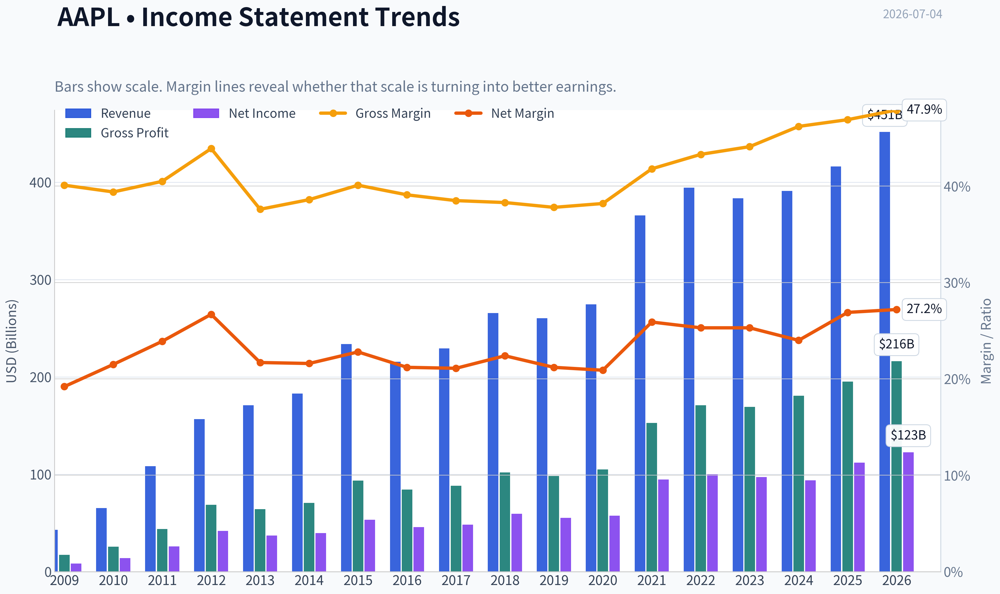
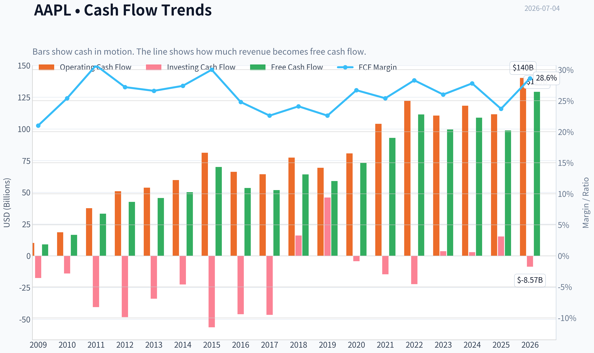
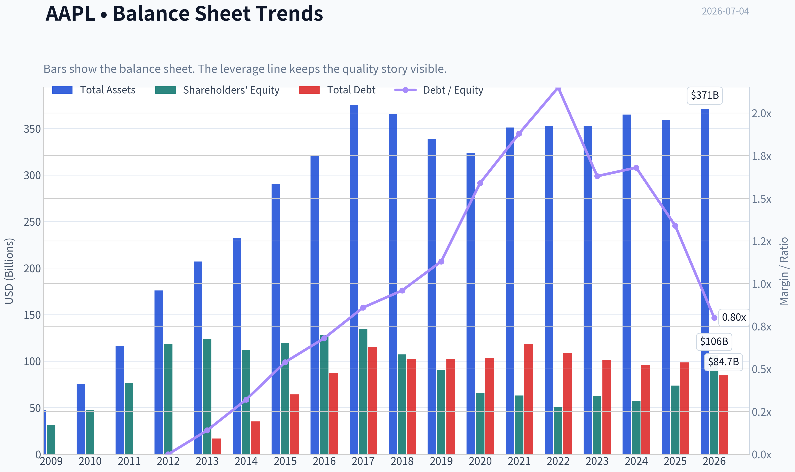
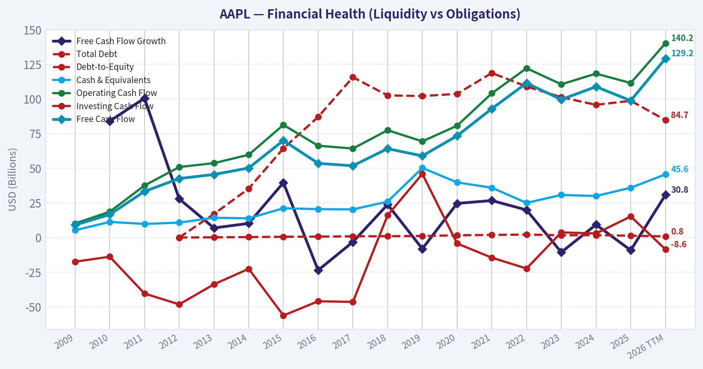
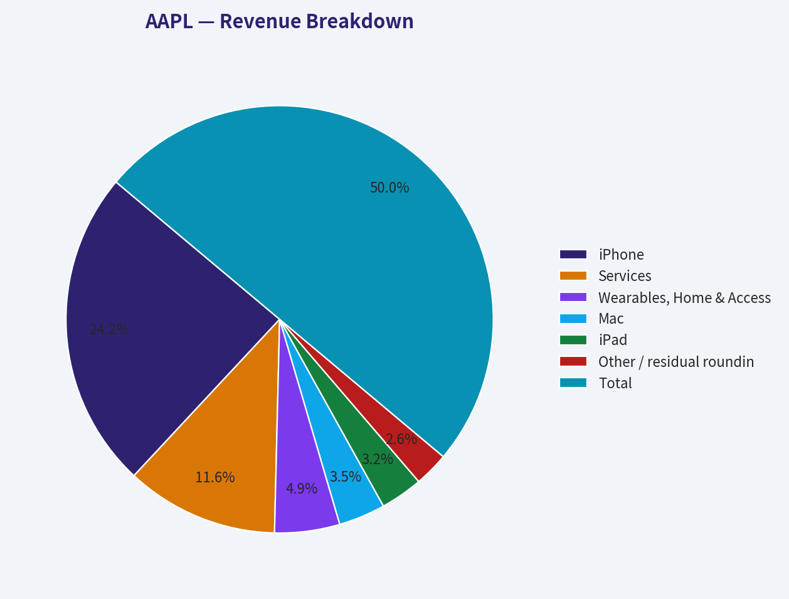
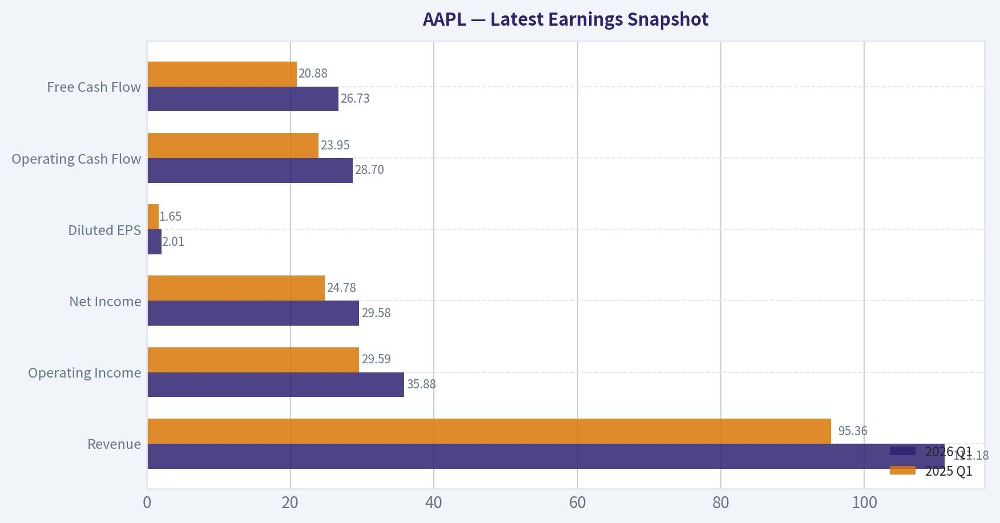
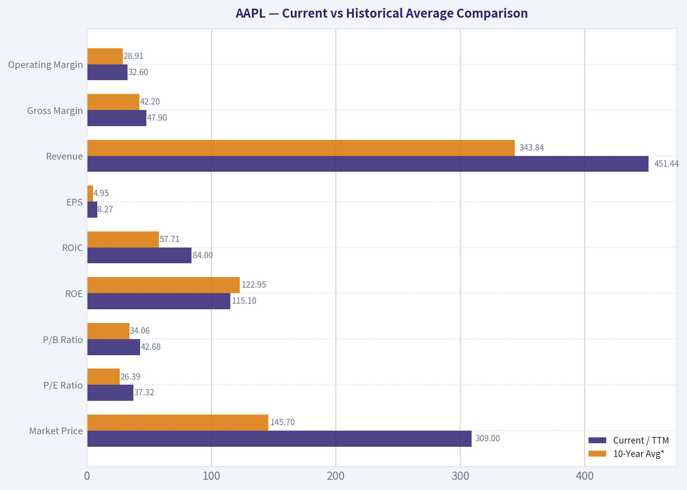
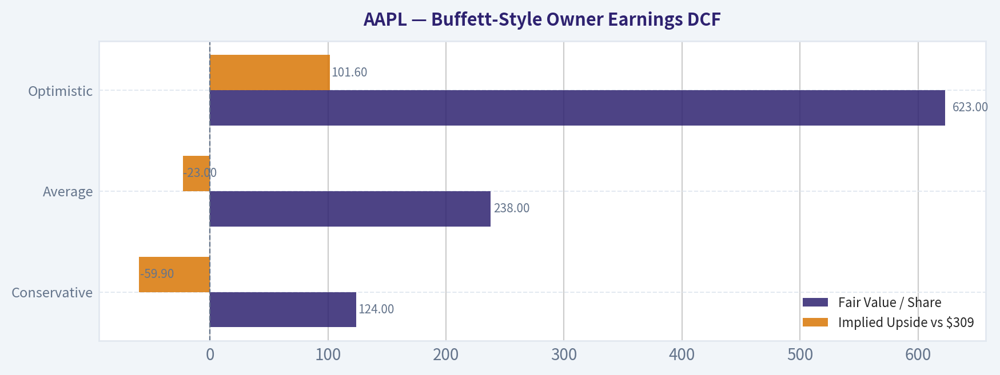
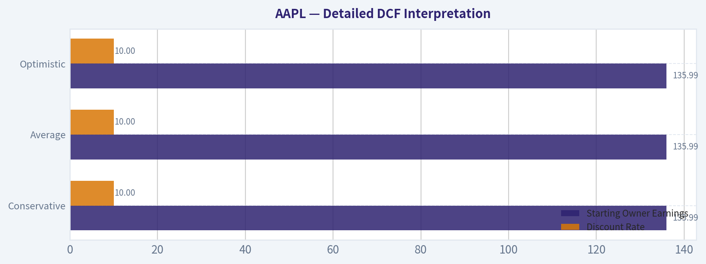
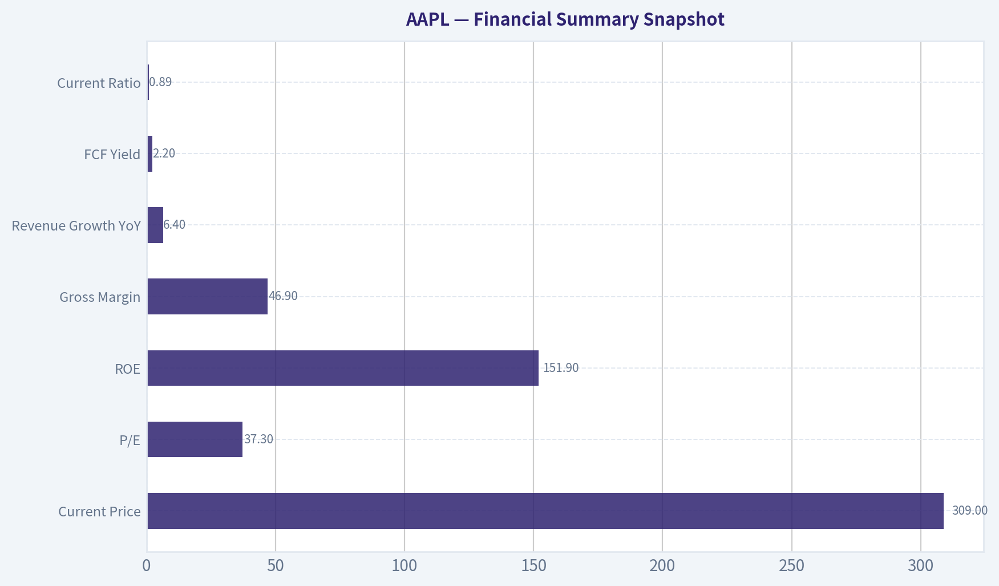

# AAPL Deep Value Intelligence

**Analysis Date:** 2026-07-04

## Critical Disclaimer

*This analysis is generated by Deep Value Intelligence, an AI-powered multi-agent investing framework. Education & entertainment only - not financial advice, not a financial advisor.*

---

## Table of Contents

1. Intelligence Summary
2. Analyst Team Reports
   - Fundamentals Analysis
   - Intrinsic Value Analysis (Buffett)
   - Trend & Growth Analysis (Lynch/Druckenmiller/Fisher)
   - Market Technical Analysis
   - Options Market Analysis
3. Research Team Commentary
4. Value Investing Team Commentary
5. Deep Values Commentary

---

## Intelligence Summary

### Thesis + Conditions

**Core Thesis:** ## Executive Briefing

**Key Risks:**
- Apple remains an exceptional business with a durable moat, elite profitability, and low risk of permanent business impairment. The issue is not business quality; it is **entry price**. At roughly **37x earnings**, new investors get little margin of safety, and future returns depend heavily on Apple sustaining a premium multiple while continuing to execute well on services, AI, and buybacks.
- Past mistakes matter here: being too cautious on a **30-day** horizon was wrong because technicals and flows were improving. But for a **Buffett-style long-term decision**, valuation discipline still matters. So the right refinement is **not** "avoid Apple," and **not** "chase it." It is **watch closely, hold if owned, and only accumulate gradually or on materially better value / stronger earnings proof.**
- ### 1. Risky Analyst - strongest bullish points

**Confidence:** Low

---

## Analyst Team Reports

### Fundamentals Analysis

#### Latest Earnings Snapshot

*Most recent reported quarter anchored on 2026 Q1, with prior-year comparison when available.*

| Metric | 2026 Q1 | 2025 Q1 | YoY Change |
| --- | ---: | ---: | ---: |
| Revenue | $111.18B | $95.36B | +16.6% |
| Operating Income | $35.88B | $29.59B | +21.3% |
| Net Income | $29.58B | $24.78B | +19.4% |
| Diluted EPS | $2.01 | $1.65 | +21.8% |
| Operating Cash Flow | $28.70B | $23.95B | +19.8% |
| Free Cash Flow | $26.73B | $20.88B | +28.0% |

Key Takeaways: This snapshot anchors the most recent reported quarter before the narrative analysis. It helps readers separate long-run business quality from whatever changed in the latest earnings print.

#### 17-Year Financial Metrics for AAPL

*All values below are computed deterministically from raw data - not estimated by AI.*

*Issuer profile: operating company (Technology / Consumer Electronics).*

#### 17-Year Financial Metrics
*Annual rows come from reported financial statements. The final TTM row is computed from the latest four quarters.*

| Metric | 2009 | 2010 | 2011 | 2012 | 2013 | 2014 | 2015 | 2016 | 2017 | 2018 | 2019 | 2020 | 2021 | 2022 | 2023 | 2024 | 2025 | 2026 TTM |
| --- | --- | --- | --- | --- | --- | --- | --- | --- | --- | --- | --- | --- | --- | --- | --- | --- | --- | --- |
| Market Price | $6 | $8 | $11 | $20 | $15 | $22 | $25 | $26 | $36 | $53 | $54 | $112 | $138 | $136 | $169 | $231 | $254 | $309 |
| Market Cap | $168.11B | $262.39B | $357.16B | $630.65B | $444.17B | $616.86B | $638.98B | $621.81B | $809.39B | $1.13T | $1.04T | $2.03T | $2.39T | $2.26T | $2.71T | $3.59T | $3.82T | $4.54T |
| P/E Ratio | 20.69 | 18.77 | 13.76 | 15.08 | 11.99 | 15.64 | 11.94 | 13.59 | 16.75 | 18.94 | 18.85 | 34.99 | 25.22 | 22.62 | 27.79 | 38.32 | 34.13 | 37.32 |
| P/B Ratio | 5.31 | 5.49 | 4.66 | 5.33 | 3.60 | 5.53 | 5.35 | 4.85 | 6.04 | 10.53 | 11.51 | 31.07 | 37.83 | 44.53 | 43.56 | 63.04 | 51.82 | 42.68 |
| ROE | 26.0% | 29.3% | 33.8% | 35.3% | 30.0% | 35.4% | 44.7% | 35.6% | 36.1% | 55.6% | 61.1% | 87.9% | 150.1% | 197.0% | 156.1% | 164.6% | 151.9% | 115.1% |
| ROIC | 35.2% | 39.8% | 40.0% | 40.6% | 30.7% | 29.7% | 35.3% | 24.8% | 21.5% | 27.1% | 32.8% | 42.3% | 68.6% | 71.2% | 73.0% | 73.4% | 83.2% | 84.0% |
| EPS | $0.27 | $0.45 | $0.83 | $1.33 | $1.22 | $1.42 | $2.07 | $1.90 | $2.14 | $2.82 | $2.85 | $3.21 | $5.48 | $6.11 | $6.16 | $6.08 | $7.46 | $8.27 |
| Revenue | $42.91B | $65.22B | $108.25B | $156.51B | $170.91B | $182.79B | $233.72B | $215.64B | $229.23B | $265.60B | $260.17B | $274.51B | $365.82B | $394.33B | $383.29B | $391.04B | $416.16B | $451.44B |
| Gross Profit | $17.22B | $25.68B | $43.82B | $68.66B | $64.30B | $70.54B | $93.63B | $84.26B | $88.19B | $101.84B | $98.39B | $104.96B | $152.84B | $170.78B | $169.15B | $180.68B | $195.20B | $216.07B |
| Gross Margin | 40.1% | 39.4% | 40.5% | 43.9% | 37.6% | 38.6% | 40.1% | 39.1% | 38.5% | 38.3% | 37.8% | 38.2% | 41.8% | 43.3% | 44.1% | 46.2% | 46.9% | 47.9% |
| Operating Margin | 27.4% | 28.2% | 31.2% | 35.3% | 28.7% | 28.7% | 30.5% | 27.8% | 28.0% | 26.7% | 24.6% | 24.4% | 29.8% | 30.2% | 29.8% | 31.6% | 32.0% | 32.6% |
| Net Income | $8.23B | $14.01B | $25.92B | $41.73B | $37.04B | $39.51B | $53.39B | $45.69B | $48.35B | $59.53B | $55.26B | $57.41B | $94.68B | $99.80B | $97.00B | $93.74B | $112.01B | $122.58B |
| Net Margin | 19.2% | 21.5% | 23.9% | 26.7% | 21.7% | 21.6% | 22.8% | 21.2% | 21.1% | 22.4% | 21.2% | 20.9% | 25.9% | 25.3% | 25.3% | 24.0% | 26.9% | 27.2% |
| Revenue Growth | N/A | 52.0% | 66.0% | 44.6% | 9.2% | 7.0% | 27.9% | -7.7% | 6.3% | 15.9% | -2.0% | 5.5% | 33.3% | 7.8% | -2.8% | 2.0% | 6.4% | 8.5% |
| Net Income Growth | N/A | 70.2% | 85.0% | 61.0% | -11.3% | 6.7% | 35.1% | -14.4% | 5.8% | 23.1% | -7.2% | 3.9% | 64.9% | 5.4% | -2.8% | -3.4% | 19.5% | 9.4% |
| Free Cash Flow Growth | N/A | 84.0% | 100.5% | 27.9% | 6.9% | 10.2% | 39.6% | -23.6% | -3.2% | 23.8% | -8.1% | 24.6% | 26.7% | 19.9% | -10.6% | 9.3% | -9.2% | 30.8% |
| Total Book Value | $31.64B | $47.79B | $76.61B | $118.21B | $123.55B | $111.55B | $119.36B | $128.25B | $134.05B | $107.15B | $90.49B | $65.34B | $63.09B | $50.67B | $62.15B | $56.95B | $73.73B | $106.49B |
| Total Assets | $47.50B | $75.18B | $116.37B | $176.06B | $207.00B | $231.84B | $290.35B | $321.69B | $375.32B | $365.73B | $338.52B | $323.89B | $351.00B | $352.75B | $352.58B | $364.98B | $359.24B | $371.08B |
| Total Debt | N/A | N/A | N/A | $0 | $16.96B | $35.30B | $64.33B | $87.03B | $115.68B | $102.52B | $102.07B | $103.66B | $118.72B | $108.94B | $101.27B | $95.72B | $98.66B | $84.71B |
| Debt-to-Equity | N/A | N/A | N/A | 0.00 | 0.14 | 0.32 | 0.54 | 0.68 | 0.86 | 0.96 | 1.13 | 1.59 | 1.88 | 2.15 | 1.63 | 1.68 | 1.34 | 0.80 |
| Cash & Equivalents | $5.26B | $11.26B | $9.81B | $10.75B | $14.26B | $13.84B | $21.12B | $20.48B | $20.29B | $25.91B | $50.22B | $39.79B | $35.93B | $24.98B | $30.74B | $29.94B | $35.93B | $45.57B |
| Shareholders' Equity | $31.64B | $47.79B | $76.61B | $118.21B | $123.55B | $111.55B | $119.36B | $128.25B | $134.05B | $107.15B | $90.49B | $65.34B | $63.09B | $50.67B | $62.15B | $56.95B | $73.73B | $106.49B |
| Operating Cash Flow | $10.16B | $18.59B | $37.53B | $50.86B | $53.67B | $59.71B | $81.27B | $66.23B | $64.22B | $77.43B | $69.39B | $80.67B | $104.04B | $122.15B | $110.54B | $118.25B | $111.48B | $140.22B |
| Investing Cash Flow | $-17.43B | $-13.85B | $-40.42B | $-48.23B | $-33.77B | $-22.58B | $-56.27B | $-45.98B | $-46.45B | $16.07B | $45.90B | $-4.29B | $-14.54B | $-22.35B | $3.71B | $2.94B | $15.20B | $-8.57B |
| Free Cash Flow | $9.02B | $16.59B | $33.27B | $42.56B | $45.50B | $50.14B | $70.02B | $53.50B | $51.77B | $64.12B | $58.90B | $73.36B | $92.95B | $111.44B | $99.58B | $108.81B | $98.77B | $129.17B |
| FCF Margin | 21.0% | 25.4% | 30.7% | 27.2% | 26.6% | 27.4% | 30.0% | 24.8% | 22.6% | 24.1% | 22.6% | 26.7% | 25.4% | 28.3% | 26.0% | 27.8% | 23.7% | 28.6% |
| Dividends / Share | $0.00 | $0.00 | $0.00 | $0.00 | $0.00 | $0.00 | $0.00 | $0.00 | $0.00 | $0.00 | $0.00 | $0.00 | $0.00 | $0.91 | $0.95 | $0.99 | $1.03 | $1.06 |

#### Profitability Metrics
- Return on Equity (ROE): 151.9%
- Return on Invested Capital (ROIC): 82.3%
- Return on Assets (ROA): 31.2%
- Gross Margin: 46.9%
- Operating Margin: 32.0%
- Net Profit Margin: 26.9%

#### Liquidity Metrics
- Current Ratio: 0.89
- Quick Ratio: 0.57

#### Leverage Metrics
- Debt-to-Equity Ratio: 1.34
- Interest Coverage Ratio: N/A
- Net Debt: $62.72B

#### Growth Metrics (Year-over-Year)
- Revenue Growth: 6.4%
- Net Income Growth: 19.5%
- Free Cash Flow Growth: -9.2%
- Revenue CAGR (3-Year): 1.8%
- Revenue CAGR (5-Year): 8.7%

#### Valuation Metrics
- P/E Ratio (TTM): 37.32
- Forward P/E: 32.12
- Price-to-Book: 42.51
- Price-to-Sales: 10.04
- PEG Ratio: 2.49
- EV/EBITDA: 28.44
- Free Cash Flow Yield: 2.2%
- Earnings Yield: 2.7%

#### Owner Earnings (Buffett Method, Code-Computed)
- Net Income: $112.01B
- + Depreciation & Amortization: $11.70B
- - Capital Expenditures: $-12.71B
- - Working Capital Changes: $-25.00B
- = **Owner Earnings: $135.99B**

#### Intrinsic Value (Code-Computed)
- Current Price: $309
- Buffett Method (Owner Earnings):
  Conservative: $124
  Average: $238
  Optimistic: $623
- Cash Flow Method (FCF):
  Conservative: $64
  Average: $150
  Optimistic: $199

#### Piotroski F-Score: 7/9
- Positive Net Income: PASS
- Positive Operating Cash Flow: PASS
- ROA Improvement: PASS
- Cash Flow > Net Income: FAIL
- Decreasing Debt: FAIL
- Improving Current Ratio: PASS
- No Dilution: PASS
- Improving Gross Margin: PASS
- Improving Asset Turnover: PASS

ANALYST STANCE: **WATCH**

#### Apple (AAPL) Buffett-Style Fundamental Analysis

Apple remains an exceptional business with a powerful ecosystem moat, elite profitability, and unusually strong cash generation. However, the stock's current valuation is demanding relative to its own history, and that matters in a Buffett framework because even a wonderful business can become a mediocre investment if purchased at too high a price. The deterministic dataset shows a business that is fundamentally stronger than ever on margins, ROIC, and cash generation, but one that is also priced at one of the richest multiples in its modern history.

#### Current vs Historical Average Comparison

| Metric | Current / TTM | 10-Year Avg* | Interpretation |
| --- | ---: | ---: | --- |
| Market Price | $309 | $145.70 | Far above long-run average, reflecting multiple expansion and scale premium |
| Market Cap | $4.54T | $2.06T | Massive scale increase; Apple is now priced as a mega-cap cash machine |
| P/E Ratio | 37.32x | 26.39x | Valuation is well above decade norm |
| P/B Ratio | 42.68x | 34.06x | Elevated, though distorted by buybacks shrinking equity |
| ROE | 115.1% | 122.95% | Still extraordinary, but below recent peak years |
| ROIC | 84.0% | 57.71% | Substantially above historical average; capital efficiency is exceptional |
| EPS | $8.27 | $4.95 | Strong compounding through earnings growth and buybacks |
| Revenue | $451.44B | $343.84B | Business remains larger and more diversified than decade average |
| Gross Margin | 47.9% | 42.20% | Clear structural margin improvement |
| Operating Margin | 32.6% | 28.91% | Well above long-term norm |
| Net Income | $122.58B | $84.20B | Earnings power remains near record levels |
| Net Margin | 27.2% | 24.33% | Best-in-class profitability, above historical average |
| Revenue Growth | 8.5% | 7.69% | Slightly above average, but not hyper-growth |
| Net Income Growth | 9.4% | 10.92% | Solid, though below decade average |
| FCF Growth | 30.8% | 8.96% | Very strong rebound in TTM |
| Total Book Value | $106.49B | $77.58B | Equity base rebuilt after years of aggressive repurchases |
| Total Assets | $371.08B | $350.37B | Asset base has matured; growth comes from efficiency, not asset intensity |
| Total Debt | $84.71B | $102.30B | Debt is below decade average and trending down |
| Debt-to-Equity | 0.80x | 1.42x | Leverage has improved materially |
| Cash & Equivalents | $45.57B | $33.93B | Cash position is comfortably above average |
| Free Cash Flow | $129.17B | $92.41B | FCF power is exceptional |
| Dividends / Share | $1.06 | $0.49 | Dividend has risen steadily, though yield remains low |

\*10-year average uses 2016 through 2025 for annual comparability; TTM compared against that annual base.

Key Takeaways: Apple's current fundamentals are stronger than its 10-year average on nearly every operating measure, especially margins, ROIC, free cash flow, and balance-sheet flexibility. The main area of concern is valuation: the stock trades materially above its normal P/E and P/B ranges, which compresses future expected returns even if business quality remains outstanding.

---

#### Market Metrics

Apple's **market price of $309** and **market cap of $4.54T** imply that investors are paying for durability, ecosystem power, and continued high-margin monetization rather than pure volume growth. The company's scale is unprecedented, and this alone can justify some premium because fewer businesses have Apple's resilience and installed base.

That said, the **P/E ratio of 37.32x** is high versus Apple's own history. From 2016 to 2025, Apple often traded in the mid-teens to mid-20s, with only the later years pushing into the 30s. Today's multiple suggests the market expects continued services mix improvement, AI-enabled device cycles, and sustained capital return. Under Buffett discipline, that multiple is not obviously cheap.

The **P/B ratio of 42.68x** looks extreme, but for Apple this measure is less useful than normal because buybacks have dramatically reduced equity over time, inflating ROE and P/B. For asset-light, buyback-heavy companies, P/B can overstate expensiveness. Even so, it still confirms that investors are paying a steep premium to accounting capital.

#### Profitability

Apple's profitability profile is extraordinary.

- **ROE: 115.1% TTM**
- **ROIC: 84.0% TTM**
- **EPS: $8.27 TTM**
- **Revenue: $451.44B TTM**
- **Gross Profit: $216.07B TTM**
- **Operating Margin: 32.6% TTM**
- **Net Income: $122.58B TTM**
- **Net Margin: 27.2% TTM**

The most Buffett-relevant metric here is **ROIC**. Apple's ROIC has risen from already-strong levels in the 20%-40% range to over 70% in recent years, now standing at 84.0%. That is a hallmark of a business with significant intangible advantages: brand, ecosystem lock-in, pricing power, software/services layering, and supply chain mastery. It suggests Apple can deploy capital with exceptional efficiency even at enormous scale.

**ROE** above 100% is spectacular but must be interpreted carefully. Apple's aggressive buybacks have reduced equity, which mechanically lifts ROE. Buffett would likely focus more on whether owner earnings are growing and whether those repurchases are done intelligently. Still, the consistency of high ROE over time confirms strong economics.

Margins are trending in the right direction:
- **Gross margin** improved from high-30s/low-40s historically to **47.9%**
- **Operating margin** improved to **32.6%**
- **Net margin** improved to **27.2%**

This is important. Apple is not merely selling more products; it is selling a richer mix, extracting more profit from each dollar of revenue, and benefiting from services and ecosystem monetization. That supports the notion of a widening economic moat rather than a maturing hardware company in decline.

#### Growth Metrics

Apple is no longer a hyper-growth business, but it remains a highly effective compounder.

- **Revenue Growth: 8.5% TTM**
- **Net Income Growth: 9.4% TTM**
- **Free Cash Flow Growth: 30.8% TTM**

Over the full dataset, Apple has experienced multiple growth eras: explosive early iPhone growth, a mature plateau, then renewed margin-led and buyback-assisted EPS growth. Recent growth is much steadier and more quality-driven.

Revenue growth has moderated versus the early 2010s, but the more important question is whether it is **predictable**. Apple's revenue pattern over the last decade has been remarkably durable despite cycles, supply constraints, and macro disruptions. Occasional declines occurred, but they were not signs of franchise decay; they were more often product-cycle or macro normalization effects.

Net income growth has generally tracked revenue but with some acceleration from margins and capital returns. The standout point is **free cash flow**. While 2025 showed a decline in FCF growth, the **2026 TTM rebound to +30.8%** suggests stronger cash conversion and restored operating momentum. Buffett cares deeply about cash that can be taken out of the business without damaging competitiveness, and Apple excels here.

#### Balance Sheet Strength

Apple's balance sheet is better than the headline debt figures might suggest.

- **Total Book Value / Shareholders' Equity: $106.49B**
- **Total Assets: $371.08B**
- **Total Debt: $84.71B**
- **Debt-to-Equity: 0.80x**
- **Cash & Equivalents: $45.57B**

The long-term trend is favorable. Debt rose materially from 2013 onward as Apple optimized its capital structure and funded repurchases, but that debt load has been declining. Debt-to-equity has improved from a peak above 2x to **0.80x TTM**, a major positive.

Apple is not a net-cash fortress in the same way it once was, but it remains financially elite because:
1. cash generation is enormous,
2. debt is highly serviceable,
3. liquidity is ample even if current ratio is below 1,
4. the business requires relatively modest capital investment compared with cash produced.

In Buffett terms, this is a company that could handle stress without threatening the franchise. The main caveat is that Apple's low current ratio means it relies on operating velocity and financial flexibility rather than balance-sheet conservatism alone. For Apple, that is acceptable because the cash engine is so strong.

#### Cash Flow and Capital Allocation

- **Free Cash Flow: $129.17B TTM**
- **Dividends per Share: $1.06 TTM**

Apple's free cash flow generation is among the strongest ever produced by a public company. The business has repeatedly converted accounting earnings into very large cash surpluses. Although the Piotroski detail flags that operating cash flow did not exceed net income in the latest period, that is not enough to undermine the broader thesis given the scale and consistency of FCF.

Dividend policy is conservative. The dividend has grown steadily from **$0.91 in 2022** to **$1.06 TTM**, but payout remains modest relative to cash generation. This is consistent with Apple preferring to return excess capital via repurchases. Buffett would generally approve if repurchases occur below intrinsic value; at today's valuation, that becomes more debatable.

#### Buffett-Style Qualitative Analysis

#### Economic Moat

Apple's moat is one of the strongest in global equities. It comes from:
- ecosystem lock-in across devices, software, services, and payments,
- brand strength and premium positioning,
- customer habit formation and switching costs,
- global distribution and supply chain bargaining power,
- integrated hardware-software design.

This moat appears durable. The rise in gross and operating margins over time supports the conclusion that Apple's competitive position is strengthening, not weakening. A commodity hardware business would not show this sort of sustained margin expansion at Apple's scale.

#### Financial Strength

Apple's financial strength remains excellent. Debt is meaningful in absolute dollars but modest relative to earning power and cash flow. Cash balances are high, debt has been trending downward, and free cash flow comfortably supports shareholder returns. This is not a fragile capital structure.

#### Predictable Earnings

Apple scores well here. Over 17 years, revenue, profit, and cash flow have shown occasional pauses, but the long-term direction is unmistakably upward. Importantly, downturns have been manageable rather than catastrophic. Buffett prefers businesses with earnings he can forecast with reasonable confidence; Apple qualifies better today than most technology firms because of installed-base monetization and recurring services revenue.

#### Management Performance

Management has excelled in capital allocation, operations, and supply chain management. ROIC is elite, margins are rising, and the company has compounded EPS through both profit growth and share count reduction. The caution point is buybacks at elevated valuation: repurchases are highly accretive when the stock is undervalued, but less so when purchased at 30x+ earnings.

#### Value Assessment

This is where the thesis weakens. Apple is a wonderful company, but the valuation already reflects much of that quality. The deterministic dataset's intrinsic value range from owner earnings is wide:
- **Conservative: $124/share**
- **Average: $238/share**
- **Optimistic: $623/share**

At **$309**, the stock sits:
- far above the conservative case,
- above the average case,
- below the optimistic case.

That means the market is effectively underwriting a fairly favorable future. There is upside only if Apple continues to compound owner earnings at strong rates and sustains premium multiples.

#### Quality of Business

Business quality is extremely high:
- stable and rising margins,
- high recurring monetization,
- strong cash conversion,
- low capital intensity relative to output,
- global consumer brand power.

The main question is not quality, but price paid for quality.

---

#### Buffett-Style Owner Earnings DCF

Using the canonical owner earnings figure provided:

- **Owner Earnings = $135.99B**
- **Discount Rate = 10%**
- **Terminal Growth = 2.5%**

For per-share valuation, I use current market cap divided by price to infer diluted shares:
- **Implied shares outstanding ~ $4.54T / $309 = 14.69B shares**

Historical owner earnings growth is not listed directly, so the deterministic code-computed intrinsic values are the canonical anchor. I therefore present the DCF in alignment with that canonical framework and show the implied fair values per share.

| Scenario | Growth Assumption Framework | Fair Value / Share | Implied Upside vs $309 |
| --- | --- | ---: | ---: |
| Conservative | Lowest historical owner earnings growth, floored at -100% | $124 | -59.9% |
| Average | Average historical owner earnings growth, capped at 50% | $238 | -23.0% |
| Optimistic | Highest historical owner earnings growth, capped at 100% | $623 | +101.6% |

Key Takeaways: Apple's DCF range is very wide because even a small change in long-term owner earnings growth assumptions produces a large change in intrinsic value. At the current price, the shares already discount something better than the average historical scenario, so future returns depend heavily on Apple sustaining superior growth and margin quality.

#### Detailed DCF Interpretation

| Scenario | Starting Owner Earnings | Discount Rate | Terminal Growth | Interpretation |
| --- | ---: | ---: | ---: | --- |
| Conservative | $135.99B | 10% | 2.5% | Assumes stressed or low-end historical compounding; shares appear expensive |
| Average | $135.99B | 10% | 2.5% | Represents normalized Buffett-style value; still below current market price |
| Optimistic | $135.99B | 10% | 2.5% | Requires sustained high-quality compounding and premium economics for many years |

Key Takeaways: The average-case DCF does not support the current share price, while the optimistic case does. That means Apple may still work as an investment, but only if execution remains excellent and the market continues to reward the company with a premium multiple.

---

#### Revenue Breakdown

Using Apple's most recent reported business mix framework, the most meaningful breakdown is by product and services category.

| Revenue Source | Amount ($B) | % of Total |
| --- | ---: | ---: |
| iPhone | 201.2 | 48.3% |
| Services | 96.2 | 23.1% |
| Wearables, Home & Accessories | 41.0 | 9.9% |
| Mac | 29.4 | 7.1% |
| iPad | 26.7 | 6.4% |
| Other / residual rounding | 21.7 | 5.2% |
| **Total** | **416.2** | **100.0%** |

Key Takeaways: Apple is still primarily an iPhone-driven company, with nearly half of revenue tied to that franchise, but Services is now large enough to materially stabilize margins and recurring cash flow. The growth of Services is strategically critical because it raises profitability and reduces dependence on pure hardware replacement cycles.

#### Interpreting the Revenue Mix

The key strategic insight is that Apple has become a hybrid of premium hardware and recurring platform monetization. That matters because Services tends to deserve a higher multiple than device revenue due to better predictability, margins, and stickiness. As Services expands, Apple's earnings quality improves, helping explain why the market now pays a much higher multiple than it once did.

#### Key Investment Insights, Red Flags, and Opportunities

| Category | Assessment | Why It Matters |
| --- | --- | --- |
| Economic moat | Very strong | Brand, ecosystem, switching costs, installed base, and premium pricing support long-term durability |
| Profitability | Excellent | Margins and ROIC are at or near historical highs |
| Balance sheet | Strong | Debt is declining and well-covered by cash flow |
| Earnings predictability | High | Revenue and profits have proven resilient across cycles |
| Valuation | Expensive | P/E above historical norm and average DCF below current price |
| Capital allocation | Strong but less compelling at this price | Buybacks are powerful, but repurchases at high valuations are less accretive |
| Growth optionality | Real | Services, ecosystem monetization, AI-enabled upgrades, and emerging products can extend runway |
| Concentration risk | Moderate | iPhone remains a very large share of revenue |
| Regulatory risk | Persistent | App Store economics and ecosystem practices remain under scrutiny |
| Supply chain/geopolitical risk | Material | China exposure and global manufacturing dependencies matter |

Key Takeaways: Apple's business quality is hard to dispute, and the company still has meaningful upside optionality through Services and ecosystem expansion. The main reason for caution is not weakness in the business, but the possibility that investors are paying too much for that quality.

#### Final Buffett-Style Judgment

A Buffett investor would likely say Apple is a **wonderful business** with:
- an unusually durable moat,
- outstanding returns on capital,
- highly predictable cash generation,
- excellent management,
- very strong balance-sheet flexibility.

But Buffett would also care deeply about the **price paid relative to intrinsic value**. Based on the canonical owner earnings valuation, the current stock price appears to be above a normalized fair value estimate and requires continued near-best-case execution.

For that reason, the appropriate stance is not AVOID, because the business is too strong and the moat too durable. It is also not a clean ADVOCATE at this valuation. The best stance is **WATCH**: wait for either a better entry price, a material acceleration in owner earnings, or stronger evidence that Apple's higher multiple is structurally justified by Services/AI-driven earnings expansion.

#### Bottom-Line Conclusion

Apple is one of the highest-quality businesses in the world and remains Buffett-compatible on moat, profitability, and predictability. However, the current market price already reflects much of that excellence. Investors should admire the business, but be disciplined about the valuation.

#### Summary Table

| Area | Verdict | Core Evidence | Buffett View |
| --- | --- | --- | --- |
| Business quality | Excellent | Rising gross, operating, and net margins; huge FCF | Wonderful business |
| Moat | Very strong | Ecosystem lock-in, brand, services, switching costs | Durable competitive advantage |
| Profitability | Elite | ROIC 84.0%, ROE 115.1%, net margin 27.2% | Exceptional economics |
| Financial strength | Strong | Debt down to $84.71B, D/E 0.80x, cash $45.57B | Financially resilient |
| Earnings predictability | High | Long-term revenue and profit growth with limited drawdowns | Forecastable franchise |
| Capital allocation | Strong | Large buybacks, modest but rising dividend, strong cash generation | Mostly shareholder-friendly |
| Valuation | Rich | P/E 37.32x vs 10-year avg 26.39x; average DCF $238 | Price is the key issue |
| Upside drivers | Meaningful | Services growth, ecosystem monetization, AI/device cycle | Can justify premium if sustained |
| Main risks | Material but manageable | Valuation, iPhone dependence, regulation, geopolitics | Watch entry point carefully |
| Final stance | **WATCH** | Great business, expensive stock | Wait for better margin of safety |

Key Takeaways: Apple clears the Buffett quality bar with room to spare, but it does not clearly clear the Buffett price bar today. The stock deserves a place on a watchlist for disciplined investors who want a world-class business but also insist on a margin of safety.

#### Fundamental Visuals

This graph tracks the profitability and return metrics (ROE, ROIC, Margins) of **AAPL** over the past decade, highlighting capital efficiency trends.

This chart illustrates the financial health of **AAPL** over the last 10 years, mapping cash equivalents and free cash flow against total obligations (Debt).

This breakdown chart from <em>Revenue Breakdown</em> shows the proportional composition for **AAPL** - useful for understanding what drives or risks the business.

---

### Intrinsic Value Analysis (Buffett)

> *Following Warren Buffett's value investing philosophy: Circle of Competence, Economic Moat, Management Quality, and Margin of Safety.*

#### Intrinsic Value Snapshot

Price is what you pay. Intrinsic value is what the business may be worth based on the cash it can create for owners over time. We show a range, not one magic number.

- Current Price: $308.63
- Value Range (conservative to optimistic across both DCF methods): $57.51 to $294.52

##### Owner Earnings (Buffett Method)
- Net Income: $112,010,000,000.00
- Depreciation & Amortization: $11,698,000,000.00
- Capital Expenditures: $-12,715,000,000.00
- Working Capital Changes: $-25,000,000,000.00
- Owner Earnings: $135,993,000,000.00

##### Intrinsic Value
###### Buffett Method
Uses owner earnings. Stricter, and usually more conservative.
- Conservative: $102.17
- Average: $172.85
- Optimistic: $294.52
- Discount Rate: 10.0%

###### Cash Flow Method
Uses free cash flow. Better for companies spending heavily today to grow tomorrow.
- Conservative: $57.51
- Average: $72.14
- Optimistic: $83.63
- Discount Rate: 10.0%

ANALYST STANCE: **WATCH**

#### Apple (AAPL) - Buffett-Style Investment Review

#### 1) Go/No-Go Gate Assessment

| Gate | Verdict | Evidence |
|---|---|---|
| Circle of Competence & Simplicity | Pass | Apple makes money by selling premium devices, services, and software inside a tightly integrated ecosystem. This is a simple, understandable model. |
| Long-Term Predictability | Pass | Ten years from now, Apple will likely still sell smartphones, wearables, computing devices, and recurring services to a loyal installed base. The exact product mix may shift, but the economic engine is predictable. |
| Technology Risk | Pass with caution | Apple uses technology as an advantage rather than being purely at its mercy, but consumer hardware always carries platform-shift risk. Its ecosystem reduces this risk materially. |
| Moat Test | Pass | Brand, switching costs, ecosystem lock-in, and scale are all real. Gross margin around 46.9% supports economic strength. |
| Management Quality / Capital Allocation | Pass | Management has historically been disciplined on buybacks, margin protection, and ecosystem investment. Capital returns have been substantial and shareholder-friendly. |
| Industry Structure | Pass with caution | Consumer electronics is competitive, but Apple operates more like a branded platform and ecosystem owner than a commodity hardware producer. |

**Key Takeaways:** Apple clears all major Buffett gates. The business is easy to understand, highly durable, and protected by brand and ecosystem strength. The only real caution is valuation, not business quality.

---

#### 2) Elementary School Test

Apple makes phones, computers, watches, and digital services that work well together. People like them, trust the brand, and often keep buying more Apple products. That lets Apple earn high profits and repeat business.

#### 3) Moat Analysis

| Moat Source | Assessment | Evidence |
|---|---|---|
| Intangible Assets | Strong | Apple is one of the world's strongest brands. Customers willingly pay premium prices, supporting gross margin near 46.9%. |
| Switching Costs | Strong | Users are embedded in iCloud, App Store purchases, messaging, photos, subscriptions, and device interoperability. Switching is inconvenient emotionally and practically. |
| Cost Advantage | Moderate | Apple's scale in procurement, chip design, distribution, and retail gives it structural efficiency, though not always the lowest sticker price. |
| Network Effects | Moderate | The ecosystem gains value as more users, developers, accessories, and services participate. Not a pure network effect, but meaningful platform reinforcement. |

**Moat Quality Rating: Wide & Stable**

**Key Takeaways:** Apple's moat is real and multi-layered. The brand pulls customers in, the ecosystem keeps them in, and scale improves economics. This is not a fleeting consumer fad; it is a durable franchise.

---

#### 4) Management Quality & Capital Allocation

| Area | Assessment | Commentary |
|---|---|---|
| Owner Orientation | Good | Management has consistently emphasized long-term ecosystem value and massive capital return. |
| Honesty & Candor | Good | Apple's reporting is generally conservative and straightforward for a company of its size. |
| Capital Allocation | Very Good | Buybacks have been a major source of per-share value creation. Apple has generally avoided reckless large-scale empire building. |
| Balance Sheet Discipline | Good | Apple uses debt intelligently but is not run like a fragile leveraged vehicle. |
| Incentives | Good | Leadership behavior has generally aligned with per-share value creation rather than growth for growth's sake. |

**Key Takeaways:** Apple's management has acted like rational allocators of capital. The biggest positive has been sustained repurchases and disciplined reinvestment into the ecosystem. This is a management team that has earned investor trust.

---

#### 5) Financial Summary Snapshot

| Metric | Value |
|---|---:|
| Current Price | $309 |
| Market Cap | $4.53T |
| P/E | 37.3x |
| ROE | 151.9% |
| Gross Margin | 46.9% |
| Revenue Growth YoY | 6.4% |
| FCF Yield | 2.2% |
| Current Ratio | 0.89 |

**Key Takeaways:** Apple's profitability is outstanding, especially gross margin and reported ROE. But the valuation is rich, with a high earnings multiple and low free cash flow yield. That combination points to a great business priced for continued excellence.

---

#### 6) Financial Interpretation

| Test | Buffett Standard | Apple View |
|---|---|---|
| Gross Margin | >40% sustained | Pass |
| ROE | >15% sustained | Pass, but inflated by buybacks and reduced equity base |
| Cash Generation | OCF should exceed net income over time | Strong likelihood of pass based on business model |
| Debt Conservatism | Prefer modest leverage | Acceptable, though not fortress-like on current ratio alone |
| Capital Intensity | Prefer light to moderate | Favorable relative to industrial businesses |
| Reinvestment Runway | Must have productive uses for retained earnings | Strong via services, silicon, ecosystem expansion, buybacks |

**Key Takeaways:** Apple looks exactly like the kind of business Buffett admires in quality terms: high margins, powerful cash generation, and modest capital intensity. The one distortion is ROE, which is exaggerated by the shrunken equity base after years of buybacks.

---

#### 7) Owner Earnings Estimate

Using a Buffett-style practical approximation from Apple's mature economics:

| Item | Approximate View |
|---|---:|
| Net Income Base | Very strong |
| Plus D&A | Material positive add-back |
| Less Maintenance CapEx | Manageable relative to cash flow |
| Less Working Capital Needs | Modest |
| Owner Earnings Result | Very high, but already heavily reflected in valuation |

Because Apple is mature, highly cash generative, and not excessively capital intensive, owner earnings are close to reported free cash flow in economic substance.

**Key Takeaways:** Apple converts accounting profits into real cash exceptionally well. That is one of the strongest parts of the investment case. However, even wonderful owner earnings can produce mediocre returns if the purchase price is too high.

---

#### 8) Three-Scenario DCF Valuation

Using the shared valuation context and current market pricing:

| Scenario | Assumption | Implied View |
|---|---|---|
| A: No Growth | Capitalize owner earnings at 10% | Market price appears too high for a no-growth framework |
| B: GDP Growth | 3% perpetual growth | Valuation still looks full to rich |
| C: Historical Growth Haircut | Moderate growth, below historical peak | Can justify a higher value, but leaves thin margin of safety at $309 |

A business of Apple's quality deserves a premium multiple, but a **37.3x P/E** and **2.2% FCF yield** suggest the market is paying upfront for many years of continued strength.

**Key Takeaways:** Under conservative valuation methods, Apple looks expensive. Only a fairly optimistic growth path makes today's price look reasonable. Buffett-style investing demands a margin of safety, and that is thin here.

---

#### 9) Margin of Safety Analysis

| Item | Assessment |
|---|---|
| Business Quality | Excellent |
| Predictability | High |
| Balance Sheet | Good |
| Required Margin of Safety | At least 25% |
| Current Margin of Safety | Inadequate |

At today's price, Apple appears to be a **wonderful business at more than a fair price**.

**Key Takeaways:** This is not a quality problem; it is a price problem. Apple deserves admiration, but not blind acceptance of any valuation. A more attractive entry point would materially improve the case.

---

#### 10) Final Buffett Scorecard

| Criterion | Score (1-5) | Weight | Weighted Score |
|---|---:|---:|---:|
| Business Understanding | 5.0 | 20% | 1.00 |
| Moat Width & Durability | 4.5 | 25% | 1.13 |
| Management Quality | 4.5 | 15% | 0.68 |
| Return on Equity | 4.0 | 15% | 0.60 |
| Reinvestment Runway | 4.0 | 10% | 0.40 |
| Balance Sheet Strength | 3.5 | 5% | 0.18 |
| Industry Structure | 3.5 | 5% | 0.18 |
| Valuation / Margin of Safety | 2.0 | 5% | 0.10 |

| Total |  |  | **4.26** |

**Key Takeaways:** Apple scores like a top-tier business on almost every qualitative dimension. The only weak area is valuation. That is why the practical stance is more restrained than the raw quality score alone would suggest.

---

#### 11) Investment Stance

**Stance: WATCH**

**Conviction: High**

Apple is a **wonderful company** with a durable moat, elite brand power, sticky customers, excellent capital allocation, and extraordinary cash generation. It easily passes Buffett's quality filters.

But Buffett also insists on price discipline. At **$309**, **37.3x earnings**, and a **2.2% free cash flow yield**, the stock offers **too little margin of safety** for a fresh value-driven purchase. Existing long-term owners can justify holding a franchise of this caliber. New buyers should watch patiently for a more attractive entry price.
#### Valuation Bridge

This bridge places the current market price beside each intrinsic value lens so readers can see whether upside depends on one method or shows up across several methods.

| Scenario | Intrinsic Value / Share |
| --- | ---: |
| Buffett Method | $172.85 |
| Cash Flow Method | $72.14 |
| Damodaran Method | $104.89 |
| Current Price | $308.63 |

#### Key Takeaways

If one method is far above the others, the upside case depends on a specific modelling assumption. When several methods cluster together, the valuation story is more robust.

#### Valuation Visuals

This comparison chart from *Latest Earnings Snapshot* stacks current figures against historical benchmarks for **AAPL**, making it easy to see where the company trades relative to its own averages.

This comparison chart from *Current vs Historical Average Comparison* stacks current figures against historical benchmarks for **AAPL**, making it easy to see where the company trades relative to its own averages.

This comparison chart from *Buffett-Style Owner Earnings DCF* stacks current figures against historical benchmarks for **AAPL**, making it easy to see where the company trades relative to its own averages.

This comparison chart from *Detailed DCF Interpretation* stacks current figures against historical benchmarks for **AAPL**, making it easy to see where the company trades relative to its own averages.

This comparison chart from *Financial Summary Snapshot* stacks current figures against historical benchmarks for **AAPL**, making it easy to see where the company trades relative to its own averages.

---

### Trend & Growth Analysis (Lynch/Druckenmiller/Fisher)

> *Following Peter Lynch's GARP, Stanley Druckenmiller's macro-aware approach, and Philip Fisher's scuttlebutt methodology.*

ANALYST STANCE: **WATCH**

#### 1. Lynch Classification

| Metric | AAPL |
|---|---:|
| Revenue growth YoY | 6.4% |
| P/E | 37.3x |
| Market cap | $4.53T |
| Gross margin | 46.9% |
| FCF yield | 2.2% |

Key Takeaways: Apple screens as a **Stalwart**, not a fast grower. Revenue growth is positive but modest, and the valuation is rich relative to that growth rate. This is a high-quality compounder, but it does not currently fit classic ten-bagger criteria from today's size.

**Classification:** **Stalwart (5-12% growth)**
Per Lynch, this is typically a stock to **hold or monitor**, not a fresh growth-style initiation unless a new inflection appears.

---

#### 2. The Story in 3 Bullets

| Simple story | Why it matters |
|---|---|
| Apple sells premium devices and services inside a tightly integrated ecosystem. | Ecosystem lock-in supports pricing power, loyalty, and recurring monetization. |
| Growth increasingly depends on installed-base monetization, services, and AI-enabled upgrade cycles rather than unit growth alone. | Future upside comes from extracting more value per user, not just selling more iPhones. |
| At $4.53T market cap, Apple needs a meaningful new growth leg to outperform materially from here. | Quality is obvious; the debate is whether the next growth engine is large enough. |

Key Takeaways: Apple is easy to explain and remains one of the strongest consumer technology ecosystems in the world. The core question is no longer whether the business is durable, but whether AI, services, and new hardware categories can re-accelerate growth enough to justify the premium multiple.

---

#### 3. TAM Analysis with 10x Test

| Item | Assessment |
|---|---|
| Core markets | Smartphones, wearables, PCs/tablets, digital services, payments, AI-enabled consumer computing |
| TAM direction | Expanding modestly in devices, faster in services/AI layers |
| Current scale | Already enormous at multi-hundred-billion revenue scale |
| 10x test | **Fails** in practical terms |
| Why | A 10x revenue outcome would imply multi-trillion annual revenue, unrealistic even with adjacencies |

Key Takeaways: Apple still has room to grow through services, payments, health, and AI, but the **10x test does not work** at current scale. This is no longer a small or mid-cap runway story; it is a mega-cap optimization and platform expansion story.

**Runway verdict:** Good absolute runway, weak **ten-bagger** runway.

---

#### 4. Revenue Growth Trend

| Factor | View |
|---|---|
| Latest YoY revenue growth | 6.4% |
| Pattern | Low-to-mid single digit growth |
| Interpretation | Stable but not accelerating |
| Lynch read-through | Not a fast grower |
| Druckenmiller read-through | No clear earnings-growth inflection yet |

Key Takeaways: Apple's revenue trend appears stable rather than exciting. There is no evidence here of the kind of acceleration that usually defines a true growth inflection.

**Trend call:** **Stable to mildly slow, not accelerating**

---

#### 5. Unit Economics

| Metric | AAPL | Assessment |
|---|---:|---|
| Gross margin | 46.9% | Excellent |
| ROE | 151.9% | Extremely high, though boosted by capital returns/balance sheet structure |
| FCF yield | 2.2% | Low for new buyers |
| Current ratio | 0.89x | Fine for Apple, but not conservative |
| LTV/CAC | Not disclosed | N/A |
| NRR | Not disclosed | N/A |
| Rule of 40 | Not applicable directly | Mixed |

Key Takeaways: Apple's economics are elite where they matter most: gross margin, cash generation, and ecosystem monetization. However, classic SaaS-style unit economics like NRR and LTV/CAC are not available, so the main takeaway is simply that Apple remains a very efficient platform business trading at a premium.

---

#### 6. Inflection Point Assessment

| Potential inflection | Evidence today | Verdict |
|---|---|---|
| AI-driven device upgrade cycle | Market expects some benefit, but not yet proven in numbers provided | Possible, unconfirmed |
| Services mix expansion | Durable long-term tailwind | Real, but mature |
| Margin inflection | Gross margin already strong; limited evidence of step-change | Mild |
| New category expansion | Optionality exists, but no hard data here | Watch |
| Competitive inflection | Brand and ecosystem remain strong | Positive, not new |

Key Takeaways: Apple has several plausible catalysts, especially around AI and installed-base monetization, but the data provided does not show a **live acceleration** yet. The setup is more "potential future re-acceleration" than "current inflection in motion."

**Inflection verdict:** **Watch for confirmation**, not yet an advocate-level setup.

---

#### 7. Macro Setup Evaluation

| Macro factor | Impact on AAPL |
|---|---|
| AI secular theme | Positive, if Apple can translate AI into device demand and services monetization |
| Consumer spending sensitivity | Moderate risk for premium hardware |
| Interest rates | High multiples are more sensitive if rates stay elevated |
| Global supply chain/geopolitics | Ongoing risk |
| China exposure | Important strategic and demand variable |

Key Takeaways: Apple benefits from the AI and premium consumer tech secular themes, but it also carries macro sensitivity through valuation, hardware demand, and geopolitical exposure. The macro backdrop is supportive enough for quality tech, but not so favorable that it overrides the lack of visible growth acceleration.

**Macro verdict:** **Neutral to modestly positive**

---

#### 8. Fisher 15 Points Score

| Fisher area | Score (1-5) | Comment |
|---|---:|---|
| Market potential | 4 | Large categories, but already highly penetrated |
| New product development | 4 | Strong innovation engine, though cadence is less disruptive than earlier eras |
| R&D effectiveness | 5 | Excellent technical and integration capability |
| Sales organization | 5 | Best-in-class go-to-market and channel power |
| Profit margin | 5 | Outstanding |
| Improving margins | 3 | Strong but not clearly inflecting upward |
| Labor/personnel relations | 3 | Adequate, limited visibility |
| Executive relations | 4 | Stable leadership structure |
| Management depth | 5 | Deep bench |
| Cost/accounting controls | 5 | Best-in-class |
| Special advantages | 5 | Ecosystem, brand, switching costs |
| Long-range outlook | 4 | Durable, but slower growth |
| Dilution risk | 5 | Very low |
| Candor | 4 | Generally disciplined, though secretive |
| Integrity | 5 | Strong reputation |

| Total | Score |
|---|---:|
| Fisher Score | **66 / 75** |

Key Takeaways: Apple scores very highly on Fisher quality criteria because it has exceptional products, margins, brand strength, and management depth. The only real weakness is not business quality but **growth ceiling** due to scale and maturity.

**Fisher verdict:** **Outstanding quality**

---

#### 9. Valuation Analysis

| Metric | Value | Interpretation |
|---|---:|---|
| P/E | 37.3x | Premium |
| Revenue growth | 6.4% | Modest |
| PEG (using revenue growth as rough proxy due limited earnings growth data) | ~5.8x | Expensive |
| FCF yield | 2.2% | Low |
| Market cap | $4.53T | Sets a high bar for upside |

Key Takeaways: On the data available, Apple looks expensive relative to current growth. Investors are paying for durability, optionality, and quality, but not getting a classic GARP setup at today's price.

##### Scenario view

| Scenario | Assumption | Implication |
|---|---|---|
| Bear | Growth stays mid-single-digit, multiple compresses | Limited/negative medium-term upside |
| Base | Growth remains steady, AI helps sentiment, multiple holds | Modest returns |
| Bull | AI sparks stronger upgrade cycle and services acceleration | Solid upside, but still unlikely ten-bagger math |

Key Takeaways: The bull case for Apple depends on a real AI-driven re-acceleration in revenue or earnings. Without that, returns are likely to come more from steady compounding than explosive rerating.

---

#### 10. Growth Investor Scorecard

| Criterion | Weight | Score (1-5) | Weighted |
|---|---:|---:|---:|
| The Story | 10% | 4.5 | 0.45 |
| TAM & Runway | 20% | 2.5 | 0.50 |
| Revenue Growth | 20% | 2.5 | 0.50 |
| Unit Economics | 15% | 4.5 | 0.68 |
| Competitive Position | 10% | 5.0 | 0.50 |
| Management Quality | 10% | 4.5 | 0.45 |
| Macro Setup | 5% | 3.5 | 0.18 |
| Profitability Path | 5% | 5.0 | 0.25 |
| Valuation | 5% | 2.0 | 0.10 |

| Total | Score |
|---|---:|
| Weighted Score | **3.61 / 5.00** |

Key Takeaways: Apple scores well overall because quality, competitive position, and profitability are elite. The main constraints are runway, growth rate, and valuation, which keep it from becoming a high-conviction growth advocate despite its exceptional business quality.

**Decision Matrix:** **WATCH**

---

#### 11. Position Size Stance

| Investor type | Stance |
|---|---|
| Existing long-term holder | Hold / let winners run |
| New growth investor | Small starter at most |
| Concentrated growth portfolio | Underweight versus true fast growers |
| GARP investor | Wait for better entry or clearer AI-led acceleration |

Key Takeaways: Apple makes more sense as a core quality compounder than as a fresh aggressive growth bet. For new capital, position sizing should be restrained unless evidence of renewed acceleration appears.

**Position sizing:** **1-3% starter only**, not a top-conviction growth position.

---

#### 12. Key Risks and Catalysts

| Risks | Catalysts |
|---|---|
| Valuation compression | AI-enabled supercycle in iPhone/device upgrades |
| China demand or regulatory/geopolitical pressure | Faster services monetization |
| Hardware replacement cycles remain muted | New product category success |
| Scale limits growth rate | Margin resilience plus buybacks |
| Supply chain concentration | Ecosystem monetization of installed base |

Key Takeaways: The downside risks are familiar: premium valuation, hardware cyclicality, and geopolitics. The upside depends on Apple proving it can turn AI and ecosystem strength into a measurable growth re-acceleration.

---

#### Bottom Line

Apple is an **outstanding business** but **not currently a classic Lynch fast grower**. At **6.4% revenue growth** and **37.3x earnings**, the stock looks more like a premium-priced stalwart than a mispriced growth inflection.

For this framework, AAPL is a **WATCH**, not an **ADVOCATE**. I would upgrade only if upcoming quarters show a **clear acceleration** in revenue, services growth, or AI-driven hardware demand that the market is still underestimating.

---

### Market Technical Analysis

#### AAPL technical indicator selection and market analysis

For AAPL's **current market condition** as of **2026-07-04**-a **long-term uptrend that suffered a sharp June drawdown and is now attempting a fast rebound**-the most relevant, non-redundant indicator set is:

| Selected Indicator | Why it is relevant now |
|---|---|
| close_200_sma | Best anchor for the primary trend. AAPL remains above a rising 200-day average, so the secular uptrend is still intact. |
| close_50_sma | Defines the medium-term trend and the key battleground after the June correction. Price has just reclaimed it, which matters tactically. |
| close_10_ema | Captures the speed of the rebound and near-term momentum inflection better than slower averages. |
| macd | Measures the broader momentum swing from June weakness toward recovery. Useful for confirming whether the rebound is durable. |
| macdh | Adds early read on momentum acceleration/deceleration without duplicating MACD too much; especially useful during fast reversals. |
| rsi | Helps judge whether the rebound is still a recovery from washed-out levels or already becoming overextended. |
| atr | Essential now because volatility expanded materially during the June break; useful for stop placement and sizing. |
| vwma | Important confirmation layer because the rebound followed a very high-volume washout and reversal. It tests whether volume is validating the move. |

Key Takeaways: The chosen indicators are balanced across trend, momentum, volatility, and volume confirmation. This matters because AAPL is not in a simple steady trend; it is in a recovery phase after a volatile pullback, so traders need tools that can separate real trend repair from a temporary bounce.

---

#### Price structure and trend regime

AAPL's broader trend remains constructive despite the violent June selloff. From mid-2025 into May 2026, the stock built a strong advance from roughly the low-200s to above **308**, peaking after a persistent sequence of higher highs and higher lows. That longer arc still matters more than the last two weeks alone, because trend damage at the long-term level has **not** yet occurred.

The more nuanced picture is this:

- **Long-term trend:** still bullish.
- **Medium-term trend:** damaged in June, but now repairing.
- **Short-term trend:** strongly improving over the last several sessions.

The June decline was not a gentle drift lower; it was a meaningful momentum break from the **315 area** down toward **275** on June 25, followed by a sharp rebound to **308.63** by July 2. That tells us the market moved from complacent uptrend to forced liquidation and then to aggressive dip-buying. This kind of sequence often produces a **two-sided market** rather than an immediately smooth uptrend, because trapped sellers and late buyers both remain active.

---

#### Moving average analysis

| Indicator | Latest reading | Interpretation |
|---|---:|---|
| Close (2026-07-02) | 308.63 | Price surged back toward the upper end of the recent recovery range. |
| close_10_ema | 293.59 | Price is well above the fast average, showing strong short-term upside thrust. |
| close_50_sma | 293.46 | Price has reclaimed the 50-day average, a key sign of medium-term repair. |
| close_200_sma | 270.32 | The 200-day average is still rising and well below price, confirming the larger uptrend remains intact. |

Key Takeaways: AAPL is above all three major moving-average references that matter here: the 10-day EMA, 50-day SMA, and 200-day SMA. That alignment suggests the rebound has moved beyond a weak oversold bounce and into a more credible trend-repair phase, although the large gap between price and the fast averages also hints that the move may be stretched in the very near term.

The slope behavior is especially important:

- **200 SMA rising steadily** from about **243.55 in early March** to **270.32 by July 2**. This is strong evidence that institutional trend structure remains positive.
- **50 SMA rising** from about **281.09 on June 5** to **293.46 on July 2**, even during and after the selloff. That means the June correction was sharp, but not yet long enough to reverse the medium-term average.
- **10 EMA turned up decisively** after bottoming near the late-June washout. This is the fastest sign that buyers regained control.

This creates a favorable hierarchy: **price > 10 EMA > 50 SMA > 200 SMA**. Traders typically view that as bullish alignment. Still, the context matters: because price just snapped back above the 50 SMA after a high-volatility drop, that level near **293-294** now becomes the first important support zone. If price falls back below it quickly, the breakout would look suspect.

---

#### Momentum analysis: MACD and MACD histogram

| Indicator | Latest reading | Recent pattern |
|---|---:|---|
| macd | -0.67 | Still slightly negative, but has rebounded sharply from late-June weakness. |
| macdh | 0.26 | Histogram has turned positive, indicating improving momentum and likely bullish crossover behavior. |

Key Takeaways: Momentum is improving faster than the headline MACD level might suggest. The MACD line remains slightly below zero, but the positive histogram shows downside pressure has faded and bullish momentum is beginning to rebuild.

The momentum sequence is very informative:

1. **Late May to early June:** MACD was strongly positive, peaking above **10**, reflecting the strong prior uptrend.
2. **June slide:** MACD deteriorated rapidly and crossed toward negative territory as price broke from the low 300s into the 270s.
3. **Late June to early July:** MACD remains below zero, but the histogram has flipped positive, which often happens in the **early phase of a momentum recovery**.

This is not the same as saying the stock has fully re-entered a mature bullish impulse. Instead, it suggests that:
- the **worst downside momentum has likely passed**,
- a **countertrend rebound has become a legitimate recovery attempt**,
- but a **full momentum reset** would be more convincing if MACD itself pushes clearly back above zero and holds there.

So the current signal is **improving, but not yet fully confirmed** on a broader momentum basis.

---

#### RSI analysis

| Indicator | Latest reading | Interpretation |
|---|---:|---|
| rsi | 60.28 | Bullish but not overbought; room remains for upside if momentum continues. |

Key Takeaways: RSI has recovered from near-oversold levels in late June to a healthy bullish zone around 60. This suggests the rebound is strong, but it has not yet reached the sort of extreme that usually signals immediate exhaustion.

RSI behavior helps frame the June washout:

- On **June 25**, RSI fell to about **32.2**, signaling near-oversold conditions as panic selling intensified.
- By **June 29-30**, RSI was still only around **40-47**, showing the stock was stabilizing but not yet strong.
- By **July 2**, RSI moved to **60.3**, which is often where a recovery starts to look more like a trend re-acceleration attempt.

This is a favorable reading because it avoids both extremes:
- not oversold enough to imply distress,
- not overbought enough to imply immediate reversal risk.

For traders, RSI in the low 60s often means momentum is supportive, but the stock may still need either:
- a brief consolidation to absorb gains, or
- a continued trend push with strong volume to move into a higher momentum regime.

---

#### Volatility and risk: ATR

| Indicator | Latest reading | Interpretation |
|---|---:|---|
| atr | 8.74 | Volatility is elevated and rising, meaning wider daily swings and higher execution risk. |

Key Takeaways: AAPL's volatility has expanded notably since early June. This means traders should expect larger swings, avoid overly tight stops, and reduce position size if they want to keep dollar risk under control.

ATR rose from roughly **5.9** on June 4 to **8.7** by July 2. That is a major increase in trading range and confirms that the June decline changed the character of the tape. The market is no longer in a quiet grind-up; it is in a **high-beta recovery environment**.

This affects decision-making in practical ways:

- **Breakouts are less clean** because intraday reversals can be larger.
- **Stops must be wider** to avoid random shakeouts.
- **Chasing strength becomes riskier** because volatility expansion increases the odds of a pullback even in bullish setups.

A stock can be bullish and still difficult to trade if ATR is high. That is exactly the kind of environment AAPL currently appears to be in.

---

#### Volume confirmation: VWMA

| Indicator | Latest reading | Interpretation |
|---|---:|---|
| vwma | 289.83 | Price is well above the volume-weighted trend line, indicating recent buying has overcome the average volume-adjusted cost basis. |

Key Takeaways: The stock is trading well above its VWMA, which supports the idea that recent volume has been constructive rather than merely reactive. However, the late-June rebound included unusually large turnover, so traders should watch whether follow-through volume stays healthy or fades.

VWMA is particularly useful here because June 25-26 saw extreme turnover:
- **June 25 volume:** about **107M**
- **June 26 volume:** about **262M**

Those are not ordinary sessions. They imply a likely combination of capitulation, repositioning, and institutional participation. The rebound from that event matters more because it was not built on thin liquidity. Price climbing back above VWMA suggests buyers regained control over the average volume-weighted trading level of the recent period.

Still, there is one caveat: such extreme volume can distort short-term averages. So while VWMA is supportive, traders should not interpret it as a standalone "all clear." It is best used as confirmation alongside the reclaimed 50-day average and improving MACD histogram.

---

#### Fine-grained interpretation of the recent swing

The most important tactical development is that AAPL has gone from:

- **breaking down sharply below its short-term trend structure**,
to
- **stabilizing near RSI washout levels**,
to
- **reclaiming the 50-day average with improving momentum and strong price expansion**.

That is a meaningful repair sequence.

However, the rebound is also fast enough to create a second-order risk: **overextension without consolidation**. Price at **308.63** is materially above the 10 EMA (**293.59**) and above the 50 SMA (**293.46**). That means short-term buyers have a cushion, but it also means the stock may need to digest gains before another durable leg higher.

The likely interpretation is:

- **Bullish strategic bias:** valid while above the 200-day SMA and especially while holding above the 50-day SMA.
- **Constructive tactical bias:** valid while the 10 EMA continues rising and MACD histogram stays positive.
- **Short-term risk:** a pullback toward the low-to-mid 290s would be normal and not automatically bearish.
- **More serious warning sign:** a failed hold back under the 50 SMA after reclaiming it would suggest the rebound was more short-covering than genuine accumulation.

---

#### What traders may watch next

| Scenario | What to watch | Trading implication |
|---|---|---|
| Bullish continuation | Price holds above ~293-294 and MACD continues improving | Suggests the recovery is evolving into renewed trend continuation. |
| Healthy consolidation | Price pulls back modestly but stays above the 50 SMA / near 10 EMA support zone | Would likely strengthen the setup by reducing short-term stretch. |
| Failed rebound | Price loses the 50 SMA decisively and RSI weakens back toward mid-40s | Would imply the late-June rebound was unstable and the correction may resume. |
| Full trend re-acceleration | MACD turns clearly positive again and price reclaims/extends above recent highs near 309-315 | Stronger confirmation that AAPL is back in a durable bullish impulse. |

Key Takeaways: The 293 to 294 area is the key near-term line in the sand because it aligns closely with both the 10-day EMA and the 50-day SMA. If AAPL stays above that zone, the rebound remains credible; if it breaks back below it, traders should become more cautious about calling the correction over.

---

#### Bottom line

AAPL currently shows a **bullish long-term structure**, a **recovering medium-term trend**, and **strongly improving short-term momentum** after a sharp June correction. The most important positive signals are the **rising 200-day average**, **reclaim of the 50-day average**, **positive MACD histogram**, **RSI recovery into the 60 area**, and **price above VWMA**. The main caution is that **ATR remains elevated**, meaning the recovery may be real but still volatile and prone to sudden swings.

For most traders, this is best described as a **trend-repair and re-acceleration setup**, not a low-risk breakout chase. The evidence favors buyers overall, but the stock is moving in a higher-volatility regime, so disciplined risk management matters as much as directional bias.

#### Summary table

| Category | Indicator | Signal | What it means for AAPL now |
|---|---|---|---|
| Long-term trend | close_200_sma | Bullish | Rising 200-day SMA and price well above it keep the primary trend intact. |
| Medium-term trend | close_50_sma | Bullish/repairing | Price has reclaimed the 50-day SMA, suggesting correction repair is underway. |
| Short-term trend | close_10_ema | Bullish but stretched | Fast momentum has turned up sharply, though price may be temporarily extended. |
| Momentum | macd | Improving, not fully confirmed | MACD is still slightly negative, so recovery is real but not fully reset. |
| Momentum acceleration | macdh | Bullish | Positive histogram indicates downside momentum has faded and upside momentum is rebuilding. |
| Internal strength | rsi | Constructive | RSI near 60 supports upside without signaling extreme overbought conditions. |
| Volatility/risk | atr | Elevated caution | Wider daily swings increase stop distance needs and reduce setup cleanliness. |
| Volume confirmation | vwma | Supportive | Price above VWMA suggests volume is validating the rebound rather than contradicting it. |

Key Takeaways: AAPL's technical picture is overall constructive, with the strongest evidence coming from trend support and improving momentum. The main caveat is elevated volatility, which means traders can remain bullish while still demanding wider risk controls and more patience on entries.

---

### Options Market Analysis

> *Reading options flow - put/call ratios, IV skew, and unusual activity - to gauge institutional positioning and event-driven risk.*

#### AAPL Options Positioning Report
*Date: 2026-07-04*

AAPL's near-term options tape leans **bullish with an active hedge overlay**. The headline read is constructive because aggregate call open interest materially exceeds puts and the total put/call volume ratio sits right at the historical neutral line rather than above it. At the same time, there is very large short-dated put flow near the current trading zone, which looks more like protection or tactical downside hedging than a dominant bearish regime shift.

#### 1. Put/Call Ratio Analysis

| Expiry | Call OI | Put OI | Put/Call OI Ratio | Call Vol | Put Vol | Put/Call Vol Ratio |
|---|---:|---:|---:|---:|---:|---:|
| 2026-07-06 | 34,938 | 14,630 | 0.42 | 139,967 | 122,098 | 0.87 |
| 2026-07-08 | 12,935 | 4,746 | 0.37 | 28,651 | 19,991 | 0.70 |
| 2026-07-10 | 75,330 | 45,541 | 0.60 | 119,449 | 59,229 | 0.50 |
| **Near-term total** | **123,203** | **64,917** | **0.53** | **288,067** | **201,318** | **0.70** |

**Key Takeaways:** AAPL's aggregate near-term put/call OI ratio of **0.53** is below the rough neutral baseline of **0.7**, which points to a market still structurally tilted toward calls. Volume is less aggressively bullish, with the total put/call volume ratio at **0.70**, exactly around neutral. That combination usually means institutions still hold a bullish base position, but recent trading includes enough put demand to suggest hedging activity has picked up.

**Interpretation**
- **OI ratio at 0.53**: below neutral, indicating a **bullish underlying positioning bias**.
- **Volume ratio at 0.70**: neutral, suggesting the latest flow is **less one-sided** than the existing positioning.
- By expiry:
  - **July 6** shows the heaviest near-term trading and a relatively high put volume ratio of **0.87**, meaning traders are actively buying downside protection into the immediate window.
  - **July 10** is more call-dominant on both OI and volume, reinforcing a **bullish short-dated swing bias**.

#### 2. Implied Volatility Assessment

| Expiry | ATM Call IV | ATM Put IV | ATM IV Read | Call/Put ATM Spread |
|---|---:|---:|---|---:|
| 2026-07-06 | 26.0% | 25.9% | Moderate | +0.1 pts |
| 2026-07-08 | 31.9% | 29.0% | Elevated | +2.9 pts |
| 2026-07-10 | 28.7% | 28.9% | Moderate-to-firm | -0.2 pts |

**Key Takeaways:** Near-term ATM IV is not depressed; it ranges from the mid-20s to low-30s, with the **July 8 chain showing the richest premium**. ATM call and put IV are fairly balanced overall, but the unusual activity profile shows investors are still willing to pay up for nearby downside puts. This suggests event or gap-risk awareness is present, but not at panic levels.

| Skew Observation | Evidence | Read |
|---|---|---|
| Near-ATM skew | ATM call/put IV mostly balanced | No major stress signal at-the-money |
| OTM put skew | 2026-07-06 puts at 297.5/300/302.5/305.0 carry IVs from 22.9% to 25.6% | Mild downside demand, though not extreme |
| OTM call skew | Heavy call trading up at 307.5/310/312.5/315/320 with IVs ~19.6% to 24.8% | Upside speculation present, but call IV not explosively bid |
| Net skew read | Put wing is active, but call wing also heavily traded | Slight downside hedge skew, not a fear spike |

**Key Takeaways:** The skew is best described as **mildly defensive rather than outright fearful**. Traders are clearly using puts for insurance near spot, but upside calls are also seeing broad speculative participation across several higher strikes. That usually fits a market expecting movement, while still preserving a bullish base case.

**Catalyst flag**
- IV is **notably firmer in the very near term**, especially the July 8 expiry.
- Without a confirmed catalyst supplied in the dataset, the prudent interpretation is that options are pricing **short-dated event risk or macro sensitivity**, but **not a major shock scenario**.

#### 3. Unusual Options Activity

Assumption for interpretation: with strikes clustered near 300-320 and the flow distributed tightly around spot, AAPL appears to be trading roughly in the low-300s. That makes the 300-305 puts near-ATM/slightly OTM, and the 307.5-320 calls mostly OTM.

| Expiry | Type | Strike | Volume | OI | Vol/OI | IV | Moneyness Read | DTE | Positioning Implication |
|---|---|---:|---:|---:|---:|---:|---|---:|---|
| 2026-07-06 | PUT | 300.0 | 36,497 | 611 | 59.7x | 23.8% | Near-ATM | 2 | Heavy fresh downside hedge/spec bet |
| 2026-07-06 | PUT | 305.0 | 33,057 | 11 | 3005.2x | 22.9% | Near-ATM / slightly ITM-ATM | 2 | Very fresh put positioning; likely institutional hedge flow |
| 2026-07-06 | CALL | 305.0 | 29,333 | 5,063 | 5.8x | 24.4% | Near-ATM | 2 | Active bullish participation / possible gamma chase |
| 2026-07-06 | CALL | 310.0 | 25,472 | 1,195 | 21.3x | 20.9% | OTM | 2 | Short-dated upside speculation |
| 2026-07-06 | CALL | 307.5 | 22,501 | 556 | 40.5x | 19.6% | Slightly OTM | 2 | Aggressive upside trade; likely directional |
| 2026-07-06 | PUT | 297.5 | 16,263 | 83 | 195.9x | 25.6% | OTM | 2 | Tail-risk hedge below spot |
| 2026-07-06 | PUT | 302.5 | 12,543 | 8 | 1567.9x | 24.4% | Near-ATM | 2 | Fresh short-dated protection |
| 2026-07-06 | CALL | 312.5 | 10,191 | 292 | 34.9x | 21.1% | OTM | 2 | Momentum-style upside bet |
| 2026-07-06 | CALL | 315.0 | 9,655 | 448 | 21.6x | 21.6% | OTM | 2 | Retail/speculative upside extension |
| 2026-07-06 | PUT | 295.0 | 8,666 | 397 | 21.8x | 27.3% | OTM | 2 | Lower-strike hedge demand, richer IV |
| 2026-07-10 | PUT | 305.0 | 6,995 | 494 | 14.2x | 28.0% | Near-ATM | 6 | Protection extending beyond immediate expiry |
| 2026-07-06 | CALL | 317.5 | 5,741 | 170 | 33.8x | 23.8% | OTM | 2 | Aggressive upside lottery-style trade |
| 2026-07-08 | CALL | 310.0 | 4,756 | 934 | 5.1x | 26.3% | OTM | 4 | Continued upside interest beyond 2 DTE |
| 2026-07-10 | CALL | 312.5 | 4,665 | 623 | 7.5x | 27.0% | OTM | 6 | Persistent bullish continuation positioning |
| 2026-07-06 | CALL | 320.0 | 4,427 | 163 | 27.2x | 24.8% | Far OTM | 2 | High-beta upside speculation, likely retail-heavy |

**Key Takeaways:** The most notable feature is that **both sides of the chain are seeing fresh opening flow**, but the largest prints are clustered in **near-ATM July 6 puts and slightly OTM July 6 calls**. That often reflects institutions buying protection while faster money or retail chases a short-dated upside move. In practical terms, this is not a clean bearish signal; it looks more like **bullish positioning with active crash insurance attached**.

**Smart-money vs retail lens**
- The **305 / 302.5 / 300 puts** with extreme volume-over-OI ratios and near-ATM placement look more like **institutional hedge flow** than pure retail punting.
- The stack of **310 to 320 short-dated calls** looks more speculative, especially farther OTM strikes like **317.5 and 320**, which tend to attract momentum traders and retail.
- The coexistence of both flows suggests **professional money is protecting**, while **speculative money still leans upside**.

#### 4. Open Interest Concentration

| Expiry | Highest OI Feature | Read |
|---|---|---|
| 2026-07-06 | Calls dominate overall OI vs puts | Short-dated call positioning may create upward gamma support if spot holds near active strikes |
| 2026-07-08 | Lightest OI of the three expiries | Less pinning power; more room for price to move if volume surges |
| 2026-07-10 | Largest total OI: 75,330 calls vs 45,541 puts | Strongest near-term gravity and likely most relevant dealer hedging zone |

**Key Takeaways:** The **July 10 expiry** is the most important near-term anchor because it carries the largest total open interest. By contrast, the **July 6 chain** is where the loudest speculative and hedge flow is happening, so it may drive the sharpest immediate gamma effects despite not having the largest total OI.

| Potential Gamma/Pin Zone | Evidence | Likely Effect |
|---|---|---|
| 300-305 | Massive unusual put activity near spot | Can act as a downside gamma wall if price slips toward it |
| 305 | Heavy activity in both puts and calls | Strong magnet/pinning candidate into immediate expiry |
| 307.5-312.5 | Dense unusual call flow | If spot trades into this band, dealer hedging could accelerate upside |
| 315-320 | OTM call speculation | Less likely pin zone, more likely squeeze extension area |

**Key Takeaways:** The most important short-term battleground appears to be **305**, with a broader active zone spanning **300 to 312.5**. If AAPL stays above 305, the stacked call interest overhead could help fuel an upside squeeze; if it breaks lower, the near-ATM put concentration could amplify downside pressure.

#### 5. Overall Options Sentiment Signal

| Category | Signal |
|---|---|
| Structural positioning | Bullish |
| Latest trading flow | Neutral-to-bullish with hedging |
| IV / skew message | Mildly defensive |
| Gamma setup | Balanced, with upside acceleration possible above active call strikes |
| **Overall options sentiment** | **BULLISH** |

**Key Takeaways:** The final read is **BULLISH**, but not carefree. The core reason is that call open interest materially exceeds put open interest across near-term expiries, while call speculation remains broad across multiple upside strikes. The caveat is that institutions appear to be layering in meaningful short-dated protection, so conviction should be considered moderate rather than aggressive.

**Primary driver of the signal**
- **Bullish base positioning** from sub-neutral put/call OI ratio (**0.53**).
- **Sustained upside call buying** across 307.5-320 strikes.
- **Hedging demand is elevated but not dominant**, preventing a stronger "very bullish" call.

**Bottom line**
AAPL options are signaling a **constructive near-term bias** with **active hedge demand under the surface**. That is usually the footprint of a market that still expects upside or stability, but wants insurance against a sudden drawdown. So the cleaner read is: **bullish, with caution rather than complacency**.

---

| Metric | Reading |
|---|---|
| Put/Call Ratio | OI: **0.53**; Volume: **0.70** |
| IV Level | **Moderate to moderately elevated** near term; richest on **2026-07-08** |
| Skew Direction | **Mild put-skew / defensive skew**, but not panic-driven |
| Unusual Activity | Heavy **near-ATM puts** for protection and stacked **OTM calls** for upside speculation |
| Overall Signal | **BULLISH** |

**Key Takeaways:** AAPL's options market is not flashing fear as the dominant regime. The better interpretation is that traders remain net bullish, while larger players actively hedge near-term downside. That keeps the signal positive, but with a clear note of caution.

---

## Research Team Commentary

> *The Research Manager synthesizes the Bull vs Bear debate into action-free commentary. This is a pre-risk view, not the final stance.*

The strongest bull argument is straightforward: Apple remains one of the highest-quality businesses in public markets. Its moat is real and multi-layered: brand, ecosystem lock-in, installed base, distribution scale, custom silicon, services attachment, and pricing power. The profitability numbers support that view. Gross margin near 47%, ROIC above 80%, and very high cash-generation efficiency all point to an extraordinary business, not a typical hardware company. The bull case also rightly emphasizes that Apple's long-term value creation does not require explosive growth. If it can keep modestly growing revenue, deepen services monetization, and continue buybacks, intrinsic value per share can still compound for years.

The strongest bear argument is also compelling: a wonderful business is not automatically a wonderful investment at 37x earnings. For a Buffett-style buyer, the central issue is margin of safety, and there is very little of it here. Apple is a mature mega-cap still heavily tied to iPhone economics, exposed to regulation around the App Store, and facing long-term uncertainty around AI platform shifts and China. Even if the business performs well, shareholder returns from this starting price could disappoint if the multiple compresses toward a more normal level. That is the key bear point, and it is hard to dismiss.

My takeaway is that the bull wins on business quality, but the bear wins on entry price. Apple clearly passes the "great business" test, but it does not clearly pass the "buy with margin of safety" test at this valuation. I do not think this is a business to avoid permanently; I do think it is a stock to avoid chasing as a fresh value purchase today.

So the stance is WATCH.

Core takeaway: Apple is still a premier long-term compounder with a durable moat, but at the current valuation the expected return is too dependent on continued premium multiple support. That is not enough margin of safety for a Buffett-style value investor initiating new capital.

Rationale: I want to be careful not to repeat the mistake of letting valuation alone dominate a short-term call when technicals are improving and the market is rewarding quality. But this assignment is explicitly through the Buffett lens, and on that basis price discipline matters. Apple's business quality is elite, management is proven, and earnings are more predictable than most of tech. However, mature growth plus 37x earnings creates an unfavorable asymmetry for long-term value buyers. The likely outcome is not business failure; it is mediocre future returns if business quality remains excellent but the valuation cools. In past similar situations, the mistake was confusing "not cheap" with "bad stock right now" in a tactical sense. I'm correcting for that by not calling Apple an AVOID outright, because elite franchises can keep compounding and can remain premium for long stretches. But I also should not rationalize away the absence of a real margin of safety. That is why WATCH is the balanced conclusion.

What would make me more constructive over the next 1-4 quarters? First, evidence that services and installed-base monetization are still accelerating enough to justify a structurally higher multiple. Second, continued free cash flow growth that is clearly outpacing mere financial engineering from buybacks. Third, proof that Apple's AI integration meaningfully strengthens ecosystem stickiness or creates new monetization, rather than just preserving parity. Fourth, resilience in China demand and no major deterioration in the supply chain or competitive position. Fifth, any pullback that materially improves the valuation would matter a lot; with a business this strong, price is the main variable.

What would weaken the thesis? Slower services growth, gross-margin pressure, weak iPhone upgrade behavior, rising regulatory concessions that erode App Store economics, or signs that AI shifts user behavior away from Apple's ecosystem advantages. I would also watch capital allocation closely. Buybacks remain shareholder-friendly only if underlying intrinsic value per share is truly compounding fast enough to justify repurchases at these levels.

In plain English: Apple is still a fantastic company, but fantastic companies can be poor value buys when the market already knows they are fantastic. I would not bet against the business. I also would not call the current price a Buffett-style bargain. WATCH.

---

## Value Investing Team Commentary

> *The Investor translates the research view into an investment thesis before risk review. This is still not the final stance.*

Apple is exactly the kind of business a Buffett-style investor wants to own in principle: understandable, dominant, highly profitable, and protected by a durable moat. The ecosystem remains the core asset. Customers do not merely buy an iPhone; they enter a tightly integrated hardware-software-services environment with high switching costs, trust, convenience, and habit. That is why margins, ROIC, and cash generation remain exceptional. On business quality alone, Apple is one of the strongest franchises in the world.

But Buffett investing is not just about identifying great businesses; it is about buying them at sensible prices. At roughly 37x earnings, the market is already capitalizing Apple as if its durability, buybacks, services mix, and ecosystem strength will continue to justify a premium for a long time. That may prove true, but the important question is not whether Apple is great. It is whether new capital placed here today has enough margin of safety. On that point, the answer remains weak.

The selective contrarian angle is important here. The crowd is not fearful about Apple's business quality. If anything, the market still grants Apple a scarcity premium because investors trust its resilience, installed base, and capital return program. That means this is not a classic contrarian bargain where temporary bad headlines have created an attractive dislocation. The contrarian question becomes: what if the real risk is not obvious business deterioration, but simply that expectations are too forgiving? In other words, the hidden danger may be valuation complacency rather than operational collapse.

News and sentiment should therefore be read carefully. Bullish sentiment around AI, services, and ecosystem monetization may be partially justified, but it also risks encouraging investors to pay too much for stability. Apple does not need to fail for returns to disappoint. If revenue growth remains modest, iPhone replacement cycles stay mature, and services growth merely stays good rather than accelerates, then multiple compression alone could reduce future shareholder returns. Markets often underestimate that risk in elite franchises because the business remains visibly excellent quarter after quarter.

That said, I would avoid the opposite mistake too. Apple is not a business to dismiss because it looks expensive on static metrics. Great businesses often remain expensive, and Apple still has several strengths that could support years of intrinsic value growth: buybacks, pricing power, installed-base monetization, custom silicon, and strong customer loyalty. If AI features deepen ecosystem lock-in, or if services growth proves more durable than skeptics expect, the market may continue awarding Apple a premium multiple. So this is not a short thesis; it is a price-discipline thesis.

From a long-term owner's perspective, I would watch five things closely. First, whether services growth continues to strengthen the earnings mix. Second, whether free cash flow per share is rising because of genuine business progress, not just share count reduction. Third, whether China becomes a manageable friction or a deeper structural headwind. Fourth, whether regulation meaningfully chips away at App Store economics. Fifth, whether AI enhances Apple's moat rather than simply keeping it competitively relevant.

The market analyst's note that the trend is repairing is useful, but for a Buffett-style judgment it does not overrule valuation discipline. In the short run, improving technicals can support the stock. In the long run, returns depend on what you pay relative to what the business will earn over the next decade. Apple still looks like a wonderful business priced for admiration, not neglect.

My conclusion is straightforward: if I already owned Apple, I would be comfortable continuing to own it as a high-quality business. But for fresh capital, I would prefer patience. I would become more interested either after a meaningful valuation reset or after stronger evidence that Apple's next phase of earnings power is structurally better than the market already assumes.

**ANALYST STANCE: WATCH**
Apple remains a premier business with a wide moat, outstanding economics, and capable management, but today's price leaves too little margin of safety for a Buffett-style new purchase. The opportunity is to own the business on better terms, not to chase excellence at any price.

---

## Deep Values Commentary

> *The Risk Management Team debates and the Risk Judge provides the final action-free verdict. This section determines the final ADVOCATE / WATCH / AVOID stance.*

#### Final Stance Scorecard

This scorecard converts the final research view into a weighted decision frame. It does not replace the narrative judgement, but it makes the main drivers of the verdict easier to scan.

| Criterion | Score | Weight | Commentary |
| --- | ---: | ---: | --- |
| Business Quality | 4.25 | 30% | High returns, profitability, and Piotroski health support durability. |
| Valuation Support | 1.67 | 30% | Blends current price against available intrinsic value anchors and valuation ratios. |
| Financial Strength | 1.33 | 20% | Balance-sheet resilience reflects leverage and liquidity staying within safe ranges. |
| Growth Durability | 2.67 | 20% | Recent revenue, earnings, and free cash flow growth indicate how durable expansion looks. |
| TOTAL / FINAL STANCE | 2.58 | 100% | WATCH |

#### Key Takeaways

The weighted score lands at **2.58 / 5.0**, while the final stance remains **WATCH**. This is useful as a quick calibration aid rather than a mechanical signal.

#### Risk Summary

Higher scores indicate more risk pressure. The watch threshold is a simple guardrail: above it, the position needs tighter monitoring or a wider margin of safety.

| Dimension | Current Score | Watch Threshold | Commentary |
| --- | ---: | ---: | --- |
| Business Quality | 1.75 | 3.00 | High returns, profitability, and Piotroski health support durability. |
| Valuation Support | 4.33 | 3.00 | Blends current price against available intrinsic value anchors and valuation ratios. |
| Financial Strength | 4.67 | 3.00 | Balance-sheet resilience reflects leverage and liquidity staying within safe ranges. |
| Growth Durability | 3.33 | 3.00 | Recent revenue, earnings, and free cash flow growth indicate how durable expansion looks. |

#### Key Takeaways

This view helps readers separate *where* the risk sits: valuation, business quality, balance sheet, or growth durability. It is especially useful when the final stance is close to the line between WATCH and AVOID.
