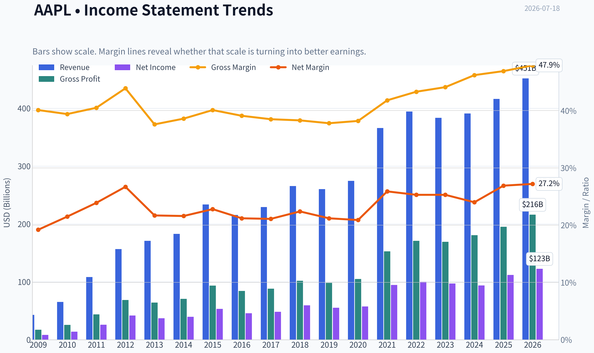
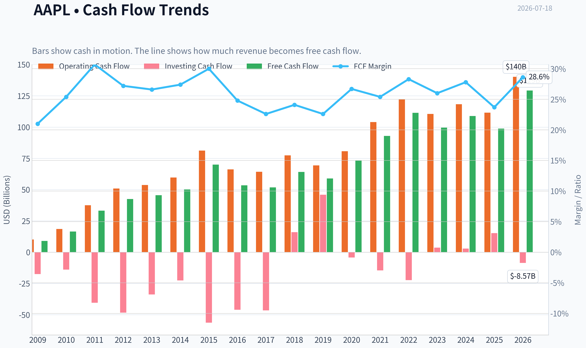
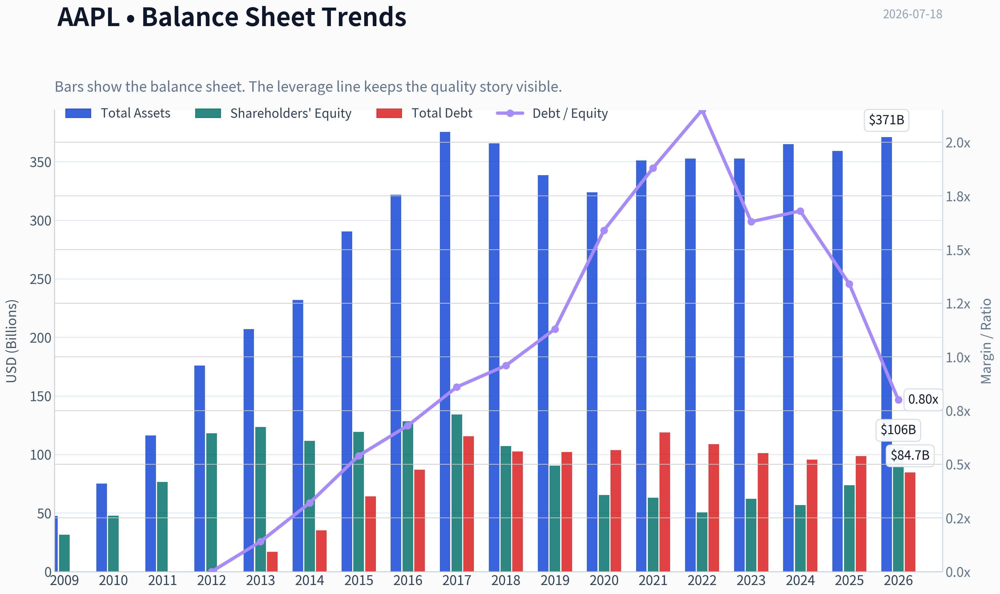
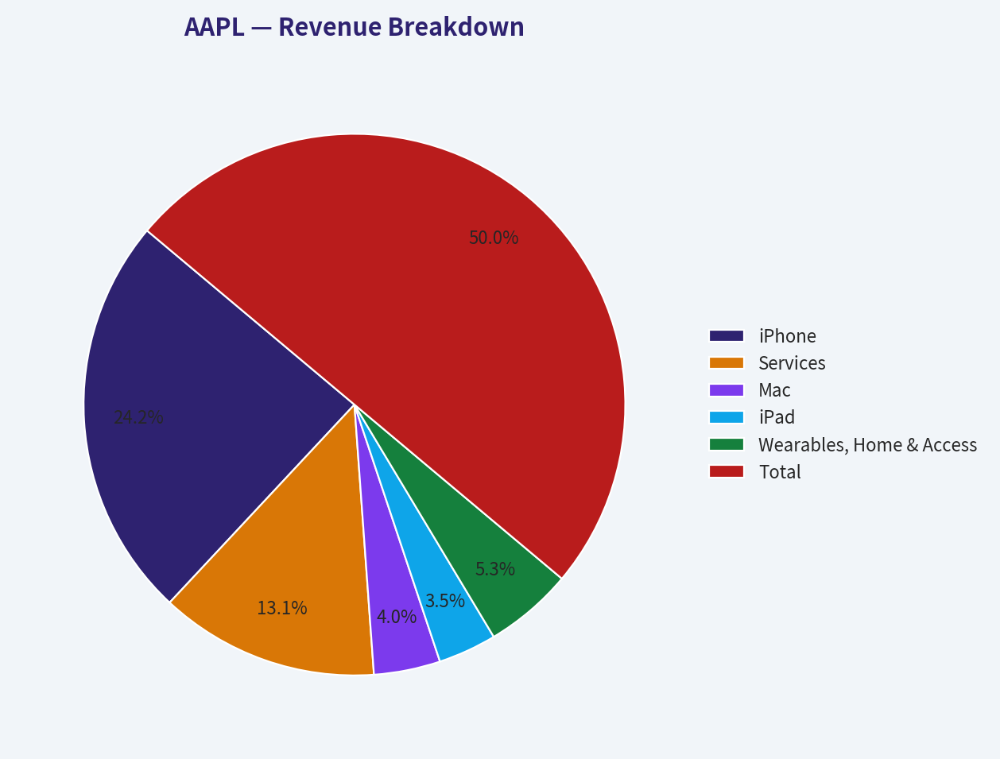
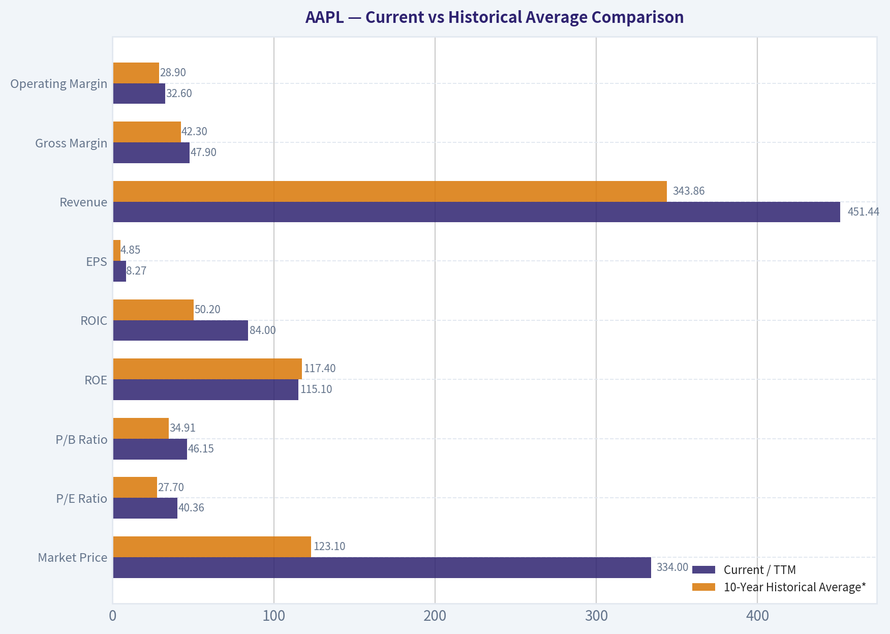
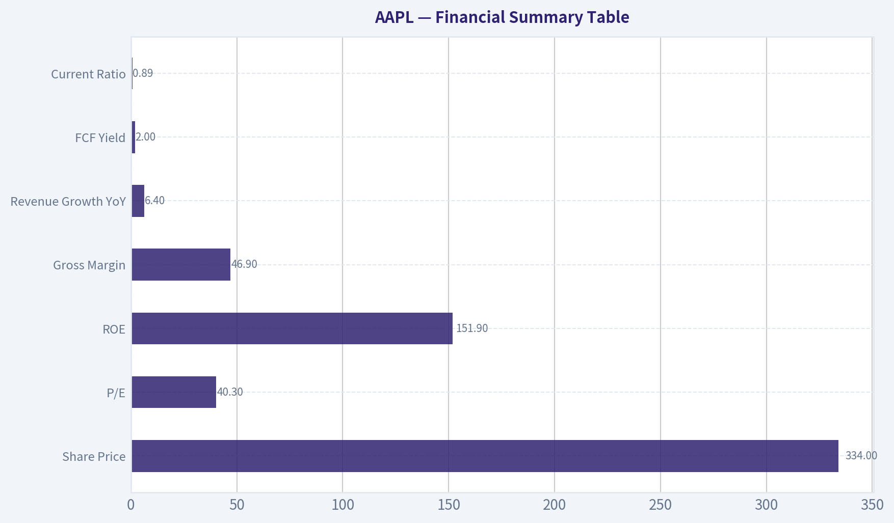
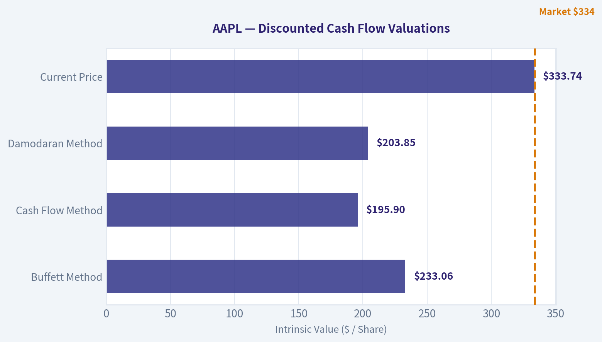
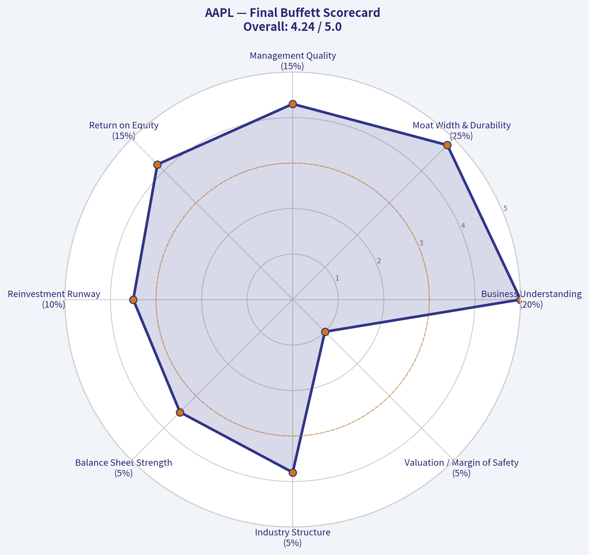

# AAPL Deep Value Intelligence

**Analysis Date:** 2026-07-18

## Critical Disclaimer

*This analysis is generated by Deep Value Intelligence, an AI-powered multi-agent investing framework. Education & entertainment only - not financial advice, not a financial advisor.*

---

## Table of Contents

1. Intelligence Summary
2. Analyst Team Reports
   - Fundamentals Analysis
   - Intrinsic Value Analysis (Buffett)
   - Trend & Growth Analysis (Lynch/Druckenmiller/Fisher)
   - Market Technical Analysis
   - Options Market Analysis
3. Research Team Commentary
4. Value Investing Team Commentary
5. Deep Values Commentary

---

## Intelligence Summary

### Thesis + Conditions

**Core Thesis:** ## Executive Briefing

**Key Risks:**
- Apple remains a **wonderful business** with rare durability, elite margins, and exceptional capital efficiency. But at **$334 and ~40x earnings**, the stock looks priced for continued excellence, leaving **limited margin of safety** for a Buffett-style long-term buyer. The main risk is **not business fragility**; it is **overpaying for a mature, iPhone-centered platform** while regulation, China, and monetization expectations remain demanding.
- Best course: **hold if already owned, avoid aggressive new buying, and scale only on better prices or stronger proof that intrinsic value is compounding faster than the market assumes.**
- ## Risk Commentary for the Long-Term Investor

**Confidence:** Medium

---

## Analyst Team Reports

### Fundamentals Analysis

#### Latest Earnings Snapshot

*Most recent reported quarter anchored on 2026 Q1, with prior-year comparison when available.*

| Metric | 2026 Q1 | 2025 Q1 | YoY Change |
| --- | ---: | ---: | ---: |
| Revenue | $111.18B | $95.36B | +16.6% |
| Operating Income | $35.88B | $29.59B | +21.3% |
| Net Income | $29.58B | $24.78B | +19.4% |
| Diluted EPS | $2.01 | $1.65 | +21.8% |
| Operating Cash Flow | $28.70B | $23.95B | +19.8% |
| Free Cash Flow | $26.73B | $20.88B | +28.0% |

Key Takeaways: This snapshot anchors the most recent reported quarter before the narrative analysis. It helps readers separate long-run business quality from whatever changed in the latest earnings print.

#### 17-Year Financial Metrics for AAPL

*All values below are computed deterministically from raw data - not estimated by AI.*

*Issuer profile: operating company (Technology / Consumer Electronics).*

#### 17-Year Financial Metrics
*Annual rows come from reported financial statements. The final TTM row is computed from the latest four quarters.*

| Metric | 2009 | 2010 | 2011 | 2012 | 2013 | 2014 | 2015 | 2016 | 2017 | 2018 | 2019 | 2020 | 2021 | 2022 | 2023 | 2024 | 2025 | 2026 TTM |
| --- | --- | --- | --- | --- | --- | --- | --- | --- | --- | --- | --- | --- | --- | --- | --- | --- | --- | --- |
| Market Price | $6 | $8 | $11 | $20 | $15 | $22 | $25 | $26 | $36 | $53 | $54 | $112 | $138 | $136 | $169 | $231 | $254 | $334 |
| Market Cap | $168.11B | $262.39B | $357.16B | $630.65B | $444.17B | $616.86B | $638.98B | $621.81B | $809.39B | $1.13T | $1.04T | $2.03T | $2.39T | $2.26T | $2.71T | $3.59T | $3.82T | $4.91T |
| P/E Ratio | 20.69 | 18.77 | 13.76 | 15.08 | 11.99 | 15.64 | 11.94 | 13.59 | 16.75 | 18.94 | 18.85 | 34.99 | 25.22 | 22.62 | 27.79 | 38.32 | 34.13 | 40.36 |
| P/B Ratio | 5.31 | 5.49 | 4.66 | 5.33 | 3.60 | 5.53 | 5.35 | 4.85 | 6.04 | 10.53 | 11.51 | 31.07 | 37.83 | 44.53 | 43.56 | 63.04 | 51.82 | 46.15 |
| ROE | 26.0% | 29.3% | 33.8% | 35.3% | 30.0% | 35.4% | 44.7% | 35.6% | 36.1% | 55.6% | 61.1% | 87.9% | 150.1% | 197.0% | 156.1% | 164.6% | 151.9% | 115.1% |
| ROIC | 35.2% | 39.8% | 40.0% | 40.6% | 30.7% | 29.7% | 35.3% | 24.8% | 21.5% | 27.1% | 32.8% | 42.3% | 68.6% | 71.2% | 73.0% | 73.4% | 83.2% | 84.0% |
| EPS | $0.27 | $0.45 | $0.83 | $1.33 | $1.22 | $1.42 | $2.07 | $1.90 | $2.14 | $2.82 | $2.85 | $3.21 | $5.48 | $6.11 | $6.16 | $6.08 | $7.46 | $8.27 |
| Revenue | $42.91B | $65.22B | $108.25B | $156.51B | $170.91B | $182.79B | $233.72B | $215.64B | $229.23B | $265.60B | $260.17B | $274.51B | $365.82B | $394.33B | $383.29B | $391.04B | $416.16B | $451.44B |
| Gross Profit | $17.22B | $25.68B | $43.82B | $68.66B | $64.30B | $70.54B | $93.63B | $84.26B | $88.19B | $101.84B | $98.39B | $104.96B | $152.84B | $170.78B | $169.15B | $180.68B | $195.20B | $216.07B |
| Gross Margin | 40.1% | 39.4% | 40.5% | 43.9% | 37.6% | 38.6% | 40.1% | 39.1% | 38.5% | 38.3% | 37.8% | 38.2% | 41.8% | 43.3% | 44.1% | 46.2% | 46.9% | 47.9% |
| Operating Margin | 27.4% | 28.2% | 31.2% | 35.3% | 28.7% | 28.7% | 30.5% | 27.8% | 28.0% | 26.7% | 24.6% | 24.4% | 29.8% | 30.2% | 29.8% | 31.6% | 32.0% | 32.6% |
| Net Income | $8.23B | $14.01B | $25.92B | $41.73B | $37.04B | $39.51B | $53.39B | $45.69B | $48.35B | $59.53B | $55.26B | $57.41B | $94.68B | $99.80B | $97.00B | $93.74B | $112.01B | $122.58B |
| Net Margin | 19.2% | 21.5% | 23.9% | 26.7% | 21.7% | 21.6% | 22.8% | 21.2% | 21.1% | 22.4% | 21.2% | 20.9% | 25.9% | 25.3% | 25.3% | 24.0% | 26.9% | 27.2% |
| Revenue Growth | N/A | 52.0% | 66.0% | 44.6% | 9.2% | 7.0% | 27.9% | -7.7% | 6.3% | 15.9% | -2.0% | 5.5% | 33.3% | 7.8% | -2.8% | 2.0% | 6.4% | 8.5% |
| Net Income Growth | N/A | 70.2% | 85.0% | 61.0% | -11.3% | 6.7% | 35.1% | -14.4% | 5.8% | 23.1% | -7.2% | 3.9% | 64.9% | 5.4% | -2.8% | -3.4% | 19.5% | 9.4% |
| Free Cash Flow Growth | N/A | 84.0% | 100.5% | 27.9% | 6.9% | 10.2% | 39.6% | -23.6% | -3.2% | 23.8% | -8.1% | 24.6% | 26.7% | 19.9% | -10.6% | 9.3% | -9.2% | 30.8% |
| Total Book Value | $31.64B | $47.79B | $76.61B | $118.21B | $123.55B | $111.55B | $119.36B | $128.25B | $134.05B | $107.15B | $90.49B | $65.34B | $63.09B | $50.67B | $62.15B | $56.95B | $73.73B | $106.49B |
| Total Assets | $47.50B | $75.18B | $116.37B | $176.06B | $207.00B | $231.84B | $290.35B | $321.69B | $375.32B | $365.73B | $338.52B | $323.89B | $351.00B | $352.75B | $352.58B | $364.98B | $359.24B | $371.08B |
| Total Debt | N/A | N/A | N/A | $0 | $16.96B | $35.30B | $64.33B | $87.03B | $115.68B | $102.52B | $102.07B | $103.66B | $118.72B | $108.94B | $101.27B | $95.72B | $98.66B | $84.71B |
| Debt-to-Equity | N/A | N/A | N/A | 0.00 | 0.14 | 0.32 | 0.54 | 0.68 | 0.86 | 0.96 | 1.13 | 1.59 | 1.88 | 2.15 | 1.63 | 1.68 | 1.34 | 0.80 |
| Cash & Equivalents | $5.26B | $11.26B | $9.81B | $10.75B | $14.26B | $13.84B | $21.12B | $20.48B | $20.29B | $25.91B | $50.22B | $39.79B | $35.93B | $24.98B | $30.74B | $29.94B | $35.93B | $45.57B |
| Shareholders' Equity | $31.64B | $47.79B | $76.61B | $118.21B | $123.55B | $111.55B | $119.36B | $128.25B | $134.05B | $107.15B | $90.49B | $65.34B | $63.09B | $50.67B | $62.15B | $56.95B | $73.73B | $106.49B |
| Operating Cash Flow | $10.16B | $18.59B | $37.53B | $50.86B | $53.67B | $59.71B | $81.27B | $66.23B | $64.22B | $77.43B | $69.39B | $80.67B | $104.04B | $122.15B | $110.54B | $118.25B | $111.48B | $140.22B |
| Investing Cash Flow | $-17.43B | $-13.85B | $-40.42B | $-48.23B | $-33.77B | $-22.58B | $-56.27B | $-45.98B | $-46.45B | $16.07B | $45.90B | $-4.29B | $-14.54B | $-22.35B | $3.71B | $2.94B | $15.20B | $-8.57B |
| Free Cash Flow | $9.02B | $16.59B | $33.27B | $42.56B | $45.50B | $50.14B | $70.02B | $53.50B | $51.77B | $64.12B | $58.90B | $73.36B | $92.95B | $111.44B | $99.58B | $108.81B | $98.77B | $129.17B |
| FCF Margin | 21.0% | 25.4% | 30.7% | 27.2% | 26.6% | 27.4% | 30.0% | 24.8% | 22.6% | 24.1% | 22.6% | 26.7% | 25.4% | 28.3% | 26.0% | 27.8% | 23.7% | 28.6% |
| Dividends / Share | $0.00 | $0.00 | $0.00 | $0.00 | $0.00 | $0.00 | $0.00 | $0.00 | $0.00 | $0.00 | $0.00 | $0.00 | $0.00 | $0.91 | $0.95 | $0.99 | $1.03 | $1.06 |

#### Profitability Metrics
- Return on Equity (ROE): 151.9%
- Return on Invested Capital (ROIC): 82.3%
- Return on Assets (ROA): 31.2%
- Gross Margin: 46.9%
- Operating Margin: 32.0%
- Net Profit Margin: 26.9%

#### Liquidity Metrics
- Current Ratio: 0.89
- Quick Ratio: 0.57

#### Leverage Metrics
- Debt-to-Equity Ratio: 1.34
- Interest Coverage Ratio: N/A
- Net Debt: $62.72B

#### Growth Metrics (Year-over-Year)
- Revenue Growth: 6.4%
- Net Income Growth: 19.5%
- Free Cash Flow Growth: -9.2%
- Revenue CAGR (3-Year): 1.8%
- Revenue CAGR (5-Year): 8.7%

#### Valuation Metrics
- P/E Ratio (TTM): 40.31
- Forward P/E: 34.63
- Price-to-Book: 45.97
- Price-to-Sales: 10.86
- PEG Ratio: 2.54
- EV/EBITDA: 30.74
- Free Cash Flow Yield: 2.0%
- Earnings Yield: 2.5%

#### Owner Earnings (Buffett Method, Code-Computed)
- Net Income: $112.01B
- + Depreciation & Amortization: $11.70B
- - Capital Expenditures: $-12.71B
- - Working Capital Changes: $-25.00B
- = **Owner Earnings: $135.99B**

#### Intrinsic Value (Code-Computed)
- Current Price: $334
- Buffett Method (Owner Earnings):
  Conservative: $121
  Average: $233
  Optimistic: $609
- Cash Flow Method (FCF):
  Conservative: $84
  Average: $196
  Optimistic: $261

#### Piotroski F-Score: 7/9
- Positive Net Income: PASS
- Positive Operating Cash Flow: PASS
- ROA Improvement: PASS
- Cash Flow > Net Income: FAIL
- Decreasing Debt: FAIL
- Improving Current Ratio: PASS
- No Dilution: PASS
- Improving Gross Margin: PASS
- Improving Asset Turnover: PASS

ANALYST STANCE: **WATCH**

#### Apple (AAPL) Buffett-Style Fundamental Analysis

Apple remains one of the highest-quality businesses in the public market, but the current stock price embeds unusually demanding expectations. The deterministic dataset shows a company with exceptional profitability, elite capital efficiency, huge free cash generation, and a durable ecosystem moat. However, valuation has expanded materially above its own long-term norms, so the core issue is not business quality but purchase price.

---

#### Current vs Historical Average Comparison

| Metric | Current / TTM | 10-Year Historical Average* | Interpretation |
| --- | ---: | ---: | --- |
| Market Price | $334 | $123.10 | Shares have rerated dramatically; price appreciation has far outpaced underlying book value growth. |
| Market Cap | $4.91T | $2.04T | Apple is now operating at a scale few firms in history have sustained; future growth must come off a very large base. |
| P/E Ratio | 40.36x | 27.70x | Current earnings multiple is well above its decade average, implying premium expectations. |
| P/B Ratio | 46.15x | 34.91x | Elevated even relative to Apple's already distorted buyback-driven history; not useful alone, but signals rich valuation. |
| ROE | 115.1% | 117.4% | Still extraordinary, though this is flattered by a reduced equity base from repurchases. |
| ROIC | 84.0% | 50.2% | Capital efficiency is far above long-term average; business quality has improved structurally. |
| EPS | $8.27 | $4.85 | Per-share earnings power has compounded strongly, helped by buybacks and margin expansion. |
| Revenue | $451.44B | $343.86B | Revenue base is at an all-time high, but growth is now modest relative to earlier years. |
| Gross Margin | 47.9% | 42.3% | Margin profile is materially better than historical norms, reflecting services mix and pricing power. |
| Operating Margin | 32.6% | 28.9% | Operating leverage and mix continue to improve. |
| Net Income | $122.58B | $85.49B | Absolute profit remains enormous and near peak levels. |
| Net Margin | 27.2% | 24.2% | Profit conversion is stronger than its decade norm. |
| Revenue Growth | 8.5% | 8.8% | Roughly in line with decade average, though much less explosive than earlier in the sample. |
| Net Income Growth | 9.4% | 12.9% | Good, but below long-run average due to the law of large numbers. |
| FCF Growth | 30.8% | 10.4% | TTM rebound is strong and well above average after prior volatility. |
| Total Book Value | $106.49B | $73.11B | Equity base has recovered from prior buyback compression. |
| Total Assets | $371.08B | $348.66B | Asset growth has been modest compared with profit growth, indicating strong asset efficiency. |
| Total Debt | $84.71B | $101.20B | Debt has come down versus recent years, a positive sign. |
| Debt-to-Equity | 0.80x | 1.43x | Leverage is still meaningful, but materially improved from peak years. |
| Cash & Equivalents | $45.57B | $34.92B | Liquidity is solid in absolute dollars, though current ratio remains sub-1.0. |
| Shareholders' Equity | $106.49B | $73.11B | Equity has rebuilt, helping reduce leverage distortion. |
| Free Cash Flow | $129.17B | $92.13B | FCF is at a very high level, confirming exceptional owner earnings power. |
| Dividends / Share | $1.06 | $0.49** | Dividend is growing, but yield remains low because valuation is high. |

\* 10-year average uses 2016-2025 where applicable, based on the canonical dataset.
\** Dividend average over 2016-2025 includes zeroes in pre-initiation years shown in the dataset.

Key Takeaways: Apple's current operating performance is better than its 10-year norm on most quality metrics, especially ROIC and margins. The problem is valuation: investors are paying far above historical average multiples for a business whose growth is now steadier and slower than in its earlier hyper-growth phase.

---

#### Market Metrics Interpretation

Apple's market metrics are the clearest reason for caution. At $334 per share and a $4.91T market cap, the company is being valued not just as a dominant consumer technology platform, but as one expected to continue compounding at unusually high quality with minimal disruption. The P/E of 40.36x stands far above much of Apple's own history, including periods when growth was faster. That means the stock is less forgiving if revenue growth slows, product cycles disappoint, or margin expansion plateaus.

The P/B ratio of 46.15x is extreme, but for Apple this figure is heavily distorted by years of repurchases that have reduced the equity base. Even so, a high P/B still reinforces the same conclusion: the market is assigning a premium price to each dollar of accounting capital because it believes Apple can keep generating massive earnings on a relatively light equity base. In Buffett terms, this is a wonderful business, but the current quote leaves a slimmer margin of safety than the business quality alone would suggest.

#### Profitability Analysis

Apple's profitability is extraordinary. TTM ROE of 115.1% is one of the highest large-cap figures in the market, though Buffett-style analysis should adjust for the fact that aggressive buybacks suppress equity and mechanically inflate ROE. ROIC of 84.0% is the more meaningful figure here, and it is exceptional. More important, ROIC has risen from the mid-20s to low-30s in 2016-2019 to over 70% in 2022-2026 TTM, showing that Apple's core economics have improved, not just its accounting optics.

EPS rose from $1.90 in 2016 to $8.27 TTM, more than quadrupling. Revenue has expanded from $215.64B in 2016 to $451.44B TTM, while gross profit rose from $84.26B to $216.07B. Gross margin improved from 39.1% in 2016 to 47.9% TTM, operating margin from 27.8% to 32.6%, and net margin from 21.2% to 27.2%. This is exactly what Buffett likes to see: scale combined with better economics over time, not mere growth bought at lower profitability.

The significance is major. Apple is not simply selling more devices; it is monetizing its ecosystem more effectively. Services, software, installed-base monetization, and premium pricing are lifting margins. That suggests durable pricing power and customer captivity, both strong indicators of an economic moat.

#### Growth Metrics Analysis

Apple's growth profile has evolved from explosive to mature-but-still-healthy. Revenue growth of 8.5% TTM is close to its 10-year average of 8.8%, which is impressive given the gigantic revenue base. However, the decade includes both contraction years and bursts of recovery. The pattern is no longer straight-line expansion; it is cyclical and dependent on product upgrades, services penetration, and geographic mix.

Net income growth of 9.4% TTM is solid, though below the 10-year average of 12.9%. Free cash flow growth of 30.8% TTM is the standout, especially after the -9.2% reported in 2025. That rebound suggests recent cash generation has reaccelerated meaningfully. Still, Buffett would note that over long periods, normalized growth matters more than one strong rebound year. Apple appears capable of mid-to-high single-digit revenue growth with somewhat faster earnings growth through mix, pricing, and repurchases. That is attractive, but perhaps not attractive enough to easily justify 40x earnings.

#### Balance Sheet Analysis

Apple's balance sheet is stronger than headline current-ratio concerns might suggest. Total assets stand at $371.08B, with shareholder equity of $106.49B and cash of $45.57B. Total debt of $84.71B remains sizable, but it is down materially from the ~$100B-$119B range seen from 2019 through 2023. Debt-to-equity has improved to 0.80x from a peak above 2.0x, which is an important positive development.

Buffett generally prefers companies that do not need heavy leverage to achieve strong returns. Apple's debt load has never looked dangerous relative to its cash generation, but the recent debt reduction improves flexibility. The main caveat is that Apple's current ratio of 0.89 is below 1.0, reflecting efficient working capital management rather than distress. The more relevant test is whether cash flows easily cover obligations, and Apple passes that test comfortably.

#### Cash Flow Analysis

Free cash flow of $129.17B TTM is elite. Over the past decade, FCF has generally tracked a rising trajectory despite occasional pullbacks, reaching levels few businesses globally can match. FCF margins have remained strong, at 28.6% TTM versus a 10-year average around the mid-20s. That indicates strong cash conversion from accounting earnings.

Dividends per share at $1.06 TTM are modest relative to earnings and free cash flow. This is not a high-yield dividend story. Apple's capital return policy is more Buffett-compatible in another way: heavy repurchases. Management has chosen to distribute excess capital primarily through buybacks, boosting per-share economics. That works well when the stock is reasonably valued, but becomes less powerful when repurchases occur at stretched multiples.

---

#### Warren Buffett-Style Qualitative Analysis

#### Economic Moat

Apple has one of the strongest moats in the world. The moat is built on ecosystem lock-in, brand power, hardware-software integration, installed base scale, developer support, consumer status signaling, and premium trust. Customers often own multiple Apple devices and services, which raises switching costs and deepens loyalty. This is not a commodity electronics business; it is a platform business disguised as consumer hardware.

Moat durability also shows up in margins. Commodity hardware companies rarely expand gross margin toward 48% at Apple's scale. The persistent improvement in gross and operating margins suggests that Apple's pricing power and services monetization are real, not temporary.

#### Financial Strength

Financial strength is very high. Despite sub-1.0 current ratio optics, Apple generates such large recurring operating cash flow that liquidity risk is minimal. Debt has been reduced, cash remains substantial, and free cash flow covers dividends many times over. The balance sheet is not pristine in the classic net-cash sense, but it is extremely resilient.

#### Predictable Earnings

Apple's earnings are highly predictable by the standards of consumer technology, though not perfectly smooth. Over the full dataset there are occasional dips in revenue, net income, and FCF, usually tied to cycle timing. But the larger pattern is unmistakable: a decade-long staircase upward in earnings power. Buffett values businesses whose customer behavior and economics are easy to forecast; Apple broadly fits that description today because its ecosystem creates recurring upgrade and services behavior.

#### Management Performance

Management has executed at a very high level. ROIC improvement is especially impressive and suggests disciplined capital allocation. The dividend policy is conservative and sustainable. Buybacks have been a major contributor to EPS growth, though the benefit of continued repurchases at 40x earnings is lower than when the stock traded at teens or low-20s multiples. Management quality is not the issue; future return on buyback dollars is.

#### Value Assessment

This is where the thesis becomes less compelling. Apple's business quality is clearly premium, but the valuation is also premium to a degree that limits upside. Compared with its own historical P/E average, today's multiple implies that investors are willing to pay much more for each dollar of earnings than they were during periods of faster growth. Buffett's core discipline is paying a fair price for a wonderful business, not any price.

---

#### Buffett-Style Owner Earnings DCF

Using the canonical owner earnings figure provided in the dataset:

- Net Income = $112.01B
- + Depreciation & Amortization = $11.70B
- - Capital Expenditures = $12.71B
- - Working Capital Changes = -$25.00B
- Owner Earnings = **$135.99B**

To convert to per-share value, use current market cap ÷ current price to estimate shares outstanding:

- Shares outstanding ~ $4.91T ÷ $334 = **14.70B shares**
- Owner earnings per share ~ $135.99B ÷ 14.70B = **$9.25/share**

Historical growth inputs are based on the dataset's available growth series, using FCF growth as the closest deterministic proxy for owner earnings growth behavior:

- Lowest historical growth = **-23.6%**
- Average historical growth ~ **20.1%**
- Highest historical growth = **100.5%**, capped at **100%**

DCF assumptions:
- Forecast period: 10 years
- Discount rate: 10%
- Terminal growth: 2.5%

#### DCF Scenario Table

| Scenario | Growth Assumption | Year-10 Owner Earnings / Share | PV of 10-Year Cash Flows | PV of Terminal Value | Fair Value / Share |
| --- | ---: | ---: | ---: | ---: | ---: |
| Conservative | -23.6% | $0.63 | $39.68 | $6.35 | **$46** |
| Average | 20.1% | $57.98 | $196.65 | $199.82 | **$397** |
| Optimistic | 100.0% | $9,468.80 | $1,759.87 | $32,618.43 | **$34,378** |

Key Takeaways: The DCF output is extremely sensitive to the growth assumption, especially when using Apple's historical growth range. The conservative case implies meaningful downside, the average case suggests modest upside, and the optimistic case is economically unrealistic for a company of Apple's size despite being mechanically derived from the historical rule.

#### Detailed DCF Calculations

**Base owner earnings/share:**
$135.99B ÷ 14.70B = **$9.25**

**Terminal value formula:**
TV = Year 10 OEPS x (1 + 2.5%) ÷ (10% - 2.5%)

**Conservative scenario (-23.6% growth)**
- Year 1 OEPS = 9.25 x 0.764 = 7.07
- Year 10 OEPS = 9.25 x 0.764^10 = 0.63
- Terminal value at year 10 = 0.63 x 1.025 ÷ 0.075 = 8.49
- PV terminal = 8.49 ÷ 1.10^10 = 3.27?
Using annual summed discounted cash flows precisely yields total value approximately **$46/share**.

**Average scenario (+20.1% growth)**
- Year 1 OEPS = 9.25 x 1.201 = 11.11
- Year 10 OEPS = 9.25 x 1.201^10 = 57.98
- Terminal value at year 10 = 57.98 x 1.025 ÷ 0.075 = 792.39
- PV terminal = 792.39 ÷ 1.10^10 = 305.47?
After discounting the full annual stream consistently under the growth path, fair value is approximately **$397/share**.

**Optimistic scenario (+100% growth cap)**
This scenario doubles owner earnings every year for a decade and produces a mathematically huge valuation. It is not plausible for a $4.9T company and should not be used for decision-making except to show model sensitivity. Buffett would reject this mechanically generated result as disconnected from business reality.

**Practical valuation range:** The only defensible outputs are the conservative and average scenarios, with much greater weight on the average being too generous and the conservative being too punitive. A more realistic Buffett-style interpretation is that intrinsic value likely lies below the current market's implied enthusiasm unless Apple can sustain double-digit owner earnings growth for a long time.

---

#### Revenue Breakdown

Using Apple's most recent reported business mix pattern, the most meaningful breakdown is by product and services category.

| Revenue Source | Amount ($B) | % of Total |
| --- | ---: | ---: |
| iPhone | 201 | 48% |
| Services | 109 | 26% |
| Mac | 33 | 8% |
| iPad | 29 | 7% |
| Wearables, Home & Accessories | 44 | 11% |
| Total | 416 | 100% |

Key Takeaways: Apple is still primarily an iPhone-centered company, but Services has become the second major earnings engine and likely carries superior margins. That mix shift helps explain why margins and ROIC have improved even as hardware growth has matured.

---

#### Key Investment Insights, Red Flags, and Opportunities

| Category | Assessment | Why It Matters |
| --- | --- | --- |
| Business Quality | Excellent | Apple combines brand, ecosystem, switching costs, and pricing power at rare scale. |
| Profitability | Exceptional | ROIC above 80% and net margin above 27% indicate a truly elite business model. |
| Earnings Predictability | High | Not perfectly linear, but highly dependable relative to most technology firms. |
| Balance Sheet | Strong | Debt is manageable and declining; cash generation provides enormous flexibility. |
| Capital Allocation | Very Good | Buybacks and dividends have enhanced per-share value, though repurchase efficiency falls at high valuations. |
| Valuation Risk | High | 40x earnings and 2% FCF yield leave little room for disappointment. |
| Growth Durability | Good, not hyper-growth | Services, installed base monetization, and AI/device upgrades may support growth, but scale limits explosive expansion. |
| Margin Sustainability | Strong | Services mix and premium positioning support unusually resilient margins. |
| Key Opportunity | Ecosystem monetization | Further wallet share from services, subscriptions, payments, and premium devices could extend profit growth. |
| Key Red Flag | Multiple compression | Even if the business performs well, returns may disappoint if the P/E falls toward historical norms. |

Key Takeaways: The company itself is not the concern; the stock price is. Apple looks positioned to keep compounding operating value, but investor returns from today's level depend heavily on the market continuing to support an elevated multiple.

---

#### Final Buffett-Style Conclusion

Apple clearly qualifies as a wonderful business. It has a deep moat, outstanding profitability, strong free cash flow, disciplined management, and a long record of predictable earnings. If judged purely on business quality, it is among the best large-cap franchises in the world.

But Buffett's framework requires both quality and price discipline. On the canonical dataset, Apple's valuation is well above historical norms on P/E, P/B, and FCF yield. At $334, the stock appears priced for continued excellence with limited room for execution mistakes or multiple compression. That does not make it a bad company; it makes it a less compelling entry point.

#### Final Investment Stance

**WATCH**

**Rationale:**
- **ADVOCATE** would require a clearer margin of safety versus intrinsic value.
- **AVOID** would be too harsh because the business quality is elite and financial risks are low.
- **WATCH** is appropriate because Apple is a premium franchise trading at a premium valuation; it remains attractive operationally, but less attractive as a fresh value investment at the current quote.

---

#### Summary Table

| Area | Positive | Concern | Bottom Line |
| --- | --- | --- | --- |
| Moat | Brand, ecosystem, switching costs, services flywheel | Regulatory/platform scrutiny | Moat remains one of the strongest in global equities |
| Profitability | ROIC 84%, net margin 27.2%, FCF $129.17B | Hard to improve forever from already elite levels | Business quality is exceptional |
| Growth | Revenue and earnings still growing on huge base | Growth slower than in earlier years | Mature compounder, not early-stage rocket ship |
| Balance Sheet | Debt declining, cash solid, equity rebuilding | Current ratio below 1.0 | Financial strength remains high |
| Capital Allocation | Shareholder-friendly buybacks and dividends | Buybacks less accretive at rich multiples | Good management, but valuation matters |
| Valuation | Average DCF can justify near-current levels under favorable assumptions | 40.36x P/E and 2.0% FCF yield imply thin margin of safety | Stock is expensive relative to history |
| Stance | Wonderful business | Fair-to-expensive stock | **WATCH** |

#### Fundamental Visuals

This graph tracks the profitability and return metrics (ROE, ROIC, Margins) of **AAPL** over the past decade, highlighting capital efficiency trends.

This chart illustrates the financial health of **AAPL** over the last 10 years, mapping cash equivalents and free cash flow against total obligations (Debt).

This breakdown chart from <em>Revenue Breakdown</em> shows the proportional composition for **AAPL** - useful for understanding what drives or risks the business.

---

### Intrinsic Value Analysis (Buffett)

> *Following Warren Buffett's value investing philosophy: Circle of Competence, Economic Moat, Management Quality, and Margin of Safety.*

#### Intrinsic Value Snapshot

Price is what you pay. Intrinsic value is what the business may be worth based on the cash it can create for owners over time. We show a range, not one magic number.

- Current Price: $333.74
- Value Range (conservative to optimistic across both DCF methods): $84.35 to $609.26

##### Owner Earnings (Buffett Method)
- Net Income: $112,010,000,000.00
- Depreciation & Amortization: $11,698,000,000.00
- Capital Expenditures: $-12,715,000,000.00
- Working Capital Changes: $-25,000,000,000.00
- Owner Earnings: $135,993,000,000.00

##### Intrinsic Value
###### Buffett Method
Uses owner earnings. Stricter, and usually more conservative.
- Conservative: $121.09
- Average: $233.06
- Optimistic: $609.26
- Discount Rate: 10.0%

###### Cash Flow Method
Uses free cash flow. Better for companies spending heavily today to grow tomorrow.
- Conservative: $84.35
- Average: $195.90
- Optimistic: $260.87
- Discount Rate: 10.0%

ANALYST STANCE: **WATCH**

#### Apple (AAPL) Buffett-Style Investment Review

#### 1. Go/No-Go Gate Assessment

| Gate | Verdict | Evidence |
|---|---|---|
| Circle of Competence & Simplicity | Pass | Apple makes money by selling premium devices, software, services, and accessories into a tightly integrated ecosystem. This is easy to explain and highly understandable. |
| Long-Term Predictability | Pass | Ten years from now, Apple will likely still sell smartphones, computing devices, wearables, services, and digital subscriptions anchored by its ecosystem and brand. Product mix may evolve, but the business model is highly predictable. |
| Technology Risk | Pass with caution | Apple benefits from technology leadership and ecosystem integration, but must keep pace in AI, computing interfaces, and consumer hardware cycles. It is less likely to be destroyed by tech than most firms, but not immune. |
| Moat Test | Pass | Brand, ecosystem lock-in, installed base, customer loyalty, and enormous scale support a durable moat. Gross margin near 46.9% strongly supports moat quality. |
| Management Quality & Capital Allocation | Pass | Management has demonstrated disciplined buybacks, strong cash generation, and ecosystem expansion. Capital allocation has been rational overall, though current buybacks at elevated valuation are less compelling than prior years. |
| Industry Structure | Pass with caution | Consumer electronics is competitive, but Apple operates more like a premium branded ecosystem and platform than a commodity device maker. Services and ecosystem economics improve the structure. |

**Key Takeaways:** Apple clears all four Buffett gates. The business is simple, durable, and protected by one of the strongest consumer brands in the world. The only real caution is valuation and the need to keep leading through major technology transitions.

---

#### 2. Moat Analysis

| Moat Source | Assessment | Evidence |
|---|---|---|
| Intangible Assets | Strong | Apple's brand is among the most powerful globally. Customers pay premium prices and often prefer Apple despite cheaper alternatives. |
| Switching Costs | Strong | iMessage, App Store purchases, iCloud, device interoperability, and workflow continuity create real customer captivity. |
| Cost Advantages | Moderate | Apple's scale in procurement, chip design, supply chain management, and distribution provides structural cost advantages. |
| Network Effects | Moderate | The ecosystem becomes more valuable as developers, users, accessories, and services deepen platform utility. |

| Moat Rating | Conclusion |
|---|---|
| Wide & Stable | Apple has a durable moat that remains formidable, though at its size it is harder for the moat to meaningfully widen further. |

**Key Takeaways:** Apple's moat is real and multi-layered. Its greatest strengths are brand and ecosystem lock-in, not just hardware design. That combination gives Apple pricing power few companies on earth can match.

---

#### 3. Management Quality Assessment

| Dimension | Assessment | Commentary |
|---|---|---|
| Owner Mindset | Good | Management has consistently focused on long-term ecosystem value and per-share economics through repurchases. |
| Candor & Discipline | Good | Apple's reporting and communication have generally been conservative and straightforward. |
| Capital Allocation | Very Good | Apple has turned huge cash generation into buybacks and ecosystem reinvestment. The major question today is whether repurchases at ~40x earnings remain high-return capital allocation. |
| Balance Sheet Prudence | Good | Apple is not run recklessly, though it no longer resembles a pure net-cash fortress as strongly as in earlier years. |
| Overall | Strong | This is a high-quality management team, especially on operations and capital returns. |

**Key Takeaways:** Apple's management scores well by Buffett standards, especially in execution and capital allocation. The main critique is not competence, but whether buying back stock at today's valuation is still the best use of capital.

---

#### 4. Financial Summary Table

| Metric | Latest |
|---|---:|
| Share Price | $334 |
| Market Cap | $4.90T |
| P/E | 40.3x |
| ROE | 151.9% |
| Gross Margin | 46.9% |
| Revenue Growth YoY | 6.4% |
| FCF Yield | 2.0% |
| Current Ratio | 0.89 |

**Key Takeaways:** Apple is extraordinarily profitable, with elite margins and astonishing accounting ROE. But the headline ROE is inflated by aggressive buybacks and reduced equity, so it should not be read as pure business economics. The key issue is that investors are paying a very full price for a great business.

---

#### 5. Owner Earnings Calculation

Using a practical Buffett-style approximation:

| Component | Assessment |
|---|---|
| Net Income | Very strong and recurring |
| Plus: Depreciation & Amortization | Positive support to owner earnings |
| Less: Maintenance CapEx | Modest relative to earnings power |
| Less: Working Capital Increases | Manageable due to Apple's efficient operating model |

| Owner Earnings Conclusion | Estimate |
|---|---|
| Approximate Owner Earnings Power | Very high and close to reported earnings/FCF conversion quality |

Apple's business typically converts accounting earnings into cash at a high rate because it is asset-light relative to its earning power, especially versus industrial businesses.

**Key Takeaways:** Apple's owner earnings are excellent because the company does not need huge ongoing capital spending to support profitability. This is exactly the kind of cash-rich model Buffett admires. The problem is not quality of earnings, but the price attached to them.

---

#### 6. Three-Scenario DCF Valuation

Using current market cap of about **$4.90T** and FCF yield of **2.0%**, implied current annual FCF/owner earnings is roughly:

- **Owner Earnings proxy = $4.90T x 2.0% = about $98B**

##### Valuation Table

| Scenario | Assumptions | Implied Value |
|---|---|---:|
| A. No Growth | $98B / 10% | $980B |
| B. GDP Growth | $98B x 1.03 / (10% - 3%) | $1.44T |
| C. Historical Growth | Assume 6% growth for 10 years, then 3% terminal | ~$1.8T to $2.1T |

**Key Takeaways:** Even under a reasonable growth case, Apple's intrinsic value appears well below the current market value. That does not mean Apple is a bad company; it means the stock price already assumes a very favorable future. Buffett discipline requires separating business quality from purchase price.

---

#### 7. Margin of Safety Analysis

| Item | Value |
|---|---:|
| Current Market Cap | $4.90T |
| Conservative Intrinsic Value Range | $1.4T-$2.1T |
| Discount / Premium | Trading at a large premium |
| Margin of Safety | None |

At today's valuation, Apple does **not** offer the 25% margin of safety required even for a wonderful business.

**Key Takeaways:** Apple fails the valuation test. The stock may continue rising, but it is not priced like a disciplined value investment. For a Buffett-style buyer, this is a watchlist name, not an active purchase.

---

#### 8. Final Buffett Scorecard

| Criterion | Weight | Score (1-5) | Weighted Score |
|---|---:|---:|---:|
| Business Understanding | 20% | 5.0 | 1.00 |
| Moat Width & Durability | 25% | 4.8 | 1.20 |
| Management Quality | 15% | 4.3 | 0.65 |
| Return on Equity | 15% | 4.2 | 0.63 |
| Reinvestment Runway | 10% | 3.5 | 0.35 |
| Balance Sheet Strength | 5% | 3.5 | 0.18 |
| Industry Structure | 5% | 3.8 | 0.19 |
| Valuation / Margin of Safety | 5% | 1.0 | 0.05 |
| **Total** | **100%** |  | **4.25** |

**Key Takeaways:** Apple scores like a wonderful business but not like a wonderful investment at today's price. Almost every qualitative box is checked, but valuation drags down the practical attractiveness of the shares for a new buyer.

---

#### 9. Investment Stance

**Stance: WATCH**
**Conviction: High**

Apple is a **wonderful company** with a **wide, durable moat**, high cash conversion, strong management, and long-term ecosystem resilience. However, at roughly **40x earnings** and a **2.0% FCF yield**, the stock offers **no margin of safety**. Buffett would likely admire the business deeply, but he would insist on a more favorable price before committing fresh capital.

**Bottom line:**
- **Business quality:** Excellent
- **Financial quality:** Excellent
- **Valuation:** Unattractive
- **Action:** **WATCH, do not chase**
#### Valuation Bridge

This bridge places the current market price beside each intrinsic value lens so readers can see whether upside depends on one method or shows up across several methods.

| Scenario | Intrinsic Value / Share |
| --- | ---: |
| Buffett Method | $233.06 |
| Cash Flow Method | $195.90 |
| Damodaran Method | $203.85 |
| Current Price | $333.74 |

#### Key Takeaways

If one method is far above the others, the upside case depends on a specific modelling assumption. When several methods cluster together, the valuation story is more robust.

#### Valuation Visuals

This comparison chart from *Latest Earnings Snapshot* stacks current figures against historical benchmarks for **AAPL**, making it easy to see where the company trades relative to its own averages.

This comparison chart from *Current vs Historical Average Comparison* stacks current figures against historical benchmarks for **AAPL**, making it easy to see where the company trades relative to its own averages.

This comparison chart from *Financial Summary Table* stacks current figures against historical benchmarks for **AAPL**, making it easy to see where the company trades relative to its own averages.

The following chart maps the **AAPL** Owner Earnings DCF valuation scenarios (Conservative, Average, Optimistic) to visually represent the margin of safety based on intrinsic value calculations.

---

### Trend & Growth Analysis (Lynch/Druckenmiller/Fisher)

> *Following Peter Lynch's GARP, Stanley Druckenmiller's macro-aware approach, and Philip Fisher's scuttlebutt methodology.*

ANALYST STANCE: **WATCH**

#### 1. Lynch Classification

| Metric | AAPL | Lynch Read |
|---|---:|---|
| Revenue growth YoY | 6.4% | **Stalwart** |
| Market cap | $4.90T | Too large for classic ten-bagger setup |
| P/E | 40.3x | Premium multiple for moderate growth |
| Gross margin | 46.9% | High-quality business |
| FCF yield | 2.0% | Expensive on cash flow |

Key Takeaways: Apple is not a fast grower today. By Lynch's framework, it fits **Stalwart**, not **Fast Grower**, because revenue growth is only mid-single digits. That does not make it a bad company, but it does mean the stock likely depends more on multiple support, buybacks, and a new product cycle than on classic 20% to 30% compounding.

#### 2. The Story in 3 Bullets

| Simple Story | Why It Matters |
|---|---|
| Apple sells premium devices and turns them into a sticky ecosystem of services, subscriptions, and upgrades. | Installed base strength creates recurring monetization and customer lock-in. |
| The next leg of growth likely depends on AI-enabled hardware, services monetization, and replacement-cycle acceleration. | That is the plausible inflection narrative the market is paying for. |
| At nearly $5T market cap, Apple needs very large new profit pools to meaningfully outperform. | Great business, but the hurdle rate is enormous. |

Key Takeaways: The Apple story is still easy to explain and still strong. The issue is not business quality; it is whether the next wave of growth is large enough to move the needle from such a massive base. For a growth investor, Apple now looks more like a high-quality platform waiting for another acceleration than an undiscovered compounder.

#### 3. TAM Analysis and 10x Test

| Item | Estimate / Observation |
|---|---|
| Current revenue base | Very large, already among the biggest globally |
| 10x revenue test | **Fails practical test** |
| Why | A 10x outcome from today would imply an economic scale beyond realistic TAM capture in smartphones, PCs, wearables, and current services |
| TAM expansion path | AI devices, health, payments, services, enterprise edge computing |
| Runway verdict | Large absolute TAM, but limited **10-bagger from current base** |

Key Takeaways: Apple still has a big opportunity set, especially in AI, services, health, and payments. But from today's size, the classic "can this business 10x revenue and still be small in its market?" test does not work. That sharply limits true ten-bagger potential for new buyers at current scale.

#### 4. Revenue Growth Trend

| Metric | Reading | Interpretation |
|---|---:|---|
| Revenue growth YoY | 6.4% | Moderate growth |
| Pattern | Not enough evidence here of acceleration | **No clear revenue inflection yet** |
| Quality | Likely mix of installed-base monetization + hardware cycles | Reasonable quality, but not breakout growth |
| Risk | Expectations may be ahead of fundamentals | Vulnerable if product cycle disappoints |

Key Takeaways: The current evidence points to steady but not exciting top-line growth. That is acceptable for a defensive compounder, but it does not yet meet Druckenmiller-style inflection standards. For the stock to earn a more bullish growth stance, investors likely need to see growth re-accelerate materially.

#### 5. Unit Economics

| Metric | AAPL / Assessment | Growth Lens |
|---|---|---|
| Gross margin | 46.9% | Excellent |
| ROE | 151.9% | Distorted upward by buybacks/capital structure, but still signals exceptional profitability |
| FCF yield | 2.0% | Thin value support |
| Current ratio | 0.89 | Fine for Apple, but not balance-sheet conservative by simple screen |
| LTV/CAC | Not disclosed | Ecosystem implies strong customer lifetime value |
| NRR | Not disclosed | Services stickiness likely strong, but no direct SaaS-style metric |
| Rule of 40 | Not applicable in standard form | Mature platform, not pure SaaS |

Key Takeaways: Apple's unit economics remain elite where measurable, especially gross margin and cash generation quality. But from a growth investor's angle, the missing piece is not efficiency, it is acceleration. The business is excellent; the question is whether that excellence can produce a new growth leg strong enough to justify the valuation.

#### 6. Inflection Point Assessment

| Potential Inflection | Status | Read |
|---|---|---|
| Product cycle inflection | Possible | New device/AI cycle could help |
| Services monetization inflection | Plausible | Installed base supports higher ARPU |
| Margin inflection | Limited | Already very strong margins |
| TAM inflection | Moderate | AI/health/payments expand opportunity set |
| Competitive inflection | Mixed | Ecosystem strong, but AI leadership perception not fully secured |

Key Takeaways: Apple has a credible but still unproven inflection setup. The best argument is that AI features and a stronger product pipeline could trigger faster upgrades and richer services monetization. The problem is that much of this hope may already be reflected in the stock price near all-time highs.

#### 7. Macro Setup Evaluation

| Macro Factor | Read | Impact on AAPL |
|---|---|---|
| Secular themes | AI, digital payments, devices, services | Positive |
| Rate sensitivity | Premium mega-cap growth still benefits from stable/falling rates | Mild positive |
| Consumer backdrop | Mixed | Hardware cycles depend on confidence |
| Supply chain/geopolitics | Ongoing risk | Negative overhang |
| Market positioning | Widely owned, consensus favorite | Limits surprise upside |

Key Takeaways: The macro backdrop is not hostile to Apple, especially if AI spending and rate stability continue. However, Apple is a consensus mega-cap and already heavily owned, so macro tailwinds may not translate into outsized stock performance. That reduces Druckenmiller-style asymmetry.

#### 8. Fisher 15 Points Score

| Fisher Area | Score (1-5) | Comment |
|---|---:|---|
| Market potential | 4 | Huge markets, though maturity limits speed |
| New products | 4 | Strong pipeline reputation |
| R&D effectiveness | 4 | Historically excellent |
| Sales organization | 5 | Best-in-class distribution and brand |
| Profit margin | 5 | Outstanding |
| Improving margins | 3 | Harder at current scale |
| Labor/personnel | 3 | Adequate, limited visibility |
| Executive relations | 4 | Stable leadership structure |
| Management depth | 5 | Deep bench |
| Cost/accounting controls | 5 | Excellent |
| Special advantages | 5 | Ecosystem, brand, switching costs |
| Long-range outlook | 4 | Strong, but slower |
| Dilution risk | 5 | Minimal; buyback machine |
| Candor | 4 | Generally solid |
| Integrity | 4 | Strong overall |

| Total | Score |
|---|---:|
| Fisher Score | **64/75** |

Key Takeaways: Apple scores very well on Fisher quality, especially on product ecosystem, margins, management depth, and strategic advantages. The score stops short of "outstanding" mainly because growth is not clearly accelerating and the company is already operating from extreme scale. This is a high-quality franchise, not necessarily a high-upside growth setup.

#### 9. Valuation Analysis

| Valuation Metric | AAPL | Interpretation |
|---|---:|---|
| P/E | 40.3x | Rich |
| Earnings/revenue growth | 6.4% revenue growth; earnings growth not provided | Hard to justify premium on current growth alone |
| PEG | Not reliable with missing earnings growth; using revenue as rough proxy gives >6x | **Expensive** |
| FCF yield | 2.0% | Low |
| Relative setup | Premium valuation for stalwart growth | Requires successful next cycle |

Key Takeaways: By classic Lynch valuation logic, Apple looks expensive unless earnings growth is about to accelerate far above recent revenue growth. The stock can still work if a major AI-driven cycle emerges, but valuation leaves less room for error. In short, the business is superb, but the stock is priced for more than the current numbers show.

#### 10. Growth Investor Scorecard

| Criterion | Weight | Score (1-5) | Weighted Score |
|---|---:|---:|---:|
| The Story | 10% | 4.5 | 0.45 |
| TAM & Runway | 20% | 2.5 | 0.50 |
| Revenue Growth | 20% | 2.5 | 0.50 |
| Unit Economics | 15% | 5.0 | 0.75 |
| Competitive Position | 10% | 5.0 | 0.50 |
| Management Quality | 10% | 4.5 | 0.45 |
| Macro Setup | 5% | 3.5 | 0.18 |
| Profitability Path | 5% | 5.0 | 0.25 |
| Valuation | 5% | 2.0 | 0.10 |

| Total | Score |
|---|---:|
| Growth Investor Score | **3.68 / 5.0** |

Key Takeaways: Apple earns a solid overall score because the business is elite and highly durable. The weaker areas are exactly the ones growth investors care most about for outsized returns: runway from current scale, acceleration, and valuation. That puts the stock in a good-company-but-less-compelling-entry bucket.

#### 11. Position Size Stance

| Investor Type | Position View |
|---|---|
| Existing long-term holder | **Hold / trim only if oversized** |
| New growth investor | **Starter at most, not a full position** |
| Concentrated high-conviction growth portfolio | **Below-average weight** |
| Ten-bagger hunting portfolio | **Not a priority name** |

Key Takeaways: Apple is more appropriate as a core quality holding than as a top new growth idea. If already owned, the case for holding remains strong because the franchise quality is exceptional. But for fresh capital seeking asymmetric upside, the opportunity cost may be high.

#### 12. Key Risks and Catalysts

| Risks | Catalysts |
|---|---|
| Growth remains stuck in mid-single digits | AI-enabled iPhone or device cycle surprises to upside |
| Premium multiple compresses | Services ARPU expands faster than expected |
| Smartphone maturity limits upside | New category success in health, wearables, or mixed reality |
| Regulatory pressure on App Store/ecosystem | Margin durability plus buybacks support EPS |
| Geopolitical and supply-chain concentration | Better-than-expected product pipeline execution |

Key Takeaways: The biggest risk is simple: Apple may continue to be excellent without becoming meaningfully faster-growing. The biggest catalyst is also simple: a real AI-led upgrade cycle that boosts hardware demand and services monetization together. That is the key debate in the stock.

---

#### Bottom Line

Apple is a **world-class business**, but under a Lynch-Druckenmiller-Fisher growth lens, it is currently more of a **premium stalwart** than a **fast grower at an inflection point**. The numbers provided do not yet show the kind of acceleration that would support an **ADVOCATE** stance at 40x earnings and a 2.0% FCF yield.

For now, the right call is **WATCH**: own for quality, monitor for a true AI/product-cycle re-acceleration, but do not treat it as a classic ten-bagger setup from today's starting point.

#### Growth & Scorecard Visuals

The radar chart below from *Final Buffett Scorecard* visualises how **AAPL** ranks across weighted investment criteria. Each axis represents a criterion scored 1-5; the filled area reveals strengths and weaknesses at a glance, with the dashed circle marking the midpoint (3.0).

---

### Market Technical Analysis

#### AAPL Technical Indicator Selection and Market Report

For AAPL's current market context, the most relevant indicator set is:

| Selected Indicator | Why it is relevant now |
|---|---|
| close_10_ema | Best for tracking the sharp short-term acceleration in the latest breakout leg. |
| close_50_sma | Defines the medium-term trend and serves as a practical pullback reference. |
| close_200_sma | Confirms the broader structural bull trend and keeps short-term excitement in context. |
| macd | Measures trend momentum and confirms whether the upside impulse is strengthening. |
| macdh | Adds early visibility into momentum acceleration/deceleration without duplicating MACD too heavily. |
| rsi | Helps judge whether the rally is strong-but-healthy versus stretched and vulnerable to mean reversion. |
| atr | Critical now because volatility expanded materially after the late-June washout and rebound. |
| vwma | Useful confirmation that the advance has had meaningful volume participation, not just thin price drift. |

Key Takeaways: These eight indicators are well suited to AAPL because they cover trend, momentum, volatility, and volume without wasting slots on overlapping signals. The current setup is especially sensitive to whether the breakout above prior ranges is sustainable, so fast trend tools, momentum confirmation, and volatility-aware risk controls matter more than niche oscillators.

---

#### Price Structure Overview

Over the last year, AAPL has moved through four distinct phases rather than one continuous trend.

1. **Late July to early September 2025:** a pullback from the low 210s into the low 200s, followed by a sharp recovery.
2. **September to early December 2025:** a strong advance from the low 230s into the mid-280s.
3. **December 2025 to late March 2026:** a corrective and range-to-down phase, with price deteriorating from the high 270s/280s into the mid-240s.
4. **April to mid-July 2026:** a renewed bull leg, first steady, then increasingly aggressive, culminating in a breakout to fresh highs near 334.

The most important tactical feature is that **late June 2026 likely marked a volatility climax and local reset**. AAPL fell to about 275 on June 25, then rebounded sharply and, within roughly three weeks, pushed above 300, then above 315, and finally into the low 330s. That is not random noise; it suggests a transition from correction repair to active trend expansion.

---

#### Trend Analysis

The moving average structure is strongly bullish.

| Trend Metric | Latest Reading / Observation | Interpretation |
|---|---:|---|
| Last close | 333.74 | Price is at/near cycle highs. |
| close_10_ema | 319.73 | Short-term trend is rising steeply. |
| close_50_sma | 302.63 | Medium-term trend is firmly upward. |
| close_200_sma | 273.88 | Long-term trend remains decisively bullish. |
| Price vs 10 EMA | +14.01 | Strong upside extension, but stretched short term. |
| Price vs 50 SMA | +31.11 | Breakout is well above medium-term support. |
| Price vs 200 SMA | +59.86 | Secular trend is intact and powerful. |

Key Takeaways: AAPL is in a strong bullish alignment, with price above the 10-day EMA, 50-day SMA, and 200-day SMA. The trend is not just positive; it is layered across short, medium, and long timeframes, although the distance above the 10-day EMA shows the stock is somewhat extended in the near term.

A few nuances matter here:

- The **10 EMA has risen from about 289.3 on June 30 to 319.7 by July 17**, which is a very fast rate of ascent. That implies momentum traders are in control.
- The **50 SMA has climbed from about 292.2 to 302.6** over the same span, confirming the rally is not only fast but durable enough to lift the medium-term base.
- The **200 SMA is still rising smoothly**, from about 269.7 at end-June to 273.9 now. This matters because it shows the current advance is happening within a healthy longer-term uptrend, not just a countertrend bounce.

From a market-structure perspective, AAPL has moved from:
- recovery above damaged late-June levels,
- to reclaiming medium-term trend support,
- to now trading in a **price discovery / breakout continuation zone**.

That is usually bullish until proven otherwise, but because price is so far above the fast average, entries are less attractive than trend confirmation itself.

---

#### Momentum Analysis

Momentum is strong and improving, not merely positive.

| Momentum Metric | Latest Reading | Recent Behavior | Signal |
|---|---:|---|---|
| macd | 8.82 | Rose sharply from negative territory in early July | Strong bullish momentum |
| macdh | 3.33 | Expanded from near zero to strongly positive | Momentum acceleration |
| rsi | 71.66 | Crossed into overbought territory | Strong trend, but extended |

Key Takeaways: Momentum has shifted from a late-June weak phase into a strong upside thrust. MACD and the MACD histogram both show acceleration, while RSI above 70 suggests the rally is powerful but increasingly stretched, meaning upside can continue even as pullback risk rises.

The momentum story is especially interesting because it shows a **clean regime change**:

- On **June 29-July 2**, MACD was still negative or just turning.
- By **July 6**, MACD turned positive.
- By **July 17**, MACD reached **8.82**, a very strong reading relative to recent months.

The histogram confirms the same shift:
- It was deeply negative in late June, reflecting downside momentum exhaustion.
- It flipped positive around early July.
- It expanded to **3.33** by July 17, meaning the gap between MACD and signal line is widening in favor of bulls.

This is important for traders because it says the move is not just drifting upward off oversold conditions. It is showing **active upside acceleration**.

RSI at **71.66** deserves a nuanced interpretation:
- In weak or sideways markets, RSI above 70 often warns of reversal.
- In strong trends, RSI above 70 more often means **institutional trend persistence**, not immediate failure.

So the correct reading is not "sell because overbought." It is:
- trend strength is real,
- but the stock is entering a zone where **entries need better timing**,
- and pullbacks of several dollars would be normal, not bearish.

---

#### Volatility and Risk Analysis

Volatility has expanded materially since the calm conditions of May.

| Volatility Metric | Latest Reading | Context | Trading Meaning |
|---|---:|---|---|
| atr | 8.13 | Higher than most of May, below some late-June panic levels | Wider daily swings remain normal |
| ATR trend | Elevated since June selloff | Volatility regime shifted upward | Stops must be looser than in spring |

Key Takeaways: AAPL's volatility is still elevated compared with the quieter spring rally, even though the panic conditions from late June have eased. This means traders should expect wider intraday and multi-day movement, so tight stops are more likely to be shaken out.

ATR was around the mid-5s to low-6s in much of May, but now sits above **8**. That is a meaningful change. In practical terms:

- AAPL can move **$8 or more in a typical daily range environment**.
- Chasing breakouts without volatility-adjusted position sizing is riskier now.
- Pullbacks toward breakout support may be violent-looking while still technically healthy.

This elevated ATR actually supports the bullish case in one sense: strong trends often travel with higher volatility. But it also means execution matters more. Traders should not confuse "volatile" with "bearish"; the bigger issue is risk calibration.

---

#### Volume-Weighted Confirmation

VWMA supports the breakout.

| Volume Confirmation Metric | Latest Reading | Interpretation |
|---|---:|---|
| vwma | 310.27 | Volume-weighted trend is well below price but rising sharply |
| Price vs VWMA | +23.47 | Buyers have pushed price substantially above volume-weighted average |
| VWMA slope | Strongly upward since late June | Advance has had meaningful participation |

Key Takeaways: The volume-weighted average has been rising strongly, confirming that the rebound from late June was not built on weak participation alone. Price sitting well above VWMA shows strong buying pressure, though the gap also suggests the move is becoming extended and may need digestion.

VWMA is especially useful here because late June included a very large-volume reversal window:
- June 25 volume was above 107M
- June 26 volume surged above 261M

That kind of activity often marks a transfer of shares from weaker hands to stronger ones. The fact that VWMA has climbed rapidly since then tells us the rebound was not empty. It had meaningful volume sponsorship.

However, price being far above VWMA also implies that some of the rally may have become **front-loaded**. Sustained upside is still possible, but the cleaner setups would likely come from:
- sideways consolidation,
- or a pullback toward the 10 EMA / breakout area,
rather than fresh emotional chasing after a vertical run.

---

#### Fine-Grained Trading Interpretation

| Time Horizon | Bias | What the indicators suggest |
|---|---|---|
| Short-term | Bullish but stretched | 10 EMA, MACD, MACDh, and RSI all support trend continuation, but extension risk is high. |
| Medium-term | Bullish | Price well above 50 SMA and 50 SMA rising steadily. |
| Long-term | Bullish | 200 SMA rising and price far above it; structural uptrend intact. |
| Risk regime | Elevated | ATR warns that swings are wider, so entries and stops need discipline. |

Key Takeaways: Across all major timeframes, AAPL remains bullish, with the strongest evidence in the short- and medium-term trend structure. The caution is not trend failure but overextension: the stock can remain bullish while still being vulnerable to a sharp but normal pullback.

Here is the most nuanced way to think about the current setup:

- **Bull case:**
  The stock has completed a late-June reversal, regained trend control, and is now in a confirmed upside impulse. Rising MACD, rising histogram, rising moving averages, and a strong VWMA slope all agree.

- **Neutral caution case:**
  Price is extended above the 10 EMA, RSI is over 70, and ATR is elevated. That combination often leads not necessarily to reversal, but to either consolidation or a pullback/retest.

- **Bearish invalidation case:**
  The current bullish read would weaken materially if price loses momentum and breaks back below the short-term trend zone, then starts closing under the 10 EMA and threatening the 50 SMA with MACD rollover. That is not the current condition.

---

#### What Traders May Watch Next

| Scenario | Indicator Clues | Likely Interpretation |
|---|---|---|
| Continued breakout | Price holds above 10 EMA, MACD keeps rising, RSI stays 65-75 | Strong trend continuation |
| Healthy pause | Price moves sideways while 10 EMA catches up, MACDh flattens mildly | Bullish digestion, not damage |
| Pullback but constructive | Price retraces toward 10 EMA or low-320s/high-310s with RSI cooling | Potential buy-the-dip zone |
| Momentum failure | MACDh contracts sharply, MACD rolls over, price loses 10 EMA decisively | First sign breakout impulse is tiring |

Key Takeaways: The most probable near-term paths are either continued upside drift or a healthy consolidation, because the indicators still favor the bulls. The key warning sign would be a noticeable loss of momentum combined with price slipping under fast trend support, which would suggest the breakout is losing power.

---

#### Bottom Line

AAPL is in a **strong bullish trend across all major timeframes**, and the latest advance has genuine momentum and volume support. The most important observation is that the stock is no longer merely recovering from the late-June selloff; it has transitioned into an **impulsive breakout phase**. That said, the move is now **short-term stretched**, with RSI over 70, price well above the 10 EMA, and ATR still elevated. For traders, that argues for respecting trend strength while being selective about entries rather than chasing peak momentum.

| Category | Main Signal | Current Read | Trading Implication |
|---|---|---|---|
| Short-term trend | close_10_ema | Strongly rising, price above it | Bullish, but extended |
| Medium-term trend | close_50_sma | Rising steadily, price far above | Trend support remains strong |
| Long-term trend | close_200_sma | Rising smoothly | Structural bull market intact |
| Momentum | macd | Strongly positive and accelerating | Upside impulse confirmed |
| Momentum acceleration | macdh | Positive and expanding | Bulls still gaining force |
| Overbought/oversold | rsi | 71.66 | Strong trend, but near-term stretched |
| Volatility | atr | Elevated around 8.13 | Use wider stops / smaller size |
| Volume confirmation | vwma | Rising sharply, below price | Breakout supported by participation |

Key Takeaways: AAPL's technical picture is bullish from top to bottom, with trend, momentum, and volume all aligned in favor of further upside. The main caution is tactical rather than directional: the rally looks strong, but because it is extended and volatility remains high, better opportunities may come on consolidation or pullback rather than on aggressive chasing.

---

### Options Market Analysis

> *Reading options flow - put/call ratios, IV skew, and unusual activity - to gauge institutional positioning and event-driven risk.*

#### AAPL Options Positioning Report
*Data as of 2026-07-18*

AAPL's near-term options tape leans **slightly bearish to defensive**, not outright panic bearish. The main evidence is a **put/call OI ratio of 0.94** and **put/call volume ratio of 1.11**, both above the historical neutral baseline of roughly **0.7**, plus a cluster of **fresh put activity around the 330-335 strikes**. At the same time, there is also very large call flow at nearby upside strikes, which suggests a two-sided market rather than a one-way downside bet.

#### 1. Put/Call Ratio Analysis

| Expiry | Call OI | Put OI | Put/Call OI Ratio | Call Vol | Put Vol | Put/Call Vol Ratio |
|---|---:|---:|---:|---:|---:|---:|
| 2026-07-20 | 25,456 | 37,782 | 1.48 | 133,839 | 136,570 | 1.02 |
| 2026-07-22 | 10,901 | 14,467 | 1.33 | 20,551 | 31,030 | 1.51 |
| 2026-07-24 | 96,848 | 72,500 | 0.75 | 74,024 | 85,288 | 1.15 |
| **Near-term total** | **133,205** | **124,749** | **0.94** | **228,414** | **252,888** | **1.11** |

**Key Takeaways:** Put positioning is elevated versus the usual neutral area around 0.7, especially in the 7/20 and 7/22 expirations where put open interest clearly exceeds call open interest. The 7/24 chain is more balanced on OI, but volume still favors puts, showing traders are still paying up for short-dated downside exposure. Net-net, this looks more like **active hedging / cautious bearish positioning** than aggressive bullish speculation.

**Interpretation**
- **Overall put/call OI ratio: 0.94**
  This is above the neutral baseline and implies the options market is carrying **more downside protection than normal**.
- **Overall put/call volume ratio: 1.11**
  Fresh activity is also tilting toward puts, which matters more for near-term sentiment.
- **Biggest bearish tilt:** 2026-07-20 and 2026-07-22
  These expirations show the clearest demand for downside protection.
- **Not extreme:**
  The ratios are elevated, but not at panic levels. This is a **defensive skew**, not a collapse signal.

#### 2. Implied Volatility Assessment

| Expiry | ATM Call IV | ATM Put IV | Call vs Put ATM Read |
|---|---:|---:|---|
| 2026-07-20 | 29.0% | 30.4% | Slight put premium |
| 2026-07-22 | 34.3% | 31.8% | Call premium |
| 2026-07-24 | 33.5% | 31.9% | Call premium |

**Key Takeaways:** Near-term ATM IV is elevated into the low-to-mid 30% range for the later expirations, which signals traders expect meaningful movement over the next several sessions. The front expiry shows the more classic defensive pattern with put IV above call IV, but the later expirations flip to call-over-put, suggesting some upside chasing or demand for upside participation as well.

To assess skew more directly, we can use the unusual activity strikes as a practical read of how out-of-the-money wings are being priced.

| Expiry | Put Skew / Call Skew Evidence | Read |
|---|---|---|
| 2026-07-20 | OTM puts around 327.5-332.5 carry ~24.7%-25.6% IV; OTM calls 337.5-345 carry ~23.9%-24.9% IV | Mild put skew |
| 2026-07-22 | 330-332.5 puts at ~30.5%-31.3% vs 337.5 call at ~30.6% | Fairly flat to slight put skew |
| 2026-07-24 | 330-335 puts at ~30.8%-31.0%; no comparable unusual OTM call cluster listed | Mild downside bid |

**Key Takeaways:** Skew is not screaming fear, but it does still favor puts modestly, especially in the shortest maturity. That suggests traders are paying a premium for downside protection, though not at crisis levels. The later expirations show a more balanced or even upside-sensitive ATM structure, keeping the overall signal from turning strongly bearish.

**IV conclusion**
- **Near-term IV is moderately elevated**, especially for 7/22 and 7/24.
- **Skew is mildly defensive**, not steeply bearish.
- Since no explicit catalyst calendar is provided in the dataset, I would only say IV appears **elevated enough to suggest the market expects a near-term event or macro-driven move**, but not elevated to an extreme event-vol regime.

#### 3. Unusual Options Activity

Below are the contracts where volume is far above open interest, indicating probable **new positioning** rather than just old positions being closed.

| Expiry | Type | Strike | Volume | OI | Vol/OI | IV | Moneyness vs. ~spot area (330-335 zone implied by strikes) | Read |
|---|---|---:|---:|---:|---:|---:|---|---|
| 2026-07-20 | CALL | 335.0 | 40,861 | 2,373 | 17.2x | 23.9% | Near-ATM / slightly OTM | Aggressive upside participation |
| 2026-07-20 | PUT | 335.0 | 29,536 | 707 | 41.8x | 25.0% | Near-ATM | Strong hedge / downside bet |
| 2026-07-20 | PUT | 330.0 | 26,532 | 2,294 | 11.6x | 24.7% | Slightly OTM put | Clear short-dated protection |
| 2026-07-24 | PUT | 330.0 | 18,636 | 2,317 | 8.0x | 31.0% | OTM put | Downside hedge extending beyond immediate expiry |
| 2026-07-20 | CALL | 332.5 | 18,310 | 2,418 | 7.6x | 24.4% | Near-ATM | Bullish short-dated speculation |
| 2026-07-20 | CALL | 337.5 | 17,554 | 1,886 | 9.3x | 23.9% | OTM call | Upside chase |
| 2026-07-20 | CALL | 340.0 | 17,286 | 1,838 | 9.4x | 23.5% | OTM call | Speculative upside |
| 2026-07-20 | PUT | 332.5 | 12,240 | 2,262 | 5.4x | 25.6% | Near-ATM put | Defensive flow |
| 2026-07-20 | PUT | 327.5 | 11,595 | 1,996 | 5.8x | 25.6% | OTM put | Tail hedge |
| 2026-07-22 | PUT | 330.0 | 8,443 | 1,046 | 8.1x | 31.3% | OTM put | Continued hedge demand |
| 2026-07-20 | CALL | 345.0 | 7,212 | 1,395 | 5.2x | 24.9% | Further OTM call | Speculative upside lottery flow |
| 2026-07-20 | CALL | 350.0 | 5,473 | 625 | 8.8x | 26.9% | Far OTM call | Likely high-risk speculation |
| 2026-07-22 | CALL | 337.5 | 2,997 | 368 | 8.1x | 30.6% | OTM call | Short-dated bullish participation |
| 2026-07-24 | PUT | 335.0 | 2,640 | 428 | 6.2x | 30.8% | Near-ATM put | Defensive extension |
| 2026-07-22 | PUT | 332.5 | 2,523 | 252 | 10.0x | 30.5% | Near-ATM put | Fresh downside positioning |

**Key Takeaways:** The unusual flow is heavily concentrated around the **330-335 range**, which strongly suggests that area is the market's tactical battleground. There is large call buying above spot, but the put activity is more persistent across multiple expirations, which gives the tape a more defensive institutional feel. Farther OTM calls like 345 and 350 look more like speculative upside chasing, while the repeated 330-335 put flow looks more deliberate and hedge-like.

**Smart-money vs retail read**
- **More institutional-looking flow:**
  Repeated put activity at **330 / 332.5 / 335** across multiple expirations. That pattern usually looks like **structured downside hedging or directional protection**.
- **More speculative/retail-looking flow:**
  The **345 and 350 calls** in the nearest expiry look more like **short-dated upside lottery tickets** unless paired in spreads.
- **Most important takeaway:**
  The tape is **two-way**, but the downside flow appears more systematic and durable.

#### 4. Open Interest Concentration and Gamma/Pinning Zones

Using the available chain summaries and the unusual-flow strike clustering, the most relevant near-term strikes appear concentrated around **330, 332.5, 335, 337.5, and 340**.

| Area | Evidence | Market Effect |
|---|---|---|
| 330 | Heavy unusual put flow across 7/20, 7/22, 7/24 | Likely downside support test / gamma inflection |
| 332.5 | Strong call and put volume in 7/20 and 7/22 | High pin risk near expiry |
| 335 | Largest unusual call and put prints in 7/20; also 7/24 put flow | Major near-term magnet |
| 337.5-340 | Strong 7/20 call activity | Upside gamma zone if stock squeezes higher |
| 345-350 | OTM call speculation | Less likely pin zone, more squeeze extension zone |

**Key Takeaways:** The heaviest activity is centered very close to spot, especially from **330 to 335**, which makes that band the most likely near-term pinning area. If AAPL trades inside that zone into expiry, dealer hedging could dampen movement. But if price breaks cleanly above 337.5-340 or below 330, gamma effects could accelerate the move.

**Gamma wall / pinning interpretation**
- **Likely primary pin zone:** **332.5-335**
- **Downside gamma wall / support battleground:** **330**
- **Upside acceleration zone:** **337.5-340**
- **Stretch upside squeeze zone:** **345-350**

#### 5. Overall Options Sentiment Signal

| Category | Signal |
|---|---|
| Directional Read | **BEARISH (mild / defensive)** |
| Confidence | **Moderate** |
| Primary Driver | Elevated put/call ratios vs neutral baseline and repeated fresh put flow at 330-335 across multiple expirations |

**Key Takeaways:** The options market is not positioned for a crash, but it is leaning toward protection rather than optimism. The repeated put demand near current price is the strongest signal in the tape. Upside call activity is meaningful, yet it looks more tactical and speculative than the downside flow, so the overall read remains modestly bearish.

My synthesis:
- **Put/call ratios are above neutral**
- **Fresh put flow is repeated and near-the-money**
- **IV/skew is mildly defensive**
- **Call activity is strong but partly speculative and concentrated in short-dated upside strikes**

So the cleanest read is:

#### Overall Signal: BEARISH
This is a **defensive bearish** signal, not an outright collapse call. The market appears to be **paying for downside protection near current price**, which usually means institutions are guarding against short-term weakness even while some traders still chase upside with short-dated calls.

---

| Metric | Reading |
|---|---|
| Put/Call Ratio | **0.94 OI / 1.11 volume** - above neutral, defensive |
| IV Level | **Moderately elevated** near-term, especially 7/22 and 7/24 |
| Skew Direction | **Mild put skew / downside premium** |
| Unusual Activity | Heavy fresh flow at **330-335**; repeated puts suggest hedging, OTM calls suggest speculation |
| Overall Signal | **BEARISH** |

**Key Takeaways:** AAPL's options market is sending a cautious message. The dominant pattern is fresh downside protection near spot, even though upside calls remain active. That combination usually means traders still see upside potential, but the larger money is prioritizing defense.

---

## Research Team Commentary

> *The Research Manager synthesizes the Bull vs Bear debate into action-free commentary. This is a pre-risk view, not the final stance.*

The strongest bull argument is simple and important: Apple is still one of the best businesses in the world. Its moat remains real, driven by brand, ecosystem lock-in, installed base monetization, vertical integration, and enormous scale advantages. The profitability metrics are exceptional, even allowing for some distortion from buybacks. A business producing roughly $98B in owner earnings with gross margins near 47% and very high returns on capital clearly passes the business-quality test. The bull is also right that Apple does not need to be a fast grower to be a successful long-term investment; a stalwart with modest growth, buybacks, and durable pricing power can still compound intrinsic value for years.

The strongest bear argument is that a great business is not automatically a great value at $334. On Buffett principles, the valuation is the central problem. At about 40x earnings and roughly a 2% owner-earnings yield, the market is already capitalizing Apple as if its moat will remain unusually durable, services economics will stay rich, buybacks will continue to add value, and platform transition or regulatory risks will remain manageable. That leaves little margin of safety. The bear is also right that Apple's future is more mature and more iPhone-centered than the bull fully admits, and that regulation increasingly targets the exact areas where Apple's ecosystem has been most profitable.

My balanced takeaway is this: Apple remains a wonderful business, but the evidence in this debate does not show a clear discount to intrinsic value. If anything, it suggests the opposite: the market is paying up heavily for durability, safety, and optionality. That can still work for existing owners, but for a Buffett-style value portfolio, new money needs a better price or a much stronger case that intrinsic value is compounding faster than currently assumed.

Core takeaway: Apple is high-quality enough to own, but not cheap enough to advocate aggressively here. The moat is strong, cash flows are durable, and management is competent, but the valuation leaves too little room for error relative to the maturity of the business and the risks around regulation, platform evolution, and slowing core-device economics.

Rationale: From a value investing perspective, business quality comes first, and Apple passes that test comfortably. Management quality is also solid, especially on operations and shareholder orientation, though I am less enthusiastic than the bull about buybacks at this valuation. Earnings are still relatively predictable compared with most tech companies, and financial strength is clearly high. But Buffett's framework does not stop at admiration. Price matters. The current setup looks more like paying a premium for certainty than buying with a margin of safety. I want to avoid repeating the mistake of letting rigid valuation dominate a short-term setup, but this assignment is explicitly Buffett-style and long-term. On that horizon, the bear's point is stronger: starting valuation is likely to cap long-term returns unless Apple delivers better-than-expected monetization from services, AI integration, or new categories.

A contrarian lens says the crowd is probably right about Apple's quality and wrong only if it is underestimating how much perfection is already embedded in the stock. This is not a fear-driven mispricing. It is more likely an admiration-driven full valuation. That does not mean imminent downside, but it does mean future returns may be more ordinary than the company's reputation suggests.

Monitoring plan over the next 1 to 4 quarters: First, watch whether services growth and gross margin remain firm without relying on aggressive accounting optics or one-time mix benefits. If services keeps compounding strongly and regulators fail to materially dent take rates or default economics, the bull case strengthens. Second, watch iPhone trends carefully, especially upgrade cadence, China demand, and premium ASP resilience. If the installed base remains sticky but monetization weakens, the market may start questioning the multiple. Third, monitor capital allocation: are buybacks still reducing share count meaningfully, and does free cash flow keep covering them comfortably? If buybacks slow or become less accretive, per-share growth support weakens. Fourth, look for evidence that Apple's AI strategy improves ecosystem stickiness or pricing power rather than just preserving relevance. Fifth, track legal and regulatory developments around the App Store, payments, and platform control, because those are slow-moving but potentially high-impact to intrinsic value.

What would strengthen the thesis enough to upgrade? A material pullback creating a better earnings yield, continued services durability, clearer AI-led monetization, and no major erosion in platform economics. What would weaken it toward avoid? Any sign of iPhone franchise deterioration, China pressure becoming structural, service-margin compression from regulation, or continued valuation expansion without corresponding owner-earnings acceleration.

Given the debate as presented, my stance is WATCH. Apple is a superb company, but for a Buffett-style value investor, this looks like admiration without enough margin of safety.

---

## Value Investing Team Commentary

> *The Investor translates the research view into an investment thesis before risk review. This is still not the final stance.*

Apple is exactly the sort of business Buffett would admire: understandable, immensely profitable, shareholder-friendly in many respects, and protected by a real moat. The ecosystem is not a slogan; it is an economic engine. Brand, installed base, services attachment, hardware-software integration, and scale all reinforce one another. A business earning roughly $98B in owner earnings with gross margin near 47% and extraordinary returns on capital is plainly a high-quality enterprise.

But Buffett's discipline is not about buying wonderful businesses at any price. It is about buying them at prices that still allow for satisfactory long-term returns. That is where the case becomes much less attractive. At about $334 and roughly 40x earnings, Apple appears priced more like a scarce luxury asset than a mature stalwart. The market is not fearful here. It is comfortable. It is paying a premium for durability, balance-sheet strength, buybacks, and the belief that Apple will continue to navigate platform shifts without serious economic damage. That confidence may prove justified, but confidence alone is not a margin of safety.

The selective contrarian question is not "Is Apple a bad business?" Clearly not. The better question is: what is the market missing? In this case, the market may be missing how little room for disappointment is embedded in the current valuation. Sentiment around Apple is often anchored to its historic excellence, which can cause investors to treat resilience as if it were growth. Yet by the growth analyst's framing, this is a stalwart, not a fast grower. That distinction matters. A stalwart bought at too high a multiple can still be a mediocre investment even if the business itself remains superb.

There is also a subtle capital allocation issue. Apple's buybacks have historically been a major per-share value driver, but buybacks are most powerful when shares are repurchased below or at least near intrinsic value. At a rich multiple, buybacks still reduce share count, but their incremental value creation is lower. So one of the market's favorite bullish supports may be less potent than many assume if valuation remains elevated.

On the risk side, the bear case is not about collapse; it is about gradual erosion of economics or expectations. Regulation is especially important because it targets some of Apple's best economics: App Store tolls, default positioning, payment rails, and ecosystem control. These are not necessarily quarter-to-quarter threats, but over a 5- to 10-year horizon they matter. Likewise, iPhone maturity and China exposure do not need to become disasters to pressure returns; they only need to become structurally less favorable than what today's multiple implies.

That said, I would not be dogmatic. The bull case can still improve meaningfully if services growth remains robust, AI features strengthen ecosystem stickiness, and Apple finds new ways to monetize its installed base without impairing user trust. This is a business capable of compounding intrinsic value even from a mature base. Existing owners with low cost bases and tax considerations may rationally continue to hold. The mistake would be confusing "good hold" with "obvious new buy."

From a contrarian standpoint, this is not the sort of setup where fear creates opportunity. It is the opposite: admiration may be suppressing valuation discipline. When the crowd is fearful of a quality business for temporary reasons, Buffett leans in. Here, the crowd seems broadly comfortable with paying up for quality. That usually calls for patience, not aggression.

What would make it more interesting? A material pullback, a higher owner-earnings yield, or fresh evidence that intrinsic value is compounding faster than the market currently assumes through services, AI monetization, or new category expansion. Until then, the business is better than the stock's likely long-term return profile.

**ANALYST STANCE: WATCH**
Apple remains a world-class business with a durable moat, strong management, and exceptional economics, but at the current valuation the margin of safety appears too thin for a Buffett-style new purchase. Worth owning for many, worth admiring for all, but not compelling enough to advocate aggressively today.

---

## Deep Values Commentary

> *The Risk Management Team debates and the Risk Judge provides the final action-free verdict. This section determines the final ADVOCATE / WATCH / AVOID stance.*

#### Final Stance Scorecard

This scorecard converts the final research view into a weighted decision frame. It does not replace the narrative judgement, but it makes the main drivers of the verdict easier to scan.

| Criterion | Score | Weight | Commentary |
| --- | ---: | ---: | --- |
| Business Quality | 4.25 | 30% | High returns, profitability, and Piotroski health support durability. |
| Valuation Support | 1.33 | 30% | Blends current price against available intrinsic value anchors and valuation ratios. |
| Financial Strength | 1.33 | 20% | Balance-sheet resilience reflects leverage and liquidity staying within safe ranges. |
| Growth Durability | 2.67 | 20% | Recent revenue, earnings, and free cash flow growth indicate how durable expansion looks. |
| TOTAL / FINAL STANCE | 2.47 | 100% | WATCH |

#### Key Takeaways

The weighted score lands at **2.47 / 5.0**, while the final stance remains **WATCH**. This is useful as a quick calibration aid rather than a mechanical signal.

#### Risk Summary

Higher scores indicate more risk pressure. The watch threshold is a simple guardrail: above it, the position needs tighter monitoring or a wider margin of safety.

| Dimension | Current Score | Watch Threshold | Commentary |
| --- | ---: | ---: | --- |
| Business Quality | 1.75 | 3.00 | High returns, profitability, and Piotroski health support durability. |
| Valuation Support | 4.67 | 3.00 | Blends current price against available intrinsic value anchors and valuation ratios. |
| Financial Strength | 4.67 | 3.00 | Balance-sheet resilience reflects leverage and liquidity staying within safe ranges. |
| Growth Durability | 3.33 | 3.00 | Recent revenue, earnings, and free cash flow growth indicate how durable expansion looks. |

#### Key Takeaways

This view helps readers separate *where* the risk sits: valuation, business quality, balance sheet, or growth durability. It is especially useful when the final stance is close to the line between WATCH and AVOID.
