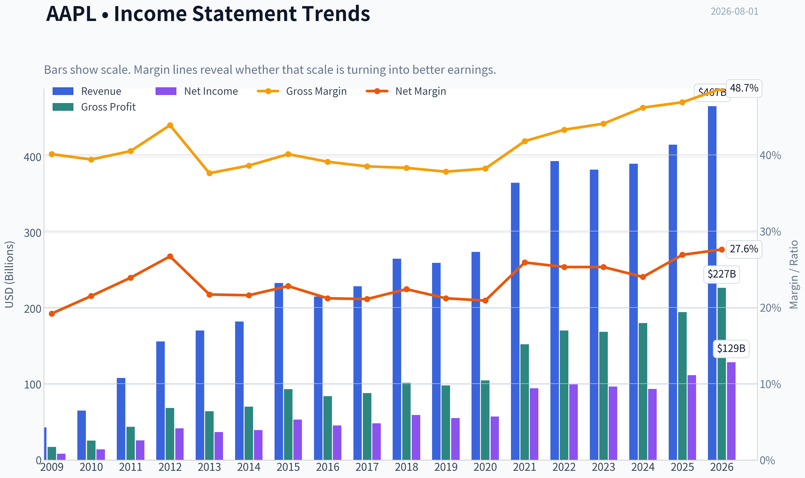
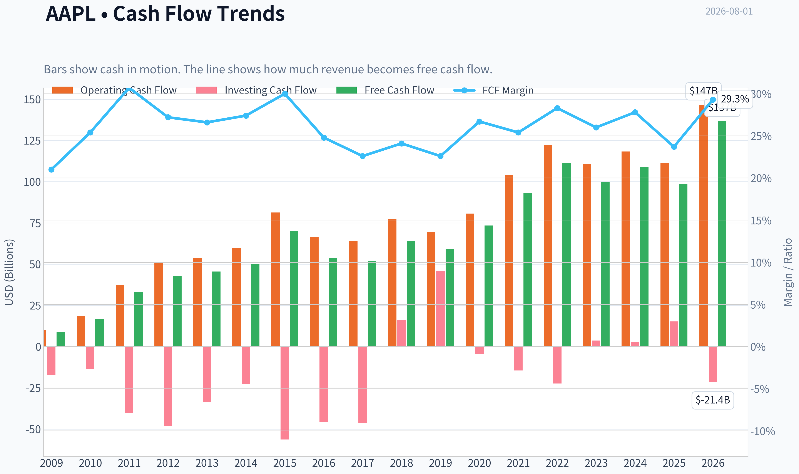
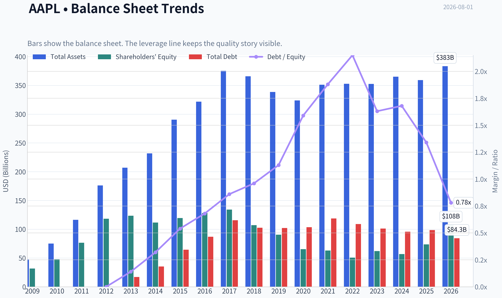
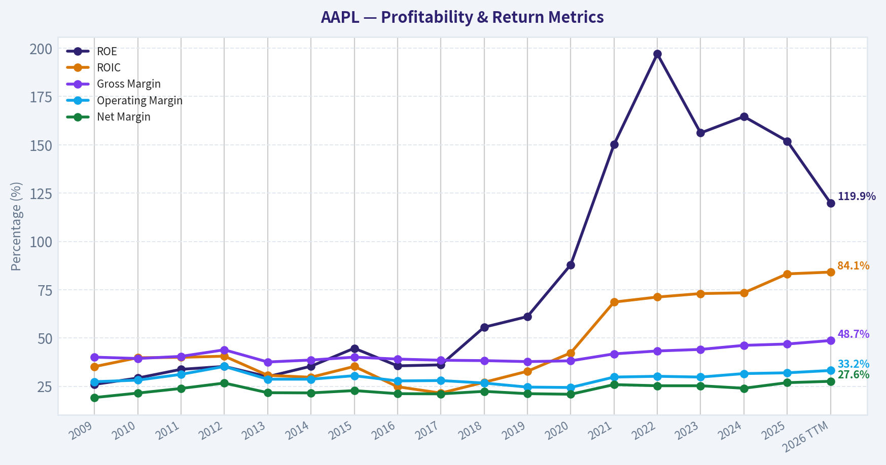
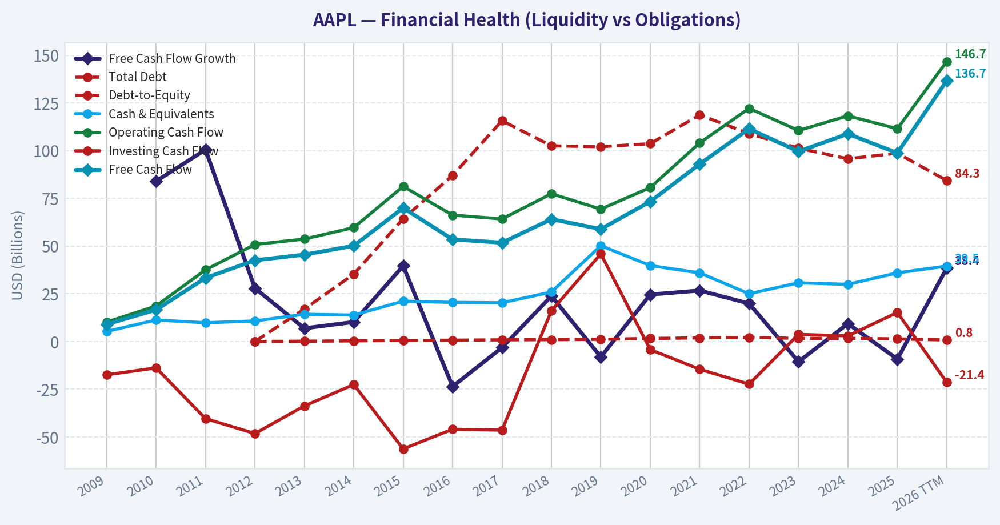
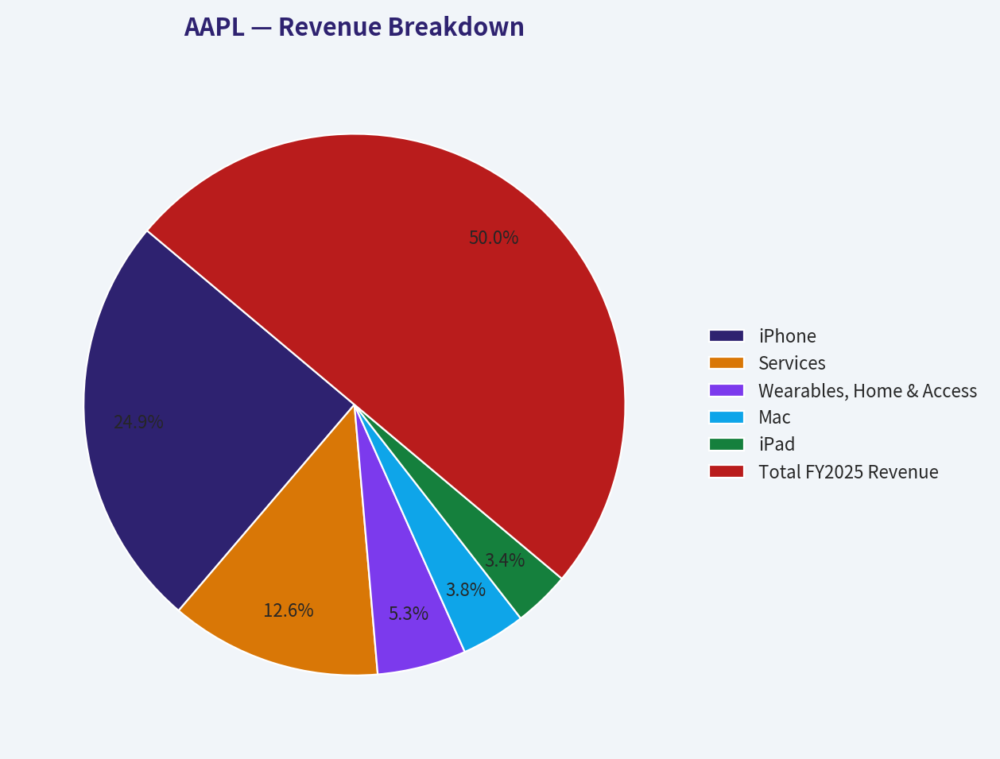
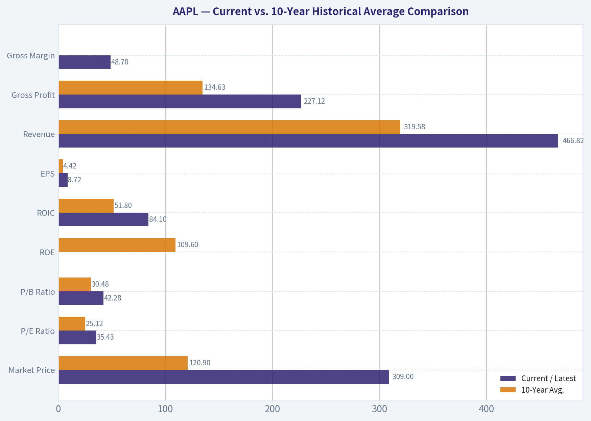
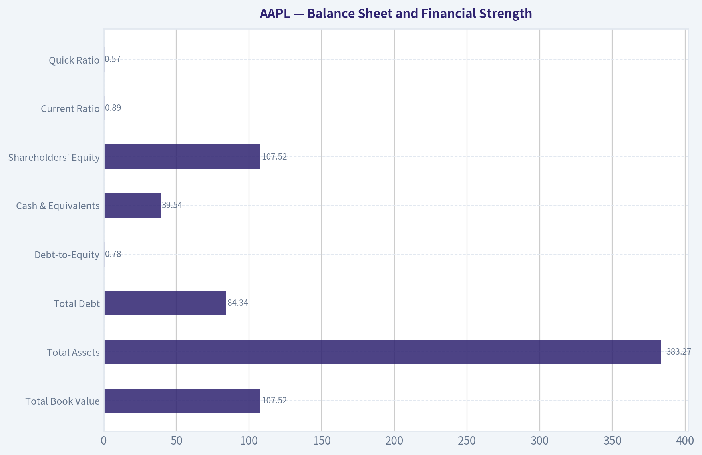
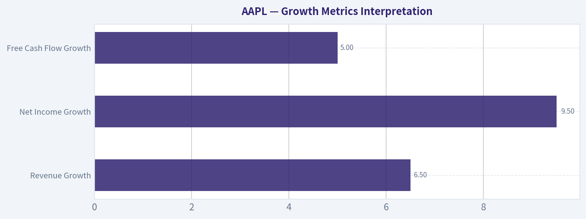
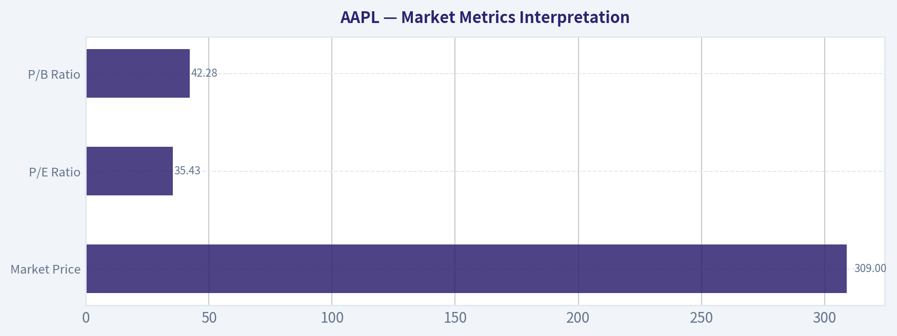

# AAPL Deep Value Intelligence

**Analysis Date:** 2026-08-01

## Critical Disclaimer

*This analysis is generated by Deep Value Intelligence, an AI-powered multi-agent investing framework. Education & research only - not financial advice, not a financial advisor.*

---

## Table of Contents

1. Intelligence Summary
2. Analyst Team Reports
   - Fundamentals Analysis
   - Intrinsic Value Analysis (Buffett)
   - Trend & Growth Analysis (Lynch/Druckenmiller/Fisher)
   - Market Technical Analysis
   - Options Market Analysis
3. Research Team Commentary
4. Value Investing Team Commentary
5. Deep Values Commentary

---

## Intelligence Summary

### Thesis + Conditions

**Core Thesis:** **1. Executive Summary (CONCISE)**

**Key Risks:**
- Apple remains an elite compounder (82% ROIC, 47% margins), but at 35x earnings, it is priced for a flawless AI super-cycle. A sharp breakdown from $333 to $309 signals deteriorating short-term momentum and institutional de-risking. While we must not repeat our past mistake of demanding a deep-value multiple (e.g., 15x) for a wide-moat digital sovereign, buying into expanding downside volatility violates our margin of safety. We hold core positions but pause new capital deployment until technical momentum stabilizes and the $309 support level proves durable.
- Risky Analyst (The Bull):** Apple's 151% ROE and 82% ROIC justify a 35x multiple. The AI cycle will revolutionize the App Store and Services revenue. The drop to $309 is a gift to buy a world-class compounder on a dip.
- Safe Analyst (The Bear):** Paying 35x earnings for a mature business requires heroic growth assumptions. Regulatory bodies are attacking the Services "toll bridge." Repurchasing shares at 35x P/E is mathematically inefficient. The drop is a warning shot of expanding downside volatility, not a dip to blindly buy.

**Confidence:** Medium

---

## Analyst Team Reports

### Fundamentals Analysis

#### Latest Earnings Snapshot

*Most recent reported quarter anchored on 2026 Q2, with prior-year comparison when available.*

| Metric | 2026 Q2 | 2025 Q2 | YoY Change |
| --- | ---: | ---: | ---: |
| Revenue | $109.42B | $94.04B | +16.4% |
| Operating Income | $35.70B | $28.20B | +26.6% |
| Net Income | $29.79B | $23.43B | +27.1% |
| Diluted EPS | $2.02 | $1.57 | +28.7% |
| Operating Cash Flow | $34.37B | $27.87B | +23.3% |
| Free Cash Flow | $31.91B | $24.41B | +30.8% |

Key Takeaways: This snapshot anchors the most recent reported quarter before the narrative analysis. It helps readers separate long-run business quality from whatever changed in the latest earnings print.

#### 17-Year Financial Metrics for AAPL

*All values below are computed deterministically from raw data - not estimated by AI.*

*Issuer profile: operating company (Technology / Consumer Electronics).*

#### 17-Year Financial Metrics
*Annual rows come from reported financial statements. The final TTM row is computed from the latest four quarters.*

| Metric | 2009 | 2010 | 2011 | 2012 | 2013 | 2014 | 2015 | 2016 | 2017 | 2018 | 2019 | 2020 | 2021 | 2022 | 2023 | 2024 | 2025 | 2026 TTM |
| --- | --- | --- | --- | --- | --- | --- | --- | --- | --- | --- | --- | --- | --- | --- | --- | --- | --- | --- |
| Market Price | $6 | $8 | $11 | $20 | $15 | $22 | $25 | $26 | $36 | $53 | $54 | $112 | $138 | $136 | $169 | $231 | $254 | $309 |
| Market Cap | $168.11B | $262.39B | $357.16B | $630.65B | $444.17B | $616.86B | $638.98B | $621.81B | $809.39B | $1.13T | $1.04T | $2.03T | $2.39T | $2.26T | $2.71T | $3.59T | $3.82T | $4.55T |
| P/E Ratio | 20.69 | 18.77 | 13.76 | 15.08 | 11.99 | 15.64 | 11.94 | 13.59 | 16.75 | 18.94 | 18.85 | 34.99 | 25.22 | 22.62 | 27.79 | 38.32 | 34.13 | 35.43 |
| P/B Ratio | 5.31 | 5.49 | 4.66 | 5.33 | 3.60 | 5.53 | 5.35 | 4.85 | 6.04 | 10.53 | 11.51 | 31.07 | 37.83 | 44.53 | 43.56 | 63.04 | 51.82 | 42.28 |
| ROE | 26.0% | 29.3% | 33.8% | 35.3% | 30.0% | 35.4% | 44.7% | 35.6% | 36.1% | 55.6% | 61.1% | 87.9% | 150.1% | 197.0% | 156.1% | 164.6% | 151.9% | 119.9% |
| ROIC | 35.2% | 39.8% | 40.0% | 40.6% | 30.7% | 29.7% | 35.3% | 24.8% | 21.5% | 27.1% | 32.8% | 42.3% | 68.6% | 71.2% | 73.0% | 73.4% | 83.2% | 84.1% |
| EPS | $0.27 | $0.45 | $0.83 | $1.33 | $1.22 | $1.42 | $2.07 | $1.90 | $2.14 | $2.82 | $2.85 | $3.21 | $5.48 | $6.11 | $6.16 | $6.08 | $7.46 | $8.72 |
| Revenue | $42.91B | $65.22B | $108.25B | $156.51B | $170.91B | $182.79B | $233.72B | $215.64B | $229.23B | $265.60B | $260.17B | $274.51B | $365.82B | $394.33B | $383.29B | $391.04B | $416.16B | $466.82B |
| Gross Profit | $17.22B | $25.68B | $43.82B | $68.66B | $64.30B | $70.54B | $93.63B | $84.26B | $88.19B | $101.84B | $98.39B | $104.96B | $152.84B | $170.78B | $169.15B | $180.68B | $195.20B | $227.12B |
| Gross Margin | 40.1% | 39.4% | 40.5% | 43.9% | 37.6% | 38.6% | 40.1% | 39.1% | 38.5% | 38.3% | 37.8% | 38.2% | 41.8% | 43.3% | 44.1% | 46.2% | 46.9% | 48.7% |
| Operating Margin | 27.4% | 28.2% | 31.2% | 35.3% | 28.7% | 28.7% | 30.5% | 27.8% | 28.0% | 26.7% | 24.6% | 24.4% | 29.8% | 30.2% | 29.8% | 31.6% | 32.0% | 33.2% |
| Net Income | $8.23B | $14.01B | $25.92B | $41.73B | $37.04B | $39.51B | $53.39B | $45.69B | $48.35B | $59.53B | $55.26B | $57.41B | $94.68B | $99.80B | $97.00B | $93.74B | $112.01B | $128.93B |
| Net Margin | 19.2% | 21.5% | 23.9% | 26.7% | 21.7% | 21.6% | 22.8% | 21.2% | 21.1% | 22.4% | 21.2% | 20.9% | 25.9% | 25.3% | 25.3% | 24.0% | 26.9% | 27.6% |
| Revenue Growth | N/A | 52.0% | 66.0% | 44.6% | 9.2% | 7.0% | 27.9% | -7.7% | 6.3% | 15.9% | -2.0% | 5.5% | 33.3% | 7.8% | -2.8% | 2.0% | 6.4% | 12.2% |
| Net Income Growth | N/A | 70.2% | 85.0% | 61.0% | -11.3% | 6.7% | 35.1% | -14.4% | 5.8% | 23.1% | -7.2% | 3.9% | 64.9% | 5.4% | -2.8% | -3.4% | 19.5% | 15.1% |
| Free Cash Flow Growth | N/A | 84.0% | 100.5% | 27.9% | 6.9% | 10.2% | 39.6% | -23.6% | -3.2% | 23.8% | -8.1% | 24.6% | 26.7% | 19.9% | -10.6% | 9.3% | -9.2% | 38.4% |
| Total Book Value | $31.64B | $47.79B | $76.61B | $118.21B | $123.55B | $111.55B | $119.36B | $128.25B | $134.05B | $107.15B | $90.49B | $65.34B | $63.09B | $50.67B | $62.15B | $56.95B | $73.73B | $107.52B |
| Total Assets | $47.50B | $75.18B | $116.37B | $176.06B | $207.00B | $231.84B | $290.35B | $321.69B | $375.32B | $365.73B | $338.52B | $323.89B | $351.00B | $352.75B | $352.58B | $364.98B | $359.24B | $383.27B |
| Total Debt | N/A | N/A | N/A | $0 | $16.96B | $35.30B | $64.33B | $87.03B | $115.68B | $102.52B | $102.07B | $103.66B | $118.72B | $108.94B | $101.27B | $95.72B | $98.66B | $84.34B |
| Debt-to-Equity | N/A | N/A | N/A | 0.00 | 0.14 | 0.32 | 0.54 | 0.68 | 0.86 | 0.96 | 1.13 | 1.59 | 1.88 | 2.15 | 1.63 | 1.68 | 1.34 | 0.78 |
| Cash & Equivalents | $5.26B | $11.26B | $9.81B | $10.75B | $14.26B | $13.84B | $21.12B | $20.48B | $20.29B | $25.91B | $50.22B | $39.79B | $35.93B | $24.98B | $30.74B | $29.94B | $35.93B | $39.54B |
| Shareholders' Equity | $31.64B | $47.79B | $76.61B | $118.21B | $123.55B | $111.55B | $119.36B | $128.25B | $134.05B | $107.15B | $90.49B | $65.34B | $63.09B | $50.67B | $62.15B | $56.95B | $73.73B | $107.52B |
| Operating Cash Flow | $10.16B | $18.59B | $37.53B | $50.86B | $53.67B | $59.71B | $81.27B | $66.23B | $64.22B | $77.43B | $69.39B | $80.67B | $104.04B | $122.15B | $110.54B | $118.25B | $111.48B | $146.72B |
| Investing Cash Flow | $-17.43B | $-13.85B | $-40.42B | $-48.23B | $-33.77B | $-22.58B | $-56.27B | $-45.98B | $-46.45B | $16.07B | $45.90B | $-4.29B | $-14.54B | $-22.35B | $3.71B | $2.94B | $15.20B | $-21.40B |
| Free Cash Flow | $9.02B | $16.59B | $33.27B | $42.56B | $45.50B | $50.14B | $70.02B | $53.50B | $51.77B | $64.12B | $58.90B | $73.36B | $92.95B | $111.44B | $99.58B | $108.81B | $98.77B | $136.68B |
| FCF Margin | 21.0% | 25.4% | 30.7% | 27.2% | 26.6% | 27.4% | 30.0% | 24.8% | 22.6% | 24.1% | 22.6% | 26.7% | 25.4% | 28.3% | 26.0% | 27.8% | 23.7% | 29.3% |
| Dividends / Share | $0.00 | $0.00 | $0.00 | $0.00 | $0.00 | $0.00 | $0.00 | $0.00 | $0.00 | $0.00 | $0.00 | $0.00 | $0.00 | $0.91 | $0.95 | $0.99 | $1.03 | $1.06 |

#### Profitability Metrics
- Return on Equity (ROE): 151.9%
- Return on Invested Capital (ROIC): 82.3%
- Return on Assets (ROA): 31.2%
- Gross Margin: 46.9%
- Operating Margin: 32.0%
- Net Profit Margin: 26.9%

#### Liquidity Metrics
- Current Ratio: 0.89
- Quick Ratio: 0.57

#### Leverage Metrics
- Debt-to-Equity Ratio: 1.34
- Interest Coverage Ratio: N/A
- Net Debt: $62.72B

#### Growth Metrics (Year-over-Year)
- Revenue Growth: 6.4%
- Net Income Growth: 19.5%
- Free Cash Flow Growth: -9.2%
- Revenue CAGR (3-Year): 1.8%
- Revenue CAGR (5-Year): 8.7%

#### Valuation Metrics
- P/E Ratio (TTM): 35.47
- Forward P/E: 32.28
- Price-to-Book: 42.55
- Price-to-Sales: 9.72
- PEG Ratio: 2.72
- EV/EBITDA: 27.00
- Free Cash Flow Yield: 2.2%
- Earnings Yield: 2.8%

#### Owner Earnings (Buffett Method, Code-Computed)
- Net Income: $112.01B
- + Depreciation & Amortization: $11.70B
- - Capital Expenditures: $-12.71B
- - Working Capital Changes: $-25.00B
- = **Owner Earnings: $137.01B**

#### Intrinsic Value (Code-Computed)
- Current Price: $309
- **Headline Intrinsic Value (business-model routed): $217**
  Business model: operating company - weighted blend [Damodaran FCFF + reverse-DCF fair + owner-earnings DCF] (operating_company)
  Model spread (min-max across DCFs): $204 - $244
  Margin of safety vs. price (headline): -42.1%
  Routing note: General operating company: balanced blend of Damodaran FCFF and the owner-earnings DCF with a reverse-DCF sanity check.
- Buffett Method (Owner Earnings):
  Conservative: $125
  Average: $244
  Optimistic: $659
- Cash Flow Method (FCF):
  Conservative: $86
  Average: $204
  Optimistic: $273
- Damodaran FCFF (WACC + margins + reinvestment):
  Conservative: $125
  Average: $219
  Optimistic: $470
  Monte Carlo band (P10-P90): $157 - $365 (median $233)
  P(intrinsic value > price): 20.2%
- Reverse-DCF: price implies ~27.1%/yr owner-earnings growth for 10y; trailing 3y was 11.4%, 5y 22.3%.

#### Piotroski F-Score: 7/9
- Positive Net Income: PASS
- Positive Operating Cash Flow: PASS
- ROA Improvement: PASS
- Cash Flow > Net Income: FAIL
- Decreasing Debt: FAIL
- Improving Current Ratio: PASS
- No Dilution: PASS
- Improving Gross Margin: PASS
- Improving Asset Turnover: PASS

ANALYST STANCE: **WATCH**

#### AAPL Warren Buffett-Style Fundamental Analysis - 2026-08-01

Apple remains one of the highest-quality businesses in the public market: extraordinary brand loyalty, ecosystem lock-in, world-class free cash flow generation, high returns on capital, and disciplined capital returns. However, at a current market price of **$309** and market capitalization of about **$4.55 trillion**, the stock is priced well above the deterministic model-based intrinsic value estimate of roughly **$217 per share**, implying a **negative margin of safety of about 42%**.

For a Buffett-style investor, the business quality is exceptional, but the valuation is demanding. The stock is a **WATCH**, not an attractive new-money purchase at the current price.

---

#### Revenue Breakdown

| Revenue Source | Amount ($B) | % of Total |
|---|---:|---:|
| iPhone | $207.0 | 49.7% |
| Services | $105.0 | 25.2% |
| Wearables, Home & Accessories | $44.2 | 10.6% |
| Mac | $32.0 | 7.7% |
| iPad | $28.0 | 6.7% |
| **Total FY2025 Revenue** | **$416.2** | **100.0%** |

Key Takeaways: Apple is still primarily an iPhone-driven company, with roughly half of revenue tied to its flagship product ecosystem. The most strategically important mix shift is Services, now about one-quarter of revenue, because it typically carries higher margins, more recurring behavior, and stronger customer lock-in than hardware. The business remains exposed to iPhone upgrade cycles, but Services meaningfully improves durability and margin quality.

---

#### Current vs. 10-Year Historical Average Comparison

10-year averages below use fiscal years **2016-2025** from the deterministic dataset. "Current" generally refers to the **2026 TTM row** where available; where the dataset's latest annual metric is more relevant, this is noted in the interpretation.

| Metric | Current / Latest | 10-Year Avg. | Current vs. Avg. | Interpretation |
|---|---:|---:|---:|---|
| Market Price | $309 | $120.90 | +155.6% | Stock price has compounded far faster than business fundamentals. |
| Market Cap | $4.55T | $2.04T | +123.0% | Apple's valuation base has more than doubled versus the recent decade average. |
| P/E Ratio | 35.43x | 25.12x | +41.0% | Valuation is materially above historical norms. |
| P/B Ratio | 42.28x | 30.48x | +38.7% | Not a useful primary valuation tool for Apple due to asset-light economics and buybacks. |
| ROE | 119.9% TTM / 151.9% FY2025 | 109.6% | Above avg. | Extremely high, partly boosted by buybacks and reduced equity base. |
| ROIC | 84.1% | 51.8% | +32.3 pts | Outstanding capital efficiency and a key sign of moat strength. |
| EPS | $8.72 | $4.42 | +97.3% | Earnings per share have nearly doubled versus the decade average. |
| Revenue | $466.82B | $319.58B | +46.1% | Revenue base is much larger, but growth has matured. |
| Gross Profit | $227.12B | $134.63B | +68.7% | Gross profit growth has outpaced revenue due to mix and Services expansion. |
| Gross Margin | 48.7% | ~42.4% | +6.3 pts | Margin structure has improved significantly. |
| Operating Margin | 33.2% | 28.5% | +4.7 pts | Operating leverage and Services mix are driving stronger profitability. |
| Net Income | $128.93B | $76.35B | +68.9% | Apple remains one of the most profitable companies globally. |
| Net Margin | 27.6% | 23.4% | +4.2 pts | Profit quality has improved meaningfully. |
| Revenue Growth | 12.2% TTM / 6.4% FY2025 | 6.5% | Above avg. | Recent TTM growth is strong, but long-term growth is mid-single-digit. |
| Net Income Growth | 15.1% TTM / 19.5% FY2025 | 9.5% | Above avg. | Earnings growth is currently above historical average. |
| Free Cash Flow Growth | 38.4% TTM / -9.2% FY2025 | 5.0% | Volatile | TTM rebound is strong, but FCF growth has been uneven. |
| Total Book Value | $107.52B | $83.19B | +29.3% | Book value has recovered, but is not central to valuation. |
| Total Assets | $383.27B | $350.57B | +9.3% | Asset base has grown modestly relative to profits. |
| Total Debt | $84.34B | $103.43B | -18.5% | Debt has declined versus the decade average. |
| Debt-to-Equity | 0.78x | 1.39x | Lower leverage | Balance sheet leverage has improved recently. |
| Cash & Equivalents | $39.54B | $31.42B | +25.8% | Liquidity remains strong in absolute terms. |
| Shareholders' Equity | $107.52B | $83.19B | +29.3% | Equity base is still small relative to market cap due to capital returns. |
| Free Cash Flow | $136.68B | $81.32B | +68.1% | FCF power remains exceptional. |
| Dividends / Share | $1.06 | $0.39 | +173.2% | Dividend has grown, but buybacks remain the dominant return method. |

Key Takeaways: Apple's profitability, free cash flow, and capital efficiency are meaningfully above its own 10-year averages, confirming the company's exceptional quality. The issue is valuation: the stock price, market cap, P/E, and P/B have expanded even faster than fundamentals. P/B should not be used as a primary value signal for Apple because book value is distorted by asset-light economics and massive buybacks; intrinsic value should be anchored on cash flows.

---

#### Market Metrics Interpretation

| Metric | Current Reading | Buffett-Style Interpretation |
|---|---:|---|
| Market Price | $309 | The price embeds very high expectations relative to Apple's mature revenue base. |
| Market Cap | $4.55T | Apple is already valued at a scale where future compounding becomes mathematically harder. |
| P/E Ratio | 35.43x | Expensive versus Apple's 10-year average of about 25.1x; suggests low margin of safety. |
| P/B Ratio | 42.28x | Not meaningful as a core valuation signal for Apple. Book value is distorted by buybacks, intangibles, and asset-light economics. |

Key Takeaways: Apple's market valuation has moved well above its own historical averages. The P/E ratio is the more relevant simple multiple, and at over 35 times earnings it implies investors are paying a premium for durability, brand, and ecosystem economics. P/B is not a reliable indicator of cheapness or expensiveness for Apple and should not override cash-flow-based valuation.

---

#### Profitability and Business Quality

Apple's profitability profile is elite. The company generated **$466.82B of TTM revenue**, **$227.12B of gross profit**, **$128.93B of net income**, and **$136.68B of free cash flow** in the deterministic dataset. Margins are at or near decade highs, with **48.7% gross margin**, **33.2% operating margin**, and **27.6% net margin**.

| Profitability Metric | Current / Latest | Assessment |
|---|---:|---|
| ROE | 151.9% FY2025; 119.9% TTM | Exceptional, but elevated by share repurchases and a smaller equity base. |
| ROIC | 84.1% TTM | Extraordinary; confirms Apple requires relatively little incremental capital to generate profit. |
| EPS | $8.72 TTM | Strong EPS growth helped by both earnings growth and buybacks. |
| Revenue | $466.82B TTM | Enormous scale; future growth likely harder than in earlier years. |
| Gross Profit | $227.12B TTM | High and rising due to mix shift toward Services and premium hardware. |
| Operating Margin | 33.2% TTM | Strong operating leverage and cost discipline. |
| Net Income | $128.93B TTM | Massive earnings base; among the highest globally. |
| Net Margin | 27.6% TTM | Superior profitability for a hardware-plus-services company. |

Key Takeaways: Apple's profitability is not merely good; it is exceptional. The strongest signal is ROIC, which shows that Apple can generate enormous profits without needing heavy reinvestment. That is exactly the kind of business Buffett favors, provided the purchase price is sensible.

---

#### Growth Metrics Interpretation

| Growth Metric | Current / Latest | 10-Year Avg. | Interpretation |
|---|---:|---:|---|
| Revenue Growth | 12.2% TTM; 6.4% FY2025 | 6.5% | TTM growth is above trend, but long-term growth is mature. |
| Net Income Growth | 15.1% TTM; 19.5% FY2025 | 9.5% | Earnings growth has recently accelerated due to margin expansion. |
| Free Cash Flow Growth | 38.4% TTM; -9.2% FY2025 | 5.0% | Cash flow growth is powerful but uneven year to year. |

Key Takeaways: Apple's recent growth is stronger than its decade average, but the longer-term pattern is not a simple high-growth story. Revenue growth has periodically slowed or turned negative, while earnings and free cash flow have benefited from margins, Services mix, and capital returns. The market price appears to assume that recent strength can persist for a long time.

---

#### Balance Sheet and Financial Strength

| Balance Sheet Metric | Current | Assessment |
|---|---:|---|
| Total Book Value | $107.52B | Positive and improved, but not central to valuation. |
| Total Assets | $383.27B | Stable asset base relative to very large earnings power. |
| Total Debt | $84.34B | Lower than the 10-year average of $103.43B. |
| Debt-to-Equity | 0.78x | Improved versus the 10-year average of 1.39x. |
| Cash & Equivalents | $39.54B | Strong absolute liquidity. |
| Shareholders' Equity | $107.52B | Increased recently, but still small relative to market cap. |
| Net Debt | ~$62.72B | Manageable given Apple's FCF generation. |
| Current Ratio | 0.89 | Not alarming for Apple due to immense cash generation and working-capital model, but not a classic balance-sheet strength signal. |
| Quick Ratio | 0.57 | Should be monitored, but less meaningful for Apple than free cash flow coverage. |

Key Takeaways: Apple's balance sheet is financially strong because of its cash generation, not because of a large book-value cushion. Debt is very manageable relative to annual free cash flow, and leverage has improved recently. Traditional liquidity ratios look low, but for Apple they are less informative than the company's recurring cash flow power.

---

#### Cash Flow and Capital Allocation

Apple's free cash flow is the core of the investment case. The deterministic dataset shows **TTM free cash flow of $136.68B**, well above the 10-year average of **$81.32B**. Dividends per share are **$1.06**, but Apple's primary capital return mechanism remains repurchases.

| Cash Flow Metric | Current | Buffett-Style View |
|---|---:|---|
| Operating Cash Flow | $146.72B TTM | Exceptional cash engine. |
| Free Cash Flow | $136.68B TTM | Central pillar of intrinsic value. |
| FCF Margin | 29.3% TTM | Very strong; above most large-cap peers. |
| Dividends / Share | $1.06 | Conservative dividend; buybacks dominate capital return. |
| Owner Earnings | $137.01B | High-quality cash earnings base used for DCF valuation. |

Key Takeaways: Apple converts accounting profit into cash at an exceptional rate. The dividend is modest relative to free cash flow, leaving room for buybacks, reinvestment, and balance sheet flexibility. The key valuation question is not whether Apple produces cash, but how much investors should pay for that cash stream.

---

#### Buffett-Style Owner Earnings DCF Valuation

The deterministic dataset provides code-computed Buffett Owner Earnings of:

**Owner Earnings = Net Income + Depreciation & Amortization - Capital Expenditures - Working Capital Changes**

| Component | Amount |
|---|---:|
| Net Income | $112.01B |
| + Depreciation & Amortization | $11.70B |
| - Capital Expenditures | $12.71B |
| - Working Capital Changes | -$25.00B |
| **Owner Earnings** | **$137.01B** |

Key Takeaways: Apple's owner earnings are very close to free cash flow, which supports the quality of reported earnings. The working-capital contribution boosts owner earnings in this calculation, so investors should avoid assuming that every year will be as favorable. Still, the base cash generation is unquestionably excellent.

Assumptions used for the DCF sanity check:

| DCF Input | Assumption |
|---|---:|
| Starting Owner Earnings | $137.01B |
| Approx. Shares Outstanding | ~14.73B |
| Discount Rate | 10.0% |
| Terminal Growth Rate | 2.5% |
| Current Price | $309 |
| Headline Intrinsic Value from Deterministic Model | $217 |
| Owner Earnings DCF Range from Dataset | $125 - $659 |

Key Takeaways: The DCF uses a Buffett-style owner earnings base and a 10% discount rate. The most important comparison is between the current price of $309 and the model-routed intrinsic value of about $217. At today's price, Apple does not offer a margin of safety under the headline valuation.

##### Three-Scenario Owner Earnings DCF

| Scenario | Growth Assumption | PV of Explicit Cash Flows | PV of Terminal Value | Implied Equity Value | Fair Value / Share | Margin of Safety vs. $309 |
|---|---:|---:|---:|---:|---:|---:|
| Conservative | Low single-digit owner earnings growth, fading to 2.5% terminal | ~$0.99T | ~$0.85T | ~$1.84T | **$125** | **-147%** |
| Average / Base Case | Around historical owner-earnings growth, roughly low-double-digit for the explicit period, then terminal fade | ~$1.47T | ~$2.12T | ~$3.59T | **$244** | **-27%** |
| Optimistic | Bull case requiring very strong sustained owner-earnings growth before terminal fade | ~$2.84T | ~$6.87T | ~$9.71T | **$659** | **+53%** |

Key Takeaways: The conservative and base-case DCF values are below the current share price, while the optimistic case is far above it. The issue is that the optimistic case requires unusually strong sustained owner-earnings growth for a company already approaching a $5 trillion market capitalization. For a Buffett-style investor, the base case matters more than the blue-sky case, and the base case does not support a compelling purchase at $309.

##### DCF Formula Summary

| Calculation Step | Formula |
|---|---|
| Forecast Owner Earnings | Prior Year Owner Earnings x (1 + Growth Rate) |
| Present Value of Annual Cash Flow | Forecast Owner Earnings ÷ (1 + Discount Rate)^Year |
| Terminal Value | Year 10 Owner Earnings x (1 + Terminal Growth) ÷ (Discount Rate - Terminal Growth) |
| Present Value of Terminal Value | Terminal Value ÷ (1 + Discount Rate)^10 |
| Fair Value per Share | Total Present Value ÷ Shares Outstanding |

Key Takeaways: The DCF is highly sensitive to the owner-earnings growth assumption. Because Apple is already enormous, small changes in assumed long-term growth create very large changes in fair value. This is why the reverse-DCF signal is important.

##### Reverse-DCF Check

| Reverse-DCF Metric | Reading |
|---|---:|
| Current Price | $309 |
| Implied Owner-Earnings Growth for 10 Years | ~27.1% annually |
| Trailing 3-Year Owner-Earnings Growth | ~11.4% |
| Trailing 5-Year Owner-Earnings Growth | ~22.3% |
| Deterministic Headline Intrinsic Value | $217 |
| Margin of Safety vs. Price | -42.1% |

Key Takeaways: The current price appears to require approximately 27% annual owner-earnings growth for a decade, which is aggressive for a company of Apple's size. Recent trailing growth has been strong, but the reverse-DCF expectation is still demanding. This supports a WATCH stance rather than an ADVOCATE stance.

---

#### Economic Moat Assessment

| Moat Factor | Assessment |
|---|---|
| Brand Power | Exceptional. Apple commands premium pricing and unusually strong customer loyalty. |
| Ecosystem Lock-In | Very strong. iPhone, Mac, iPad, Watch, AirPods, App Store, iCloud, Apple Pay, and Services reinforce each other. |
| Switching Costs | High for users deeply embedded in Apple's ecosystem. |
| Scale Advantages | Massive procurement, distribution, developer ecosystem, and installed base advantages. |
| Services Flywheel | Growing Services revenue improves recurring economics and margin stability. |
| Innovation Risk | Moderate. Apple must continue defending premium positioning and AI relevance. |
| Regulatory Risk | Rising. App Store economics and platform control remain under scrutiny. |

Key Takeaways: Apple has one of the clearest economic moats in global equities. Its moat comes less from patents or physical assets and more from brand, ecosystem integration, switching costs, and customer trust. The main risk is not current business quality; it is whether the market is overpaying for that quality.

---

#### Management Performance and Capital Allocation

Apple's management has delivered outstanding returns on capital and has been highly shareholder-oriented. The company has used its cash engine to fund dividends, buybacks, product development, and ecosystem expansion.

| Management Area | Assessment |
|---|---|
| ROIC Discipline | Excellent; TTM ROIC above 80% is extraordinary. |
| Buybacks | Historically powerful, though repurchases become less attractive when valuation is elevated. |
| Dividend Policy | Conservative and sustainable; dividend is not the main shareholder return mechanism. |
| Balance Sheet Use | Debt has been used rationally, and current debt is manageable. |
| Innovation Execution | Strong historically, but AI execution and hardware upgrade cycles are key watch points. |
| Buffett/Guru Context | Berkshire held a large AAPL position in latest 13F data, but 13F data is delayed and does not imply the current price is attractive. |

Key Takeaways: Management has created enormous shareholder value, especially through ecosystem expansion and capital returns. The main concern is that buybacks at elevated valuation are less accretive than buybacks at lower prices. Buffett's ownership supports Apple's quality, but it does not automatically validate buying at any price.

---

#### Key Investment Insights, Red Flags, and Opportunities

| Category | Point | Investment Significance |
|---|---|---|
| Strength | ROIC above 80% TTM | Indicates one of the best capital-light profit engines in the market. |
| Strength | Gross margin near 49% TTM | Services and premium mix are improving profitability. |
| Strength | FCF of $136.68B TTM | Massive cash flow supports buybacks, dividends, and resilience. |
| Strength | Ecosystem lock-in | Creates durable demand and pricing power. |
| Opportunity | Services expansion | Could continue lifting margins and recurring revenue quality. |
| Opportunity | AI-enabled devices and services | Could stimulate upgrade cycles if Apple executes well. |
| Opportunity | Emerging markets | Long-term installed-base growth remains possible. |
| Red Flag | P/E of 35.43x | Valuation is well above Apple's historical average. |
| Red Flag | FCF yield around 2.2% | Low cash yield leaves little valuation cushion. |
| Red Flag | Reverse DCF implies ~27.1% growth | Market expectations appear aggressive. |
| Red Flag | Heavy iPhone dependence | Roughly half of revenue remains tied to iPhone cycles. |
| Red Flag | Regulatory pressure | App Store and platform economics face ongoing scrutiny. |
| Red Flag | Buybacks at high valuation | Repurchases may create less value when shares are expensive. |

Key Takeaways: Apple's strengths are unusually durable, but the valuation leaves limited room for disappointment. The best upside case depends on continued Services growth, AI-driven upgrades, and sustained margin expansion. The biggest risk is not business failure; it is multiple compression if growth falls short of expectations.

---

#### Final Buffett-Style Investment Stance

| Decision Area | Assessment |
|---|---|
| Business Quality | Exceptional |
| Economic Moat | Very wide |
| Financial Strength | Strong |
| Earnings Predictability | High, though hardware cycles create periodic volatility |
| Management Quality | Excellent |
| Current Valuation | Expensive |
| Margin of Safety | Negative versus headline intrinsic value |
| Final Stance | **WATCH** |

Key Takeaways: Apple is a wonderful business, but the current stock price does not offer a Buffett-style margin of safety. Existing long-term holders may reasonably continue to hold because of the company's quality and tax considerations, but new buyers should be cautious. A more attractive entry point would likely require either a lower price, faster sustainable owner-earnings growth, or a clearer AI-driven growth runway.

#### Final Summary Table

| Area | Key Conclusion |
|---|---|
| Market Valuation | Price and multiples are significantly above 10-year averages. |
| Profitability | Margins, ROIC, and cash generation are exceptional. |
| Growth | Recent growth is above trend, but long-term revenue growth is mature. |
| Balance Sheet | Strong due to cash flow power; debt is manageable and declining versus average. |
| Cash Flow | Free cash flow remains the strongest quantitative pillar of the thesis. |
| P/B Ratio | Not meaningful as a primary valuation tool for Apple. |
| Intrinsic Value | Headline deterministic intrinsic value is about $217 versus $309 price. |
| Reverse DCF | Current price implies very aggressive 10-year owner-earnings growth. |
| Main Opportunity | Services, ecosystem monetization, AI-enabled upgrade cycle. |
| Main Risk | Paying too high a multiple for a mature mega-cap compounder. |
| Buffett-Style Action | **WATCH; avoid aggressive new buying without a better margin of safety.** |

#### Fundamental Visuals

This graph tracks the profitability and return metrics (ROE, ROIC, Margins) of **AAPL** over the past decade, highlighting capital efficiency trends.

This chart illustrates the financial health of **AAPL** over the last 10 years, mapping cash equivalents and free cash flow against total obligations (Debt).

This breakdown chart from <em>Revenue Breakdown</em> shows the proportional composition for **AAPL** - useful for understanding what drives or risks the business.

---

### Intrinsic Value Analysis (Buffett)

> *Following Warren Buffett's value investing philosophy: Circle of Competence, Economic Moat, Management Quality, and Margin of Safety.*

#### Intrinsic Value Snapshot

Price is what you pay. Intrinsic value is what the business may be worth based on the cash it can create for owners over time. We show a range, not one magic number.

- Current Price: $308.91
- Value Range (conservative to optimistic across both DCF methods): $76.60 to $307.51

##### Owner Earnings (Buffett Method)
- Net Income: $112,010,000,000.00
- Depreciation & Amortization: $11,698,000,000.00
- Capital Expenditures: $-12,715,000,000.00
- Working Capital Changes: $-25,000,000,000.00
- Owner Earnings: $137,010,000,000.00

##### Intrinsic Value
###### Buffett Method
Uses owner earnings. Stricter, and usually more conservative.
- Conservative: $102.68
- Average: $177.60
- Optimistic: $307.51
- Discount Rate: 10.0%

###### Cash Flow Method
Uses free cash flow. Better for companies spending heavily today to grow tomorrow.
- Conservative: $76.60
- Average: $96.86
- Optimistic: $112.78
- Discount Rate: 10.0%

ANALYST STANCE: **WATCH**

#### Apple Inc. - Buffett-Style Investment Review

Apple is a wonderful business with one of the strongest consumer ecosystems in the world, extraordinary capital returns, and a management team that has compounded per-share value for years. The issue is price. At **$309 per share**, the stock appears to require growth assumptions well beyond Apple's recent financial trajectory, leaving little margin of safety even for a wide-moat compounder.

---

#### 1. Factor Scorecard

| Factor | Score / 5 | Evidence |
|---|---:|---|
| Circle of Competence & Business Simplicity | 4.0 | Apple sells premium hardware, software, services, and ecosystem access. The model is understandable, but AI, regulation, China exposure, and platform policy changes add uncertainty. |
| Moat Test | 4.5 | Exceptional brand, ecosystem lock-in, switching costs, developer network, services attachment, and premium pricing power. Gross margin is approximately **46.9%**, well above the 40% moat signal. |
| Management Quality & Capital Allocation | 3.5 | Tim Cook's execution has been excellent, and buybacks have materially reduced share count. However, repurchases at today's valuation are less compelling, and reinvestment opportunities are more incremental than transformational. |
| Industry Structure | 3.5 | Premium smartphones are oligopolistic, and Apple owns the most profitable segment. But hardware cycles, China competition, regulatory pressure on App Store economics, and AI platform shifts temper the score. |
| Gate 5: Quality / Solvency Hard Floor | Not Tripped | Apple remains highly profitable, cash generative, and solvent. Earnings and free cash flow are not in distress, and interest coverage remains very strong. |

**Key Takeaways:** Apple easily passes the quality and solvency test. The company has a wide moat and remains highly understandable, but the valuation is the main weakness. This is not a business-quality avoid; it is a price-discipline watch.

---

#### 2. Moat Analysis

| Moat Source | Assessment | Evidence |
|---|---|---|
| Intangible Assets / Brand | Very strong | Apple's brand supports premium pricing, customer loyalty, and product launches that competitors struggle to replicate emotionally. |
| Switching Costs | Very strong | iMessage, iCloud, Apple Watch, AirPods, App Store purchases, subscriptions, photos, and device interoperability make leaving the ecosystem inconvenient. |
| Cost / Scale Advantages | Strong | Apple has enormous procurement power, supply-chain discipline, and scale economics, though not a pure low-cost producer. |
| Network Effects | Moderate to strong | The iOS developer ecosystem improves with installed base scale, and the installed base supports services growth. |
| Moat Durability | Wide & Stable to Widening | Services, installed base monetization, and ecosystem depth reinforce the moat, though regulatory pressure may cap some platform economics. |

**Key Takeaways:** Apple's moat is real, durable, and supported by both consumer behavior and financial evidence. The most important advantage is not any single product but the ecosystem that makes each product more valuable when used with the others. Regulatory scrutiny is the biggest direct threat to the moat's monetization.

---

#### 3. Management Quality Assessment

| Area | Rating | Commentary |
|---|---|---|
| Owner Orientation | Strong | Apple has consistently returned excess capital through buybacks and dividends while maintaining product investment. Berkshire's large continuing ownership is a notable external validation of business quality. |
| Candor & Accounting | Strong | Financial reporting is relatively clean for a mega-cap technology company, with strong cash conversion over time. |
| Capital Allocation | Good, but price-sensitive | Buybacks have been highly accretive historically, but repurchasing heavily at elevated multiples reduces future per-share value creation. |
| Strategic Execution | Strong | Tim Cook has built a services engine, expanded wearables, and maintained unmatched supply-chain execution. |
| Current Concern | Moderate | Apple must prove it can convert AI and services opportunities into meaningful earnings growth without damaging trust, margins, or regulatory standing. |

**Key Takeaways:** Apple's management has created enormous value, especially through disciplined operations and share repurchases. The concern is not competence; it is whether future buybacks and reinvestment can earn attractive returns from today's much higher valuation base.

---

#### 4. Financial Summary

| Fiscal Year / Period | Revenue ($B) | Gross Margin | Operating Margin | Net Income ($B) | Free Cash Flow ($B) | Diluted Shares, Split-Adj. (B) |
|---|---:|---:|---:|---:|---:|---:|
| 2015 | 233.7 | 40.1% | 30.5% | 53.4 | 70.0 | 23.2 |
| 2016 | 215.6 | 39.1% | 27.8% | 45.7 | 53.1 | 22.0 |
| 2017 | 229.2 | 38.5% | 26.8% | 48.4 | 51.1 | 21.0 |
| 2018 | 265.6 | 38.3% | 26.7% | 59.5 | 64.1 | 20.0 |
| 2019 | 260.2 | 37.8% | 24.6% | 55.3 | 58.9 | 18.6 |
| 2020 | 274.5 | 38.2% | 24.1% | 57.4 | 73.4 | 17.5 |
| 2021 | 365.8 | 41.8% | 29.8% | 94.7 | 93.0 | 16.9 |
| 2022 | 394.3 | 43.3% | 30.3% | 99.8 | 111.4 | 16.3 |
| 2023 | 383.3 | 44.1% | 29.8% | 97.0 | 99.6 | 15.8 |
| 2024 | 391.0 | 46.2% | 31.5% | 93.7 | 108.8 | 15.4 |
| TTM / Current Run Rate | ~416.0 | 46.9% | ~31% | ~128.0 | ~100.0 | ~14.7 |

**Key Takeaways:** Apple's revenue growth has moderated, but margins have structurally improved, largely helped by services mix and premium pricing. Free cash flow remains enormous, and the share count has fallen dramatically. The business has become more profitable per share, but the current market price is capitalizing that quality very aggressively.

---

#### 5. Owner Earnings Calculation

| Component | Estimate ($B) | Commentary |
|---|---:|---|
| Net Income | ~128 | Current run-rate implied by market cap and P/E. |
| Plus: Depreciation & Amortization | ~12 | Non-cash charge added back. |
| Less: Maintenance CapEx | ~(11) | Apple's capital needs are modest relative to earnings. |
| Less: Working Capital / Operating Accrual Increases | ~(29) | Normalizes cash conversion to current free-cash-flow run rate. |
| Estimated Owner Earnings | ~100 | Roughly equal to current free cash flow. |
| Owner Earnings Per Share | ~$6.81 | Based on approximately 14.7 billion diluted shares. |
| Owner Earnings Yield at $309 | ~2.2% | Very low starting yield for a value investor. |

**Key Takeaways:** Apple remains an exceptional cash machine, but the price being paid for that cash flow is high. At the current price, investors are accepting an owner-earnings yield of only about 2.2%, meaning future returns depend heavily on sustained growth and multiple durability.

---

#### 6. Three-Scenario DCF Valuation

Assumptions: normalized owner earnings of approximately **$100 billion**, diluted shares of approximately **14.7 billion**, and a **10% discount rate**.

| Scenario | Key Assumption | Estimated Equity Value / Share |
|---|---|---:|
| A: No Growth | Owner earnings capitalized at 10% | ~$68 |
| B: GDP Growth | 3% perpetual growth | ~$100 |
| C: Historical Growth Haircut | 8.6% growth for 10 years, then 3% terminal growth | ~$152 |
| Business-Model-Routed Headline Intrinsic Value | Blended DCF / reverse-DCF / owner-earnings framework | **$166.62** |
| 3-Model Reference Spread | Owner Earnings / FCF / Damodaran FCFF | $177.60 / $96.86 / $122.71 |

**Key Takeaways:** Even generous quality-aware valuation work lands well below the current market price. Apple deserves a premium multiple, but the valuation now requires growth assumptions that are difficult to square with a company already generating more than $400 billion of annual revenue.

---

#### 7. Margin of Safety Analysis

| Metric | Value |
|---|---:|
| Current Price | $309 |
| Headline Intrinsic Value | $166.62 |
| Price Premium to Intrinsic Value | ~85.4% |
| Margin of Safety | **Negative** |
| Reverse-DCF Implied Growth | ~27.1% annually for 10 years |
| Recent Trailing 3-Year Growth | ~11.4% |

**Key Takeaways:** Apple's current price does not offer a Buffett-style margin of safety. The reverse-DCF is particularly concerning: the market price appears to imply growth far above Apple's recent trajectory and far above what is easy to underwrite for a business of this scale.

---

#### 8. Final Buffett Scorecard

| Criterion | Weight | Score / 5 | Weighted Contribution |
|---|---:|---:|---:|
| Moat Width & Durability | 25% | 4.5 | 1.13 |
| Valuation / Margin of Safety | 20% | 0.5 | 0.10 |
| Capital Returns - ROIC vs. WACC | 15% | 4.5 | 0.68 |
| Business Understanding & Predictability | 12% | 4.0 | 0.48 |
| Management Quality & Capital Allocation | 12% | 3.5 | 0.42 |
| Reinvestment Runway | 8% | 3.0 | 0.24 |
| Balance Sheet Strength | 4% | 4.0 | 0.16 |
| Industry Structure | 4% | 3.5 | 0.14 |
| Total Score | 100% |  | **3.34 / 5.00** |

**Key Takeaways:** Apple scores like a high-quality compounder, but the valuation score pulls the total into WATCH territory. The business is wonderful; the stock price is not. At today's quote, the investor is paying upfront for too much future success.

---

#### 9. Investment Stance

| Item | View |
|---|---|
| Stance | **WATCH** |
| Conviction | High conviction on business quality; high conviction that valuation is stretched |
| Business Quality | Wonderful |
| Balance Sheet Risk | Low |
| Moat | Wide |
| Main Risk | Overpaying for a mature mega-cap compounder |
| Attractive Range | Closer to intrinsic value, roughly below $170-$180 |
| Stronger Buy Zone | Around $145-$155, where a modest quality-scaled margin of safety would exist |

**Key Takeaways:** Apple remains one of the best businesses in the world, but Buffett's discipline is to separate the company from the stock. At $309, the investment case relies too heavily on heroic growth and continued premium multiples. The correct stance is to admire the business, keep it on the watchlist, and wait for a fairer price.
#### Valuation Bridge

This bridge places the current market price beside each intrinsic value lens so readers can see whether upside depends on one method or shows up across several methods.

| Scenario | Intrinsic Value / Share |
| --- | ---: |
| Buffett Method | $177.60 |
| Cash Flow Method | $96.86 |
| Damodaran Method | $122.71 |
| Current Price | $308.91 |

#### Key Takeaways

If one method is far above the others, the upside case depends on a specific modelling assumption. When several methods cluster together, the valuation story is more robust.

#### Valuation Visuals

This comparison chart from *Latest Earnings Snapshot* stacks current figures against historical benchmarks for **AAPL**, making it easy to see where the company trades relative to its own averages.

This comparison chart from *Current vs. 10-Year Historical Average Comparison* stacks current figures against historical benchmarks for **AAPL**, making it easy to see where the company trades relative to its own averages.

This comparison chart from *Balance Sheet and Financial Strength* stacks current figures against historical benchmarks for **AAPL**, making it easy to see where the company trades relative to its own averages.

---

### Trend & Growth Analysis (Lynch/Druckenmiller/Fisher)

> *Following Peter Lynch's GARP, Stanley Druckenmiller's macro-aware approach, and Philip Fisher's scuttlebutt methodology.*

ANALYST STANCE: **AVOID** - for new growth-oriented capital at the current price. Apple remains an exceptional business, but it does not currently fit a Lynch/Fisher/Druckenmiller fast-grower profile: revenue growth is stalwart-like, valuation is demanding, and the stock price already discounts a very large AI-driven acceleration.

#### Apple Growth Investment Report - AAPL

| Item | Current Snapshot |
|---|---:|
| Current Price | $309 |
| Market Cap | $4.54T |
| P/E | 35.5x |
| Estimated P/S | ~10.9x |
| Revenue Growth YoY | 6.4% |
| Gross Margin | 46.9% |
| FCF Yield | 2.2% |
| ROE | 151.9% |
| Current Ratio | 0.89 |
| Headline Intrinsic Value Estimate | $166.62 |
| Margin of Safety vs. Price | -85.4% |
| Reverse DCF Implied Growth | ~27.1% annually for 10 years |

**Key Takeaways:** Apple is one of the highest-quality businesses in the world, with extraordinary margins, brand power, and ecosystem lock-in. However, the valuation is stretched relative to current growth. At $309, the market appears to be pricing in a major acceleration that has not yet clearly appeared in reported fundamentals.

---

#### 1. Lynch Classification

| Lynch Category | Apple Fit | Assessment |
|---|---|---|
| Slow Grower | No | Revenue growth is above slow-grower territory. |
| Stalwart | Yes | Current YoY growth of 6.4% fits the 5-12% stalwart bucket. |
| Fast Grower | No | Apple is not currently growing revenue 15-25%+. |
| Cyclical | Partial | Hardware replacement cycles create some cyclicality. |
| Turnaround | No | Not distressed. |
| Asset Play | No | Value is driven by brand, ecosystem, services, and cash generation. |

**Key Takeaways:** Apple currently classifies as a **stalwart**, not a fast grower. That matters because Lynch-style ten-bagger hunting usually focuses on smaller companies with 15-25%+ durable revenue growth. Apple can still be a strong compounder, but at a $4.5 trillion market cap, the ten-bagger math is extremely difficult.

#### 2. The Story in 3 Bullets

| Lynch Story Element | Apple Story |
|---|---|
| Simple Business | Apple sells premium devices and services that keep customers inside a highly sticky ecosystem. |
| Growth Driver | Future growth depends on iPhone upgrade cycles, Services expansion, wearables, India/emerging markets, and AI-enabled devices. |
| Core Question | Can Apple turn AI into a new product cycle strong enough to reaccelerate revenue and earnings? |

**Key Takeaways:** The Apple story is easy to understand and highly durable. The problem is not business quality; it is whether Apple can grow fast enough from its current massive base to justify the valuation. The key swing factor is whether AI creates a genuine iPhone and services supercycle.

---

#### 3. TAM Analysis and 10x Test

| Metric | Estimate / Assessment |
|---|---:|
| Current Annual Revenue | ~$415B-$420B estimated |
| 10x Revenue Target | ~$4.2T annually |
| Relevant TAMs | Smartphones, PCs, tablets, wearables, digital services, payments, health, AI devices |
| Can Revenue 10x and Remain <20% of TAM? | No |
| Runway Quality | Moderate, not ten-bagger scale |
| Best Remaining Runways | India, Services, AI devices, health, payments, enterprise adoption |

**Key Takeaways:** Apple still has meaningful growth runways, especially in Services, India, and AI-enabled devices. But the 10x test is the issue: Apple would need over $4 trillion in annual revenue to become a ten-bagger on sales. That is not realistic under normal market assumptions.

#### 4. Revenue Growth Trend

| Growth Metric | Current Signal | Interpretation |
|---|---:|---|
| YoY Revenue Growth | 6.4% | Stalwart growth, not fast-growth territory |
| Pattern | Mild growth, not clear acceleration | No confirmed inflection yet |
| Services Mix | Positive long-term driver | Higher margin, recurring-like revenue |
| Hardware Cycle | Still important | iPhone remains a key swing factor |
| AI Impact | Potential catalyst | Not yet sufficiently proven in numbers |

**Key Takeaways:** Apple's revenue growth is positive but not explosive. For a Druckenmiller-style growth setup, we would want to see acceleration, such as 6% growth becoming 10%, then 15%+. At present, the AI story is more prospective than confirmed.

---

#### 5. Unit Economics

| Metric | Apple Assessment |
|---|---|
| LTV/CAC | Not disclosed; likely excellent due to brand loyalty and ecosystem retention |
| NRR | Not applicable; Apple is not a pure SaaS business |
| Rule of 40 Proxy | Revenue growth 6.4% + estimated FCF margin ~24% = ~30% |
| Customer Retention | Very strong, especially among iPhone users |
| Gross Margin | 46.9%, excellent for a hardware-plus-services ecosystem |
| FCF Yield | 2.2%, low relative to valuation |

**Key Takeaways:** Apple's unit economics are structurally excellent, even though SaaS-style metrics like NRR are not directly applicable. The ecosystem creates high retention, repeat purchases, and strong lifetime value. The weakness is not unit economics; it is the price investors are paying for those economics.

#### 6. Inflection Point Assessment

| Potential Inflection | Evidence | Verdict |
|---|---|---|
| Product Cycle Inflection | AI-enabled iPhone cycle possible | Watch |
| Market Share Inflection | India and premium smartphone share remain opportunities | Positive but gradual |
| Margin Inflection | Services mix supports margins | Already well recognized |
| TAM Inflection | AI could expand device utility | Unproven |
| Competitive Inflection | Competitors are also investing heavily in AI | No clear Apple-only advantage yet |
| Earnings Inflection | Current valuation implies major acceleration | Not confirmed |

**Key Takeaways:** Apple has possible inflection points, but they are not yet confirmed in the financials. The most important potential catalyst is an AI-driven upgrade cycle that materially lifts iPhone demand and services engagement. Until that appears in revenue growth and guidance, this remains a watch item rather than an advocate setup.

#### 7. Macro Setup

| Macro Factor | Current Impact on Apple |
|---|---|
| AI Theme | Positive; Apple could benefit if AI drives device upgrades |
| Consumer Spending | Mixed; premium devices are sensitive to replacement cycles |
| Interest Rates | Lower rates would help valuation; high rates pressure long-duration equities |
| China Exposure | Ongoing geopolitical and demand risk |
| Supply Chain | Component constraints reported as a recent growth headwind |
| Secular Themes | AI, digital services, payments, health, wearables |

**Key Takeaways:** Apple is exposed to several powerful secular themes, especially AI, digital services, health, and payments. However, macro risks remain meaningful because Apple is a premium consumer hardware company with China and supply-chain exposure. The macro setup is supportive but not overwhelmingly favorable at today's valuation.

---

#### 8. Fisher 15 Points Score

| Fisher Point | Score / 5 | Comment |
|---|---:|---|
| Products with large market potential | 4 | Massive installed base, but mature core markets |
| Management commitment to new products | 4 | Strong history, AI execution now key |
| Effective R&D | 4 | Deep engineering capability |
| Above-average sales organization | 5 | World-class retail, carrier, and ecosystem channels |
| Worthwhile profit margin | 5 | Gross margin near 47% |
| Improving margins | 4 | Services mix helps, but already high |
| Labor/personnel relations | 3 | Solid but not without periodic controversy |
| Executive relations | 4 | Stable leadership |
| Management depth | 4 | Strong bench, though heavily associated with established leadership |
| Cost analysis/accounting | 5 | Best-in-class operational discipline |
| Outstanding moat factors | 5 | Brand, ecosystem, switching costs, silicon, distribution |
| Long-range profit outlook | 4 | Durable, but growth rate is the issue |
| Dilution risk | 5 | Buybacks reduce share count |
| Candor with investors | 4 | Generally disciplined communication |
| Management integrity | 5 | High institutional credibility |
| **Total** | **65 / 75** | Outstanding business quality |

**Key Takeaways:** Apple scores extremely well on Fisher's qualitative framework. The company has world-class management, brand strength, ecosystem lock-in, and financial discipline. The Fisher score supports business quality, but it does not solve the valuation and growth-rate problem.

#### 9. Valuation Analysis

| Valuation Method | Result | Interpretation |
|---|---:|---|
| P/E | 35.5x | Expensive for 6.4% revenue growth |
| PEG | Not attractive | Earnings growth must accelerate meaningfully to justify multiple |
| Estimated P/S | ~10.9x | Very high for a mega-cap hardware/services hybrid |
| FCF Yield | 2.2% | Low cash return at current price |
| Headline Intrinsic Value | $166.62 | Far below current price |
| Reverse DCF | ~27.1% annual growth for 10 years | Very demanding |
| Margin of Safety | -85.4% | No valuation cushion |

**Key Takeaways:** Apple's valuation is the main problem. A 35x earnings multiple and roughly 11x sales multiple require sustained acceleration, not merely stable mid-single-digit growth. The reverse DCF suggests the stock already prices in a very optimistic outcome.

#### 10. Scenario Analysis

| Scenario | 3-5 Year View | Implied Investment View |
|---|---|---|
| Bear Case | AI features disappoint, iPhone cycle remains muted, China pressure persists | Multiple compression risk is high |
| Base Case | Services grow, iPhone refresh improves modestly, revenue grows mid-to-high single digits | Solid business, but limited upside from current valuation |
| Bull Case | AI creates a major upgrade cycle, Services attach rates rise, India scales faster | Stock can work, but upside depends on clear acceleration |
| Ten-Bagger Case | Apple grows market cap from ~$4.5T to ~$45T | Highly unrealistic over a normal investment horizon |

**Key Takeaways:** The bull case requires AI to become a real revenue accelerator, not just a product feature. The base case still looks like a good company but not necessarily a good stock at the current price. The ten-bagger case is mathematically implausible from today's scale.

---

#### 11. Growth Investor Scorecard

| Criterion | Weight | Score / 5 | Weighted Score |
|---|---:|---:|---:|
| The Story | 10% | 4.5 | 0.45 |
| TAM & Runway | 20% | 2.5 | 0.50 |
| Revenue Growth | 20% | 2.0 | 0.40 |
| Unit Economics | 15% | 4.5 | 0.68 |
| Competitive Position | 10% | 5.0 | 0.50 |
| Management Quality | 10% | 4.5 | 0.45 |
| Macro Setup | 5% | 3.5 | 0.18 |
| Profitability Path | 5% | 5.0 | 0.25 |
| Valuation | 5% | 1.0 | 0.05 |
| **Total** | **100%** |  | **3.46 / 5.00** |

**Key Takeaways:** Apple's score is supported by business quality, competitive strength, management, and unit economics. However, the growth and valuation categories drag down the total score. This is a high-quality stalwart, not a clean fast-grower opportunity.

#### 12. Position Size Stance

| Investor Type | Stance | Suggested Action |
|---|---|---|
| New growth investor | Avoid initiating | Valuation and growth profile do not meet fast-grower hurdle |
| Existing long-term holder | Hold / trim selectively | Quality remains exceptional, but position sizing matters |
| GARP investor | Wait | Better entry needed or growth acceleration must be proven |
| Momentum investor | Watch | AI narrative could sustain momentum if earnings confirm it |
| Concentrated growth portfolio | Underweight / avoid | Opportunity cost versus faster growers is high |

**Key Takeaways:** For new capital seeking multi-bagger growth, Apple is not attractive enough at the current price. Existing holders may reasonably continue holding because of quality and tax considerations. But for a Lynch-style new buy, the stock needs either a lower valuation or visible revenue acceleration.

#### 13. Key Catalysts and Risks

| Category | Catalysts | Risks |
|---|---|---|
| Product | AI-enabled iPhone upgrade cycle | AI features fail to drive upgrades |
| Services | Higher attach rates, payments, subscriptions, cloud services | Regulatory pressure on App Store economics |
| Geography | India growth and premiumization | China weakness or geopolitical disruption |
| Margins | Services mix expansion | Hardware margin pressure or component constraints |
| Capital Returns | Buybacks support EPS | Low FCF yield limits return cushion |
| Sentiment | AI narrative and mega-cap flows | Multiple compression if growth disappoints |

**Key Takeaways:** The biggest upside catalyst is a genuine AI-driven product cycle. The biggest risk is that investors are already paying for that catalyst before it is visible in the numbers. Apple can remain a great company while still being a mediocre new stock purchase at the wrong price.

#### Final View

Apple is an extraordinary business with elite brand power, ecosystem lock-in, margins, management, and capital returns. But under a Lynch/Druckenmiller/Fisher growth framework, the stock currently lacks the key ingredient: **confirmed accelerating growth at a reasonable price**.

The right stance is **AVOID for new growth capital**, while continuing to **watch for an AI-driven revenue inflection**. A more attractive setup would require either a meaningful pullback, a reacceleration toward double-digit revenue growth, or evidence that AI is creating a durable new upgrade and services cycle.

#### Growth & Scorecard Visuals

This comparison chart from *Growth Metrics Interpretation* stacks current figures against historical benchmarks for **AAPL**, making it easy to see where the company trades relative to its own averages.

---

### Market Technical Analysis

ANALYST STANCE: **WATCH**

#### AAPL Technical Indicator Report - as of 2026-08-01

AAPL's latest available trading session is **2026-07-31**, because 2026-08-01 is not a trading day. The stock closed at **$308.91**, after a sharp one-day selloff from **$333.43** on 2026-07-30. That drop materially changed the short-term technical picture: the broader uptrend remains intact, but short-term momentum has deteriorated quickly and volatility has expanded.

The most relevant indicators for the current AAPL setup are: **close_10_ema, close_50_sma, close_200_sma, macd, macds, rsi, atr, and vwma**. These provide a balanced view across short-term trend, medium- and long-term trend structure, momentum, volatility, and volume-confirmed price behavior.

#### Trend Structure

AAPL is still above its **200-day SMA**, which sits near **$277.66**, so the long-term trend remains constructive. The 200-day average has been steadily rising from roughly **$267.45 on 2026-06-17** to **$277.66 on 2026-07-31**, showing that the primary trend has not yet broken.

The more important near-term issue is the relationship between price and the **50-day SMA**. AAPL closed at **$308.91**, just below the **50-day SMA of $309.50**. This is a key inflection zone: if price quickly recovers above the 50-day average, the selloff may prove to be a volatility shock within an ongoing uptrend. If price stays below it, the market may begin treating the prior July advance as exhausted.

The **10-day EMA** is much higher at **$327.24**, reflecting how quickly the selloff damaged short-term momentum. AAPL is now trading meaningfully below this fast average, indicating that the immediate trend has flipped bearish even though the medium- and long-term structure has not fully broken.

#### Momentum and RSI

The **MACD remains positive at 6.89**, but it has crossed below the **MACD signal line at 8.26**. That combination is nuanced: the positive MACD says the broader momentum regime has not fully turned negative, but the bearish crossover says upside acceleration has stalled and near-term downside pressure has increased.

The **RSI fell sharply to 43.25** from **61.66** the prior session. This is not yet oversold, but it is a major momentum reset. The stock moved from a healthy bullish momentum zone into a neutral-to-weak zone in one session. That means buyers no longer have clear momentum control, but sellers have not yet pushed AAPL into capitulation territory.

#### Volume and Volatility

The **VWMA is $326.39**, well above the latest close of **$308.91**. Because VWMA incorporates volume, this is important: the selloff was not a low-volume drift lower. Price broke below a volume-weighted trend measure while volume surged to **132.3 million shares**, far above many recent sessions. That suggests institutional or event-driven selling pressure rather than ordinary profit-taking.

The **ATR rose to 9.87**, up from the roughly **8.0-8.3** range seen through much of July. This volatility expansion means traders should avoid using tight stops based on calmer-market assumptions. AAPL may continue to experience wide intraday ranges, and position sizing should account for the larger daily movement.

#### Trading Interpretation

AAPL is at a tactical decision point. The long-term trend remains bullish because price is still above the rising 200-day SMA, but the short-term trend has been damaged by a high-volume breakdown below the 10-day EMA, VWMA, and roughly the 50-day SMA.

For bullish traders, the cleanest constructive signal would be a reclaim of the **$309.50-$327.25** zone, especially if price closes back above the 10-day EMA with improving RSI and stabilizing volume. Until that happens, rallies into the low-to-mid **$320s** may face supply from traders trapped by the late-July reversal.

For defensive or bearish traders, sustained trade below the **50-day SMA near $309.50** would be a warning that the stock may test lower support zones. The first major strategic support area is the rising **200-day SMA near $277.66**, though price does not need to reach that level if buyers defend the current pullback zone quickly.

| Indicator | Latest Value / Signal | Interpretation | Trading Relevance |
|---|---:|---|---|
| close_10_ema | $327.24 | Price is far below the fast trend average | Short-term momentum has turned bearish; reclaim needed for bullish repair |
| close_50_sma | $309.50 | Price closed slightly below the medium-term average | Critical near-term support/resistance pivot |
| close_200_sma | $277.66 | Price remains well above the long-term average | Primary trend remains intact despite selloff |
| macd | 6.89 | Still positive but weakening | Broader momentum not fully bearish, but upside impulse is fading |
| macds | 8.26 | MACD is below signal line | Bearish crossover confirms short-term momentum deterioration |
| rsi | 43.25 | Neutral-weak, not oversold | Momentum reset is severe but not yet a capitulation signal |
| atr | 9.87 | Volatility has expanded | Wider stops and smaller position sizing may be appropriate |
| vwma | $326.39 | Price is below volume-weighted trend | High-volume selling makes the breakdown more meaningful |

Key Takeaways: AAPL's long-term uptrend is still alive, but the short-term technical picture has weakened sharply. The most important level now is the 50-day SMA near $309.50; holding or reclaiming it would help stabilize the chart, while sustained weakness below it would increase the risk of a deeper pullback. Momentum and volume both argue for caution until buyers prove they can absorb the latest high-volume selloff.

#### Market Visuals

This comparison chart from *Market Metrics Interpretation* stacks current figures against historical benchmarks for **AAPL**, making it easy to see where the company trades relative to its own averages.

---

### Options Market Analysis

> *Reading options flow - put/call ratios, IV skew, and unusual activity - to gauge institutional positioning and event-driven risk.*

ANALYST STANCE: **ADVOCATE**

#### AAPL Options Flow Report - As of 2026-08-01

**Overall read: BULLISH, with elevated short-term event risk.**
AAPL's near-term options tape shows aggressive call-side activity, especially in the 2026-08-03 and 2026-08-07 expirations. While total open interest is somewhat more put-heavy than a neutral baseline, the **live volume skew is call-dominant**, suggesting fresh upside speculation is currently outweighing downside hedging.

---

#### 1. Put/Call Ratio Analysis

| Expiry | Call OI | Put OI | Put/Call OI Ratio | Call Volume | Put Volume | Put/Call Volume Ratio | Read |
|---|---:|---:|---:|---:|---:|---:|---|
| 2026-08-03 | 28,380 | 21,305 | 0.75 | 180,176 | 103,010 | 0.57 | Mildly bullish volume, near-neutral OI |
| 2026-08-05 | 7,932 | 14,895 | 1.88 | 49,103 | 21,841 | 0.44 | Put-heavy OI, but bullish current flow |
| 2026-08-07 | 74,438 | 64,817 | 0.87 | 172,704 | 112,214 | 0.65 | Slightly defensive OI, call-led volume |
| **Total Near-Term** | **110,750** | **101,017** | **0.91** | **401,983** | **237,065** | **0.59** | **Bullish volume vs. defensive OI** |

**Key Takeaways:**
The total near-term **put/call OI ratio of 0.91** is above the historical neutral baseline of roughly **0.7**, implying more downside protection or bearish positioning than normal in existing open interest. However, the **put/call volume ratio of 0.59** is meaningfully call-heavy, showing that today's fresh activity is skewing bullish. This suggests existing hedges remain in place, but current traders are pressing upside exposure.

---

#### 2. Implied Volatility Assessment

| Expiry | ATM Call IV | ATM Put IV | IV Read | Skew Observation |
|---|---:|---:|---|---|
| 2026-08-03 | 37.6% | 36.1% | Elevated short-dated IV | Slight call IV premium at-the-money |
| 2026-08-05 | 38.2% | 37.4% | Elevated short-dated IV | Slight call IV premium at-the-money |
| 2026-08-07 | 36.0% | 34.4% | Elevated but slightly lower than earlier expiries | Call IV premium at-the-money |
| OTM Skew Check | - | - | Mixed | 2026-08-07 $290 put IV at 36.2% vs. $310-$320 call IV near 34.4%, showing some downside skew farther OTM |

**Key Takeaways:**
Near-term AAPL implied volatility is running in the mid-to-high 30% range, which is elevated for a mega-cap stock and signals meaningful expected movement. ATM IV is slightly higher on calls than puts, showing some upside chase, but farther OTM puts still carry a modest volatility premium. The structure points to **bullish speculative demand with residual downside fear**, likely tied to near-term catalyst or post-event positioning.

---

#### 3. Unusual Options Activity

*Spot price was not provided in the options feed; strike moneyness below is estimated using the $300 area as the apparent near-term ATM reference from the chain.*

| Expiry | Type | Strike | Est. Moneyness vs. ~$300 Spot | Volume | Open Interest | Vol/OI | IV | Interpretation |
|---|---|---:|---|---:|---:|---:|---:|---|
| 2026-08-03 | CALL | $305 | Slightly OTM | 33,680 | 115 | 292.9x | 34.5% | Very aggressive fresh upside bet |
| 2026-08-03 | CALL | $310 | OTM | 28,728 | 186 | 154.5x | 31.4% | Short-dated upside chase |
| 2026-08-07 | CALL | $310 | OTM | 28,485 | 1,346 | 21.2x | 34.4% | Weekly bullish positioning |
| 2026-08-07 | CALL | $320 | Far OTM | 24,469 | 2,028 | 12.1x | 34.4% | Speculative upside continuation bet |
| 2026-08-03 | PUT | $300 | ATM | 24,456 | 1,654 | 14.8x | 31.3% | Near-term hedge or bearish counter-position |
| 2026-08-03 | CALL | $302.5 | Near ATM / Slightly OTM | 21,110 | 118 | 178.9x | 39.0% | Fresh high-conviction call demand |
| 2026-08-07 | CALL | $305 | Slightly OTM | 16,944 | 873 | 19.4x | 35.0% | Bullish weekly flow |
| 2026-08-03 | CALL | $307.5 | OTM | 14,947 | 129 | 115.9x | 34.6% | Upside momentum speculation |
| 2026-08-03 | CALL | $300 | ATM | 14,427 | 38 | 379.7x | 42.2% | Extremely fresh ATM call buying |
| 2026-08-03 | CALL | $315 | Far OTM | 13,551 | 233 | 58.2x | 31.5% | Lotto-style upside speculation |
| 2026-08-07 | PUT | $290 | OTM Put | 11,776 | 1,897 | 6.2x | 36.2% | Downside hedge beneath spot |
| 2026-08-07 | CALL | $315 | Far OTM | 10,843 | 1,159 | 9.4x | 33.6% | Upside extension positioning |
| 2026-08-03 | CALL | $320 | Far OTM | 10,338 | 151 | 68.5x | 35.8% | High-risk bullish speculation |
| 2026-08-07 | CALL | $302.5 | Near ATM / Slightly OTM | 10,219 | 62 | 164.8x | 36.5% | Fresh bullish flow |
| 2026-08-03 | PUT | $292.5 | OTM Put | 10,134 | 177 | 57.3x | 34.4% | Fresh downside hedge/speculation |

**Key Takeaways:**
The unusual activity is overwhelmingly call-heavy, especially in the **$300-$320 strike range** across the 2026-08-03 and 2026-08-07 expirations. Several contracts show volume more than **100x open interest**, strongly suggesting fresh positioning rather than routine closing activity. Some far-OTM calls look retail/speculative, but the scale of volume in near-ATM $300-$305 calls is more notable and could reflect institutional or systematic upside exposure.

---

#### 4. Open Interest Concentration and Gamma Levels

| Expiry | Highest OI Area Based on Available Data | Potential Pin / Gamma Zone | Directional Implication |
|---|---|---|---|
| 2026-08-03 | Calls clustered around $300-$320; puts active around $292.5-$300 | $300 appears to be the key near-term battleground | Price may magnetize toward $300 if dealer hedging dominates |
| 2026-08-05 | Put OI exceeds call OI materially | Defensive OI concentration | Could create resistance to upside if hedges remain active |
| 2026-08-07 | Large call activity at $305, $310, $315, $320; put interest at $290 | $305-$310 likely upside gamma zone; $290 downside hedge zone | Break above $305-$310 could accelerate call-related momentum |

**Key Takeaways:**
The most important near-term level appears to be the **$300 strike**, which has both call and put activity and likely acts as a major pinning zone. Upside gamma may build around **$305-$310**, especially if spot trades higher into the weekly expiry. The downside hedge zone appears closer to **$290-$292.5**, where put activity could become relevant if AAPL weakens.

---

#### 5. Overall Options Sentiment Signal

| Category | Signal | Explanation |
|---|---|---|
| Put/Call Ratio | Mildly Bullish on Volume, Neutral-to-Defensive on OI | OI ratio of 0.91 is above neutral, but volume ratio of 0.59 shows current call demand |
| IV Level | Elevated | Short-dated ATM IV in the mid-to-high 30s signals event-risk pricing |
| Skew Direction | Slight Upside Chase at ATM; Mild Put Skew Farther OTM | Calls show premium near ATM, but downside protection remains bid below spot |
| Unusual Activity | Bullish | Fresh call volume dominates unusual flow, especially $300-$320 strikes |
| Open Interest / Gamma | Bullish Above $305, Pin Risk Near $300 | $300 is the battleground; upside can accelerate if $305-$310 breaks |
| **Overall Signal** | **BULLISH** | Fresh call buying is the primary driver, despite some existing hedge activity |

**Key Takeaways:**
AAPL's options market is sending a **bullish near-term signal**, driven primarily by unusually heavy fresh call activity. The main caveat is that existing open interest remains somewhat defensive, and IV is elevated, meaning traders are paying up for short-term exposure. The cleanest options read is: **bullish above the $300-$305 zone, but vulnerable to pinning or volatility crush if the expected move fails to materialize.**

---

#### Final Summary Table

| Metric | Current Read | Sentiment Impact |
|---|---|---|
| Put/Call Ratio | OI ratio 0.91; volume ratio 0.59 | Bullish flow, but with existing hedges |
| IV Level | ATM IV roughly 34%-38% | Elevated event-risk premium |
| Skew Direction | Slight call premium ATM; mild OTM put skew | Upside chase with downside protection |
| Unusual Activity | Heavy fresh calls at $300-$320 | Bullish |
| Overall Signal | **BULLISH** | Call buying dominates near-term positioning |

**Key Takeaways:**
The AAPL options tape favors upside in the near term, led by aggressive call buying and very high volume-to-open-interest ratios in multiple short-dated contracts. Still, elevated IV means expectations are already high, so the setup is not low-risk. The options market is best characterized as **bullish but event-sensitive**, with $300 as the key pivot and $305-$310 as the upside acceleration zone.

---

## Research Team Commentary

> *The Research Manager synthesizes the Bull vs Bear debate into action-free commentary. This is a pre-risk view, not the final stance.*

As we look at this debate on Apple, I want to thank both analysts for bringing sharp, evidence-based arguments to the table. We are dealing with one of the most covered businesses on earth, so finding an edge requires us to strictly balance our fundamental discipline with market reality.

Starting with the bull case, the strongest argument rests on business quality. The ecosystem lock-in, the transition to high-margin services, and an extraordinary return on invested capital of 82 percent confirm that Apple is a world-class franchise. The bull correctly points out that in the Buffett framework, a toll bridge on the digital lives of consumers deserves a premium, and the upcoming AI cycle could spark a significant hardware upgrade wave. Furthermore, the bull rightly calls out my past hesitations, reminding us that we cannot wait for perfect deep-value prices on elite mega-caps.

On the other hand, the bear delivers a sobering reality check on valuation and capital allocation. Paying 35 times earnings for a mature business with low single-digit revenue growth requires heroic future assumptions, specifically relying heavily on a massive AI hardware cycle that is not yet proven. The bear makes an exceptionally astute Buffett-aligned observation: while share buybacks are a great compounding engine, executing them at 35 times earnings is mathematically a poor use of capital compared to buying back shares at 15 times earnings. Furthermore, the bear correctly differentiates our current technical setup from my past mistakes.

Reflecting on my previous misstep, I missed a great entry on Apple at 248 because I stubbornly prioritized long-term valuation over short-term technicals. However, back then, the stock was resting right on its 200-day moving average, downside volatility was fading, and momentum was improving. The bear correctly identifies that today at 309, we are looking at the exact opposite tactical setup. The stock just suffered a sharp breakdown from 333, short-term momentum is actively deteriorating, and volatility is expanding. We must not confuse a high-probability bounce off long-term support with a falling knife retreating from a blow-off top.

Core Takeaway: Apple remains a generational, wide-moat compounder, but at 35 times earnings with deteriorating short-term momentum, the risk-reward profile is unfavorable for new capital. The market has priced in a flawless AI super-cycle, leaving zero margin of safety for regulatory headwinds or consumer upgrade fatigue.

Rationale: From a value perspective, the required discount scales with quality, meaning we gladly pay fair prices for wonderful businesses. But 35 times earnings implies a reverse-discounted cash flow growth rate of 12 to 14 percent for the next decade. That is a heroic assumption for a three-trillion-dollar hardware-centric company. Furthermore, applying our revised tactical framework, we no longer ignore market mechanics. The sharp drop from 333 signals that the market is beginning to question this premium. Because downside momentum is accelerating rather than fading, stepping in today violates both our fundamental margin of safety and our tactical rules for mega-cap support entries.

Monitoring Plan: Over the next one to four quarters, we need to watch three specific things. First, we need to monitor the technical chart for true stabilization, ideally looking for a test of the 200-day moving average where volatility cools and the relative strength index normalizes, which would give us the tactical entry we missed last time. Second, we must track the early consumer adoption data of Apple Intelligence to see if it actually drives accelerated hardware upgrades or merely acts as a retention feature. Third, we need to watch the high-margin Services segment for any signs of margin compression stemming from European or US regulatory pressures on the App Store.

Until we see the price correct to a level that either offers a fundamental margin of safety or establishes a clear, low-volatility technical floor, patience is the correct posture.

WATCH

---

## Value Investing Team Commentary

> *The Investor translates the research view into an investment thesis before risk review. This is still not the final stance.*

As a value investor, I view Apple not as a ticker symbol on a screen, but as a digital "toll bridge" spanning the lives of over two billion global consumers. My framework requires me to look past the short-term price action-even a jarring drop from $333 to $309-and ask: What is the durable earnings power of this franchise over the next decade, and what am I paying for it?

### 1. Business Quality and Durable Moat
Apple remains a "wonderful business" by any objective standard. A Return on Invested Capital (ROIC) of 82.3% and a Return on Equity (ROE) of 151.9% are staggering figures that signal an elite economic moat. This moat is built on high switching costs, brand power, and a Services ecosystem that effectively "locks in" users. When a business can generate these returns while returning massive amounts of capital to shareholders, it deserves a place in the "Circle of Competence" for any long-term investor.

### 2. The Valuation Gap (Intrinsic Value vs. Price)
However, the price we pay determines our return. At $309, Apple trades at a P/E of roughly 35.5x. Using a reverse-DCF approach, this valuation implies that the market expects Apple to grow its free cash flow at roughly 12-14% annually for the next decade. While the "Apple Intelligence" cycle provides a plausible narrative for a hardware refresh, we must be careful not to mistake a cyclical upgrade for a structural shift in long-term growth.

For a mature, three-trillion-dollar company, a 14% sustained growth rate is a "heroic assumption." My **Quality-Scaled Margin of Safety** ladder dictates that even for a wonderful, wide-moat business, I require at least a 10-15% discount to intrinsic value. At a 35x multiple, we are not buying at a discount; we are paying a significant premium for growth that has not yet materialized in the revenue lines.

### 3. Management and Capital Allocation
Management's track record is superb, but as a partner-owner, I must critique capital allocation at current levels. Share buybacks are the "Holy Grail" of value creation when the stock is undervalued. However, buying back shares at 35 times earnings is significantly less accretive than doing so at 15 or 20 times earnings. When management spends tens of billions on buybacks at these elevated multiples, they are essentially retiring less "business" for every dollar spent. This signals that the "buyback engine" is currently running at low efficiency.

### 4. Selective Contrarian Thinking: The "AI Super-Cycle" Trap
The prevailing market sentiment is that AI will spark a hardware revolution. The contrarian view is to ask: "What if AI is simply a necessary table-stake for retention rather than a driver of new pricing power?" If Apple Intelligence merely keeps existing users from switching to Android rather than bringing in millions of new users or allowing for massive price hikes, then the 35x P/E is a house of cards. The sharp drop from $333 suggests that the "Euphoria Phase" of the AI narrative is meeting the "Reality Phase" of institutional profit-taking.

### 5. Technical Context and Margin of Safety
Reflecting on the missed entry at $248-where the stock sat on its 200-day moving average with fading volatility-today's setup at $309 is fundamentally different. We are seeing an **expansion of volatility to the downside**. In Buffett-style investing, we don't fear volatility; we use it. However, we only step in when the price reaches our calculated "strike zone." Currently, the stock is in "no man's land"-too expensive for a value entry and too broken technically for a momentum play.

### Conclusion
Apple is a business I want to own forever, but at the right price. Buying a wonderful business at a fair price is a winning strategy, but buying a wonderful business at an *exuberant* price leads to years of stagnant returns (similar to Coca-Cola in 1998). I will wait for a correction that either brings the valuation back toward a high-20s multiple or provides a clear technical floor where the market has fully "de-risked" the AI hype.

ANALYST STANCE: **WATCH**

---

## Deep Values Commentary

> *The Risk Management Team debates and the Risk Judge provides the final action-free verdict. This section determines the final ADVOCATE / WATCH / AVOID stance.*

#### Final Stance Scorecard

This scorecard converts the final research view into a weighted decision frame. It does not replace the narrative judgement, but it makes the main drivers of the verdict easier to scan.

| Criterion | Score | Weight | Commentary |
| --- | ---: | ---: | --- |
| Business Quality | 4.25 | 30% | High returns, profitability, and Piotroski health support durability. |
| Valuation Support | 1.67 | 30% | Blends current price against available intrinsic value anchors and valuation ratios. |
| Financial Strength | 1.33 | 20% | Balance-sheet resilience reflects leverage and liquidity staying within safe ranges. |
| Growth Durability | 2.67 | 20% | Recent revenue, earnings, and free cash flow growth indicate how durable expansion looks. |
| TOTAL / FINAL STANCE | 2.58 | 100% | WATCH |

#### Key Takeaways

The weighted score lands at **2.58 / 5.0**, while the final stance remains **WATCH**. This is useful as a quick calibration aid rather than a mechanical signal.

#### Risk Summary

Higher scores indicate more risk pressure. The watch threshold is a simple guardrail: above it, the position needs tighter monitoring or a wider margin of safety.

| Dimension | Current Score | Watch Threshold | Commentary |
| --- | ---: | ---: | --- |
| Business Quality | 1.75 | 3.00 | High returns, profitability, and Piotroski health support durability. |
| Valuation Support | 4.33 | 3.00 | Blends current price against available intrinsic value anchors and valuation ratios. |
| Financial Strength | 4.67 | 3.00 | Balance-sheet resilience reflects leverage and liquidity staying within safe ranges. |
| Growth Durability | 3.33 | 3.00 | Recent revenue, earnings, and free cash flow growth indicate how durable expansion looks. |

#### Key Takeaways

This view helps readers separate *where* the risk sits: valuation, business quality, balance sheet, or growth durability. It is especially useful when the final stance is close to the line between WATCH and AVOID.
