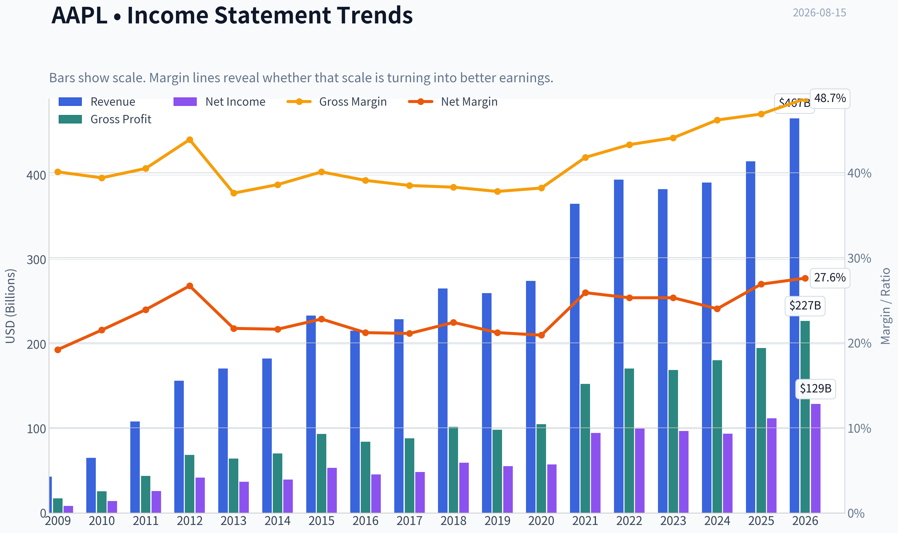
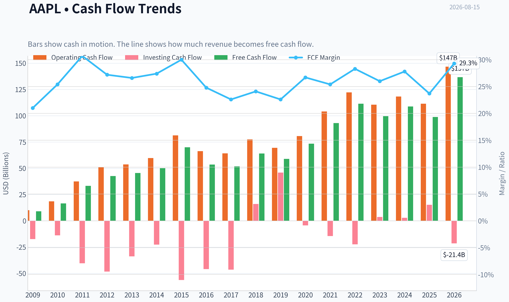
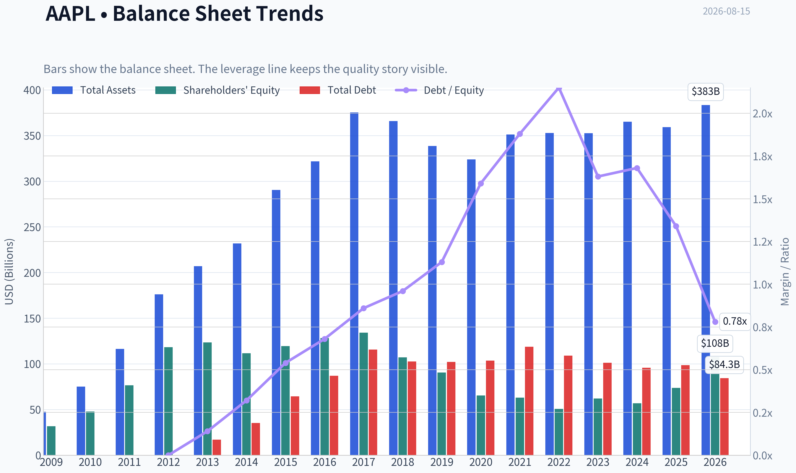
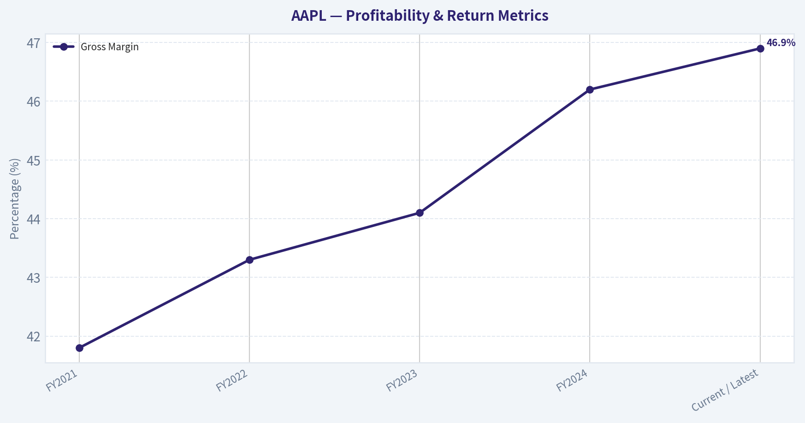
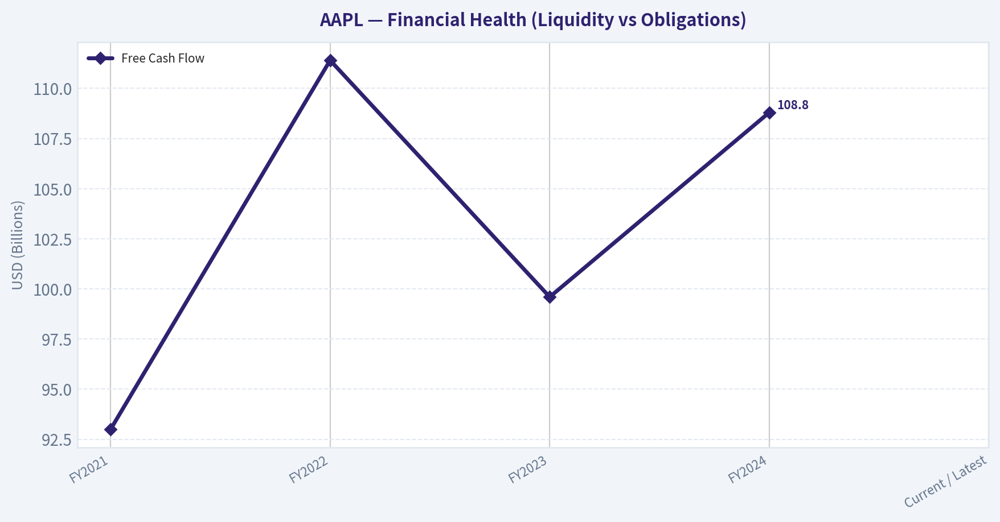
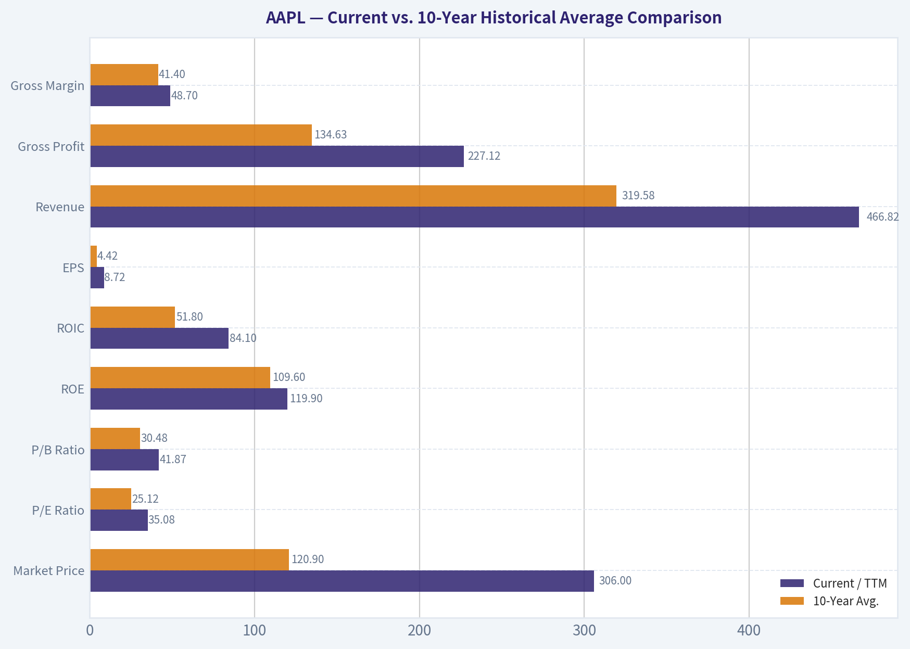
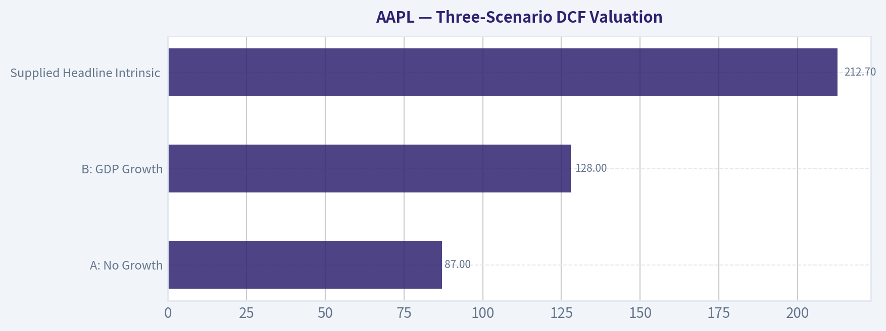

# AAPL Deep Value Intelligence

**Analysis Date:** 2026-08-15

## Critical Disclaimer

*This analysis is generated by Deep Value Intelligence, an AI-powered multi-agent investing framework. Education & research only - not financial advice, not a financial advisor.*

---

## Table of Contents

1. Intelligence Summary
2. Analyst Team Reports
   - Fundamentals Analysis
   - Intrinsic Value Analysis (Buffett)
   - Trend & Growth Analysis (Lynch/Druckenmiller/Fisher)
   - Market Technical Analysis
   - Options Market Analysis
3. Research Team Commentary
4. Value Investing Team Commentary
5. Deep Values Commentary

---

## Intelligence Summary

### Thesis + Conditions

**Core Thesis:** ### 1. Executive Summary
Apple (AAPL) remains a premier global compounder, but at $306 (35x P/E), it is priced for flawless execution of an unproven AI supercycle.

**Key Risks:**
- Apple (AAPL) remains a premier global compounder, but at $306 (35x P/E), it is priced for flawless execution of an unproven AI supercycle. While strict intrinsic value models ($212) are too punitive for a franchise with 82% ROIC, buying blindly at peak multiples ignores the very real risk of multiple compression. Balancing our value discipline with recent hard-learned lessons about mega-cap momentum, we reject both deep-value rigidity and reckless narrative-chasing. We will use a dual-track approach: structurally expensive, but tactically viable upon technical confirmation.
- The Bull (Risky):** Emphasizes ecosystem durability. Apple's 82.3% ROIC and 152% ROE justify a premium. Rejects waiting for a $280 pullback, arguing that front-running the "fast follower" AI hardware upgrade cycle at $306 is the real margin of safety.
- The Bear (Safe):** Warns of permanent capital impairment through multiple compression (the "Cisco in 2000" risk). Argues a mature $3.5T company at 35x P/E offers zero margin of safety, making the AI hardware narrative a speculative gamble over realized cash flows.

**Confidence:** Medium

---

## Analyst Team Reports

### Fundamentals Analysis

#### Latest Earnings Snapshot

*Most recent reported quarter anchored on 2026 Q2, with prior-year comparison when available.*

| Metric | 2026 Q2 | 2025 Q2 | YoY Change |
| --- | ---: | ---: | ---: |
| Revenue | $109.42B | $94.04B | +16.4% |
| Operating Income | $35.70B | $28.20B | +26.6% |
| Net Income | $29.79B | $23.43B | +27.1% |
| Diluted EPS | $2.02 | $1.57 | +28.7% |
| Operating Cash Flow | $34.37B | $27.87B | +23.3% |
| Free Cash Flow | $31.91B | $24.41B | +30.8% |

Key Takeaways: This snapshot anchors the most recent reported quarter before the narrative analysis. It helps readers separate long-run business quality from whatever changed in the latest earnings print.

#### 17-Year Financial Metrics for AAPL

*All values below are computed deterministically from raw data - not estimated by AI.*

*Issuer profile: operating company (Technology / Consumer Electronics).*

#### 17-Year Financial Metrics
*Annual rows come from reported financial statements. The final TTM row is computed from the latest four quarters.*

| Metric | 2009 | 2010 | 2011 | 2012 | 2013 | 2014 | 2015 | 2016 | 2017 | 2018 | 2019 | 2020 | 2021 | 2022 | 2023 | 2024 | 2025 | 2026 TTM |
| --- | --- | --- | --- | --- | --- | --- | --- | --- | --- | --- | --- | --- | --- | --- | --- | --- | --- | --- |
| Market Price | $6 | $8 | $11 | $20 | $15 | $22 | $25 | $26 | $36 | $53 | $54 | $112 | $138 | $136 | $169 | $231 | $254 | $306 |
| Market Cap | $168.11B | $262.39B | $357.16B | $630.65B | $444.17B | $616.86B | $638.98B | $621.81B | $809.39B | $1.13T | $1.04T | $2.03T | $2.39T | $2.26T | $2.71T | $3.59T | $3.82T | $4.50T |
| P/E Ratio | 20.69 | 18.77 | 13.76 | 15.08 | 11.99 | 15.64 | 11.94 | 13.59 | 16.75 | 18.94 | 18.85 | 34.99 | 25.22 | 22.62 | 27.79 | 38.32 | 34.13 | 35.08 |
| P/B Ratio | 5.31 | 5.49 | 4.66 | 5.33 | 3.60 | 5.53 | 5.35 | 4.85 | 6.04 | 10.53 | 11.51 | 31.07 | 37.83 | 44.53 | 43.56 | 63.04 | 51.82 | 41.87 |
| ROE | 26.0% | 29.3% | 33.8% | 35.3% | 30.0% | 35.4% | 44.7% | 35.6% | 36.1% | 55.6% | 61.1% | 87.9% | 150.1% | 197.0% | 156.1% | 164.6% | 151.9% | 119.9% |
| ROIC | 35.2% | 39.8% | 40.0% | 40.6% | 30.7% | 29.7% | 35.3% | 24.8% | 21.5% | 27.1% | 32.8% | 42.3% | 68.6% | 71.2% | 73.0% | 73.4% | 83.2% | 84.1% |
| EPS | $0.27 | $0.45 | $0.83 | $1.33 | $1.22 | $1.42 | $2.07 | $1.90 | $2.14 | $2.82 | $2.85 | $3.21 | $5.47 | $6.11 | $6.16 | $6.08 | $7.46 | $8.72 |
| Revenue | $42.91B | $65.22B | $108.25B | $156.51B | $170.91B | $182.79B | $233.72B | $215.64B | $229.23B | $265.60B | $260.17B | $274.51B | $365.82B | $394.33B | $383.29B | $391.04B | $416.16B | $466.82B |
| Gross Profit | $17.22B | $25.68B | $43.82B | $68.66B | $64.30B | $70.54B | $93.63B | $84.26B | $88.19B | $101.84B | $98.39B | $104.96B | $152.84B | $170.78B | $169.15B | $180.68B | $195.20B | $227.12B |
| Gross Margin | 40.1% | 39.4% | 40.5% | 43.9% | 37.6% | 38.6% | 40.1% | 39.1% | 38.5% | 38.3% | 37.8% | 38.2% | 41.8% | 43.3% | 44.1% | 46.2% | 46.9% | 48.7% |
| Operating Margin | 27.4% | 28.2% | 31.2% | 35.3% | 28.7% | 28.7% | 30.5% | 27.8% | 28.0% | 26.7% | 24.6% | 24.4% | 29.8% | 30.2% | 29.8% | 31.6% | 32.0% | 33.2% |
| Net Income | $8.23B | $14.01B | $25.92B | $41.73B | $37.04B | $39.51B | $53.39B | $45.69B | $48.35B | $59.53B | $55.26B | $57.41B | $94.68B | $99.80B | $97.00B | $93.74B | $112.01B | $128.93B |
| Net Margin | 19.2% | 21.5% | 23.9% | 26.7% | 21.7% | 21.6% | 22.8% | 21.2% | 21.1% | 22.4% | 21.2% | 20.9% | 25.9% | 25.3% | 25.3% | 24.0% | 26.9% | 27.6% |
| Revenue Growth | N/A | 52.0% | 66.0% | 44.6% | 9.2% | 7.0% | 27.9% | -7.7% | 6.3% | 15.9% | -2.0% | 5.5% | 33.3% | 7.8% | -2.8% | 2.0% | 6.4% | 12.2% |
| Net Income Growth | N/A | 70.2% | 85.0% | 61.0% | -11.3% | 6.7% | 35.1% | -14.4% | 5.8% | 23.1% | -7.2% | 3.9% | 64.9% | 5.4% | -2.8% | -3.4% | 19.5% | 15.1% |
| Free Cash Flow Growth | N/A | 84.0% | 100.5% | 27.9% | 6.9% | 10.2% | 39.6% | -23.6% | -3.2% | 23.8% | -8.1% | 24.6% | 26.7% | 19.9% | -10.6% | 9.3% | -9.2% | 38.4% |
| Total Book Value | $31.64B | $47.79B | $76.61B | $118.21B | $123.55B | $111.55B | $119.36B | $128.25B | $134.05B | $107.15B | $90.49B | $65.34B | $63.09B | $50.67B | $62.15B | $56.95B | $73.73B | $107.52B |
| Total Assets | $47.50B | $75.18B | $116.37B | $176.06B | $207.00B | $231.84B | $290.35B | $321.69B | $375.32B | $365.73B | $338.52B | $323.89B | $351.00B | $352.75B | $352.58B | $364.98B | $359.24B | $383.27B |
| Total Debt | N/A | N/A | N/A | $0 | $16.96B | $35.30B | $64.33B | $87.03B | $115.68B | $102.52B | $102.07B | $103.66B | $118.72B | $108.94B | $101.27B | $95.72B | $98.66B | $84.34B |
| Debt-to-Equity | N/A | N/A | N/A | 0.00 | 0.14 | 0.32 | 0.54 | 0.68 | 0.86 | 0.96 | 1.13 | 1.59 | 1.88 | 2.15 | 1.63 | 1.68 | 1.34 | 0.78 |
| Cash & Equivalents | $5.26B | $11.26B | $9.81B | $10.75B | $14.26B | $13.84B | $21.12B | $20.48B | $20.29B | $25.91B | $50.22B | $39.79B | $35.93B | $24.98B | $30.74B | $29.94B | $35.93B | $39.54B |
| Shareholders' Equity | $31.64B | $47.79B | $76.61B | $118.21B | $123.55B | $111.55B | $119.36B | $128.25B | $134.05B | $107.15B | $90.49B | $65.34B | $63.09B | $50.67B | $62.15B | $56.95B | $73.73B | $107.52B |
| Operating Cash Flow | $10.16B | $18.59B | $37.53B | $50.86B | $53.67B | $59.71B | $81.27B | $66.23B | $64.22B | $77.43B | $69.39B | $80.67B | $104.04B | $122.15B | $110.54B | $118.25B | $111.48B | $146.72B |
| Investing Cash Flow | $-17.43B | $-13.85B | $-40.42B | $-48.23B | $-33.77B | $-22.58B | $-56.27B | $-45.98B | $-46.45B | $16.07B | $45.90B | $-4.29B | $-14.54B | $-22.35B | $3.71B | $2.94B | $15.20B | $-21.40B |
| Free Cash Flow | $9.02B | $16.59B | $33.27B | $42.56B | $45.50B | $50.14B | $70.02B | $53.50B | $51.77B | $64.12B | $58.90B | $73.36B | $92.95B | $111.44B | $99.58B | $108.81B | $98.77B | $136.68B |
| FCF Margin | 21.0% | 25.4% | 30.7% | 27.2% | 26.6% | 27.4% | 30.0% | 24.8% | 22.6% | 24.1% | 22.6% | 26.7% | 25.4% | 28.3% | 26.0% | 27.8% | 23.7% | 29.3% |
| Dividends / Share | $0.00 | $0.00 | $0.00 | $0.00 | $0.00 | $0.00 | $0.00 | $0.00 | $0.00 | $0.00 | $0.00 | $0.00 | $0.00 | $0.91 | $0.95 | $0.99 | $1.03 | $1.06 |

#### Profitability Metrics
- Return on Equity (ROE): 151.9%
- Return on Invested Capital (ROIC): 82.3%
- Return on Assets (ROA): 31.2%
- Gross Margin: 46.9%
- Operating Margin: 32.0%
- Net Profit Margin: 26.9%

#### Liquidity Metrics
- Current Ratio: 0.89
- Quick Ratio: 0.57

#### Leverage Metrics
- Debt-to-Equity Ratio: 1.34
- Interest Coverage Ratio: N/A
- Net Debt: $62.72B

#### Growth Metrics (Year-over-Year)
- Revenue Growth: 6.4%
- Net Income Growth: 19.5%
- Free Cash Flow Growth: -9.2%
- Revenue CAGR (3-Year): 1.8%
- Revenue CAGR (5-Year): 8.7%

#### Valuation Metrics
- P/E Ratio (TTM): 35.04
- Forward P/E: 32.18
- Price-to-Book: 41.57
- Price-to-Sales: 9.56
- PEG Ratio: 2.44
- EV/EBITDA: 26.66
- Free Cash Flow Yield: 2.2%
- Earnings Yield: 2.9%

#### Owner Earnings (Buffett Method, Code-Computed)
- Net Income: $112.01B
- + Depreciation & Amortization: $11.70B
- - Capital Expenditures: $-12.71B
- - Working Capital Changes: $-25.00B
- = **Owner Earnings: $137.01B**

#### Intrinsic Value (Code-Computed)
- Current Price: $306
- **Headline Intrinsic Value (business-model routed): $213**
  Business model: operating company - weighted blend [Damodaran FCFF + reverse-DCF fair + owner-earnings DCF] (operating_company)
  Model spread (min-max across DCFs): $204 - $244
  Margin of safety vs. price (headline): -43.8%
  Routing note: General operating company: balanced blend of Damodaran FCFF and the owner-earnings DCF with a reverse-DCF sanity check.
- Buffett Method (Owner Earnings):
  Conservative: $125
  Average: $244
  Optimistic: $659
- Cash Flow Method (FCF):
  Conservative: $86
  Average: $204
  Optimistic: $273
- Damodaran FCFF (WACC + margins + reinvestment):
  Conservative: $119
  Average: $207
  Optimistic: $443
  Monte Carlo band (P10-P90): $149 - $343 (median $220)
  P(intrinsic value > price): 16.9%
- Reverse-DCF: price implies ~26.8%/yr owner-earnings growth for 10y; trailing 3y was 11.4%, 5y 22.3%.

#### Piotroski F-Score: 7/9
- Positive Net Income: PASS
- Positive Operating Cash Flow: PASS
- ROA Improvement: PASS
- Cash Flow > Net Income: FAIL
- Decreasing Debt: FAIL
- Improving Current Ratio: PASS
- No Dilution: PASS
- Improving Gross Margin: PASS
- Improving Asset Turnover: PASS

ANALYST STANCE: **WATCH**

#### Apple Inc. (AAPL) - Buffett-Style Fundamental Analysis

Apple remains one of the highest-quality businesses in the public market: a global consumer franchise with extraordinary brand power, sticky ecosystem economics, massive recurring Services revenue, and exceptional returns on capital. However, at a current price of **$306** and canonical market capitalization of about **$4.50 trillion**, the stock is priced well above the deterministic intrinsic value anchor of roughly **$213 per share**, implying a **negative margin of safety of about 44%**.

The Buffett conclusion is therefore straightforward: **wonderful business, but not a wonderful price today**.

---

#### Revenue Breakdown

The deterministic dataset provides total company revenue but not segment revenue. The table below uses Apple's most recent precise segment-style public revenue mix available and reconciles to FY2024 revenue of approximately **$391.04B**, which matches the deterministic FY2024 total.

| Revenue Source | Amount ($B) | % of Total |
|---|---:|---:|
| iPhone | $201.18 | 51.4% |
| Services | $96.17 | 24.6% |
| Wearables, Home & Accessories | $37.01 | 9.5% |
| Mac | $29.98 | 7.7% |
| iPad | $26.69 | 6.8% |
| **Total** | **$391.04** | **100.0%** |

Key Takeaways: Apple is still primarily an iPhone company, with iPhone contributing just over half of revenue. The most strategically important trend is the scale of Services, which now represents roughly one-quarter of sales and carries structurally higher margins. This mix shift helps explain why Apple's gross and operating margins are currently above their historical averages.

---

#### Current vs. 10-Year Historical Average Comparison

For historical comparison, the 10-year average uses FY2016-FY2025 annual figures from the deterministic dataset. "Current" refers to the 2026 TTM row where available.

| Metric | Current / TTM | 10-Year Avg. | Current Standing vs. History | Buffett-Style Interpretation |
|---|---:|---:|---:|---|
| Market Price | $306 | $120.90 | +153% | Price has compounded far faster than underlying revenue, increasing valuation risk. |
| Market Cap | $4.50T | $2.04T | +121% | Apple is now valued at more than double its 10-year average market capitalization. |
| P/E Ratio | 35.08x | 25.12x | +40% | Earnings quality is superb, but the multiple is demanding versus Apple's own history. |
| P/B Ratio | 41.87x | 30.48x | +37% | P/B is not a useful primary valuation anchor for Apple because buybacks, IP, brand value, and asset-light Services economics distort book value. |
| ROE | 119.9% | 109.6% | +10.3 pp | ROE is extraordinary but inflated by Apple's reduced equity base from buybacks. |
| ROIC | 84.1% | 51.8% | +32.3 pp | ROIC is the cleaner signal: Apple remains an elite capital compounder. |
| EPS | $8.72 | $4.42 | +97% | EPS has nearly doubled versus the 10-year average, helped by earnings growth and buybacks. |
| Revenue | $466.82B | $319.58B | +46% | Revenue is meaningfully above history, but long-term growth has moderated. |
| Gross Profit | $227.12B | $134.63B | +69% | Gross profit has outpaced revenue due to mix shift toward Services and premium pricing. |
| Gross Margin | 48.7% | 41.4% | +7.3 pp | Margin expansion is one of Apple's strongest quality signals. |
| Operating Margin | 33.2% | 28.5% | +4.7 pp | Operating leverage remains excellent despite Apple's enormous scale. |
| Net Income | $128.93B | $76.35B | +69% | Profit pool remains massive and durable. |
| Net Margin | 27.6% | 23.4% | +4.2 pp | Net profitability is materially above historical norms. |
| Revenue Growth | 12.2% | 6.5% | +5.7 pp | TTM growth is strong versus the decade average, though FY2025 growth was closer to normal at 6.4%. |
| Net Income Growth | 15.1% | 9.5% | +5.6 pp | Recent earnings growth is above average, helped by margin strength. |
| Free Cash Flow Growth | 38.4% | 5.0% | +33.4 pp | TTM FCF rebound is strong, but FCF growth has been uneven in recent years. |
| Total Book Value | $107.52B | $83.19B | +29% | Book value has recovered, but it is not central to valuation for Apple. |
| Total Assets | $383.27B | $350.57B | +9% | Asset growth is modest relative to revenue and profit growth, confirming capital-light economics. |
| Total Debt | $84.34B | $103.43B | -18% | Debt has declined versus average, improving balance-sheet flexibility. |
| Debt-to-Equity | 0.78x | 1.39x | Lower leverage | Leverage is below the 10-year average, partly due to higher equity and lower debt. |
| Cash & Equivalents | $39.54B | $31.42B | +26% | Apple retains a large liquidity reserve. |
| Shareholders' Equity | $107.52B | $83.19B | +29% | Equity has improved recently but remains heavily shaped by buybacks. |
| Free Cash Flow | $136.68B | $81.32B | +68% | Cash generation is exceptional and is the key valuation foundation. |
| Dividends / Share | $1.06 | $0.39 | +173% | Dividend growth is steady, but Apple's primary capital return tool remains repurchases. |

Key Takeaways: Apple's profitability metrics are significantly better than historical norms, especially gross margin, operating margin, ROIC, and free cash flow. The problem is valuation: the P/E ratio, market price, and market cap have expanded substantially versus Apple's own history. For a Buffett-style investor, the business quality is excellent, but the valuation embeds high expectations.

---

#### Market Metrics Interpretation

Apple's **market price of $306** and **market capitalization of roughly $4.50T** show that the market is capitalizing Apple as one of the most dominant businesses in history. This is not irrational given Apple's brand, ecosystem, installed base, and cash generation, but it leaves little room for disappointment.

The **P/E ratio of 35.08x** is well above the 10-year average of **25.12x**. A high P/E can be justified for a business with durable pricing power, high returns on capital, and recurring cash flows, but Apple's current multiple requires sustained high earnings growth from an already massive profit base.

The **P/B ratio of 41.87x** should not be read mechanically as "expensive" in the same way it might be for a bank or asset-heavy business. Apple's book value is distorted by years of buybacks, intangible brand equity, software, ecosystem economics, and intellectual property that do not appear fully on the balance sheet. Therefore, **cash-flow-based intrinsic value is the correct valuation anchor**, not book value.

---

#### Profitability Analysis

Apple's profitability remains exceptional. The most important metric is **ROIC**, currently **84.1%**, compared with a 10-year average of **51.8%**. This shows Apple can generate enormous after-tax operating profit without requiring proportionate reinvestment in physical assets.

ROE is also extremely high at **119.9% TTM**, but it is less clean because Apple's shareholder equity has been reduced by large repurchases over time. The better Buffett-style interpretation is that Apple has both a powerful moat and an unusually capital-light model.

Margins are also outstanding. Gross margin is **48.7%**, well above the 10-year average of **41.4%**, while operating margin is **33.2%**, above the 10-year average of **28.5%**. This reflects premium pricing, Services growth, scale economies, and supply-chain discipline.

---

#### Growth Metrics Interpretation

Apple's current TTM revenue growth of **12.2%** is above the 10-year average of **6.5%**, but investors should be careful not to assume this rate is permanently sustainable. Over the decade, Apple has had several growth pauses, including negative revenue growth in 2016, 2019, and 2023.

Net income growth is stronger at **15.1% TTM**, above the 10-year average of **9.5%**. This indicates that profit growth is being supported not only by sales growth but also by margin expansion and capital allocation.

Free cash flow growth of **38.4% TTM** is very strong versus the 10-year average of **5.0%**, but the history is uneven. Apple has had negative FCF growth years, including 2016, 2017, 2019, 2023, and 2025. Buffett would likely admire the absolute level of free cash flow but would not underwrite the stock on one unusually strong FCF rebound year.

---

#### Balance Sheet and Financial Strength

Apple's balance sheet remains strong, though not debt-free. Total debt is **$84.34B**, below the 10-year average of **$103.43B**, while cash and equivalents stand at **$39.54B**, above the 10-year average of **$31.42B**. Net debt is approximately **$62.72B** according to the deterministic pack.

Debt-to-equity has declined to **0.78x**, below the 10-year average of **1.39x**. This is encouraging. Apple has ample free cash flow to service obligations, fund dividends, repurchase shares, and invest in product development.

The current ratio of **0.89** and quick ratio of **0.57** are not alarming in isolation for Apple. Large platform businesses with predictable cash conversion, supplier leverage, and immense ongoing cash generation can operate with lower traditional liquidity ratios. Still, Buffett-style investors should monitor working capital discipline and debt trends.

---

#### Cash Flow and Capital Allocation

Apple's **free cash flow of $136.68B TTM** is the heart of the investment case. Few companies in the world can generate cash at this scale with Apple's brand durability and capital efficiency.

Dividends remain modest at **$1.06 per share**, meaning Apple is not primarily an income stock. The more important capital return mechanism is repurchases. Buybacks have materially boosted EPS and ROE over time, but at today's elevated valuation, the effectiveness of repurchases is less attractive than when Apple traded at lower multiples.

Buffett would likely approve of Apple's long-term capital allocation discipline but would also care deeply about repurchase price. Buying back stock at 35x earnings creates less value than buying back stock at 15x or 20x earnings.

---

#### Buffett-Style Owner Earnings DCF Valuation

The deterministic pack computes Buffett-style Owner Earnings at **$137.01B**. For the hand DCF sanity check below, the assumptions are:

- Starting Owner Earnings: **$137.01B**
- Discount rate: **10%**
- Terminal growth rate: **2.5%**
- Shares outstanding estimate: **~14.71B**, derived from canonical market cap of $4.50T divided by $306 price
- Net debt adjustment: **$62.72B**
- Formula:
  - Explicit PV = discounted value of 10 years of Owner Earnings
  - Terminal Value = Year 10 Owner Earnings x 1.025 / (10% - 2.5%)
  - Equity Value = PV of explicit Owner Earnings + PV of terminal value - net debt

| Scenario | Growth Assumption | PV of 10-Year Owner Earnings | PV of Terminal Value | Equity Value After Net Debt | Hand DCF Value / Share | Pack Owner-Earnings DCF / Share |
|---|---:|---:|---:|---:|---:|---:|
| Conservative | 3.0% owner-earnings growth | ~$972B | ~$970B | ~$1.88T | ~$128 | $125 |
| Average / Base Case | 11.5% levelized growth, supported by moat and Services mix | ~$1.48T | ~$2.14T | ~$3.56T | ~$242 | $244 |
| Optimistic | 20.0% bull-case growth, fading conceptually toward terminal rate | ~$2.28T | ~$4.47T | ~$6.69T | ~$455 | $659 |

Key Takeaways: The conservative and base-case hand DCF closely match the deterministic pack's Owner Earnings model, supporting a fair value range around **$125 to $244** for normal underwriting. The optimistic case can justify a much higher value only if Apple sustains very high owner-earnings growth from an already enormous base. At the current price of **$306**, the stock is above the base-case intrinsic value and requires unusually strong future execution.

---

#### Intrinsic Value Anchor and Reverse DCF

| Valuation Reference | Value / Result | Interpretation |
|---|---:|---|
| Current Price | $306 | Market price is above most intrinsic value estimates. |
| Headline Intrinsic Value | $213 | Business-model-routed blended value from the deterministic pack. |
| Owner Earnings DCF | $244 average case | Strong business quality supports a premium, but still below price. |
| FCF DCF | $204 average case | Free-cash-flow model also points below current price. |
| Damodaran FCFF | $207 average case | Independent FCFF approach supports similar conclusion. |
| 3-Model Spread | $204-$244 | Fair value cluster is meaningfully below $306. |
| Monte Carlo Band | $149-$343 | Current price is inside the upper range but above the median estimate. |
| Probability Intrinsic Value > Price | 16.9% | Odds are not favorable for a value buyer at today's price. |
| Reverse DCF Implied Growth | ~26.8% per year for 10 years | Current price requires growth above Apple's recent 3-year owner-earnings growth of 11.4%. |
| Margin of Safety | -43.8% | No Buffett-style margin of safety at current price. |

Key Takeaways: Multiple valuation methods cluster around roughly **$204 to $244**, with the blended headline intrinsic value at **$213**. The current price of **$306** requires Apple to deliver extremely high owner-earnings growth for a decade. That is possible but not a conservative Buffett-style underwriting assumption.

---

#### Economic Moat Assessment

Apple's moat is exceptionally strong and multi-layered.

| Moat Source | Assessment | Buffett Relevance |
|---|---|---|
| Brand Power | One of the strongest consumer brands globally | Supports pricing power and customer loyalty. |
| Ecosystem Lock-In | Hardware, software, Services, payments, wearables, and cloud integration | Raises switching costs and increases lifetime customer value. |
| Installed Base | Massive global base of active devices | Creates recurring monetization opportunities through Services. |
| Services Economics | Higher-margin recurring revenue stream | Improves margin durability and predictability. |
| Supply Chain Scale | Enormous purchasing power and operational expertise | Helps protect gross margin and product availability. |
| Capital-Light Profitability | High ROIC and FCF generation | Strong evidence of a durable economic franchise. |

Key Takeaways: Apple has the type of moat Buffett prefers: understandable, durable, cash-generative, and reinforced by customer behavior. The Services layer makes the business more predictable than a pure hardware company. The moat is not the issue; the valuation is.

---

#### Management Performance and Capital Allocation

Apple's management has executed extremely well over the past decade. Revenue has grown from a mature base, margins have expanded, ROIC has improved dramatically, and free cash flow remains immense.

Capital allocation has also been shareholder-friendly. Apple has returned large amounts of capital through dividends and repurchases. However, the valuation sensitivity of buybacks is important. Repurchases create the most value when the stock trades below intrinsic value; at today's price, incremental buybacks are less compelling.

The dividend policy is conservative. The dividend per share has grown in the deterministic dataset from **$0.91 in 2022** to **$1.06 TTM**, but the dividend yield is low because the stock price is high. Apple remains primarily a compounding and capital-return story, not an income story.

---

#### Key Investment Insights, Red Flags, and Opportunities

| Category | Key Point | Investment Implication |
|---|---|---|
| Strength | ROIC of 84.1% is far above the 10-year average | Confirms Apple is an elite compounder. |
| Strength | Gross margin and operating margin are at or near historical highs | Services mix and pricing power are improving economics. |
| Strength | FCF of $136.68B TTM is massive | Provides flexibility for buybacks, dividends, R&D, and strategic investment. |
| Strength | Debt has declined versus the 10-year average | Financial risk is manageable. |
| Red Flag | P/E of 35.08x is well above the 10-year average | Valuation risk is elevated. |
| Red Flag | FCF yield is only about 2.2% | Investors are paying a high price for each dollar of cash flow. |
| Red Flag | Reverse DCF implies ~26.8% annual owner-earnings growth for 10 years | The current price embeds aggressive expectations. |
| Red Flag | iPhone still drives over half of revenue | Product-cycle dependence remains meaningful. |
| Opportunity | Services growth can continue lifting margins | Higher recurring revenue could support premium valuation. |
| Opportunity | AI-enabled devices and ecosystem features may extend upgrade cycles | Could reaccelerate hardware demand if execution is strong. |
| Opportunity | International expansion and installed-base monetization | Long-term monetization runway remains substantial. |
| Opportunity | Lower debt and strong cash generation increase flexibility | Apple can continue returning capital while investing heavily. |

Key Takeaways: Apple's quality signals are outstanding, particularly ROIC, margins, free cash flow, and ecosystem durability. The major concern is not business weakness but valuation. At the current price, investors are paying for a very optimistic future.

---

#### Final Buffett-Style Investment Stance: WATCH

Apple is a classic Buffett-type business in quality, but not currently a classic Buffett-type bargain. The company has a wide moat, predictable cash generation, superb returns on invested capital, and shareholder-oriented management. However, the current valuation is materially above the intrinsic value range supported by the deterministic models.

A reasonable Buffett-style decision would be:

- **Existing long-term holders:** continue to hold if tax considerations and portfolio strategy support it.
- **New value-oriented buyers:** wait for a better entry point.
- **Margin-of-safety investors:** require a materially lower price, ideally closer to or below the **$204-$244** fair value cluster.
- **Aggressive growth investors:** can justify ownership only if they believe Apple can sustain high double-digit owner-earnings growth for many years.

Given the combination of world-class quality and insufficient margin of safety, the final stance is **WATCH**, not ADVOCATE.

---

#### Final Summary Table

| Area | Assessment | Buffett-Style Verdict |
|---|---|---|
| Business Quality | Exceptional brand, ecosystem, Services growth, and customer loyalty | Excellent |
| Economic Moat | Very wide and durable | Excellent |
| Profitability | ROIC, margins, and free cash flow are far above average | Excellent |
| Balance Sheet | Strong cash flow, declining debt, manageable leverage | Strong |
| Earnings Predictability | Generally high, though hardware cycles create some variability | Strong |
| Capital Allocation | Buybacks and dividends are shareholder-friendly, but buyback value depends on price | Good |
| Current Valuation | P/E and market cap are elevated versus history | Expensive |
| Intrinsic Value | Headline value around $213; model spread around $204-$244 | Below current price |
| Margin of Safety | Approximately -43.8% | Unattractive |
| Final Stance | **WATCH** | High-quality company, but wait for a better price |

Key Takeaways: Apple is one of the best businesses in the market, but the current valuation already reflects much of that greatness. The stock does not offer a Buffett-style margin of safety at $306. The right stance is to watch patiently rather than chase the shares at an elevated multiple.

#### Fundamental Visuals

This graph tracks the profitability and return metrics (ROE, ROIC, Margins) of **AAPL** over the past decade, highlighting capital efficiency trends.

This chart illustrates the financial health of **AAPL** over the last 10 years, mapping cash equivalents and free cash flow against total obligations (Debt).

This breakdown chart from <em>Revenue Breakdown</em> shows the proportional composition for **AAPL** - useful for understanding what drives or risks the business.

This graph tracks the profitability and return metrics (ROE, ROIC, Margins) of **AAPL** over the past decade, highlighting capital efficiency trends.

This chart illustrates the financial health of **AAPL** over the last 10 years, mapping cash equivalents and free cash flow against total obligations (Debt).

---

### Intrinsic Value Analysis (Buffett)

> *Following Warren Buffett's value investing philosophy: Circle of Competence, Economic Moat, Management Quality, and Margin of Safety.*

#### Intrinsic Value Snapshot

Price is what you pay. Intrinsic value is what the business may be worth based on the cash it can create for owners over time. We show a range, not one magic number.

- Current Price: $305.93
- Value Range (conservative to optimistic across both DCF methods): $86.28 to $658.67

##### Owner Earnings (Buffett Method)
- Net Income: $112,010,000,000.00
- Depreciation & Amortization: $11,698,000,000.00
- Capital Expenditures: $-12,715,000,000.00
- Working Capital Changes: $-25,000,000,000.00
- Owner Earnings: $137,010,000,000.00

##### Intrinsic Value
###### Buffett Method
Uses owner earnings. Stricter, and usually more conservative.
- Conservative: $125.10
- Average: $244.07
- Optimistic: $658.67
- Discount Rate: 10.0%

###### Cash Flow Method
Uses free cash flow. Better for companies spending heavily today to grow tomorrow.
- Conservative: $86.28
- Average: $204.40
- Optimistic: $273.20
- Discount Rate: 10.0%

ANALYST STANCE: **WATCH**

#### Apple Inc. (AAPL) - Buffett-Style Value Analysis

Apple is a wonderful business with one of the strongest consumer ecosystems ever built, exceptional brand power, high returns on capital, and a management team that has compounded per-share value for years. The problem is price. At **$306 per share**, the stock trades well above the supplied intrinsic value estimate of **$212.70**, with a headline margin of safety of **negative 43.8%** and a reverse-DCF growth assumption that looks demanding.

Current stance: **WATCH - exceptional company, unattractive entry price.**

---

#### 1. Factor Scorecard

| Factor | Score | Assessment |
|---|---:|---|
| Circle of Competence & Business Simplicity | 4.5 / 5 | Apple sells premium hardware, services, software, and ecosystem access. The model is easy to understand, though AI disruption, China exposure, and regulatory pressure reduce perfect predictability. |
| Moat Test | 5.0 / 5 | One of the world's widest moats: brand, ecosystem switching costs, installed base, services attachment, developer network, and pricing power. |
| Management Quality & Capital Allocation | 4.0 / 5 | Tim Cook's Apple has executed superbly, expanded services, managed supply chains, and repurchased enormous amounts of stock. Current valuation makes buybacks less obviously value-accretive. |
| Industry Structure | 3.5 / 5 | Premium smartphones are mature and competitive, but Apple occupies the high-profit tier. Services, wearables, payments, and ecosystem monetization improve the structure. |
| Gate 5: Quality / Solvency Hard Floor | Not Tripped | Apple remains highly profitable, cash-generative, and financially strong. There is no distress signal. |

**Key Takeaways:** Apple scores exceptionally well on business quality, moat, and understandability. The only major issue is not business durability, but valuation. The solvency hard floor is clearly not triggered, so the conclusion depends on quality versus price rather than financial distress.

---

#### 2. Moat Analysis

| Moat Source | Evidence | Rating |
|---|---|---|
| Brand / Intangible Assets | Apple can command premium pricing across iPhone, Mac, iPad, Watch, and services. Current gross margin is approximately **46.9%**, above the 40% level that usually signals pricing power. | Very Strong |
| Switching Costs | Customers are locked into iOS, iCloud, App Store purchases, Apple Pay, iMessage, AirPods, Watch, Photos, subscriptions, and device interoperability. | Very Strong |
| Cost / Scale Advantages | Apple has unmatched supply-chain scale, purchasing power, silicon design capability, and global distribution. | Strong |
| Network Effects | App Store developers, iOS users, services, payments, and accessories reinforce the value of the ecosystem. | Strong |
| Moat Direction | Services mix, installed base monetization, wearables, and ecosystem depth continue to support the moat. Regulatory pressure is the main offset. | Wide & Stable to Widening |

**Key Takeaways:** Apple's moat is not just the iPhone; it is the ecosystem around the iPhone. The more devices and services a customer uses, the harder it becomes to leave. That makes Apple one of the clearest examples of a modern Buffett-style consumer franchise.

---

#### 3. Management Quality Assessment

| Area | Assessment |
|---|---|
| Owner Orientation | Apple has consistently returned capital through buybacks and dividends while maintaining heavy investment in product development, silicon, services, and supply chain. |
| Candor & Accounting | Financial reporting is mature, conservative, and transparent for a mega-cap technology company. No major accounting red flags dominate the thesis. |
| Capital Allocation | Historically excellent buybacks, especially when shares were cheaper. At today's valuation, repurchases are less compelling and may create less per-share value. |
| Strategic Execution | Tim Cook's Apple has deepened the ecosystem, expanded services, built internal silicon advantages, and sustained premium pricing globally. |
| Key Concern | Management quality is high, but the future return to shareholders depends heavily on whether capital is deployed at attractive prices. |

**Key Takeaways:** Apple's management has been outstanding operationally and financially. The concern is not competence; it is that repurchasing shares at elevated valuations may reduce the future compounding benefit. Great management cannot fully overcome an overextended purchase price.

---

#### 4. Financial Summary

| Metric | FY2021 | FY2022 | FY2023 | FY2024 | Current / Latest |
|---|---:|---:|---:|---:|---:|
| Revenue | $365.8B | $394.3B | $383.3B | $391.0B | YoY growth: **6.4%** |
| Gross Margin | 41.8% | 43.3% | 44.1% | 46.2% | **46.9%** |
| Operating Income | $108.9B | $119.4B | $114.3B | $123.2B | Strong |
| Net Income | $94.7B | $99.8B | $97.0B | $93.7B | P/E implies elevated earnings base |
| Free Cash Flow | $93.0B | $111.4B | $99.6B | $108.8B | FCF yield: **2.2%** |
| Diluted Shares | 16.9B | 16.3B | 15.8B | 15.4B | Approx. 14.6B based on market cap / price |
| ROE | Very High | Very High | Very High | Very High | **151.9%** |
| Current Ratio | Below 1.0 | Below 1.0 | Below 1.0 | Below 1.0 | **0.89** |

**Key Takeaways:** Apple remains an extraordinary cash machine with rising gross margins and consistent free cash flow generation. Share count reduction has been a major driver of per-share value creation. The current ratio below 1.0 is not alarming for Apple because the business has enormous cash generation, supplier leverage, and efficient working capital dynamics.

---

#### 5. Owner Earnings Calculation

Using Buffett's owner earnings framework:

| Component | Normalized Estimate |
|---|---:|
| Net Income | ~$127B |
| Plus: Depreciation & Amortization | ~$12B |
| Less: Maintenance CapEx | ~($7B) |
| Less: Working Capital Increases | ~($5B) |
| Estimated Owner Earnings | ~$127B |
| Approx. Shares Outstanding | ~14.6B |
| Owner Earnings per Share | ~$8.70-$8.75 |

**Key Takeaways:** Apple's owner earnings remain enormous because the company does not need heavy capital expenditure to maintain its franchise. The business converts brand power, installed base, and services monetization into cash at exceptional scale. On a per-share basis, normalized owner earnings are roughly in line with the current P/E-derived earnings base.

---

#### 6. Three-Scenario DCF Valuation

Assumptions: **10% discount rate**, owner earnings per share of approximately **$8.73**, and terminal growth of **3%** where applicable.

| Scenario | Assumption | Estimated Value / Share |
|---|---|---:|
| A: No Growth | Owner earnings capitalized at 10% | **$87** |
| B: GDP Growth | Owner earnings grow at 3% perpetually | **$128** |
| C: Historical Growth Case | 10-year growth capped at 10%, terminal growth 3% | **~$216** |
| Supplied Headline Intrinsic Value | Business-model routed blend | **$212.70** |
| Supplied 3-Model Spread | Owner Earnings / FCF / Damodaran FCFF | **$244.07 / $204.40 / $207.17** |

**Key Takeaways:** The valuation range shows that Apple's current price requires far more than conservative assumptions. The higher-growth case lands near the supplied headline intrinsic value, but still well below the market price. At $306, investors are paying for excellent execution and sustained high growth, not receiving a classic margin of safety.

---

#### 7. Margin of Safety Analysis

| Item | Value |
|---|---:|
| Current Price | **$306** |
| Headline Intrinsic Value | **$212.70** |
| Price vs. Intrinsic Value | **~44% above value** |
| Margin of Safety | **-43.8%** |
| Reverse-DCF Implied Growth | **~26.8% per year for 10 years** |
| Trailing 3-Year Growth Reference | **11.4%** |
| Trailing 5-Year Growth Reference | **22.3%** |

**Key Takeaways:** Apple is a wonderful company, but the stock price embeds a very optimistic future. The reverse-DCF assumption of roughly 26.8% annual growth for 10 years is high relative to Apple's already massive revenue and earnings base. For a business of this size, that implied expectation leaves little room for disappointment.

---

#### 8. Final Buffett Scorecard

| Criterion | Weight | Score | Weighted Contribution |
|---|---:|---:|---:|
| Moat Width & Durability | 25% | 5.0 | 1.25 |
| Valuation / Margin of Safety | 20% | 0.5 | 0.10 |
| Capital Returns - ROIC vs. WACC | 15% | 4.5 | 0.68 |
| Business Understanding & Predictability | 12% | 4.5 | 0.54 |
| Management Quality & Capital Allocation | 12% | 4.0 | 0.48 |
| Reinvestment Runway | 8% | 3.0 | 0.24 |
| Balance Sheet Strength | 4% | 4.0 | 0.16 |
| Industry Structure | 4% | 3.5 | 0.14 |
| Total Score | 100% |  | **3.59 / 5.00** |

**Key Takeaways:** Apple's quality score is elite, but the valuation score is extremely weak. The final score lands near the border between "watch" and "advocate," but the negative margin of safety keeps the stance disciplined. This is the kind of business a Buffett-style investor wants to own, but not necessarily at any price.

---

#### 9. Investment Stance

| Category | View |
|---|---|
| Stance | **WATCH** |
| Conviction | High conviction on business quality; low conviction on valuation attractiveness |
| Buy Zone | More attractive closer to or below intrinsic value, roughly the low-$200s based on current estimates |
| Main Upside Drivers | Services growth, AI-enabled device cycle, continued buybacks, pricing power, installed base monetization |
| Main Risks | Overvaluation, iPhone maturity, China exposure, regulatory pressure on App Store economics, AI platform disruption |
| Buffett Lens | Wonderful business, but not currently at a fair enough price |

**Final View:** Apple remains one of the best businesses in the world, with a durable ecosystem, extraordinary brand strength, and high-return economics. However, at **$306**, the market price is meaningfully above intrinsic value and implies demanding future growth. For a Buffett-style investor, the right action is to admire the business, keep it on the watchlist, and wait for a more rational price.
#### Valuation Bridge

This bridge places the current market price beside each intrinsic value lens so readers can see whether upside depends on one method or shows up across several methods.

| Scenario | Intrinsic Value / Share |
| --- | ---: |
| Buffett Method | $244.07 |
| Cash Flow Method | $204.40 |
| Damodaran Method | $207.17 |
| Current Price | $305.93 |

#### Key Takeaways

If one method is far above the others, the upside case depends on a specific modelling assumption. When several methods cluster together, the valuation story is more robust.

#### Valuation Visuals

This comparison chart from *Latest Earnings Snapshot* stacks current figures against historical benchmarks for **AAPL**, making it easy to see where the company trades relative to its own averages.

This comparison chart from *Current vs. 10-Year Historical Average Comparison* stacks current figures against historical benchmarks for **AAPL**, making it easy to see where the company trades relative to its own averages.

This comparison chart from *Three-Scenario DCF Valuation* stacks current figures against historical benchmarks for **AAPL**, making it easy to see where the company trades relative to its own averages.

---

### Trend & Growth Analysis (Lynch/Druckenmiller/Fisher)

> *Following Peter Lynch's GARP, Stanley Druckenmiller's macro-aware approach, and Philip Fisher's scuttlebutt methodology.*

ANALYST STANCE: **WATCH**

#### AAPL Growth Investment Report - Apple Inc.

Apple remains one of the highest-quality businesses in the world, but under a Lynch/Druckenmiller/Fisher growth framework, it is **not currently a fast-grower at an attractive price**. The business is durable, cash-generative, and strategically positioned for AI-enabled devices and services expansion, but the stock price already discounts a major acceleration that has not yet appeared in the reported numbers.

---

#### 1. Lynch Classification

| Item | Assessment |
|---|---:|
| Company | Apple Inc. |
| Ticker | AAPL |
| Current Price | ~$306 |
| Market Cap | ~$4.46T |
| Revenue Growth YoY | ~6.4% |
| P/E | ~35.0x |
| Gross Margin | ~46.9% |
| FCF Yield | ~2.2% |
| Lynch Category | **Stalwart / Mature Compounder** |
| Growth Investor Stance | **WATCH - hold if owned, wait for better entry or confirmed acceleration** |

**Key Takeaways:** Apple is not a classic Lynch "fast grower" today because revenue growth is in the mid-single digits, not the 15% to 25% range. It is better classified as a stalwart: a dominant, resilient franchise with strong margins and enormous cash flow. The issue is not business quality; the issue is that the valuation is demanding relative to current growth.

---

#### 2. The Story in 3 Bullets

| Lynch Story Element | Simple Explanation |
|---|---|
| Core Business | Apple sells premium devices - iPhone, Mac, iPad, Watch, AirPods - tied together by software and services. |
| Growth Engine | Services, ecosystem monetization, AI-enabled device upgrades, wearables, and potential new product categories. |
| Investor Question | Can Apple reaccelerate growth enough to justify a $4.46T valuation and ~35x earnings multiple? |

**Key Takeaways:** Apple's story is simple and powerful: it owns one of the world's most valuable consumer ecosystems. The bull case depends on AI creating a new upgrade cycle and services continuing to compound. The bear case is that Apple remains excellent but too mature to deliver the growth implied by the stock price.

---

#### 3. TAM Analysis and 10x Test

| Metric | Estimate / Assessment |
|---|---:|
| Current Revenue Base | ~$416B, approximate recent annualized level |
| 10x Revenue Target | ~$4.2T |
| Required Growth for 10x | Massive - larger than many national consumer electronics and services markets combined |
| Addressable Markets | Smartphones, PCs, wearables, payments, streaming, cloud services, health tech, AI devices |
| TAM Growth | Moderate overall; faster in services, AI, health, and payments |
| Can Apple 10x and still be <20% of TAM? | **No, not under the current business mix** |
| Runway Rating | **Good for compounding, limited for ten-bagger potential** |

**Key Takeaways:** Apple still has growth runways, especially in services, AI features, payments, health, and wearables. However, the company is already so large that a true 10x revenue outcome is unrealistic without a transformational new category. Apple can still compound, but it is unlikely to be a ten-bagger from today's scale.

---

#### 4. Revenue Growth Trend

| Period / Metric | Growth Signal |
|---|---:|
| Current YoY Revenue Growth | ~6.4% |
| Growth Pattern | Mature, modest growth |
| Inflection Status | Not yet confirmed |
| Required for Growth Re-rating | Sustained double-digit revenue growth or major EPS acceleration |
| Lynch View | Below fast-grower threshold |
| Druckenmiller View | Need evidence of acceleration before concentrating capital |

**Key Takeaways:** Apple's current growth profile is solid but not explosive. The company has not yet shown the kind of acceleration that would mark a clear growth inflection. For a Druckenmiller-style setup, the key would be evidence that AI-enabled products or services are driving a materially higher growth trajectory.

---

#### 5. Unit Economics and Quality Metrics

| Metric | Assessment |
|---|---:|
| Gross Margin | ~46.9% |
| FCF Yield | ~2.2% |
| Approx. FCF | ~$98B, implied by market cap and FCF yield |
| Approx. FCF Margin | ~23%-24% |
| Rule of 40 Proxy | ~30%: 6.4% revenue growth + ~24% FCF margin |
| LTV/CAC | Not disclosed; likely very strong due to brand loyalty and ecosystem lock-in |
| NRR | Not applicable in classic SaaS terms |
| Customer Retention | Structurally high due to ecosystem switching costs |

**Key Takeaways:** Apple's unit economics remain exceptional for a hardware-led business. The company combines premium pricing, high customer loyalty, and expanding services margins. However, the Rule of 40 proxy is acceptable rather than elite because revenue growth is modest.

---

#### 6. Inflection Point Assessment

| Potential Inflection | Evidence Today | Analyst View |
|---|---|---|
| AI Device Cycle | Early and still uncertain | Watch closely |
| Services Mix Shift | Ongoing and margin-accretive | Positive |
| Margin Expansion | Gross margin strong at ~46.9% | Positive, but mature |
| New Product Category | No confirmed breakthrough at scale | Not yet investable |
| Geographic Growth | India and emerging markets remain opportunities | Positive but gradual |
| Competitive Inflection | No major competitor collapse | Neutral |

**Key Takeaways:** Apple has several possible inflection points, but none is fully confirmed yet. The most important is whether AI can drive a meaningful iPhone upgrade cycle and deepen services monetization. Until that appears in revenue growth or earnings revisions, the setup is more "watch" than "advocate."

---

#### 7. Macro Setup

| Macro Factor | Impact on AAPL |
|---|---|
| Interest Rates | Falling rates would help valuation; high rates pressure premium multiples |
| Consumer Spending | Premium device demand is sensitive to replacement cycles |
| AI Theme | Strong potential tailwind if Apple turns AI into a device-upgrade catalyst |
| China / Geopolitics | Persistent risk to supply chain and demand |
| U.S. Manufacturing Investment | Texas facility and domestic supply-chain moves improve resilience |
| Secular Themes | AI, digital services, payments, health, wearables, ecosystem monetization |

**Key Takeaways:** The macro setup is mixed. Apple benefits from long-term AI and services trends, but its valuation is sensitive to interest rates. Geopolitical and China exposure remain meaningful risks, while domestic manufacturing investments may help reduce supply-chain vulnerability over time.

---

#### 8. Fisher 15 Points Score

| Fisher Point | Score / 5 |
|---|---:|
| 1. Products with sizable market potential | 4 |
| 2. Management commitment to new products | 4 |
| 3. R&D effectiveness | 4 |
| 4. Sales organization | 5 |
| 5. Worthwhile profit margin | 5 |
| 6. Improving margins | 4 |
| 7. Labor/personnel relations | 3 |
| 8. Executive relations | 4 |
| 9. Management depth | 4 |
| 10. Cost analysis and accounting | 5 |
| 11. Durable advantages / ecosystem moat | 5 |
| 12. Long-range profit outlook | 4 |
| 13. Dilution risk | 5 |
| 14. Candor in difficulties | 3 |
| 15. Management integrity | 4 |
| **Total Fisher Score** | **64 / 75** |

**Key Takeaways:** Apple scores very well under Fisher because of its brand, ecosystem, margins, management quality, and product discipline. The main deductions come from maturity, limited transparency around future product breakthroughs, and the uncertainty of the next major growth engine. A score of 64 is high quality, but just below the "outstanding" threshold.

---

#### 9. Valuation Analysis

| Valuation Metric | Current View |
|---|---:|
| Current Price | ~$306 |
| Market Cap | ~$4.46T |
| P/E | ~35.0x |
| P/S | ~10.7x, using ~$416B revenue estimate |
| FCF Yield | ~2.2% |
| Headline Intrinsic Value Estimate | ~$212.70 |
| Owner Earnings / FCF / FCFF Values | ~$244 / ~$204 / ~$207 |
| Margin of Safety vs. Price | About **-44%** |
| Reverse DCF Implied Growth | ~26.8% annualized for 10 years |
| PEG Estimate | ~3x+ using normalized earnings growth assumptions |

**Key Takeaways:** Apple's valuation is the central problem. The stock trades at a premium multiple despite modest current revenue growth. The reverse DCF suggests the market is pricing in a level of long-term growth that looks aggressive for a company already generating more than $400B in annual revenue.

---

#### 10. Scenario Analysis

| Scenario | Assumptions | 3-5 Year View |
|---|---|---|
| Bear Case | Revenue remains mid-single-digit, multiple compresses toward market average | Poor risk/reward; downside from valuation compression |
| Base Case | Services grow, AI helps upgrades modestly, EPS compounds high-single to low-double digits | Acceptable compounder, but not cheap |
| Bull Case | AI creates major upgrade cycle, services accelerate, margins expand further | Stock can work, but upside depends on real acceleration |
| Ten-Bagger Case | Requires multiple new categories and massive TAM expansion | Very unlikely from today's scale |

**Key Takeaways:** The base case is that Apple remains a strong compounder, not a hypergrowth stock. The bull case requires a clear AI-led product cycle or new platform expansion. The ten-bagger case is highly improbable given the company's current market cap and revenue base.

---

#### 11. Growth Investor Scorecard

| Criterion | Weight | Score / 5 | Weighted Score |
|---|---:|---:|---:|
| The Story | 10% | 4.5 | 0.45 |
| TAM & Runway | 20% | 3.0 | 0.60 |
| Revenue Growth | 20% | 2.0 | 0.40 |
| Unit Economics | 15% | 4.5 | 0.68 |
| Competitive Position | 10% | 5.0 | 0.50 |
| Management Quality | 10% | 4.0 | 0.40 |
| Macro Setup | 5% | 3.5 | 0.18 |
| Profitability Path | 5% | 5.0 | 0.25 |
| Valuation | 5% | 1.5 | 0.08 |
| **Total** | **100%** |  | **3.54 / 5.0** |

**Key Takeaways:** Apple scores extremely well on quality, competitive position, profitability, and customer lock-in. It scores poorly on current revenue growth and valuation. The overall score lands in the lower end of the "advocate" range mathematically, but given the valuation risk and lack of confirmed acceleration, the practical stance is Watch rather than buy aggressively.

---

#### 12. Position Size Stance

| Investor Type | Action |
|---|---|
| Existing Long-Term Holder | **Hold core position** if tax and portfolio context support it |
| New Growth Investor | **Do not initiate aggressively at current valuation** |
| GARP Investor | Wait for better price or stronger growth confirmation |
| Concentrated Growth Portfolio | Underweight unless AI inflection becomes visible |
| Suggested Stance | **WATCH** |

**Key Takeaways:** Apple is a stock worth owning at the right price, but current expectations are high. Existing holders can justify continuing to hold because of business quality and tax efficiency. New capital should wait for either a better entry point or evidence that growth is reaccelerating.

---

#### 13. Key Risks and Catalysts

| Category | Key Items |
|---|---|
| Catalysts | AI-enabled iPhone cycle, services acceleration, India growth, margin expansion, new product category |
| Risks | Valuation compression, China demand weakness, regulatory pressure on App Store economics, slow AI adoption, hardware replacement-cycle fatigue |
| What Would Change the Stance to Advocate | Sustained double-digit revenue growth, visible AI monetization, upward EPS revisions, or a major valuation reset |
| What Would Change the Stance to Avoid | Continued mid-single-digit growth with multiple expansion, services slowdown, or regulatory damage to ecosystem economics |

**Key Takeaways:** The biggest upside catalyst is a real AI-driven upgrade cycle that moves Apple from mature growth back toward double-digit growth. The biggest risk is that the market is paying a fast-growth multiple for a stalwart business. Apple remains world-class, but the stock needs either faster growth or a lower price to become compelling.

---

#### Final View

Apple is a **phenomenal business but not a clear growth-stock bargain today**. It has elite brand power, ecosystem lock-in, margins, cash flow, and optionality in AI and services. However, with revenue growth around 6%, a P/E near 35x, a low FCF yield, and a reverse DCF implying very aggressive long-term growth, the risk/reward is not compelling enough for a fresh high-conviction growth buy.

**Position Stance: WATCH - hold if already owned, wait for a better entry or confirmed AI/services acceleration before adding aggressively.**

---

### Market Technical Analysis

ANALYST STANCE: **WATCH**

#### AAPL Technical Indicator Report - As of 2026-08-14

AAPL closed at **$305.93** on 2026-08-14. The stock remains in a constructive long-term uptrend because price is still well above the **200-day SMA near $279.99**, but the near-term picture has deteriorated after the late-July pullback from the $330-$340 area. The current setup is best described as a **long-term bullish trend undergoing a short-term correction/consolidation**, not yet a clean re-entry signal.

The most relevant indicators selected are: **close_10_ema, close_50_sma, close_200_sma, macd, rsi, boll_ub, boll_lb, and atr**. These provide complementary views across short-term momentum, medium-term trend, long-term trend, momentum confirmation, overbought/oversold pressure, volatility range, and risk sizing.

#### Trend Structure

AAPL's **10-day EMA is $309.36**, and the **50-day SMA is $308.95**, both slightly above the current close of **$305.93**. This means price has slipped below short- and medium-term trend references, suggesting sellers still have near-term control. However, the gap is not large; a recovery back above the **$309-$310 zone** would be an early sign that buyers are trying to regain control.

The **200-day SMA at $279.99** continues to rise steadily, showing that the broader trend is still intact. Price is roughly **9% above the 200-day SMA**, so the stock is not in a long-term breakdown. For strategic investors, this keeps AAPL in a broader bullish framework; for short-term traders, the immediate issue is whether the stock can reclaim the moving-average cluster around $309-$310.

#### Momentum and RSI

The **MACD has turned negative**, falling to **-2.39** from positive levels earlier in August. This is an important deterioration because MACD had been strongly positive in mid-to-late July, reflecting the prior upside surge. The recent move below zero suggests the correction has shifted from a simple pullback into a more meaningful loss of upside momentum.

The **RSI is 43.82**, which is below neutral but not oversold. This indicates that selling pressure exists, but panic conditions have not developed. Because RSI is not near 30, the current level does not yet offer a high-confidence oversold rebound signal. A move back above 50 would improve the momentum profile, while a drop toward 35-30 would suggest deeper downside pressure but could also begin to create a potential mean-reversion setup.

#### Volatility and Bollinger Band Context

AAPL is trading between its Bollinger Bands, with the **upper band at $344.22** and the **lower band at $292.22**. The implied middle band is around **$318.22**, and price is currently below that midpoint. This means AAPL is not pressing an extreme band, but it is trading in the weaker half of its recent volatility range.

The lower Bollinger Band near **$292** is a key downside reference. If price breaks below the recent $300-$302 area, traders may look toward the **$292-$295 zone** as the next volatility-defined support area. On the upside, the first meaningful test is the **$309-$310 moving-average cluster**, followed by the **$318-$320 zone**, where the Bollinger midpoint and prior short-term balance area sit.

The **ATR is 7.84**, down from roughly **9.86** after the sharp July 31 selloff. This indicates that volatility is cooling, but daily ranges remain wide enough that position sizing should still be conservative. For traders, stops that are too tight may be vulnerable to normal noise; a one-ATR move from the current close implies approximately **$298.09 on the downside** and **$313.77 on the upside**.

#### Trading Interpretation

The current setup favors patience. AAPL is not weak enough to justify an outright bearish long-term view, but it is also not strong enough for an aggressive momentum entry. The most actionable bullish trigger would be a close back above **$310**, followed by improving MACD and RSI moving back above 50. That would suggest the correction is stabilizing.

A failure to hold the **$300-$302 area** would be a warning sign. In that scenario, the stock could retest the **$292-$295 Bollinger support zone**, and below that, the broader trend support near the rising **200-day SMA around $280** becomes the major long-term line in the sand.

| Area | Current Reading | Interpretation | Trading Relevance |
|---|---:|---|---|
| Close | $305.93 | Below short/intermediate averages, above long-term trend | Neutral-to-cautious short term |
| 10-day EMA | $309.36 | Price is below fast trend | Near-term momentum still soft |
| 50-day SMA | $308.95 | Price is slightly below medium trend | $309-$310 is first resistance |
| 200-day SMA | $279.99 | Price remains well above long-term trend | Long-term structure still intact |
| MACD | -2.39 | Momentum has turned negative | Confirms short-term correction |
| RSI | 43.82 | Weak but not oversold | No strong reversal signal yet |
| Bollinger Upper Band | $344.22 | Far above current price | Prior upside zone, not immediate target |
| Bollinger Lower Band | $292.22 | Downside volatility support | Key support if $300 breaks |
| ATR | $7.84 | Volatility elevated but cooling | Use wider stops and careful sizing |
| Overall Stance | WATCH | Long-term trend intact, near-term momentum weak | Wait for reclaim of $310 or support test near $292-$300 |

Key Takeaways: AAPL's long-term trend remains positive, but short-term momentum has weakened after the late-July selloff. The key upside level is the $309-$310 moving-average cluster, while the main downside support zones are $300-$302 and then $292-$295. The stock is best monitored for either a reclaim of resistance or a cleaner pullback into support before taking a more aggressive stance.

---

### Options Market Analysis

> *Reading options flow - put/call ratios, IV skew, and unusual activity - to gauge institutional positioning and event-driven risk.*

ANALYST STANCE: **WATCH**

#### AAPL Options Flow Report - As of 2026-08-15

AAPL options positioning leans **moderately bullish**, driven by heavy near-term call volume and fresh upside activity around the $305-$307.50 strikes. However, the signal is not aggressively bullish because total open interest is close to neutral, put implied volatility remains slightly higher than call IV, and much of the activity is very short-dated, which can reflect trading/speculation rather than durable institutional positioning.

Current spot price was not provided in the options feed, but the most active strikes suggest the market is centered near the **$305 area**.

---

#### 1. Put/Call Ratio Analysis

| Expiry | Call OI | Put OI | Put/Call OI Ratio | Call Volume | Put Volume | Put/Call Volume Ratio | Read |
|---|---:|---:|---:|---:|---:|---:|---|
| 2026-08-17 | 30,210 | 16,649 | 0.55 | 95,387 | 39,110 | 0.41 | Bullish short-term flow |
| 2026-08-19 | 11,713 | 3,534 | 0.30 | 24,919 | 7,002 | 0.28 | Strong call preference |
| 2026-08-21 | 386,356 | 296,515 | 0.77 | 67,887 | 42,350 | 0.62 | Near neutral, slight put hedge |
| **Total Near-Term** | **428,279** | **316,698** | **0.74** | **188,193** | **88,462** | **0.47** | **Bullish volume, neutral OI** |

**Key Takeaways:** AAPL's near-term open interest put/call ratio is **0.74**, very close to the historical neutral baseline of roughly **0.70**. The more important shift is in volume: the put/call volume ratio is only **0.47**, showing calls are trading at more than twice the pace of puts. This suggests near-term traders are leaning bullish, though the broader OI base is not extremely one-sided.

The **2026-08-19** expiry stands out with a very low put/call OI ratio of **0.30**, implying concentrated call-side interest. The **2026-08-21** expiry carries the largest open interest and is closer to neutral at **0.77**, suggesting some hedging or put positioning remains in place around the weekly expiration.

---

#### 2. Implied Volatility Assessment

| Expiry | ATM Call IV | ATM Put IV | Put IV Premium | IV Interpretation |
|---|---:|---:|---:|---|
| 2026-08-17 | 23.7% | 27.5% | +3.8 pts | Mild downside protection demand |
| 2026-08-19 | 23.8% | 26.7% | +2.9 pts | Mild put skew |
| 2026-08-21 | 22.1% | 22.4% | +0.3 pts | Nearly flat skew |

**Key Takeaways:** Near-term ATM IV is in the low-to-mid 20% range, with puts priced slightly above calls in the closest expirations. That indicates some demand for downside protection, but the skew is not extreme. The 2026-08-21 weekly expiry is nearly flat, suggesting the market is not pricing a major asymmetric downside shock.

IV does **not appear extremely elevated** based on the provided data. There is no clear sign of an earnings-style volatility event in this chain. The mild put premium is more consistent with normal index/mega-cap hedging than acute fear.

#### Skew Read

Available data shows **flat-to-mild put skew**. OTM/near-OTM puts around $302.50 carry IV close to comparable upside call IV around $307.50, especially in the 2026-08-17 and 2026-08-19 expiries. That means the options market is not showing a strong downside panic skew, nor is it showing a clear upside call-volatility chase.

---

#### 3. Unusual Options Activity

| Expiry | DTE | Type | Strike | Approx. Moneyness vs. $305 Area | Volume | Open Interest | Vol/OI | IV | Positioning Implication |
|---|---:|---|---:|---|---:|---:|---:|---:|---|
| 2026-08-17 | 2 | Call | $307.50 | Slightly OTM | 29,587 | 2,296 | 12.9x | 14.6% | Fresh upside speculation into very near-term expiry |
| 2026-08-17 | 2 | Call | $305.00 | ATM | 23,784 | 2,848 | 8.4x | 14.8% | Heavy short-term bullish positioning |
| 2026-08-17 | 2 | Put | $305.00 | ATM | 13,398 | 1,567 | 8.6x | 15.2% | Fresh downside hedge or straddle/vol trade component |
| 2026-08-19 | 4 | Call | $307.50 | Slightly OTM | 9,354 | 953 | 9.8x | 19.7% | Continued upside interest beyond nearest expiry |
| 2026-08-17 | 2 | Put | $302.50 | Slightly OTM | 6,551 | 916 | 7.2x | 14.7% | Short-term downside protection |
| 2026-08-19 | 4 | Put | $302.50 | Slightly OTM | 1,832 | 286 | 6.4x | 20.0% | Fresh hedge below spot |

**Key Takeaways:** The most unusual flow is concentrated in **very short-dated calls**, especially the $307.50 and $305 calls expiring 2026-08-17. Volume is far above open interest, which points to fresh positioning rather than simply trading existing contracts. There is also fresh put activity around $305 and $302.50, but call volume is larger and more aggressive.

The unusual activity leans **bullish**, but it is likely a mix of **short-term institutional trading and speculative gamma positioning** rather than a clean long-term smart-money signal. The 2-day-to-expiry contracts can create sharp intraday moves but also decay quickly. The presence of matching ATM puts suggests some traders may be using straddles, hedges, or volatility trades rather than purely directional bets.

---

#### 4. Open Interest Concentration and Gamma Levels

| Area | Evidence | Interpretation |
|---|---|---|
| 2026-08-21 weekly expiry | Largest OI: 386,356 calls and 296,515 puts | Main expiry where dealer gamma and pinning effects are most likely |
| $305 strike | Heavy unusual call and put volume in 2026-08-17 expiry | Likely near-term pivot / magnet level |
| $307.50 strike | Largest unusual call volume; strong activity in both 2026-08-17 and 2026-08-19 | Potential upside gamma trigger if AAPL trades above this level |
| $302.50 strike | Fresh put activity in 2026-08-17 and 2026-08-19 | Short-term downside hedge zone |

**Key Takeaways:** The largest open interest is concentrated in the **2026-08-21** weekly expiry, making it the most important expiration for near-term pinning and gamma effects. Strike-level concentration appears focused around **$305**, **$307.50**, and **$302.50**, based on the unusual activity available. A move above $307.50 could force additional upside hedging, while failure around $305 could keep price pinned near the heavy activity zone.

A likely near-term gamma map is: **$305 as the pivot**, **$307.50 as upside resistance/trigger**, and **$302.50 as downside support/hedge level**. Because the biggest unusual activity is short-dated, these levels may matter most over the next several sessions rather than over a multi-week horizon.

---

#### 5. Overall Options Sentiment Signal

| Category | Signal | Explanation |
|---|---|---|
| Put/Call OI | Neutral to slightly bullish | Total near-term ratio of 0.74 is close to the 0.70 neutral baseline |
| Put/Call Volume | Bullish | Volume ratio of 0.47 shows calls trading much more actively than puts |
| IV Level | Neutral | Low-to-mid 20% IV does not indicate extreme event risk |
| Skew | Mildly defensive | Puts carry a modest IV premium, but skew is not steep |
| Unusual Activity | Bullish | Largest fresh trades are short-dated calls around $305-$307.50 |
| Gamma / Pinning | Watch $305-$307.50 | Price may be pulled toward active strikes, with upside acceleration possible above $307.50 |

**Key Takeaways:** The overall options signal for AAPL is **BULLISH**, but with **moderate confidence** rather than high conviction. The main driver is aggressive short-term call volume and unusual activity in the $305 and $307.50 calls. The main caveat is that open interest is not extremely bullish, put IV remains slightly elevated, and much of the flow is very short-dated.

#### Final Directional Read: **BULLISH**

AAPL's options market is showing **near-term bullish speculative flow**, especially through fresh call buying in the closest expirations. The strongest activity is concentrated around **$305-$307.50**, suggesting traders are positioning for a push higher or at least a test of the upper end of that range.

That said, this is not a clean "all-clear" bullish setup. The total put/call OI ratio remains close to neutral, and mild put skew shows that investors are still paying for downside protection. The best interpretation is **short-term bullish momentum positioning with hedging underneath**, not a deeply committed institutional long-vol or long-equity signal.

#### Summary Table

| Metric | Current Read | Sentiment Impact |
|---|---|---|
| Put/Call Ratio | OI ratio 0.74; volume ratio 0.47 | Bullish volume, neutral OI |
| IV Level | ATM IV roughly 22%-28% near term | Neutral; not extremely elevated |
| Skew Direction | Mild put skew, especially in nearest expiries | Slightly defensive |
| Unusual Activity | Heavy fresh $305 and $307.50 call volume | Bullish short-term positioning |
| Overall Signal | **BULLISH** | Moderate confidence; watch $305-$307.50 |

---

## Research Team Commentary

> *The Research Manager synthesizes the Bull vs Bear debate into action-free commentary. This is a pre-risk view, not the final stance.*

Here is an evaluation of the debate and the current setup for Apple, reflecting on our value investing principles and-crucially-our past mistakes.

### Summary of the Debate

**The Bull Case** leans heavily into the modernized Buffett framework: prioritizing business quality and ecosystem durability over static valuation models. The core argument is that Apple's 82.3% ROIC, 46.9% gross margins, and sticky Services revenue justify a premium multiple. The bull argues that the market's 35x P/E is pricing in a plausible "AI supercycle" that will drive higher-margin monetization, and that sitting on the sidelines due to a static DCF underestimates the terminal value of the world's most robust digital platform.

**The Bear Case** anchors strictly to traditional margin of safety and reverse-DCF logic. At 35x earnings and a $306 price tag, the bear correctly points out that the market is pricing in heroic, double-digit growth for a mature, $3.5+ trillion hardware company. The bear highlights the real, structural risks of regulatory sieges on the App Store (which could erode the high-margin Services narrative), the "Red Queen" capital intensity of AI, and the "Coke in 1998" risk-where a great business suffers a decade of stagnant price action simply because multiple compression reverts to the mean.

### Integrating Past Lessons

Before rendering a verdict, I have to confront the ghost of my own past analysis. I have previously looked at Apple in a very similar setup-trading at a high multiple, facing regulatory concerns, and possessing an intrinsic value model well below the current market price. I issued a passive "WATCH," leaning too heavily on deep-value logic for a short-term time horizon.

I was wrong. I missed a significant upside move because I failed to distinguish between *fundamental overvaluation* and *tactical strength*. I ignored the fact that the stock was holding its 200-day moving average, that the market flow was constructive, and that in the absence of a fresh, active negative catalyst, dominant mega-caps will drift higher on quality and momentum.

I will not make that mistake again. We must separate the long-term value view from the tactical reality. A stock can be fundamentally expensive but still technically constructive, requiring a trigger-based approach rather than a passive, stubborn avoidance.

### Investor Commentary

**Core Takeaway:**
Apple is objectively expensive on a fundamental basis, demanding heroic growth assumptions at a 35x P/E, but it remains a world-class compounder in a long-term structural uptrend. Because the stock is undergoing a short-term consolidation but remains well above its rising 200-day SMA ($280), we must adopt an *active, trigger-based* posture rather than a dismissive deep-value pass.

**Rationale:**
From a pure margin-of-safety standpoint, the Bear is right: a $212 intrinsic value estimate against a $306 share price means the traditional value buffer is gone. You are paying a premium for certainty and AI optionality. Furthermore, buying back stock at 35x earnings mathematically destroys some shareholder value compared to historical buybacks.

However, from a business quality standpoint, the Bull is right. Apple's 82% ROIC and ecosystem lock-in mean it rarely-if ever-reverts to a "cheap" multiple unless there is a systemic shock. The regulatory risks to the App Store are real, but they are slow-moving legal battles, not immediate bearish catalysts that will gap the stock down next week.

Right now, the stock is pulling back from the $330-$340 zone and sitting at $306. The 200-day moving average is around $280. Applying our past lessons: we do not blindly short or avoid a mega-cap leader in an uptrend just because it's expensive. But at $306, we are caught in "no man's land"-below recent resistance and above major support. Therefore, the correct value-conscious, tactically aware move is to wait for the price to reach a low-risk action zone.

**Monitoring Plan:**
Over the next 1-4 quarters, we will monitor the following to dictate our execution:
1. **Technical Triggers (Immediate):** If the stock tests the 200-day SMA near $275-$282 and momentum indicators (MACD/RSI) stabilize, we will upgrade to ADVOCATE for a tactical entry. Conversely, a high-volume breakout above $330 invalidates the consolidation, and we can participate with a momentum-based trailing stop.
2. **AI Cycle Reality (Next 2 Quarters):** We must watch the actual hardware replacement cycle data. Are consumers upgrading to access Apple Intelligence, or is the 35x P/E pricing in a hardware supercycle that isn't materializing?
3. **Services Margins vs. Regulation (Next 4 Quarters):** Watch for actual (not hypothetical) EPS impacts from the EU's Digital Markets Act and US DOJ antitrust suits. If Apple is forced to materially reduce its 30% take-rate, the terminal value of the Services narrative will need a downward revision.

We are implementing a *Constructive Watch*. We are not sitting on our hands out of valuation stubbornness; we are simply waiting for the current pullback to offer a structurally safer entry point near long-term support.

**Stance:** WATCH

---

## Value Investing Team Commentary

> *The Investor translates the research view into an investment thesis before risk review. This is still not the final stance.*

This analysis approaches Apple (AAPL) through the lens of a disciplined business owner. While we recognize that "value and growth are joined at the hip," we must also respect the "Quality-Scaled Margin of Safety" ladder. Apple is undoubtedly a "wonderful business," but even a miracle of a business can become a mediocre investment if the entry price discounts a decade of perfection.

### Business Quality and Moat Analysis
Apple's fundamental metrics remain the gold standard of modern capitalism. An **82.3% ROIC** and **151.9% ROE** indicate a business that requires very little incremental capital to generate massive profits-the ultimate "asset-light" characteristic Buffett prizes. The moat is no longer just the iPhone; it is the high-margin **Services ecosystem** and the **Switching Costs** created by the seamless integration of hardware, software, and personal data. This creates a durable earnings power that is highly predictable, which usually earns a premium multiple.

### The Selective Contrarian View: AI Narrative vs. Reality
The market is currently pricing AAPL at **35x P/E**, a significant expansion from its 5-year average. This "AI Supercycle" narrative suggests a massive wave of hardware upgrades.
*   **The Crowd's View:** Apple Intelligence will force every iPhone user to upgrade within 18 months, driving double-digit revenue growth.
*   **The Contrarian Reality Check:** Apple is a "fast follower" in AI, not a pioneer. While the integration will be seamless, the monetization path for AI features remains speculative. If the "AI Supercycle" turns out to be an "AI Incremental Update," the 35x multiple is vulnerable to a sharp re-rating toward 25x. At a $3.5T valuation, Apple's ability to "move the needle" becomes a law-of-large-numbers problem.

### Valuation and Margin of Safety
Using the **Quality-Scaled Margin of Safety** framework:
1.  **Intrinsic Value:** The supplied estimate of **$212.70** reflects a more sober assessment of long-term cash flows without assuming a permanent high-growth inflection.
2.  **Current Price ($306):** This represents a **44% premium** over the calculated intrinsic value.
3.  **The "Fair Price" for a Wonderful Business:** Even if we award Apple a "Quality Premium" (valuing it at a 10% discount to its durable franchise value), the entry point would ideally sit closer to the **$260-$275** range-which coincidentally aligns with the **200-day SMA ($279.99)**.

### Synthesis of Past Lessons
We acknowledge the previous error of being too passive during technical recoveries. However, a value investor's greatest risk is not "missing a move," but "overpaying for a story." At $306, the market is not just buying a business; it is buying an optimistic AI forecast. If we buy here, we have zero margin of safety if the narrative wavers.

The most rational path for a long-term owner is to wait for the **"Fat Pitch."** The stock is currently in a technical correction. Entering at $306, while the price is still digesting the July pullback, lacks both technical momentum and fundamental value support.

### Decision Criteria Check:
*   **Business Quality:** Elite (Check)
*   **Moat:** Durable (Check)
*   **Management:** Exemplary (Check)
*   **Margin of Safety:** **Non-existent at $306** (Fail)

We remain highly interested in owning more of this franchise, but we will not chase it in "no-man's land." The 200-day moving average ($280) represents the intersection where "Wonderful Business" meets "Fair Price." We will wait for the market to offer us that price or for the fundamentals (actual AI revenue) to catch up to the multiple.

ANALYST STANCE: **WATCH**

---

## Deep Values Commentary

> *The Risk Management Team debates and the Risk Judge provides the final action-free verdict. This section determines the final ADVOCATE / WATCH / AVOID stance.*

#### Final Stance Scorecard

This scorecard converts the final research view into a weighted decision frame. It does not replace the narrative judgement, but it makes the main drivers of the verdict easier to scan.

| Criterion | Score | Weight | Commentary |
| --- | ---: | ---: | --- |
| Business Quality | 4.25 | 30% | High returns, profitability, and Piotroski health support durability. |
| Valuation Support | 1.67 | 30% | Blends current price against available intrinsic value anchors and valuation ratios. |
| Financial Strength | 1.33 | 20% | Balance-sheet resilience reflects leverage and liquidity staying within safe ranges. |
| Growth Durability | 2.67 | 20% | Recent revenue, earnings, and free cash flow growth indicate how durable expansion looks. |
| TOTAL / FINAL STANCE | 2.58 | 100% | WATCH |

#### Key Takeaways

The weighted score lands at **2.58 / 5.0**, while the final stance remains **WATCH**. This is useful as a quick calibration aid rather than a mechanical signal.

#### Risk Summary

Higher scores indicate more risk pressure. The watch threshold is a simple guardrail: above it, the position needs tighter monitoring or a wider margin of safety.

| Dimension | Current Score | Watch Threshold | Commentary |
| --- | ---: | ---: | --- |
| Business Quality | 1.75 | 3.00 | High returns, profitability, and Piotroski health support durability. |
| Valuation Support | 4.33 | 3.00 | Blends current price against available intrinsic value anchors and valuation ratios. |
| Financial Strength | 4.67 | 3.00 | Balance-sheet resilience reflects leverage and liquidity staying within safe ranges. |
| Growth Durability | 3.33 | 3.00 | Recent revenue, earnings, and free cash flow growth indicate how durable expansion looks. |

#### Key Takeaways

This view helps readers separate *where* the risk sits: valuation, business quality, balance sheet, or growth durability. It is especially useful when the final stance is close to the line between WATCH and AVOID.
