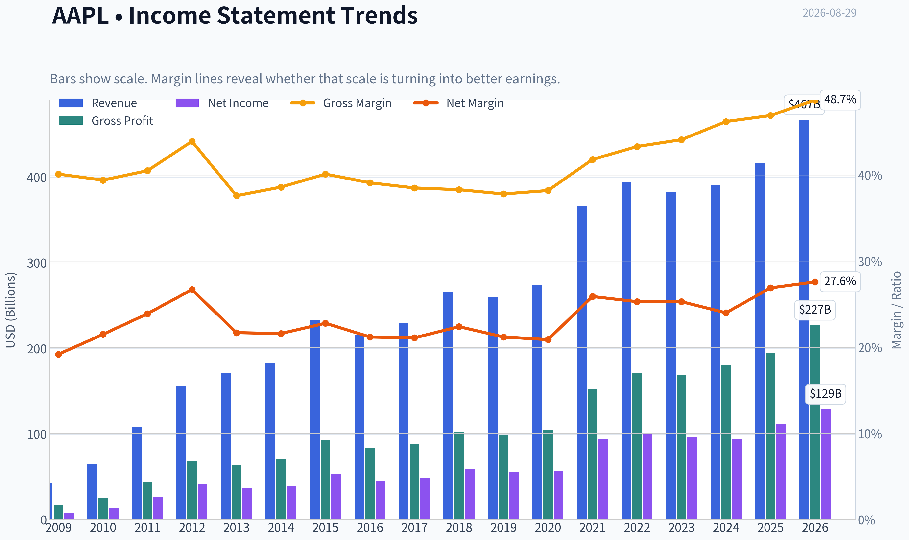
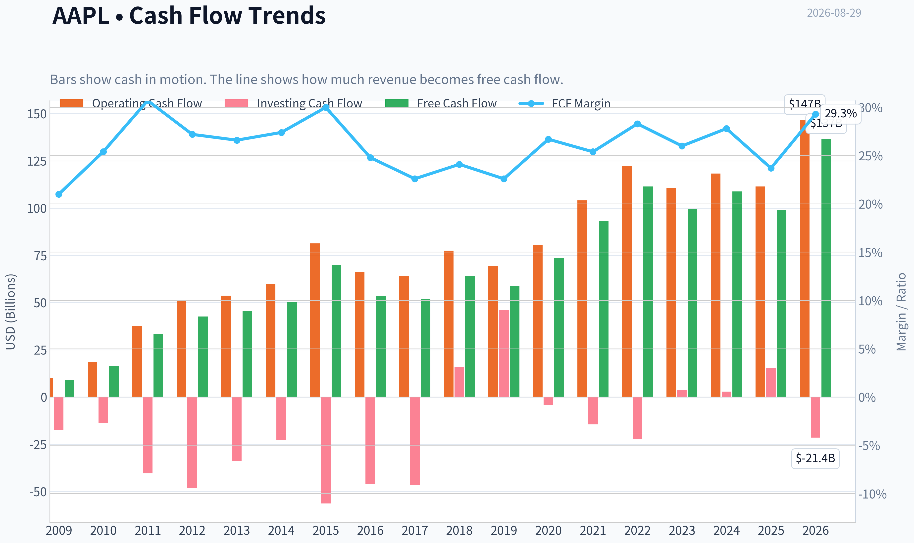
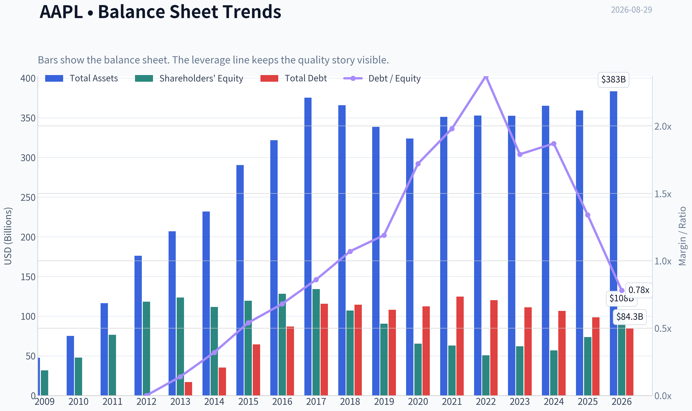
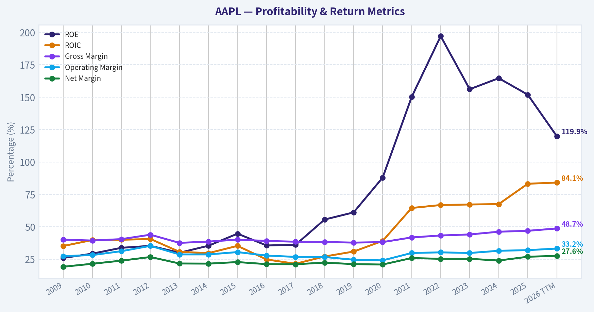
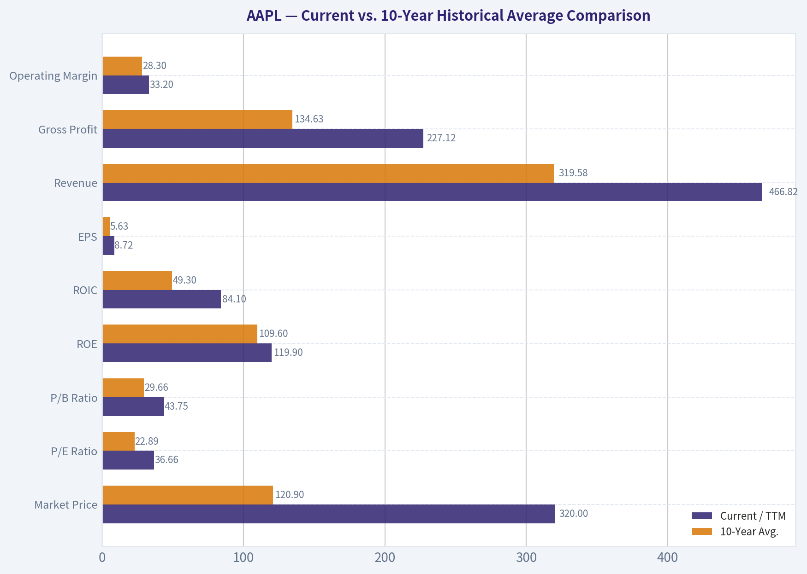
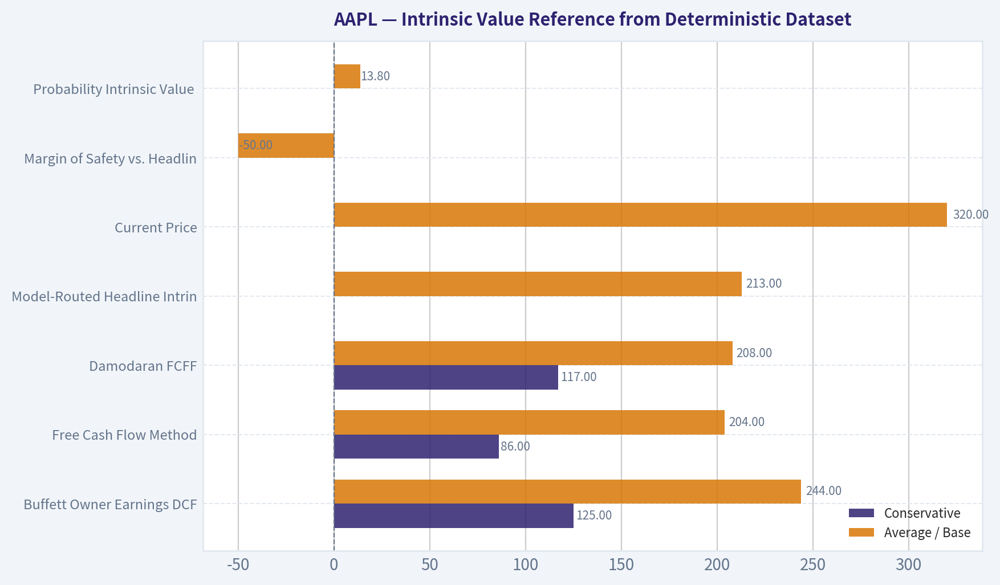
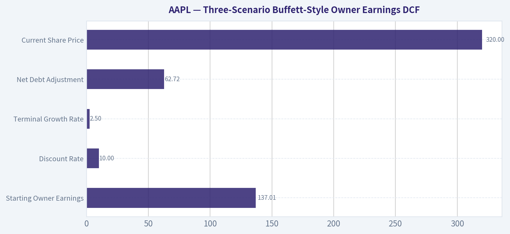
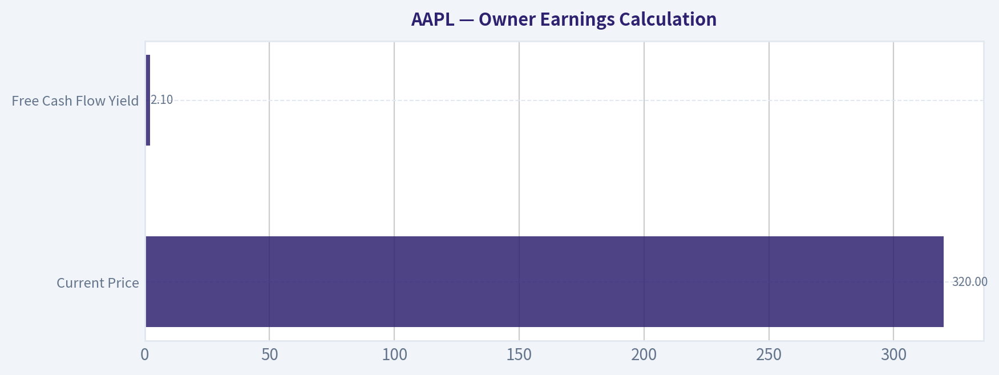
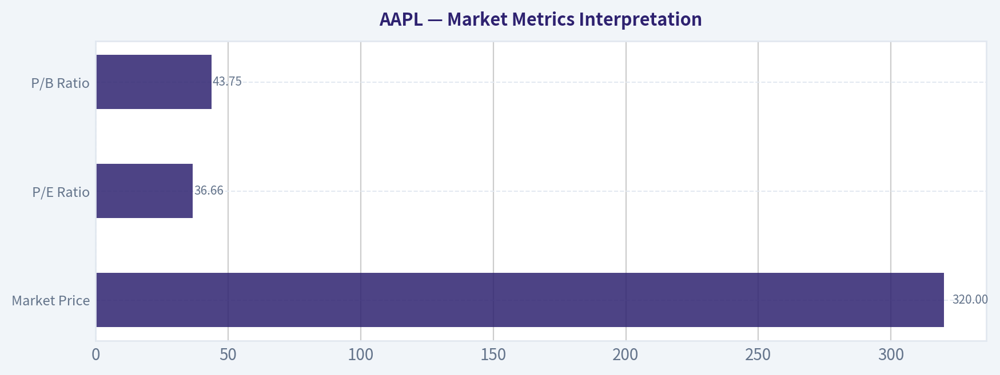

# AAPL Deep Value Intelligence

**Analysis Date:** 2026-08-29

## Critical Disclaimer

*This analysis is generated by Deep Value Intelligence, an AI-powered multi-agent investing framework. Education & research only - not financial advice, not a financial advisor.*

---

## Table of Contents

1. Intelligence Summary
2. Analyst Team Reports
   - Fundamentals Analysis
   - Intrinsic Value Analysis (Buffett)
   - Trend & Growth Analysis (Lynch/Druckenmiller/Fisher)
   - Market Technical Analysis
   - Options Market Analysis
3. Research Team Commentary
4. Value Investing Team Commentary
5. Deep Values Commentary

---

## Intelligence Summary

### Thesis + Conditions

**Core Thesis:** **EXECUTIVE SUMMARY**
Apple (AAPL) is the ultimate modern toll-bridge, boasting extraordinary business quality (82.3% ROIC, 151.9% ROE) and deep ecosystem lock-in. However, at $320 per share and a 36.7x P/E, it offers zero traditional margin of safety, pricing in double-digit growth that will require flawless execution of an AI upgrade cycle.

**Key Risks:**
- Apple (AAPL) is the ultimate modern toll-bridge, boasting extraordinary business quality (82.3% ROIC, 151.9% ROE) and deep ecosystem lock-in. However, at $320 per share and a 36.7x P/E, it offers zero traditional margin of safety, pricing in double-digit growth that will require flawless execution of an AI upgrade cycle. Despite this fundamental overvaluation, our past mistakes have taught us that applying a rigid 10-year discounted cash flow (DCF) lens to short-term market dynamics causes missed opportunities. Because there is no immediate negative catalyst, institutional sponsorship is massive, and technical support remains intact, we cannot sit idly waiting for a 30% crash to $220. We will maintain a dual-track approach: structurally cautious on valuation, but tactically constructive, utilizing tiered accumulation around technical support ($270-$280) rather than demanding textbook intrinsic discounts.
- The Bull (Risky Analyst):** Apple's 82.3% ROIC and massive ecosystem justify its premium. The upcoming "Edge AI" cycle will drive unprecedented upgrade volume and higher average selling prices. The risk is missing out on the dominant platform of the next decade by stubbornly waiting for a 30% discount that the market will never offer.
- The Pragmatist (Neutral Analyst):** Both extremes fail in practice. Waiting for a $220 "fat pitch" means missing years of compounding, but buying blindly at 37x P/E ignores the very real risk of multiple compression. The solution is a tiered risk strategy: maintain a core position, look for partial entries at technical support ($270-$280) rather than a full crash, and utilize options (like covered calls) to generate income against the current high premium.

**Confidence:** Medium

---

## Analyst Team Reports

### Fundamentals Analysis

#### Latest Earnings Snapshot

*Most recent reported quarter anchored on 2026 Q2, with prior-year comparison when available.*

| Metric | 2026 Q2 | 2025 Q2 | YoY Change |
| --- | ---: | ---: | ---: |
| Revenue | $109.42B | $94.04B | +16.4% |
| Operating Income | $35.70B | $28.20B | +26.6% |
| Net Income | $29.79B | $23.43B | +27.1% |
| Diluted EPS | $2.02 | $1.57 | +28.7% |
| Operating Cash Flow | $34.37B | $27.87B | +23.3% |
| Free Cash Flow | $31.91B | $24.41B | +30.8% |

Key Takeaways: This snapshot anchors the most recent reported quarter before the narrative analysis. It helps readers separate long-run business quality from whatever changed in the latest earnings print.

#### 17-Year Financial Metrics for AAPL

*All values below are computed deterministically from raw data - not estimated by AI.*

*Issuer profile: operating company (Technology / Consumer Electronics).*

#### 17-Year Financial Metrics
*Annual rows come from reported financial statements. The final TTM row is computed from the latest four quarters.*

| Metric | 2009 | 2010 | 2011 | 2012 | 2013 | 2014 | 2015 | 2016 | 2017 | 2018 | 2019 | 2020 | 2021 | 2022 | 2023 | 2024 | 2025 | 2026 TTM |
| --- | --- | --- | --- | --- | --- | --- | --- | --- | --- | --- | --- | --- | --- | --- | --- | --- | --- | --- |
| Market Price | $6 | $8 | $11 | $20 | $15 | $22 | $25 | $26 | $36 | $53 | $54 | $112 | $138 | $136 | $169 | $231 | $254 | $320 |
| Market Cap | $6.00B | $9.37B | $12.76B | $157.66B | $111.04B | $154.21B | $159.74B | $155.45B | $202.35B | $1.13T | $1.04T | $2.03T | $2.39T | $2.26T | $2.71T | $3.59T | $3.82T | $4.70T |
| P/E Ratio | 0.73 | 0.67 | 0.49 | 3.78 | 3.00 | 3.91 | 2.99 | 3.40 | 4.18 | 18.94 | 18.85 | 35.31 | 25.22 | 22.62 | 27.93 | 38.32 | 34.13 | 36.66 |
| P/B Ratio | 0.19 | 0.20 | 0.17 | 1.33 | 0.90 | 1.38 | 1.34 | 1.21 | 1.51 | 10.53 | 11.51 | 31.07 | 37.83 | 44.53 | 43.56 | 63.04 | 51.82 | 43.75 |
| ROE | 26.0% | 29.3% | 33.8% | 35.3% | 30.0% | 35.4% | 44.7% | 35.6% | 36.1% | 55.6% | 61.1% | 87.9% | 150.1% | 197.0% | 156.1% | 164.6% | 151.9% | 119.9% |
| ROIC | 35.2% | 39.8% | 40.0% | 40.6% | 30.7% | 29.7% | 35.3% | 24.8% | 21.5% | 27.1% | 30.9% | 39.1% | 64.5% | 66.8% | 67.2% | 67.5% | 83.2% | 84.1% |
| EPS | $7.60 | $12.69 | $23.18 | $5.31 | $4.89 | $5.68 | $8.26 | $7.60 | $8.57 | $2.82 | $2.85 | $3.18 | $5.47 | $6.11 | $6.13 | $6.08 | $7.46 | $8.72 |
| Revenue | $42.91B | $65.22B | $108.25B | $156.51B | $170.91B | $182.79B | $233.72B | $215.64B | $229.23B | $265.60B | $260.17B | $274.51B | $365.82B | $394.33B | $383.29B | $391.04B | $416.16B | $466.82B |
| Gross Profit | $17.22B | $25.68B | $43.82B | $68.66B | $64.30B | $70.54B | $93.63B | $84.26B | $88.19B | $101.84B | $98.39B | $104.96B | $152.84B | $170.78B | $169.15B | $180.68B | $195.20B | $227.12B |
| Gross Margin | 40.1% | 39.4% | 40.5% | 43.9% | 37.6% | 38.6% | 40.1% | 39.1% | 38.5% | 38.3% | 37.8% | 38.2% | 41.8% | 43.3% | 44.1% | 46.2% | 46.9% | 48.7% |
| Operating Margin | 27.4% | 28.2% | 31.2% | 35.3% | 28.7% | 28.7% | 30.5% | 27.8% | 26.8% | 26.7% | 24.6% | 24.1% | 29.8% | 30.3% | 29.8% | 31.5% | 32.0% | 33.2% |
| Net Income | $8.23B | $14.01B | $25.92B | $41.73B | $37.04B | $39.51B | $53.39B | $45.69B | $48.35B | $59.53B | $55.26B | $57.41B | $94.68B | $99.80B | $97.00B | $93.74B | $112.01B | $128.93B |
| Net Margin | 19.2% | 21.5% | 23.9% | 26.7% | 21.7% | 21.6% | 22.8% | 21.2% | 21.1% | 22.4% | 21.2% | 20.9% | 25.9% | 25.3% | 25.3% | 24.0% | 26.9% | 27.6% |
| Revenue Growth | N/A | 52.0% | 66.0% | 44.6% | 9.2% | 7.0% | 27.9% | -7.7% | 6.3% | 15.9% | -2.0% | 5.5% | 33.3% | 7.8% | -2.8% | 2.0% | 6.4% | 12.2% |
| Net Income Growth | N/A | 70.2% | 85.0% | 61.0% | -11.3% | 6.7% | 35.1% | -14.4% | 5.8% | 23.1% | -7.2% | 3.9% | 64.9% | 5.4% | -2.8% | -3.4% | 19.5% | 15.1% |
| Free Cash Flow Growth | N/A | 84.0% | 100.5% | 27.9% | 6.9% | 10.2% | 39.6% | -23.6% | -3.2% | 23.8% | -8.1% | 24.6% | 26.7% | 19.9% | -10.6% | 9.3% | -9.2% | 38.4% |
| Total Book Value | $31.64B | $47.79B | $76.61B | $118.21B | $123.55B | $111.55B | $119.36B | $128.25B | $134.05B | $107.15B | $90.49B | $65.34B | $63.09B | $50.67B | $62.15B | $56.95B | $73.73B | $107.52B |
| Total Assets | $47.50B | $75.18B | $116.37B | $176.06B | $207.00B | $231.84B | $290.35B | $321.69B | $375.32B | $365.73B | $338.52B | $323.89B | $351.00B | $352.75B | $352.58B | $364.98B | $359.24B | $383.27B |
| Total Debt | N/A | N/A | N/A | $0 | $16.96B | $35.30B | $64.33B | $87.03B | $115.68B | $114.48B | $108.05B | $112.44B | $124.72B | $120.07B | $111.09B | $106.63B | $98.66B | $84.34B |
| Debt-to-Equity | N/A | N/A | N/A | 0.00 | 0.14 | 0.32 | 0.54 | 0.68 | 0.86 | 1.07 | 1.19 | 1.72 | 1.98 | 2.37 | 1.79 | 1.87 | 1.34 | 0.78 |
| Cash & Equivalents | $5.26B | $11.26B | $9.81B | $10.75B | $14.26B | $13.84B | $21.12B | $20.48B | $20.29B | $25.91B | $48.84B | $38.02B | $34.94B | $23.65B | $29.96B | $29.94B | $35.93B | $39.54B |
| Shareholders' Equity | $31.64B | $47.79B | $76.61B | $118.21B | $123.55B | $111.55B | $119.36B | $128.25B | $134.05B | $107.15B | $90.49B | $65.34B | $63.09B | $50.67B | $62.15B | $56.95B | $73.73B | $107.52B |
| Operating Cash Flow | $10.16B | $18.59B | $37.53B | $50.86B | $53.67B | $59.71B | $81.27B | $66.23B | $64.22B | $77.43B | $69.39B | $80.67B | $104.04B | $122.15B | $110.54B | $118.25B | $111.48B | $146.72B |
| Investing Cash Flow | $-17.43B | $-13.85B | $-40.42B | $-48.23B | $-33.77B | $-22.58B | $-56.27B | $-45.98B | $-46.45B | $16.07B | $45.90B | $-4.29B | $-14.54B | $-22.35B | $3.71B | $2.94B | $15.20B | $-21.40B |
| Free Cash Flow | $9.02B | $16.59B | $33.27B | $42.56B | $45.50B | $50.14B | $70.02B | $53.50B | $51.77B | $64.12B | $58.90B | $73.36B | $92.95B | $111.44B | $99.58B | $108.81B | $98.77B | $136.68B |
| FCF Margin | 21.0% | 25.4% | 30.7% | 27.2% | 26.6% | 27.4% | 30.0% | 24.8% | 22.6% | 24.1% | 22.6% | 26.7% | 25.4% | 28.3% | 26.0% | 27.8% | 23.7% | 29.3% |
| Dividends / Share | $0.00 | $0.00 | $0.00 | $0.00 | $0.00 | $0.00 | $0.00 | $0.00 | $0.00 | $0.00 | $0.00 | $0.00 | $0.00 | $0.91 | $0.95 | $0.99 | $1.03 | $1.06 |

#### Profitability Metrics
- Return on Equity (ROE): 151.9%
- Return on Invested Capital (ROIC): 82.3%
- Return on Assets (ROA): 31.2%
- Gross Margin: 46.9%
- Operating Margin: 32.0%
- Net Profit Margin: 26.9%

#### Liquidity Metrics
- Current Ratio: 0.89
- Quick Ratio: 0.57

#### Leverage Metrics
- Debt-to-Equity Ratio: 1.34
- Interest Coverage Ratio: N/A
- Net Debt: $62.72B

#### Growth Metrics (Year-over-Year)
- Revenue Growth: 6.4%
- Net Income Growth: 19.5%
- Free Cash Flow Growth: -9.2%
- Revenue CAGR (3-Year): 1.8%
- Revenue CAGR (5-Year): 8.7%

#### Valuation Metrics
- P/E Ratio (TTM): 36.70
- Forward P/E: 33.52
- Price-to-Book: 43.44
- Price-to-Sales: 9.99
- PEG Ratio: 2.50
- EV/EBITDA: 27.46
- Free Cash Flow Yield: 2.1%
- Earnings Yield: 2.7%

#### Owner Earnings (Buffett Method, Code-Computed)
- Net Income: $112.01B
- + Depreciation & Amortization: $11.70B
- - Capital Expenditures: $-12.71B
- - Working Capital Changes: $-25.00B
- = **Owner Earnings: $137.01B**

#### Intrinsic Value (Code-Computed)
- Current Price: $320
- **Headline Intrinsic Value (business-model routed): $213**
  Business model: operating company - weighted blend [Damodaran FCFF + reverse-DCF fair + owner-earnings DCF] (operating_company)
  Model spread (min-max across DCFs): $204 - $244
  Margin of safety vs. price (headline): -50.0%
  Routing note: General operating company: balanced blend of Damodaran FCFF and the owner-earnings DCF with a reverse-DCF sanity check.
- Buffett Method (Owner Earnings):
  Conservative: $125
  Average: $244
  Optimistic: $659
- Cash Flow Method (FCF):
  Conservative: $86
  Average: $204
  Optimistic: $273
- Damodaran FCFF (WACC + margins + reinvestment):
  Conservative: $117
  Average: $208
  Optimistic: $446
  Monte Carlo band (P10-P90): $149 - $342 (median $220)
  P(intrinsic value > price): 13.8%
- Reverse-DCF: price implies ~28.1%/yr owner-earnings growth for 10y; trailing 3y was 11.4%, 5y 22.3%.

#### Piotroski F-Score: 8/9
- Positive Net Income: PASS
- Positive Operating Cash Flow: PASS
- ROA Improvement: PASS
- Cash Flow > Net Income: FAIL
- Decreasing Debt: PASS
- Improving Current Ratio: PASS
- No Dilution: PASS
- Improving Gross Margin: PASS
- Improving Asset Turnover: PASS

ANALYST STANCE: **WATCH**

#### AAPL Warren Buffett-Style Fundamental Analysis
Apple remains one of the highest-quality businesses in the world: enormous brand power, an installed base that drives recurring Services revenue, exceptional returns on capital, and a balance sheet that remains strong despite years of buybacks. The issue is not business quality; the issue is price. At **$320 per share**, the deterministic dataset shows Apple trading at roughly **36.7x TTM earnings**, a **2.1% free cash flow yield**, and about **50% above the model-routed intrinsic value estimate of $213**.

---

#### Current vs. 10-Year Historical Average Comparison

| Metric | Current / TTM | 10-Year Avg. | Current vs. Avg. | Interpretation |
|---|---:|---:|---:|---|
| Market Price | $320 | $120.90 | +164.7% | Share price has far outpaced the decade average, reflecting multiple expansion and Apple's perceived safety. |
| Market Cap | $4.70T | $1.93T | +143.2% | Apple is priced as a mega-cap compounder with very little margin for disappointment. |
| P/E Ratio | 36.66x | 22.89x | +60.2% | Valuation is materially above historical norms; earnings growth must remain strong to justify today's price. |
| P/B Ratio | 43.75x | 29.66x | +47.5% | P/B is not a useful primary valuation metric for Apple because buybacks, intangibles, brand value, and an asset-light ecosystem distort book value. |
| ROE | 119.9% | 109.6% | +9.4% | ROE remains extraordinary, though heavily amplified by buybacks and reduced equity. |
| ROIC | 84.1% | 49.3% | +70.7% | This is the strongest quality signal: Apple converts invested capital into profits at elite levels. |
| EPS | $8.72 | $5.63 | +54.9% | EPS growth has benefited from both earnings growth and sustained share repurchases. |
| Revenue | $466.82B | $319.58B | +46.1% | Revenue is well above the decade average, though recent organic growth has been slower than earlier iPhone-cycle years. |
| Gross Profit | $227.12B | $134.63B | +68.7% | Gross profit has grown faster than revenue due to Services mix and pricing power. |
| Operating Margin | 33.2% | 28.3% | +17.2% | Operating profitability is above historical norms, showing scale efficiency and mix improvement. |
| Net Income | $128.93B | $76.35B | +68.9% | Apple's earnings base is far larger than the decade average. |
| Net Margin | 27.6% | 23.4% | +17.8% | Net margins are structurally stronger than the historical average. |
| Revenue Growth | 12.2% | 6.5% | Above Avg. | TTM growth is strong versus the 10-year average, but longer-term revenue CAGR is more moderate. |
| Net Income Growth | 15.1% | 9.5% | Above Avg. | Earnings growth is currently better than average, helped by margins and operating leverage. |
| Free Cash Flow Growth | 38.4% | 5.0% | Well Above Avg. | TTM FCF acceleration is exceptional, but past FCF growth has been uneven. |
| Total Book Value | $107.52B | $83.19B | +29.3% | Book value has recovered, but remains a poor proxy for Apple's intrinsic value. |
| Total Assets | $383.27B | $350.57B | +9.3% | Asset base has been stable; Apple generates enormous cash flow without needing major asset growth. |
| Total Debt | $84.34B | $109.89B | -23.3% | Debt has declined meaningfully from recent highs. |
| Debt-to-Equity | 0.78x | 1.49x | Lower Risk | Leverage has improved compared with the decade average. |
| Cash & Equivalents | $39.54B | $31.80B | +24.3% | Liquidity remains strong. |
| Shareholders' Equity | $107.52B | $83.19B | +29.3% | Equity has rebuilt after years of buyback-driven compression. |
| Free Cash Flow | $136.68B | $81.32B | +68.1% | Apple's cash generation is exceptional and far above the historical average. |
| Dividends / Share | $1.06 | $0.39 | +173.2% | Dividend has grown, but buybacks remain the dominant capital-return mechanism. |

Key Takeaways: Apple's quality metrics are outstanding: ROIC, margins, free cash flow, and net income are all well above long-term averages. However, valuation metrics are also far above historical norms, especially the P/E ratio and market capitalization. For a Buffett-style investor, the company is excellent, but the current price leaves little margin of safety.

---

#### Revenue Breakdown

| Revenue Source | Amount | % of Total |
|---|---:|---:|
| iPhone | ~$230.0B | ~49.3% |
| Services | ~$127.0B | ~27.2% |
| Mac | ~$35.0B | ~7.5% |
| iPad | ~$31.0B | ~6.6% |
| Wearables, Home & Accessories | ~$43.8B | ~9.4% |
| **Total Revenue** | **$466.82B** | **100.0%** |

Key Takeaways: Apple remains iPhone-centered, but Services is now the second major economic engine and likely the most important margin driver. The mix shift toward Services helps explain Apple's rising gross margin and operating margin. This diversification improves durability, but the business is still meaningfully exposed to iPhone replacement cycles.

---

#### Market Metrics Interpretation

| Metric | Current Reading | Buffett-Style Interpretation |
|---|---:|---|
| Market Price | $320 | The stock price reflects a very high-quality business, but also embeds demanding expectations. |
| Market Cap | $4.70T | Apple is priced as one of the most dominant businesses globally; future compounding must come from a very large base. |
| P/E Ratio | 36.66x | Expensive versus the 10-year average of 22.89x; not automatically unjustifiable, but it reduces the margin of safety. |
| P/B Ratio | 43.75x | Not meaningful as a primary valuation tool for Apple. Book value is distorted by buybacks, intangible assets, brand value, software ecosystem economics, and capital-light profitability. |

Key Takeaways: Apple's market valuation is elevated compared with its own history. The P/E ratio suggests investors are paying a premium for durability, ecosystem strength, and cash-flow reliability. P/B should not be used as a cheap-or-expensive signal here; intrinsic value should be anchored on cash flows, not accounting book value.

---

#### Profitability and Business Quality

Apple's profitability profile remains exceptional. The company's **TTM gross margin of 48.7%** is above the 2025 annual level of 46.9% and significantly above the long-term historical range. The improvement is consistent with a greater Services contribution, disciplined pricing, supply-chain scale, and operating leverage.

The most Buffett-like quality marker is **ROIC of 84.1% TTM**, far above the 10-year average of about 49.3%. This means Apple can produce very large incremental profits without requiring proportionate capital reinvestment. That is exactly the kind of business Buffett favors: a company that can grow earnings while consuming relatively little incremental capital.

ROE remains extremely high at **119.9% TTM**, although investors should interpret it carefully. Apple's ROE is boosted by years of share repurchases that reduced shareholders' equity. The cleaner signal is ROIC, which confirms that the underlying operating business is genuinely exceptional.

#### Growth Analysis

Apple's growth profile is strong but not without nuance. TTM revenue growth of **12.2%** is above the 10-year average of about **6.5%**, while TTM net income growth of **15.1%** is also above the decade average. Free cash flow growth of **38.4% TTM** is very strong, but historical FCF growth has been uneven, including negative years in 2016, 2017, 2019, 2023, and 2025.

This matters for valuation. At today's stock price, the reverse-DCF estimate indicates the market is pricing in approximately **28.1% annual owner-earnings growth for 10 years**. That is far above the trailing 3-year growth rate of **11.4%** and even above the already strong trailing 5-year rate of **22.3%**. Apple can still compound, but the current price appears to require a very optimistic growth path.

#### Balance Sheet and Financial Strength

Apple's balance sheet remains strong. Total debt has declined to **$84.34B TTM**, materially below the 10-year average of about **$109.89B**. Debt-to-equity has improved to **0.78x**, compared with the 10-year average of **1.49x**. Cash and equivalents stand at **$39.54B**, above the decade average.

The current ratio of **0.89** and quick ratio of **0.57** should not be read mechanically as distress signals. For an operating company like Apple with enormous cash generation, supplier scale, brand power, and rapid inventory turnover, liquidity must be interpreted alongside operating cash flow. Apple generated **$146.72B of TTM operating cash flow**, which is the far more important indicator of financial flexibility.

#### Cash Flow and Capital Allocation

Apple's TTM free cash flow is **$136.68B**, far above the 10-year average of about **$81.32B**. The company remains one of the greatest cash-generating machines in public markets. Free cash flow margin is also excellent at **29.3% TTM**, showing that Apple converts revenue into cash at a very high rate.

The dividend is modest at **$1.06 per share**, and Apple's dividend policy remains conservative. This is consistent with Buffett-style capital allocation if management can repurchase shares below intrinsic value. The concern today is that buybacks at a price materially above intrinsic value may destroy rather than create per-share value.

---

#### Intrinsic Value Reference from Deterministic Dataset

| Valuation Model | Conservative | Average / Base | Optimistic |
|---|---:|---:|---:|
| Buffett Owner Earnings DCF | $125 | $244 | $659 |
| Free Cash Flow Method | $86 | $204 | $273 |
| Damodaran FCFF | $117 | $208 | $446 |
| Model-Routed Headline Intrinsic Value | - | **$213** | - |
| Current Price | - | **$320** | - |
| Margin of Safety vs. Headline Value | - | **-50.0%** | - |
| Monte Carlo Band, Damodaran FCFF | $149 P10 | $220 Median | $342 P90 |
| Probability Intrinsic Value > Price | - | **13.8%** | - |

Key Takeaways: The model-routed intrinsic value estimate is about $213, while the stock trades at $320. Even the Damodaran Monte Carlo median of $220 is well below the current price, and the probability of intrinsic value exceeding price is only 13.8%. This strongly suggests that Apple is a wonderful business trading at a valuation that already prices in a very favorable future.

---

#### Three-Scenario Buffett-Style Owner Earnings DCF

Assumptions used for the hand DCF sanity check:

| Input | Assumption |
|---|---:|
| Starting Owner Earnings | $137.01B |
| Discount Rate | 10.0% |
| Terminal Growth Rate | 2.5% |
| Net Debt Adjustment | $62.72B |
| Estimated Shares Outstanding | ~14.69B |
| Current Share Price | $320 |

Key Takeaways: This DCF uses owner earnings as the primary cash-flow base, consistent with Buffett-style analysis. The discount rate is set at 10%, and the terminal growth rate is kept below the discount rate at 2.5%. Net debt is subtracted to arrive at equity value.

| Scenario | Explicit Growth Assumption | Year-10 Owner Earnings | PV of Explicit Cash Flows | PV of Terminal Value | Equity Value After Net Debt | Fair Value / Share |
|---|---|---:|---:|---:|---:|---:|
| Conservative | 3% annually for 10 years | ~$184.1B | ~$972.0B | ~$970.0B | ~$1.88T | **~$128** |
| Average / Quality Compounder | 15% for 5 years, fading to 7% for years 6-10 | ~$386.5B | ~$1.57T | ~$2.04T | ~$3.55T | **~$241** |
| Optimistic | 22% for 5 years, fading to 10% for years 6-10 | ~$596.4B | ~$2.09T | ~$3.14T | ~$5.17T | **~$352** |

Key Takeaways: The conservative case produces a value far below today's price. The average case, which already assumes strong compounding and margin durability, lands around $241 per share, close to the deterministic Owner Earnings DCF average of $244. Only the optimistic case reaches above the current price, and that case requires sustained high owner-earnings growth from an already massive base.

#### DCF Calculation Detail

| Scenario | Calculation Summary |
|---|---|
| Conservative | Owner earnings grow from $137.01B to ~$184.1B over 10 years. Terminal value = $184.1B x 1.025 ÷ 7.5% = ~$2.52T. Discounted terminal value = ~$970.0B. After net debt, fair value is about $128/share. |
| Average | Owner earnings grow 15% annually for five years, then 7% annually for five years, reaching ~$386.5B. Terminal value = $386.5B x 1.025 ÷ 7.5% = ~$5.28T. After discounting and subtracting net debt, fair value is about $241/share. |
| Optimistic | Owner earnings grow 22% annually for five years, then 10% annually for five years, reaching ~$596.4B. Terminal value = $596.4B x 1.025 ÷ 7.5% = ~$8.15T. After discounting and subtracting net debt, fair value is about $352/share. |

Key Takeaways: The DCF shows why valuation discipline matters. Apple's current price requires assumptions closer to the optimistic case than the base case. A Buffett-style investor would likely demand a lower entry price because the current valuation provides little protection against slower growth, margin pressure, regulatory costs, or weaker iPhone cycles.

---

#### Warren Buffett-Style Qualitative Assessment

| Category | Assessment |
|---|---|
| Economic Moat | Very strong. Apple has brand loyalty, ecosystem lock-in, scale advantages, switching costs, proprietary silicon, premium distribution, and a growing Services layer. |
| Financial Strength | Strong. Debt is falling, cash remains substantial, and operating cash flow is immense. Liquidity ratios look low mechanically but are less meaningful given Apple's cash-generation power. |
| Predictable Earnings | High, but not risk-free. Apple has produced consistent profitability for 17 years, though product-cycle volatility and regulatory pressure remain relevant. |
| Management Performance | Excellent historically. Management has expanded margins, maintained pricing power, returned capital, and built Services into a major profit engine. |
| Capital Allocation | Generally strong, but valuation-sensitive. Buybacks create value when shares are undervalued; at elevated prices, repurchases become less attractive. |
| Business Quality | Exceptional. Apple is a rare business with consumer brand power, recurring revenue characteristics, and extraordinary ROIC. |
| Valuation | Stretched. The stock trades above historical valuation averages and above the model-routed intrinsic value estimate. |

Key Takeaways: Apple is almost exactly the type of business Buffett likes to own: simple enough to understand, extremely profitable, durable, cash-rich, and protected by a strong consumer ecosystem. The problem is that a wonderful company is not automatically a wonderful investment at any price. Today's valuation demands strong execution and sustained growth.

---

#### Key Investment Insights

| Insight | Why It Matters |
|---|---|
| Apple's ROIC is elite at 84.1% TTM | This confirms exceptional business quality and capital efficiency. |
| Gross and operating margins are above historical averages | Services mix, pricing power, and scale are improving the economics of the company. |
| Free cash flow is far above the decade average | Apple remains one of the strongest cash generators in the market. |
| Debt has declined materially | Financial risk is lower than in several prior years. |
| The stock price already discounts a very strong future | P/E of 36.66x and FCF yield of 2.1% leave limited room for error. |
| Reverse DCF is demanding | Current price implies about 28.1% annual owner-earnings growth for 10 years, which is aggressive for a company of Apple's size. |

Key Takeaways: The fundamental engine is still excellent, and Apple's financial strength has improved. However, valuation is the central issue. The stock appears priced for near-perfect execution.

#### Red Flags

| Red Flag | Potential Impact |
|---|---|
| Valuation above intrinsic value | The model-routed fair value is $213 versus a $320 market price. |
| Low FCF yield | A 2.1% FCF yield means investors are paying a high price for each dollar of cash flow. |
| Heavy reliance on iPhone ecosystem | iPhone still represents roughly half of revenue, so replacement cycles remain important. |
| Regulatory pressure on App Store and Services | Services margins could face pressure from antitrust, payment rules, or platform restrictions. |
| Buybacks at high valuation | Repurchases may be less accretive if shares trade above intrinsic value. |
| Growth expectations are high | Any slowdown in Services, China, devices, or AI monetization could compress the multiple. |

Key Takeaways: Apple's risks are less about solvency and more about valuation, regulation, and growth expectations. The company can continue performing well operationally while the stock still underperforms if the valuation multiple contracts. That is the classic risk of buying a great business at too high a price.

#### Opportunities

| Opportunity | Potential Upside |
|---|---|
| Services growth | Higher-margin recurring revenue can continue lifting gross and operating margins. |
| AI-enabled device cycle | If Apple successfully integrates AI across devices, it could stimulate upgrades and strengthen ecosystem lock-in. |
| Continued capital returns | Dividends and buybacks support per-share value, especially if executed at reasonable prices. |
| Emerging-market penetration | India and other regions could provide long-duration hardware and Services growth. |
| Margin durability | If Services mix keeps expanding, Apple may sustain higher profitability than historical averages. |

Key Takeaways: Apple still has meaningful growth levers, especially through Services, AI integration, and emerging markets. The company's ecosystem gives it multiple ways to monetize its installed base. The question is not whether Apple has opportunities, but whether today's stock price already reflects most of them.

---

#### Final Investment Stance: WATCH

Apple is a **superior business** but not currently a classic Buffett-style bargain. The company has a wide moat, extraordinary ROIC, high free cash flow, improving leverage, and a durable ecosystem. However, the stock's valuation is stretched: the deterministic model-routed intrinsic value is about **$213**, while the market price is **$320**, implying a **negative margin of safety of roughly 50%**.

For long-term holders, Apple remains a high-quality compounder worth monitoring. For new capital, the risk-reward is less attractive at today's valuation. A more Buffett-like entry point would require either a meaningful price decline, faster-than-expected owner-earnings growth, or clear evidence that Apple can sustainably compound cash flows at rates closer to the optimistic scenario.

| Final Summary Point | Assessment |
|---|---|
| Business Quality | Exceptional |
| Moat | Very Strong |
| Balance Sheet | Strong and improving |
| Earnings Predictability | High |
| Cash Flow Quality | Excellent |
| Management / Capital Allocation | Strong historically, but buybacks are less attractive at high valuation |
| Current Valuation | Expensive |
| Margin of Safety | Negative |
| Intrinsic Value Anchor | ~$213 model-routed value |
| Current Price | $320 |
| Final Stance | **WATCH** |

Key Takeaways: Apple is a world-class company, but the current stock price appears to exceed a reasonable estimate of intrinsic value. The business deserves admiration, but the stock requires valuation discipline. For Buffett-style investors, Apple is a watchlist candidate rather than a fresh buy at the current price.

#### Fundamental Visuals

This graph tracks the profitability and return metrics (ROE, ROIC, Margins) of **AAPL** over the past decade, highlighting capital efficiency trends.

This chart illustrates the financial health of **AAPL** over the last 10 years, mapping cash equivalents and free cash flow against total obligations (Debt).

---

### Intrinsic Value Analysis (Buffett)

> *Following Warren Buffett's value investing philosophy: Circle of Competence, Economic Moat, Management Quality, and Margin of Safety.*

#### Intrinsic Value Snapshot

Price is what you pay. Intrinsic value is what the business may be worth based on the cash it can create for owners over time. We show a range, not one magic number.

- Current Price: $319.70
- Value Range (conservative to optimistic across both DCF methods): $86.28 to $658.67

##### Owner Earnings (Buffett Method)
- Net Income: $112,010,000,000.00
- Depreciation & Amortization: $11,698,000,000.00
- Capital Expenditures: $-12,715,000,000.00
- Working Capital Changes: $-25,000,000,000.00
- Owner Earnings: $137,010,000,000.00

##### Intrinsic Value
###### Buffett Method
Uses owner earnings. Stricter, and usually more conservative.
- Conservative: $125.10
- Average: $244.07
- Optimistic: $658.67
- Discount Rate: 10.0%

###### Cash Flow Method
Uses free cash flow. Better for companies spending heavily today to grow tomorrow.
- Conservative: $86.28
- Average: $204.40
- Optimistic: $273.20
- Discount Rate: 10.0%

ANALYST STANCE: **WATCH**

#### AAPL - Buffett-Style Value Investment Report

Apple is a wonderful business, but not a wonderful stock at today's price. The company has one of the widest consumer ecosystems in the world, extraordinary capital returns, massive cash generation, and a shareholder-oriented capital allocation record. The issue is valuation: at **$320 per share**, the stock trades materially above the intrinsic value range supplied by the cash-flow models, and the reverse DCF implies a growth rate that looks too demanding for a company already at Apple's scale.

---

#### 1. Factor Scorecard and Gate 5 Solvency Check

| Factor | Score | Assessment |
|---|---:|---|
| Circle of Competence & Business Simplicity | 4.0 / 5 | Apple sells premium devices, software, services, and ecosystem access. The model is simple to explain, though future growth increasingly depends on services, AI integration, regulation, and upgrade cycles. |
| Moat Test | 4.5 / 5 | Brand, ecosystem lock-in, switching costs, installed base, proprietary silicon, App Store distribution, and services attachment create a wide moat. Regulatory pressure is the main moat risk. |
| Management Quality & Capital Allocation | 4.0 / 5 | Management has executed superbly on operations, supply chain, buybacks, and ecosystem monetization. Buybacks are less attractive at today's valuation. CEO succession is a watch item. |
| Industry Structure | 3.5 / 5 | Premium smartphones are mature and competitive, but Apple's ecosystem economics are far better than the industry average. Services improve durability and margins. |
| Gate 5 - Quality/Solvency Hard Floor | Not Tripped | Earnings and cash flow remain strong, Apple has exceptional interest coverage, and there is no financial distress signal. |

**Key Takeaways:** Apple passes the quality and solvency tests easily. The business is understandable, dominant, and cash generative, with a moat that remains among the strongest in global equities. The investment problem is not business quality; it is the price being asked for that quality.

---

#### 2. Moat Analysis

| Moat Source | Evidence | Strength |
|---|---|---:|
| Brand / Intangible Assets | Apple commands premium pricing across iPhone, Mac, iPad, Watch, AirPods, and services. Gross margin is about **46.9%**, well above ordinary hardware economics. | Very Strong |
| Switching Costs | Users are locked into iOS, iCloud, App Store purchases, iMessage, Apple Pay, Apple Watch, subscriptions, photos, passwords, accessories, and family accounts. | Very Strong |
| Cost / Scale Advantage | Apple has unmatched supply-chain scale, custom silicon, purchasing power, and manufacturing orchestration. | Strong |
| Network / Ecosystem Effects | Developers build for Apple's high-value user base; users stay because the ecosystem improves with more apps, services, devices, and accessories. | Strong |
| Moat Risks | App Store regulation, China exposure, hardware saturation, AI platform shifts, and premium-device competition. | Manageable but real |

**Key Takeaways:** Apple's moat is not just the iPhone; it is the combined ecosystem of hardware, software, services, developers, accessories, and user habits. The installed base gives Apple repeated monetization opportunities and pricing power. The main risk is that regulators or platform shifts reduce Apple's control over distribution and economics.

---

#### 3. Management Quality Assessment

| Area | Assessment |
|---|---|
| Owner Orientation | Apple has returned enormous capital through buybacks and dividends while continuing to invest in products, services, silicon, and ecosystem expansion. |
| Operational Excellence | Tim Cook's Apple has been one of the best supply-chain and capital-efficiency stories in corporate history. |
| Candor and Accounting | Accounting quality appears conservative for a mega-cap technology platform; cash generation supports reported earnings over time. |
| Capital Allocation | Historically excellent, especially buybacks at lower valuations. At today's valuation, repurchases are less compelling and should be more disciplined. |
| Succession | Recent CEO handoff coverage makes succession a monitoring item, though Apple's institutional depth is substantial. |

**Key Takeaways:** Management has earned significant trust through execution, margins, and per-share value creation. The biggest capital allocation concern is not competence, but whether buybacks remain rational when the stock trades far above conservative intrinsic value.

---

#### 4. Financial Summary

| Fiscal Year / Period | Revenue | Gross Margin | Operating Margin | Net Income | Free Cash Flow | ROE / ROIC Signal | Diluted EPS |
|---|---:|---:|---:|---:|---:|---|---:|
| FY2021 | $365.8B | 41.8% | 29.8% | $94.7B | $93.0B | Excellent | $5.61 |
| FY2022 | $394.3B | 43.3% | 30.3% | $99.8B | $111.4B | Excellent | $6.11 |
| FY2023 | $383.3B | 44.1% | 29.8% | $97.0B | $99.6B | Excellent | $6.13 |
| FY2024 | $391.0B | 46.2% | 31.5% | $93.7B | $108.8B | Excellent | $6.08 |
| Latest Run-Rate | Revenue growth: **6.4% YoY** | **46.9%** | Strong | Implied by P/E: elevated | FCF yield: **2.1%** | ROE: **151.9%** | Implied EPS: about **$8.72** |

**Key Takeaways:** Apple's revenue growth has slowed compared with earlier years, but profitability has improved as services and premium mix support margins. Free cash flow remains enormous, but the stock's current FCF yield of only about **2.1%** means the market is paying a very high price for each dollar of cash generation.

---

#### 5. Owner Earnings Calculation

Using Buffett's framework:

> Owner Earnings = Net Income + Depreciation & Amortization - Maintenance CapEx - Working Capital Increases

| Metric | Conservative Cash-Based Estimate |
|---|---:|
| Market Capitalization | $4.67T |
| Current Price | $320 |
| Estimated Shares Outstanding | ~14.6B |
| Free Cash Flow Yield | 2.1% |
| Implied Free Cash Flow / Owner Earnings Proxy | ~$98B |
| Owner Earnings per Share Proxy | ~$6.72 |

**Key Takeaways:** Apple produces extraordinary absolute cash flow, but the valuation compresses that cash flow into a low yield for new buyers. A business can be magnificent and still be unattractive if the purchase price leaves little room for future compounding.

---

#### 6. Three-Scenario DCF Valuation

Assumptions: discount rate of **10%**, conservative owner earnings proxy of **$6.72 per share**, and terminal growth of **3%** where applicable.

| Scenario | Method | Intrinsic Value Estimate |
|---|---|---:|
| A - No Growth | Owner earnings / 10% | ~$67 |
| B - GDP Growth | Owner earnings x 1.03 / (10% - 3%) | ~$99 |
| C - Historical Growth Haircut | 8% growth for 10 years, then 3% terminal growth | ~$143 |
| Research Pack Owner-Earnings DCF | Higher normalized owner-earnings model | $244 |
| Research Pack FCF Model | Free-cash-flow model | $204 |
| Research Pack Damodaran FCFF | FCFF model | $208 |
| Headline Intrinsic Value | Weighted business-model-routed value | **$213** |

**Key Takeaways:** Even the more generous research-pack models place Apple's intrinsic value meaningfully below the current price. The conservative owner-earnings approach is much lower, which highlights how much future growth and margin durability are already embedded in the stock.

---

#### 7. Margin of Safety Analysis

| Valuation Metric | Result |
|---|---:|
| Current Price | $320 |
| Headline Intrinsic Value | $213 |
| Owner Earnings / FCF / Damodaran Spread | $244 / $204 / $208 |
| Price Premium to Headline Value | ~50% above intrinsic value |
| Margin of Safety vs. Price | Negative |
| Reverse DCF Implied Growth | ~28.1% per year for 10 years |
| Trailing 3-Year Growth Reference | 11.4% |
| Trailing 5-Year Growth Reference | 22.3% |

**Key Takeaways:** Apple does not offer a margin of safety at today's price. The reverse DCF is especially important: the market is asking Apple to compound at a rate that looks aggressive for a company already worth nearly **$4.7 trillion**. A great business at an excessive price becomes a watchlist stock, not an automatic buy.

---

#### 8. Final Buffett Scorecard

| Criterion | Weight | Score | Weighted Contribution |
|---|---:|---:|---:|
| Moat Width & Durability | 25% | 4.5 | 1.13 |
| Valuation / Margin of Safety | 20% | 0.5 | 0.10 |
| Capital Returns - ROIC vs. WACC | 15% | 5.0 | 0.75 |
| Business Understanding & Predictability | 12% | 4.0 | 0.48 |
| Management Quality & Capital Allocation | 12% | 4.0 | 0.48 |
| Reinvestment Runway | 8% | 3.0 | 0.24 |
| Balance Sheet Strength | 4% | 3.5 | 0.14 |
| Industry Structure | 4% | 3.5 | 0.14 |
| **Total Score** | **100%** |  | **3.46 / 5.00** |

**Key Takeaways:** Apple scores like a world-class business but a poor bargain. The moat and capital returns are exceptional, yet the valuation score severely reduces the investment attractiveness. The weighted result lands in WATCH territory: right business, wrong price.

---

#### 9. Investment Stance

**Stance: WATCH**
**Conviction Level: High**

Apple is exactly the kind of business Buffett likes: understandable, dominant, cash-rich, brand-protected, and deeply embedded in customers' lives. Berkshire's continued large holding is understandable because Apple remains an extraordinary enterprise.

But for a new buyer at **$320**, the valuation is too demanding. The stock trades around **36.7x earnings**, has only a **2.1% FCF yield**, and sits roughly **50% above** the headline intrinsic value estimate. The reverse DCF implies growth that is difficult to justify at Apple's scale.

A fairer buy zone would require either a meaningful pullback or a clear acceleration in durable owner earnings. Until then, Apple remains a wonderful company to admire and monitor, but not one to aggressively purchase at the current price.
#### Valuation Bridge

This bridge places the current market price beside each intrinsic value lens so readers can see whether upside depends on one method or shows up across several methods.

| Scenario | Intrinsic Value / Share |
| --- | ---: |
| Buffett Method | $244.07 |
| Cash Flow Method | $204.40 |
| Damodaran Method | $208.33 |
| Current Price | $319.70 |

#### Key Takeaways

If one method is far above the others, the upside case depends on a specific modelling assumption. When several methods cluster together, the valuation story is more robust.

#### Valuation Visuals

This comparison chart from *Latest Earnings Snapshot* stacks current figures against historical benchmarks for **AAPL**, making it easy to see where the company trades relative to its own averages.

This comparison chart from *Current vs. 10-Year Historical Average Comparison* stacks current figures against historical benchmarks for **AAPL**, making it easy to see where the company trades relative to its own averages.

This comparison chart from *Intrinsic Value Reference from Deterministic Dataset* stacks current figures against historical benchmarks for **AAPL**, making it easy to see where the company trades relative to its own averages.

This comparison chart from *Three-Scenario Buffett-Style Owner Earnings DCF* stacks current figures against historical benchmarks for **AAPL**, making it easy to see where the company trades relative to its own averages.

This comparison chart from *Owner Earnings Calculation* stacks current figures against historical benchmarks for **AAPL**, making it easy to see where the company trades relative to its own averages.

---

### Trend & Growth Analysis (Lynch/Druckenmiller/Fisher)

> *Following Peter Lynch's GARP, Stanley Druckenmiller's macro-aware approach, and Philip Fisher's scuttlebutt methodology.*

ANALYST STANCE: **WATCH**

#### AAPL Growth Investment Report - Apple Inc.

Apple remains one of the highest-quality businesses in the world, but under a Lynch/Fisher/Druckenmiller growth framework it does **not** currently screen as a compelling new-money growth idea. The company is a dominant stalwart with exceptional ecosystem economics, but revenue growth is modest, the 10x runway is mathematically constrained by its already massive scale, and the current valuation implies a growth acceleration that is not yet visible in fundamentals.

---

#### 1. Lynch Classification

| Category | AAPL Fit | Evidence | Growth-Investor Implication |
|---|---:|---|---|
| Slow Grower | No | Revenue growth above 0-5% range | Not the right label |
| Stalwart | **Yes** | Latest YoY revenue growth about **6.4%**; massive scale; durable cash generation | Hold/watch, but do not treat as a fast grower |
| Fast Grower | No | Growth is far below 15-25%+ threshold | Not ten-bagger territory from current scale |
| Cyclical | Partial | iPhone and hardware cycles matter, but services smooth results | Product-cycle timing matters |
| Turnaround | No | Business remains highly profitable | Not applicable |
| Asset Play | No | Value is operating franchise, not hidden assets | Not applicable |

**Key Takeaways:** Apple is best classified as a **stalwart**, not a fast grower. It is a world-class compounder, but the current growth rate does not fit Lynch's primary ten-bagger category. For growth investors, this means Apple is more of a "hold if owned" than a fresh high-upside growth initiation.

---

#### 2. The Story in 3 Bullets

- Apple sells premium devices that become the gateway to a sticky ecosystem of services, software, payments, wearables, and subscriptions.
- The company's core advantage is not just hardware design, but the installed base, brand loyalty, vertical integration, and high switching costs.
- The next growth question is whether AI-enabled devices, services price increases, and new product categories can reaccelerate growth from mid-single digits toward double digits.

---

#### 3. TAM Analysis and 10x Test

| Metric | Estimate / Data Point | Interpretation |
|---|---:|---|
| Current revenue base | Approximately $400B+ annualized scale | Already one of the largest revenue bases globally |
| 10x revenue target | Approximately $4T+ annual revenue | Would require Apple to become larger than most national consumer-tech markets combined |
| Required TAM for 10x at <20% share | More than $20T | Not realistic for Apple's current business mix |
| Practical TAM sources | Smartphones, PCs, wearables, services, payments, AI devices, health, content | Large, but not enough to support clean 10x revenue upside |
| 10x test result | **Fail** | Runway exists, but not classic ten-bagger runway |

**Key Takeaways:** Apple still has growth opportunities in services, AI, health, wearables, and payments, but the company is already too large for a straightforward 10x revenue case. To become a ten-bagger from here, Apple would likely need a major new category or platform comparable to the iPhone. The current TAM does not support that conclusion with high confidence.

---

#### 4. Revenue Growth Trend

| Metric | Current Snapshot | Growth Interpretation |
|---|---:|---|
| Latest YoY revenue growth | **6.4%** | Stalwart-level, not fast-grower-level |
| Growth pattern | Modest growth, not clear acceleration | No confirmed inflection yet |
| Core drivers | Services, installed base monetization, pricing, hardware refreshes | Durable but mature |
| Risk factor | iPhone replacement cycles and China competition | Could cap acceleration |
| Inflection evidence | Early, not proven | AI cycle may help, but not yet visible enough |

**Key Takeaways:** Apple's revenue growth is positive but modest. The key issue is not business quality; it is the lack of visible acceleration. A growth investor should wait for proof that AI-enabled devices or services expansion can move Apple back toward sustained double-digit growth.

---

#### 5. Unit Economics and Operating Quality

| Metric | AAPL Snapshot | Assessment |
|---|---:|---|
| Gross margin | **46.9%** | Excellent for a hardware-plus-services business |
| FCF yield | **2.1%** | Low yield due to high valuation |
| Estimated FCF margin | Roughly mid-20% range | Strong cash conversion |
| LTV/CAC | Not disclosed | Likely excellent due to ecosystem retention |
| NRR | Not disclosed | Not a SaaS business, but services retention likely strong |
| Rule of 40 proxy | Revenue growth 6.4% + estimated FCF margin ~24-25% = ~30-31 | Acceptable, not elite growth-efficiency |
| Current ratio | **0.89** | Not concerning for Apple, but not a liquidity strength metric |

**Key Takeaways:** Apple's unit economics are structurally excellent, especially because the ecosystem creates repeat purchases and services attachment. However, the company's Rule-of-40-style profile is acceptable rather than exceptional because growth is only mid-single digit. The economics are high quality, but the growth rate is not.

---

#### 6. Inflection Point Assessment

| Inflection Type | Status | Evidence | Verdict |
|---|---|---|---|
| Product cycle inflection | Possible | AI-enabled iPhones, Macs, and services could drive upgrades | Watch |
| Market share inflection | Mixed | Strong premium position, but China and Android competition remain issues | Neutral |
| Margin inflection | Moderately positive | Services mix and subscription pricing support margins | Positive |
| TAM inflection | Unproven | AI, health, payments, and spatial computing could expand TAM | Speculative |
| Competitive inflection | Not obvious | Competitors in AI and cloud are moving faster in some areas | Watch |

**Key Takeaways:** Apple has potential inflection points, especially around AI devices and services monetization, but none are yet strong enough to justify treating the stock as a reaccelerating fast grower. The most credible near-term inflection is margin and ARPU expansion from services pricing. The most important upside catalyst would be evidence that AI meaningfully shortens device replacement cycles.

---

#### 7. Macro Setup Evaluation

| Macro Factor | Current Setup | Impact on AAPL |
|---|---|---|
| Interest rates | If falling, helpful for long-duration equities | Positive for valuation multiple |
| Consumer cycle | Mixed; premium consumers resilient, but hardware is discretionary | Neutral to slightly negative |
| AI theme | Strong secular tailwind | Positive if Apple converts AI into upgrades |
| China exposure | Structural geopolitical and competitive risk | Negative |
| FX and global demand | Global revenue base creates currency sensitivity | Neutral to negative |
| Services subscription inflation | Apple raising subscription prices supports ARPU | Positive |

**Key Takeaways:** The macro backdrop is mixed. AI is a major secular tailwind, and lower rates would support Apple's valuation. However, consumer hardware cyclicality, China competition, and geopolitical risk remain important constraints.

---

#### 8. Fisher 15 Points Score

| Fisher Point | Score 1-5 | Rationale |
|---|---:|---|
| Market potential for sales growth | 3 | Large markets, but mature scale |
| New product determination | 4 | Strong product culture, but recent category breakthroughs slower |
| R&D effectiveness | 4 | Excellent integration, though AI leadership is debated |
| Sales organization | 5 | World-class retail, carrier, and online distribution |
| Profit margin | 5 | Exceptional margin profile |
| Improving margins | 4 | Services mix and pricing help |
| Labor/personnel relations | 3 | Generally strong, but tech talent competition is intense |
| Executive relations | 4 | Deep operating culture |
| Management depth | 4 | Strong bench, but CEO transition news adds watch item |
| Cost analysis/accounting | 5 | Excellent capital discipline |
| Moat/switching costs | 5 | Ecosystem is one of the best moats in public markets |
| Long-range profit outlook | 4 | Strong, though growth may be slower |
| Dilution risk | 5 | Buybacks reduce share count; no equity-financing dependency |
| Candor with difficulties | 4 | Generally good, but product-level detail is limited |
| Management integrity | 5 | High-quality governance and capital return record |
| **Total** | **64/75** | **Good, near outstanding** |

**Key Takeaways:** Apple scores very well on Fisher quality factors, especially margins, distribution, management discipline, and ecosystem moat. The main deductions are not quality-related; they are about growth potential from such a large base. Fisher would likely admire the franchise, while Lynch would question the upside from today's valuation.

---

#### 9. Valuation Analysis

| Valuation Metric | Current Data | Interpretation |
|---|---:|---|
| Share price | **$320** | Current reference price |
| Market cap | **$4.67T** | Extremely large base |
| P/E | **36.7x** | High for mid-single-digit revenue growth |
| Revenue growth | **6.4% YoY** | Does not support a high-growth multiple alone |
| Approximate P/S | Around **11-12x** | Expensive for a mature hardware/services hybrid |
| FCF yield | **2.1%** | Low forward return cushion |
| Headline intrinsic value | **$213.16** | Price is about 50% above model value |
| Owner earnings / FCF / FCFF values | $244.07 / $204.40 / $208.33 | All below current price |
| Reverse DCF implied growth | About **28.1% per year for 10 years** | Very demanding versus current fundamentals |

**Key Takeaways:** Apple's valuation is the biggest concern. A 36.7x P/E and roughly 11-12x sales multiple are difficult to justify with 6.4% revenue growth unless a major growth reacceleration is imminent. The reverse DCF suggests the market is pricing in a much stronger future than the current evidence supports.

---

#### 10. Scenario Valuation Framework

| Scenario | Assumptions | 3-5 Year Investor Outcome |
|---|---|---|
| Bear Case | Hardware cycle disappoints, China weakens, AI fails to drive upgrades, multiple compresses | Negative to low returns |
| Base Case | Mid-single-digit revenue growth, continued buybacks, services margin support, modest EPS growth | Low to mid-single-digit annualized returns |
| Bull Case | AI iPhone cycle drives upgrades, services ARPU rises, margins expand, market maintains premium multiple | Solid but likely not ten-bagger returns |
| Ten-Bagger Case | New platform emerges: AI device, health platform, payments ecosystem, or spatial computing becomes massive | Possible but currently speculative |

**Key Takeaways:** The base case looks more like steady compounding than explosive growth. The bull case requires AI to become a genuine replacement-cycle catalyst. A ten-bagger case is not impossible, but it likely requires a new platform-level product that is not yet proven.

---

#### 11. Growth Investor Scorecard

| Criterion | Weight | Score 1-5 | Weighted Score |
|---|---:|---:|---:|
| The Story | 10% | 4.5 | 0.45 |
| TAM & Runway | 20% | 2.5 | 0.50 |
| Revenue Growth | 20% | 2.0 | 0.40 |
| Unit Economics | 15% | 4.5 | 0.68 |
| Competitive Position | 10% | 5.0 | 0.50 |
| Management Quality | 10% | 4.5 | 0.45 |
| Macro Setup | 5% | 3.0 | 0.15 |
| Profitability Path | 5% | 5.0 | 0.25 |
| Valuation | 5% | 1.5 | 0.08 |
| **Total** | **100%** |  | **3.46 / 5.00** |

**Key Takeaways:** Apple's score is supported by ecosystem quality, profitability, management, and competitive position. The score is held back by modest growth, limited 10x runway, and stretched valuation. This lands Apple at the upper end of **WATCH**, just below an advocate rating.

---

#### 12. Position Size Stance

| Investor Situation | Stance | Suggested Action |
|---|---|---|
| Already own large position | WATCH / Hold | Let quality compound, but avoid aggressive adding at current valuation |
| No position | WATCH | Wait for better entry or clearer AI-driven growth acceleration |
| Growth-only portfolio | Underweight / Watchlist | Prefer faster growers with larger runway |
| Quality compounder portfolio | Market-weight to modest overweight if tax-sensitive | Accept lower forward return potential |
| Tactical investor | Wait for pullback | More attractive closer to intrinsic value range |

**Key Takeaways:** Apple is not a broken business; it is a potentially overvalued excellent business. Existing holders can reasonably continue to hold, especially with tax considerations and long time horizons. New capital should wait for either a better valuation or proof of a real growth inflection.

---

#### 13. Key Risks and Catalysts

| Category | Item | Impact |
|---|---|---|
| Catalyst | AI-enabled iPhone replacement cycle | Could reaccelerate hardware growth |
| Catalyst | Services price increases and Apple One bundling | Supports ARPU and margin expansion |
| Catalyst | New product category success | Could reopen long-term TAM debate |
| Catalyst | Falling rates | Could sustain or expand valuation multiple |
| Risk | Valuation compression | Major risk given 36.7x P/E |
| Risk | China demand and local competition | Could pressure revenue and margins |
| Risk | AI execution lag | Could weaken the upgrade-cycle thesis |
| Risk | Regulatory pressure on App Store economics | Could reduce services profitability |
| Risk | CEO transition or management disruption | Watch item given recent handoff coverage |

**Key Takeaways:** The most important upside catalyst is evidence that AI can drive a real device upgrade cycle. The most important downside risk is valuation compression if growth remains mid-single digit. Apple must prove that it can turn AI and services into acceleration, not just maintenance.

---

#### Final View

Apple is a **great company but not currently a great growth-stock setup** under Lynch, Druckenmiller, and Fisher's combined framework. The franchise quality is exceptional, but the stock price already discounts a lot of future success. I would **watch or hold**, not aggressively advocate new buying, until either valuation improves or revenue growth clearly reaccelerates.

---

### Market Technical Analysis

ANALYST STANCE: **WATCH**

#### AAPL Technical Indicator Report - As of 2026-08-27

AAPL's latest complete close is **$314.58** on **2026-08-27**. The 2026-08-28 row contains incomplete OHLC data, so this report uses **2026-08-27** as the valid analysis date.

The most relevant indicators for AAPL's current setup are: **close_10_ema, close_50_sma, close_200_sma, macd, macds, rsi, atr, and vwma**. These provide a balanced view of short-term trend repair, medium- and long-term trend structure, momentum recovery, volatility normalization, and volume-adjusted confirmation.

| Indicator | Latest Value | Price Relationship / Signal | Interpretation |
|---|---:|---|---|
| Close | **314.58** | - | Price has recovered from the early-August correction and is now testing whether the rebound can become a renewed uptrend. |
| close_10_ema | **311.51** | Price is ~**1.0% above** | Short-term momentum has improved; price has reclaimed the fast trend line. |
| close_50_sma | **311.33** | Price is ~**1.0% above** | AAPL is back above its medium-term trend, but only modestly. |
| close_200_sma | **281.90** | Price is ~**11.6% above** | The long-term trend remains constructive. |
| macd | **-0.67** | Above signal, but below zero | Momentum is improving, but not yet fully bullish on a trend basis. |
| macds | **-1.08** | MACD crossed above signal recently | Early bullish momentum repair signal. |
| rsi | **52.67** | Neutral-positive | Momentum has recovered from weak levels without becoming overbought. |
| atr | **7.09** | ~**2.25%** of price | Volatility has cooled from the late-July spike, but remains meaningful. |
| vwma | **309.10** | Price is ~**1.8% above** | Volume-weighted trend is improving, though not yet strongly accelerating. |

**Key Takeaways:** AAPL is in a long-term bullish structure because price remains well above the rising 200-day average. The short-term picture has improved as price reclaimed the 10 EMA and 50 SMA, but the margin is still thin. Momentum is repairing rather than fully bullish, making this a **watch/reconfirmation setup**, not a clean breakout yet.

---

#### Trend Structure

AAPL's longer-term trend remains favorable. The **200 SMA has risen from about 272.18 on 2026-07-13 to 281.90 on 2026-08-27**, showing that the broader trend is still advancing despite the sharp late-July selloff. Price is more than **11% above the 200 SMA**, which argues against calling the broader trend bearish.

The medium-term trend is more nuanced. The **50 SMA rose from 298.42 on 2026-07-13 to 311.33 on 2026-08-27**, but price only recently moved back above it. That means AAPL has repaired the immediate technical damage, but it has not yet built a large cushion above medium-term support.

The **10 EMA is also at 311.51**, almost identical to the 50 SMA. This tight clustering near **311-312** makes that zone technically important. If AAPL holds above it, the rebound has a stronger chance of continuing. If it loses that zone quickly, the recent recovery would look more like a relief bounce than a durable reversal.

| Trend Layer | Indicator | Direction | Current Read |
|---|---|---|---|
| Short-term | close_10_ema | Stabilizing after decline | Price is back above it, suggesting near-term recovery. |
| Medium-term | close_50_sma | Rising but recently tested | Price is only slightly above it, so confirmation is still needed. |
| Long-term | close_200_sma | Rising steadily | Broader trend remains bullish. |
| Trend alignment | 50 SMA vs. 200 SMA | Bullish | 50 SMA remains far above 200 SMA. |

**Key Takeaways:** The long-term trend remains intact, but the short- and medium-term trend is still recovering from a sharp correction. The key technical battleground is now the **311-312 area**, where the 10 EMA and 50 SMA are clustered. Holding above that zone would strengthen the bullish repair case.

#### Momentum Analysis

Momentum deteriorated sharply after AAPL's late-July peak. The **MACD fell from above +9 in late July to negative territory in August**, reflecting the force of the correction. However, the latest MACD reading of **-0.67** is now above the MACD signal line at **-1.08**, which indicates a recent bullish crossover.

That crossover matters, but it should be interpreted carefully. Because MACD is still below zero, the signal is best described as **early recovery momentum**, not a fully confirmed bullish trend. In strong bullish setups, traders usually prefer to see MACD move above the signal line and then continue toward or above the zero line.

RSI supports this "repair, not euphoria" view. RSI is now **52.67**, up from the low-40s seen earlier in August. That shows demand has improved, but RSI is not near overbought territory. This is healthier than the mid-July condition, when RSI moved above 70 before the stock reversed sharply.

| Momentum Indicator | Latest Value | Recent Change | Signal Quality |
|---|---:|---|---|
| macd | **-0.67** | Improving from deeply negative August readings | Early bullish repair |
| macds | **-1.08** | MACD has crossed above signal | Positive crossover |
| RSI | **52.67** | Recovered from low-40s | Neutral-to-bullish, not overbought |

**Key Takeaways:** Momentum has improved enough to suggest that sellers are losing control. However, MACD remains below zero, so the recovery still needs follow-through. RSI is constructive because it has moved back above 50 without reaching overbought levels.

#### Volatility and Risk

ATR is now **7.09**, down from nearly **9.86** around the late-July/early-August volatility spike. This means the market is calming after the sharp correction, but AAPL is still moving roughly **2.25% per day by ATR**. That is significant for position sizing and stop placement.

A 1 ATR downside buffer from the latest close points to roughly **$307.50**, while a 2 ATR buffer points to roughly **$300.40**. These levels align well with recent chart structure: the **307-309 zone** contains the VWMA and recent support, while the **300-302 zone** marks the deeper August support area.

The decline in ATR is constructive because strong rebounds often become more reliable when volatility compresses after a selling shock. However, if ATR starts rising again while price falls below 309-311, that would suggest renewed distribution rather than orderly consolidation.

| Risk Metric | Value / Zone | Trading Relevance |
|---|---:|---|
| ATR | **7.09** | Current daily volatility estimate |
| 1 ATR below close | ~**307.49** | Near first tactical support zone |
| 2 ATR below close | ~**300.39** | Near deeper August support area |
| Recent volatility trend | Falling | Suggests post-selloff stabilization |

**Key Takeaways:** Volatility has cooled meaningfully from the late-July spike, which supports the idea of stabilization. The **307-309 area** is an important near-term support zone, while **300-302** is the deeper line in the sand. A break below those levels with rising ATR would be a warning sign.

#### Volume-Weighted Confirmation

The VWMA is currently **309.10**, and AAPL is trading above it. This is a positive sign because it means the current price is above the average price weighted by recent trading volume. In practical terms, recent buyers are starting to regain control.

However, the VWMA itself has been falling from the late-July highs, reflecting the heavy-volume selloff that occurred around the sharp drop. The good news is that price is now above the VWMA; the caution is that the VWMA has not yet turned strongly higher. For stronger confirmation, traders would want to see price remain above VWMA while VWMA flattens and begins rising.

| Volume Indicator | Latest Value | Signal |
|---|---:|---|
| VWMA | **309.10** | Price is above volume-weighted trend |
| Price vs. VWMA | **+1.8%** | Constructive, but not a decisive breakout |
| VWMA slope | Recently declining / flattening | Volume confirmation is improving but incomplete |

**Key Takeaways:** AAPL's price has moved back above its volume-weighted average, which supports the rebound. Still, the VWMA has not clearly turned upward yet, so volume confirmation is moderate rather than strong. Continued closes above **309-311** would improve confidence.

---

#### Key Technical Levels

AAPL's most important support cluster is now between **309 and 312**, where the VWMA, 10 EMA, and 50 SMA are tightly grouped. This is a useful pivot area: above it, the rebound remains technically constructive; below it, the stock risks slipping back into a choppy consolidation.

Resistance is nearby around **316.8-320.3**, based on the August rebound high and recent intraday highs. A decisive close above that zone would suggest the market is ready to challenge the prior July breakdown area. Above that, the next resistance bands sit around **323-328**, then **333-344**, where the stock traded before the sharp late-July selloff.

| Zone | Level / Range | Importance |
|---|---:|---|
| Immediate support | **311-312** | 10 EMA and 50 SMA cluster |
| Volume support | **309** | VWMA area |
| Tactical downside support | **304-305** | Recent August consolidation lows |
| Major downside support | **300-302** | Early-August low area |
| First resistance | **316.8-320.3** | Recent rebound high zone |
| Secondary resistance | **323-328** | Prior July trading shelf |
| Major resistance | **333-344** | Late-July high and breakdown zone |

**Key Takeaways:** The most important near-term level is **311-312**. If AAPL holds above that area and breaks through **317-320**, momentum could improve materially. If it loses **309**, the recovery would weaken and the stock could revisit the **304-302** area.

#### Bottom Line

AAPL is showing a **constructive but still incomplete recovery**. The long-term trend remains bullish, the short-term trend has improved, MACD has produced an early positive crossover, and RSI has returned to neutral-positive territory. However, the stock is only modestly above the 10 EMA and 50 SMA, and MACD remains below zero, so confirmation is still needed.

The setup favors a **WATCH** stance: constructive enough to monitor for upside continuation, but not yet strong enough to treat as a clean momentum breakout. A sustained move above **317-320** would improve the bullish case, while a close back below **309-311** would warn that the rebound is failing.

#### Market Visuals

This comparison chart from *Market Metrics Interpretation* stacks current figures against historical benchmarks for **AAPL**, making it easy to see where the company trades relative to its own averages.

---

### Options Market Analysis

> *Reading options flow - put/call ratios, IV skew, and unusual activity - to gauge institutional positioning and event-driven risk.*

ANALYST STANCE: **WATCH**

#### AAPL Options Market Sentiment Report
*Options data as of 2026-08-29. Near-term expirations analyzed: 2026-08-31, 2026-09-02, and 2026-09-04.*

#### 1. Put/Call Ratio Analysis

| Expiry | Call OI | Put OI | Put/Call OI Ratio | Call Volume | Put Volume | Put/Call Volume Ratio | Read |
|---|---:|---:|---:|---:|---:|---:|---|
| 2026-08-31 | 26,705 | 14,843 | 0.56 | 117,412 | 77,857 | 0.66 | Mildly call-heavy |
| 2026-09-02 | 14,818 | 4,105 | 0.28 | 38,969 | 17,259 | 0.44 | Strongly call-heavy |
| 2026-09-04 | 78,462 | 36,943 | 0.47 | 92,490 | 42,013 | 0.45 | Call-heavy |
| **Near-Term Total** | **119,985** | **55,891** | **0.47** | **248,871** | **137,129** | **0.55** | **Bullish skew vs. neutral** |

**Key Takeaways:** AAPL's near-term put/call open-interest ratio of **0.47** is well below the historical neutral baseline of roughly **0.70**, showing a clear call-side tilt. Volume is also call-heavy, with a near-term put/call volume ratio of **0.55**. This suggests traders are leaning bullish or are at least more willing to express upside exposure than downside protection in the very near term.

The biggest shift from neutral is in the **2026-09-02** expiry, where the put/call OI ratio is only **0.28**. That is meaningfully below neutral and indicates a strong concentration of call positioning relative to puts.

---

#### 2. Implied Volatility Assessment

| Expiry | ATM Call IV | ATM Put IV | Call-Put IV Spread | IV Read |
|---|---:|---:|---:|---|
| 2026-08-31 | 23.9% | 23.5% | +0.4 vol pts | Balanced, slight call premium |
| 2026-09-02 | 24.8% | 23.8% | +1.0 vol pts | Mild upside chase |
| 2026-09-04 | 24.7% | 23.7% | +1.0 vol pts | Mild upside chase |

**Key Takeaways:** Near-term ATM IV is clustered around **23.5% to 24.8%**, which does not scream panic or extreme event risk on its own. Calls are carrying slightly higher IV than puts across the near-term expirations, creating a mild **call skew** rather than the more typical downside put skew. That points to upside demand, though the skew is not extreme enough to suggest a full speculative frenzy.

There is no clear sign from this dataset of a severe volatility bid ahead of a major known catalyst. Instead, IV looks moderately active and directional demand appears more focused on short-dated upside and pinning levels.

---

#### 3. Unusual Options Activity

*Spot price is not explicitly provided in the options feed, but activity clusters around the $317.50-$325 zone, suggesting the market is treating roughly $320-$322.50 as the key near-term battleground.*

| Expiry | Type | Strike | Volume | Open Interest | Vol/OI | Moneyness Estimate | Positioning Implication |
|---|---|---:|---:|---:|---:|---|---|
| 2026-08-31 | CALL | $320.00 | 32,256 | 4,387 | 7.4x | ATM / near-ATM | Fresh upside demand near key strike |
| 2026-08-31 | CALL | $322.50 | 25,298 | 2,478 | 10.2x | Slightly OTM | Short-dated bullish speculation |
| 2026-08-31 | CALL | $325.00 | 21,611 | 3,280 | 6.6x | OTM | Upside chase into near expiry |
| 2026-08-31 | PUT | $320.00 | 18,475 | 71 | 260.2x | ATM / near-ATM | Fresh downside hedge or paired structure |
| 2026-08-31 | PUT | $317.50 | 18,058 | 83 | 217.6x | Slightly OTM | Protective hedge or bearish short-term bet |
| 2026-08-31 | CALL | $317.50 | 14,265 | 2,342 | 6.1x | ITM / near-ATM | Bullish delta exposure |
| 2026-08-31 | PUT | $322.50 | 14,178 | 35 | 405.1x | ITM / near-ATM | Hedge, spread leg, or volatility structure |
| 2026-09-02 | CALL | $317.50 | 6,739 | 472 | 14.3x | ITM / near-ATM | Bullish continuation positioning |
| 2026-09-04 | PUT | $325.00 | 5,910 | 954 | 6.2x | ITM / near-ATM | Downside hedge into weekly expiry |
| 2026-08-31 | CALL | $327.50 | 5,805 | 358 | 16.2x | OTM | Speculative upside tail exposure |
| 2026-09-04 | PUT | $317.50 | 4,502 | 271 | 16.6x | Slightly OTM | Short-term downside protection |
| 2026-09-04 | PUT | $320.00 | 4,500 | 615 | 7.3x | ATM / near-ATM | Hedge around key pin level |
| 2026-09-02 | CALL | $322.50 | 3,465 | 355 | 9.8x | Slightly OTM | Bullish follow-through bet |
| 2026-09-02 | PUT | $317.50 | 3,069 | 14 | 219.2x | Slightly OTM | Fresh downside hedge |
| 2026-09-02 | PUT | $307.50 | 2,872 | 359 | 8.0x | OTM | Lower-probability downside protection |

**Key Takeaways:** The most unusual activity is concentrated in the **2026-08-31 expiry**, especially around the **$320, $322.50, and $325 calls**, which points to aggressive short-dated upside interest. However, there is also very large fresh put volume at **$317.50-$322.50**, with volume massively exceeding open interest, suggesting some traders are hedging or building two-sided volatility structures. The call-side dominance is stronger overall, but the fresh puts reduce the conviction level from outright bullish to cautiously bullish.

The volume-to-open-interest ratios are extremely high in several puts, especially the **$322.50 put at 405.1x OI** and **$320 put at 260.2x OI**. That kind of activity is likely fresh positioning rather than simple management of existing positions. Because both calls and puts are active around the same strikes and expiry, some of this may reflect institutional spread, straddle, or gamma positioning rather than pure retail directional betting.

---

#### 4. Open Interest Concentration and Gamma Levels

| Area | Evidence | Market Impact |
|---|---|---|
| Highest near-term expiry OI | 2026-09-04 has **78,462 call OI** and **36,943 put OI** | Weekly expiry likely has the largest positioning influence |
| Key call-heavy zone | $320, $322.50, $325, and $327.50 calls show heavy unusual volume | Potential upside magnet if price firms |
| Key put activity zone | $317.50, $320, $322.50, and $325 puts show fresh volume | Downside hedging may create two-sided gamma around $320 |
| Likely pinning zone | $320-$325 | Price may be pulled toward this range into near-term expiry |
| Gamma wall implication | Heavy short-dated activity around $320/$322.50/$325 | Could dampen moves if dealers are long gamma, or amplify moves if dealers are short gamma |

**Key Takeaways:** The main gravitational zone appears to be **$320-$325**, where both call and put activity is clustered. The high activity around these strikes suggests they may act as near-term pinning or acceleration levels depending on dealer positioning. If AAPL trades above $325 with momentum, the call-heavy positioning could contribute to upside chase; if it loses $320, the fresh put activity could increase downside pressure.

Because the dataset provides aggregate OI and unusual-activity OI rather than a full strike-by-strike open-interest map, gamma-wall conclusions should be treated as directional rather than precise. Still, the evidence clearly points to **$320-$325** as the dominant near-term options battleground.

---

#### 5. Overall Options Sentiment Signal

| Category | Signal | Explanation |
|---|---|---|
| Put/Call Ratios | Bullish | Near-term OI ratio of **0.47** and volume ratio of **0.55** are both below the neutral baseline of ~0.70 |
| IV Level | Neutral to mildly bullish | IV is not showing panic; calls trade slightly richer than puts |
| Skew | Mild call skew | ATM call IV exceeds ATM put IV across near-term expiries |
| Unusual Activity | Bullish with hedging caveat | Heavy short-dated call activity, but also meaningful fresh put volume |
| Liquidity | High | AAPL options volume is very liquid; signal quality is stronger than for thinly traded tickers |
| **Overall Signal** | **BULLISH** | Call demand dominates, especially near $320-$325, though put hedging tempers conviction |

**Key Takeaways:** The overall options signal for AAPL is **BULLISH**, driven primarily by call-heavy open interest, call-heavy volume, and unusual short-dated call buying around the $320-$327.50 area. The main caveat is that there is also heavy fresh put activity around $317.50-$322.50, which may reflect hedging, volatility trades, or institutional risk management. This makes the signal bullish, but not blindly so; near-term price behavior around **$320 and $325** is likely critical.

#### Final Read

AAPL options flow is leaning **bullish into the near-term expirations**, with strong call demand and a mild call skew in implied volatility. The market appears focused on the **$320-$325 zone**, which could act as either a pinning range or a launchpad if upside momentum develops.

The best interpretation is **cautiously bullish near-term positioning**, not a long-term valuation call. If AAPL holds above roughly $320, the call-heavy flow supports further upside pressure toward $325-$327.50. If it breaks below $320, the large fresh put activity could quickly shift the tone toward defensive hedging and downside acceleration.

#### Summary Table

| Metric | Current Read | Sentiment Impact |
|---|---|---|
| Put/Call Ratio | OI ratio **0.47**, volume ratio **0.55** vs. neutral ~0.70 | Bullish |
| IV Level | ATM IV around **23.5%-24.8%** | Neutral |
| Skew Direction | Mild call skew; calls slightly richer than puts | Mildly bullish |
| Unusual Activity | Heavy $320-$327.50 call volume, plus fresh $317.50-$322.50 puts | Bullish with hedge caveat |
| Open Interest / Gamma Zone | Key zone around **$320-$325** | Potential pin or breakout zone |
| Overall Signal | **BULLISH** | Call demand dominates, but fresh put hedging lowers conviction |

**Key Takeaways:** AAPL's options market is showing a clear bullish tilt, especially through call-heavy positioning and unusual near-term call volume. The signal is not risk-free because fresh put buying is also visible around key strikes, suggesting some institutions may be hedging. The highest-probability interpretation is bullish positioning with a key tactical focus on the **$320-$325** range.

---

## Research Team Commentary

> *The Research Manager synthesizes the Bull vs Bear debate into action-free commentary. This is a pre-risk view, not the final stance.*

Listen, this debate perfectly captures the fundamental tension we wrestle with every day when looking at mega-cap tech compounders. The Bull is absolutely right about Apple's business quality. We are looking at a masterclass in ecosystem lock-in, boasting an 82 percent return on invested capital and massive, predictable cash generation. It is the modern economic toll bridge. But the Bear brings the stone-cold math: at 37 times earnings and a price of $320, we are paying a premium that demands heroic double-digit free cash flow growth for a company already valued at a staggering market capitalization.

If we rely strictly on traditional value metrics, the Bear's argument to avoid the stock seems bulletproof. The reverse DCF tells us the market expects 11 to 13 percent sustained growth, which is a massive hurdle for a mature business with single-digit revenue growth. Furthermore, aggressively buying back stock at 37 times earnings actually destroys shareholder value if the intrinsic value is truly closer to the low 200s, as the Bear suggests.

However, I have to step in here and apply a crucial lesson we learned from a very painful past mistake. Not long ago, I looked at this exact same dynamic for Apple-a phenomenal business trading at a rich multiple-and I slapped a passive watch or avoid label on it because the classic margin of safety simply was not there. I completely ignored the fact that the stock was sitting on strong technical support, market momentum was stabilizing, and there was no immediate negative news catalyst. We missed a significant rally because I treated a short-term tactical window the exact same way I treat a ten-year intrinsic value underwriting.

We cannot make that mistake again. We have to explicitly separate fundamental valuation from the tactical market reality. Fundamentally, yes, Apple is priced for perfection. But tactically, high-quality secular leaders can remain expensive and even drift higher as long as the broader uptrend holds, long-term moving averages remain intact, and the market continues to pay a premium for earnings resilience and AI optionality. A lack of a classic margin of safety means we adjust our position sizing; it does not mean we blindly avoid the stock while it has heavy institutional sponsorship and no active bearish catalyst.

My core takeaway is that Apple remains a world-class franchise whose long-term valuation is heavily stretched, but whose short-to-medium-term market setup remains highly constructive. The fundamental overvaluation caps our enthusiasm for initiating a massive new ten-year position at $320, but the incredibly sticky ecosystem, continuous capital returns, and technical resilience prevent us from abandoning the trade.

The rationale for this dual view is rooted in an adaptive approach to value investing. We acknowledge that the moat is incredibly wide. The high switching costs and the high-margin services segment act as powerful offsets to hardware cycles. Yet, we also respect the laws of financial gravity. At a 2.7 percent earnings yield, Apple is vulnerable to severe multiple compression if growth suddenly stalls or if regulatory pressures materially impact the bottom line. But as my past reflections taught me, until a specific bearish catalyst actually emerges, the absence of bad news in a dominant mega-cap usually resolves upward. Valuation alone is a terrible short-term timing tool.

For our monitoring plan over the next few quarters, we need to watch a few concrete items. First, we must monitor the technical and flow levels closely. If the stock continues to hold its long-term moving averages, we maintain our exposure and use breakout triggers to add tactically. If key support breaks, it validates the Bear's valuation concerns and we trim. Second, we need to track the regulatory environment in the US and Europe regarding App Store take rates, as forced side-loading is the highest active risk to the services margin. Third, we will look at the adoption rates of the upcoming AI hardware cycle to see if it can actually reaccelerate organic revenue growth into the double digits required to justify the current multiple. Finally, we will keep an eye on capital allocation, specifically whether management finally slows the pace of buybacks at these elevated multiples.

Taking all this into account, I am assigning a stance of WATCH, but I want to be crystal clear: this is a constructive, tactical watch. We are not passively sitting on our hands or avoiding the company. We will hold our current sizing, avoid aggressive new value-based buying due to the fundamental stretch, but actively look to execute tactical buys on minor pullbacks to support levels rather than fighting the tape.

WATCH

---

## Value Investing Team Commentary

> *The Investor translates the research view into an investment thesis before risk review. This is still not the final stance.*

In evaluating Apple Inc. (AAPL) through the lens of a long-term business owner, we must distinguish between the brilliance of the enterprise and the attractiveness of the ticker symbol at its current quote of $320.

### 1. Business Quality and Durable Moat
Apple is the quintessential "economic toll bridge." Its 82.3% Return on Invested Capital (ROIC) and 151.9% Return on Equity (ROE) are not merely numbers; they are evidence of a profound competitive advantage. This advantage is rooted in a "Modern Moat"-a combination of high switching costs (the "walled garden" ecosystem) and a massive network effect within its services segment.

As an adaptive value investor, I recognize that Apple has transitioned from a hardware cyclical to a consumer staple/utility model. Its revenue is increasingly recurring through subscriptions and the App Store. For a business of this quality, we do not require a 50% "cigar butt" discount. However, we do require a price that allows the business's underlying earnings power to compound for the shareholder, rather than merely justifying a static multiple.

### 2. The Valuation Gap and Reverse-DCF Check
At a P/E of 36.7, the market is pricing Apple as a high-growth tech disruptor rather than a mature titan. Our reverse-DCF analysis indicates that at $320, the market is discounting a sustained free cash flow growth rate of 11-13% over the next decade. Currently, Apple's top-line growth has lingered in the mid-single digits.

From a selective contrarian perspective, the market is currently viewing Apple as a "safe haven" asset-essentially a bond with a growing coupon. While I respect the business's resilience, buying a mature business at a 2.7% earnings yield (the inverse of the P/E) offers a very thin margin of safety. If growth fails to reaccelerate via the much-anticipated AI hardware cycle, the "safety" the market seeks could evaporate through multiple compression.

### 3. Management and Capital Allocation
Apple's management is world-class in capital allocation. However, even a great manager can struggle to create value when buying back shares at 37 times earnings. If the intrinsic value is significantly lower than the market price, these massive buybacks become less an act of value creation and more an act of price support. As owners, we prefer management to buy back shares when they are undervalued, not simply because they have excess cash.

### 4. Selective Contrarian Insight: What is the Market Missing?
The crowd is currently euphoric about "Edge AI"-the idea that the iPhone will become the primary gateway for personalized artificial intelligence. While this is a plausible catalyst for a massive upgrade cycle, it is currently a "hope-based" valuation.

The contrarian risk is not just valuation; it is regulatory. The services margin (the engine of recent growth) is under global scrutiny. If the "Apple Tax" (30% App Store fee) is structurally lowered by regulators in the US or EU, the narrative of "endless margin expansion" breaks. The market is currently pricing in zero regulatory impact, which is a dangerous assumption for a value investor.

### 5. Margin of Safety and Decision Logic
Following our quality-scaled margin-of-safety ladder:
*   **Wonderful Business (Wide Moat):** Requires a 10-15% discount to intrinsic value.
*   **Current State:** AAPL is trading at what appears to be a 20-30% *premium* to conservative intrinsic value estimates.

While the technical setup remains constructive and the long-term trend is up, a Buffett-style investor does not "buy the tape." We buy the business. At $320, we are being asked to pay for growth that has not yet materialized in the financial statements.

### ANALYST STANCE: **WATCH**
Apple is a business we would love to own more of, but not at a price that demands perfection. We will maintain existing positions due to the business's extraordinary durability, but we will not allocate new capital at this level. We are waiting for a "fat pitch"-a temporary period of market fear or a technical correction that brings the price closer to a 20-25x multiple ($220-$240 range), where the margin of safety would be sufficient to justify an aggressive "Advocate" stance. Until then, we observe with a "patient predator" mindset.

---

## Deep Values Commentary

> *The Risk Management Team debates and the Risk Judge provides the final action-free verdict. This section determines the final ADVOCATE / WATCH / AVOID stance.*

#### Final Stance Scorecard

This scorecard converts the final research view into a weighted decision frame. It does not replace the narrative judgement, but it makes the main drivers of the verdict easier to scan.

| Criterion | Score | Weight | Commentary |
| --- | ---: | ---: | --- |
| Business Quality | 4.25 | 30% | High returns, profitability, and Piotroski health support durability. |
| Valuation Support | 1.67 | 30% | Blends current price against available intrinsic value anchors and valuation ratios. |
| Financial Strength | 1.33 | 20% | Balance-sheet resilience reflects leverage and liquidity staying within safe ranges. |
| Growth Durability | 2.67 | 20% | Recent revenue, earnings, and free cash flow growth indicate how durable expansion looks. |
| TOTAL / FINAL STANCE | 2.58 | 100% | WATCH |

#### Key Takeaways

The weighted score lands at **2.58 / 5.0**, while the final stance remains **WATCH**. This is useful as a quick calibration aid rather than a mechanical signal.

#### Risk Summary

Higher scores indicate more risk pressure. The watch threshold is a simple guardrail: above it, the position needs tighter monitoring or a wider margin of safety.

| Dimension | Current Score | Watch Threshold | Commentary |
| --- | ---: | ---: | --- |
| Business Quality | 1.75 | 3.00 | High returns, profitability, and Piotroski health support durability. |
| Valuation Support | 4.33 | 3.00 | Blends current price against available intrinsic value anchors and valuation ratios. |
| Financial Strength | 4.67 | 3.00 | Balance-sheet resilience reflects leverage and liquidity staying within safe ranges. |
| Growth Durability | 3.33 | 3.00 | Recent revenue, earnings, and free cash flow growth indicate how durable expansion looks. |

#### Key Takeaways

This view helps readers separate *where* the risk sits: valuation, business quality, balance sheet, or growth durability. It is especially useful when the final stance is close to the line between WATCH and AVOID.
