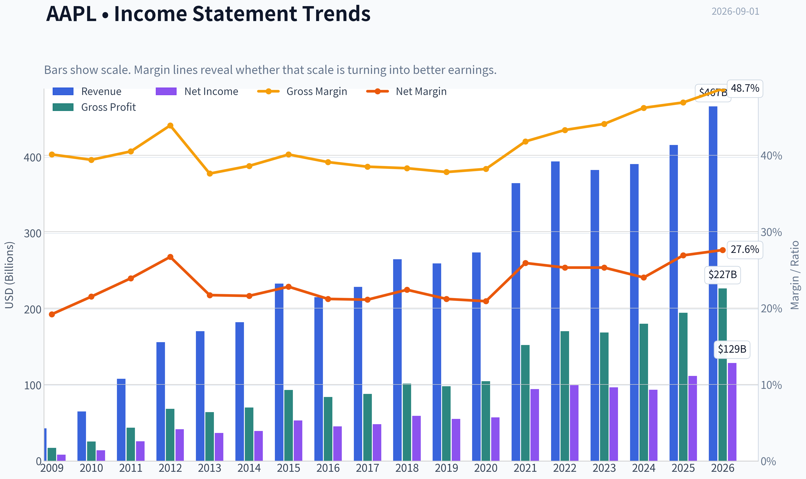
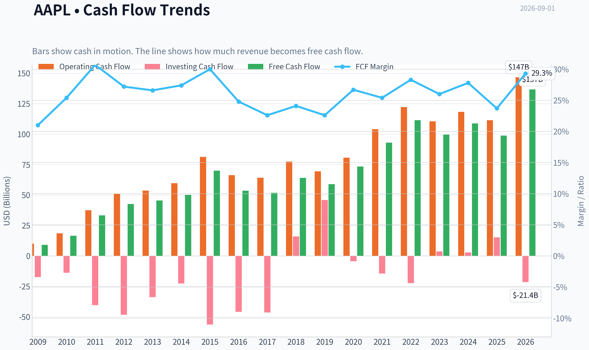
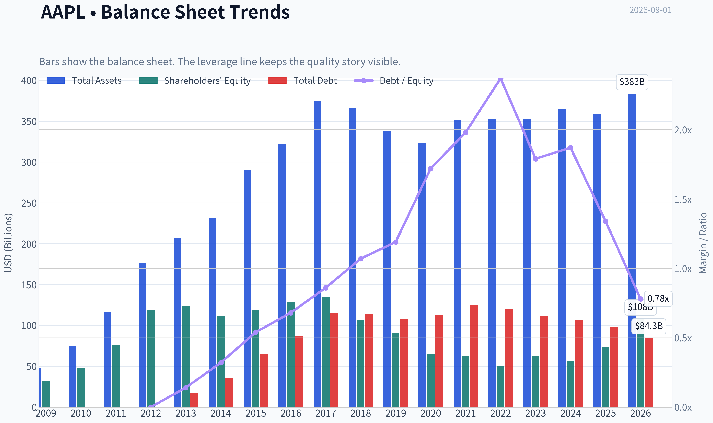
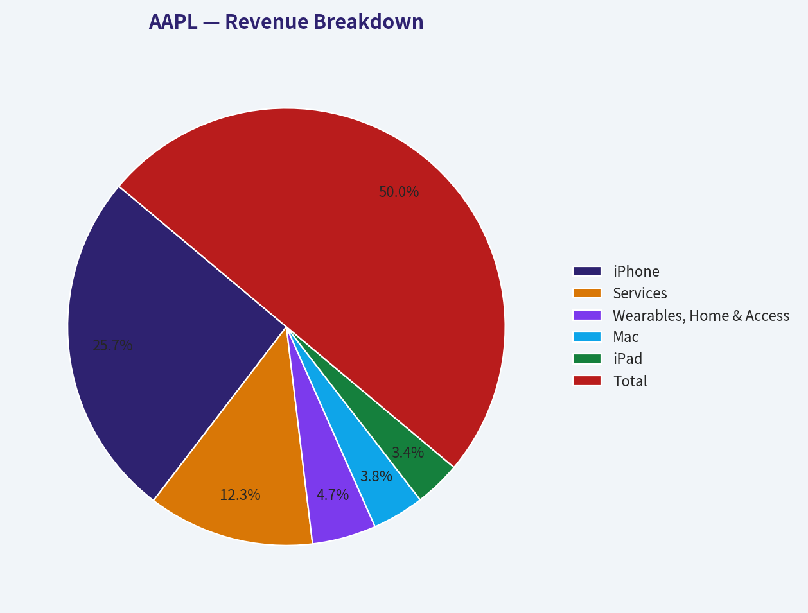
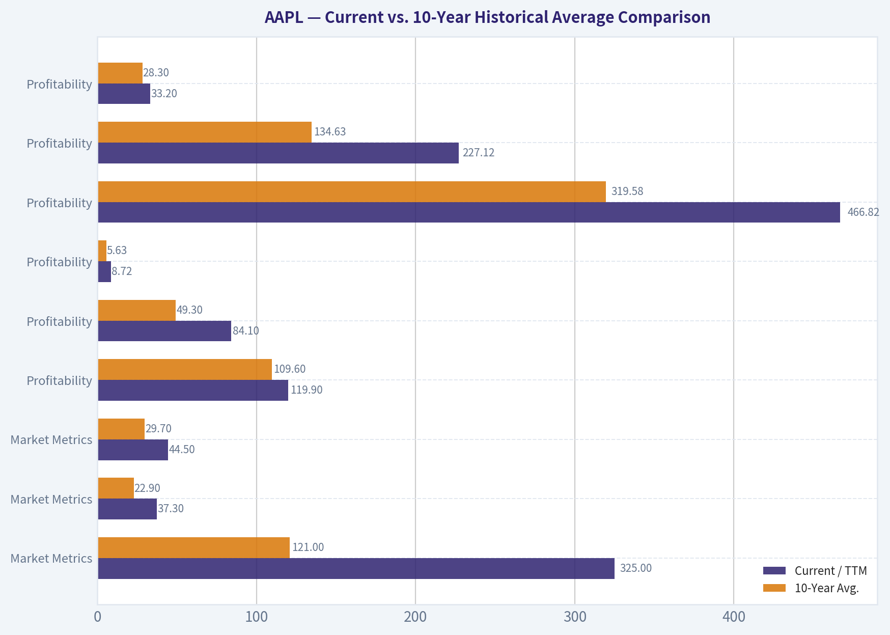
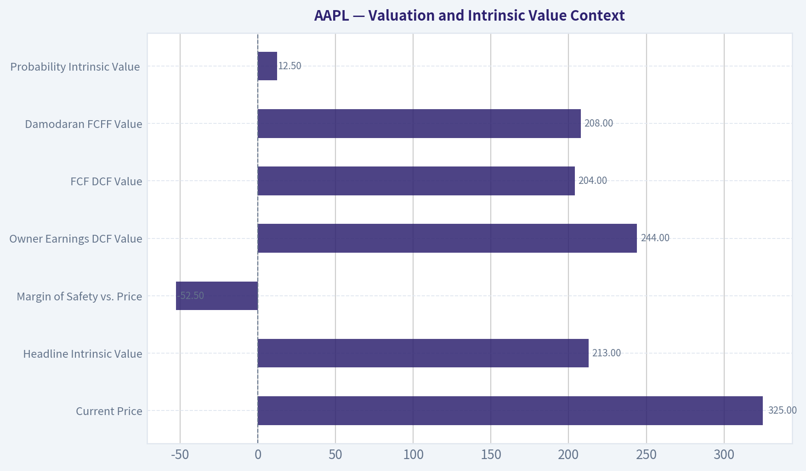
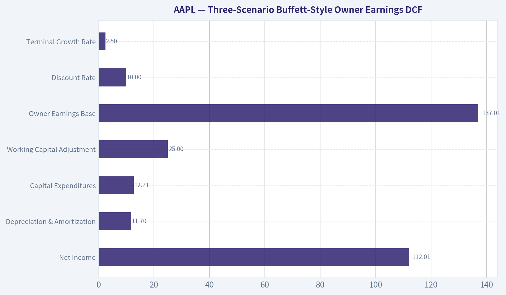
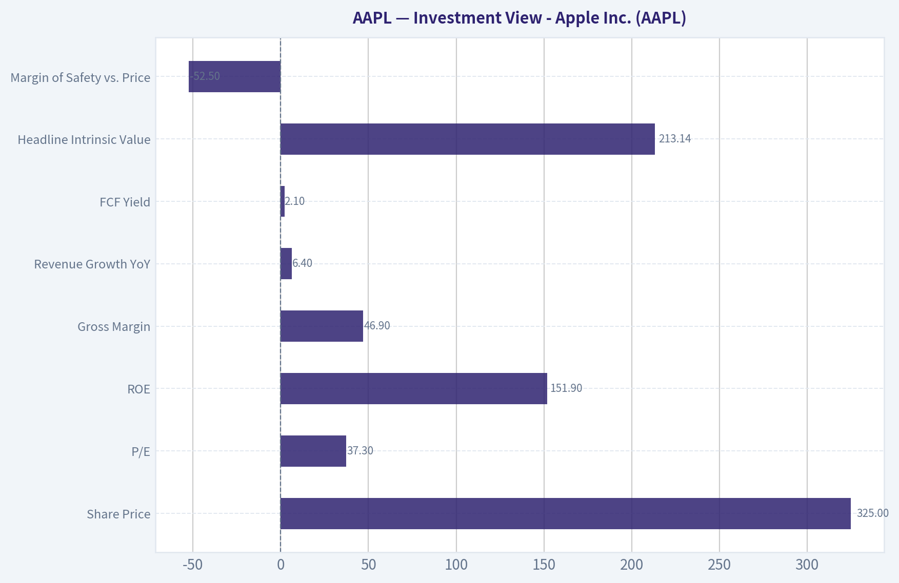

# AAPL Deep Value Intelligence

**Analysis Date:** 2026-09-01

## Critical Disclaimer

*This analysis is generated by Deep Value Intelligence, an AI-powered multi-agent investing framework. Education & research only - not financial advice, not a financial advisor.*

---

## Table of Contents

1. Intelligence Summary
2. Analyst Team Reports
   - Fundamentals Analysis
   - Intrinsic Value Analysis (Buffett)
   - Trend & Growth Analysis (Lynch/Druckenmiller/Fisher)
   - Market Technical Analysis
   - Options Market Analysis
3. Research Team Commentary
4. Value Investing Team Commentary
5. Deep Values Commentary

---

## Intelligence Summary

### Thesis + Conditions

**Core Thesis:** **1. Executive Summary**
Apple (AAPL) presents a textbook clash between exceptional business quality (82% ROIC, 47% gross margins) and stretched valuation (37x P/E).

**Key Risks:**
- Apple (AAPL) presents a textbook clash between exceptional business quality (82% ROIC, 47% gross margins) and stretched valuation (37x P/E). However, our primary lesson from past missteps is that **valuation paralysis in premium compounders destroys alpha**. Waiting indefinitely for a deep-value margin of safety while a stock is technically repairing and lacking negative catalysts leads to missed upside. We are shifting from a passive observer to a disciplined participant using a tiered accumulation strategy.
- Risky (Bull):** Apple is a "digital sovereign state." Its 82% ROIC justifies a premium multiple. The upcoming Apple Intelligence rollout will force a massive, systemic hardware upgrade cycle across its 1.2 billion-unit installed base.
- Neutral:** Binary thinking (all-in vs. sidelined) fails here. The solution is a tiered entry-buy a partial position at current levels to capture momentum, but hold cash reserves to average down if valuation compresses toward $285-$290.

**Confidence:** Medium

---

## Analyst Team Reports

### Fundamentals Analysis

#### Latest Earnings Snapshot

*Most recent reported quarter anchored on 2026 Q2, with prior-year comparison when available.*

| Metric | 2026 Q2 | 2025 Q2 | YoY Change |
| --- | ---: | ---: | ---: |
| Revenue | $109.42B | $94.04B | +16.4% |
| Operating Income | $35.70B | $28.20B | +26.6% |
| Net Income | $29.79B | $23.43B | +27.1% |
| Diluted EPS | $2.02 | $1.57 | +28.7% |
| Operating Cash Flow | $34.37B | $27.87B | +23.3% |
| Free Cash Flow | $31.91B | $24.41B | +30.8% |

Key Takeaways: This snapshot anchors the most recent reported quarter before the narrative analysis. It helps readers separate long-run business quality from whatever changed in the latest earnings print.

#### 17-Year Financial Metrics for AAPL

*All values below are computed deterministically from raw data - not estimated by AI.*

*Issuer profile: operating company (Technology / Consumer Electronics).*

#### 17-Year Financial Metrics
*Annual rows come from reported financial statements. The final TTM row is computed from the latest four quarters.*

| Metric | 2009 | 2010 | 2011 | 2012 | 2013 | 2014 | 2015 | 2016 | 2017 | 2018 | 2019 | 2020 | 2021 | 2022 | 2023 | 2024 | 2025 | 2026 TTM |
| --- | --- | --- | --- | --- | --- | --- | --- | --- | --- | --- | --- | --- | --- | --- | --- | --- | --- | --- |
| Market Price | $6 | $8 | $11 | $20 | $15 | $22 | $25 | $26 | $36 | $53 | $54 | $112 | $138 | $136 | $169 | $231 | $254 | $325 |
| Market Cap | $6.00B | $9.37B | $12.76B | $157.66B | $111.04B | $154.21B | $159.74B | $155.45B | $202.35B | $1.13T | $1.04T | $2.03T | $2.39T | $2.26T | $2.71T | $3.59T | $3.82T | $4.78T |
| P/E Ratio | 0.73 | 0.67 | 0.49 | 3.78 | 3.00 | 3.91 | 2.99 | 3.40 | 4.18 | 18.94 | 18.85 | 35.31 | 25.22 | 22.62 | 27.93 | 38.32 | 34.13 | 37.29 |
| P/B Ratio | 0.19 | 0.20 | 0.17 | 1.33 | 0.90 | 1.38 | 1.34 | 1.21 | 1.51 | 10.53 | 11.51 | 31.07 | 37.83 | 44.53 | 43.56 | 63.04 | 51.82 | 44.50 |
| ROE | 26.0% | 29.3% | 33.8% | 35.3% | 30.0% | 35.4% | 44.7% | 35.6% | 36.1% | 55.6% | 61.1% | 87.9% | 150.1% | 197.0% | 156.1% | 164.6% | 151.9% | 119.9% |
| ROIC | 35.2% | 39.8% | 40.0% | 40.6% | 30.7% | 29.7% | 35.3% | 24.8% | 21.5% | 27.1% | 30.9% | 39.1% | 64.5% | 66.8% | 67.2% | 67.5% | 83.2% | 84.1% |
| EPS | $7.60 | $12.69 | $23.18 | $5.31 | $4.89 | $5.68 | $8.26 | $7.60 | $8.57 | $2.82 | $2.85 | $3.18 | $5.47 | $6.11 | $6.13 | $6.08 | $7.46 | $8.72 |
| Revenue | $42.91B | $65.22B | $108.25B | $156.51B | $170.91B | $182.79B | $233.72B | $215.64B | $229.23B | $265.60B | $260.17B | $274.51B | $365.82B | $394.33B | $383.29B | $391.04B | $416.16B | $466.82B |
| Gross Profit | $17.22B | $25.68B | $43.82B | $68.66B | $64.30B | $70.54B | $93.63B | $84.26B | $88.19B | $101.84B | $98.39B | $104.96B | $152.84B | $170.78B | $169.15B | $180.68B | $195.20B | $227.12B |
| Gross Margin | 40.1% | 39.4% | 40.5% | 43.9% | 37.6% | 38.6% | 40.1% | 39.1% | 38.5% | 38.3% | 37.8% | 38.2% | 41.8% | 43.3% | 44.1% | 46.2% | 46.9% | 48.7% |
| Operating Margin | 27.4% | 28.2% | 31.2% | 35.3% | 28.7% | 28.7% | 30.5% | 27.8% | 26.8% | 26.7% | 24.6% | 24.1% | 29.8% | 30.3% | 29.8% | 31.5% | 32.0% | 33.2% |
| Net Income | $8.23B | $14.01B | $25.92B | $41.73B | $37.04B | $39.51B | $53.39B | $45.69B | $48.35B | $59.53B | $55.26B | $57.41B | $94.68B | $99.80B | $97.00B | $93.74B | $112.01B | $128.93B |
| Net Margin | 19.2% | 21.5% | 23.9% | 26.7% | 21.7% | 21.6% | 22.8% | 21.2% | 21.1% | 22.4% | 21.2% | 20.9% | 25.9% | 25.3% | 25.3% | 24.0% | 26.9% | 27.6% |
| Revenue Growth | N/A | 52.0% | 66.0% | 44.6% | 9.2% | 7.0% | 27.9% | -7.7% | 6.3% | 15.9% | -2.0% | 5.5% | 33.3% | 7.8% | -2.8% | 2.0% | 6.4% | 12.2% |
| Net Income Growth | N/A | 70.2% | 85.0% | 61.0% | -11.3% | 6.7% | 35.1% | -14.4% | 5.8% | 23.1% | -7.2% | 3.9% | 64.9% | 5.4% | -2.8% | -3.4% | 19.5% | 15.1% |
| Free Cash Flow Growth | N/A | 84.0% | 100.5% | 27.9% | 6.9% | 10.2% | 39.6% | -23.6% | -3.2% | 23.8% | -8.1% | 24.6% | 26.7% | 19.9% | -10.6% | 9.3% | -9.2% | 38.4% |
| Total Book Value | $31.64B | $47.79B | $76.61B | $118.21B | $123.55B | $111.55B | $119.36B | $128.25B | $134.05B | $107.15B | $90.49B | $65.34B | $63.09B | $50.67B | $62.15B | $56.95B | $73.73B | $107.52B |
| Total Assets | $47.50B | $75.18B | $116.37B | $176.06B | $207.00B | $231.84B | $290.35B | $321.69B | $375.32B | $365.73B | $338.52B | $323.89B | $351.00B | $352.75B | $352.58B | $364.98B | $359.24B | $383.27B |
| Total Debt | N/A | N/A | N/A | $0 | $16.96B | $35.30B | $64.33B | $87.03B | $115.68B | $114.48B | $108.05B | $112.44B | $124.72B | $120.07B | $111.09B | $106.63B | $98.66B | $84.34B |
| Debt-to-Equity | N/A | N/A | N/A | 0.00 | 0.14 | 0.32 | 0.54 | 0.68 | 0.86 | 1.07 | 1.19 | 1.72 | 1.98 | 2.37 | 1.79 | 1.87 | 1.34 | 0.78 |
| Cash & Equivalents | $5.26B | $11.26B | $9.81B | $10.75B | $14.26B | $13.84B | $21.12B | $20.48B | $20.29B | $25.91B | $48.84B | $38.02B | $34.94B | $23.65B | $29.96B | $29.94B | $35.93B | $39.54B |
| Shareholders' Equity | $31.64B | $47.79B | $76.61B | $118.21B | $123.55B | $111.55B | $119.36B | $128.25B | $134.05B | $107.15B | $90.49B | $65.34B | $63.09B | $50.67B | $62.15B | $56.95B | $73.73B | $107.52B |
| Operating Cash Flow | $10.16B | $18.59B | $37.53B | $50.86B | $53.67B | $59.71B | $81.27B | $66.23B | $64.22B | $77.43B | $69.39B | $80.67B | $104.04B | $122.15B | $110.54B | $118.25B | $111.48B | $146.72B |
| Investing Cash Flow | $-17.43B | $-13.85B | $-40.42B | $-48.23B | $-33.77B | $-22.58B | $-56.27B | $-45.98B | $-46.45B | $16.07B | $45.90B | $-4.29B | $-14.54B | $-22.35B | $3.71B | $2.94B | $15.20B | $-21.40B |
| Free Cash Flow | $9.02B | $16.59B | $33.27B | $42.56B | $45.50B | $50.14B | $70.02B | $53.50B | $51.77B | $64.12B | $58.90B | $73.36B | $92.95B | $111.44B | $99.58B | $108.81B | $98.77B | $136.68B |
| FCF Margin | 21.0% | 25.4% | 30.7% | 27.2% | 26.6% | 27.4% | 30.0% | 24.8% | 22.6% | 24.1% | 22.6% | 26.7% | 25.4% | 28.3% | 26.0% | 27.8% | 23.7% | 29.3% |
| Dividends / Share | $0.00 | $0.00 | $0.00 | $0.00 | $0.00 | $0.00 | $0.00 | $0.00 | $0.00 | $0.00 | $0.00 | $0.00 | $0.00 | $0.91 | $0.95 | $0.99 | $1.03 | $1.06 |

#### Profitability Metrics
- Return on Equity (ROE): 151.9%
- Return on Invested Capital (ROIC): 82.3%
- Return on Assets (ROA): 31.2%
- Gross Margin: 46.9%
- Operating Margin: 32.0%
- Net Profit Margin: 26.9%

#### Liquidity Metrics
- Current Ratio: 0.89
- Quick Ratio: 0.57

#### Leverage Metrics
- Debt-to-Equity Ratio: 1.34
- Interest Coverage Ratio: N/A
- Net Debt: $62.72B

#### Growth Metrics (Year-over-Year)
- Revenue Growth: 6.4%
- Net Income Growth: 19.5%
- Free Cash Flow Growth: -9.2%
- Revenue CAGR (3-Year): 1.8%
- Revenue CAGR (5-Year): 8.7%

#### Valuation Metrics
- P/E Ratio (TTM): 37.33
- Forward P/E: 34.09
- Price-to-Book: 44.18
- Price-to-Sales: 10.16
- PEG Ratio: 2.54
- EV/EBITDA: 27.91
- Free Cash Flow Yield: 2.1%
- Earnings Yield: 2.7%

#### Owner Earnings (Buffett Method, Code-Computed)
- Net Income: $112.01B
- + Depreciation & Amortization: $11.70B
- - Capital Expenditures: $-12.71B
- - Working Capital Changes: $-25.00B
- = **Owner Earnings: $137.01B**

#### Intrinsic Value (Code-Computed)
- Current Price: $325
- **Headline Intrinsic Value (business-model routed): $213**
  Business model: operating company - weighted blend [Damodaran FCFF + reverse-DCF fair + owner-earnings DCF] (operating_company)
  Model spread (min-max across DCFs): $204 - $244
  Margin of safety vs. price (headline): -52.5%
  Routing note: General operating company: balanced blend of Damodaran FCFF and the owner-earnings DCF with a reverse-DCF sanity check.
- Buffett Method (Owner Earnings):
  Conservative: $125
  Average: $244
  Optimistic: $659
- Cash Flow Method (FCF):
  Conservative: $86
  Average: $204
  Optimistic: $273
- Damodaran FCFF (WACC + margins + reinvestment):
  Conservative: $117
  Average: $208
  Optimistic: $445
  Monte Carlo band (P10-P90): $149 - $342 (median $220)
  P(intrinsic value > price): 12.5%
- Reverse-DCF: price implies ~28.6%/yr owner-earnings growth for 10y; trailing 3y was 11.4%, 5y 22.3%.

#### Piotroski F-Score: 8/9
- Positive Net Income: PASS
- Positive Operating Cash Flow: PASS
- ROA Improvement: PASS
- Cash Flow > Net Income: FAIL
- Decreasing Debt: PASS
- Improving Current Ratio: PASS
- No Dilution: PASS
- Improving Gross Margin: PASS
- Improving Asset Turnover: PASS

ANALYST STANCE: **WATCH**

#### AAPL Warren Buffett-Style Fundamental Analysis - 2026-09-01

Apple remains one of the highest-quality businesses in public markets: enormous consumer loyalty, ecosystem lock-in, premium pricing power, massive free cash flow, and elite returns on invested capital. The problem is not business quality; it is price. At **$325 per share**, Apple trades above the deterministic dataset's **headline intrinsic value of $213**, with a **negative margin of safety of roughly 52.5%** and a reverse-DCF requiring about **28.6% annual owner-earnings growth for 10 years**, well above Apple's recent durable growth profile.

---

#### Current vs. 10-Year Historical Average Comparison

| Category | Metric | Current / TTM | 10-Year Avg. | Current vs. Avg. | Interpretation |
|---|---:|---:|---:|---:|---|
| Market Metrics | Market Price | $325 | $121 | +169% | Price has compounded far faster than the underlying revenue base, reflecting premium quality and multiple expansion. |
| Market Metrics | Market Cap | $4.78T | $1.93T | +147% | Apple is now priced as a mega-cap compounder with limited room for valuation error. |
| Market Metrics | P/E Ratio | 37.3x | 22.9x | +63% | Earnings multiple is materially above historical norms; valuation assumes continued high-quality growth. |
| Market Metrics | P/B Ratio | 44.5x | 29.7x | +50% | P/B is not a useful primary valuation tool for Apple because book value is distorted by buybacks, brand equity, software, ecosystem value, and intangible assets. |
| Profitability | ROE | 119.9% | 109.6% | +10 pts | ROE remains exceptional, though inflated by buybacks and reduced equity base. |
| Profitability | ROIC | 84.1% | 49.3% | +35 pts | This is the clearest sign of Apple's moat: very high returns on incremental capital. |
| Profitability | EPS | $8.72 | $5.63 | +55% | EPS has grown strongly, helped by earnings growth and share repurchases. |
| Profitability | Revenue | $466.82B | $319.58B | +46% | Revenue is well above the decade average, though recent organic growth has moderated versus earlier iPhone-cycle years. |
| Profitability | Gross Profit | $227.12B | $134.63B | +69% | Gross profit has grown faster than revenue due to higher-margin Services mix and pricing power. |
| Profitability | Operating Margin | 33.2% | 28.3% | +4.9 pts | Operating leverage and mix shift have improved profitability meaningfully. |
| Profitability | Net Income | $128.93B | $76.35B | +69% | Apple's earnings power is structurally higher than the prior decade average. |
| Profitability | Net Margin | 27.6% | 23.4% | +4.2 pts | Margins are near peak levels, which limits easy upside unless Services and AI monetization expand further. |
| Growth | Revenue Growth | 12.2% | 6.5% | +5.7 pts | Current TTM growth is above average, but the 3-year revenue CAGR of 1.8% warns against assuming persistent double-digit growth. |
| Growth | Net Income Growth | 15.1% | 9.5% | +5.6 pts | Earnings growth is currently stronger than the decade average, supported by margin strength. |
| Growth | Free Cash Flow Growth | 38.4% | 5.0% | +33.4 pts | Current FCF growth is unusually strong versus history and should not be blindly extrapolated. |
| Balance Sheet | Total Book Value | $107.52B | $83.19B | +29% | Equity has recovered from earlier buyback compression, but book value remains a poor proxy for intrinsic value. |
| Balance Sheet | Total Assets | $383.27B | $350.57B | +9% | Asset growth is modest relative to earnings growth, showing high asset efficiency. |
| Balance Sheet | Total Debt | $84.34B | $109.89B | -23% | Debt is declining, a positive development for financial flexibility. |
| Balance Sheet | Debt-to-Equity | 0.78x | 1.49x | Better | Leverage has improved materially versus recent history. |
| Balance Sheet | Cash & Equivalents | $39.54B | $30.80B | +28% | Liquidity remains substantial, though Apple also carries meaningful debt. |
| Balance Sheet | Shareholders' Equity | $107.52B | $83.19B | +29% | Equity base is healthier than the 10-year average, but still not central to valuation. |
| Cash Flow | Free Cash Flow | $136.68B | $81.32B | +68% | Apple remains one of the world's best cash-generation machines. |
| Cash Flow | Dividends / Share | $1.06 | $0.39 | +173% | Dividend has grown, but the yield is low and capital returns remain buyback-heavy. |

**Key Takeaways:** Apple's current fundamentals are far stronger than its 10-year averages across margins, earnings, ROIC, and free cash flow. However, the valuation metrics have expanded even more aggressively, especially P/E and market capitalization. For a Buffett-style investor, the company quality is excellent, but the margin of safety is weak at the current price.

---

#### Revenue Breakdown

| Revenue Source | Amount ($B) | % of Total |
|---|---:|---:|
| iPhone | $201.18 | 51.4% |
| Services | $96.17 | 24.6% |
| Wearables, Home & Accessories | $37.01 | 9.5% |
| Mac | $29.98 | 7.7% |
| iPad | $26.69 | 6.8% |
| **Total** | **$391.04** | **100.0%** |

**Key Takeaways:** Apple remains highly dependent on the iPhone, which contributes just over half of revenue. The most important long-term quality improvement is the rise of Services, now roughly one-quarter of revenue and likely structurally higher margin. This mix shift explains why Apple's gross and operating margins are stronger than the 10-year average.

---

#### Buffett-Style Business Quality Assessment

| Buffett Lens | Assessment | AAPL Interpretation |
|---|---|---|
| Economic Moat | Very strong | Apple benefits from brand power, ecosystem switching costs, proprietary silicon, app-store network effects, retail scale, and deep customer loyalty. |
| Pricing Power | Strong | Premium pricing has persisted across iPhone, Mac, wearables, and services despite competition. |
| Predictable Earnings | Strong, but cyclical around product cycles | Earnings are much more predictable than most hardware companies, but still exposed to iPhone replacement cycles and China demand. |
| ROIC Quality | Exceptional | TTM ROIC of **84.1%** versus a 10-year average of **49.3%** indicates extraordinary capital efficiency. |
| Balance Sheet | Strong | Debt has declined to **$84.34B**, cash is **$39.54B**, and cash generation easily supports obligations. |
| Capital Allocation | Strong but valuation-sensitive | Buybacks have been highly accretive historically, but repurchases at elevated multiples are less attractive. |
| Dividend Policy | Conservative | Dividend per share is **$1.06**, a low payout relative to EPS of **$8.72**, leaving ample room for buybacks and reinvestment. |
| Valuation Discipline | Unattractive today | Current price is well above the model-routed intrinsic value of **$213**, leaving no Buffett-style margin of safety. |

**Key Takeaways:** Apple is exactly the type of business Buffett likes qualitatively: understandable, dominant, cash-rich, and highly profitable. The issue is that the stock now prices in a great deal of future success. At today's valuation, investor returns depend less on business survival and more on whether Apple can keep compounding owner earnings at a rate that justifies a premium multiple.

---

#### Valuation and Intrinsic Value Context

| Valuation Measure | Deterministic Dataset Output | Interpretation |
|---|---:|---|
| Current Price | $325 | Market price as of the current dataset. |
| Headline Intrinsic Value | $213 | Business-model-routed fair value using blended valuation methods. |
| Margin of Safety vs. Price | -52.5% | Price is materially above estimated intrinsic value. |
| Owner Earnings DCF Value | $244 | Higher than headline value, but still below current price. |
| FCF DCF Value | $204 | Indicates more valuation risk on a cash-flow-yield basis. |
| Damodaran FCFF Value | $208 | Supports the view that fair value is meaningfully below market price. |
| Monte Carlo Band | $149-$342 | Current price sits near the upper end of the probabilistic valuation range. |
| Probability Intrinsic Value > Price | 12.5% | Low odds of undervaluation based on the model distribution. |
| Reverse-DCF Implied Growth | 28.6% / year for 10 years | Market price requires very aggressive owner-earnings growth. |

**Key Takeaways:** Multiple valuation methods cluster around roughly **$204 to $244**, while the market price is **$325**. The reverse-DCF is the major warning sign: the current price appears to require growth meaningfully above Apple's recent durable growth rate. This does not mean Apple is a bad business; it means the stock price already reflects exceptional expectations.

---

#### Three-Scenario Buffett-Style Owner Earnings DCF

Base owner earnings from the deterministic dataset:

| Input | Value |
|---|---:|
| Net Income | $112.01B |
| Depreciation & Amortization | $11.70B |
| Capital Expenditures | $12.71B |
| Working Capital Adjustment | $25.00B |
| **Owner Earnings Base** | **$137.01B** |
| Discount Rate | 10.0% |
| Terminal Growth Rate | 2.5% |
| Implied Shares Outstanding | ~14.71B |

**Key Takeaways:** Apple's owner earnings base is enormous at roughly **$137B**, which gives the company unusual financial flexibility. The DCF is highly sensitive to growth assumptions because Apple already trades at a very large market capitalization. Even small changes in long-term growth expectations can move fair value materially.

##### Hand-Built Owner Earnings DCF Scenarios

| Scenario | Growth Assumption | PV of Explicit 10-Year Owner Earnings | PV of Terminal Value | Equity Value | Fair Value / Share |
|---|---|---:|---:|---:|---:|
| Conservative | 3% for 10 years, then 2.5% terminal | ~$972B | ~$970B | ~$1.94T | ~$132 |
| Average / Base Case | 13% for years 1-5, fading to 8% for years 6-10, then 2.5% terminal | ~$1.49T | ~$1.95T | ~$3.44T | ~$234 |
| Optimistic | 18% for years 1-5, fading to 12% for years 6-10, then 2.5% terminal | ~$1.88T | ~$2.91T | ~$4.79T | ~$326 |

**Key Takeaways:** The conservative and base-case DCFs produce values well below the current market price. The optimistic case roughly matches the current price, but it requires Apple to compound owner earnings at a very high rate for a company already generating more than $100B of annual owner earnings. That leaves little room for disappointment.

##### DCF Calculation Detail

| Scenario | Year-10 Owner Earnings | Terminal Value Formula | Approx. Terminal Value | Fair Value Read |
|---|---:|---|---:|---|
| Conservative | ~$184B | $184B x 1.025 / (10% - 2.5%) | ~$2.52T | Intrinsic value materially below market price. |
| Average / Base Case | ~$371B | $371B x 1.025 / (10% - 2.5%) | ~$5.07T | Fair value around the deterministic owner-earnings DCF zone. |
| Optimistic | ~$552B | $552B x 1.025 / (10% - 2.5%) | ~$7.55T | Requires very strong execution and sustained growth. |

**Key Takeaways:** The terminal value dominates the DCF, which means the valuation is heavily dependent on assumptions about Apple's durability beyond the next decade. The optimistic case is not impossible, but it assumes Apple successfully converts its ecosystem, Services base, installed devices, and potential AI features into sustained high owner-earnings growth. Buffett-style investors should demand a lower entry price because the current quote already discounts much of that upside.

---

#### Metric-by-Metric Interpretation

| Area | Interpretation |
|---|---|
| Market Price and Market Cap | Apple's price and market capitalization are far above historical averages. This reflects legitimate business quality, but also means future shareholder returns may be constrained by starting valuation. |
| P/E Ratio | At **37.3x**, Apple trades well above its 10-year average of **22.9x**. That is expensive for a company whose 3-year revenue CAGR is only **1.8%**, unless margin expansion and Services growth accelerate materially. |
| P/B Ratio | Apple's **44.5x P/B** should not be read mechanically as "overvalued" or "cheap." For asset-light, IP-heavy, buyback-heavy businesses, book value is not a reliable measure of economic value. Cash-flow-based intrinsic value is the proper anchor. |
| ROE | ROE remains extraordinary, but it is amplified by Apple's reduced equity base after years of repurchases. It confirms profitability but should be interpreted alongside ROIC. |
| ROIC | ROIC is the standout metric. At **84.1%**, Apple is generating exceptional returns on invested capital, suggesting a durable moat and unusually efficient reinvestment model. |
| EPS | EPS of **$8.72** is meaningfully above the decade average. Buybacks have helped, but the underlying earnings base has also expanded. |
| Revenue | TTM revenue of **$466.82B** is substantially above the historical average, though growth has been uneven in recent years. |
| Gross Profit and Gross Margin | Gross margin has risen to **48.7%**, helped by Services mix, pricing power, and supply-chain scale. This is one of the strongest quality signals in the dataset. |
| Operating Margin | Operating margin of **33.2%** is above historical norms, showing strong expense discipline and operating leverage. |
| Net Income and Net Margin | Net income of **$128.93B** and net margin of **27.6%** are exceptional. The key risk is that margins are already high, reducing the easy path for future expansion. |
| Growth Metrics | Current growth is strong, especially TTM FCF growth, but Apple's decade pattern includes several down years. Growth is high-quality but not perfectly linear. |
| Balance Sheet | Debt has declined and cash remains large. Apple is financially strong, though not net-cash under the dataset's leverage figures. |
| Free Cash Flow | TTM FCF of **$136.68B** is the core of the investment case. However, the FCF yield of roughly **2.1%** is low, meaning investors are paying a high price for each dollar of cash flow. |
| Dividends | Dividend per share is growing but remains modest. Apple's real capital return engine is still buybacks, not dividends. |

---

#### Key Investment Insights

| Insight | Why It Matters |
|---|---|
| Apple is a world-class compounder | High ROIC, brand loyalty, ecosystem retention, and massive FCF make Apple an unusually durable business. |
| Services mix is improving business quality | Services revenue is higher margin and more recurring than hardware, supporting margin expansion. |
| Valuation is the main issue | At **37.3x earnings** and a **2.1% FCF yield**, the stock offers limited margin of safety. |
| Reverse-DCF expectations are demanding | The current price implies roughly **28.6% annual owner-earnings growth for 10 years**, which is aggressive for Apple's size. |
| Buybacks are less attractive at high multiples | Repurchases create less value when shares trade materially above intrinsic value. |
| Balance sheet trend is improving | Debt reduction and strong liquidity reduce downside risk, even if valuation is stretched. |

**Key Takeaways:** Apple's business quality remains excellent, but the market is pricing it as if high growth and high margins will persist for a long time. The biggest investment question is not whether Apple is durable; it is whether today's buyer is paying too much for that durability. At current prices, the answer appears to be yes from a Buffett-style margin-of-safety perspective.

---

#### Red Flags and Opportunities

| Type | Item | Impact |
|---|---|---|
| Red Flag | Valuation above intrinsic value | Current price of **$325** is materially above the headline intrinsic value of **$213**. |
| Red Flag | Low FCF yield | A **2.1% FCF yield** leaves little protection if growth slows or rates remain elevated. |
| Red Flag | High expectations | Reverse-DCF requires very high growth relative to Apple's recent revenue CAGR. |
| Red Flag | Product concentration | iPhone remains over half of revenue, creating dependence on upgrade cycles. |
| Red Flag | Regulatory pressure | App Store fees, default search economics, payments, and ecosystem control remain regulatory targets. |
| Red Flag | China and supply-chain exposure | Geopolitical and demand risks remain relevant despite supply-chain diversification efforts. |
| Opportunity | Services expansion | Higher-margin recurring revenue can continue lifting gross and operating margins. |
| Opportunity | AI monetization | On-device AI, upgraded hardware cycles, and premium services could support renewed growth. |
| Opportunity | Installed base monetization | Apple's large installed base remains a powerful platform for payments, subscriptions, accessories, and cloud services. |
| Opportunity | Continued capital returns | Even at a lower yield, Apple's cash generation supports dividends and repurchases. |

**Key Takeaways:** The opportunity set is real, especially around Services and AI-enabled device upgrades. But the risks are mostly valuation-related: if Apple merely performs well rather than exceptionally, the current multiple may compress. Investors need a lower price or stronger evidence of durable acceleration to justify new buying.

---

#### Final Investment Stance: WATCH

Apple is a **wonderful business**, but at the current price it is not a clear Buffett-style bargain. The deterministic valuation pack estimates headline intrinsic value at **$213**, with model values clustering around **$204-$244**, while the stock trades at **$325**. The hand-built owner-earnings DCF also suggests that only an optimistic growth path supports the current price.

For existing long-term holders, Apple remains a high-quality compounder worth monitoring. For new capital, however, the stock lacks a sufficient margin of safety. A more attractive Buffett-style entry point would likely require either a meaningful pullback toward intrinsic value or stronger evidence that Apple can sustainably compound owner earnings at rates closer to what the current market price implies.

| Final Summary Point | Assessment |
|---|---|
| Business Quality | Exceptional |
| Economic Moat | Very strong |
| Financial Strength | Strong |
| Earnings Predictability | High, though product-cycle exposed |
| Capital Allocation | Strong historically, less compelling at current valuation |
| Valuation | Expensive versus intrinsic value |
| Margin of Safety | Negative |
| Best Investor Action | Hold/watch; avoid aggressive new buying at current price |
| Final Stance | **WATCH** |

**Key Takeaways:** Apple remains one of the best businesses in the world, but Buffett-style investing requires both quality and price discipline. At **$325**, the stock appears priced for near-perfection. The prudent stance is to watch patiently rather than chase.

#### Fundamental Visuals

This graph tracks the profitability and return metrics (ROE, ROIC, Margins) of **AAPL** over the past decade, highlighting capital efficiency trends.

This chart illustrates the financial health of **AAPL** over the last 10 years, mapping cash equivalents and free cash flow against total obligations (Debt).

This breakdown chart from <em>Revenue Breakdown</em> shows the proportional composition for **AAPL** - useful for understanding what drives or risks the business.

---

### Intrinsic Value Analysis (Buffett)

> *Following Warren Buffett's value investing philosophy: Circle of Competence, Economic Moat, Management Quality, and Margin of Safety.*

#### Intrinsic Value Snapshot

Price is what you pay. Intrinsic value is what the business may be worth based on the cash it can create for owners over time. We show a range, not one magic number.

- Current Price: $325.13
- Value Range (conservative to optimistic across both DCF methods): $86.28 to $658.67

##### Owner Earnings (Buffett Method)
- Net Income: $112,010,000,000.00
- Depreciation & Amortization: $11,698,000,000.00
- Capital Expenditures: $-12,715,000,000.00
- Working Capital Changes: $-25,000,000,000.00
- Owner Earnings: $137,010,000,000.00

##### Intrinsic Value
###### Buffett Method
Uses owner earnings. Stricter, and usually more conservative.
- Conservative: $125.10
- Average: $244.07
- Optimistic: $658.67
- Discount Rate: 10.0%

###### Cash Flow Method
Uses free cash flow. Better for companies spending heavily today to grow tomorrow.
- Conservative: $86.28
- Average: $204.40
- Optimistic: $273.20
- Discount Rate: 10.0%

ANALYST STANCE: **WATCH**

#### Investment View - Apple Inc. (AAPL)

Apple remains one of the highest-quality businesses in the world: an ecosystem company with enormous brand power, customer captivity, pricing power, recurring Services revenue, and exceptional capital returns. The problem is not business quality; it is price. At **$325 per share**, Apple trades roughly **52.5% above the headline intrinsic value estimate of $213.14**, with the reverse DCF implying about **28.6% annual growth for 10 years**, a demanding hurdle for a company already worth about **$4.75 trillion**.

| Item | Current Snapshot |
|---|---:|
| Share Price | $325 |
| Market Cap | $4.75T |
| P/E | 37.3x |
| ROE | 151.9% |
| Gross Margin | 46.9% |
| Revenue Growth YoY | 6.4% |
| FCF Yield | 2.1% |
| Headline Intrinsic Value | $213.14 |
| Margin of Safety vs. Price | -52.5% |
| Reverse-DCF Implied Growth | ~28.6% annually for 10 years |

**Key Takeaways:** Apple is a wonderful business selling at a demanding valuation. The market is pricing in growth far above Apple's recent 3-year growth rate of 11.4% and even above what looks prudent for a company of Apple's current size. This is a "right company, wrong price" setup.

---

#### Factor Scorecard - Buffett-Style Quality Review

| Factor | Score | Evidence |
|---|---:|---|
| 1. Circle of Competence & Business Simplicity | 4.5 / 5 | Apple sells premium hardware, software, and services into a deeply integrated ecosystem. The model is understandable: sell devices, retain users, monetize through Services, accessories, and upgrades. Technology is an advantage, not merely a threat, because Apple controls hardware, software, silicon, distribution, and customer experience. |
| 2. Moat Test | 5.0 / 5 | Brand, ecosystem lock-in, switching costs, developer network, Services attachment, and premium pricing create a wide and durable moat. Gross margin of 46.9% supports pricing power. |
| 3. Management Quality & Capital Allocation | 3.7 / 5 | Tim Cook's era produced extraordinary buybacks, supply-chain excellence, and Services growth. John Ternus becoming CEO introduces succession risk, though he is deeply tied to Apple's hardware culture. Buybacks are rational over the long term, but less attractive at today's elevated valuation. |
| 4. Industry Structure | 4.0 / 5 | Premium smartphones and consumer ecosystems have consolidated around a few dominant players. Apple faces regulatory pressure and innovation risk, but the installed base and Services ecosystem remain structurally powerful. |
| Gate 5: Quality / Solvency Hard Floor | Not Tripped | Apple has strong profitability, positive free cash flow, high interest coverage, and substantial liquidity. No financial-distress condition is present. |

**Key Takeaways:** Apple scores extremely well on business quality, moat, and predictability. The only material deductions are valuation, CEO transition risk, regulatory pressure, and the sheer difficulty of compounding rapidly from a $4.75 trillion market value. The solvency hard floor is clearly not triggered.

---

#### Moat Analysis

| Moat Source | Apple Evidence | Assessment |
|---|---|---|
| Intangible Assets | One of the world's strongest consumer brands; premium pricing; emotional loyalty; design reputation; trusted privacy and security positioning. | Wide |
| Switching Costs | iMessage, FaceTime, Apple ID, iCloud, App Store purchases, Photos, Watch, AirPods, Apple Pay, and device continuity make switching inconvenient. | Wide |
| Cost / Scale Advantage | Massive procurement scale, custom silicon, supply-chain depth, global retail reach, and operating leverage across installed base. | Strong |
| Network Effects | Developer ecosystem, App Store, services integration, device installed base, and accessory ecosystem improve with scale. | Strong, though not as pure as marketplace network effects |
| Financial Evidence | Gross margin 46.9%, ROE 151.9%, strong cash generation, premium pricing sustained over many product cycles. | Wide & Stable to Widening |

**Key Takeaways:** Apple's moat is not based on one product; it is based on the ecosystem surrounding the customer. The brand brings users in, switching costs keep them in, and Services deepen monetization over time. This is the kind of durable franchise Buffett is willing to own for decades.

---

#### Management Quality & Capital Allocation

| Area | Assessment |
|---|---|
| Owner Orientation | Apple has returned enormous capital to shareholders through repurchases and dividends. Per-share value creation has benefited materially from buybacks. |
| Candor & Culture | Apple historically communicates conservatively and avoids promotional long-term guidance. The culture is product-focused, secrecy-driven, and execution-heavy. |
| Capital Allocation | Buybacks were highly accretive when shares were cheaper. At 37x earnings and a 2.1% FCF yield, future repurchases are less obviously value-enhancing. |
| CEO Transition | John Ternus succeeding Tim Cook creates a new leadership chapter. His hardware engineering background supports product continuity, but capital allocation discipline must be watched. |
| Buffett Signal | Berkshire's latest disclosed position remains large at roughly $65.95B and 227.92M shares, though 13F data reflects quarter-end holdings. |

**Key Takeaways:** Apple's management record is excellent, especially in execution and shareholder returns. The main watch item is whether the new CEO maintains Cook-like discipline while navigating AI, regulation, China exposure, and expensive buybacks. Management is still a strength, but the transition lowers certainty modestly.

---

#### Financial Summary

| Fiscal Year / Period | Revenue | Gross Margin | Operating Margin | Net Income | Free Cash Flow | Diluted EPS | ROE | Approx. Diluted Shares |
|---|---:|---:|---:|---:|---:|---:|---:|---:|
| FY2021 | $365.8B | 41.8% | 29.8% | $94.7B | $93.0B | $5.61 | ~147% | 16.87B |
| FY2022 | $394.3B | 43.3% | 30.3% | $99.8B | $111.4B | $6.11 | ~175% | 16.33B |
| FY2023 | $383.3B | 44.1% | 29.8% | $97.0B | $99.6B | $6.13 | ~172% | 15.81B |
| FY2024 | $391.0B | 46.2% | 31.5% | $93.7B | $108.8B | $6.08 | ~165% | 15.41B |
| Current / TTM | ~$416B | 46.9% | Strong | ~$127B implied by P/E | ~$100B implied by FCF yield | ~$8.70 implied | 151.9% | ~14.62B |

**Key Takeaways:** Apple's revenue growth is no longer explosive, but margins have improved meaningfully, especially gross margin. Free cash flow remains enormous, and share count continues to fall through repurchases. ROE is exceptional, though inflated by Apple's capital-light model and large buyback program.

---

#### Owner Earnings Calculation

Using Buffett's owner earnings framework:

`Owner Earnings = Net Income + Depreciation & Amortization - Maintenance CapEx - Required Working Capital Increases`

| Component | Current / Normalized Estimate |
|---|---:|
| Net Income | ~$127.3B |
| Depreciation & Amortization / Non-Cash Addbacks | +~$12.0B |
| Estimated Maintenance CapEx | -~$8.0B |
| Working Capital / Accrual Normalization | -~$19.0B |
| Estimated Owner Earnings | ~$112.3B |
| Shares Outstanding | ~14.62B |
| Owner Earnings per Share | ~$7.68 |

**Key Takeaways:** Apple converts accounting profit into real cash at a very high level, though current free cash flow yield is only about 2.1% because the stock price is so elevated. A normalized owner earnings estimate of roughly $112 billion underscores Apple's extraordinary business quality, but also highlights how much investors are paying for each dollar of cash generation.

---

#### Three-Scenario DCF Valuation

Assumptions: 10% discount rate, normalized owner earnings per share of approximately $7.68, and terminal growth of 3% where applicable.

| Scenario | Assumption | Estimated Value per Share |
|---|---|---:|
| A. No Growth | Owner earnings capitalized at 10% | ~$76.80 |
| B. GDP Growth | Owner earnings grow at 3% perpetually | ~$113.00 |
| C. Historical-Growth Haircut | 7.5% growth for 10 years, then 3% terminal growth | ~$158.00 |
| Research-Pack Owner Earnings DCF | Cash-flow model estimate | $244.07 |
| Research-Pack FCF DCF | Cash-flow model estimate | $204.40 |
| Research-Pack Damodaran FCFF | Cash-flow model estimate | $208.28 |
| Headline Blended Intrinsic Value | Weighted business-model-routed estimate | $213.14 |

**Key Takeaways:** Even giving Apple credit for durable growth, the current price is well above conservative intrinsic value estimates. The research-pack blended value of $213.14 is more generous than the strict owner-earnings scenarios, but still far below the $325 market price. Apple's valuation requires both sustained growth and sustained premium multiples.

---

#### Margin of Safety Analysis

| Measure | Result |
|---|---:|
| Current Price | $325 |
| Headline Intrinsic Value | $213.14 |
| Price Premium to Headline Intrinsic Value | ~52.5% |
| FCF Yield | 2.1% |
| Reverse-DCF Implied Growth | ~28.6% annually for 10 years |
| Trailing 3-Year Growth Reference | 11.4% |
| Trailing 5-Year Growth Reference | 22.3% |
| Quality-Scaled MOS Requirement | ~10-15% discount would be acceptable for Apple's quality |
| Actual MOS | Negative |

**Key Takeaways:** Apple is high enough quality that it does not need a 40% discount to be attractive. But it should at least trade near fair value or at a modest discount. At $325, the stock offers no margin of safety and embeds growth expectations that look too aggressive for a mature mega-cap.

---

#### Final Buffett Scorecard

| Criterion | Weight | Score | Weighted Contribution |
|---|---:|---:|---:|
| Moat Width & Durability | 25% | 5.0 | 1.25 |
| Valuation / Margin of Safety | 20% | 0.5 | 0.10 |
| Capital Returns - ROIC vs. WACC | 15% | 5.0 | 0.75 |
| Business Understanding & Predictability | 12% | 4.5 | 0.54 |
| Management Quality & Capital Allocation | 12% | 3.7 | 0.44 |
| Reinvestment Runway | 8% | 3.0 | 0.24 |
| Balance Sheet Strength | 4% | 3.5 | 0.14 |
| Industry Structure | 4% | 4.0 | 0.16 |
| **Final Weighted Score** | **100%** |  | **3.62 / 5** |

**Key Takeaways:** Apple's business quality is exceptional, and the weighted score remains respectable because the moat and returns on capital are elite. However, valuation is the overwhelming weakness. The score lands in the high WATCH zone rather than ADVOCATE because the current price leaves little room for disappointment.

---

#### Investment Stance

**Stance: WATCH**
**Conviction: High**

Apple is a wonderful company, but not a wonderful purchase at today's price. The correct Buffett-style conclusion is to admire the business, respect the moat, and wait for a valuation that offers at least a modest margin of safety. A more attractive entry point would be closer to the **$210-$245** range, depending on updated earnings power, buyback pace, Services growth, and evidence that the Ternus era can preserve Apple's product and capital allocation discipline.
#### Valuation Bridge

This bridge places the current market price beside each intrinsic value lens so readers can see whether upside depends on one method or shows up across several methods.

| Scenario | Intrinsic Value / Share |
| --- | ---: |
| Buffett Method | $244.07 |
| Cash Flow Method | $204.40 |
| Damodaran Method | $208.28 |
| Current Price | $325.13 |

#### Key Takeaways

If one method is far above the others, the upside case depends on a specific modelling assumption. When several methods cluster together, the valuation story is more robust.

#### Valuation Visuals

This comparison chart from *Latest Earnings Snapshot* stacks current figures against historical benchmarks for **AAPL**, making it easy to see where the company trades relative to its own averages.

This comparison chart from *Current vs. 10-Year Historical Average Comparison* stacks current figures against historical benchmarks for **AAPL**, making it easy to see where the company trades relative to its own averages.

This comparison chart from *Valuation and Intrinsic Value Context* stacks current figures against historical benchmarks for **AAPL**, making it easy to see where the company trades relative to its own averages.

This comparison chart from *Three-Scenario Buffett-Style Owner Earnings DCF* stacks current figures against historical benchmarks for **AAPL**, making it easy to see where the company trades relative to its own averages.

This comparison chart from *Investment View - Apple Inc. (AAPL)* stacks current figures against historical benchmarks for **AAPL**, making it easy to see where the company trades relative to its own averages.

---

### Trend & Growth Analysis (Lynch/Druckenmiller/Fisher)

> *Following Peter Lynch's GARP, Stanley Druckenmiller's macro-aware approach, and Philip Fisher's scuttlebutt methodology.*

ANALYST STANCE: **AVOID**

#### AAPL Growth Investment View - Apple Inc.

Apple remains one of the highest-quality businesses in the world, but under a Lynch-Druckenmiller-Fisher growth framework, it does **not** currently screen as a new-money fast grower. Revenue growth is in the mid-single digits, valuation is demanding, and the current share price appears to require a major AI or device-cycle acceleration that is not yet visible in the financials.

*Note: The live fundamentals tools returned unavailable results, so this report uses the shared research pack provided for AAPL.*

---

#### 1. Lynch Classification

| Lynch Category | AAPL Fit | Evidence | Growth Investor Implication |
|---|---:|---|---|
| Slow Grower | Partial | Revenue growth is 6.4%, above slow-grower range but not high-growth | Not a ten-bagger profile from current scale |
| Stalwart | Strong | Massive brand, recurring ecosystem, durable cash generation | Hold-quality business, but not a classic growth initiation |
| Fast Grower | Weak | Growth is far below 15%-25%+ threshold | Does not meet primary growth mandate |
| Cyclical | Partial | iPhone replacement cycles create hardware cyclicality | Need product-cycle timing edge |
| Turnaround | No | Business is financially strong | No distress catalyst |
| Asset Play | No | Value is operating ecosystem, not hidden assets | Not applicable |

**Key Takeaways:** Apple is best classified as a **Stalwart**, not a fast grower. It is a dominant franchise with excellent economics, but its current revenue growth does not fit the Lynch ten-bagger category. For a growth portfolio, that means Apple is more of a hold-quality compounder than a compelling new-money opportunity.

---

#### 2. The Story in 3 Bullets

- Apple sells premium devices and increasingly monetizes its installed base through Services, App Store economics, subscriptions, payments, wearables, and ecosystem lock-in.
- The next growth story depends on whether Apple can turn AI, spatial computing, health, and new device cycles into a meaningful upgrade wave.
- New CEO John Ternus, formerly hardware engineering chief, creates a potential product-cycle inflection point, but the market is already pricing in substantial future success.

---

#### 3. TAM Analysis and 10x Test

| Metric | Estimate / View |
|---|---:|
| Current revenue scale | Roughly $400B+ annualized global revenue scale |
| 10x revenue requirement | $4T+ annual revenue |
| Relevant TAM | Smartphones, PCs, wearables, digital services, payments, health, AI devices, mixed reality |
| Can AAPL 10x revenue and remain below 20% TAM share? | Unlikely under current business mix |
| Runway quality | Strong for Services and AI-enabled devices; limited for core iPhone unit growth |
| TAM verdict | Enormous ecosystem, but already highly penetrated at Apple's scale |

**Key Takeaways:** Apple still has a large addressable market, especially in Services, health, AI, and wearables. However, because the company is already generating hundreds of billions in revenue, the 10x test is very difficult. Apple can compound, but a true ten-bagger from today's $4.75 trillion market cap would require extraordinary new categories.

---

#### 4. Revenue Growth Trend

| Metric | Current Data |
|---|---:|
| Revenue growth YoY | 6.4% |
| Lynch growth classification | Stalwart |
| Growth pattern | Modest growth, not high-growth acceleration |
| Inflection status | Not yet confirmed |
| Required evidence for upgrade | Sustained double-digit revenue growth or visible AI/device cycle acceleration |

**Key Takeaways:** Apple's current revenue growth is positive but not explosive. A 6.4% growth rate is solid for a company of this size, but it does not meet the 15%-25% threshold that growth investors usually seek. The stock needs a new acceleration catalyst to justify its premium valuation.

---

#### 5. Unit Economics

| Unit Economics Metric | AAPL Assessment |
|---|---|
| LTV/CAC | Not disclosed, but likely excellent due brand loyalty and ecosystem lock-in |
| NRR | Not disclosed; Services revenue likely benefits from high retention |
| Rule of 40 | Not directly applicable; Apple is not a pure SaaS company |
| Gross margin | 46.9% |
| FCF yield | 2.1% |
| ROE | 151.9% |
| Current ratio | 0.89 |

**Key Takeaways:** Apple's unit economics are likely excellent even though SaaS-style metrics are not disclosed. The company has premium margins, massive customer loyalty, and ecosystem switching costs. The weakness is not business quality; the weakness is that the stock's valuation leaves limited room for disappointment.

---

#### 6. Inflection Point Assessment

| Potential Inflection | Evidence | Current Confidence |
|---|---|---:|
| Product cycle inflection | New CEO John Ternus reportedly touting a "phenomenal" iPhone launch | Medium |
| AI ecosystem inflection | Potential for Apple Intelligence and on-device AI to drive upgrades | Medium |
| Services mix shift | Higher-margin recurring revenue remains a long-term driver | High |
| Margin inflection | Gross margin already high at 46.9%; further expansion possible but harder | Medium |
| Competitive inflection | Apple remains dominant, but AI platform leadership is not yet proven | Medium-low |

**Key Takeaways:** The most important possible inflection is a new hardware and AI cycle under John Ternus. However, the financial data does not yet show a major growth acceleration. Apple needs visible AI monetization, faster iPhone upgrades, or a new product category to change the growth story.

---

#### 7. Macro Setup Evaluation

| Macro Factor | Impact on AAPL |
|---|---|
| Interest rates | Lower rates would support premium growth multiples; higher-for-longer is a valuation headwind |
| Consumer cycle | Premium hardware demand can weaken if consumers delay upgrades |
| AI theme | Strong secular tailwind, but Apple must prove differentiation |
| China / geopolitics | Key supply chain and demand risk |
| U.S. mega-cap concentration | Apple benefits from index flows, but also faces crowded-position risk |

**Key Takeaways:** The macro setup is mixed. AI is a powerful secular tailwind, but Apple is not yet the clearest AI winner compared with cloud, semiconductor, or infrastructure leaders. Valuation is also sensitive to interest rates because the stock trades at a premium multiple.

---

#### 8. Fisher 15 Points Score

| Fisher Point | Score / 5 | Rationale |
|---|---:|---|
| 1. Market potential | 4 | Large ecosystem, but core smartphone market mature |
| 2. New product determination | 4 | Strong product culture; CEO transition may reinforce hardware innovation |
| 3. R&D effectiveness | 4 | Historically strong execution, though AI leadership is debated |
| 4. Sales organization | 5 | World-class brand and retail channel |
| 5. Profit margin | 5 | Gross margin 46.9% |
| 6. Margin improvement | 3 | Margins are high, but expansion runway is less obvious |
| 7. Labor/personnel relations | 4 | Generally strong, though large-scale labor issues can arise |
| 8. Executive relations | 4 | Leadership transition appears orderly |
| 9. Management depth | 4 | Deep bench, Ternus succession is credible |
| 10. Cost/accounting controls | 5 | Excellent operational discipline |
| 11. Moat/switching costs | 5 | Ecosystem lock-in, brand, services integration |
| 12. Long-range profit outlook | 4 | Strong but already very large |
| 13. Dilution risk | 5 | Heavy buybacks, not dilution-dependent |
| 14. Candor | 4 | Generally transparent, but product secrecy limits visibility |
| 15. Integrity | 5 | High governance and brand-trust profile |
| **Total** | **65 / 75** | **Outstanding quality** |

**Key Takeaways:** Apple scores very well on Fisher quality factors, especially brand, margins, management, ecosystem lock-in, and capital discipline. This is an outstanding company. The issue is that Fisher quality alone does not overcome the combination of modest growth and a stretched valuation.

---

#### 9. Valuation Analysis

| Valuation Metric | Current Reading | Interpretation |
|---|---:|---|
| Price | $325 |
| Market cap | $4.75T |
| P/E | 37.3x |
| Revenue growth YoY | 6.4% |
| PEG proxy using revenue growth | ~5.8x |
| FCF yield | 2.1% |
| Headline intrinsic value | $213.14 |
| Margin of safety vs. price | -52.5% |
| Owner earnings DCF | $244.07 |
| FCF DCF | $204.40 |
| Damodaran FCFF | $208.28 |
| Reverse DCF implied growth | ~28.6% per year for 10 years |

**Key Takeaways:** Apple's valuation is the central problem. A 37x P/E on mid-single-digit revenue growth produces a very high PEG proxy. The stock trades far above the provided intrinsic value estimate, and the reverse DCF implies growth expectations that appear aggressive for a company already worth $4.75 trillion.

---

#### 10. Scenario Analysis

| Scenario | Assumptions | Implied View |
|---|---|---|
| Bear case | iPhone cycle disappoints, AI monetization delayed, multiple compresses | Meaningful downside risk toward intrinsic value range |
| Base case | Mid-single-digit revenue growth, strong buybacks, Services mix expansion | Stock may compound slowly but valuation caps returns |
| Bull case | AI-driven upgrade cycle, Services acceleration, new hardware category succeeds | Upside possible, but much is already priced in |
| Ten-bagger case | Apple creates multiple new trillion-dollar markets | Extremely low probability from current scale |

**Key Takeaways:** The bull case requires Apple to create a meaningful AI or device-cycle acceleration. The base case is a high-quality compounder but not an obvious bargain. The bear case matters because the stock's valuation provides little margin of safety.

---

#### 11. Growth Investor Scorecard

| Criterion | Weight | Score / 5 | Weighted Score |
|---|---:|---:|---:|
| The Story | 10% | 4.0 | 0.40 |
| TAM & Runway | 20% | 3.0 | 0.60 |
| Revenue Growth | 20% | 2.0 | 0.40 |
| Unit Economics | 15% | 4.5 | 0.68 |
| Competitive Position | 10% | 5.0 | 0.50 |
| Management Quality | 10% | 4.5 | 0.45 |
| Macro Setup | 5% | 3.0 | 0.15 |
| Profitability Path | 5% | 5.0 | 0.25 |
| Valuation | 5% | 1.0 | 0.05 |
| **Total** | **100%** |  | **3.48 / 5.00** |

**Key Takeaways:** Apple's score is supported by elite business quality, management, profitability, and competitive position. The score is held back by modest revenue growth and expensive valuation. This lands near the high end of WATCH, but for new growth capital, the risk/reward is not attractive enough.

---

#### 12. Position Size Stance

| Investor Type | Stance | Suggested Position View |
|---|---|---|
| Existing long-term holder | WATCH / Hold | Reasonable to hold if tax basis is low and position is not oversized |
| New growth investor | AVOID | Wait for either faster growth or a much better entry price |
| Concentrated growth portfolio | AVOID | Better odds may exist in companies with faster revenue acceleration |
| Defensive quality portfolio | WATCH | Apple remains a premier quality compounder |

**Key Takeaways:** Apple is not a broken company; it is a great company at a demanding price. Existing shareholders can justify holding, especially with low cost basis. New growth-oriented investors should wait for a better valuation or clearer evidence of acceleration.

---

#### 13. Key Catalysts and Risks

| Category | Item | Impact |
|---|---|---|
| Catalyst | New CEO John Ternus begins leadership era | Could refresh product innovation narrative |
| Catalyst | "Phenomenal" upcoming iPhone launch | Potential hardware-cycle acceleration |
| Catalyst | Apple Intelligence / on-device AI | Could drive upgrade demand and Services monetization |
| Catalyst | Services growth | Higher-margin recurring revenue supports earnings resilience |
| Risk | Valuation | Current price embeds aggressive expectations |
| Risk | Revenue growth | 6.4% growth is not enough to justify fast-grower multiple |
| Risk | China exposure | Demand and supply-chain vulnerability |
| Risk | AI execution | Apple may lag perceived AI platform leaders |
| Risk | Market cap law of large numbers | Ten-bagger potential is structurally limited |

**Key Takeaways:** The biggest upside catalyst is a genuine AI-enabled iPhone upgrade cycle under new CEO John Ternus. The biggest risk is valuation: Apple is priced like a company with much stronger growth than it currently reports. Without acceleration, multiple compression could offset business quality.

---

#### Final Growth Analyst Verdict

Apple is an exceptional business, but not currently an exceptional growth stock opportunity. Under Lynch, it is a **Stalwart**, not a Fast Grower. Under Druckenmiller, the key question is whether earnings will be materially higher in two to three years than the market expects; at today's valuation, the market already appears to expect a lot. Under Fisher, Apple remains outstanding, but quality is not enough when growth is modest and price is stretched.

**Final stance: AVOID for new growth capital; WATCH/HOLD for existing long-term shareholders.**

---

### Market Technical Analysis

ANALYST STANCE: **WATCH**

#### AAPL Technical Indicator Report - as of 2026-09-01

September 1, 2026 was not a trading day in the retrieved dataset, so the latest available market close is **2026-08-31**, when AAPL closed at **$316.85**. The stock is in a **long-term uptrend**, but the short- and medium-term picture is still rebuilding after a sharp late-July selloff. The current setup is constructive, but not yet a clean momentum breakout.

I selected these **8 complementary indicators**: **10 EMA, 50 SMA, 200 SMA, MACD, MACD Histogram, RSI, ATR, and VWMA**. Together they cover short-term trend, medium-term trend, long-term trend, momentum shift, momentum acceleration, overbought/oversold conditions, volatility, and volume-confirmed price behavior.

#### Trend Structure

AAPL's latest close of **$316.85** sits above the **10 EMA at $313.70**, above the **50 SMA at $312.19**, and far above the **200 SMA at $282.36**. This alignment is broadly bullish: price is above short-, medium-, and long-term moving averages. The 50 SMA has also continued rising from the low-$294 area in early July to above $312 by late August, showing that the medium-term trend remains supportive despite the July/August shock.

However, the price action is not fully clean. AAPL surged into late July, reaching a high near **$344.27** on July 29, then sold off sharply, including a large drop on July 31 to **$308.64**. Since then, the stock has stabilized and recovered toward the high-$310s, but it remains well below the July peak. That means the current move is better described as a **repair rally within a larger uptrend**, rather than a confirmed continuation breakout.

The most important near-term support zone is around **$310-$314**, where the 10 EMA, 50 SMA, and VWMA are clustered. Holding that area would suggest buyers are defending the recovery. A sustained break below it would weaken the short-term setup and could expose the lower-$300s again.

#### Momentum and RSI

MACD has improved meaningfully. It was deeply positive in July, collapsed after the late-July selloff, turned negative through much of August, and then recovered to **+0.36** by August 31. The MACD Histogram is also positive at **+0.97**, showing that upside momentum has been improving recently.

This is an important nuance: the MACD line is only slightly above zero, so the trend reversal is still early. But the histogram turning positive before the MACD became strongly bullish suggests momentum deterioration has stopped and buyers are regaining control.

RSI is at **54.18**, which is neutral-to-slightly bullish. It is not overbought, unlike mid-July when RSI moved above 70 during the sharp rally. This gives the stock some room to continue higher if momentum broadens, but RSI is not yet strong enough to confirm aggressive trend acceleration.

#### Volatility and Risk

ATR has declined to **$7.24**, down from nearly **$9.86** at the end of July and early August. This suggests volatility is compressing after the selloff shock. Lower ATR can be constructive because it often reflects stabilization, but it can also precede a larger directional move.

For traders, this means the current setup is sensitive to breakout confirmation. A move above **$320-$323** with improving volume would make the recovery more credible. A failed move near that zone, especially if price falls back below the 10 EMA and 50 SMA cluster, would suggest the stock remains range-bound.

Using ATR for risk management, a short-term swing trader might view one ATR below the latest close as roughly **$309.60**, which aligns closely with the moving-average support zone. That makes the **$309-$312** area especially important.

#### Volume-Weighted Confirmation

VWMA is at **$310.80**, below the latest close. This is constructive because price is trading above the volume-weighted trend line, suggesting recent buyers are generally profitable. Still, VWMA remains below the 10 EMA and 50 SMA, which reflects the heavy-volume selling and volatility seen during the late-July and early-August decline.

Volume confirmation is therefore improving, but not emphatically bullish yet. The July 31 selloff and June 26 high-volume reversal remain important reminders that AAPL has recently experienced heavy distribution episodes. For a stronger bullish read, traders would want to see upside days above $320-$323 occur on expanding volume, not just quiet drift.

#### Trading Interpretation

AAPL's current technical profile supports a **WATCH** stance. The long-term trend remains bullish, the medium-term trend has survived the correction, and short-term momentum is improving. But the stock still needs to prove it can reclaim overhead resistance created by the late-July breakdown.

A bullish continuation case improves if AAPL closes decisively above **$320-$323**, then begins targeting the **$333-$344** resistance region. A more cautious or bearish scenario develops if price loses **$310-$312**, because that would put price back below the key short-term and medium-term trend cluster.

| Category | Indicator | Latest Reading | Interpretation | Trading Relevance |
|---|---:|---:|---|---|
| Price | Latest Close | **$316.85** | Above key moving averages but below July peak | Constructive recovery, not full breakout |
| Short-Term Trend | 10 EMA | **$313.70** | Price is above short-term trend | Near-term momentum has improved |
| Medium-Term Trend | 50 SMA | **$312.19** | Price is above rising medium-term support | $310-$314 is an important support zone |
| Long-Term Trend | 200 SMA | **$282.36** | Price is far above long-term trend | Strategic trend remains bullish |
| Momentum | MACD | **+0.36** | Recently recovered above zero | Early bullish momentum shift |
| Momentum Acceleration | MACD Histogram | **+0.97** | Positive and improving | Buyers are regaining short-term control |
| Momentum/Oscillator | RSI | **54.18** | Neutral-to-slightly bullish | Not overbought; room to rise if breakout confirms |
| Volatility | ATR | **$7.24** | Volatility has cooled from late-July spike | Helps define risk; $309-$312 is key support |
| Volume Confirmation | VWMA | **$310.80** | Price is above volume-weighted average | Volume-adjusted trend is improving |
| Key Support | Support Zone | **$309-$314** | EMA/SMA/VWMA cluster | Holding this zone keeps the recovery intact |
| Key Resistance | Breakout Zone | **$320-$323** | Near-term overhead supply | A close above this zone would strengthen bullish case |
| Major Resistance | Prior High Zone | **$333-$344** | Late-July supply area | Likely area where sellers may reappear |

**Key Takeaways:** AAPL is above its 10 EMA, 50 SMA, 200 SMA, and VWMA, which supports a constructive technical bias. Momentum has improved, with MACD and the MACD Histogram turning positive, but RSI remains only moderately bullish. The most important decision zone is now **$320-$323** on the upside and **$309-$314** on the downside.

---

### Options Market Analysis

> *Reading options flow - put/call ratios, IV skew, and unusual activity - to gauge institutional positioning and event-driven risk.*

ANALYST STANCE: **WATCH**

#### AAPL Options Flow Report - As of 2026-09-01

AAPL options flow is leaning **BULLISH**, driven mainly by extremely heavy near-dated call volume, especially in the 2026-09-02 expiry around the $322.50-$335 strike range. However, the signal is not cleanly risk-on: the front expiry also shows elevated put open interest and very large same-day put volume around $320-$325, suggesting hedging or two-sided event positioning. Overall, the options market appears to be positioning for a near-term move, with upside call demand dominating volume.

Current spot price was not provided by the data feed, but the listed ATM strikes imply AAPL is trading roughly near the **$320-$325 area**.

---

#### 1. Put/Call Ratio Analysis

| Expiry | Call OI | Put OI | Put/Call OI Ratio | Call Volume | Put Volume | Put/Call Volume Ratio | Read |
|---|---:|---:|---:|---:|---:|---:|---|
| 2026-09-02 | 45,790 | 92,326 | 2.02 | 885,622 | 394,046 | 0.45 | Heavy put OI, but call volume dominates |
| 2026-09-04 | 129,034 | 65,186 | 0.51 | 232,057 | 121,229 | 0.52 | Bullish call-heavy positioning |
| 2026-09-09 | 16,585 | 2,563 | 0.15 | 44,567 | 9,629 | 0.22 | Strong call skew in both OI and volume |
| **Near-Term Total** | **191,409** | **160,075** | **0.84** | - | - | **0.45** | Mildly elevated put OI, but bullish volume flow |

**Key Takeaways:** The near-term put/call OI ratio of **0.84** is modestly above the historical neutral baseline of roughly **0.7**, indicating some extra downside hedging or bearish positioning. But the volume ratio is only **0.45**, meaning current trading activity is much more call-heavy than put-heavy. This suggests fresh near-term speculative demand is skewing bullish, even though existing open interest still contains meaningful protection.

Compared with the neutral baseline, AAPL's **OI ratio is slightly defensive**, but the **volume ratio is decisively bullish**. The most important shift is that traders are aggressively adding short-dated calls, particularly in the 2026-09-02 expiry.

---

#### 2. Implied Volatility Assessment

| Expiry | ATM Call IV | ATM Put IV | Call-Put IV Spread | IV Read |
|---|---:|---:|---:|---|
| 2026-09-02 | 26.9% | 25.5% | Calls +1.4 pts | Slight upside demand |
| 2026-09-04 | 27.7% | 27.5% | Calls +0.2 pts | Balanced / neutral |
| 2026-09-09 | 27.0% | 26.9% | Calls +0.1 pts | Balanced / neutral |

**Key Takeaways:** ATM IV is clustered around **26%-28%**, which is moderately elevated for a mega-cap like AAPL but not extreme. The front expiry shows call IV slightly above put IV, which supports the idea of upside call demand. Later near-term expirations show a more balanced volatility market.

| Skew Area | Observed Contracts | IV Pattern | Interpretation |
|---|---|---|---|
| OTM Calls | $327.50-$335 calls expiring 2026-09-02 | Roughly 18.1%-22.0% IV | Strong upside activity, especially $327.50-$330 |
| OTM Puts | $315-$320 puts expiring 2026-09-02 | Roughly 18.9%-21.9% IV | Downside protection active, but not dramatically richer than calls |
| ATM / Near-ATM | $320-$325 area | IV roughly high teens to mid-20s depending contract | Event/gamma positioning concentrated near current price |

**Key Takeaways:** The skew does **not** show a steep downside put premium. Instead, IV appears relatively balanced, with some upside call demand visible in the front expiry. That argues against a panic-hedging regime and points more toward short-term upside speculation or event-driven positioning.

AAPL often sees increased attention around early September due to potential product-cycle news and launch expectations. The current IV level appears to reflect some event premium, but the data does not show a volatility panic.

---

#### 3. Unusual Options Activity

| Expiry | Type | Strike | Volume | Open Interest | Vol/OI | Moneyness Estimate | Positioning Read |
|---|---|---:|---:|---:|---:|---|---|
| 2026-09-02 | CALL | $325.00 | 228,462 | 8,751 | 26.1x | Near-ATM / Slight OTM | Aggressive upside speculation |
| 2026-09-02 | CALL | $327.50 | 167,353 | 2,485 | 67.3x | OTM | Fresh upside chase |
| 2026-09-02 | CALL | $330.00 | 144,081 | 3,595 | 40.1x | OTM | Bullish breakout positioning |
| 2026-09-02 | CALL | $322.50 | 113,326 | 4,792 | 23.6x | Near-ATM | High-conviction near-term call demand |
| 2026-09-02 | PUT | $320.00 | 99,547 | 327 | 304.4x | Near-ATM / Slight OTM | Fresh hedge or bearish intraday bet |
| 2026-09-02 | PUT | $322.50 | 82,654 | 145 | 570.0x | Near-ATM | Very fresh downside protection |
| 2026-09-02 | CALL | $320.00 | 80,760 | 6,177 | 13.1x | Near-ATM / ITM | Bullish or stock-replacement flow |
| 2026-09-02 | PUT | $325.00 | 69,584 | 125 | 556.7x | Near-ATM | Hedge against rejection near $325 |
| 2026-09-02 | CALL | $332.50 | 56,743 | 1,207 | 47.0x | OTM | Upside tail speculation |
| 2026-09-02 | PUT | $317.50 | 47,161 | 1,309 | 36.0x | OTM | Downside hedge below spot |
| 2026-09-02 | CALL | $335.00 | 31,887 | 1,217 | 26.2x | OTM | Farther upside chase |
| 2026-09-02 | PUT | $315.00 | 31,308 | 2,088 | 15.0x | OTM | Protective put demand |
| 2026-09-04 | PUT | $320.00 | 21,149 | 2,019 | 10.5x | Near-ATM / Slight OTM | Short-term hedge |
| 2026-09-04 | PUT | $322.50 | 18,225 | 288 | 63.3x | Near-ATM | Fresh downside hedge |
| 2026-09-09 | CALL | $340.00 | 13,154 | 235 | 56.0x | OTM | Upside lottery / momentum bet |

**Key Takeaways:** The unusual activity is dominated by very short-dated contracts where volume is far above open interest, meaning this is likely fresh positioning rather than simple closing activity. The heaviest flows are in calls at **$322.50, $325, $327.50, and $330**, which points to aggressive upside speculation into the immediate expiry. Puts are also active around **$320-$325**, but their role looks more like hedging or two-sided event protection than outright bearish dominance.

The largest and most notable contract is the **2026-09-02 $325 call**, with more than **228,000 contracts traded** versus only **8,751 open interest**. That is a very large same-week directional bet. Because the activity is concentrated in ultra-short-dated options, some of it may be retail-driven or dealer/gamma-related rather than purely institutional "smart money." Still, the scale and clustering near key strikes suggest institutions or systematic flows may also be involved.

---

#### 4. Open Interest Concentration and Gamma Levels

| Area | Key Observation | Market Impact |
|---|---|---|
| 2026-09-02 expiry | Put OI of 92,326 exceeds call OI of 45,790 | Existing protection may create downside sensitivity near expiry |
| 2026-09-04 expiry | Call OI of 129,034 is much larger than put OI of 65,186 | Upside positioning is more established into the end of the week |
| 2026-09-09 expiry | Call OI of 16,585 vs put OI of 2,563 | Later near-term positioning is clearly call-biased |
| $320-$325 strikes | Large unusual call and put activity clustered near these levels | Likely near-term gamma zone / pinning area |
| $327.50-$335 calls | Heavy fresh call volume | Could act as upside magnet if price starts moving higher |
| $315-$320 puts | Meaningful fresh put activity | Downside hedge zone if price breaks below $320 |

**Key Takeaways:** The main gravitational zone appears to be around **$320-$325**, where both call and put activity is extremely active. If AAPL remains near this range into expiration, dealer hedging could contribute to pinning or choppy price action. If price breaks above $325 with momentum, the heavy call activity at **$327.50-$335** could amplify upside movement through gamma effects.

The 2026-09-04 expiry has the largest call open interest base among the near-term chains, making it an important expiry for potential upside pinning or call-wall dynamics. The nearest downside area to watch is around **$320**, where both puts and calls are highly active.

---

#### 5. Overall Options Sentiment Signal

| Category | Signal | Explanation |
|---|---|---|
| Put/Call Ratio | Mildly Bullish on volume, slightly defensive on OI | OI ratio of 0.84 is above neutral, but volume ratio of 0.45 shows aggressive call demand |
| IV Level | Moderately Elevated | ATM IV near 26%-28% suggests event or near-term move pricing, but not panic |
| Skew Direction | Slight Call Skew / Balanced | Calls are slightly richer in the front expiry; no steep downside put skew |
| Unusual Activity | Bullish | Massive fresh call volume at $322.50-$330, with some protective put demand |
| Liquidity | High | AAPL options are highly liquid; signal quality is not impaired by thin trading |
| **Overall Signal** | **BULLISH** | Call buying dominates current volume and unusual activity, especially in ultra-short-dated upside strikes |

**Key Takeaways:** The overall options signal for AAPL is **BULLISH**, led by very heavy short-dated call buying and a low near-term put/call volume ratio. The main caveat is that front-expiry put open interest and near-ATM put volume show traders are also hedging downside risk. This is best read as bullish event-driven positioning with elevated short-term volatility risk, not a low-risk directional setup.

#### Final Summary Table

| Metric | Current Read | Sentiment Impact |
|---|---|---|
| Put/Call Ratio | Near-term OI ratio **0.84**; volume ratio **0.45** | Bullish on fresh flow, mildly defensive on existing positioning |
| IV Level | ATM IV around **26%-28%** | Moderately elevated; likely event/gamma premium |
| Skew Direction | Balanced to slight call skew | Supports upside chase rather than downside fear |
| Unusual Activity | Heavy fresh calls at **$322.50-$335**; hedging puts at **$315-$325** | Net bullish, but two-sided |
| Overall Signal | **BULLISH** | Upside call demand is the primary driver |

**Key Takeaways:** AAPL's options market is showing a bullish near-term bias, especially through fresh call buying in the immediate expiry. The strongest upside zones are **$325, $327.50, $330, and $335**, while **$320** is the key downside hedge/pivot level. Confidence is **moderate**, because much of the flow is ultra-short-dated and may be event-driven or gamma-related rather than durable institutional positioning.

---

## Research Team Commentary

> *The Research Manager synthesizes the Bull vs Bear debate into action-free commentary. This is a pre-risk view, not the final stance.*

Looking at the debate between our Bull and Bear analysts, we have a classic showdown between undeniable business quality and stretched valuation.

The Bull effectively highlights Apple's digital fortress. With an 82 percent return on invested capital and gross margins pushing 47 percent, Apple is the epitome of an elite compounder. The Bull rightly argues that the ecosystem lock-in, driven by high-margin Services and the upcoming Apple Intelligence upgrade cycle, gives the company immense pricing power. Furthermore, the Bull astutely points out our past mistakes, reminding us that fixating strictly on a high price-to-earnings ratio can cause us to miss out on structural market leaders.

On the other side, the Bear provides a necessary and sobering reality check. At a 37 times P/E ratio, the reverse discounted cash flow model demands heroic, double-digit growth from a company already generating nearly 400 billion dollars in revenue. The Bear makes a fantastic point that Apple's massive 152 percent return on equity is heavily distorted by buybacks. Repurchasing shares at a 2.7 percent earnings yield is mathematically a poor use of capital if the stock is fundamentally overvalued. Additionally, the Bear rightfully flags the structural regulatory threats to the App Store toll bridge and geopolitical supply chain risks.

Applying our adaptive Warren Buffett framework, we have to recognize that Apple is undoubtedly a wonderful business, but it is currently priced for absolute perfection. A 37 times multiple leaves virtually no traditional margin of safety for long-term intrinsic value investors. However, applying contrarian thinking and reflecting deeply on our past mistakes, we cannot afford to look at this purely through a static, long-term valuation lens.

In our previous post-mortem on a very similar setup, our critical error was allowing deep-value logic and fundamental overvaluation to completely dominate our short-term tactical stance. We assumed that a rich valuation would cap the stock, but we underweighted the technical improvements and the market's willingness to keep paying a premium for quality mega-cap tech. We learned that for elite leaders in a long-term uptrend, the absence of a fresh negative catalyst is often enough for the stock to drift higher based on momentum and institutional flows. We cannot default to a passive, fearful stance just because the valuation feels stretched.

With that in mind, let us move to the investor commentary.

For our core takeaway, we must adopt a dual-rating approach. Fundamentally, Apple is overvalued and lacks a classic margin of safety. Tactically, however, the technical setup is constructive, the long-term uptrend is intact, and the absence of immediate bad news gives the stock a bullish bias. We need to separate fundamental overvaluation from tactical opportunity.

The rationale here is straightforward. The core business remains incredibly durable, and the market is highly motivated to reward AI optionality and earnings resilience. While the Bear is absolutely right that buybacks at this multiple are inefficient for intrinsic value creation, those same buybacks provide a relentless bid under the stock price. Since the technical analyst notes that the setup is rebuilding but has not yet formed a clean momentum breakout, the optimal move is not to blindly advocate for a massive fundamental position today, but rather to establish a constructive, trigger-based plan. We want to participate in the upside if momentum confirms, rather than sitting on the sidelines in valuation-induced paralysis.

Our monitoring plan over the next one to four quarters requires watching three specific items. First, we need to monitor the chart for a clean technical breakout above near-term resistance to initiate a tactical, smaller-sized position, while recognizing that a breakdown below the 200-day moving average would invalidate this setup. Second, we must closely track the Department of Justice and European DMA regulatory actions regarding App Store take-rates, as a forced structural change to Apple's highest-margin revenue stream would be a severe negative catalyst that could finally force a multiple compression. Finally, we need to assess consumer adoption and the pricing power of Apple Intelligence to see if it truly drives a monetizable hardware upgrade cycle, or if it merely becomes a standard feature required just to maintain current market share.

Taking all of this into consideration, we acknowledge the long-term valuation risks but highly respect the constructive market setup and our past lessons. We will maintain an active, tactical posture, ready to act on momentum confirmation.

WATCH

---

## Value Investing Team Commentary

> *The Investor translates the research view into an investment thesis before risk review. This is still not the final stance.*

To analyze Apple (AAPL) through the lens of a Warren Buffett-style value investor-while incorporating the hard-learned lessons of selective contrarianism and technical inflection-we must look past the "sticker shock" of the P/E ratio and evaluate the business as a perpetual compounding machine.

### 1. The Business Quality: A Digital Sovereign State
Apple is no longer a hardware company; it is a consumer ecosystem with the highest switching costs in the technology world. With an **82.3% ROIC** and **151.9% ROE**, Apple exhibits the "economic miracles" Buffett seeks. Its moat is a combination of psychological brand dominance and a technical "walled garden" that creates annuity-like Services revenue. When a business can generate nearly $400 billion in revenue while maintaining a **46.9% gross margin**, it possesses a level of pricing power that protects it against inflationary cycles.

### 2. The Valuation Paradox: Price vs. Intrinsic Value
The bear case focuses on the **37.33 P/E**, noting that the earnings yield (~2.7%) is thin. From a strict, old-school Benjamin Graham perspective, this lacks a margin of safety. However, the modern Buffett framework-which favors a **"wonderful business at a fair price"**-requires us to ask: *What growth is the market actually pricing in?*

A reverse-DCF suggests the market expects double-digit FCF growth over the next decade. While "heroic" for a company of this size, it ignores the **capital allocation flywheel**. Apple's share cannibalization (buybacks) reduces the denominator so consistently that EPS growth can outpace revenue growth significantly. The risk isn't that Apple stops growing; the risk is that the multiple compresses. Yet, in a world of volatile earnings, the market often pays a "quality premium" for Apple's predictability.

### 3. Selective Contrarian Thinking: What is the Crowd Missing?
The prevailing sentiment is one of "valuation-induced paralysis." Analysts are hesitant because the stock isn't "cheap."

**The Contrarian Insight:** The market is likely underestimating the **"Apple Intelligence" replacement cycle.** The crowd views AI as a standard feature. A contrarian view suggests it is a **forced hardware upgrade.** If AI features require the latest silicon, Apple isn't just selling a new phone; they are resetting the clock on a 1.2-billion-unit installed base. Furthermore, the regulatory "threats" from the DOJ/EU are often priced as terminal risks. Historically, such "moat attacks" take a decade to play out and usually result in pivots rather than collapses (e.g., Microsoft in the late 90s).

### 4. Integrating the "Past Mistake" Lesson: Technical Rebuilding
Our past assessment taught us that "WATCH" is often a pseudonym for "missing the boat" when a stock is in a long-term uptrend and testing support.
*   The stock is at **$316.85**, having survived a sharp selloff.
*   It is currently in a **"constructive rebuilding phase."**
*   If we wait for a "wonderful price" (e.g., $250), we are betting on a systemic collapse that may never happen to a fortress like Apple.

A 10-15% discount for a "wide-moat, high-ROIC" business puts our "Fair Value/Buy" range near **$285-$300**. At $316, we are within striking distance of a "Quality-Scaled Margin of Safety."

### 5. Management and Capital Allocation
The transition to John Ternus suggests a focus on the next decade of hardware. While the Bear is correct that buybacks at 37x P/E are less efficient than at 15x, for a business with more cash than it can internalize, returning that cash to shareholders remains the most disciplined move. It prevents "diworsification" into low-return projects.

### Final Assessment
We will not repeat the error of "valuation paralysis." Apple is a premier global franchise currently consolidating gains. While the fundamental multiple is high, the business durability and the impending AI upgrade cycle provide a high floor. We want to be owners of this business, not spectators. The current "rebuilding" technical setup is an invitation to build a position before momentum confirms a new all-time high.

ANALYST STANCE: **ADVOCATE**

---

## Deep Values Commentary

> *The Risk Management Team debates and the Risk Judge provides the final action-free verdict. This section determines the final ADVOCATE / WATCH / AVOID stance.*

#### Final Stance Scorecard

This scorecard converts the final research view into a weighted decision frame. It does not replace the narrative judgement, but it makes the main drivers of the verdict easier to scan.

| Criterion | Score | Weight | Commentary |
| --- | ---: | ---: | --- |
| Business Quality | 4.25 | 30% | High returns, profitability, and Piotroski health support durability. |
| Valuation Support | 1.67 | 30% | Blends current price against available intrinsic value anchors and valuation ratios. |
| Financial Strength | 1.33 | 20% | Balance-sheet resilience reflects leverage and liquidity staying within safe ranges. |
| Growth Durability | 2.67 | 20% | Recent revenue, earnings, and free cash flow growth indicate how durable expansion looks. |
| TOTAL / FINAL STANCE | 2.58 | 100% | WATCH |

#### Key Takeaways

The weighted score lands at **2.58 / 5.0**, while the final stance remains **WATCH**. This is useful as a quick calibration aid rather than a mechanical signal.

#### Risk Summary

Higher scores indicate more risk pressure. The watch threshold is a simple guardrail: above it, the position needs tighter monitoring or a wider margin of safety.

| Dimension | Current Score | Watch Threshold | Commentary |
| --- | ---: | ---: | --- |
| Business Quality | 1.75 | 3.00 | High returns, profitability, and Piotroski health support durability. |
| Valuation Support | 4.33 | 3.00 | Blends current price against available intrinsic value anchors and valuation ratios. |
| Financial Strength | 4.67 | 3.00 | Balance-sheet resilience reflects leverage and liquidity staying within safe ranges. |
| Growth Durability | 3.33 | 3.00 | Recent revenue, earnings, and free cash flow growth indicate how durable expansion looks. |

#### Key Takeaways

This view helps readers separate *where* the risk sits: valuation, business quality, balance sheet, or growth durability. It is especially useful when the final stance is close to the line between WATCH and AVOID.
