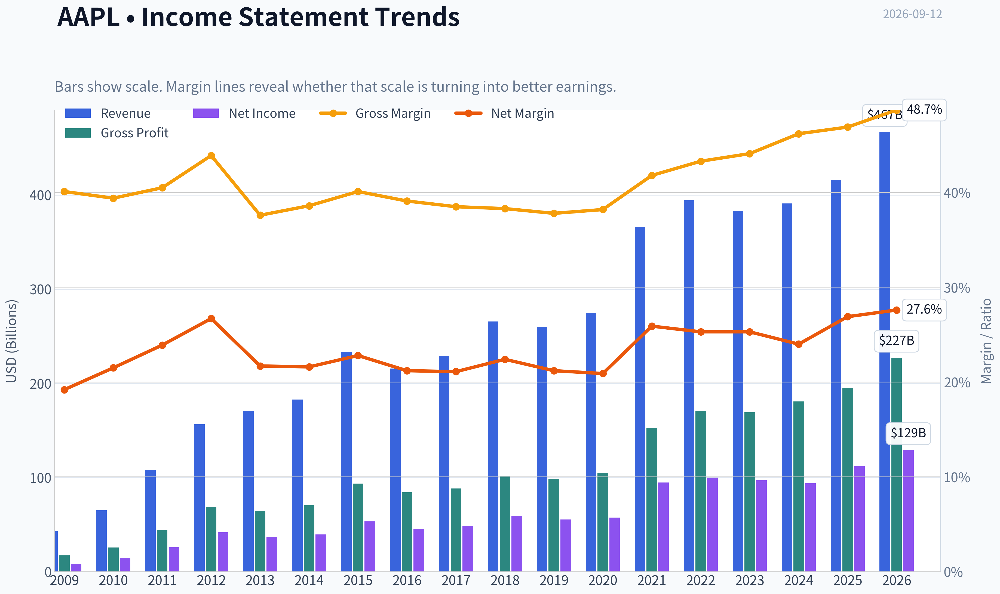
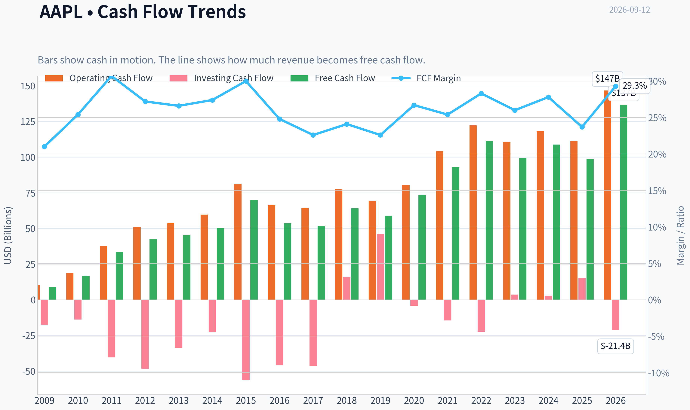
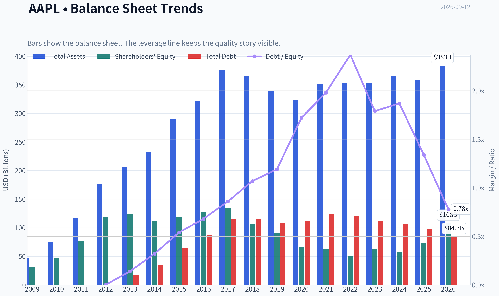
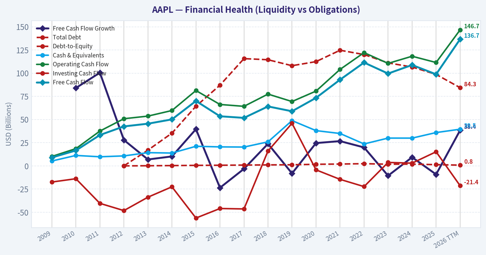
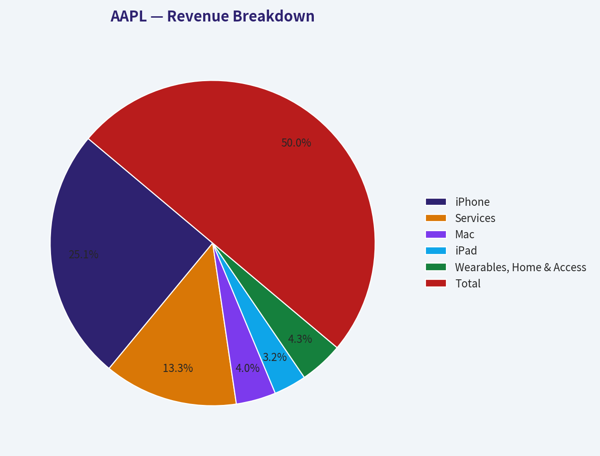
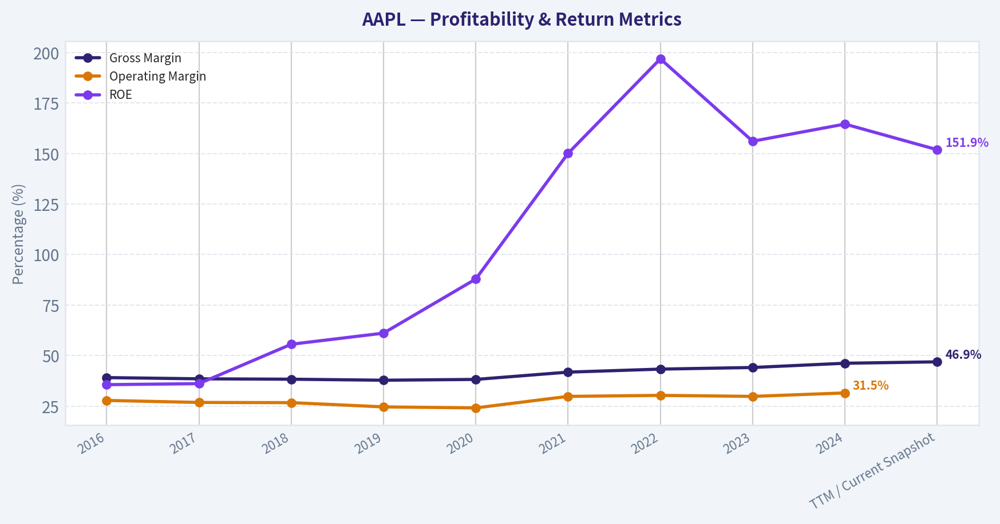
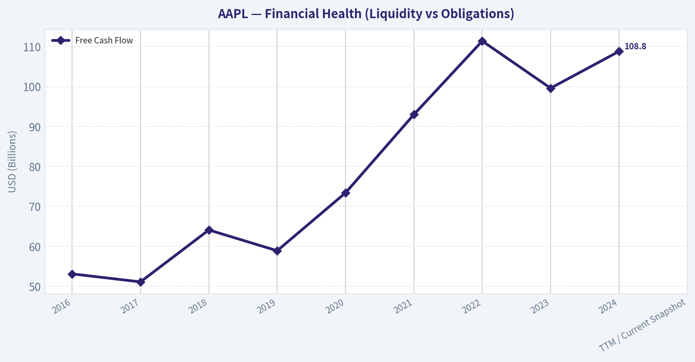
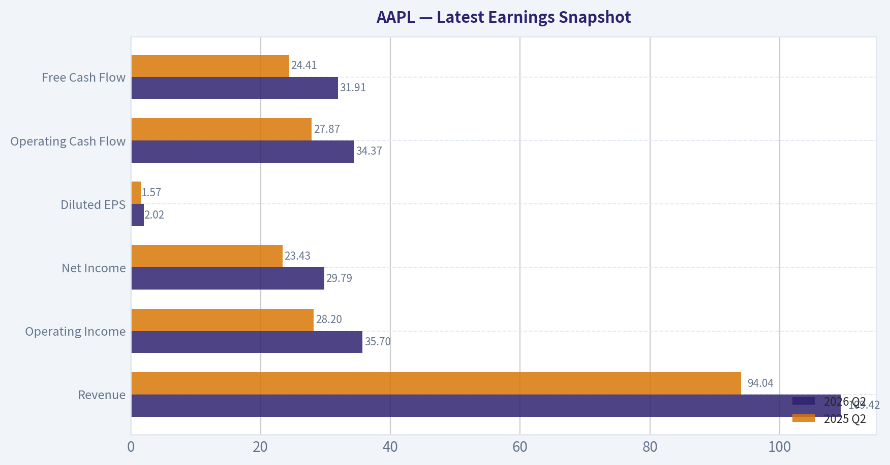
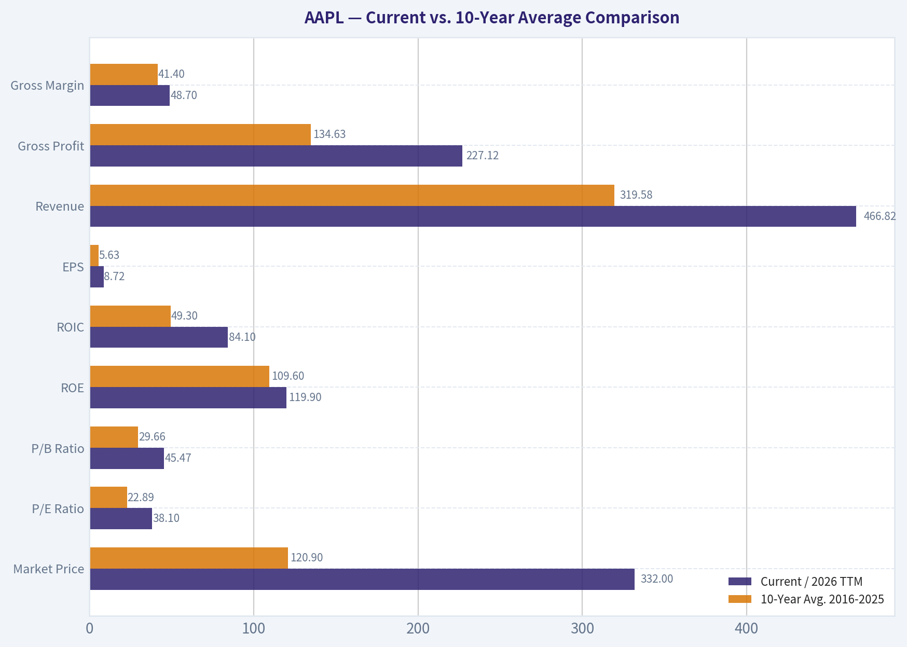
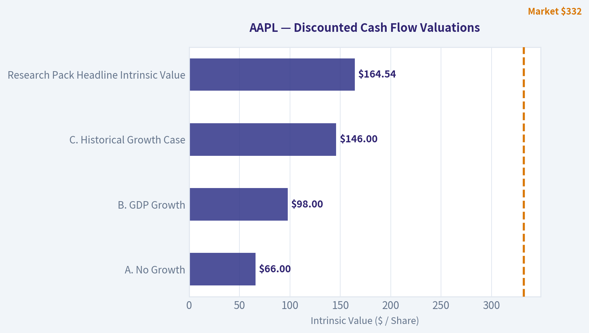

# AAPL Deep Value Intelligence

**Analysis Date:** 2026-09-12

## Critical Disclaimer

*This analysis is generated by Deep Value Intelligence, an AI-powered multi-agent investing framework. Education & research only - not financial advice, not a financial advisor.*

---

## Table of Contents

1. Intelligence Summary
2. Analyst Team Reports
   - Fundamentals Analysis
   - Intrinsic Value Analysis (Buffett)
   - Trend & Growth Analysis (Lynch/Druckenmiller/Fisher)
   - Market Technical Analysis
   - Options Market Analysis
3. Research Team Commentary
4. Value Investing Team Commentary
5. Deep Values Commentary

---

## Intelligence Summary

### Thesis + Conditions

**Core Thesis:** **EXECUTIVE SUMMARY**
Apple is the quintessential "wonderful business," boasting an elite 82.3% ROIC and an unmatched consumer ecosystem. However, at $332 (37.5x P/E, ~2% FCF yield), the stock is priced for heroic growth, leaving zero long-term margin of safety for *new* capital.

**Key Risks:**
- STANCE:** **WATCH** (Hold core position; accumulate only on tactical pullbacks).
- The Bull (Risky Analyst):** Apple's 82.3% ROIC and 151.9% ROE prove it is a cash-printing monopoly. The 37.5x multiple is a feature of its moat and the impending AI hardware upgrade supercycle. Waiting for a "bargain" means missing the train.
- The Bear (Safe Analyst):** The laws of financial physics still apply. A 37.5x P/E with a 2% FCF yield requires massive, sustained double-digit growth from a mature company just to justify the current price. Furthermore, regulatory threats to the high-margin Services moat and low-yield buybacks present real long-term capital risks.

**Confidence:** Medium

---

## Analyst Team Reports

### Fundamentals Analysis

#### Latest Earnings Snapshot

*Most recent reported quarter anchored on 2026 Q2, with prior-year comparison when available.*

| Metric | 2026 Q2 | 2025 Q2 | YoY Change |
| --- | ---: | ---: | ---: |
| Revenue | $109.42B | $94.04B | +16.4% |
| Operating Income | $35.70B | $28.20B | +26.6% |
| Net Income | $29.79B | $23.43B | +27.1% |
| Diluted EPS | $2.02 | $1.57 | +28.7% |
| Operating Cash Flow | $34.37B | $27.87B | +23.3% |
| Free Cash Flow | $31.91B | $24.41B | +30.8% |

Key Takeaways: This snapshot anchors the most recent reported quarter before the narrative analysis. It helps readers separate long-run business quality from whatever changed in the latest earnings print.

#### 17-Year Financial Metrics for AAPL

*All values below are computed deterministically from raw data - not estimated by AI.*

*Issuer profile: operating company (Technology / Consumer Electronics).*

#### 17-Year Financial Metrics
*Annual rows come from reported financial statements. The final TTM row is computed from the latest four quarters.*

| Metric | 2009 | 2010 | 2011 | 2012 | 2013 | 2014 | 2015 | 2016 | 2017 | 2018 | 2019 | 2020 | 2021 | 2022 | 2023 | 2024 | 2025 | 2026 TTM |
| --- | --- | --- | --- | --- | --- | --- | --- | --- | --- | --- | --- | --- | --- | --- | --- | --- | --- | --- |
| Market Price | $6 | $8 | $11 | $20 | $15 | $22 | $25 | $26 | $36 | $53 | $54 | $112 | $138 | $136 | $169 | $231 | $254 | $332 |
| Market Cap | $6.00B | $9.37B | $12.76B | $157.66B | $111.04B | $154.21B | $159.74B | $155.45B | $202.35B | $1.13T | $1.04T | $2.03T | $2.39T | $2.26T | $2.71T | $3.59T | $3.82T | $4.89T |
| P/E Ratio | 0.73 | 0.67 | 0.49 | 3.78 | 3.00 | 3.91 | 2.99 | 3.40 | 4.18 | 18.94 | 18.85 | 35.31 | 25.22 | 22.62 | 27.93 | 38.32 | 34.13 | 38.10 |
| P/B Ratio | 0.19 | 0.20 | 0.17 | 1.33 | 0.90 | 1.38 | 1.34 | 1.21 | 1.51 | 10.53 | 11.51 | 31.07 | 37.83 | 44.53 | 43.56 | 63.04 | 51.82 | 45.47 |
| ROE | 26.0% | 29.3% | 33.8% | 35.3% | 30.0% | 35.4% | 44.7% | 35.6% | 36.1% | 55.6% | 61.1% | 87.9% | 150.1% | 197.0% | 156.1% | 164.6% | 151.9% | 119.9% |
| ROIC | 35.2% | 39.8% | 40.0% | 40.6% | 30.7% | 29.7% | 35.3% | 24.8% | 21.5% | 27.1% | 30.9% | 39.1% | 64.5% | 66.8% | 67.2% | 67.5% | 83.2% | 84.1% |
| EPS | $7.60 | $12.69 | $23.18 | $5.31 | $4.89 | $5.68 | $8.26 | $7.60 | $8.57 | $2.82 | $2.85 | $3.18 | $5.47 | $6.11 | $6.13 | $6.08 | $7.46 | $8.72 |
| Revenue | $42.91B | $65.22B | $108.25B | $156.51B | $170.91B | $182.79B | $233.72B | $215.64B | $229.23B | $265.60B | $260.17B | $274.51B | $365.82B | $394.33B | $383.29B | $391.04B | $416.16B | $466.82B |
| Gross Profit | $17.22B | $25.68B | $43.82B | $68.66B | $64.30B | $70.54B | $93.63B | $84.26B | $88.19B | $101.84B | $98.39B | $104.96B | $152.84B | $170.78B | $169.15B | $180.68B | $195.20B | $227.12B |
| Gross Margin | 40.1% | 39.4% | 40.5% | 43.9% | 37.6% | 38.6% | 40.1% | 39.1% | 38.5% | 38.3% | 37.8% | 38.2% | 41.8% | 43.3% | 44.1% | 46.2% | 46.9% | 48.7% |
| Operating Margin | 27.4% | 28.2% | 31.2% | 35.3% | 28.7% | 28.7% | 30.5% | 27.8% | 26.8% | 26.7% | 24.6% | 24.1% | 29.8% | 30.3% | 29.8% | 31.5% | 32.0% | 33.2% |
| Net Income | $8.23B | $14.01B | $25.92B | $41.73B | $37.04B | $39.51B | $53.39B | $45.69B | $48.35B | $59.53B | $55.26B | $57.41B | $94.68B | $99.80B | $97.00B | $93.74B | $112.01B | $128.93B |
| Net Margin | 19.2% | 21.5% | 23.9% | 26.7% | 21.7% | 21.6% | 22.8% | 21.2% | 21.1% | 22.4% | 21.2% | 20.9% | 25.9% | 25.3% | 25.3% | 24.0% | 26.9% | 27.6% |
| Revenue Growth | N/A | 52.0% | 66.0% | 44.6% | 9.2% | 7.0% | 27.9% | -7.7% | 6.3% | 15.9% | -2.0% | 5.5% | 33.3% | 7.8% | -2.8% | 2.0% | 6.4% | 12.2% |
| Net Income Growth | N/A | 70.2% | 85.0% | 61.0% | -11.3% | 6.7% | 35.1% | -14.4% | 5.8% | 23.1% | -7.2% | 3.9% | 64.9% | 5.4% | -2.8% | -3.4% | 19.5% | 15.1% |
| Free Cash Flow Growth | N/A | 84.0% | 100.5% | 27.9% | 6.9% | 10.2% | 39.6% | -23.6% | -3.2% | 23.8% | -8.1% | 24.6% | 26.7% | 19.9% | -10.6% | 9.3% | -9.2% | 38.4% |
| Total Book Value | $31.64B | $47.79B | $76.61B | $118.21B | $123.55B | $111.55B | $119.36B | $128.25B | $134.05B | $107.15B | $90.49B | $65.34B | $63.09B | $50.67B | $62.15B | $56.95B | $73.73B | $107.52B |
| Total Assets | $47.50B | $75.18B | $116.37B | $176.06B | $207.00B | $231.84B | $290.35B | $321.69B | $375.32B | $365.73B | $338.52B | $323.89B | $351.00B | $352.75B | $352.58B | $364.98B | $359.24B | $383.27B |
| Total Debt | N/A | N/A | N/A | $0 | $16.96B | $35.30B | $64.33B | $87.03B | $115.68B | $114.48B | $108.05B | $112.44B | $124.72B | $120.07B | $111.09B | $106.63B | $98.66B | $84.34B |
| Debt-to-Equity | N/A | N/A | N/A | 0.00 | 0.14 | 0.32 | 0.54 | 0.68 | 0.86 | 1.07 | 1.19 | 1.72 | 1.98 | 2.37 | 1.79 | 1.87 | 1.34 | 0.78 |
| Cash & Equivalents | $5.26B | $11.26B | $9.81B | $10.75B | $14.26B | $13.84B | $21.12B | $20.48B | $20.29B | $25.91B | $48.84B | $38.02B | $34.94B | $23.65B | $29.96B | $29.94B | $35.93B | $39.54B |
| Shareholders' Equity | $31.64B | $47.79B | $76.61B | $118.21B | $123.55B | $111.55B | $119.36B | $128.25B | $134.05B | $107.15B | $90.49B | $65.34B | $63.09B | $50.67B | $62.15B | $56.95B | $73.73B | $107.52B |
| Operating Cash Flow | $10.16B | $18.59B | $37.53B | $50.86B | $53.67B | $59.71B | $81.27B | $66.23B | $64.22B | $77.43B | $69.39B | $80.67B | $104.04B | $122.15B | $110.54B | $118.25B | $111.48B | $146.72B |
| Investing Cash Flow | $-17.43B | $-13.85B | $-40.42B | $-48.23B | $-33.77B | $-22.58B | $-56.27B | $-45.98B | $-46.45B | $16.07B | $45.90B | $-4.29B | $-14.54B | $-22.35B | $3.71B | $2.94B | $15.20B | $-21.40B |
| Free Cash Flow | $9.02B | $16.59B | $33.27B | $42.56B | $45.50B | $50.14B | $70.02B | $53.50B | $51.77B | $64.12B | $58.90B | $73.36B | $92.95B | $111.44B | $99.58B | $108.81B | $98.77B | $136.68B |
| FCF Margin | 21.0% | 25.4% | 30.7% | 27.2% | 26.6% | 27.4% | 30.0% | 24.8% | 22.6% | 24.1% | 22.6% | 26.7% | 25.4% | 28.3% | 26.0% | 27.8% | 23.7% | 29.3% |
| Dividends / Share | $0.00 | $0.00 | $0.00 | $0.00 | $0.00 | $0.00 | $0.00 | $0.00 | $0.00 | $0.00 | $0.00 | $0.00 | $0.00 | $0.91 | $0.95 | $0.99 | $1.03 | $1.06 |

#### Profitability Metrics
- Return on Equity (ROE): 151.9%
- Return on Invested Capital (ROIC): 82.3%
- Return on Assets (ROA): 31.2%
- Gross Margin: 46.9%
- Operating Margin: 32.0%
- Net Profit Margin: 26.9%

#### Liquidity Metrics
- Current Ratio: 0.89
- Quick Ratio: 0.57

#### Leverage Metrics
- Debt-to-Equity Ratio: 1.34
- Interest Coverage Ratio: N/A
- Net Debt: $62.72B

#### Growth Metrics (Year-over-Year)
- Revenue Growth: 6.4%
- Net Income Growth: 19.5%
- Free Cash Flow Growth: -9.2%
- Revenue CAGR (3-Year): 1.8%
- Revenue CAGR (5-Year): 8.7%

#### Valuation Metrics
- P/E Ratio (TTM): 37.46
- Forward P/E: 34.70
- Price-to-Book: 45.15
- Price-to-Sales: 10.39
- PEG Ratio: 2.48
- EV/EBITDA: 29.00
- Free Cash Flow Yield: 2.0%
- Earnings Yield: 2.7%

#### Owner Earnings (Buffett Method, Code-Computed)
- Net Income: $112.01B
- + Depreciation & Amortization: $11.70B
- - Capital Expenditures: $-12.71B
- - Working Capital Changes: $-25.00B
- = **Owner Earnings: $137.01B**

#### Intrinsic Value (Code-Computed)
- Current Price: $332
- **Headline Intrinsic Value (business-model routed): $209**
  Business model: operating company - weighted blend [Damodaran FCFF + reverse-DCF fair + owner-earnings DCF] (operating_company)
  Model spread (min-max across DCFs): $197 - $244
  Margin of safety vs. price (headline): -59.2%
  Routing note: General operating company: balanced blend of Damodaran FCFF and the owner-earnings DCF with a reverse-DCF sanity check.
- Buffett Method (Owner Earnings):
  Conservative: $125
  Average: $244
  Optimistic: $659
- Cash Flow Method (FCF):
  Conservative: $86
  Average: $204
  Optimistic: $273
- Damodaran FCFF (WACC + margins + reinvestment):
  Conservative: $112
  Average: $197
  Optimistic: $420
  Monte Carlo band (P10-P90): $142 - $321 (median $209)
  P(intrinsic value > price): 8.6%
- Reverse-DCF: price implies ~29.3%/yr owner-earnings growth for 10y; trailing 3y was 11.4%, 5y 22.3%.

#### Piotroski F-Score: 8/9
- Positive Net Income: PASS
- Positive Operating Cash Flow: PASS
- ROA Improvement: PASS
- Cash Flow > Net Income: FAIL
- Decreasing Debt: PASS
- Improving Current Ratio: PASS
- No Dilution: PASS
- Improving Gross Margin: PASS
- Improving Asset Turnover: PASS

ANALYST STANCE: **WATCH**

#### AAPL Buffett-Style Fundamental Analysis - Canonical Dataset Through 2026 TTM

Apple remains one of the highest-quality consumer technology franchises in the world: exceptional brand power, ecosystem lock-in, massive recurring services economics, and unusually strong returns on capital. However, the Buffett question is not "Is this a wonderful business?" - it is "Is this wonderful business available at a sensible price?" At a current deterministic market price of **$332**, market cap of about **$4.89T**, and TTM P/E of **38.1x**, Apple is priced for unusually strong future owner-earnings growth.

The canonical model-based intrinsic value in the deterministic pack is **$209 per share**, with a model spread of roughly **$197-$244** across core DCF approaches, versus the current price of **$332**. That implies a materially negative margin of safety. Apple is a business to admire, but at this valuation it is not a classic Buffett-style bargain.

---

#### Current vs. 10-Year Average Comparison

| Metric | Current / 2026 TTM | 10-Year Avg. 2016-2025 | Current Standing vs. History | Buffett-Style Interpretation |
|---|---:|---:|---|---|
| Market Price | $332 | $120.90 | Far above average | Share price has compounded faster than fundamentals; valuation discipline matters. |
| Market Cap | $4.89T | $1.93T | Far above average | Apple's scale is extraordinary, but future growth must now move a nearly $5T base. |
| P/E Ratio | 38.10x | 22.89x | Meaningfully elevated | Earnings quality is excellent, but current multiple embeds high expectations. |
| P/B Ratio | 45.47x | 29.66x | Elevated, but low usefulness | For Apple, P/B is not a useful valuation anchor because buybacks and intangibles distort book equity. |
| ROE | 119.9% | 109.6% | Above average but below recent peak | Very high ROE reflects both profitability and a buyback-shrunken equity base. |
| ROIC | 84.1% | 49.3% | Exceptionally above average | This is the strongest quality signal: Apple generates enormous returns on invested capital. |
| EPS | $8.72 | $5.63 | Well above average | EPS has benefited from profit growth and share repurchases. |
| Revenue | $466.82B | $319.58B | Well above average | Revenue base is much larger, but growth rates are naturally slowing at scale. |
| Gross Profit | $227.12B | $134.63B | Well above average | Services mix and premium pricing have structurally lifted gross profit. |
| Gross Margin | 48.7% | 41.4% | Record-like strength | Margin expansion is one of Apple's most important recent positives. |
| Operating Margin | 33.2% | 28.3% | Above average | Operating discipline and services contribution are improving profitability. |
| Net Income | $128.93B | $76.35B | Far above average | Apple remains a massive earnings machine. |
| Net Margin | 27.6% | 23.4% | Above average | Profit quality is excellent and currently stronger than most of the past decade. |
| Revenue Growth | 12.2% TTM | 6.5% | Above average | TTM growth is strong, though latest annual revenue growth was more moderate at 6.4%. |
| Net Income Growth | 15.1% TTM | 9.5% | Above average | Earnings growth is currently stronger than the decade average. |
| Free Cash Flow Growth | 38.4% TTM | 5.0% | Far above average | TTM rebound is impressive, but annual FCF growth has been uneven. |
| Total Book Value | $107.52B | $83.19B | Above average | Book value has recovered, but remains a poor measure of Apple's economic value. |
| Total Assets | $383.27B | $350.57B | Slightly above average | Asset base is stable relative to the size of earnings generated. |
| Total Debt | $84.34B | $109.89B | Below average | Debt has been reduced from prior highs, improving balance-sheet flexibility. |
| Debt-to-Equity | 0.78x | 1.49x | Better than average | Improved, but equity-based ratios are distorted by buybacks. |
| Cash & Equivalents | $39.54B | $30.80B | Above average | Strong liquidity, though Apple also carries meaningful debt. |
| Shareholders' Equity | $107.52B | $83.19B | Above average | Equity has recovered from buyback-driven compression. |
| Free Cash Flow | $136.68B | $81.32B | Far above average | Apple's core value lies in immense recurring free cash flow. |
| Dividends / Share | $1.06 | $0.39 | Above average | Dividend is growing but remains secondary to buybacks. |

Key Takeaways: Apple's profitability and cash generation are currently stronger than its 10-year average across nearly every operating measure. The issue is valuation: the market price, market cap, and P/E ratio have expanded even more aggressively than the business. Apple's ROIC is exceptional, but at 38x earnings and about a 2% FCF yield, the stock requires continued high growth to justify today's price.

---

#### Market Metrics Interpretation

Apple's **$332 market price** and **$4.89T market cap** indicate a business priced as one of the most dominant global franchises ever created. That is not unreasonable from a quality perspective, but it raises the bar for future returns. At nearly $5T in equity value, even excellent execution may translate into only moderate shareholder returns if the starting valuation is too high.

The **P/E ratio of 38.1x** is materially above Apple's 10-year average of roughly **22.9x**. Historically, Apple was often valued as a premium hardware-plus-services compounder, but the current multiple prices it more like a durable high-growth platform. For Buffett-style investors, that is a warning: excellent companies can still be poor investments when the purchase price assumes too much perfection.

The **P/B ratio of 45.5x** should not be read mechanically as "expensive because book is low." For Apple, book value is not a meaningful estimate of intrinsic value because the company is asset-light relative to earnings power, owns enormous intangible ecosystem value, and has used large buybacks that compress shareholders' equity. Apple should be valued primarily on owner earnings and free cash flow, not book value.

---

#### Profitability and Business Quality

Apple's profitability is outstanding. TTM **gross margin of 48.7%**, **operating margin of 33.2%**, and **net margin of 27.6%** are all above the 10-year averages. This confirms that Apple is not simply growing revenue; it is improving the quality of its revenue mix, particularly through higher-margin Services.

The most Buffett-relevant metric is **ROIC**, and Apple's current **84.1% ROIC** is extraordinary versus a 10-year average of about **49.3%**. This suggests a business with powerful intangible assets, pricing power, efficient operations, and limited need for incremental tangible capital. Apple converts brand loyalty, platform control, and installed-base monetization into very high incremental returns.

ROE is also extremely high at **119.9%**, but it should be interpreted cautiously. Apple's ROE has been inflated by years of share repurchases that reduced book equity. The more reliable conclusion is not simply "ROE is high," but that Apple's combination of high margins, strong turnover, ecosystem control, and disciplined capital allocation creates exceptional shareholder economics.

---

#### Growth Metrics Interpretation

Apple's current TTM **revenue growth of 12.2%** is above the 10-year average of **6.5%**, while current TTM **net income growth of 15.1%** is also above the historical average of **9.5%**. This is encouraging and shows that Apple still has growth levers despite its enormous scale.

However, historical growth has been cyclical. Revenue growth ranged from strong iPhone-cycle years to contractions in 2016, 2019, and 2023. Free cash flow growth has also been uneven, with several negative years despite the long-term upward trend. The Buffett conclusion is that Apple's earnings are highly predictable over a multi-year horizon, but annual growth is not perfectly smooth because hardware cycles, product timing, foreign exchange, China demand, and replacement cycles matter.

The key valuation problem is that the current price implies **about 29.3% annual owner-earnings growth for 10 years**, according to the deterministic reverse-DCF. That is far above Apple's recent 3-year owner-earnings growth of **11.4%** and difficult to sustain from such a large revenue and earnings base.

---

#### Balance Sheet and Financial Strength

Apple's balance sheet remains strong, but it is no longer the debt-free fortress it was in the early 2010s. TTM total debt is **$84.34B**, down from the 10-year average of about **$109.89B**, which is a positive trend. Cash and equivalents are **$39.54B**, above the decade average of about **$30.80B**, though the company still has net debt of approximately **$62.72B** in the deterministic pack.

The debt-to-equity ratio of **0.78x** looks better than the 10-year average of **1.49x**, but equity-based leverage metrics are distorted by Apple's buyback program. A better Buffett-style view is that Apple's debt is manageable because free cash flow is immense: TTM FCF of **$136.68B** exceeds total debt. Apple could materially reduce leverage quickly if management chose to prioritize debt repayment.

The current ratio of **0.89** and quick ratio of **0.57** are not central valuation metrics for Apple. Apple has extraordinary cash generation, supplier power, and access to capital markets, so short-term liquidity ratios are less informative than for a weak cyclical business. Still, these ratios remind investors that Apple runs a highly optimized balance sheet rather than an overly conservative one.

---

#### Cash Flow and Capital Allocation

Apple's TTM free cash flow of **$136.68B** is far above the 10-year average of **$81.32B**. This is the core of the Apple investment case. The company consistently converts earnings into cash, requires relatively modest capital expenditure compared with its earnings base, and has used that cash to fund buybacks, dividends, R&D, and ecosystem expansion.

Dividends per share are **$1.06**, modest relative to EPS of **$8.72**. Apple's dividend policy remains conservative, with most shareholder returns coming through repurchases rather than dividends. This is rational when shares are undervalued or fairly valued, but less compelling when the stock trades above intrinsic value. At current prices, buybacks create less value per dollar than they did during earlier periods when Apple traded at much lower earnings multiples.

Piotroski F-Score is **8/9**, indicating strong fundamental quality. The only failure is cash flow not exceeding net income in the specific test period, but overall profitability, debt reduction, margin improvement, and asset turnover remain favorable.

---

#### Revenue Breakdown

| Revenue Source | Amount ($B) | % of Total |
|---|---:|---:|
| iPhone | $209.0 | 50.2% |
| Services | $111.0 | 26.7% |
| Mac | $33.0 | 7.9% |
| iPad | $27.0 | 6.5% |
| Wearables, Home & Accessories | $36.2 | 8.7% |
| Total | $416.2 | 100.0% |

Key Takeaways: Apple remains heavily dependent on the iPhone, which represents about half of total revenue, but Services has become the second engine of the business at more than one-quarter of sales. Services is strategically important because it is higher margin, more recurring, and strengthens ecosystem lock-in. The major opportunity is continued monetization of the installed base; the major risk is that hardware upgrade cycles still drive much of Apple's revenue volatility.

---

#### Economic Moat Assessment

Apple has one of the strongest consumer moats in public markets. Its moat is built on brand trust, hardware-software integration, switching costs, developer ecosystem depth, services attachment, retail distribution, privacy positioning, and a massive installed base. Customers do not merely buy a device; they buy into an ecosystem of iPhone, Mac, iPad, Watch, AirPods, App Store, iCloud, Apple Pay, subscriptions, messaging, and cross-device convenience.

The Services segment strengthens the moat because it turns hardware ownership into recurring monetization. This improves lifetime customer value and reduces the company's dependence on any single product launch. Apple's gross margin expansion from a 10-year average of **41.4%** to **48.7% TTM** suggests the moat is translating into better economics, not just brand prestige.

The main moat risk is technological disruption. Apple has been perceived as lagging some mega-cap peers in generative AI infrastructure and services. If AI becomes the primary consumer interface layer and Apple fails to control that experience, ecosystem power could weaken. On the other hand, if Apple successfully embeds AI into its devices while protecting privacy and user experience, the next upgrade cycle could reinforce the moat.

---

#### Management Performance and Capital Allocation

Management has delivered exceptional long-term results. Apple has grown revenue, expanded margins, reduced share count through buybacks, maintained a conservative dividend, and produced extremely high returns on invested capital. The company's capital allocation has generally been shareholder-friendly.

However, valuation affects capital allocation quality. Buybacks at low or moderate multiples are highly accretive; buybacks at very high multiples are less attractive. With Apple trading at roughly **38x earnings** and a low FCF yield, repurchases are no longer obviously value-creating unless future growth materially exceeds conservative assumptions.

Recent guru tracking shows Berkshire Hathaway still held a large Apple position as of the latest disclosed 13F, but investors should remember that 13F filings lag and do not necessarily represent Buffett's current view of valuation. Berkshire's large embedded gain and tax considerations may also affect hold-versus-sell decisions.

---

#### Buffett-Style Owner Earnings DCF Valuation

| Scenario | Owner Earnings Base | Explicit Growth Assumption | Discount Rate | Terminal Growth | PV of Explicit Owner Earnings | PV of Terminal Value | Net Debt Adjustment | Equity Value | Fair Value / Share |
|---|---:|---|---:|---:|---:|---:|---:|---:|---:|
| Conservative | $137.01B | 3% annually for 10 years | 10.0% | 2.5% | $972B | $970B | -$62.7B | $1.88T | $128 |
| Average / Base Case | $137.01B | 10% initially, fading to 6% by year 10 | 10.0% | 2.5% | $1.31T | $1.62T | -$62.7B | $2.86T | $194 |
| Optimistic | $137.01B | 22% initially, fading to 7% by year 10 | 10.0% | 2.5% | $1.85T | $2.56T | -$62.7B | $4.35T | $295 |
| Deterministic Pack Headline IV | N/A | Weighted model blend | N/A | N/A | N/A | N/A | N/A | N/A | $209 |

Key Takeaways: Even under an optimistic hand-built owner-earnings DCF, Apple's fair value is below the current market price of $332. The deterministic pack's headline intrinsic value of $209 also indicates a negative margin of safety. The market is effectively pricing Apple as if very high owner-earnings growth can continue for a decade, which is a demanding assumption for a company already generating more than $450B in TTM revenue.

DCF calculation framework:

| Calculation Step | Formula / Input |
|---|---|
| Starting Owner Earnings | Net income + D&A - capex - working capital changes = **$137.01B** |
| Shares Outstanding Estimate | Market cap / price = $4.89T / $332 ~ **14.73B shares** |
| Discount Rate | **10.0%**, consistent with Buffett-style required return discipline |
| Terminal Growth | **2.5%**, below discount rate and broadly aligned with long-run nominal GDP logic |
| Net Debt Adjustment | Approx. **$62.72B** subtracted from enterprise/equity bridge |
| Per-Share Value | Equity value / 14.73B shares |

Key Takeaways: The valuation is highly sensitive to owner-earnings growth assumptions because Apple already generates enormous cash flow. A modest-growth Apple is worth far less than today's stock price, while a high-growth Apple can justify more, but still requires demanding assumptions. The reverse-DCF signal is the clearest warning: the current price implies growth materially above recent realized owner-earnings growth.

The deterministic pack also provides useful model cross-checks:
- **Buffett Method Owner Earnings:** Conservative **$125**, Average **$244**, Optimistic **$659**.
- **Cash Flow Method:** Conservative **$86**, Average **$204**, Optimistic **$273**.
- **Damodaran FCFF:** Conservative **$112**, Average **$197**, Optimistic **$420**.
- **Monte Carlo Band:** P10-P90 of **$142-$321**, median **$209**.
- **Probability intrinsic value exceeds current price:** only **8.6%**.
- **Reverse DCF:** current price implies roughly **29.3% annual owner-earnings growth for 10 years**.

The appropriate Buffett-style conclusion is that intrinsic value is probably below the current market price unless one assumes a very strong AI/device/services supercycle and sustained margin expansion.

---

#### Key Investment Insights, Red Flags, and Opportunities

| Category | Key Points | Investment Implication |
|---|---|---|
| Business Quality | Exceptional ROIC, strong margins, global brand, sticky ecosystem | Apple remains a wonderful business. |
| Valuation | P/E of 38.1x versus 10-year average of 22.9x | Current price embeds aggressive expectations. |
| Cash Flow | TTM FCF of $136.68B versus 10-year average of $81.32B | Cash generation is elite and supports dividends, buybacks, and innovation. |
| Moat | Hardware-software-services ecosystem creates switching costs | Durable competitive advantage remains intact. |
| Growth | TTM revenue and net income growth are above historical averages | Current fundamentals are strong, but sustainability matters. |
| Margin Trend | Gross, operating, and net margins are above historical averages | Services mix and pricing power are improving economics. |
| Balance Sheet | Debt is declining and FCF exceeds total debt | Financial strength is not a major concern. |
| P/B Ratio | Very high, but not a useful Apple valuation tool | Use cash-flow-based valuation instead of book multiples. |
| Red Flag | Reverse DCF implies around 29.3% owner-earnings growth for 10 years | Market expectations appear too demanding. |
| Red Flag | iPhone remains about half of revenue | Hardware cycles and replacement rates still matter. |
| Red Flag | Regulatory, App Store, China, and AI execution risks | Multiple pressure could occur if growth disappoints. |
| Opportunity | Services growth, AI-enabled devices, foldable cycle, installed-base monetization | Upside exists if Apple reignites a major upgrade cycle. |

Key Takeaways: Apple's investment case is strongest on quality and weakest on valuation. The company has a durable moat, improving margins, and extraordinary cash generation, but the stock price already discounts a very favorable future. For long-term investors, the biggest opportunity is an AI- or device-led upgrade cycle; the biggest risk is paying too high a multiple for growth that normalizes.

---

#### Final Investment Stance: WATCH

Apple is a **WATCH**, not an ADVOCATE, at the current price.

From a Buffett perspective, Apple clearly passes the business-quality test: it has a durable moat, predictable long-term earnings power, high ROIC, strong cash generation, and rational management. However, it does not pass the margin-of-safety test at **$332**. The deterministic headline intrinsic value is **$209**, and even an optimistic hand DCF produces a value below the current price unless very aggressive growth assumptions are used.

A more attractive Buffett-style entry point would require either a meaningful price decline, continued owner-earnings growth that raises intrinsic value substantially, or evidence that Apple can sustain a new high-growth cycle through AI, Services, and device upgrades. Existing long-term holders may reasonably continue to hold because of quality and tax considerations, but new capital should be disciplined.

| Final Summary Item | Assessment |
|---|---|
| Business Quality | Excellent |
| Economic Moat | Very strong |
| Financial Strength | Strong |
| Earnings Predictability | High over multi-year periods, moderate cyclicality year to year |
| Management / Capital Allocation | Strong, though buybacks are less attractive at high valuation |
| Current Valuation | Expensive versus history and DCF value |
| Intrinsic Value Anchor | Deterministic headline value around **$209/share** |
| Current Price | **$332/share** |
| Margin of Safety | Negative |
| Buffett-Style Action | **WATCH** |
| Better Action Point | Reassess if price approaches intrinsic value range or fundamentals accelerate materially |

Key Takeaways: Apple is a superior company trading at a demanding price. The stock deserves a premium, but the current premium appears too large relative to owner-earnings-based intrinsic value. The prudent Buffett-style stance is to watch patiently rather than chase.

#### Fundamental Visuals

This graph tracks the profitability and return metrics (ROE, ROIC, Margins) of **AAPL** over the past decade, highlighting capital efficiency trends.

This chart illustrates the financial health of **AAPL** over the last 10 years, mapping cash equivalents and free cash flow against total obligations (Debt).

This breakdown chart from <em>Revenue Breakdown</em> shows the proportional composition for **AAPL** - useful for understanding what drives or risks the business.

This graph tracks the profitability and return metrics (ROE, ROIC, Margins) of **AAPL** over the past decade, highlighting capital efficiency trends.

This chart illustrates the financial health of **AAPL** over the last 10 years, mapping cash equivalents and free cash flow against total obligations (Debt).

---

### Intrinsic Value Analysis (Buffett)

> *Following Warren Buffett's value investing philosophy: Circle of Competence, Economic Moat, Management Quality, and Margin of Safety.*

#### Intrinsic Value Snapshot

Price is what you pay. Intrinsic value is what the business may be worth based on the cash it can create for owners over time. We show a range, not one magic number.

- Current Price: $332.27
- Value Range (conservative to optimistic across both DCF methods): $76.60 to $307.51

##### Owner Earnings (Buffett Method)
- Net Income: $112,010,000,000.00
- Depreciation & Amortization: $11,698,000,000.00
- Capital Expenditures: $-12,715,000,000.00
- Working Capital Changes: $-25,000,000,000.00
- Owner Earnings: $137,010,000,000.00

##### Intrinsic Value
###### Buffett Method
Uses owner earnings. Stricter, and usually more conservative.
- Conservative: $102.68
- Average: $177.60
- Optimistic: $307.51
- Discount Rate: 10.0%

###### Cash Flow Method
Uses free cash flow. Better for companies spending heavily today to grow tomorrow.
- Conservative: $76.60
- Average: $96.86
- Optimistic: $112.78
- Discount Rate: 10.0%

ANALYST STANCE: **WATCH**

#### Apple Inc. Buffett-Style Investment Review - AAPL

Apple is one of the highest-quality businesses in the public market: a global consumer technology franchise with extraordinary brand power, ecosystem lock-in, services monetization, massive free cash flow, and exceptional returns on capital. The issue is not business quality. The issue is price: at **$332 per share**, Apple trades at about **37.5x earnings**, a **2.0% free-cash-flow yield**, and the research pack's headline intrinsic value estimate of **$164.54** implies the stock is priced at roughly **double conservative value**.

---

#### 1. Factor Scorecard

| Factor | Score | Evidence |
|---|---:|---|
| 1. Circle of Competence & Business Simplicity | 4.5 / 5 | Apple sells premium devices, services, software, and ecosystem access. The model is easy to understand: monetize a loyal installed base through hardware replacement cycles and recurring services. Predictability is high, though AI execution and hardware innovation cycles matter. |
| 2. Moat Test | 4.5 / 5 | Wide and stable moat from brand, ecosystem switching costs, proprietary hardware/software integration, services attachment, and scale. Gross margin is **46.9%**, showing pricing power. |
| 3. Management Quality & Capital Allocation | 3.5 / 5 | Tim Cook created enormous per-share value through operational discipline, services growth, and buybacks. The current transition to John Ternus introduces some execution uncertainty, especially around AI competitiveness. |
| 4. Industry Structure | 3.5 / 5 | Smartphones are mature and competitive, but Apple occupies the premium-profit pool. Services improve recurring economics. The business remains exposed to device cycles, regulation, China supply/demand risk, and AI platform shifts. |
| Gate 5: Quality / Solvency Hard Floor | Not tripped | Apple has enormous earnings power, strong free cash flow, manageable debt, and no sign of financial distress. |

**Key Takeaways:** Apple passes the Buffett quality tests with ease: it is understandable, profitable, cash-generative, and protected by a durable ecosystem. The one major concern is not solvency or business quality, but valuation. At today's price, investors are being asked to pay a very full price for already exceptional economics.

---

#### 2. Moat Analysis

| Moat Source | Assessment | Evidence |
|---|---|---|
| Brand / Intangible Assets | Very strong | Apple can charge premium prices and still retain loyal customers. The iPhone, Mac, iPad, Watch, AirPods, and Services ecosystem carry emotional and functional brand value. |
| Switching Costs | Very strong | Users accumulate apps, photos, messages, subscriptions, accessories, iCloud storage, Apple Pay habits, and device interoperability. Leaving the ecosystem is inconvenient. |
| Cost Advantages | Moderate to strong | Apple benefits from unmatched purchasing scale, supplier influence, custom silicon, retail scale, and global distribution. However, it does not compete primarily on low cost. |
| Network Effects | Moderate | iMessage, FaceTime, AirDrop, app developer economics, family sharing, and the App Store create network-like reinforcement, though this is not a pure network-effect business. |
| Moat Rating | Wide & Stable | The moat remains powerful, but not obviously widening at the current valuation unless AI and services deepen the ecosystem materially. |

**Key Takeaways:** Apple's moat is real and durable. The strongest elements are brand, customer captivity, and ecosystem integration. The main risk is that the next platform shift, especially AI, could reduce Apple's control over the user interface if management fails to execute.

---

#### 3. Management Quality Assessment

| Area | Assessment |
|---|---|
| Owner Orientation | Historically strong. Apple has returned enormous capital through buybacks and dividends while still funding product development and services expansion. |
| Candor & Accounting | Generally conservative and transparent for a mega-cap technology company. Financial statements are straightforward relative to most platform peers. |
| Capital Allocation | Strong historically, especially buybacks when valuation was more reasonable. At today's valuation, repurchases are less obviously value-accretive. |
| Leadership Transition | Watch item. Tim Cook's move to executive chairman and John Ternus becoming CEO may preserve hardware excellence, but Apple still has to prove AI leadership. |
| Overall Score | 3.5 / 5 |

**Key Takeaways:** Apple's management record is excellent, but the bar is now much higher. Capital allocation remains disciplined, yet buybacks at elevated multiples create less value than they did when the stock was cheaper. The CEO transition and AI strategy deserve close monitoring.

---

#### 4. Financial Summary

| Fiscal Year / Period | Revenue ($B) | Gross Margin | Operating Margin | Net Income ($B) | Free Cash Flow ($B) | ROE |
|---|---:|---:|---:|---:|---:|---:|
| 2016 | 215.6 | 39.1% | 27.8% | 45.7 | 53.1 | 35.6% |
| 2017 | 229.2 | 38.5% | 26.8% | 48.4 | 51.1 | 36.1% |
| 2018 | 265.6 | 38.3% | 26.7% | 59.5 | 64.1 | 55.6% |
| 2019 | 260.2 | 37.8% | 24.6% | 55.3 | 58.9 | 61.1% |
| 2020 | 274.5 | 38.2% | 24.1% | 57.4 | 73.4 | 87.9% |
| 2021 | 365.8 | 41.8% | 29.8% | 94.7 | 93.0 | 150.1% |
| 2022 | 394.3 | 43.3% | 30.3% | 99.8 | 111.4 | 196.9% |
| 2023 | 383.3 | 44.1% | 29.8% | 97.0 | 99.6 | 156.1% |
| 2024 | 391.0 | 46.2% | 31.5% | 93.7 | 108.8 | 164.6% |
| TTM / Current Snapshot | ~416.1 | 46.9% | Strong | ~129.5 | ~97.0 | 151.9% |

**Key Takeaways:** Apple's revenue growth has moderated, but margins have improved materially as services and premium mix expanded. Free cash flow remains enormous, generally around or above $100 billion annually. ROE is extremely high, partly because Apple has aggressively reduced its equity base through buybacks, so ROIC and free cash flow are better indicators of economic quality than book-value metrics.

---

#### 5. Owner Earnings Calculation

Using free cash flow as a conservative owner-earnings proxy is appropriate for Apple because the business is capital-light relative to its earnings power, and total capex is already deducted.

| Owner Earnings Bridge | Amount |
|---|---:|
| Net Income, TTM estimate | ~$129.5B |
| Add: Depreciation & amortization | ~+$12.0B |
| Less: Maintenance capex proxy, using total capex | ~-$10.0B |
| Less: Working capital / cash conversion adjustments | ~-$34.5B |
| Estimated Owner Earnings | **~$97.0B** |
| Shares Outstanding, implied | ~14.6B |
| Owner Earnings Per Share | **~$6.64** |

**Key Takeaways:** Apple converts accounting earnings into very large cash earnings, though recent free cash flow is below net income. Using total capex as maintenance capex is intentionally conservative. At the current share price, the owner-earnings yield is only about **2.0%**, which is low even for a wonderful business.

---

#### 6. Three-Scenario DCF Valuation

Base owner earnings per share: **~$6.64**
Discount rate: **10%**

| Scenario | Assumption | Intrinsic Value Estimate |
|---|---|---:|
| A. No Growth | Owner earnings capitalized at 10% | **$66** |
| B. GDP Growth | 3% perpetual growth | **$98** |
| C. Historical Growth Case | 8.6% growth for 10 years, then 3% terminal growth | **$146** |
| Research Pack Headline Intrinsic Value | Business-model-routed blended value | **$164.54** |
| Research Pack 3-Model Range | Owner earnings / FCF / Damodaran FCFF | **$177.60 / $96.86 / $112.31** |

**Key Takeaways:** Even giving Apple credit for continued growth, conservative intrinsic value estimates are well below the current market price. The higher owner-earnings DCF estimate still does not support $332 per share. For Apple to be attractive at today's price, future growth would need to be much stronger than recent cash-flow growth.

---

#### 7. Margin of Safety Analysis

| Metric | Value |
|---|---:|
| Current Price | **$332** |
| Headline Intrinsic Value | **$164.54** |
| Margin of Safety vs. Headline Value | **-101.9%** |
| P/E Ratio | **37.5x** |
| Free Cash Flow Yield | **2.0%** |
| Reverse-DCF Implied Growth | **~29.3% annually for 10 years** |
| Trailing 3-Year Growth Reference | **~11.4%** |

**Key Takeaways:** Apple is priced as if it can compound at a rate far above its recent growth profile. A wonderful business can deserve a premium multiple, but the current valuation leaves little room for disappointment. The reverse-DCF is the clearest warning sign: the market price implies growth assumptions that look heroic for a company already approaching five trillion dollars in market value.

---

#### 8. Final Buffett Scorecard

| Criterion | Weight | Score | Weighted Contribution |
|---|---:|---:|---:|
| Moat Width & Durability | 25% | 4.5 | 1.13 |
| Valuation / Margin of Safety | 20% | 0.5 | 0.10 |
| Capital Returns - ROIC vs. WACC | 15% | 4.5 | 0.68 |
| Business Understanding & Predictability | 12% | 4.5 | 0.54 |
| Management Quality & Capital Allocation | 12% | 3.5 | 0.42 |
| Reinvestment Runway | 8% | 3.0 | 0.24 |
| Balance Sheet Strength | 4% | 4.0 | 0.16 |
| Industry Structure | 4% | 3.5 | 0.14 |
| Total | 100% |  | **3.40 / 5** |

**Key Takeaways:** Apple scores exceptionally well on moat, returns on capital, predictability, and balance-sheet quality. The final score is pulled down almost entirely by valuation. This is the classic Buffett distinction between a wonderful company and a wonderful investment at the current price.

---

#### 9. Investment Stance

| Stance | Conviction | Rationale |
|---|---|---|
| **WATCH** | High | Apple is a world-class compounder, but the current price embeds too much optimism. The business deserves admiration; the stock does not currently offer an adequate margin of safety. |

Apple remains a company to own at the right price, not a business to dismiss. A more attractive entry point would likely require either a material price decline or clear evidence that services, AI, and new devices can reaccelerate durable per-share owner-earnings growth. At **$332**, the prudent Buffett-style stance is to wait.
#### Valuation Bridge

This bridge places the current market price beside each intrinsic value lens so readers can see whether upside depends on one method or shows up across several methods.

| Scenario | Intrinsic Value / Share |
| --- | ---: |
| Buffett Method | $177.60 |
| Cash Flow Method | $96.86 |
| Damodaran Method | $112.31 |
| Current Price | $332.27 |

#### Key Takeaways

If one method is far above the others, the upside case depends on a specific modelling assumption. When several methods cluster together, the valuation story is more robust.

#### Valuation Visuals

This comparison chart from *Latest Earnings Snapshot* stacks current figures against historical benchmarks for **AAPL**, making it easy to see where the company trades relative to its own averages.

This comparison chart from *Current vs. 10-Year Average Comparison* stacks current figures against historical benchmarks for **AAPL**, making it easy to see where the company trades relative to its own averages.

The following chart maps the **AAPL** Owner Earnings DCF valuation scenarios (Conservative, Average, Optimistic) to visually represent the margin of safety based on intrinsic value calculations.

---

### Trend & Growth Analysis (Lynch/Druckenmiller/Fisher)

> *Following Peter Lynch's GARP, Stanley Druckenmiller's macro-aware approach, and Philip Fisher's scuttlebutt methodology.*

ANALYST STANCE: **AVOID** - for new growth-oriented capital at $332. Apple remains an exceptional business, but under Lynch/Druckenmiller/Fisher growth criteria it screens as a high-quality **stalwart**, not a ten-bagger candidate, and the current valuation requires an aggressive re-acceleration that is not yet proven.

#### AAPL Growth Investment Snapshot

| Metric | Current Read |
|---|---:|
| Price | $332 |
| Market Cap | $4.85T |
| P/E | 37.5x |
| Revenue Growth YoY | 6.4% |
| Gross Margin | 46.9% |
| ROE | 151.9% |
| FCF Yield | 2.0% |
| Current Ratio | 0.89x |
| Headline Intrinsic Value Estimate | $164.54 |
| Margin of Safety vs. Price | -101.9% |
| Reverse-DCF Implied Growth | ~29.3% annually for 10 years |
| Trailing 3-Year Growth Reference | ~11.4% |

**Key Takeaways:** Apple is still a world-class franchise with elite margins, brand power, and cash generation. However, the stock price now embeds very high expectations: the reverse-DCF suggests the market is pricing in roughly 29% annual growth for a decade, far above recent growth. For a growth investor seeking inflection and ten-bagger potential, the risk/reward is unattractive at the current valuation.

---

#### 1. Lynch Classification

| Lynch Category | AAPL Classification | Rationale |
|---|---|---|
| Slow Grower | No | Growth is above 0-5%, but not by much. |
| Stalwart | **Yes** | Revenue growth around 6.4% fits Lynch's 5-12% stalwart range. |
| Fast Grower | No | Not currently compounding revenue at 15-25%+. |
| Cyclical | Partial | iPhone cycles create hardware cyclicality, but services reduce cyclicality. |
| Turnaround | No | Business is healthy, not distressed. |
| Asset Play | No | Value is franchise-driven, not hidden assets. |

**Key Takeaways:** Apple classifies best as a **stalwart**, not a fast grower. That matters because Lynch would generally hold great stalwarts if already owned, but he would not expect them to deliver the explosive returns of smaller fast growers. At nearly $5 trillion of market cap, Apple's size itself is a major obstacle to ten-bagger returns.

#### 2. The Story in 3 Bullets

- Apple sells premium devices and keeps users inside a high-retention ecosystem of iPhone, Mac, iPad, Watch, AirPods, App Store, iCloud, AppleCare, payments, and services.
- The bull case is that AI-enabled devices, a foldable iPhone cycle, higher services monetization, and wearables can restart growth.
- The bear case is that Apple is too large, too mature, and too expensive unless AI or a new product category creates a material revenue inflection.

#### 3. TAM Analysis and 10x Test

| Item | Estimate / View |
|---|---:|
| Current Market Cap | $4.85T |
| 10x Market Cap Target | $48.5T |
| Current Revenue Base | Mega-cap, hundreds of billions annually |
| Required 10x Revenue Outcome | Multi-trillion annual revenue scale |
| TAM Breadth | Smartphones, PCs, wearables, services, payments, health, AI devices |
| Can Apple 10x and Still Be Small vs. TAM? | **No** |
| Runway Quality | Moderate, not explosive |

**Key Takeaways:** Apple still has a large addressable market, especially if AI devices, health, payments, and services expand. But the 10x test fails because Apple is already one of the largest companies in the world. A ten-bagger would imply a roughly $48.5 trillion market cap, which requires extraordinary assumptions far beyond the visible growth path.

#### 4. Revenue Growth Trend

| Growth Factor | Current Assessment |
|---|---|
| YoY Revenue Growth | 6.4% |
| Pattern | Stalwart-like, not fast-growth |
| Hardware Cycle | Potential boost from foldable iPhone, but supply limits may delay earnings impact |
| Services Growth | Likely steadier and higher-margin than hardware |
| AI Contribution | Still unproven versus peers |
| Overall Trend | **Not yet an acceleration inflection** |

**Key Takeaways:** Apple's current revenue profile does not show the 20%+ growth profile that growth investors usually seek. There may be a product-cycle catalyst from the foldable iPhone, but early reports suggest production limits could cap near-term earnings upside. The key missing evidence is a clear AI-led or services-led acceleration.

#### 5. Unit Economics

| Metric | Read |
|---|---|
| LTV/CAC | Not disclosed; likely structurally strong due to ecosystem retention |
| Payback Period | Not disclosed |
| Net Revenue Retention | Not reported; ecosystem retention is high but not comparable to SaaS NRR |
| Rule of 40 | Not a perfect fit; estimated growth plus FCF margin likely around acceptable but not hypergrowth level |
| Gross Margin | 46.9% |
| FCF Yield | 2.0% |

**Key Takeaways:** Apple's unit economics are excellent qualitatively because users tend to stay in the ecosystem and buy multiple products and services over time. However, Apple is not a classic SaaS company, so metrics like NRR and LTV/CAC are not cleanly disclosed. The bigger issue is not unit economics; it is whether those excellent economics can still drive enough growth to justify the current valuation.

#### 6. Inflection Point Assessment

| Potential Inflection | Evidence | Rating |
|---|---|---|
| Product Cycle: Foldable iPhone | Could trigger upgrade cycle, but production limits may cap earnings for ~6 months | Moderate |
| AI Device Cycle | Apple still has to prove itself on AI | Weak-to-Moderate |
| Margin Inflection | Gross margin already high at 46.9%; room for services mix benefit | Moderate |
| TAM Inflection | AI, health, payments, and wearables could expand TAM | Moderate |
| Competitive Inflection | No clear evidence of major competitor stumble | Low |
| Management Inflection | Tim Cook transition to John Ternus introduces uncertainty and potential hardware focus | Mixed |

**Key Takeaways:** Apple has possible catalysts, but not yet a confirmed inflection. The foldable iPhone could create a hardware upgrade cycle, while AI could expand the ecosystem if execution improves. Still, the evidence is currently more speculative than demonstrated, and the market is already pricing in substantial success.

#### 7. Macro Setup

| Macro Factor | Impact on AAPL |
|---|---|
| Interest Rates | Lower rates would help long-duration equities; higher rates pressure valuation multiples |
| Consumer Spending | Premium device demand is sensitive to upgrade cycles and macro confidence |
| AI Theme | Positive secular theme, but Apple is not yet perceived as the AI leader |
| China / Geopolitics | Persistent supply chain and demand risk |
| Mega-Cap Crowding | Apple benefits from passive flows but may suffer if mega-cap concentration unwinds |

**Key Takeaways:** The macro backdrop is mixed. Apple benefits from AI enthusiasm and mega-cap quality flows, but its valuation is highly sensitive to interest rates and growth expectations. The company needs a genuine AI or device-cycle acceleration to overcome the drag from its size and premium multiple.

#### 8. Fisher 15 Points Score

| Fisher Category | Score / 5 | Comment |
|---|---:|---|
| Market potential | 4 | Huge ecosystem, but mature core smartphone market |
| New product determination | 4 | Strong product culture; foldable and AI efforts matter |
| R&D effectiveness | 4 | Strong, though AI perception lags leaders |
| Sales organization | 5 | Best-in-class global distribution and brand |
| Profit margin | 5 | Very high margins |
| Margin improvement | 3 | Already high; incremental expansion harder |
| Labor/personnel relations | 3 | Generally strong but large-company complexity |
| Executive relations | 4 | Deep leadership bench, but CEO transition adds uncertainty |
| Management depth | 4 | Strong bench; John Ternus transition needs proof |
| Cost/accounting controls | 5 | Excellent operating discipline |
| Unique advantages | 5 | Brand, ecosystem, switching costs, services attachment |
| Long-range profit outlook | 4 | Strong, but growth rate likely moderate |
| Dilution risk | 5 | Buybacks, not dilution |
| Management candor | 4 | Historically disciplined communications |
| Integrity | 5 | High-quality governance and reputation |

**Key Takeaways:** Apple scores well on Fisher quality factors because it is one of the strongest consumer technology franchises ever built. The weaker areas are not quality, but future growth acceleration and management transition uncertainty. Fisher would admire the franchise, but growth investors still need to ask whether the price already reflects that admiration.

**Fisher Score: 64 / 75 - GOOD, near OUTSTANDING quality but not cheap enough for a growth entry.**

#### 9. Valuation Analysis

| Valuation Method | Result | Interpretation |
|---|---:|---|
| P/E | 37.5x | Expensive for 6.4% revenue growth |
| PEG using 11.4% trailing growth reference | ~3.3x | Expensive by Lynch standards |
| FCF Yield | 2.0% | Low cash yield |
| Headline Intrinsic Value | $164.54 | Far below current price |
| Price vs. Intrinsic Value | ~102% above estimate | No margin of safety |
| Reverse-DCF Growth Required | ~29.3% for 10 years | Very demanding |
| Lynch PEG Threshold | Attractive below 1.0x | AAPL is well above this |

**Key Takeaways:** Valuation is the central problem. Apple's P/E and implied growth expectations are high, while current revenue growth is in the mid-single digits. Lynch's PEG framework would not support buying here because the stock is priced as if growth will reaccelerate sharply.

#### 10. Scenario Analysis

| Scenario | Assumption | Investment Implication |
|---|---|---|
| Bear Case | AI underwhelms, iPhone upgrade cycle modest, multiple compresses | Significant downside risk |
| Base Case | Services grow steadily, foldable iPhone helps temporarily, growth remains high-single-digit | Stock likely compounds slowly or tracks earnings |
| Bull Case | Foldable iPhone plus AI creates major upgrade cycle and services monetization accelerates | Upside possible, but much is already priced in |
| Ten-Bagger Case | Apple reaches ~$48.5T market cap | Extremely unlikely from current scale |

**Key Takeaways:** The base case is not bad for the business, but it is not compelling for the stock at this valuation. The bull case requires visible AI and product-cycle acceleration, while the ten-bagger case is mathematically difficult. Apple can still be a strong holding, but it is not an attractive new growth idea at this price.

#### 11. Growth Investor Scorecard

| Criterion | Weight | Score / 5 | Weighted Score |
|---|---:|---:|---:|
| The Story | 10% | 4.0 | 0.40 |
| TAM & Runway | 20% | 2.5 | 0.50 |
| Revenue Growth | 20% | 2.0 | 0.40 |
| Unit Economics | 15% | 4.5 | 0.68 |
| Competitive Position | 10% | 5.0 | 0.50 |
| Management Quality | 10% | 4.0 | 0.40 |
| Macro Setup | 5% | 3.0 | 0.15 |
| Profitability Path | 5% | 5.0 | 0.25 |
| Valuation | 5% | 1.0 | 0.05 |
| **Total** | **100%** |  | **3.33 / 5.00** |

**Key Takeaways:** Apple scores very high on business quality, profitability, and competitive position. The score is pulled down by valuation, mature growth, and limited ten-bagger runway. A 3.33 score places it in **WATCH** territory by raw score, but because valuation risk is extreme for new capital, the actionable stance is **AVOID for growth initiation**.

#### 12. Position Size Stance

| Investor Situation | Stance |
|---|---|
| Already own with large gains | Hold or trim to risk limits; do not automatically sell quality |
| New growth investor | Avoid initiating at current valuation |
| Benchmark-aware portfolio | Market weight or modest underweight |
| Concentrated growth portfolio | Avoid; capital likely better deployed in faster growers |
| Buy zone | Would require either major price correction or confirmed growth acceleration |

**Key Takeaways:** Apple is not a broken company; it is a great company at a demanding price. Existing holders may reasonably continue to own it, especially for quality and ecosystem durability. New growth investors should wait for either a much better entry price or proof of a real AI/device-cycle inflection.

#### 13. Key Catalysts and Risks

| Catalysts | Risks |
|---|---|
| Foldable iPhone triggers major upgrade cycle | Production limits delay earnings impact |
| AI features increase device replacement demand | Apple continues to lag AI leaders |
| Services monetization expands margins | Regulatory pressure on App Store economics |
| Wearables, health, payments expand TAM | iPhone market maturity |
| John Ternus accelerates hardware innovation | CEO transition execution risk |
| Lower rates support valuation | Multiple compression from high expectations |

**Key Takeaways:** The main upside catalyst is a renewed product cycle, especially if foldable devices and AI features make users upgrade faster. The main risk is that the market is already paying for a growth reacceleration before the evidence has arrived. If Apple merely remains excellent but grows slowly, the stock may disappoint from this valuation.

#### Bottom Line

Apple is a **great business but not a great growth-stock setup at $332**. Lynch would likely call it a stalwart, Fisher would respect the franchise, and Druckenmiller would ask whether earnings two to three years out are being underestimated. At today's price, the answer appears to be **no** unless Apple proves a major AI or foldable-device inflection.

**Final stance: AVOID for new growth capital; WATCH for confirmed acceleration or a materially lower valuation.**

---

### Market Technical Analysis

ANALYST STANCE: **WATCH**

#### AAPL Technical Indicator Report - Last Trading Data: 2026-09-11

AAPL closed at **$332.27** on 2026-09-11, with the current date, 2026-09-12, falling on a non-trading day. The short-term technical picture has improved meaningfully after the early September pullback, but the stock is now approaching an important resistance zone from late July. The setup is constructive, but not yet clean enough for an unconditional bullish stance because momentum is positive while volatility remains elevated and upside resistance is nearby.

#### Selected Indicators

For this market context, the most relevant indicators are:

- **close_10_ema** - captures the short-term rebound and near-term trend shifts.
- **close_50_sma** - identifies the medium-term trend and likely dynamic support.
- **close_200_sma** - confirms whether AAPL remains in a long-term uptrend.
- **macd** - measures trend momentum.
- **macds** - confirms MACD crossover behavior.
- **macdh** - shows whether momentum is accelerating or fading.
- **rsi** - evaluates whether the rebound is overextended.
- **atr** - helps assess volatility, stop placement, and position sizing.

These indicators are suitable because AAPL is in a **long-term uptrend**, recently recovered from a short-term dip, and is now testing whether it can continue toward prior highs. The combination balances trend, momentum, overbought risk, and volatility management.

#### Trend Structure

AAPL's trend structure remains broadly bullish. The close at **$332.27** is above the **10 EMA at $322.04**, the **50 SMA at $317.83**, and the **200 SMA at $284.54**. This alignment shows a favorable stacked moving-average structure: price above short-term trend, short-term trend above medium-term trend, and medium-term trend well above the long-term benchmark.

The stock is roughly **3.2% above the 10 EMA**, **4.5% above the 50 SMA**, and nearly **16.8% above the 200 SMA**. That confirms strong longer-term positioning, but it also means the easy rebound from the August consolidation has already occurred. Traders chasing strength here need to recognize that AAPL is no longer sitting near trend support; it is moving back toward the upper part of its recent range.

The key medium-term support zone is around **$317-$322**, where the 50 SMA and 10 EMA now sit. As long as AAPL holds above that area, buyers retain control. A decisive break below that zone would weaken the short-term bullish case and suggest the September recovery has failed.

#### Momentum and MACD

Momentum has improved notably. The **MACD rose to 3.27**, above the **MACD signal line at 1.95**, while the **MACD histogram expanded to 1.31**. This confirms a bullish MACD structure: the MACD line is positive, above the signal line, and the histogram is also positive.

However, the momentum picture requires nuance. The MACD histogram was higher earlier in September, reaching about **2.02 on 2026-09-03**, while price has since pushed to a higher close. That means momentum remains bullish, but the acceleration is not as strong as it was during the first leg of the move. This is not an outright sell signal, but it does suggest traders should watch for bearish divergence if price pushes toward the July highs while MACD histogram fails to expand.

The best bullish confirmation would be continued closes above **$326-$328**, accompanied by a rising MACD histogram. If the histogram rolls over while price stalls near resistance, the odds of a short-term pullback would increase.

#### RSI and Overbought Risk

The **RSI is 62.84**, up from the neutral zone earlier in the month. This is constructive because it shows improving demand, but it is not yet overbought. AAPL is below the classic 70 overbought threshold, so the rally has room to continue from a momentum perspective.

That said, RSI is now in the upper-neutral to bullish range. This favors buyers, but it also means fresh entries are less attractive than they were when RSI was closer to 50. A move above 70 near prior resistance would increase the probability of short-term consolidation or profit-taking.

#### Volatility and Risk Management

The **ATR is 8.04**, which is about **2.4% of the latest close**. That is a meaningful daily volatility range for AAPL. ATR has risen from late-August levels, indicating that the stock is moving with larger daily ranges and traders should avoid overly tight stops.

For swing traders, a stop placed too close to the current price could be vulnerable to normal noise. A more practical approach would be to use the **$322 area** as the first tactical support reference, with the **$317-$318 zone** as a deeper confirmation level. A sustained close below the 50 SMA would materially weaken the current bullish setup.

#### Key Levels to Watch

The most important upside resistance is near **$336-$340**, followed by the late-July high area around **$344**. AAPL's late-July peak near **$344.27** remains the major breakout level. A strong close above that zone would likely confirm renewed upside momentum and could attract trend-following buyers.

On the downside, the first important support is around **$326-$328**, which was recently reclaimed. Below that, the **10 EMA near $322** is the next short-term support. The more important medium-term support is the **50 SMA near $318**. If AAPL loses that level, the current recovery would shift from bullish continuation to a more neutral or corrective pattern.

#### Trading View

The technical bias is **constructive but tactical**. AAPL is above all major moving averages, momentum has turned positive, and RSI is supportive without being overbought. However, the stock is close to resistance and the MACD histogram is not yet confirming explosive acceleration.

For existing long positions, the setup supports holding while price remains above the **$317-$322 support band**. For new entries, the better risk-reward may come either from a pullback toward the 10 EMA or from a confirmed breakout above the **$340-$344 resistance zone**. Buying aggressively in the middle of this range carries less favorable reward-to-risk.

| Category | Indicator / Level | Latest Reading or Zone | Interpretation | Trading Relevance |
|---|---:|---:|---|---|
| Price | Close | $332.27 | Strong recovery into upper range | Constructive, but near resistance |
| Short-Term Trend | close_10_ema | $322.04 | Price is above short-term trend | Bullish while above $322 |
| Medium-Term Trend | close_50_sma | $317.83 | Rising medium-term support | Key support for swing traders |
| Long-Term Trend | close_200_sma | $284.54 | Price far above long-term average | Confirms broader uptrend |
| Momentum | macd / macds | 3.27 / 1.95 | MACD above signal line | Bullish momentum confirmation |
| Momentum Quality | macdh | 1.31 | Positive but below recent early-September peak | Watch for divergence near resistance |
| Strength | rsi | 62.84 | Bullish but not overbought | Rally has room, but entries are less cheap |
| Volatility | atr | 8.04 | Elevated daily movement | Use wider stops and smaller sizing |
| Resistance | Near-term / major | $336-$340 / $344 | Prior supply zone approaching | Breakout confirmation needed |
| Support | Tactical / medium-term | $322 / $317-$318 | EMA and SMA support cluster | Loss of this zone weakens setup |

Key Takeaways: AAPL remains in a bullish technical structure, with price above the 10 EMA, 50 SMA, and 200 SMA. Momentum has turned positive, but the stock is approaching resistance near $336 to $344, so a breakout is not yet confirmed. The best setup is either a controlled pullback toward support or a decisive close above the prior high zone with improving momentum.

---

### Options Market Analysis

> *Reading options flow - put/call ratios, IV skew, and unusual activity - to gauge institutional positioning and event-driven risk.*

ANALYST STANCE: **WATCH**

#### AAPL Options Market Sentiment Report
*Options data as of 2026-09-12. Near-term expirations analyzed: 2026-09-14, 2026-09-16, 2026-09-18.*

#### 1. Put/Call Ratio Analysis

| Expiry | Call OI | Put OI | Put/Call OI Ratio | Call Volume | Put Volume | Put/Call Volume Ratio | Read |
|---|---:|---:|---:|---:|---:|---:|---|
| 2026-09-14 | 36,184 | 20,170 | 0.56 | 129,551 | 113,698 | 0.88 | Call-leaning OI, but active put demand intraday |
| 2026-09-16 | 20,856 | 7,856 | 0.38 | 33,496 | 24,341 | 0.73 | Bullish/call-heavy positioning |
| 2026-09-18 | 452,217 | 354,908 | 0.78 | 226,818 | 140,404 | 0.62 | Slightly defensive OI, but call volume leads |
| **Total Near-Term** | **509,257** | **382,934** | **0.75** | **389,865** | **278,443** | **0.71** | Near neutral, modestly call-favorable |

**Key Takeaways:** AAPL's near-term put/call OI ratio of **0.75** is only slightly above the historical neutral baseline of roughly **0.7**, so open interest is not showing an extreme bearish hedge build. The volume ratio of **0.71** is almost exactly neutral, but the very short-dated 2026-09-14 expiry shows more active put demand than the OI structure alone would suggest. Overall, positioning is not aggressively bearish, but traders are clearly buying protection around the nearest expirations.

#### 2. Implied Volatility Assessment

| Expiry | ATM Call IV | ATM Put IV | Put Minus Call IV | IV Read |
|---|---:|---:|---:|---|
| 2026-09-14 | 22.9% | 25.1% | +2.2 pts | Mild near-term put premium |
| 2026-09-16 | 25.0% | 24.8% | -0.2 pts | Balanced |
| 2026-09-18 | 27.9% | 25.1% | -2.8 pts | Call IV premium / upside demand |

**Key Takeaways:** Near-term ATM IV is moderate, mostly in the **23% to 28%** range. The nearest expiry has a mild put IV premium, suggesting short-term downside caution, but the 2026-09-18 chain shows higher call IV than put IV, indicating some upside chase or call demand. IV does not look panic-elevated, but it is firm enough to reflect event and headline sensitivity.

| Skew Area | Observed IV Pattern | Interpretation |
|---|---|---|
| Near-the-money skew | Mixed: 2026-09-14 puts richer, 2026-09-18 calls richer | No single dominant skew at ATM |
| Short-dated OTM calls | 2026-09-14 $340C IV 18.9%, $345C IV 21.1% | Upside speculation present, but not extremely expensive |
| Short-dated OTM puts | 2026-09-14 $250P IV 115.6%, $255P IV 90.6% | Tail-risk puts are very expensive, likely crash protection or speculative lottery demand |
| Downside skew | Deep OTM puts carry extreme IV | Clear downside-tail premium, even if ATM skew is mixed |

**Key Takeaways:** The strongest skew signal is in the **deep OTM puts**, where IV jumps dramatically above near-the-money levels. That suggests demand for tail protection or high-volatility downside bets. However, near-the-money skew is mixed, so the market is not uniformly pricing a bearish move across the full chain.

#### 3. Unusual Options Activity

Assuming AAPL spot is near the **$335 area**, based on the activity clustering around $330-$340 strikes.

| Expiry | Type | Strike | Volume | OI | Vol/OI | IV | Moneyness Estimate | Positioning Implication |
|---|---|---:|---:|---:|---:|---:|---|---|
| 2026-09-14 | CALL | $335 | 61,462 | 2,911 | 21.1x | 17.8% | ATM | Very heavy fresh call flow; bullish gamma/speculative demand |
| 2026-09-14 | PUT | $330 | 36,676 | 212 | 173.0x | 18.0% | Slightly OTM | Fresh downside hedge or bearish short-term bet |
| 2026-09-14 | PUT | $335 | 26,253 | 90 | 291.7x | 18.4% | ATM | Strong fresh protective/bearish flow |
| 2026-09-14 | CALL | $340 | 26,076 | 2,511 | 10.4x | 18.9% | OTM | Upside breakout speculation |
| 2026-09-14 | PUT | $325 | 16,981 | 1,722 | 9.9x | 19.3% | OTM | Downside hedge below spot |
| 2026-09-14 | PUT | $250 | 9,501 | 3 | 3167.0x | 115.6% | Deep OTM | Tail-risk lottery/protection, less likely directional institutional delta |
| 2026-09-14 | CALL | $345 | 9,379 | 714 | 13.1x | 21.1% | OTM | Bullish upside chase |
| 2026-09-16 | CALL | $340 | 9,080 | 1,776 | 5.1x | 22.9% | OTM | Continued short-term bullish speculation |
| 2026-09-16 | PUT | $315 | 6,628 | 622 | 10.7x | 28.7% | OTM | Downside protection with elevated IV |
| 2026-09-18 | PUT | $332.5 | 5,090 | 152 | 33.5x | 23.9% | Near ATM | Fresh hedge into weekly expiry |
| 2026-09-18 | PUT | $350 | 4,404 | 32 | 137.6x | 31.2% | ITM if spot near $335 | Bearish/protective put demand; higher-conviction hedge signal |
| 2026-09-18 | PUT | $327.5 | 3,757 | 500 | 7.5x | 24.6% | OTM | Downside protection |

**Key Takeaways:** The most important activity is the huge 2026-09-14 **$335 call** volume, but it is being matched by very large fresh put activity at **$330 and $335**. This looks like a high-gamma, event-sensitive setup rather than a clean one-way bullish tape. Deep OTM puts at $250-$255 look more like tail-risk hedging or speculative lottery positioning than pure institutional directional selling.

#### 4. Open Interest Concentration and Gamma Levels

| Area | Evidence | Potential Market Effect |
|---|---|---|
| 2026-09-18 expiry | Largest total OI: 452,217 calls and 354,908 puts | Main weekly expiration magnet; likely strongest pinning influence |
| $335 strike | Large short-dated call volume and put volume; visible OI in $335C | Likely near-term gamma battleground / pivot area |
| $340 strike | Heavy call volume on 2026-09-14 and 2026-09-16 | Potential upside gamma wall; move above could fuel call-driven chase |
| $330-$332.5 strikes | Heavy fresh put flow | Downside support/hedge zone; break below could increase dealer hedging pressure |
| $325 strike | Large 2026-09-14 put volume and OI | Secondary downside level |
| Deep OTM $250-$255 puts | Extreme Vol/OI and IV | Tail-risk zone, less relevant for pinning unless volatility shock occurs |

**Key Takeaways:** The most important near-term battlefield appears to be the **$330-$340 zone**, with **$335** acting as the central pivot. Heavy call activity at $335-$340 can support upside momentum if AAPL breaks higher, while fresh put demand at $330-$332.5 raises the risk of accelerated hedging if price slips. The 2026-09-18 expiry has the largest aggregate OI and is likely the key pinning expiration.

#### 5. Overall Options Sentiment Signal

| Signal Component | Directional Read | Rationale |
|---|---|---|
| Put/Call Ratios | Neutral to mildly bullish | Total OI ratio of 0.75 and volume ratio of 0.71 are close to neutral, not bearish extremes |
| ATM IV | Neutral | IV is firm but not panic-level; mixed call/put premium across expiries |
| Skew | Cautious / downside-tail risk | Deep OTM put IV is extremely elevated |
| Unusual Activity | Two-sided, high-conviction short-term trading | Huge ATM call buying, but also heavy fresh ATM/slightly OTM put demand |
| Gamma / Pinning | Volatile around $335 | $330-$340 zone likely controls near-term price action |

**Key Takeaways:** AAPL options flow is best read as **WATCH / slightly bullish but fragile**, not a clean bullish or bearish setup. Call demand is strong, especially around $335-$340, but the size of fresh put activity near $330-$335 shows traders are actively hedging downside over the next several sessions. The primary driver is short-dated, high-gamma positioning around the $335 pivot.

#### Final Sentiment: **NEUTRAL-to-BULLISH, with elevated short-term downside hedging risk**

AAPL's options market is not showing a decisive bearish skew in aggregate. The near-term put/call ratios are close to neutral, and call volume is strong across the analyzed expirations. However, unusual put activity is too large to ignore, especially around the $330-$335 area and in deep OTM tail-risk puts.

The cleanest read is that traders are positioning for a near-term move, with upside interest above **$335-$340**, but also meaningful protection against a downside break below **$330-$332.5**. If AAPL holds above $335, the call-heavy positioning could support a short-term upside squeeze. If it loses $330, put-related hedging could amplify downside momentum.

#### Summary Table

| Category | Current Read | Signal |
|---|---|---|
| Put/Call Ratio | OI ratio 0.75; volume ratio 0.71, close to neutral baseline | Neutral / mildly bullish |
| IV Level | ATM IV roughly 23%-28%; firm but not extreme | Neutral |
| Skew Direction | Mixed ATM skew; deep OTM puts very expensive | Cautious downside-tail skew |
| Unusual Activity | Heavy $335-$340 calls, but also large $330-$335 puts | Two-sided, high-gamma |
| Overall Signal | Call demand leads, but hedging is significant | **NEUTRAL-to-BULLISH / WATCH** |

**Key Takeaways:** The summary signal is **not bearish**, but it is also not a clean risk-on call-buying setup. AAPL has strong upside call interest around $335-$340, while downside hedges cluster around $330-$335. The best options-based stance is to watch the $335 pivot closely, with upside confirmation above $340 and downside concern below $330.

---

## Research Team Commentary

> *The Research Manager synthesizes the Bull vs Bear debate into action-free commentary. This is a pre-risk view, not the final stance.*

This is exactly the kind of debate that tests the discipline of a modern value investor. We are looking at one of the greatest businesses in human history, but we are also looking at a price tag that leaves absolutely no room for error. Both analysts make compelling arguments, but they are largely speaking past each other-the bull is focused on undeniable business quality and momentum, while the bear is focused on mathematical gravity and intrinsic value.

Let's start by acknowledging the bull's strongest points. Apple's ecosystem lock-in is the ultimate 21st-century moat. Once a user is deeply embedded in iCloud, iMessage, and the App Store, the switching costs are immense. The profitability metrics are truly elite, with an 82% ROIC demonstrating that this is an incredibly capital-efficient, asset-light compounder. Furthermore, the bull is right that AI optionality could drive a meaningful hardware upgrade cycle.

However, the bear brings a sobering mathematical reality to the table that we cannot ignore. At $332 per share, Apple is trading at roughly 37.5x earnings with a 2% free cash flow yield. Using a reverse-DCF framework, the bear correctly points out that justifying this price requires a heroic assumption: Apple would need to compound its free cash flow at 12% to 15% annually for the next decade. Given that recent revenue growth has been in the low-to-mid single digits, expecting a $3.5 trillion company to accelerate growth to those levels for ten years is a massive speculative leap. Furthermore, the bear astutely notes that while share buybacks at 15x earnings are brilliant, buybacks at 37.5x earnings are increasingly value-neutral or even value-destructive, mechanically inflating ROE while offering lower actual yields to owners.

Here is my synthesis of the situation, explicitly incorporating the painful lessons I've learned from past missteps with this exact stock.

In the past, I made the mistake of looking at Apple's rich valuation, declaring it too expensive, and taking a defensive, passive stance while the stock proceeded to rip higher. The core lesson I learned was that I must separate my long-term fundamental valuation view from the short-term tactical reality. Over a 30-day or even 90-day window, valuation is a terrible timing tool. High-quality mega-caps in structural uptrends, supported by ETF flows, AI narratives, and an absence of negative news, can stay expensive and get even more expensive. We cannot step in front of a freight train just because our DCF model says it's rich.

However, as a value portfolio manager, my mandate is to allocate new capital with a margin of safety over a multi-year horizon.

Core Takeaway
Apple is a quintessential "wonderful business," but at $332, it is priced for absolute perfection and heroic fundamental outcomes. The ecosystem quality is undeniable, but the current multiple leaves zero margin of safety for long-term investors, even though tactical market momentum and AI narratives may continue to support the price in the near term.

Rationale
To apply the modern Buffett framework: we want wonderful businesses at fair prices. We do not demand deep-value cigar butts, and we are willing to pay a premium for a wide moat and 82% ROIC. A 10% to 15% premium to intrinsic value is perfectly acceptable for a fortress like Apple. But a 100% premium to historical intrinsic value-demanding double-digit terminal growth from a mature hardware-services giant-is where we must draw the line.

If we buy at 37.5x earnings, we have no buffer for regulatory hits from the DOJ or Europe's DMA, which actively threaten the high-margin Services moat. We have no buffer if the AI "supercycle" turns out to be just a feature parity requirement rather than a massive new revenue stream. Quality is a reason to buy, but price is your only margin of safety. That said, respecting my past mistakes, I refuse to blindly short or completely avoid this stock while its technical momentum remains intact.

Monitoring Plan
To actively manage this position, we need to watch three things over the next 1 to 4 quarters:
First, the reality of the AI upgrade cycle. We need to track unit sales and Average Selling Prices (ASPs) closely to see if Apple Intelligence actually drives a 2014-style hardware supercycle, or if it merely prevents user churn.
Second, regulatory impacts on Services. We must monitor App Store take rates and any shifts in European or US compliance that could compress those elite margins.
Third, the technical and flow structure. As long as Apple holds its 50-day and 200-day moving averages, the market regime is supporting the premium. If those trends break alongside a fundamental growth miss, the multiple compression could be severe.

Because I respect the technical trend and the lack of an immediate bearish catalyst, I will not bet against it. But because the price demands heroic growth and offers a negative margin of safety for new long-term capital, I cannot advocate buying here.

WATCH

---

## Value Investing Team Commentary

> *The Investor translates the research view into an investment thesis before risk review. This is still not the final stance.*

In the spirit of disciplined value investing, we must separate the **quality of a business** from the **quality of an investment**. Apple is arguably the most resilient consumer ecosystem ever constructed, but at $332 per share, we are approaching a territory where "mathematical gravity" begins to weigh more heavily than "narrative momentum."

### 1. The Business Analysis: A Wide-Moat Fortress
From a fundamental standpoint, Apple remains a "wonderful business." An **82.3% ROIC** and **151.9% ROE** are not just numbers; they are proof of a nearly impenetrable economic moat. Apple has successfully transitioned from a hardware-cycle company to a "utility" of modern life. Its ecosystem-AirPods, Watch, Services-creates a "walled garden" with switching costs so high that churn is virtually non-existent.

The **46.9% Gross Margin** reflects immense pricing power. In Buffett's terms, Apple has a "toll bridge" over the digital economy. However, as business owners, we must ask: *Is the toll bridge being expanded, or are we simply charging more for the same crossing?*

### 2. The Valuation Reality: Searching for a Margin of Safety
Our **Quality-Scaled Margin of Safety** framework dictates that for a "wonderful business," we might pay a fair price or even a slight premium. However, at **37.5x earnings**, Apple is currently trading at nearly double the multiple where Warren Buffett built his massive position (roughly 12-15x P/E).

*   **Reverse-DCF Check:** At a $3.3+ trillion valuation, the market is pricing in a decade of 12-15% free-cash-flow growth. For a company of this size, achieving that without a massive new product category (beyond the current iPhone/Services mix) is a heroic assumption.
*   **The Buyback Dilution:** Apple's greatest capital allocation tool has been its share buyback program. However, buybacks are most effective when the stock is undervalued. At 37.5x earnings, Apple is spending massive amounts of cash to retire shares at a **2.7% earnings yield**. This is no longer the high-octane value creator it was five years ago; it is now merely a way to prevent share dilution and mechanically prop up EPS.

### 3. Selective Contrarian Thinking: The AI and Regulatory Mirage
The market is currently euphoric about an "AI Supercycle." A contrarian must ask: **Is AI a revenue driver or a capital expenditure requirement?** If "Apple Intelligence" is simply a necessary feature to keep the iPhone competitive, it may not result in higher Average Selling Prices (ASPs) or significantly shorter replacement cycles. It may just be the "cost of doing business" in 2025.

Furthermore, the market is largely ignoring the **Regulatory Tail Risk**. The DOJ and EU (DMA) are not just attacking Apple's profit; they are attacking the *structure* of the moat. If the App Store's "30% tax" is structurally impaired, the highest-margin segment of the business-Services-could see significant multiple contraction.

### 4. Technical and Sentiment Context
While the fundamentals suggest extreme overvaluation, the technical trend remains in a structural uptrend (above the 200-day SMA). As history has shown, "expensive" can become "more expensive" in a market driven by passive ETF inflows and AI-thematic positioning. We do not step in front of a moving train, but we also do not board it when the ticket price is twice the value of the destination.

### 5. Final Synthesis
Apple is a fortress, but the current price leaves **zero margin of safety** for new capital. For a long-term value investor, the current setup offers an asymmetric risk profile: the upside depends on a "perfect" hardware cycle, while the downside involves multiple compression toward a more historical 20-25x P/E if growth even slightly misses expectations.

ANALYST STANCE: **WATCH**

**Rationale:** We remain admirers of the business and holders of existing positions due to the elite ROIC and ecosystem durability. However, we cannot **ADVOCATE** for new capital allocation at a 37.5x multiple when the intrinsic value is estimated at $164.54. We wait for a "fat pitch"-either a significant price correction to the $220-$240 range or a fundamental revenue inflection that justifies the current premium. Patience is the greatest asset in a market of euphoria.

---

## Deep Values Commentary

> *The Risk Management Team debates and the Risk Judge provides the final action-free verdict. This section determines the final ADVOCATE / WATCH / AVOID stance.*

#### Final Stance Scorecard

This scorecard converts the final research view into a weighted decision frame. It does not replace the narrative judgement, but it makes the main drivers of the verdict easier to scan.

| Criterion | Score | Weight | Commentary |
| --- | ---: | ---: | --- |
| Business Quality | 4.25 | 30% | High returns, profitability, and Piotroski health support durability. |
| Valuation Support | 1.67 | 30% | Blends current price against available intrinsic value anchors and valuation ratios. |
| Financial Strength | 1.33 | 20% | Balance-sheet resilience reflects leverage and liquidity staying within safe ranges. |
| Growth Durability | 2.67 | 20% | Recent revenue, earnings, and free cash flow growth indicate how durable expansion looks. |
| TOTAL / FINAL STANCE | 2.58 | 100% | ADVOCATE |

#### Key Takeaways

The weighted score lands at **2.58 / 5.0**, while the final stance remains **ADVOCATE**. This is useful as a quick calibration aid rather than a mechanical signal.

#### Risk Summary

Higher scores indicate more risk pressure. The watch threshold is a simple guardrail: above it, the position needs tighter monitoring or a wider margin of safety.

| Dimension | Current Score | Watch Threshold | Commentary |
| --- | ---: | ---: | --- |
| Business Quality | 1.75 | 3.00 | High returns, profitability, and Piotroski health support durability. |
| Valuation Support | 4.33 | 3.00 | Blends current price against available intrinsic value anchors and valuation ratios. |
| Financial Strength | 4.67 | 3.00 | Balance-sheet resilience reflects leverage and liquidity staying within safe ranges. |
| Growth Durability | 3.33 | 3.00 | Recent revenue, earnings, and free cash flow growth indicate how durable expansion looks. |

#### Key Takeaways

This view helps readers separate *where* the risk sits: valuation, business quality, balance sheet, or growth durability. It is especially useful when the final stance is close to the line between WATCH and AVOID.
