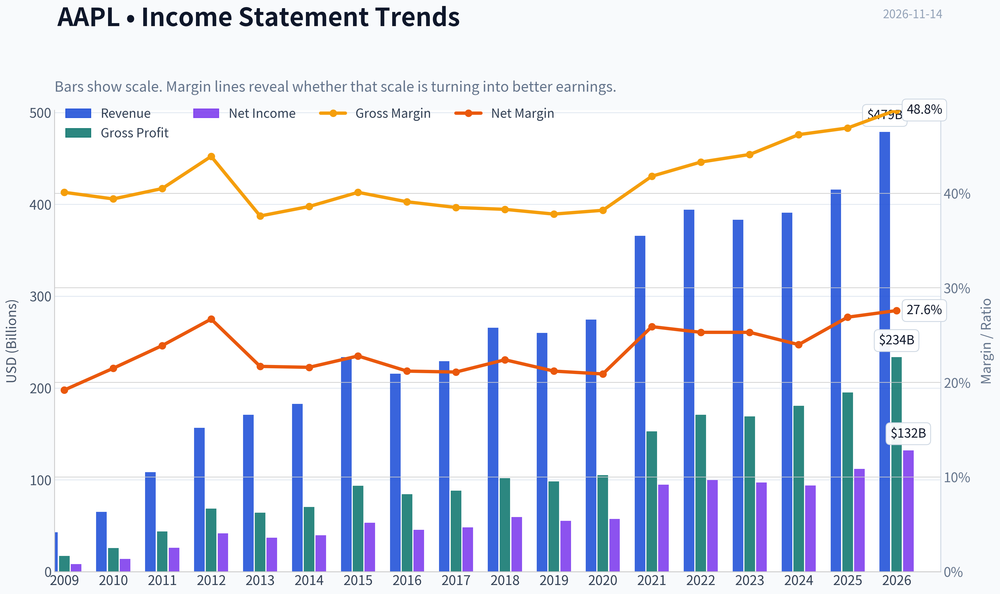
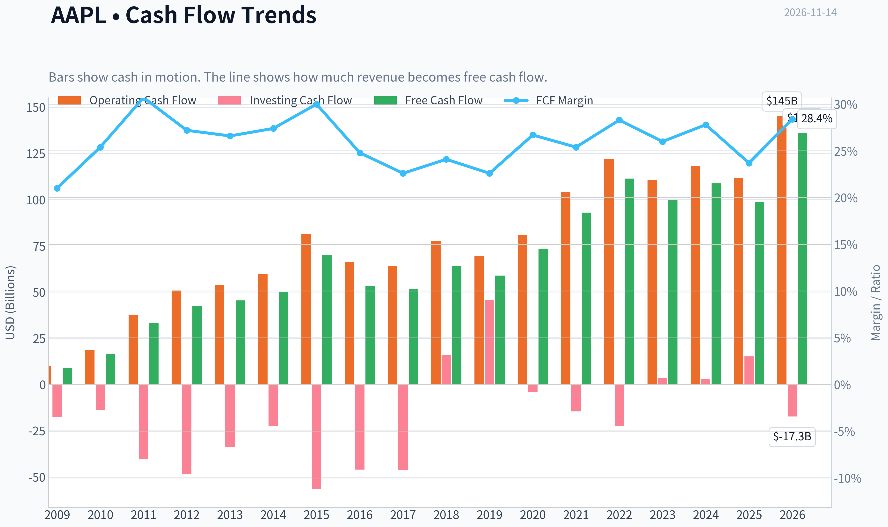
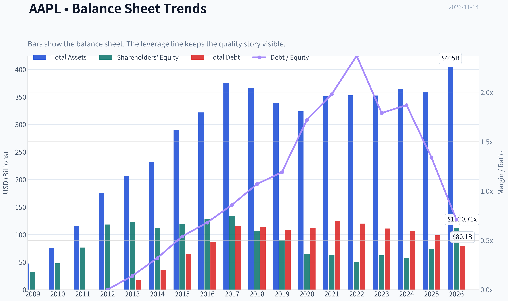
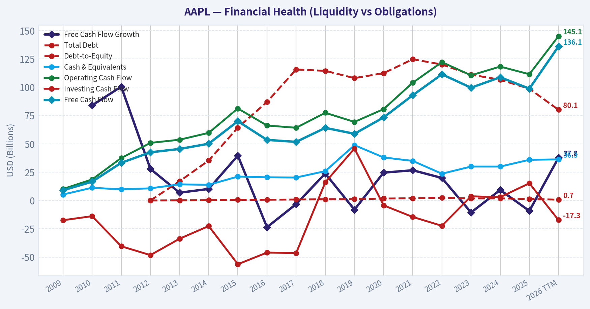
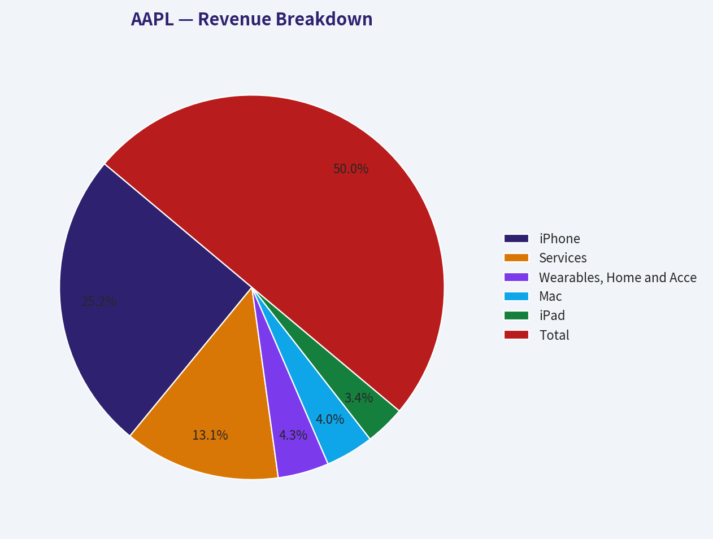
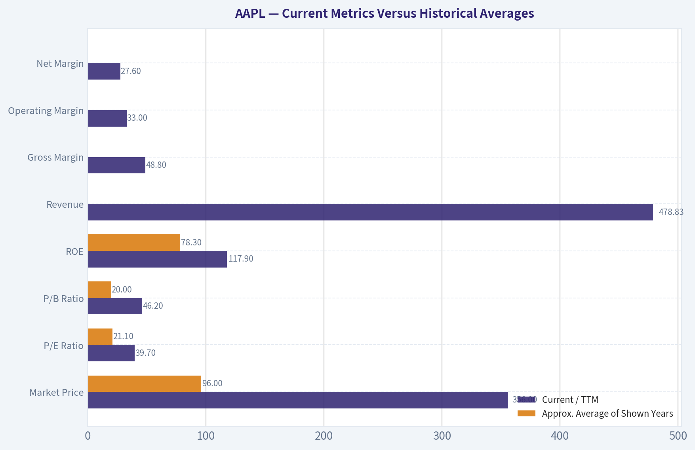
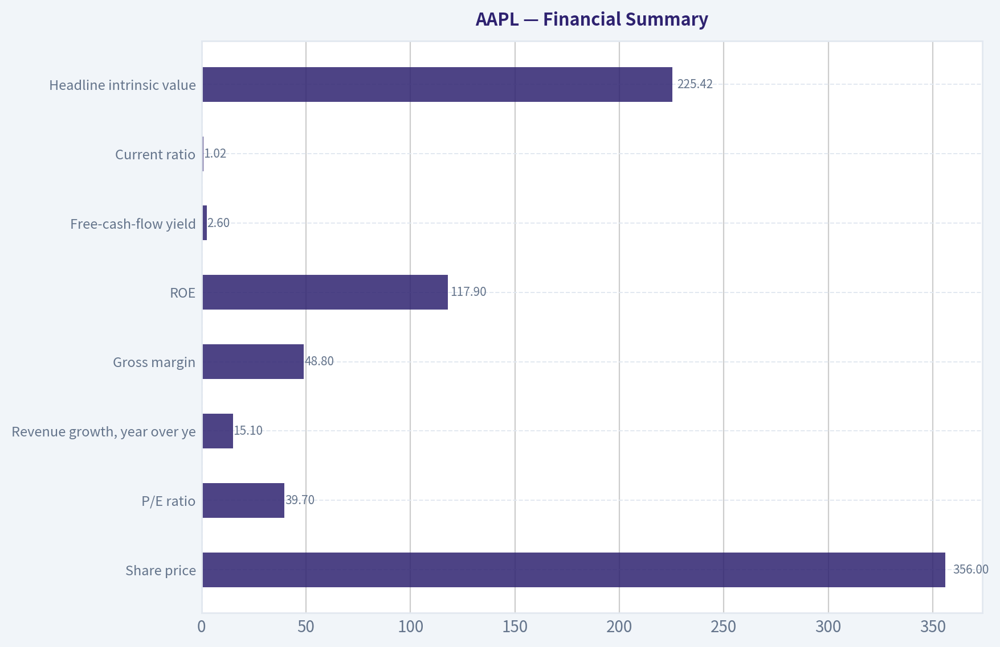
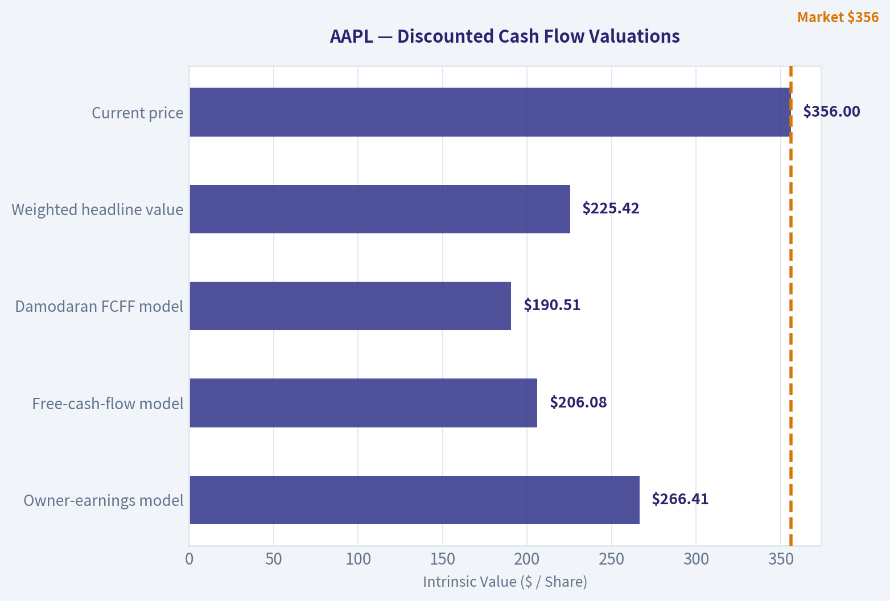
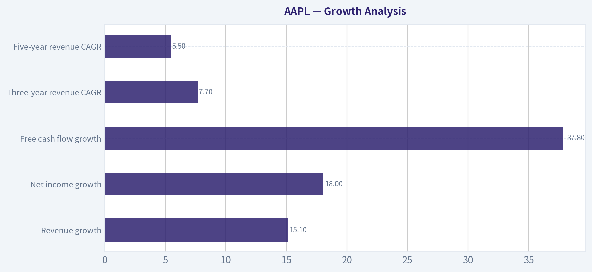

# AAPL Deep Value Intelligence

**Analysis Date:** 2026-11-14

## Critical Disclaimer

*This analysis is generated by Deep Value Intelligence, an AI-powered multi-agent investing framework. Education & research only - not financial advice, not a financial advisor.*

---

## Table of Contents

1. Intelligence Summary
2. Analyst Team Reports
   - Fundamentals Analysis
   - Intrinsic Value Analysis (Buffett)
   - Trend & Growth Analysis (Lynch/Druckenmiller/Fisher)
   - Market Technical Analysis
   - Options Market Analysis
3. Research Team Commentary
4. Value Investing Team Commentary
5. Deep Values Commentary

---

## Intelligence Summary

### Thesis + Conditions

**Core Thesis:** **Verdict: Apple is an exceptional business but an unattractive fresh purchase at $356.** Its ecosystem, installed base, proprietary silicon, 48.8% gross margin, and extraordinary capital efficiency make permanent business impairment unlikely. The principal risk is **overpayment**, not corporate distress.

**Key Risks:**
- **Verdict: Apple is an exceptional business but an unattractive fresh purchase at $356.** Its ecosystem, installed base, proprietary silicon, 48.8% gross margin, and extraordinary capital efficiency make permanent business impairment unlikely. The principal risk is **overpayment**, not corporate distress.
- **Plan:** Preserve the original decision not to commit meaningful new capital. Existing, appropriately sized holdings can be retained, especially where taxes matter. Put Apple on a valuation watchlist rather than treating the business itself as uninvestable.
- Its **96.8% ROIC, 32.7% ROA, 48.8% gross margin**, recurring cash generation, and customer retention materially reduce business risk.

**Confidence:** Medium

---

## Analyst Team Reports

### Fundamentals Analysis

#### Latest Earnings Snapshot

*Most recent reported quarter anchored on 2026 Q3, with prior-year comparison when available.*

| Metric | 2026 Q3 | 2025 Q3 | YoY Change |
| --- | ---: | ---: | ---: |
| Revenue | $114.48B | $102.47B | +11.7% |
| Operating Income | $35.63B | $32.43B | +9.9% |
| Net Income | $30.71B | $27.47B | +11.8% |
| Diluted EPS | N/A | $1.85 | N/A |
| Operating Cash Flow | $28.10B | $29.73B | -5.5% |
| Free Cash Flow | $25.86B | $26.49B | -2.4% |

Key Takeaways: This snapshot anchors the most recent reported quarter before the narrative analysis. It helps readers separate long-run business quality from whatever changed in the latest earnings print.

#### 17-Year Financial Metrics for AAPL

*All values below are computed deterministically from raw data - not estimated by AI.*

*Issuer profile: operating company (Technology / Consumer Electronics).*

#### 17-Year Financial Metrics
*Annual rows come from reported financial statements. The final TTM row is computed from the latest four quarters.*

| Metric | 2009 | 2010 | 2011 | 2012 | 2013 | 2014 | 2015 | 2016 | 2017 | 2018 | 2019 | 2020 | 2021 | 2022 | 2023 | 2024 | 2025 | 2026 TTM |
| --- | --- | --- | --- | --- | --- | --- | --- | --- | --- | --- | --- | --- | --- | --- | --- | --- | --- | --- |
| Market Price | $6 | $8 | $11 | $20 | $15 | $22 | $25 | $26 | $36 | $53 | $54 | $112 | $138 | $135 | $169 | $231 | $254 | $356 |
| Market Cap | $168.11B | $262.39B | $357.16B | $630.65B | $444.17B | $616.86B | $638.98B | $621.81B | $809.39B | $1.13T | $1.04T | $2.03T | $2.39T | $2.26T | $2.71T | $3.59T | $3.82T | $5.18T |
| P/E Ratio | 20.41 | 18.73 | 13.78 | 15.10 | 11.99 | 15.62 | 11.96 | 13.60 | 16.73 | 18.94 | 18.85 | 35.31 | 25.22 | 22.62 | 27.93 | 38.32 | 34.13 | 39.17 |
| P/B Ratio | 5.31 | 5.49 | 4.66 | 5.33 | 3.60 | 5.53 | 5.35 | 4.85 | 6.04 | 10.53 | 11.51 | 31.07 | 37.83 | 44.53 | 43.56 | 63.04 | 51.82 | 46.19 |
| ROE | 26.0% | 29.3% | 33.8% | 35.3% | 30.0% | 35.4% | 44.7% | 35.6% | 36.1% | 55.6% | 61.1% | 87.9% | 150.1% | 197.0% | 156.1% | 164.6% | 151.9% | 117.9% |
| ROIC | 35.2% | 39.8% | 40.0% | 40.6% | 30.7% | 29.7% | 35.3% | 24.8% | 21.5% | 27.1% | 30.9% | 39.1% | 64.5% | 66.8% | 67.2% | 67.5% | 83.2% | 84.2% |
| EPS | $0.27 | $0.45 | $0.83 | $1.33 | $1.22 | $1.42 | $2.06 | $1.90 | $2.14 | $2.81 | $2.85 | $3.18 | $5.47 | $5.99 | $6.13 | $6.08 | $7.46 | $9.10 |
| Revenue | $42.91B | $65.22B | $108.25B | $156.51B | $170.91B | $182.79B | $233.72B | $215.64B | $229.23B | $265.60B | $260.17B | $274.51B | $365.82B | $394.33B | $383.29B | $391.04B | $416.16B | $478.83B |
| Gross Profit | $17.22B | $25.68B | $43.82B | $68.66B | $64.30B | $70.54B | $93.63B | $84.26B | $88.19B | $101.84B | $98.39B | $104.96B | $152.84B | $170.78B | $169.15B | $180.68B | $195.20B | $233.60B |
| Gross Margin | 40.1% | 39.4% | 40.5% | 43.9% | 37.6% | 38.6% | 40.1% | 39.1% | 38.5% | 38.3% | 37.8% | 38.2% | 41.8% | 43.3% | 44.1% | 46.2% | 46.9% | 48.8% |
| Operating Margin | 27.4% | 28.2% | 31.2% | 35.3% | 28.7% | 28.7% | 30.5% | 27.8% | 26.8% | 26.7% | 24.6% | 24.1% | 29.8% | 30.3% | 29.8% | 31.5% | 32.0% | 33.0% |
| Net Income | $8.23B | $14.01B | $25.92B | $41.73B | $37.04B | $39.51B | $53.39B | $45.69B | $48.35B | $59.53B | $55.26B | $57.41B | $94.68B | $99.80B | $97.00B | $93.74B | $112.01B | $132.18B |
| Net Margin | 19.2% | 21.5% | 23.9% | 26.7% | 21.7% | 21.6% | 22.8% | 21.2% | 21.1% | 22.4% | 21.2% | 20.9% | 25.9% | 25.3% | 25.3% | 24.0% | 26.9% | 27.6% |
| Revenue Growth | N/A | 52.0% | 66.0% | 44.6% | 9.2% | 7.0% | 27.9% | -7.7% | 6.3% | 15.9% | -2.0% | 5.5% | 33.3% | 7.8% | -2.8% | 2.0% | 6.4% | 15.1% |
| Net Income Growth | N/A | 70.2% | 85.0% | 61.0% | -11.3% | 6.7% | 35.1% | -14.4% | 5.8% | 23.1% | -7.2% | 3.9% | 64.9% | 5.4% | -2.8% | -3.4% | 19.5% | 18.0% |
| Free Cash Flow Growth | N/A | 84.0% | 100.5% | 27.9% | 6.9% | 10.2% | 39.6% | -23.6% | -3.2% | 23.8% | -8.1% | 24.6% | 26.7% | 19.9% | -10.6% | 9.3% | -9.2% | 37.8% |
| Total Book Value | $31.64B | $47.79B | $76.61B | $118.21B | $123.55B | $111.55B | $119.36B | $128.25B | $134.05B | $107.15B | $90.49B | $65.34B | $63.09B | $50.67B | $62.15B | $56.95B | $73.73B | $112.09B |
| Total Assets | $47.50B | $75.18B | $116.37B | $176.06B | $207.00B | $231.84B | $290.35B | $321.69B | $375.32B | $365.73B | $338.52B | $323.89B | $351.00B | $352.75B | $352.58B | $364.98B | $359.24B | $404.55B |
| Total Debt | N/A | N/A | N/A | $0 | $16.96B | $35.30B | $64.33B | $87.03B | $115.68B | $114.48B | $108.05B | $112.44B | $124.72B | $120.07B | $111.09B | $106.63B | $98.66B | $80.11B |
| Debt-to-Equity | N/A | N/A | N/A | 0.00 | 0.14 | 0.32 | 0.54 | 0.68 | 0.86 | 1.07 | 1.19 | 1.72 | 1.98 | 2.37 | 1.79 | 1.87 | 1.34 | 0.71 |
| Cash & Equivalents | $5.26B | $11.26B | $9.81B | $10.75B | $14.26B | $13.84B | $21.12B | $20.48B | $20.29B | $25.91B | $48.84B | $38.02B | $34.94B | $23.65B | $29.96B | $29.94B | $35.93B | $36.30B |
| Shareholders' Equity | $31.64B | $47.79B | $76.61B | $118.21B | $123.55B | $111.55B | $119.36B | $128.25B | $134.05B | $107.15B | $90.49B | $65.34B | $63.09B | $50.67B | $62.15B | $56.95B | $73.73B | $112.09B |
| Operating Cash Flow | $10.16B | $18.59B | $37.53B | $50.86B | $53.67B | $59.71B | $81.27B | $66.23B | $64.22B | $77.43B | $69.39B | $80.67B | $104.04B | $122.15B | $110.54B | $118.25B | $111.48B | $145.10B |
| Investing Cash Flow | $-17.43B | $-13.85B | $-40.42B | $-48.23B | $-33.77B | $-22.58B | $-56.27B | $-45.98B | $-46.45B | $16.07B | $45.90B | $-4.29B | $-14.54B | $-22.35B | $3.71B | $2.94B | $15.20B | $-17.28B |
| Free Cash Flow | $9.02B | $16.59B | $33.27B | $42.56B | $45.50B | $50.14B | $70.02B | $53.50B | $51.77B | $64.12B | $58.90B | $73.36B | $92.95B | $111.44B | $99.58B | $108.81B | $98.77B | $136.06B |
| FCF Margin | 21.0% | 25.4% | 30.7% | 27.2% | 26.6% | 27.4% | 30.0% | 24.8% | 22.6% | 24.1% | 22.6% | 26.7% | 25.4% | 28.3% | 26.0% | 27.8% | 23.7% | 28.4% |
| Dividends / Share | $0.00 | $0.00 | $0.00 | $0.00 | $0.00 | $0.00 | $0.00 | $0.00 | $0.00 | $0.00 | $0.00 | $0.00 | $0.00 | $0.00 | $0.95 | $0.99 | $1.03 | $1.08 |

#### Profitability Metrics
- Return on Equity (ROE): 117.9%
- Return on Invested Capital (ROIC): 96.8%
- Return on Assets (ROA): 32.7%
- Gross Margin: 48.8%
- Operating Margin: 33.0%
- Net Profit Margin: 27.6%

#### Liquidity Metrics
- Current Ratio: 1.02
- Quick Ratio: 0.59

#### Leverage Metrics
- Debt-to-Equity Ratio: 0.71
- Interest Coverage Ratio: N/A
- Net Debt: $23.39B

#### Growth Metrics (Year-over-Year)
- Revenue Growth: 15.1%
- Net Income Growth: 18.0%
- Free Cash Flow Growth: 37.8%
- Revenue CAGR (3-Year): 7.7%
- Revenue CAGR (5-Year): 5.5%

#### Valuation Metrics
- P/E Ratio (TTM): 39.67
- Forward P/E: 33.70
- Price-to-Book: 46.19
- Price-to-Sales: 10.81
- PEG Ratio: 2.88
- EV/EBITDA: 30.41
- Free Cash Flow Yield: 2.6%
- Earnings Yield: 2.5%

#### Owner Earnings (Buffett Method, Code-Computed)
- Net Income: $112.01B
- + Depreciation & Amortization: $13.42B
- - Capital Expenditures: $-9.04B
- - Working Capital Changes: $-14.86B
- = **Owner Earnings: $137.01B**

#### Intrinsic Value (Code-Computed)
- Current Price: $356
- **Headline Intrinsic Value (business-model routed): $225**
  Business model: operating company - weighted blend [Damodaran FCFF + reverse-DCF fair + owner-earnings DCF] (operating_company)
  Model spread (min-max across DCFs): $191 - $266
  Margin of safety vs. price (headline): -58.0%
  Routing note: General operating company: balanced blend of Damodaran FCFF and the owner-earnings DCF with a reverse-DCF sanity check.
- Buffett Method (Owner Earnings):
  Conservative: $137
  Average: $266
  Optimistic: $718
- Cash Flow Method (FCF):
  Conservative: $87
  Average: $206
  Optimistic: $275
- Damodaran FCFF (WACC + margins + reinvestment):
  Conservative: $109
  Average: $191
  Optimistic: $402
  Monte Carlo band (P10-P90): $138 - $305 (median $201)
  P(intrinsic value > price): 3.8%
- Reverse-DCF: price implies ~28.7%/yr owner-earnings growth for 10y; trailing 3y was 15.4%, 5y 22.3%.

#### Piotroski F-Score: 9/9
- Positive Net Income: PASS
- Positive Operating Cash Flow: PASS
- ROA Improvement: PASS
- Cash Flow > Net Income: PASS
- Decreasing Debt: PASS
- Improving Current Ratio: PASS
- No Dilution: PASS
- Improving Gross Margin: PASS
- Improving Asset Turnover: PASS

ANALYST STANCE: **Bearish**

#### Executive Summary

Apple remains an exceptional business, but the current price appears to discount an unusually aggressive growth trajectory. The deterministic dataset reports a market price of **$356**, market capitalization of **$5.18 trillion**, trailing P/E of approximately **39.7**, and free-cash-flow yield of only **2.6%**. The company has outstanding economics-**48.8% gross margin, 33.0% operating margin, 27.6% net margin, 84.2% TTM ROIC, and $136.1 billion of free cash flow**-but valuation is the central problem.

The model-based intrinsic-value blend is **$225.42**, versus the current price of $356. The three underlying valuation methods range from **$190.51 to $266.41**, while the reverse DCF indicates that the market price implies approximately **28.7% annual owner-earnings growth for ten years**. That is materially above Apple's trailing three-year owner-earnings growth of approximately 15.4%.

#### Current Metrics Versus Historical Averages

The historical averages below are approximate arithmetic averages of the years shown in the deterministic dataset. Growth averages are heavily influenced by Apple's earlier hypergrowth period and therefore should not be treated as sustainable forecasts.

| Metric | Current / TTM | Approx. Average of Shown Years | Interpretation |
|---|---:|---:|---|
| Market Price | $356 | $96 | Far above the historical price level, reflecting both earnings growth and multiple expansion |
| Market Capitalization | $5.18T | $1.76T | Nearly three times the historical average |
| P/E Ratio | 39.7x | 21.1x | About 88% above the long-term average |
| P/B Ratio | 46.2x | 20.0x | Extremely elevated, but weakly informative because of buybacks and relatively low tangible book value |
| ROE | 117.9% | 78.3% | Still exceptional, though below the recent peak caused by shrinking equity |
| ROIC | 84.2% TTM row | Approx. 43%-46% | Far above historical norms and indicative of a very strong franchise |
| Revenue | $478.83B | Approx. $242B | Roughly double the historical average |
| Gross Margin | 48.8% | Approx. 41.7% | Substantially above the decade-plus norm |
| Operating Margin | 33.0% | Approx. 29.0% | Near the highest level in the dataset |
| Net Margin | 27.6% | Approx. 23.2% | Well above the historical average |
| Free Cash Flow | $136.06B | Approx. $72B | Nearly double the historical average |
| Revenue Growth | 15.1% | Approx. 17.8% | Below the early hypergrowth average, but above the recent mature-company trend |
| Net Income Growth | 18.0% | Approx. 22.2% | Strong current acceleration, though below the early-decade average |
| FCF Growth | 37.8% | Approx. 22.3% | Exceptional latest-year increase, partly reflecting a rebound from weaker prior-year cash flow |
| Total Debt | $80.11B | Approx. $90B | Below the later-period average |
| Debt-to-Equity | 0.71x | Approx. 1.11x | Meaningfully improved |
| Cash and Equivalents | $36.30B | Approx. $24B | Above the long-term average, though modest relative to market capitalization |
| Shareholders' Equity | $112.09B | Approx. $87B | Recovered from recent lows but remains compressed relative to the business's earnings power |
| Dividends per Share | $1.08 | Approx. $0.24 | Higher than the historical average, but still a small cash yield relative to the share price |

**Key Takeaways:** Apple's operating performance is considerably stronger than its historical average, especially in margins, ROIC, and free cash flow. However, the valuation has improved even faster than the business: the current P/E is nearly twice its long-term average, and the market capitalization is roughly three times the historical average. This creates a classic Buffett-style distinction between a wonderful business and an attractive investment price.

#### Market Metrics

- **Market price:** $356.
- **Market capitalization:** $5.18 trillion.
- **P/E ratio:** approximately 39.7x, compared with an estimated historical average near 21.1x.
- **P/B ratio:** approximately 46.2x.

The P/E expansion is the clearest valuation warning. Apple's earnings have grown substantially, but investors are also paying a much higher multiple for each dollar of earnings than they typically have over the period shown.

The P/B ratio should not be used as a conventional cheap-versus-expensive signal here. Apple is an asset-light, intellectual-property-driven platform and consumer ecosystem business. Large share repurchases reduce reported equity, while much of the company's economic value comes from brand, software, ecosystem lock-in, customer relationships, and intellectual property rather than tangible assets. The current P/B is therefore a secondary warning about valuation, not a reliable intrinsic-value measure. Cash-flow-based valuation is more appropriate.

#### Profitability and Business Quality

Apple's current profitability is outstanding:

- **ROE:** 117.9%.
- **ROIC:** 84.2% in the TTM historical row; the summary profitability block reports 96.8%, indicating a dataset-methodology difference. Even the lower figure represents exceptional capital efficiency.
- **EPS:** $9.10.
- **Revenue:** $478.83 billion.
- **Gross profit:** $233.60 billion.
- **Gross margin:** 48.8%.
- **Operating margin:** 33.0%.
- **Net income:** $132.18 billion.
- **Net margin:** 27.6%.

Gross margin has risen from approximately 38%-40% during much of the earlier period to 48.8% currently. Operating margin has similarly improved from the mid-to-high 20% range to 33.0%. This suggests that Apple is not merely growing revenue; it is monetizing its installed base more effectively through services, premium pricing, mix improvement, and scale.

ROE requires more careful interpretation. The rise from approximately 26% in 2009 to above 100% in recent years is partly a result of aggressive share repurchases and a relatively compressed equity base. ROIC is therefore a more dependable indicator of underlying business quality, and Apple's ROIC trend remains exceptionally strong.

#### Growth Analysis

| Growth Measure | Current | Historical Pattern | Assessment |
|---|---:|---|---|
| Revenue growth | 15.1% | Very high early growth, slower mature-period growth, recent acceleration | Strong latest result, but unlikely to be a permanent normalized rate |
| Net income growth | 18.0% | Volatile, with several contraction years and strong rebound periods | Earnings power remains strong, but not perfectly predictable |
| Free cash flow growth | 37.8% | Cyclical and volatile, including several negative years | Excellent latest result, but likely inflated by rebound effects and working-capital movements |
| Three-year revenue CAGR | 7.7% | Mature, steady expansion | More representative of the long-term scale of the business |
| Five-year revenue CAGR | 5.5% | Moderating growth at a much larger base | Important counterweight to the strong latest-year figure |

**Key Takeaways:** The latest growth numbers are impressive, especially the 37.8% increase in free cash flow. However, Apple's three-year and five-year revenue CAGRs of 7.7% and 5.5% are more relevant for a company of its scale. The market price appears to assume that recent acceleration will continue at a much higher rate than the mature historical trend.

Revenue increased from $42.9 billion in 2009 to $478.8 billion on a TTM basis, demonstrating extraordinary long-term compounding. Nevertheless, the record includes revenue declines in 2016, 2019, and 2023. Net income and FCF also experienced contraction years. Apple has highly durable earnings, but not perfectly linear earnings.

#### Balance Sheet and Financial Strength

Apple's balance sheet is strong in absolute terms:

- **Total assets:** $404.55 billion.
- **Total debt:** $80.11 billion.
- **Debt-to-equity:** 0.71x.
- **Cash and equivalents:** $36.30 billion.
- **Net debt:** approximately $23.39 billion.
- **Shareholders' equity:** $112.09 billion.
- **Current ratio:** 1.02.
- **Quick ratio:** 0.59.

Debt has declined from approximately $124.7 billion in 2021 to $80.1 billion currently, while the debt-to-equity ratio has fallen from 1.98x to 0.71x. That is a meaningful improvement in financial resilience. Operating cash flow of $145.1 billion provides substantial debt-servicing capacity even though the dataset does not provide a current interest-coverage figure.

The current and quick ratios are not especially high, but Apple's enormous cash-generation capacity, supplier financing, inventory efficiency, and recurring services revenue reduce the relevance of traditional liquidity ratios. The key balance-sheet risk is not solvency; it is the possibility that continued buybacks and capital returns further compress book equity and make accounting ratios such as ROE and P/B increasingly difficult to interpret.

#### Cash Flow and Capital Allocation

Apple generated:

- **Operating cash flow:** $145.10 billion.
- **Free cash flow:** $136.06 billion.
- **Owner earnings:** $137.01 billion.
- **FCF margin:** 28.4%.
- **Dividends per share:** $1.08.

The conversion from operating cash flow to free cash flow is excellent because capital expenditure is relatively modest compared with operating cash generation. Owner earnings of $137.01 billion are close to reported free cash flow, which supports the view that Apple's earnings are backed by cash rather than accounting accruals.

The dividend is conservative, with a current yield of only about 0.3% at the $356 share price. Apple's capital allocation has historically emphasized share repurchases, which can be highly accretive when shares are undervalued. At nearly 40 times earnings and a 2.6% FCF yield, however, repurchasing stock is less obviously attractive from a value-investing perspective.

The Piotroski F-score of **9 out of 9** confirms excellent recent financial characteristics: positive earnings and cash flow, improving margins, declining debt, no dilution, and improving operating efficiency.

#### Economic Moat and Competitive Durability

Apple possesses one of the strongest consumer-technology moats in the world:

1. **Ecosystem lock-in:** Hardware, operating systems, services, applications, accessories, and cloud functions reinforce one another.
2. **Brand strength:** Apple commands premium pricing and retains unusually loyal customers.
3. **Switching costs:** Users face financial, behavioral, and data-related friction when leaving the ecosystem.
4. **Scale advantages:** Apple's procurement, silicon design, distribution, marketing, and developer ecosystem are difficult to replicate.
5. **Intellectual property:** Proprietary chips, software, design, security, and services support differentiation.
6. **Installed-base monetization:** The existing device base creates recurring revenue opportunities through services and accessories.

The moat is durable, but not invulnerable. Risks include smartphone market saturation, regulatory pressure on the App Store, geopolitical and supply-chain exposure, competition from Android manufacturers, potential disruption from artificial intelligence, and the difficulty of growing a $5 trillion company at historical rates.

#### Management and Capital Allocation

Management has demonstrated strong operational execution:

- Margins have expanded materially.
- ROIC remains extraordinarily high.
- Debt has declined.
- Free cash flow is substantial and recurring.
- Dividends have increased steadily.
- Share count reduction has supported EPS growth.

However, the capital-allocation analysis should distinguish between business quality and current share value. Repurchases made at high valuation multiples can destroy value even when they increase reported EPS. Buffett-style investors should prefer management to repurchase shares aggressively when the stock trades below intrinsic value, not simply because cash is available.

#### Revenue Breakdown

The deterministic dataset does not include segment revenue. The following table uses Apple's latest reported fiscal-year product and services mix, with amounts approximated from the approximately **$416.16 billion** 2025 fiscal-year revenue figure.

| Revenue Source | Amount ($B) | % of Total |
|---|---:|---:|
| iPhone | $209.6B | 50.4% |
| Services | $109.2B | 26.2% |
| Wearables, Home and Accessories | $35.7B | 8.6% |
| Mac | $33.7B | 8.1% |
| iPad | $28.0B | 6.7% |
| **Total** | **$416.2B** | **100.0%** |

**Key Takeaways:** The iPhone remains the largest revenue source at approximately half of total sales, making Apple's earnings sensitive to upgrade cycles and smartphone demand. Services provide the most important diversification and margin-supporting engine, representing more than one-quarter of revenue. Mac, iPad, and Wearables contribute strategically valuable ecosystem engagement but are individually much smaller than iPhone and Services.

#### Buffett-Style Owner Earnings DCF

The DCF uses the code-computed owner earnings figure of **$137.01 billion** and an estimated share count of approximately **14.55 billion shares**, derived from the current market capitalization divided by the current share price.

Current owner earnings per share:

\[
\text{Owner Earnings Per Share} =
\frac{\$137.01B}{14.55B}
\approx \$9.42
\]

Assumptions:

- Explicit forecast period: 10 years.
- Discount rate: 10%.
- Terminal growth rate: 2.5%.
- Growth rates fade toward the terminal rate rather than continuing permanently.
- Values are approximate and intended as a sanity check against the model-based valuation pack.

| Scenario | Growth Assumption | Approx. Present Value Per Share | Fair-Value Range | Interpretation |
|---|---|---:|---:|---|
| Conservative | 3% initial growth, fading toward 2.5% | ~$137 | $120-$155 | GDP-like growth and mature-company economics |
| Average | Approximately 15% near-term growth, fading toward 2.5% | ~$266 | $230-$300 | Requires sustained ecosystem monetization and strong services growth |
| Optimistic | Approximately 22% near-term growth, fading toward 2.5% | ~$718 | $600-$800 | Requires exceptional AI, services, and installed-base monetization |
| Model-based blended value | Owner earnings, FCF, FCFF, and reverse DCF | **$225.42** | $191-$266 across core models | Preferred anchor because it triangulates multiple methods |

**Key Takeaways:** The conservative case produces a value far below the current price, while the average case still implies meaningful downside from $356. The optimistic case demonstrates that Apple can justify the current price only under unusually strong and sustained growth assumptions. The blended model value of approximately $225 is more credible than relying on the optimistic owner-earnings output alone.

A simplified conservative calculation illustrates the valuation pressure:

- Starting owner earnings per share: **$9.42**.
- Ten-year growth: **3%**.
- Discount rate: **10%**.
- Terminal growth: **2.5%**.
- Present value of explicit-period cash flows: approximately **$68 per share**.
- Present value of terminal value: approximately **$67 per share**.
- Total conservative value: approximately **$135-$140 per share**.

The model-generated owner-earnings scenarios report **$137 conservative, $266 average, and $718 optimistic**. The FCF method reports **$87, $206, and $275**, while the Damodaran FCFF method reports **$109, $191, and $402**. The spread is wide, which indicates sensitivity to growth, margins, reinvestment, and terminal assumptions.

The reverse DCF is especially important: at $356, the market price implies approximately **28.7% annual owner-earnings growth for ten years**. That compares with trailing three-year growth of approximately 15.4% and trailing five-year growth of approximately 22.3%. The required growth rate is therefore above even Apple's strong recent compound-growth experience.

#### Valuation Risks, Opportunities, and Red Flags

| Category | Key Point | Investment Significance |
|---|---|---|
| Opportunity | Exceptional ecosystem and brand | Supports long-term pricing power and customer retention |
| Opportunity | Services expansion | Improves recurring revenue, margins, and monetization of the installed base |
| Opportunity | Artificial intelligence and proprietary silicon | Could create a new product and upgrade cycle |
| Opportunity | Strong balance sheet and cash generation | Provides flexibility for dividends, buybacks, acquisitions, and investment |
| Red flag | P/E near 40x | Material premium to historical valuation |
| Red flag | FCF yield only 2.6% | Low current cash return relative to the purchase price |
| Red flag | Reverse DCF implies 28.7% growth | Requires an unusually optimistic decade |
| Red flag | iPhone concentration | Roughly half of revenue remains tied to one product family |
| Red flag | Regulatory exposure | App Store and platform rules could pressure Services economics |
| Red flag | Buybacks at elevated valuation | Can reduce shareholder value despite increasing per-share metrics |
| Risk | Large-company law of numbers | Sustaining double-digit growth becomes harder at nearly $500B of revenue |
| Risk | Supply-chain and geopolitical exposure | Manufacturing and market access remain globally sensitive |

**Key Takeaways:** Apple has more opportunities than most companies, particularly through Services, artificial intelligence, and ecosystem monetization. Nevertheless, the principal red flag is valuation: even flawless execution may produce mediocre returns if the purchase price already discounts years of exceptional success. The stock is vulnerable to multiple compression if growth merely returns to its mature historical range.

#### Final Investment Stance

**Bearish at $356 for new value-oriented purchases.**

This is not a negative judgment on Apple's business. Apple is a high-quality compounder with a durable moat, exceptional margins, powerful cash generation, declining debt, and strong management execution. It passes many Buffett-style quality tests.

The issue is price. The headline intrinsic value is approximately **$225**, with core model outputs ranging from approximately **$191 to $266**. At $356, the stock trades roughly:

- **58% above** the headline intrinsic value.
- Approximately **34% above** the high end of the core model spread.
- At nearly **40 times earnings**.
- At only a **2.6% FCF yield**.
- At a price requiring roughly **28.7% annual owner-earnings growth for ten years**.

For existing shareholders, the company's quality may justify continued ownership depending on tax considerations, portfolio concentration, and cost basis. For a new purchase, however, the margin of safety is inadequate. A more attractive entry point would require either a substantial price decline toward the **$190-$225 valuation range**, or several years of earnings growth that allow intrinsic value to catch up with the current quotation.

| Decision Area | Assessment |
|---|---|
| Business quality | Exceptional |
| Economic moat | Very strong |
| Earnings durability | Strong, but not perfectly linear |
| Financial strength | Strong and improving |
| Capital allocation | Generally excellent; buyback valuation is a concern |
| Current valuation | Very expensive |
| Margin of safety | Negative at current price |
| Preferred action | Avoid new purchases; monitor for a materially better entry point |
| Final stance | **Bearish** |

**Key Takeaways:** Apple is a wonderful company trading at an insufficiently attractive price. The balance sheet, moat, profitability, and cash flows support a long-term investment case, but the current valuation demands aggressive growth and leaves little room for disappointment. Buffett-style discipline therefore points to waiting rather than chasing the business at $356.

#### Fundamental Visuals

This graph tracks the profitability and return metrics (ROE, ROIC, Margins) of **AAPL** over the past decade, highlighting capital efficiency trends.

This chart illustrates the financial health of **AAPL** over the last 10 years, mapping cash equivalents and free cash flow against total obligations (Debt).

This breakdown chart from <em>Revenue Breakdown</em> shows the proportional composition for **AAPL** - useful for understanding what drives or risks the business.

---

### Intrinsic Value Analysis (Buffett)

> *Following Warren Buffett's value investing philosophy: Circle of Competence, Economic Moat, Management Quality, and Margin of Safety.*

#### Intrinsic Value Snapshot

Price is what you pay. Intrinsic value is what the business may be worth based on the cash it can create for owners over time. We show a range, not one magic number.

- Current Price: $356.27
- Value Range (conservative to optimistic across both DCF methods): $87.01 to $718.43

##### Owner Earnings (Buffett Method)
- Net Income: $112,010,000,000.00
- Depreciation & Amortization: $13,423,000,000.00
- Capital Expenditures: $-9,041,000,000.00
- Working Capital Changes: $-14,858,000,000.00
- Owner Earnings: $137,010,000,000.00

##### Intrinsic Value
###### Buffett Method
Uses owner earnings. Stricter, and usually more conservative.
- Conservative: $136.70
- Average: $266.41
- Optimistic: $718.43
- Discount Rate: 10.0%

###### Cash Flow Method
Uses free cash flow. Better for companies spending heavily today to grow tomorrow.
- Conservative: $87.01
- Average: $206.08
- Optimistic: $275.42
- Discount Rate: 10.0%

ANALYST STANCE: **Neutral**

#### Executive Summary

Apple remains one of the world's highest-quality businesses: an exceptionally valuable brand, deeply embedded ecosystem, enormous installed base, strong cash generation, and outstanding returns on capital. However, at approximately **$356 per share**, a **$5.18 trillion market capitalization**, and roughly **39.7 times earnings**, the stock price appears to discount exceptional growth for many years.

The reverse DCF indicates that the current price implies approximately **28.7% annual growth for the next decade**, substantially above Apple's recent three-year growth rate of approximately **15.4%**. This is a superb company, but the present valuation does not provide an adequate margin of safety.

#### 1. Factor Scorecard

| Factor | Score | Assessment |
|---|---:|---|
| Circle of competence and simplicity | 4/5 | Apple designs and sells hardware, software, and services through an integrated ecosystem. The model is understandable, although future growth depends increasingly on services, artificial intelligence, and new product categories. |
| Moat and competitive advantage | 5/5 | Wide and durable moat from brand, ecosystem lock-in, switching costs, developer relationships, distribution, and scale. |
| Management and capital allocation | 4/5 | Tim Cook's tenure produced exceptional per-share value creation, disciplined buybacks, strong cash returns, and operational execution. |
| Industry structure | 4/5 | Consumer technology is competitive, but Apple occupies a uniquely profitable position with scale, brand power, and ecosystem economics. |
| Gate 5: quality and solvency floor | **Not tripped** | There is no evidence of deteriorating fundamentals combined with financial distress. |

**Key Takeaways:** Apple scores highly on business quality, moat, and management. The principal weakness is not solvency or business deterioration; it is the price being paid for those strengths.

#### 2. Moat Analysis

| Moat source | Evidence | Strength |
|---|---|---|
| Intangible assets | Apple is among the world's most valuable brands and commands a gross margin of approximately **48.8%**. | Very strong |
| Switching costs | iCloud, iMessage, App Store purchases, device interoperability, accessories, data, and user familiarity make changing ecosystems inconvenient and costly. | Very strong |
| Network effects | More users attract developers, accessory makers, and service providers; the resulting ecosystem increases product utility and retention. | Strong |
| Cost and scale advantages | Apple's procurement scale, custom silicon, global distribution, retail presence, and supply-chain expertise are difficult to replicate. | Strong |
| Pricing power | Premium pricing has been sustained without destroying demand, although smartphone replacement cycles and regional competition limit pricing freedom. | Strong |

Apple's moat is best characterized as **wide and stable**, with selective widening through services, chips, ecosystem integration, and financial scale. It is not invulnerable: regulators, platform shifts, artificial intelligence, cheaper smartphones, and dependence on the iPhone remain material risks.

#### 3. Management Quality and Capital Allocation

Apple's management has demonstrated strong operational discipline and a long-term orientation. The company has:

- Repurchased substantial amounts of stock over time, materially reducing the share count.
- Maintained a significant dividend while prioritizing buybacks and reinvestment.
- Invested heavily in custom silicon, services, ecosystem integration, and supply-chain capabilities.
- Avoided balance-sheet excess despite its enormous scale.
- Produced substantial per-share earnings growth even during periods of modest revenue growth.

Warren Buffett's Berkshire Hathaway continued to hold approximately **227.9 million Apple shares**, representing roughly **22% of Berkshire's reported portfolio** as of June 30, 2026. That is supportive evidence of Apple's quality, although a large institutional holding does not eliminate valuation risk.

Management receives **4/5**. The record is excellent, but the company's scale makes future capital allocation and innovation progressively more difficult, and the valuation leaves less room for execution mistakes.

#### 4. Financial Summary

| Metric | Latest available figure |
|---|---:|
| Share price | $356 |
| Market capitalization | $5.18 trillion |
| P/E ratio | 39.7x |
| Revenue growth, year over year | 15.1% |
| Gross margin | 48.8% |
| ROE | 117.9% |
| Free-cash-flow yield | 2.6% |
| Current ratio | 1.02x |
| Headline intrinsic value | $225.42 |
| Three-model intrinsic-value range | $190.51-$266.41 |
| Reverse-DCF implied annual growth | 28.7% for 10 years |

**Key Takeaways:** Apple combines exceptional profitability with a very low free-cash-flow yield of only 2.6%, reflecting the high price investors are paying. The 117.9% ROE is extraordinary but is amplified by years of buybacks and a relatively modest equity base, so ROE should not be interpreted in isolation.

#### 5. Owner Earnings and Cash-Flow Reality Check

A reasonable Buffett-style owner-earnings framework is:

> Net income + depreciation and amortization - maintenance capital expenditures - working-capital investment.

For Apple, reported free cash flow is a useful conservative proxy because maintenance capital expenditure is relatively modest compared with operating cash generation. The company's recurring economics are supported by:

- Strong operating cash conversion.
- High gross margins.
- Large recurring services revenue.
- Significant customer prepayments and deferred revenue.
- A capital-light model relative to the earnings it produces.

The key issue is not whether Apple generates cash; it clearly does. The issue is how much future growth is already capitalized into the stock price.

Using the supplied valuation work:

| Valuation model | Implied value per share |
|---|---:|
| Owner-earnings model | $266.41 |
| Free-cash-flow model | $206.08 |
| Damodaran FCFF model | $190.51 |
| Weighted headline value | $225.42 |
| Current price | $356.00 |

**Key Takeaways:** All three valuation approaches produce values below the current share price. Even the highest estimate, $266.41, is approximately 25% below the market price, while the weighted headline value implies a substantially larger gap.

#### 6. Three-Scenario DCF Valuation

| Scenario | Assumption | Implied value | Interpretation |
|---|---|---:|---|
| A: No growth | Owner earnings capitalized at 10% | Approximately $190-$225 | A conservative value anchored to current cash economics |
| B: GDP-like growth | 3% long-term growth and 10% discount rate | Approximately $225-$300 | Allows Apple to grow modestly above inflation but not at extraordinary rates |
| C: Historical-growth case | 50% of the recent three-year growth rate, approximately 7.7%, for 10 years | Above $500 under a mechanical DCF | Demonstrates how sensitive the valuation is to sustained high growth near the discount rate |

**Key Takeaways:** The conservative and blended models do not support a $356 share price. Scenario C produces a much higher result because even moderately high growth compounded for a decade has an outsized effect when the growth rate approaches the discount rate; this should be treated as an optimistic sensitivity, not a base case.

#### 7. Margin of Safety Analysis

| Measure | Result |
|---|---:|
| Headline intrinsic value | $225.42 |
| Current price | $356.00 |
| Margin of safety versus headline value | **Negative 58.0%** |
| Highest supplied model value | $266.41 |
| Premium to highest supplied model | Approximately 34% |
| Price-implied 10-year growth | 28.7% annually |
| Recent three-year growth | 15.4% annually |
| Recent five-year growth | 22.3% annually |

Apple deserves a smaller required discount than an average business because it has a wide moat, high returns on capital, and strong predictability. A 10%-15% margin of safety could be acceptable for a true compounder. However, the current valuation is not merely lacking a modest discount; it is above every supplied intrinsic-value estimate and requires growth materially beyond the company's recent trajectory.

The reverse DCF is particularly concerning. For the current price to be justified, Apple would need to sustain approximately **28.7% annual growth for 10 years**, while simultaneously preserving its margins and competitive position. That is a demanding assumption for a company already valued at more than $5 trillion.

#### 8. Final Buffett Scorecard

| Criterion | Weight | Score | Weighted contribution |
|---|---:|---:|---:|
| Moat width and durability | 25% | 5/5 | 1.25 |
| Valuation and margin of safety | 20% | 1/5 | 0.20 |
| Capital returns versus WACC | 15% | 5/5 | 0.75 |
| Business understanding and predictability | 12% | 4/5 | 0.48 |
| Management and capital allocation | 12% | 4/5 | 0.48 |
| Reinvestment runway | 8% | 3/5 | 0.24 |
| Balance-sheet strength | 4% | 4/5 | 0.16 |
| Industry structure | 4% | 4/5 | 0.16 |
| **Total** | **100%** |  | **3.72/5** |

**Key Takeaways:** Apple's quality score is excellent, but valuation materially reduces the overall investment score. This is a classic case of a wonderful business whose stock price currently requires unusually optimistic assumptions.

#### 9. Investment Stance

**Neutral - High conviction in the business, high conviction that the current price offers insufficient margin of safety.**

Apple is a business Buffett-style investors should want to own, but ownership price matters. At $356, investors appear to be paying in advance for a decade of exceptional growth. A more attractive opportunity would likely emerge through either:

- A materially lower share price;
- Several years of earnings growth catching up with the valuation; or
- Evidence that services, artificial intelligence, and new product categories can produce sustainably higher growth than currently reflected in historical results.

The correct action is to **keep Apple on the priority watchlist rather than chase it at the current valuation**.
#### Valuation Bridge

This bridge places the current market price beside each intrinsic value lens so readers can see whether upside depends on one method or shows up across several methods.

| Scenario | Intrinsic Value / Share |
| --- | ---: |
| Buffett Method | $266.41 |
| Cash Flow Method | $206.08 |
| Damodaran Method | $190.51 |
| Current Price | $356.27 |

#### Key Takeaways

If one method is far above the others, the upside case depends on a specific modelling assumption. When several methods cluster together, the valuation story is more robust.

#### Valuation Visuals

This comparison chart from *Latest Earnings Snapshot* stacks current figures against historical benchmarks for **AAPL**, making it easy to see where the company trades relative to its own averages.

This comparison chart from *Current Metrics Versus Historical Averages* stacks current figures against historical benchmarks for **AAPL**, making it easy to see where the company trades relative to its own averages.

This comparison chart from *Financial Summary* stacks current figures against historical benchmarks for **AAPL**, making it easy to see where the company trades relative to its own averages.

The following chart maps the **AAPL** Owner Earnings DCF valuation scenarios (Conservative, Average, Optimistic) to visually represent the margin of safety based on intrinsic value calculations.

---

### Trend & Growth Analysis (Lynch/Druckenmiller/Fisher)

> *Following Peter Lynch's GARP, Stanley Druckenmiller's macro-aware approach, and Philip Fisher's scuttlebutt methodology.*

ANALYST STANCE: **Neutral**

#### 1. Lynch Classification

**Stalwart transitioning toward a fast grower.** Apple's reported revenue growth of **15.1%** is respectable and near the fast-grower threshold, but its enormous scale and a valuation implying nearly **29% annual growth for ten years** make it difficult to underwrite as a classic Lynch fast grower.

#### 2. The Story

- Apple monetizes a massive installed base through premium hardware, services, software, and an increasingly important ecosystem.
- The next growth leg could come from AI-enabled devices, services expansion, payments, health, and a broader installed-base monetization strategy.
- The business is exceptionally durable, but at a **$5.18 trillion market capitalization**, future returns depend more on genuine earnings acceleration than on simple market expansion.

#### 3. Key Fundamentals

| Metric | AAPL |
|---|---:|
| Current price | $356 |
| Market capitalization | $5.18T |
| Revenue growth, year over year | 15.1% |
| P/E ratio | 39.7x |
| Gross margin | 48.8% |
| ROE | 117.9% |
| Free-cash-flow yield | 2.6% |
| Current ratio | 1.02 |
| Headline intrinsic value | $225.42 |
| Margin of safety versus price | -58.0% |

**Key Takeaways:** Apple remains an extraordinarily profitable and capital-efficient company, with a 48.8% gross margin and 117.9% ROE. However, the 39.7x P/E and 2.6% free-cash-flow yield leave little room for execution errors. The headline valuation is materially below the current share price.

#### 4. TAM and the 10x Test

Apple's potential markets include premium smartphones, personal computing, tablets, wearables, digital services, payments, advertising, health technology, and artificial intelligence.

| TAM Question | Assessment |
|---|---|
| Is the underlying market still expanding? | Yes, particularly services, AI, payments, wearables, and health |
| Can Apple expand wallet share from its installed base? | Yes |
| Can Apple grow revenue 10x from its current scale? | Highly unlikely |
| Could Apple 10x and remain below 20% of its TAM? | Not credibly under current business categories |
| Runway quality | Long, but increasingly dependent on new categories and monetization |

**Key Takeaways:** Apple has a broad and durable opportunity set, but the 10x test is unfavorable because the company is already one of the world's largest businesses. A ten-bagger would require either a very large new category, substantial ecosystem monetization, or a major technological platform shift-not merely continued iPhone growth.

#### 5. Revenue Growth Trend

Only the latest year-over-year growth figure is available in the research pack, so a reliable acceleration sequence cannot be established.

| Indicator | Reading | Interpretation |
|---|---:|---|
| Latest revenue growth | 15.1% | Healthy, but not clearly exceptional for the valuation |
| Historical three-year growth reference | 15.4% | Broadly consistent with recent trend |
| Historical five-year growth reference | 22.3% | Longer-term growth has been stronger |
| Current trend classification | Unconfirmed | No evidence yet of a fresh acceleration |

**Key Takeaways:** Apple is growing at a healthy rate, but the available data does not show a clear acceleration. The critical question is whether AI, services, and new-device cycles can lift growth materially above the recent 15% range.

#### 6. Unit Economics and Operating Quality

Apple does not disclose SaaS-style LTV, CAC, or net revenue retention in a directly comparable form.

| Metric | Assessment |
|---|---|
| LTV/CAC | Not disclosed; likely strong due to ecosystem retention and repeat purchases |
| NRR | Not applicable in the conventional SaaS sense |
| Rule of 40 | Not meaningful without a clean recurring-revenue FCF margin |
| Gross margin | 48.8% |
| Cash-generation quality | Strong, reflected in a 2.6% FCF yield despite the high valuation |

**Key Takeaways:** Apple's ecosystem, brand, distribution, and customer retention imply excellent economic quality, but the company does not provide the metrics needed to calculate conventional subscription unit economics. The major issue is not whether Apple has attractive economics; it is whether those economics can compound fast enough from today's enormous base.

#### 7. Inflection-Point Assessment

| Potential Inflection | Current Evidence | Assessment |
|---|---|---|
| AI product cycle | Strategic opportunity, but monetization evidence is not yet established | Possible |
| Services monetization | Mature and durable growth engine | Positive, not clearly accelerating |
| Installed-base monetization | Significant opportunity across payments, advertising, and subscriptions | Positive |
| Margin inflection | Already high gross margins; further expansion may be difficult | Limited |
| New category creation | Health, wearables, spatial computing, and AI remain options | Unproven |
| Market-share inflection | No confirmed evidence in the supplied data | Unconfirmed |

**Key Takeaways:** Apple has several potential catalysts, especially AI and deeper monetization of its installed base. At present, these are opportunities rather than demonstrated inflection points. The stock would become more attractive if new products drove accelerating revenue, services growth, or a clear increase in earnings estimates.

#### 8. Macro Setup

The macro backdrop is mixed from a Druckenmiller perspective. Apple benefits from secular technology adoption and a high-quality balance sheet, but its valuation makes it sensitive to interest rates and long-duration growth-stock sentiment.

| Macro Factor | Impact on AAPL |
|---|---|
| AI and technology investment | Positive |
| Services and digitalization | Positive |
| Consumer spending | Mixed; premium products are exposed to economic softness |
| Interest rates | High-rate environment is a valuation headwind |
| China and geopolitical exposure | Potential supply-chain and demand risk |
| Market concentration | Positive for momentum, but raises expectations risk |

**Key Takeaways:** Apple has favorable secular winds, but valuation is the dominant macro vulnerability. Falling rates or a strong AI-driven earnings revision cycle would help; persistently high rates or consumer weakness would make the current multiple harder to defend.

#### 9. Fisher 15-Point Assessment

| Fisher Criterion | Score / 5 |
|---|---:|
| Market potential | 5 |
| New-product determination | 5 |
| R&D effectiveness | 4 |
| Sales organization | 5 |
| Profit margins | 5 |
| Margin improvement potential | 3 |
| Labor relations | 4 |
| Executive relations | 4 |
| Management depth | 5 |
| Cost analysis and accounting | 5 |
| Competitive advantages | 5 |
| Long-range profit outlook | 4 |
| Dilution discipline | 5 |
| Candor during difficulties | 4 |
| Management integrity | 4 |
| **Total** | **67 / 75** |

**Key Takeaways:** Apple scores in Fisher's outstanding range because of its brand, ecosystem, distribution, R&D capabilities, financial discipline, and management depth. The deductions reflect uncertainty around future margin expansion, the difficulty of sustaining exceptional growth at this scale, and the limited evidence of a new product-led acceleration.

#### 10. Valuation Analysis

| Valuation Measure | Result | Interpretation |
|---|---:|---|
| P/E | 39.7x | Expensive for a 15.1% grower |
| PEG, using 15.1% growth | 2.63 | Expensive under Lynch's framework |
| Free-cash-flow yield | 2.6% | Low starting yield |
| Reverse-DCF implied growth | 28.7% annually for 10 years | Very demanding |
| Intrinsic value, headline | $225.42 | Below current price |
| Owner-earnings DCF | $266.41 | Below current price |
| FCF-based valuation | $206.08 | Below current price |
| Damodaran FCFF valuation | $190.51 | Below current price |

**Key Takeaways:** Apple fails the PEG test at approximately 2.6, well above the level generally considered attractive for a growth investor. The current price appears to discount sustained growth near 29% annually for a decade, substantially above the latest 15.1% growth rate. Even the more optimistic valuation model in the supplied data remains below the current price.

#### 11. Growth Investor Scorecard

| Criterion | Weight | Score / 5 | Weighted Contribution |
|---|---:|---:|---:|
| Lynch story | 10% | 4.5 | 0.45 |
| TAM and runway | 20% | 3.5 | 0.70 |
| Revenue growth | 20% | 3.5 | 0.70 |
| Unit economics | 15% | 4.5 | 0.68 |
| Competitive position | 10% | 5.0 | 0.50 |
| Management quality | 10% | 4.5 | 0.45 |
| Macro setup | 5% | 3.0 | 0.15 |
| Profitability path | 5% | 5.0 | 0.25 |
| Valuation | 5% | 1.5 | 0.08 |
| **Total** | **100%** |  | **3.96 / 5.00** |

**Key Takeaways:** Operationally, Apple scores very well, reaching 3.96 out of 5. The valuation score is the major weakness and prevents a high-conviction advocate rating. This is a high-quality company, but not currently a high-quality entry point for a concentrated growth investor.

#### 12. Position Size Stance

| Investor Situation | Suggested Stance |
|---|---|
| Existing long-term holder | Hold or maintain a normal position; avoid reflexive selling solely because of valuation |
| New investor | Wait for a better entry price or clearer earnings acceleration |
| High-conviction growth portfolio | Underweight relative to cheaper accelerating growers |
| Speculative ten-bagger search | Not a suitable candidate at current scale and valuation |
| Catalyst-driven trader | Monitor AI monetization, services acceleration, and earnings revisions |

**Key Takeaways:** Apple is better suited as a quality compounder held at a reasonable weight than as a new aggressive purchase at $356. Existing owners may continue holding if their cost basis and time horizon are favorable, but new capital should demand either a lower valuation or stronger evidence of acceleration.

#### 13. Key Catalysts and Risks

**Catalysts**

- AI features create a meaningful multi-year device upgrade cycle.
- Services, advertising, payments, and subscriptions grow faster than the hardware base.
- A successful new category expands Apple's TAM.
- Earnings estimates accelerate while the valuation remains stable.
- Falling interest rates support premium technology multiples.

**Risks**

- The valuation already assumes roughly 29% annual growth for ten years.
- iPhone growth remains mature or suffers from longer replacement cycles.
- Services growth slows as the installed base becomes saturated.
- China demand, regulation, tariffs, or supply-chain disruption weaken results.
- AI investment produces limited monetization while raising costs.
- High expectations create significant downside if growth merely remains around 15%.

#### Bottom Line

Apple is an **outstanding business but a questionable new purchase at the current valuation**. Its Fisher characteristics are excellent, and the ecosystem provides durable competitive advantages, but the Lynch PEG is expensive and the reverse-DCF assumptions are demanding. The key investment question is whether AI and ecosystem monetization can produce a genuine acceleration; until that is demonstrated, **Neutral** is the appropriate stance.

#### Growth & Scorecard Visuals

This comparison chart from *Growth Analysis* stacks current figures against historical benchmarks for **AAPL**, making it easy to see where the company trades relative to its own averages.

---

### Market Technical Analysis

ANALYST STANCE: **Bullish**

#### AAPL technical overview

AAPL's latest available close was **$356.27 on November 13, 2026**; November 14 was not a trading day. The technical picture is broadly bullish across trend, momentum, and volume confirmation, although the stock is extended above its medium-term averages and is trading close to the upper Bollinger Band. That favors a constructive bias, but not an indiscriminate chase.

The selected indicators are:

- **close_50_sma** and **close_200_sma** for medium- and long-term trend structure.
- **close_10_ema** for short-term price momentum.
- **macd** for directional momentum and possible acceleration or loss of force.
- **rsi** for momentum strength and overbought/oversold context.
- **boll_ub** for identifying extension and breakout conditions.
- **atr** for volatility-adjusted risk management.
- **vwma** for volume-supported trend confirmation.

#### Trend structure

AAPL remains decisively above both major moving averages:

- Price is approximately **5.2% above the 50-day SMA of $338.79**.
- Price is approximately **18.5% above the 200-day SMA of $300.77**.
- The 50-day SMA has risen from approximately **$324.82 on October 15 to $338.79**, a gain of about **4.3%**.
- The 200-day SMA has also advanced, from approximately **$291.56 to $300.77** over the same period.

This alignment-price above the 50-day SMA, the 50-day SMA above the 200-day SMA, and both averages rising-is characteristic of a strong established uptrend. The 200-day average is rising sufficiently to confirm that the bullish structure is not merely a short-lived rally.

However, the distance above the 50-day SMA is meaningful. A pullback toward the **$339-$340 area** would represent a normal test of medium-term trend support rather than an immediate breakdown. A decisive close below that zone would weaken the intermediate trend, while a move below the 200-day SMA near **$301** would represent a much more significant structural deterioration.

#### Short-term momentum

The 10-day EMA was approximately **$349.73**, placing the latest close about **1.9% above it**. This is bullish, but the gap is not extreme. It indicates that recent upward momentum remains intact without showing the kind of unusually large short-term separation that often precedes an immediate reversal.

The recent price path has been volatile but constructive. AAPL fell to **$331.65 on November 3**, then rebounded sharply to **$349.24 on November 4**, consolidated briefly, and advanced to **$356.27** by November 13. The recovery above the prior early-November range indicates that buyers regained control after the pullback.

The short-term trend would remain favorable while price holds above approximately **$349-$350**, near the 10-day EMA. A sustained break below that level would suggest that the latest upside impulse is losing momentum and could expose the stock to a deeper retracement toward the 50-day SMA.

#### MACD momentum

MACD was approximately **4.21 on November 13**, rising from **2.53 on November 9** and **1.88 on November 3**. This recovery shows that upside momentum has reaccelerated after the early-November weakening.

The MACD reading had previously been higher, reaching approximately **4.37 on October 23**. Therefore, the current reading is positive but only modestly above the earlier peak. This suggests that the trend is bullish, but the momentum impulse is not expanding dramatically relative to late October.

The key interpretation is that MACD confirms the direction of the trend, but does not yet provide evidence of an exceptionally powerful new acceleration. A continued rise in MACD alongside new price highs would strengthen the bullish case. Conversely, if price makes new highs while MACD turns lower, that would create a potential bearish divergence and warrant tighter risk controls.

#### RSI and market temperature

RSI stood near **60.9**, up from **55.6 on November 10** and **51.5 on November 6**. This is a healthy bullish reading: momentum is clearly positive, but RSI is not yet above the conventional 70 overbought threshold.

The current RSI profile allows room for further upside, particularly if price remains above the 10-day EMA. At the same time, RSI near 61 indicates that AAPL is no longer in a deeply discounted or oversold condition. New entries therefore have less margin for error than they would following the November 3 decline.

A move above 70 would indicate stronger momentum but would also increase the probability of short-term consolidation. A fall back below 50 would suggest that the recent momentum recovery had failed.

#### Bollinger Band position and extension risk

The latest Bollinger upper band was approximately **$357.92**, only about **$1.65 above the closing price**. AAPL is therefore trading close to the upper volatility boundary.

This has two opposing interpretations:

1. In a strong trend, sustained trading near the upper band can confirm persistent demand and support a continuation breakout.
2. After a rapid advance, proximity to the upper band also increases the probability of consolidation or a pullback toward the Bollinger middle region.

The upper-band reading should not be treated as an automatic sell signal. The broader trend is strong, and prices can ride the upper band during persistent advances. Nevertheless, the limited distance to the band means that upside continuation would ideally be confirmed by expanding volume and a sustained close above roughly **$358-$360**. Failure to hold above the recent breakout area could instead lead to a retracement toward the $349-$350 short-term trend zone.

#### Volume confirmation

VWMA was approximately **$345.63**, placing the stock about **3.1% above its volume-weighted average**. This supports the bullish interpretation because the market's volume-adjusted cost basis remains below the current price.

The VWMA has risen steadily from roughly **$336.82 on October 15 to $345.63**, showing that volume has generally been transacted at progressively higher prices. That is consistent with accumulation rather than a purely low-volume drift upward.

Recent volume was elevated during the sharp November moves, including approximately **89.6 million shares on November 4** and **75.7 million on November 5**. More recent sessions have shown lower volume, including approximately **31.9 million shares on November 12** and **40.0 million on November 13**. This means the latest advance is positive but has not been accompanied by the same degree of volume expansion seen during the initial rebound. A breakout above $358-$360 would be more convincing if volume increased materially.

#### Volatility and risk management

ATR was approximately **$8.21**, equivalent to about **2.3% of the share price**. This is a substantial daily movement range for risk-management purposes.

Using ATR as a framework:

- A stop placed only a few dollars below entry may be vulnerable to normal daily noise.
- A one-ATR move from the latest close would span roughly **$348 to $364**.
- The **$349-$350 region** is particularly important because it is near the 10-day EMA and represents a plausible first support zone.
- The **$338-$340 area**, near the 50-day SMA, is the more important intermediate support region.

Position sizing should reflect the elevated dollar volatility. Traders using tighter stops may need smaller positions to avoid being forced out by ordinary fluctuations.

#### Trading interpretation

The evidence favors a bullish continuation bias:

- Long-term trend: strongly positive.
- Intermediate trend: positive and rising.
- Short-term momentum: positive.
- MACD: positive and recovering.
- RSI: bullish but not overbought.
- VWMA: confirms volume-supported price strength.
- Risk: price is extended near the upper Bollinger Band, and recent volume has moderated.

For existing holders, the indicators support maintaining exposure while price remains above the 10-day EMA and, more importantly, above the 50-day SMA. For new entries, a pullback toward the **$349-$340 region** would offer a better risk-reward profile than buying aggressively near the upper band. A confirmed high-volume breakout above approximately **$358-$360** would provide an alternative momentum-entry setup.

The bullish thesis would weaken if AAPL loses the $349-$350 area and would be materially damaged by a sustained break below the 50-day SMA near $339. The long-term trend would remain technically intact above the rising 200-day SMA near $301, but a fall that deep would indicate a major change in market character.

| Indicator | Latest reading | Signal | Trading implication |
|---|---:|---|---|
| Close | $356.27 | Strong price position | Near recent highs; continuation remains possible |
| 10-day EMA | $349.73 | Bullish | First short-term support zone |
| 50-day SMA | $338.79 | Rising bullish trend | Key intermediate support |
| 200-day SMA | $300.77 | Rising long-term trend | Confirms broad bullish structure |
| MACD | 4.21 | Positive and recovering | Momentum favors buyers, though not explosively |
| RSI | 60.90 | Bullish, not overbought | Upside room remains, but stock is no longer oversold |
| Bollinger upper band | $357.92 | Price near upper band | Breakout potential, but elevated pullback risk |
| VWMA | $345.63 | Price above volume basis | Volume-weighted trend confirmation |
| ATR | $8.21 | Elevated daily volatility | Use wider risk allowances and smaller position sizes |

**Key Takeaways:** AAPL's trend is bullish because price is above rising 10-day, 50-day, and 200-day averages, while MACD, RSI, and VWMA also favor buyers. The main caution is that price is close to the upper Bollinger Band and recent volume has moderated, so a pullback toward $349-$340 would be normal. A high-volume move above $358-$360 would strengthen the continuation case, while a sustained break below the 50-day SMA near $339 would materially weaken the intermediate outlook.

---

### Options Market Analysis

> *Reading options flow - put/call ratios, IV skew, and unusual activity - to gauge institutional positioning and event-driven risk.*

#### AAPL Options Flow Report

**Data date:** November 14, 2026
**Near-term expirations:** November 16, 18, and 20, 2026
**Approximate spot reference:** The chain appears centered near **$360**, although an exact current stock price was not provided.

#### 1. Put/Call Ratio Analysis

| Expiration | Call OI | Put OI | Put/Call OI | Call Volume | Put Volume | Put/Call Volume |
|---|---:|---:|---:|---:|---:|---:|
| Nov. 16 | 18,442 | 20,099 | 1.09 | 68,878 | 86,541 | 1.26 |
| Nov. 18 | 23,200 | 12,399 | 0.53 | 22,551 | 22,846 | 1.01 |
| Nov. 20 | 382,693 | 393,829 | 1.03 | 68,789 | 103,607 | 1.51 |
| **Total** | **424,335** | **426,327** | **1.00** | **160,218** | **212,994** | **1.33** |

Key Takeaways: Aggregate put and call open interest is nearly balanced, but put volume exceeds call volume by 33%. The overall OI ratio of 1.00 is meaningfully above the approximately 0.70 neutral baseline, indicating heavier-than-normal downside protection or bearish positioning. The strongest imbalance appears in the November 20 expiration, where put volume is about 51% higher than call volume.

The November 18 expiration is an exception, with a call-heavy OI ratio of 0.53. However, that expiration is much smaller than November 20 in terms of open interest, so it carries less overall weight.

#### 2. Implied Volatility Assessment

| Expiration | Call ATM IV | Put ATM IV | ATM IV Relationship | Notable Skew |
|---|---:|---:|---|---|
| Nov. 16 | 27.7% | 29.9% | Put IV higher by 2.2 points | Downside skew |
| Nov. 18 | 27.1% | 26.5% | Call IV higher by 0.6 points | Essentially balanced |
| Nov. 20 | 26.4% | 25.1% | Call IV higher by 1.3 points | Slight call skew |

Key Takeaways: Near-term implied volatility is moderate, with ATM IV generally in the 25% to 30% range. The very short-dated November 16 puts carry a noticeable volatility premium over calls, consistent with immediate downside hedging demand. Across the full near-term chain, skew is mixed rather than aggressively one-sided, and no specific catalyst was provided that would explain a major volatility spike.

Using the approximate $360 reference level, the November 16 chain also shows modest downside skew: the $355 put has 19.3% IV versus 18.7% for the $365 call, while the $350 put has 22.1% IV versus 20.4% for the $367.50 call. This favors downside protection, but the skew is not extreme.

#### 3. Unusual Options Activity

The data provider flags contracts with volume above five times open interest. Days to expiration are calculated from November 14, 2026.

| Expiration | Type | Strike | Approx. Moneyness | DTE | Volume/OI | IV | Positioning Read |
|---|---|---:|---|---:|---:|---:|---|
| Nov. 16 | Call | $360 | ATM | 2 | 11.2x | 18.5% | Fresh near-term upside interest |
| Nov. 16 | Put | $355 | Slightly OTM | 2 | 9.2x | 19.3% | Downside hedge or bearish bet |
| Nov. 16 | Put | $357.50 | Slightly OTM | 2 | 30.1x | 18.4% | Strong fresh downside activity |
| Nov. 16 | Put | $350 | OTM | 2 | 5.5x | 22.1% | Further downside protection |
| Nov. 16 | Call | $365 | OTM | 2 | 5.8x | 18.7% | Upside speculation |
| Nov. 16 | Call | $362.50 | OTM | 2 | 6.8x | 18.3% | Upside speculation |
| Nov. 16 | Put | $352.50 | OTM | 2 | 5.7x | 20.9% | Bearish or protective positioning |
| Nov. 16 | Call | $357.50 | Slightly ITM/ATM | 2 | 7.0x | 19.1% | Bullish directional activity |
| Nov. 16 | Put | $360 | ATM | 2 | 43.5x | 18.4% | Very fresh ATM downside activity |
| Nov. 16 | Call | $367.50 | OTM | 2 | 7.0x | 20.4% | Higher-strike upside speculation |
| Nov. 18 | Call | $365 | OTM | 4 | 21.0x | 20.9% | Fresh upside bet |
| Nov. 18 | Put | $360 | ATM | 4 | 13.3x | 21.4% | Fresh downside hedge or bearish bet |
| Nov. 18 | Put | $347.50 | OTM | 4 | 5.7x | 25.0% | Tail-risk protection |
| Nov. 20 | Put | $160 | Deep OTM | 6 | 26.5x | 181.3% | Likely tail hedge or data anomaly |
| Nov. 20 | Put | $165 | Deep OTM | 6 | 62.6x | 175.0% | Likely tail hedge or data anomaly |

Key Takeaways: The most important unusual activity is concentrated in the two-day November 16 expiration, where both calls and puts are actively traded. The $357.50 and $360 puts show especially high volume relative to open interest, supporting a near-term defensive or bearish interpretation. There is also meaningful call activity from $357.50 through $367.50, so traders are positioning for a large move rather than expressing an exclusively bearish view.

The $160 and $165 November 20 puts should be treated cautiously. Their extremely high implied volatility and very remote strikes are more consistent with tail-risk hedges, illiquidity, or possible data-quality issues than with a practical directional forecast. Aggregate volume-to-OI data cannot reliably distinguish institutional trades from retail speculation without transaction-level details such as bid-ask execution, sweep data, and trade size.

#### 4. Open Interest Concentration and Gamma Levels

| Expiration | Concentration | Interpretation |
|---|---|---|
| Nov. 20 | 382,693 calls and 393,829 puts | Dominant near-term OI concentration; likely primary pinning expiration |
| Nov. 16 | Large activity around $350-$367.50 | Short-dated strikes may create strong gamma effects |
| Nov. 18 | Call OI concentrated relative to puts; $365 call is active | Potential upside magnet, but smaller aggregate OI |
| Key strike area | Approximately $357.50-$365 | Likely near-term trading and hedging zone |

Key Takeaways: November 20 is the main gravitational expiration because it contains the overwhelming majority of near-term open interest. The nearly equal call and put OI around that date could dampen moves near heavily traded strikes, particularly around the approximate $360 area. Conversely, the concentrated two-day activity near $357.50 to $365 may amplify short-term price swings if AAPL moves rapidly through those strikes.

Exact gamma walls and max-pain levels cannot be calculated from the summarized data alone because strike-by-strike open interest and option Greeks were not supplied. The apparent $360-centered concentration should therefore be treated as an approximate pinning zone, not a precise forecast.

#### 5. Overall Options Sentiment Signal

**Overall signal: BEARISH, with moderate confidence**

The primary bearish drivers are:

- Aggregate put/call volume ratio of **1.33**, well above neutral.
- Aggregate put/call OI ratio of **1.00**, versus the approximately **0.70 neutral baseline**.
- Heavy short-dated activity in the $357.50 and $360 puts.
- A clear put-volatility premium in the November 16 expiration.
- Larger put volume than call volume in the dominant November 20 expiration.

The signal is not strongly bearish because call activity is also substantial, especially in the $360 to $367.50 range. This suggests a market preparing for volatility or a wide trading range, with downside protection currently receiving more demand than upside exposure. Confidence is reduced somewhat by the lack of exact spot price, execution-side information, and the apparent data anomaly in the $160 and $165 puts.

| Category | Assessment |
|---|---|
| Put/Call Ratio | Bearish tilt: OI ratio 1.00 and volume ratio 1.33 |
| IV Level | Moderate near-term IV, approximately 25%-30% ATM |
| Skew Direction | Mild downside skew in the nearest expiration; mixed overall |
| Unusual Activity | Heavy short-dated put activity, offset by active upside calls |
| Overall Signal | **BEARISH**, moderate confidence |

Key Takeaways: AAPL's near-term options market leans bearish because put volume, put open interest, and short-dated downside activity all exceed neutral levels. However, simultaneous call buying indicates that traders may be positioning for a volatile move rather than expecting a straight-line decline. The best characterization is modestly bearish with a likely near-term pinning zone around $360 and elevated risk of sharp movement around the November 16 expiration.

---

## Research Team Commentary

> *The Research Manager synthesizes the Bull vs Bear debate into action-free commentary. This is a pre-risk view, not the final stance.*

Core Takeaway: Apple remains one of the world's highest-quality businesses, but at $356, roughly 40 times earnings, and about 40-43 times normalized free cash flow, the valuation appears to require an unusually long period of near-flawless execution. The moat is strong enough to justify a premium, but not strong enough to eliminate the need for a margin of safety. I would not commit new capital at this price.

The bull case is compelling on business quality. Apple's competitive advantage is not merely a popular hardware brand. Its integrated devices, operating systems, proprietary silicon, services, developers, payments, customer data, and distribution create substantial switching costs. The installed base offers multiple ways to increase lifetime customer value without relying entirely on unit growth. Gross margins near 49%, extremely high returns on invested capital, strong cash generation, and a resilient balance sheet confirm exceptional economics.

Management also deserves credit. Apple has invested successfully in custom silicon, ecosystem integration, supply-chain capabilities, and services while returning substantial capital to shareholders. AI could strengthen the franchise through device upgrades, better on-device experiences, privacy differentiation, and new services. Apple does not have to own the best foundation model if it remains the preferred interface through which consumers use AI.

The strongest bear argument, however, is not that Apple's franchise is deteriorating. It is that the price already capitalizes much of this strength and optionality.

Using the supplied normalized free cash flow of approximately $120-130 billion against a $5.18 trillion market value produces only a 2.3%-2.5% free-cash-flow yield. Under a conventional ten-year DCF with a 9% discount rate and 3% terminal growth, even 10% annual company-wide free-cash-flow growth would likely leave intrinsic value materially below the current market capitalization. Depending on the discount rate and other assumptions, the current valuation can require something closer to low-to-mid-teens free-cash-flow growth for a decade.

That is a high hurdle for a company already operating at extraordinary scale. The bull's simplified perpetual-growth framing makes the requirement look easier than it is. Sustaining approximately 6%-7% growth indefinitely is itself demanding, while a finite-period DCF exposes how much near-term growth is needed before Apple reaches its terminal phase.

The current multiple also creates meaningful compression risk. If earnings grow 8% annually but the P/E declines from roughly 40 to 30 over the next decade, multiple compression would subtract close to three percentage points from annualized returns. Apple would then need roughly low-double-digit per-share growth simply to provide an attractive equity return. That is possible, but it is not a conservative underwriting assumption.

Buybacks need careful treatment here. They increase each remaining shareholder's ownership, but repurchasing shares at a roughly 2.5% earnings or free-cash-flow yield is much less attractive than repurchasing them at a clear discount to intrinsic value. Buybacks can lift EPS growth above total-company growth, but the cash spent is already part of the shareholder economics. It should not be counted both as cash generation and as an independent source of intrinsic value creation.

The fundamental risks are also material because the valuation leaves little room for error. The iPhone remains the gateway to much of the ecosystem, so longer replacement cycles or lost share-particularly in China-would affect both hardware and services. Regulation could reduce App Store commissions, default-search economics, payment control, and other high-margin revenue. AI may stimulate upgrades, but it could also require greater infrastructure spending or allow cross-platform assistants to capture more of the customer relationship. These outcomes would not destroy Apple, but they could prevent the growth needed to justify the current price.

I would not place much weight on the elevated put/call ratios or short-dated put activity. They indicate near-term caution or hedging, not long-term impairment. Technical indicators are similarly secondary. Current market conditions matter, but they should be used to understand entry risk rather than replace cash-flow analysis.

Rationale: Buffett's framework requires separating an exceptional company from an attractive purchase. Apple clearly passes the business-quality, financial-strength, moat, and management tests. It does not currently pass the valuation test with a satisfactory margin of safety. Even granting Apple the smaller 10%-15% discount appropriate for a wide-moat compounder, the supplied valuation appears to be pricing a favorable scenario rather than offering a discount to conservative intrinsic value.

The bull case would become more persuasive if Apple demonstrated that AI and services were already accelerating total free cash flow, rather than merely representing optionality. At present, the stock appears to require several favorable developments-durable services growth, successful AI monetization, stable premium-device economics, manageable regulation, and limited China deterioration-to occur together.

The lesson from prior mistakes is to use current fundamental data rather than allow either a compelling narrative or a single valuation multiple to dominate the decision. A high P/E alone does not disqualify an asset-light compounder, but an excellent narrative cannot compensate for a reverse DCF that demands heroic growth. Likewise, Apple's reported ROE of 117.9% should not be taken at face value because years of buybacks have reduced the equity denominator. Free cash flow, incremental returns on capital, and the price paid for those cash flows are more informative.

Monitoring Plan: Over the next one to four quarters, I would first track total-company and per-share free-cash-flow growth. Sustained double-digit growth without working-capital assistance would materially strengthen the valuation case; mid-single-digit or weaker growth would reinforce the concern that the multiple is too high.

Second, I would compare services revenue growth with services margins and regulatory developments. Healthy growth accompanied by stable margins would support the installed-base monetization thesis. Growth driven by price increases while engagement slows, or margin pressure from App Store and payment changes, would weaken it.

Third, I would watch iPhone units, revenue, installed-base trends, replacement cycles, and geographic performance, especially in China. Stable global retention and improving China trends would reduce the concentration risk. Persistent Chinese market-share losses or lengthening replacement cycles would be concerning because services remain connected to hardware ownership.

Fourth, Apple needs to provide measurable evidence of AI economics. Useful indicators include an AI-driven upgrade cycle, higher device mix, increased ecosystem engagement, or incremental paid services. Product announcements and feature demonstrations are insufficient unless they lead to revenue, margins, or retention.

Fifth, I would monitor gross margin, operating expenses, capital expenditures, and incremental returns as Apple invests in AI infrastructure and supply-chain diversification. Rising spending is acceptable if it produces durable growth; rising capital intensity without corresponding cash-flow acceleration would undermine the historical high-ROIC thesis.

Finally, I would reassess valuation after each earnings cycle. The stance could improve if normalized free cash flow rises substantially, the share price falls enough to create at least a modest quality-adjusted discount, or proven AI and services economics reduce uncertainty. A price decline alone would not be sufficient if fundamentals were deteriorating.

Apple is a wonderful company, but the current price appears to demand more growth than a disciplined value investor should confidently underwrite. Existing tax-sensitive shareholders may reasonably hold or trim based on concentration, but for prospective capital the risk-adjusted choice is to wait.

Final stance: Bearish.

---

## Value Investing Team Commentary

> *The Investor translates the research view into an investment thesis before risk review. This is still not the final stance.*

Apple is an exceptional business, but the supplied valuation makes the stock a poor new-money investment despite its outstanding quality.

The central distinction is between **business quality and purchase price**. Apple has extraordinary economics: a deeply integrated ecosystem, high customer retention, proprietary silicon, a valuable installed base, strong services economics, and proven capital allocation. Its gross margin, cash generation, and returns on capital indicate a durable franchise rather than a merely popular consumer brand. These characteristics justify paying a premium.

They do not justify paying any price.

At approximately $356 and roughly 40 times earnings, Apple appears to offer only a 2.3%-2.5% normalized free-cash-flow yield based on the supplied $120-130 billion FCF estimate. That valuation can work if Apple sustains unusually strong growth for a very long period, but the burden of proof is high. A ten-year DCF using a 9% discount rate and 3% terminal growth suggests that even 10% annual FCF growth may not adequately support a $5.18 trillion valuation. The market therefore appears to be underwriting not merely continued durability, but substantial success across AI, services, devices, China, regulation, and capital allocation.

That is the key risk: not permanent business impairment, but **a gap between excellent execution and the exceptional execution already embedded in the price**.

### What the market may be missing

The optimistic case is not irrational. Apple can potentially expand customer lifetime value through:

- AI-enabled hardware upgrades;
- greater services penetration;
- payments, advertising, health, and subscriptions;
- increased monetization of the installed base;
- continued premium pricing and ecosystem retention.

The contrarian observation is that these opportunities may be real without being sufficiently incremental to justify the current valuation. Optionality has value, but investors should not pay today for every possible future success as though it were already proven.

Apple also does not need to develop the leading AI model to benefit from AI. Its distribution, devices, privacy positioning, and user interface could make it a major beneficiary. However, the economic question is whether AI produces materially higher total-company cash flow or merely improves the product while increasing infrastructure and development costs. Product enthusiasm is not the same as incremental return on capital.

### Risks beneath the headline strength

The iPhone remains strategically important because it anchors the ecosystem. Longer replacement cycles, weaker China performance, or share loss would affect both hardware revenue and the future growth of services. Regulation affecting App Store commissions, search economics, payments, or default settings could pressure some of Apple's highest-margin revenue streams.

Buybacks deserve a measured interpretation. They have meaningfully increased per-share ownership and supported EPS growth, but repurchasing shares at approximately a 2.5% earnings or FCF yield is attractive only if Apple's intrinsic value is substantially higher. Buybacks should not be treated as a separate source of value while also counting the underlying cash flow as available to shareholders. The benefit depends on the price paid.

Similarly, the 117.9% ROE is impressive but partly distorted by the reduced equity base resulting from years of repurchases. FCF growth, incremental returns on invested capital, and the productivity of reinvested cash are more useful measures of future shareholder returns.

### Selective contrarian interpretation of sentiment

The elevated put/call ratios and heavy short-dated put activity suggest caution, hedging, or near-term concern. They do not establish a long-term bearish thesis. If Apple were to decline on temporary sentiment while services, retention, margins, and FCF remained intact, that could create an attractive opportunity. The contrarian opportunity would arise from a lower price, not from assuming that bearish options positioning must be wrong.

Conversely, Apple's popularity creates a different behavioral risk: investors may treat every new AI announcement or services initiative as confirmation of the bull case, even when the financial contribution remains unproven. A wonderful company can still be an inadequate investment when the price assumes too much.

### What would change the stance

The valuation case would improve through one or more of the following:

1. A meaningful decline in the share price that creates at least a 10%-15% discount to conservative intrinsic value.
2. Sustained double-digit FCF growth supported by operating performance rather than working-capital benefits.
3. Clear evidence that AI is driving upgrades, engagement, paid services, or higher ecosystem monetization.
4. Stable or improving services margins despite regulatory pressure.
5. Stabilization of China performance and continued strength in retention and installed-base growth.

Existing shareholders may reasonably hold if taxes are significant, their position is appropriately sized, and they are willing to accept lower prospective returns. Holding a wonderful business is not equivalent to recommending fresh capital at the current price. New investors should demand a better entry point or stronger evidence that earnings growth is accelerating.

**ANALYST STANCE: Bearish** - Apple remains a superb long-term business, but at approximately 40 times earnings and roughly a 2.5% normalized FCF yield, the current price appears to require too much future growth for a disciplined, quality-adjusted margin of safety.

---

## Deep Values Commentary

> *The Risk Management Team debates and the Risk Judge provides the final action-free verdict. This section determines the final Bullish / Neutral / Bearish stance.*

#### Final Stance Scorecard

This scorecard converts the final research view into a weighted decision frame. It does not replace the narrative judgement, but it makes the main drivers of the verdict easier to scan.

| Criterion | Score | Weight | Commentary |
| --- | ---: | ---: | --- |
| Business Quality | 4.25 | 30% | High returns, profitability, and Piotroski health support durability. |
| Valuation Support | 1.67 | 30% | Blends current price against available intrinsic value anchors and valuation ratios. |
| Financial Strength | 2.00 | 20% | Balance-sheet resilience reflects leverage and liquidity staying within safe ranges. |
| Growth Durability | 4.33 | 20% | Recent revenue, earnings, and free cash flow growth indicate how durable expansion looks. |
| TOTAL / FINAL STANCE | 3.04 | 100% | Bearish |

#### Key Takeaways

The weighted score lands at **3.04 / 5.0**, while the final stance remains **Bearish**. This is useful as a quick calibration aid rather than a mechanical signal.

#### Risk Summary

Higher scores indicate more risk pressure. The watch threshold is a simple guardrail: above it, the position needs tighter monitoring or a wider margin of safety.

| Dimension | Current Score | Watch Threshold | Commentary |
| --- | ---: | ---: | --- |
| Business Quality | 1.75 | 3.00 | High returns, profitability, and Piotroski health support durability. |
| Valuation Support | 4.33 | 3.00 | Blends current price against available intrinsic value anchors and valuation ratios. |
| Financial Strength | 4.00 | 3.00 | Balance-sheet resilience reflects leverage and liquidity staying within safe ranges. |
| Growth Durability | 1.67 | 3.00 | Recent revenue, earnings, and free cash flow growth indicate how durable expansion looks. |

#### Key Takeaways

This view helps readers separate *where* the risk sits: valuation, business quality, balance sheet, or growth durability. It is especially useful when the final stance is close to the line between Neutral and Bearish.
