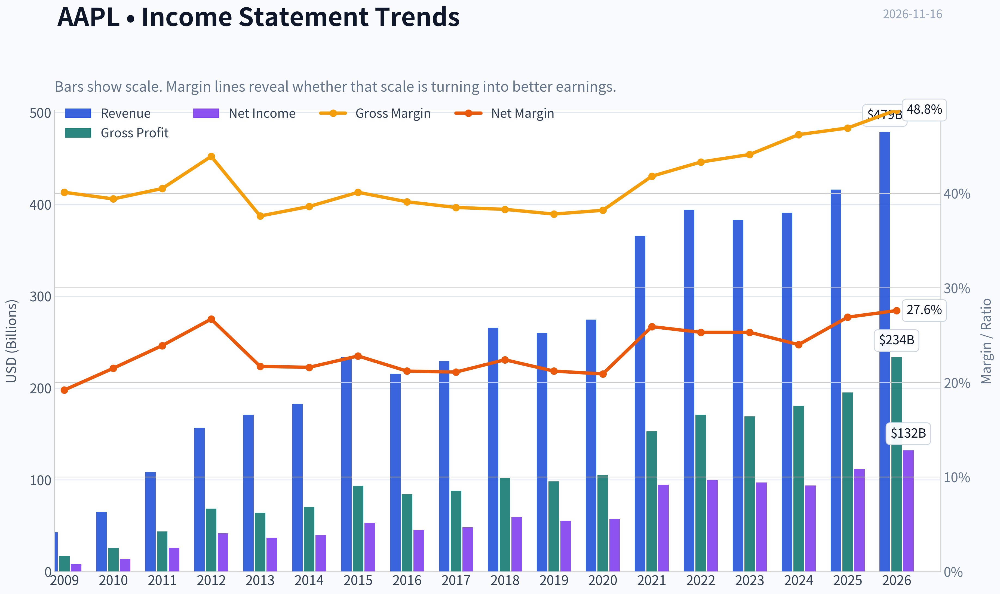
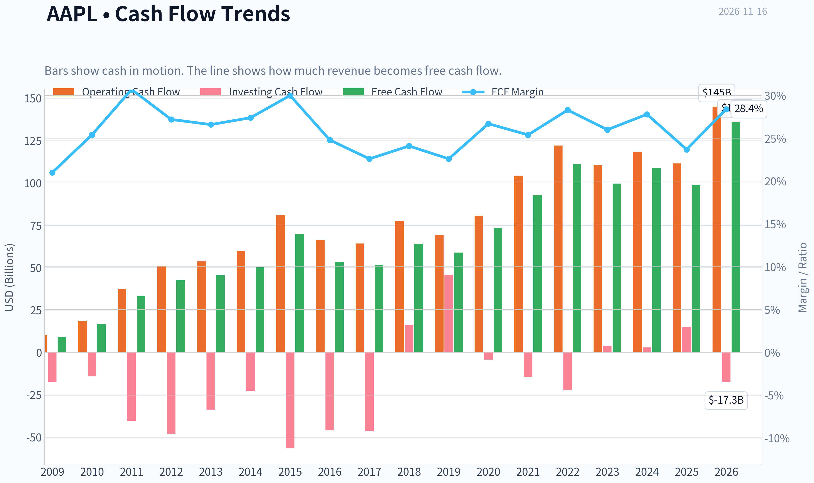
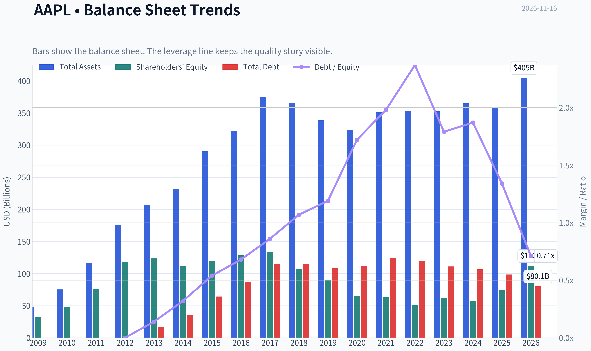
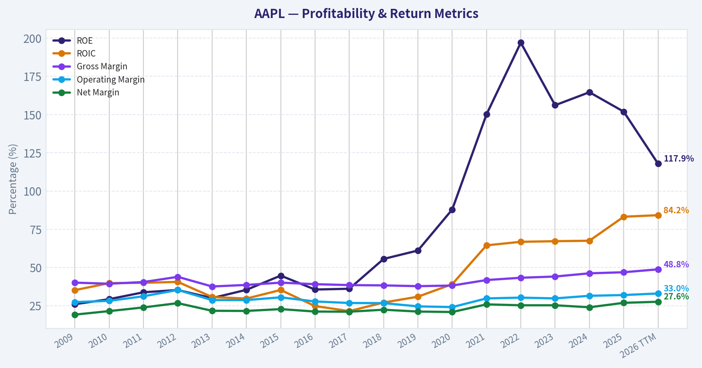
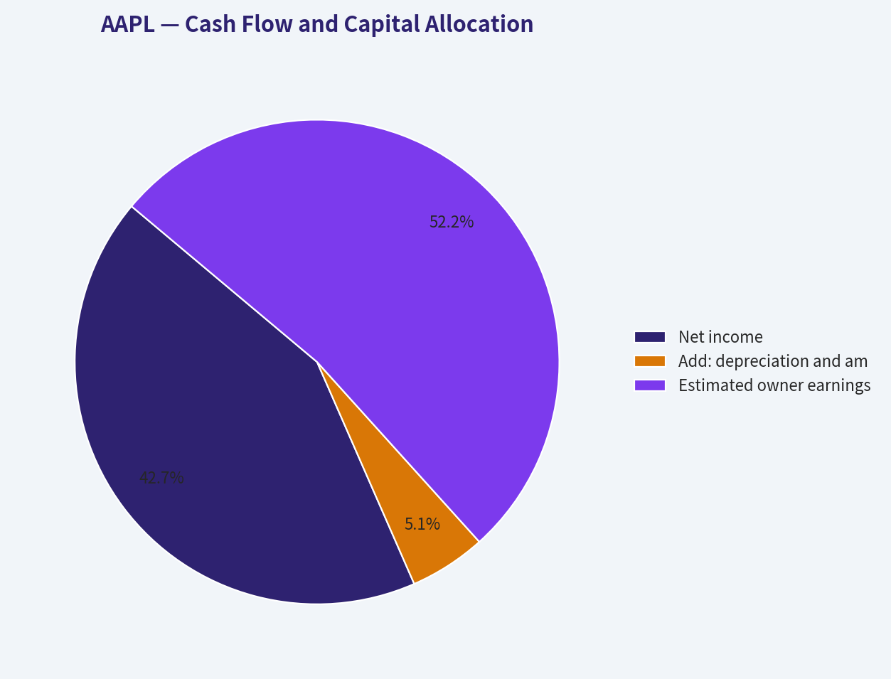
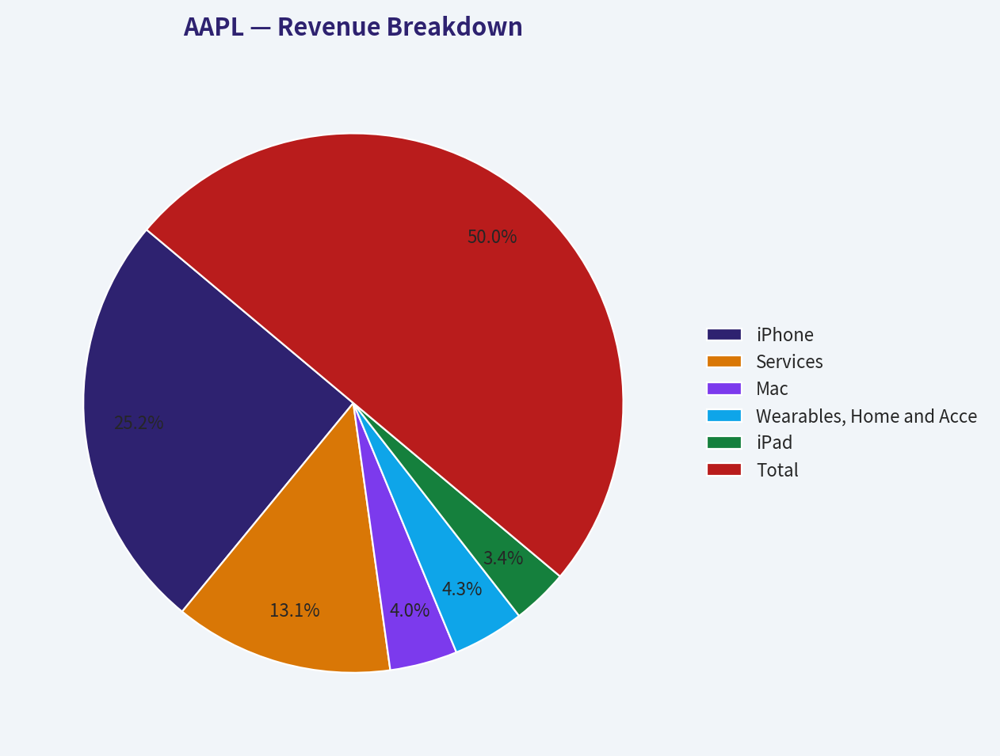
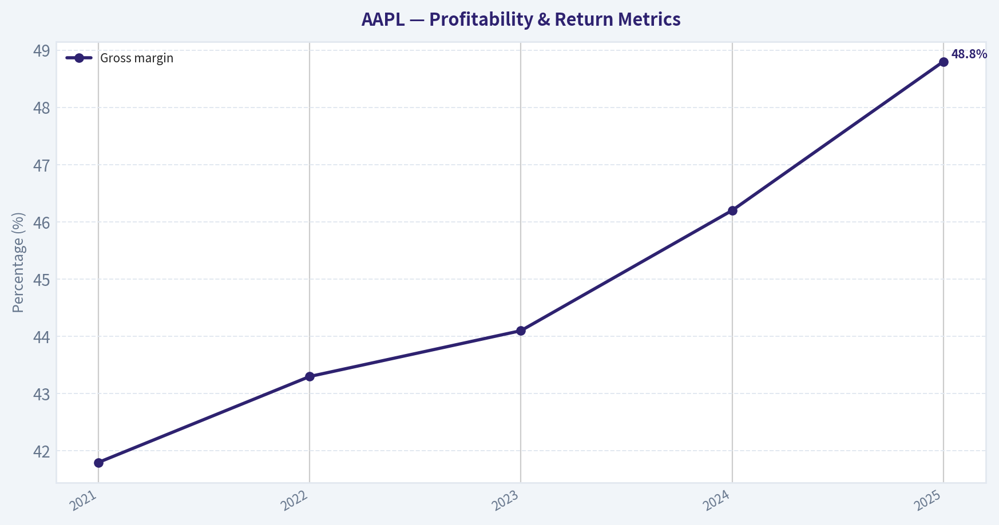
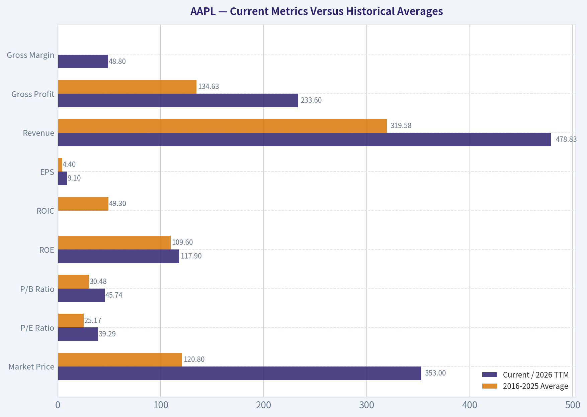
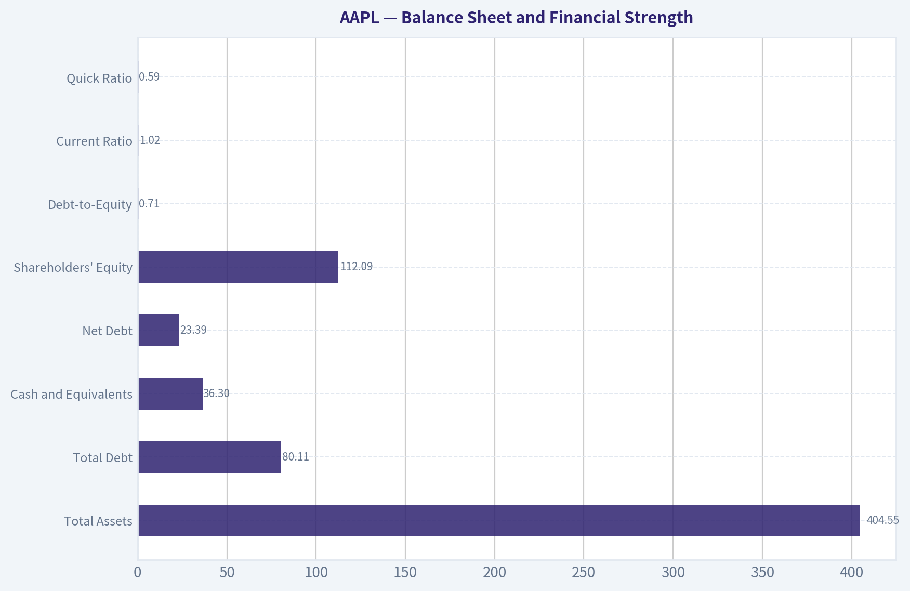

# AAPL Deep Value Intelligence

**Analysis Date:** 2026-11-16

## Critical Disclaimer

*This analysis is generated by Deep Value Intelligence, an AI-powered multi-agent investing framework. Education & research only - not financial advice, not a financial advisor.*

---

## Table of Contents

1. Intelligence Summary
2. Analyst Team Reports
   - Fundamentals Analysis
   - Intrinsic Value Analysis (Buffett)
   - Trend & Growth Analysis (Lynch/Druckenmiller/Fisher)
   - Market Technical Analysis
   - Options Market Analysis
3. Research Team Commentary
4. Value Investing Team Commentary
5. Deep Values Commentary

---

## Intelligence Summary

### Thesis + Conditions

**Core Thesis:** **Business risk is low:** Apple's ecosystem, switching costs, brand, custom silicon, installed base, and **48.8% gross margin** support a durable moat. **Valuation risk is high:** The earnings yield is only about **2.5%**.

**Key Risks:**
- **Business risk is low:** Apple's ecosystem, switching costs, brand, custom silicon, installed base, and **48.8% gross margin** support a durable moat.
- **Valuation risk is high:** The earnings yield is only about **2.5%**. Good operating results could still produce mediocre returns if the multiple normalizes.
- The Risky and Growth Analysts correctly emphasize that Apple is not merely a mature hardware vendor. It monetizes a large installed base through hardware, services, payments, accessories, software, and subscriptions. Its advantages reinforce one another:

**Confidence:** Medium

---

## Analyst Team Reports

### Fundamentals Analysis

#### Latest Earnings Snapshot

*Most recent reported quarter anchored on 2026 Q3, with prior-year comparison when available.*

| Metric | 2026 Q3 | 2025 Q3 | YoY Change |
| --- | ---: | ---: | ---: |
| Revenue | $114.48B | $102.47B | +11.7% |
| Operating Income | $35.63B | $32.43B | +9.9% |
| Net Income | $30.71B | $27.47B | +11.8% |
| Diluted EPS | N/A | $1.85 | N/A |
| Operating Cash Flow | $28.10B | $29.73B | -5.5% |
| Free Cash Flow | $25.86B | $26.49B | -2.4% |

Key Takeaways: This snapshot anchors the most recent reported quarter before the narrative analysis. It helps readers separate long-run business quality from whatever changed in the latest earnings print.

#### 17-Year Financial Metrics for AAPL

*All values below are computed deterministically from raw data - not estimated by AI.*

*Issuer profile: operating company (Technology / Consumer Electronics).*

#### 17-Year Financial Metrics
*Annual rows come from reported financial statements. The final TTM row is computed from the latest four quarters.*

| Metric | 2009 | 2010 | 2011 | 2012 | 2013 | 2014 | 2015 | 2016 | 2017 | 2018 | 2019 | 2020 | 2021 | 2022 | 2023 | 2024 | 2025 | 2026 TTM |
| --- | --- | --- | --- | --- | --- | --- | --- | --- | --- | --- | --- | --- | --- | --- | --- | --- | --- | --- |
| Market Price | $6 | $8 | $11 | $20 | $15 | $22 | $25 | $26 | $36 | $53 | $54 | $112 | $138 | $135 | $169 | $231 | $254 | $353 |
| Market Cap | $168.11B | $262.39B | $357.16B | $630.65B | $444.17B | $616.86B | $638.98B | $621.81B | $809.39B | $1.13T | $1.04T | $2.03T | $2.39T | $2.26T | $2.71T | $3.59T | $3.82T | $5.13T |
| P/E Ratio | 20.41 | 18.73 | 13.78 | 15.10 | 11.99 | 15.62 | 11.96 | 13.60 | 16.73 | 18.94 | 18.85 | 35.31 | 25.22 | 22.62 | 27.93 | 38.32 | 34.13 | 38.79 |
| P/B Ratio | 5.31 | 5.49 | 4.66 | 5.33 | 3.60 | 5.53 | 5.35 | 4.85 | 6.04 | 10.53 | 11.51 | 31.07 | 37.83 | 44.53 | 43.56 | 63.04 | 51.82 | 45.74 |
| ROE | 26.0% | 29.3% | 33.8% | 35.3% | 30.0% | 35.4% | 44.7% | 35.6% | 36.1% | 55.6% | 61.1% | 87.9% | 150.1% | 197.0% | 156.1% | 164.6% | 151.9% | 117.9% |
| ROIC | 35.2% | 39.8% | 40.0% | 40.6% | 30.7% | 29.7% | 35.3% | 24.8% | 21.5% | 27.1% | 30.9% | 39.1% | 64.5% | 66.8% | 67.2% | 67.5% | 83.2% | 84.2% |
| EPS | $0.27 | $0.45 | $0.83 | $1.33 | $1.22 | $1.42 | $2.06 | $1.90 | $2.14 | $2.81 | $2.85 | $3.18 | $5.47 | $5.99 | $6.13 | $6.08 | $7.46 | $9.10 |
| Revenue | $42.91B | $65.22B | $108.25B | $156.51B | $170.91B | $182.79B | $233.72B | $215.64B | $229.23B | $265.60B | $260.17B | $274.51B | $365.82B | $394.33B | $383.29B | $391.04B | $416.16B | $478.83B |
| Gross Profit | $17.22B | $25.68B | $43.82B | $68.66B | $64.30B | $70.54B | $93.63B | $84.26B | $88.19B | $101.84B | $98.39B | $104.96B | $152.84B | $170.78B | $169.15B | $180.68B | $195.20B | $233.60B |
| Gross Margin | 40.1% | 39.4% | 40.5% | 43.9% | 37.6% | 38.6% | 40.1% | 39.1% | 38.5% | 38.3% | 37.8% | 38.2% | 41.8% | 43.3% | 44.1% | 46.2% | 46.9% | 48.8% |
| Operating Margin | 27.4% | 28.2% | 31.2% | 35.3% | 28.7% | 28.7% | 30.5% | 27.8% | 26.8% | 26.7% | 24.6% | 24.1% | 29.8% | 30.3% | 29.8% | 31.5% | 32.0% | 33.0% |
| Net Income | $8.23B | $14.01B | $25.92B | $41.73B | $37.04B | $39.51B | $53.39B | $45.69B | $48.35B | $59.53B | $55.26B | $57.41B | $94.68B | $99.80B | $97.00B | $93.74B | $112.01B | $132.18B |
| Net Margin | 19.2% | 21.5% | 23.9% | 26.7% | 21.7% | 21.6% | 22.8% | 21.2% | 21.1% | 22.4% | 21.2% | 20.9% | 25.9% | 25.3% | 25.3% | 24.0% | 26.9% | 27.6% |
| Revenue Growth | N/A | 52.0% | 66.0% | 44.6% | 9.2% | 7.0% | 27.9% | -7.7% | 6.3% | 15.9% | -2.0% | 5.5% | 33.3% | 7.8% | -2.8% | 2.0% | 6.4% | 15.1% |
| Net Income Growth | N/A | 70.2% | 85.0% | 61.0% | -11.3% | 6.7% | 35.1% | -14.4% | 5.8% | 23.1% | -7.2% | 3.9% | 64.9% | 5.4% | -2.8% | -3.4% | 19.5% | 18.0% |
| Free Cash Flow Growth | N/A | 84.0% | 100.5% | 27.9% | 6.9% | 10.2% | 39.6% | -23.6% | -3.2% | 23.8% | -8.1% | 24.6% | 26.7% | 19.9% | -10.6% | 9.3% | -9.2% | 37.8% |
| Total Book Value | $31.64B | $47.79B | $76.61B | $118.21B | $123.55B | $111.55B | $119.36B | $128.25B | $134.05B | $107.15B | $90.49B | $65.34B | $63.09B | $50.67B | $62.15B | $56.95B | $73.73B | $112.09B |
| Total Assets | $47.50B | $75.18B | $116.37B | $176.06B | $207.00B | $231.84B | $290.35B | $321.69B | $375.32B | $365.73B | $338.52B | $323.89B | $351.00B | $352.75B | $352.58B | $364.98B | $359.24B | $404.55B |
| Total Debt | N/A | N/A | N/A | $0 | $16.96B | $35.30B | $64.33B | $87.03B | $115.68B | $114.48B | $108.05B | $112.44B | $124.72B | $120.07B | $111.09B | $106.63B | $98.66B | $80.11B |
| Debt-to-Equity | N/A | N/A | N/A | 0.00 | 0.14 | 0.32 | 0.54 | 0.68 | 0.86 | 1.07 | 1.19 | 1.72 | 1.98 | 2.37 | 1.79 | 1.87 | 1.34 | 0.71 |
| Cash & Equivalents | $5.26B | $11.26B | $9.81B | $10.75B | $14.26B | $13.84B | $21.12B | $20.48B | $20.29B | $25.91B | $48.84B | $38.02B | $34.94B | $23.65B | $29.96B | $29.94B | $35.93B | $36.30B |
| Shareholders' Equity | $31.64B | $47.79B | $76.61B | $118.21B | $123.55B | $111.55B | $119.36B | $128.25B | $134.05B | $107.15B | $90.49B | $65.34B | $63.09B | $50.67B | $62.15B | $56.95B | $73.73B | $112.09B |
| Operating Cash Flow | $10.16B | $18.59B | $37.53B | $50.86B | $53.67B | $59.71B | $81.27B | $66.23B | $64.22B | $77.43B | $69.39B | $80.67B | $104.04B | $122.15B | $110.54B | $118.25B | $111.48B | $145.10B |
| Investing Cash Flow | $-17.43B | $-13.85B | $-40.42B | $-48.23B | $-33.77B | $-22.58B | $-56.27B | $-45.98B | $-46.45B | $16.07B | $45.90B | $-4.29B | $-14.54B | $-22.35B | $3.71B | $2.94B | $15.20B | $-17.28B |
| Free Cash Flow | $9.02B | $16.59B | $33.27B | $42.56B | $45.50B | $50.14B | $70.02B | $53.50B | $51.77B | $64.12B | $58.90B | $73.36B | $92.95B | $111.44B | $99.58B | $108.81B | $98.77B | $136.06B |
| FCF Margin | 21.0% | 25.4% | 30.7% | 27.2% | 26.6% | 27.4% | 30.0% | 24.8% | 22.6% | 24.1% | 22.6% | 26.7% | 25.4% | 28.3% | 26.0% | 27.8% | 23.7% | 28.4% |
| Dividends / Share | $0.00 | $0.00 | $0.00 | $0.00 | $0.00 | $0.00 | $0.00 | $0.00 | $0.00 | $0.00 | $0.00 | $0.00 | $0.00 | $0.00 | $0.95 | $0.99 | $1.03 | $1.08 |

#### Profitability Metrics
- Return on Equity (ROE): 117.9%
- Return on Invested Capital (ROIC): 96.8%
- Return on Assets (ROA): 32.7%
- Gross Margin: 48.8%
- Operating Margin: 33.0%
- Net Profit Margin: 27.6%

#### Liquidity Metrics
- Current Ratio: 1.02
- Quick Ratio: 0.59

#### Leverage Metrics
- Debt-to-Equity Ratio: 0.71
- Interest Coverage Ratio: N/A
- Net Debt: $23.39B

#### Growth Metrics (Year-over-Year)
- Revenue Growth: 15.1%
- Net Income Growth: 18.0%
- Free Cash Flow Growth: 37.8%
- Revenue CAGR (3-Year): 7.7%
- Revenue CAGR (5-Year): 5.5%

#### Valuation Metrics
- P/E Ratio (TTM): 39.29
- Forward P/E: 33.37
- Price-to-Book: 45.74
- Price-to-Sales: 10.71
- PEG Ratio: 2.88
- EV/EBITDA: 30.12
- Free Cash Flow Yield: 2.7%
- Earnings Yield: 2.5%

#### Owner Earnings (Buffett Method, Code-Computed)
- Net Income: $112.01B
- + Depreciation & Amortization: $13.42B
- - Capital Expenditures: $-9.04B
- - Working Capital Changes: $-14.86B
- = **Owner Earnings: $137.01B**

#### Intrinsic Value (Code-Computed)
- Current Price: $353
- **Headline Intrinsic Value (business-model routed): $225**
  Business model: operating company - weighted blend [Damodaran FCFF + reverse-DCF fair + owner-earnings DCF] (operating_company)
  Model spread (min-max across DCFs): $191 - $266
  Margin of safety vs. price (headline): -56.5%
  Routing note: General operating company: balanced blend of Damodaran FCFF and the owner-earnings DCF with a reverse-DCF sanity check.
- Buffett Method (Owner Earnings):
  Conservative: $137
  Average: $266
  Optimistic: $718
- Cash Flow Method (FCF):
  Conservative: $87
  Average: $206
  Optimistic: $275
- Damodaran FCFF (WACC + margins + reinvestment):
  Conservative: $109
  Average: $191
  Optimistic: $402
  Monte Carlo band (P10-P90): $138 - $305 (median $201)
  P(intrinsic value > price): 4.4%
- Reverse-DCF: price implies ~28.5%/yr owner-earnings growth for 10y; trailing 3y was 15.4%, 5y 22.3%.

#### Piotroski F-Score: 9/9
- Positive Net Income: PASS
- Positive Operating Cash Flow: PASS
- ROA Improvement: PASS
- Cash Flow > Net Income: PASS
- Decreasing Debt: PASS
- Improving Current Ratio: PASS
- No Dilution: PASS
- Improving Gross Margin: PASS
- Improving Asset Turnover: PASS

ANALYST STANCE: **Bearish**

#### Executive Summary

Apple remains an exceptional operating business, but the current share price appears to discount an unusually aggressive growth path. The deterministic dataset shows outstanding profitability, improving margins, strong free cash flow, declining debt, and a Piotroski F-Score of 9/9. However, at **$353 per share**, Apple trades at approximately **39.3 times earnings**, produces only a **2.7% free-cash-flow yield**, and requires roughly **28.5% annual owner-earnings growth for ten years** according to the reverse DCF.

The business quality supports a premium valuation. The current valuation does not provide an adequate margin of safety for a Buffett-style investor.

#### Current Metrics Versus Historical Averages

The comparisons below use the deterministic annual data from **2016 through 2025** as the historical reference period. The current column uses the latest 2026 TTM or current valuation data supplied in the dataset.

| Metric | Current / 2026 TTM | 2016-2025 Average | Interpretation |
|---|---:|---:|---|
| Market Price | $353 | $120.80 | Nearly three times the historical average |
| Market Capitalization | $5.13T | $2.04T | Scale and valuation have expanded dramatically |
| P/E Ratio | 39.29 | 25.17 | About 56% above the decade average |
| P/B Ratio | 45.74 | 30.48 | Not meaningful for Apple's asset-light, buyback-heavy model |
| ROE | 117.9% | 109.6% | Exceptional, though partly amplified by reduced book equity |
| ROIC | 84.2% in the historical table; 96.8% in the latest profitability snapshot | 49.3% | Well above historical norms |
| EPS | $9.10 | $4.40 | More than twice the decade average |
| Revenue | $478.83B | $319.58B | Strong long-term expansion |
| Gross Profit | $233.60B | $134.63B | Growth plus significant margin expansion |
| Gross Margin | 48.8% | Approximately 42.0% | Record-level profitability |
| Operating Margin | 33.0% | 28.3% | Material improvement versus the decade average |
| Net Income | $132.18B | $76.35B | Earnings power has expanded substantially |
| Net Margin | 27.6% | 23.4% | Current profitability is well above normal historical levels |
| Free Cash Flow | $136.06B | $81.32B | Strong cash generation and recovery |
| Revenue Growth | 15.1% | Approximately 8.5% | Current growth is above the mature-company norm |
| Net Income Growth | 18.0% | Approximately 15.0% | Strong current earnings momentum |
| Free Cash Flow Growth | 37.8% | Approximately 15.5% | Particularly strong latest-year cash-flow rebound |
| Total Assets | $404.55B | Approximately $350.57B | Balance sheet has expanded, though less rapidly than earnings |
| Total Book Value | $112.09B | Approximately $83.19B | Buybacks and capital returns make book value less economically informative |
| Total Debt | $80.11B | Approximately $98.96B | Debt has declined from recent levels |
| Debt-to-Equity | 0.71 | 1.49 | Considerably improved |
| Cash and Equivalents | $36.30B | Approximately $31.80B | Solid liquidity, although not excessive relative to market value |
| Shareholders' Equity | $112.09B | Approximately $83.19B | Recent recovery after years of buybacks |
| Dividends per Share | $1.08 | Approximately $0.30 | Consistent but modest cash dividend |

**Key Takeaways:** Apple's current operating performance is stronger than its historical average across revenue, margins, earnings, ROIC, and free cash flow. The key exception is valuation: the P/E multiple is substantially above its decade norm, while the free-cash-flow yield is only 2.7%. Apple's book multiple should not be used as a conventional cheap-versus-expensive signal because buybacks and the company's asset-light economics make book value a poor valuation anchor.

#### Market Metrics and Valuation

- **Market price:** $353.
- **Market capitalization:** $5.13 trillion.
- **P/E ratio:** 39.29 times trailing earnings, versus approximately 25.17 times for 2016-2025.
- **Forward P/E:** 33.37 times, which still implies a demanding valuation even assuming continued earnings growth.
- **Price-to-sales:** 10.71 times.
- **EV/EBITDA:** 30.12 times.
- **Earnings yield:** approximately 2.5%.
- **Free-cash-flow yield:** 2.7%.
- **PEG ratio:** 2.88.

Apple's valuation is not supported merely by current growth. To justify $353 using the reverse DCF, owner earnings would need to compound at approximately **28.5% annually for ten years**. That is materially above the company's trailing three-year owner-earnings growth of about **15.4%** and its five-year rate of about **22.3%**.

The **P/B ratio of 45.74 is not meaningful** as a traditional value metric. Apple has substantial intangible economic assets, brand value, ecosystem effects, and accumulated share repurchases that distort book equity. The proper valuation anchors are owner earnings, free cash flow, reinvestment returns, and the durability of the ecosystem.

#### Profitability and Earnings Quality

Apple's profitability is outstanding:

- **ROE:** 117.9%.
- **ROIC:** 84.2% in the historical table, with the latest profitability summary reporting 96.8%.
- **Gross margin:** 48.8%.
- **Operating margin:** 33.0%.
- **Net margin:** 27.6%.
- **Net income:** $132.18 billion.
- **EPS:** $9.10.
- **Revenue:** $478.83 billion.
- **Gross profit:** $233.60 billion.

The margin trend is particularly important. Gross margin has risen from the high-30% range in much of the earlier decade to 48.8% currently. Operating margin has also improved from approximately 24%-28% during weaker years to 33.0% currently. This indicates a more valuable business mix, stronger Services economics, pricing power, supply-chain benefits, and operating leverage.

ROE is exceptionally high but requires interpretation. Apple's buybacks have reduced book equity, meaning ROE is amplified by a smaller denominator. ROIC is therefore the more useful measure of operating quality, and it too is extraordinarily high. The company appears to earn far more on invested capital than its cost of capital, demonstrating a powerful economic moat.

Earnings are not perfectly predictable. Apple experienced revenue declines in 2016, 2019, and 2023, and net income declined in several periods. Nevertheless, the long-term direction is strongly upward, margins are more resilient than revenue, and cash conversion remains excellent.

#### Growth Analysis

Apple's latest growth rates are strong:

- Revenue growth: **15.1%**
- Net income growth: **18.0%**
- Free cash flow growth: **37.8%**
- Three-year revenue CAGR: **7.7%**
- Five-year revenue CAGR: **5.5%**

The latest free-cash-flow growth rate is unusually high and should not be extrapolated indefinitely. Apple's longer-term revenue growth is more consistent with a mature global platform business than with a 28% compounder. Its growth can still exceed nominal GDP if it successfully monetizes Services, upgrades its installed base, expands into new product categories, and increases average revenue per user. However, the current stock price appears to require those favorable outcomes simultaneously.

#### Balance Sheet and Financial Strength

| Balance-Sheet Metric | Current Value | Buffett-Style Assessment |
|---|---:|---|
| Total Assets | $404.55B | Large, productive asset base |
| Total Debt | $80.11B | Manageable and declining |
| Cash and Equivalents | $36.30B | Solid liquidity, though modest relative to market capitalization |
| Net Debt | $23.39B | Low relative to annual free cash flow |
| Shareholders' Equity | $112.09B | Recovering, but distorted by buybacks |
| Debt-to-Equity | 0.71 | Improved significantly from 1.98 in 2021 and 2.37 in 2022 |
| Current Ratio | 1.02 | Adequate but not a major strength |
| Quick Ratio | 0.59 | Weak on a conventional liquidity basis, although Apple's cash generation offsets concern |
| Piotroski F-Score | 9/9 | Excellent overall financial trend |

**Key Takeaways:** Apple's debt position has improved meaningfully, and net debt is small relative to free cash flow. Conventional liquidity ratios are not especially strong, but the company's enormous recurring cash generation, ecosystem-based demand, and access to capital reduce balance-sheet risk. The main balance-sheet caution is not solvency; it is that current liquidity provides little valuation protection at a $5.13 trillion market capitalization.

Debt-to-equity should also be interpreted carefully because shareholder equity is affected by repurchases. Still, the decline in total debt from approximately $125 billion in 2021 to $80 billion currently is favorable.

#### Cash Flow and Capital Allocation

Apple generated:

- **Operating cash flow:** $145.10 billion.
- **Free cash flow:** $136.06 billion.
- **Owner earnings:** $137.01 billion under the deterministic Buffett-method calculation.
- **Dividends per share:** $1.08.

Owner earnings are calculated as:

| Owner-Earnings Calculation | Amount |
|---|---:|
| Net income | $112.01B |
| Add: depreciation and amortization | $13.42B |
| Less: capital expenditures | $(9.04)B |
| Less: working-capital changes | $(14.86)B |
| Estimated owner earnings | $137.01B |

**Key Takeaways:** Apple converts a very high proportion of accounting earnings into cash. The $137.01 billion owner-earnings figure is close to free cash flow, supporting the conclusion that reported profits are high quality. Capital allocation has favored buybacks, dividends, ecosystem investment, and strategic research and development rather than acquisitions or excessive debt accumulation.

The dividend is reliable but not the principal investment case. At $1.08 per share, the dividend yield is only about **0.3%** at the current price. Most shareholder returns must therefore come from earnings growth and future multiple support.

#### Revenue Breakdown

The deterministic dataset does not provide a segment-level revenue split. The following table uses approximate latest fiscal-year segment reporting for the most recent revenue base of approximately **$416.16 billion**.

| Revenue Source | Amount ($B) | % of Total |
|---|---:|---:|
| iPhone | $209.6B | 50.4% |
| Services | $109.2B | 26.2% |
| Mac | $33.7B | 8.1% |
| Wearables, Home and Accessories | $35.7B | 8.6% |
| iPad | $28.0B | 6.7% |
| **Total** | **$416.2B** | **100.0%** |

**Key Takeaways:** The iPhone remains the economic foundation, contributing approximately half of revenue. Services is the most important diversification engine because it typically carries higher margins and creates recurring monetization from the installed base. The central strategic risk is that Apple remains highly dependent on the iPhone for revenue, even though Services increasingly supports profitability and customer retention.

The latest TTM revenue of $478.83 billion is above the approximately $416 billion fiscal-year segment base used in this illustrative breakdown.

#### Economic Moat and Business Durability

Apple has several mutually reinforcing competitive advantages:

1. **Brand and customer loyalty:** Apple commands premium pricing and benefits from unusually high customer retention.
2. **Integrated ecosystem:** Hardware, software, operating systems, cloud services, payments, subscriptions, and accessories reinforce one another.
3. **Switching costs:** Users accumulate applications, data, accessories, habits, and social connections within the Apple environment.
4. **Distribution and scale:** Apple's purchasing power, global retail presence, and supplier relationships are difficult to replicate.
5. **Developer network effects:** A large installed base attracts developers, which improves product utility and supports further adoption.
6. **Services monetization:** The installed base produces recurring revenue opportunities beyond device sales.
7. **Capital allocation flexibility:** The company can fund research, dividends, buybacks, supply-chain investments, and strategic initiatives from internal cash generation.

The moat is durable, but not invulnerable. Risks include smartphone saturation, regulatory pressure on the App Store, geopolitical and supply-chain exposure, competition in artificial intelligence, and the possibility that consumers lengthen device replacement cycles.

#### Three-Scenario Buffett-Style Owner-Earnings DCF

The deterministic owner-earnings base is **$137.01 billion**. For the hand DCF sanity check, I use approximately **14.53 billion shares**, inferred from the current market capitalization and share price. The discount rate is **10%**, and the terminal growth rate is **2.5%**.

These hand calculations are deliberately separate from the stronger model-routed intrinsic-value estimate. They should be viewed as a reasonableness check, not as a replacement for the deterministic model pack.

| Scenario | Explicit Growth Assumption | Hand DCF Value per Share | Model-Based Reference | Interpretation |
|---|---|---:|---:|---|
| Conservative | 3% owner-earnings growth for ten years, then 2.5% terminal growth | Approximately $132 | $87-$137 depending on model | Reflects mature-company economics and limited upside |
| Average | Growth fades from 12% toward 4% over ten years, then 2.5% terminal growth | Approximately $204 | Approximately $206-$266 | Requires strong ecosystem monetization but not extraordinary perpetual growth |
| Optimistic | Growth fades from 18% toward 6% over ten years, then 2.5% terminal growth | Approximately $286 | Approximately $275-$402 | Assumes strong Services expansion, durable pricing power, and successful new opportunities |
| Routed headline intrinsic value | Weighted blend of Owner Earnings, FCF, Damodaran FCFF, and reverse DCF | - | **$225** | Preferred overall valuation anchor |
| Current market price | - | - | **$353** | Materially above the valuation range |

**Key Takeaways:** Even the optimistic hand DCF does not reach the current $353 share price. The deterministic model blend places intrinsic value near $225, with model outputs ranging from approximately $191 to $266 for the principal owner-earnings, FCF, and FCFF estimates. The current price therefore offers a negative margin of safety unless Apple sustains growth materially above its historical operating trajectory.

A simplified average-case calculation illustrates the issue:

- Starting owner earnings: **$137.01B**
- Ten-year owner earnings after fading growth: approximately **$305.95B**
- Present value of explicit-period cash flows: approximately **$1.36T**
- Terminal value before discounting: approximately **$4.18T**
- Present value of terminal value: approximately **$1.61T**
- Estimated equity value: approximately **$2.97T**
- Estimated value per share: approximately **$204**

The market capitalization of $5.13 trillion is substantially above this average-case estimate.

#### Quality of Business

Apple scores extremely well on business quality:

| Quality Dimension | Assessment | Evidence |
|---|---|---|
| Economic moat | Very strong | Brand, ecosystem, switching costs, scale, network effects |
| Profitability | Exceptional | 48.8% gross margin, 33.0% operating margin, high ROIC |
| Cash generation | Exceptional | $136.06B FCF and $137.01B owner earnings |
| Balance-sheet risk | Low to moderate | Debt declining; net debt only $23.39B |
| Earnings predictability | Strong but cyclical | Long-term growth is excellent, but annual revenue declines have occurred |
| Capital allocation | Strong | Buybacks, dividends, R&D, and disciplined debt management |
| Growth runway | Good, not unlimited | Services, installed-base monetization, AI, and new products |
| Valuation | Unfavorable | 39.3x P/E and 2.7% FCF yield |

**Key Takeaways:** Apple is a high-quality compounder with one of the strongest consumer technology moats in the world. The concern is not business durability; it is the price paid for that durability. At the current valuation, even a small slowdown in growth, margin expansion, or multiple support could produce disappointing shareholder returns.

#### Key Investment Insights, Risks, and Opportunities

| Category | Insight |
|---|---|
| Major strength | Apple combines high customer loyalty, recurring Services revenue, premium pricing, and extraordinary cash generation |
| Major valuation concern | The 39.3x P/E and 2.7% FCF yield imply unusually optimistic future performance |
| Growth opportunity | Services, subscriptions, payments, advertising, cloud offerings, and monetization of the installed base |
| Strategic opportunity | Artificial intelligence could increase device utility, upgrade demand, and Services engagement |
| Margin opportunity | Continued mix shift toward Services and premium products could preserve high margins |
| Balance-sheet positive | Debt has fallen materially, while free cash flow remains very strong |
| Principal operating risk | iPhone dependence and mature smartphone replacement cycles |
| Regulatory risk | App Store commissions, payment rules, antitrust scrutiny, and platform restrictions |
| Geopolitical risk | Manufacturing and supply-chain exposure, particularly involving China and Taiwan |
| Technology risk | A failure to lead in artificial intelligence could weaken ecosystem differentiation |
| Valuation red flag | Reverse DCF requires approximately 28.5% annual owner-earnings growth for ten years |
| Shareholder-return risk | A low dividend yield means returns depend heavily on earnings growth and valuation preservation |

#### Final Investment Stance

**Bearish at $353; Neutral for a materially better entry point.**

Apple deserves a premium valuation because its moat, profitability, capital allocation, and cash generation are exceptional. The current financial condition is strong, the Piotroski F-Score is 9/9, and recent growth is impressive.

However, Buffett-style investing requires both a wonderful business and a sensible purchase price. The deterministic valuation evidence does not support the current price:

- Headline intrinsic value: approximately **$225**
- Principal model range: approximately **$191-$266**
- Conservative owner-earnings value: approximately **$137**
- Average hand DCF: approximately **$204**
- Optimistic hand DCF: approximately **$286**
- Current price: **$353**
- Margin of safety versus headline intrinsic value: approximately **negative 56.5%**

A more attractive entry point would require either a substantial decline in price, a sustained increase in owner earnings beyond current expectations, or clear evidence that Apple can maintain unusually high growth for many years. Until then, Apple is best treated as a high-quality business whose stock offers an unfavorable risk-reward profile.

| Final Area | Conclusion |
|---|---|
| Business quality | Excellent |
| Economic moat | Very strong and durable |
| Financial strength | Strong, with declining debt and high cash generation |
| Profitability | Exceptional and above historical averages |
| Earnings predictability | Strong over the long term, though not perfectly smooth |
| Growth outlook | Attractive but unlikely to justify current implied growth requirements with high confidence |
| Valuation | Expensive relative to earnings, free cash flow, and intrinsic-value estimates |
| Dividend appeal | Low yield; secondary to buybacks and capital appreciation |
| Buffett-style decision | Avoid at current price; watch for a margin-of-safety entry |
| Final stance | **Bearish** |

#### Fundamental Visuals

This graph tracks the profitability and return metrics (ROE, ROIC, Margins) of **AAPL** over the past decade, highlighting capital efficiency trends.

This chart illustrates the financial health of **AAPL** over the last 10 years, mapping cash equivalents and free cash flow against total obligations (Debt).

This breakdown chart from <em>Cash Flow and Capital Allocation</em> shows the proportional composition for **AAPL** - useful for understanding what drives or risks the business.

This breakdown chart from <em>Revenue Breakdown</em> shows the proportional composition for **AAPL** - useful for understanding what drives or risks the business.

This graph tracks the profitability and return metrics (ROE, ROIC, Margins) of **AAPL** over the past decade, highlighting capital efficiency trends.

---

### Intrinsic Value Analysis (Buffett)

> *Following Warren Buffett's value investing philosophy: Circle of Competence, Economic Moat, Management Quality, and Margin of Safety.*

#### Intrinsic Value Snapshot

Price is what you pay. Intrinsic value is what the business may be worth based on the cash it can create for owners over time. We show a range, not one magic number.

- Current Price: $352.78
- Value Range (conservative to optimistic across both DCF methods): $87.01 to $718.43

##### Owner Earnings (Buffett Method)
- Net Income: $112,010,000,000.00
- Depreciation & Amortization: $13,423,000,000.00
- Capital Expenditures: $-9,041,000,000.00
- Working Capital Changes: $-14,858,000,000.00
- Owner Earnings: $137,010,000,000.00

##### Intrinsic Value
###### Buffett Method
Uses owner earnings. Stricter, and usually more conservative.
- Conservative: $136.70
- Average: $266.41
- Optimistic: $718.43
- Discount Rate: 10.0%

###### Cash Flow Method
Uses free cash flow. Better for companies spending heavily today to grow tomorrow.
- Conservative: $87.01
- Average: $206.08
- Optimistic: $275.42
- Discount Rate: 10.0%

ANALYST STANCE: **Neutral**

#### Executive View

Apple is an exceptional business with a powerful ecosystem, outstanding cash generation, high returns on capital, and a long reinvestment runway. The problem is price: at approximately **$353 per share**, the stock trades far above the research pack's intrinsic-value estimates, while the reverse DCF implies roughly **28.5% annual growth for the next decade**.

That is a heroic expectation for a company of Apple's scale. I would happily own Apple, but would wait for a materially better entry price.

#### Factor Scorecard

| Factor | Score | Assessment |
|---|---:|---|
| 1. Circle of competence and simplicity | 4/5 | Apple sells integrated hardware, software, services, and subscriptions. The model is understandable, although future growth depends increasingly on AI, services, and new product categories. |
| 2. Durable competitive advantage | 5/5 | Wide and widening moat from brand, ecosystem lock-in, switching costs, distribution, silicon design, and developer/customer network effects. |
| 3. Management and capital allocation | 4/5 | Strong capital discipline, enormous buybacks, substantial dividends, and consistent reinvestment. Shareholder alignment is good, though current leadership has less founder-like ownership than Steve Jobs-era Apple. |
| 4. Industry structure | 4/5 | Apple operates in competitive technology and consumer electronics markets, but its ecosystem, scale, and premium positioning create unusually attractive economics. |

**Gate 5-quality and solvency:** **Not tripped.** Apple does not show the combination of deteriorating earnings and financial distress required for a hard avoid. Interest coverage and cash generation are very strong.

#### Financial Summary

Approximate fiscal-year figures, in billions of dollars except per-share data.

| Fiscal year | Revenue | Net income | Operating cash flow | Free cash flow | Gross margin |
|---|---:|---:|---:|---:|---:|
| 2021 | $365.8 | $94.7 | $104.0 | ~$93.0 | 41.8% |
| 2022 | $394.3 | $99.8 | $122.2 | ~$111.4 | 43.3% |
| 2023 | $383.3 | $97.0 | $110.5 | ~$99.6 | 44.1% |
| 2024 | $391.0 | $93.7 | $118.3 | ~$108.8 | 46.2% |
| 2025 | $416.2 | $112.0 | ~$111.5 | ~$98.8 | 48.8% |

**Key Takeaways:** Apple has compounded enormous cash flows while expanding gross margin to approximately 48.8%. Revenue growth has not been linear, but the business has remained highly profitable through product cycles and generated operating cash flow at or above net income. The latest research pack reports approximately 15.1% year-over-year revenue growth.

#### Moat Analysis

| Moat source | Evidence | Strength |
|---|---|---|
| Brand and intangible assets | Apple commands premium pricing and maintains unusually high customer loyalty. | Excellent |
| Switching costs | Photos, messages, applications, payments, devices, cloud services, accessories, and workflows are integrated across the ecosystem. | Excellent |
| Cost and scale advantages | Massive scale supports custom silicon, supply-chain purchasing, retail distribution, and marketing efficiency. | Strong |
| Network effects | More users attract developers and accessory makers; more applications and services reinforce user retention. | Strong |
| Reinvestment runway | Services, wearables, AI-enabled devices, health technology, payments, and emerging product categories remain substantial opportunities. | Strong |

Apple's moat is not merely its logo. It is the combination of hardware, operating systems, services, custom chips, developer economics, retail reach, and user data continuity. A competitor may match one product, but replicating the entire ecosystem is extraordinarily difficult.

The principal risk is that future innovation or artificial intelligence could weaken ecosystem relevance. At present, Apple's installed base and financial resources give it significant time and capital to adapt.

#### Management Quality and Capital Allocation

Apple has demonstrated rational capital allocation over a long period:

- Returned substantial capital through buybacks and dividends.
- Reduced share count over time, increasing each remaining shareholder's ownership percentage.
- Invested heavily in custom silicon, services, supply-chain capability, and ecosystem integration.
- Avoided excessive financial leverage relative to its cash-generation capacity.
- Maintained strong operating discipline despite its enormous scale.

Warren Buffett's Berkshire Hathaway continued to hold approximately **227.9 million Apple shares** at the latest reported quarter. That is supportive evidence of the franchise's quality, but not a substitute for valuation analysis.

#### Owner Earnings Calculation

Approximate latest-year calculation, in billions of dollars:

| Item | Amount |
|---|---:|
| Net income | $112.0 |
| Depreciation and amortization | +$11.7 |
| Less: estimated maintenance capital expenditure | -$12.7 |
| Less: estimated working-capital investment | -$12.2 |
| Estimated owner earnings | **~$98.8** |

**Key Takeaways:** Apple's free cash flow is a reasonable proxy for owner earnings because capital expenditure is modest relative to operating cash flow and the business is not heavily dependent on continuous physical expansion. The resulting owner-earnings estimate is approximately $98.8 billion, or roughly $6.60 per share using an approximately 15-billion diluted share count.

#### Three-Scenario DCF Valuation

Using estimated owner earnings of approximately $98.8 billion and a 10% discount rate:

| Scenario | Assumption | Estimated value per share |
|---|---|---:|
| A: No growth | Owner earnings capitalized at 10% | ~$220 |
| B: GDP growth | 3% perpetual growth | ~$325 |
| C: Historical-growth case | Approximately 7.7% growth for 10 years, then 3% terminal growth | ~$309 |
| Research-pack headline value | Weighted blend of FCFF, reverse DCF, and owner-earnings models | **$225** |
| Three-model range | Owner earnings / FCF / Damodaran FCFF | **$266 / $206 / $191** |

**Key Takeaways:** Even generous assumptions produce values below the current price of approximately $353. The conservative models cluster around $190 to $266 per share, while a more optimistic long-term growth case reaches roughly $309. The valuation does not provide a conventional margin of safety.

#### Margin of Safety Analysis

| Measure | Result |
|---|---:|
| Current price | $353 |
| Headline intrinsic value | $225 |
| Premium to headline value | ~56.5% |
| Owner-earnings DCF value | $266 |
| Premium to owner-earnings value | ~33% |
| Optimistic historical-growth value | ~$309 |
| Premium to optimistic value | ~14% |
| Reverse-DCF implied 10-year growth | ~28.5% annually |
| Recent trailing three-year growth | ~15.4% |
| Recent trailing five-year growth | ~22.3% |

**Key Takeaways:** Apple's quality could justify paying a modest premium to conservative value, but the current price is well beyond that range. The reverse DCF is especially demanding: sustaining roughly 28.5% annual growth for ten years would be difficult for a company already generating hundreds of billions of dollars in revenue.

#### Buffett Scorecard

| Criterion | Weight | Score | Weighted contribution |
|---|---:|---:|---:|
| Moat width and durability | 25% | 5/5 | 1.25 |
| Valuation and margin of safety | 20% | 1/5 | 0.20 |
| Capital returns versus WACC | 15% | 5/5 | 0.75 |
| Business understanding and predictability | 12% | 4/5 | 0.48 |
| Management and capital allocation | 12% | 4/5 | 0.48 |
| Reinvestment runway | 8% | 4/5 | 0.32 |
| Balance-sheet strength | 4% | 4/5 | 0.16 |
| Industry structure | 4% | 4/5 | 0.16 |
| **Total** | **100%** |  | **3.80/5** |

#### Investment Stance

**Neutral - High conviction in the business, low conviction in the current price.**

Apple is a genuine Buffett-quality compounder: understandable, exceptionally profitable, capital-light relative to its earnings power, and protected by a wide ecosystem moat. The business merits a premium valuation, but the current price appears to discount a highly optimistic decade of growth.

A more attractive entry zone would be closer to the **$225-$275 range**, depending on the durability of growth and the prevailing discount rate. At approximately $353, Apple is a wonderful business priced more like a perfect business.
#### Valuation Bridge

This bridge places the current market price beside each intrinsic value lens so readers can see whether upside depends on one method or shows up across several methods.

| Scenario | Intrinsic Value / Share |
| --- | ---: |
| Buffett Method | $266.41 |
| Cash Flow Method | $206.08 |
| Damodaran Method | $190.53 |
| Current Price | $352.78 |

#### Key Takeaways

If one method is far above the others, the upside case depends on a specific modelling assumption. When several methods cluster together, the valuation story is more robust.

#### Valuation Visuals

This comparison chart from *Latest Earnings Snapshot* stacks current figures against historical benchmarks for **AAPL**, making it easy to see where the company trades relative to its own averages.

This comparison chart from *Current Metrics Versus Historical Averages* stacks current figures against historical benchmarks for **AAPL**, making it easy to see where the company trades relative to its own averages.

This comparison chart from *Balance Sheet and Financial Strength* stacks current figures against historical benchmarks for **AAPL**, making it easy to see where the company trades relative to its own averages.

---

### Trend & Growth Analysis (Lynch/Druckenmiller/Fisher)

> *Following Peter Lynch's GARP, Stanley Druckenmiller's macro-aware approach, and Philip Fisher's scuttlebutt methodology.*

ANALYST STANCE: **Neutral**

#### Executive Summary

Apple is a premier business with exceptional brand strength, ecosystem lock-in, cash generation, and management execution. However, at a **$5.13 trillion market capitalization**, approximately **39.3x P/E**, and an implied valuation roughly **56.5% above the headline intrinsic-value estimate**, the stock does not currently offer the risk/reward profile normally required for a new growth-investment position.

The key question is whether Apple can sustain earnings growth near the market-implied rate. The current price reportedly implies approximately **28.5% annual growth for the next 10 years**, versus historical revenue growth of roughly **15.4% over three years** and **22.3% over five years**. That is a demanding hurdle.

#### 1. Lynch Classification

| Category | Assessment |
|---|---|
| Classification | Stalwart, with a possible fast-grower reacceleration |
| Recent revenue growth | 15.1% year over year |
| Business quality | Exceptional |
| Growth-investment fit | Moderate; valuation is the limiting factor |
| Ten-bagger potential from current size | Extremely low |

**Key Takeaways:** Apple is growing faster than a typical stalwart, but its enormous scale makes sustained 20%-plus growth difficult. It is better viewed as a high-quality compounder than a realistic ten-bagger from today's valuation.

#### 2. The Story in Three Bullets

1. Apple monetizes a powerful installed base through premium hardware, recurring services, and ecosystem integration.
2. Its competitive advantage comes from brand, software-hardware integration, customer loyalty, distribution, and switching costs.
3. The next major growth leg would need to come from services expansion, artificial intelligence, health applications, and potentially new product categories-not merely from incremental iPhone growth.

#### 3. TAM and Runway Analysis

| Area | Assessment |
|---|---|
| Core smartphone market | Mature, with growth primarily through premiumization and share gains |
| Services opportunity | Large and still expanding through payments, cloud-like services, advertising, media, and subscriptions |
| AI opportunity | Potentially significant, but monetization and competitive differentiation remain unproven |
| Health and wearables | Attractive long-term option value |
| 10x revenue test | Fails on a practical basis at current scale; a 10x Apple would require an extraordinary expansion of global economic share |
| TAM quality | Broad and expanding, but not sufficient alone to justify current valuation |

**Key Takeaways:** Apple has multiple adjacent markets, but its scale means the 10x test is not realistic. The runway is adequate for continued compounding, yet not obviously large enough to support a ten-bagger outcome from a $5 trillion starting point.

#### 4. Revenue Growth Trend

| Metric | Result | Interpretation |
|---|---:|---|
| Latest revenue growth | 15.1% YoY | Strong for a mature mega-cap |
| Three-year historical growth | 15.4% CAGR | Healthy but not explosive |
| Five-year historical growth | 22.3% CAGR | Stronger long-term record |
| Current pattern | Not enough data to confirm acceleration | Watch for sustained growth above 20% |
| Quality of growth | Likely mixed across hardware, services, geography, and currency | Requires segment-level confirmation |

**Key Takeaways:** Growth is solid, but the available data do not establish a durable acceleration. A sustained move from approximately 15% growth toward 20%-plus would be the most important positive inflection to monitor.

#### 5. Unit Economics and Operating Efficiency

| Metric | Assessment |
|---|---|
| Gross margin | 48.8% |
| Free-cash-flow yield | 2.7% |
| Net revenue retention | Not disclosed in the provided data; not directly applicable to Apple's hardware-led model |
| LTV/CAC | Not disclosed; Apple's economics are better evaluated through retention, ecosystem spend, and customer lifetime value |
| Rule of 40 | Not applicable without subscription revenue and FCF-margin data |
| Balance-sheet liquidity | Current ratio approximately 1.02 |

**Key Takeaways:** Apple's 48.8% gross margin and enormous cash generation demonstrate an exceptionally strong business model. However, the 2.7% free-cash-flow yield indicates that investors are paying heavily for future growth, leaving limited valuation protection if growth slows.

#### 6. Inflection Point Assessment

| Potential Inflection | Current View | What Would Confirm It |
|---|---|---|
| Product cycle | Possible | New hardware category with meaningful revenue contribution |
| AI monetization | Early and unproven | Higher device upgrade rates, services revenue, or new AI subscriptions |
| Services mix | Positive secular trend | Sustained double-digit growth with rising margins |
| Market share | Strong in premium devices | Continued share gains without sacrificing pricing |
| Margin inflection | Already high base | Services mix and operating leverage lift total margins |
| Competitive environment | Mixed | Apple converts AI and ecosystem advantages into measurable financial gains |

**Key Takeaways:** The most important potential inflection is Apple turning AI from a defensive product feature into a material monetization engine. Until revenue, upgrade rates, or services metrics confirm that thesis, AI remains an option rather than an established earnings catalyst.

#### 7. Macro Setup

| Macro Factor | Impact on AAPL |
|---|---|
| Interest rates | High valuation remains sensitive to rising or persistently high rates |
| Consumer spending | Premium products are exposed to economic slowdowns, although Apple has a wealthy and loyal customer base |
| China exposure | Geopolitical, regulatory, and competitive risks remain important |
| Technology cycle | AI and device innovation provide a favorable secular backdrop |
| Market regime | Mega-cap quality is attractive, but valuation concentration creates downside risk |

**Key Takeaways:** Apple benefits from secular technology adoption and its defensive brand characteristics. The macro setup is not clearly unfavorable, but its premium multiple makes the stock vulnerable to higher rates, weaker consumer demand, or disappointment in the AI cycle.

#### 8. Fisher 15-Point Score

| Fisher Criterion | Score / 5 | Comment |
|---|---:|---|
| Market potential | 4 | Large ecosystem and adjacent markets |
| New-product determination | 4 | Strong historical innovation, though recent category creation is less clear |
| R&D effectiveness | 4 | Deep technical resources and integration capability |
| Sales organization | 5 | World-class distribution and retail presence |
| Profit margins | 5 | Exceptional gross economics |
| Margin trend | 4 | Strong, with mix and cycle sensitivity |
| Labor relations | 3 | Adequate, but not a standout positive |
| Executive relations | 4 | Generally strong organizational execution |
| Management depth | 5 | Deep global operating platform |
| Cost analysis/accounting | 4 | Strong financial discipline |
| Outstanding competitive aspects | 5 | Brand, ecosystem, switching costs, developer network |
| Long-range profit outlook | 4 | Excellent, but growth rate likely moderates with scale |
| Dilution | 5 | Share repurchases generally offset dilution |
| Management candor | 4 | Generally credible, though investor communication is controlled |
| Management integrity | 5 | Strong reputation and governance history |
| **Total** | **61 / 75** | **Good to outstanding** |

**Key Takeaways:** Apple scores especially well on brand, distribution, margins, ecosystem effects, and management depth. The deductions reflect uncertainty around the next major product category and the difficulty of sustaining high growth at its current scale.

#### 9. Valuation Analysis

| Valuation Measure | Result | Interpretation |
|---|---:|---|
| P/E | 39.3x | Expensive for a mature mega-cap |
| PEG using 15.1% revenue growth as proxy | Approximately 2.6x | Expensive |
| Free-cash-flow yield | 2.7% | Limited current-value support |
| Headline intrinsic value | $225.43 | Below current price of $353 |
| Owner earnings model | $266.41 | Below current price |
| FCF model | $206.08 | Below current price |
| Damodaran FCFF model | $190.53 | Well below current price |
| Implied required growth | Approximately 28.5% annually for 10 years | Very demanding |

**Key Takeaways:** Every supplied valuation framework indicates that Apple is priced for exceptional execution. The PEG estimate is above 2, and the current price is above all three model outputs, so valuation is the principal reason for a Watch rather than an Advocate stance.

#### 10. Scenario Analysis

Because a current revenue and forward earnings series was not provided, a precise revenue-multiple model would risk false precision. The practical scenario framework is therefore earnings-growth based.

| Scenario | Operating Assumption | Valuation Implication |
|---|---|---|
| Bear | Growth settles near 8%-12%; multiple compresses toward 25x-30x earnings | Significant downside risk |
| Base | Growth compounds around 12%-16%; multiple normalizes toward 28x-32x | Likely modest long-term returns from current price |
| Bull | AI and services drive 20%-25% earnings growth for several years; premium multiple persists | Meaningful upside, but execution must exceed history |
| Market-implied | Approximately 28.5% annual growth for 10 years | Very high bar; little room for disappointment |

**Key Takeaways:** The bull case is possible but requires a genuine growth reacceleration, not merely continued excellent execution. The base case suggests Apple may remain a good company but a mediocre new investment if purchased at the current valuation.

#### 11. Growth Investor Scorecard

| Criterion | Weight | Score / 5 | Weighted Score |
|---|---:|---:|---:|
| Lynch story | 10% | 4.5 | 0.45 |
| TAM and runway | 20% | 3.2 | 0.64 |
| Revenue growth | 20% | 3.5 | 0.70 |
| Unit economics | 15% | 4.5 | 0.68 |
| Competitive position | 10% | 5.0 | 0.50 |
| Management quality | 10% | 4.5 | 0.45 |
| Macro setup | 5% | 3.2 | 0.16 |
| Profitability path | 5% | 5.0 | 0.25 |
| Valuation | 5% | 1.8 | 0.09 |
| **Total** | **100%** |  | **3.92 / 5.00** |

**Key Takeaways:** Apple's business quality would support an Advocate rating if valuation were reasonable. The final score remains in the high Watch range because valuation and scale materially reduce the probability of outsized returns.

#### 12. Position Size Stance

| Investor Type | Position Guidance |
|---|---|
| Existing long-term holder | Hold or maintain a core position; avoid selling solely because valuation is high if taxes and portfolio concentration are major considerations |
| New growth investor | Wait for a better entry point or clear evidence of AI/services acceleration |
| High-conviction Apple investor | Small starter position only, with staged buying on weakness |
| Ten-bagger seeker | Do not prioritize AAPL; focus on smaller companies with larger TAM expansion potential |
| Portfolio role | High-quality compounder, not an aggressive growth allocation |

**Key Takeaways:** Existing owners have a stronger case to hold than new investors have to buy. For a new position, valuation discipline is important because even a great company can produce disappointing returns when purchased at an exceptional multiple.

#### 13. Key Risks and Catalysts

| Catalysts | Risks |
|---|---|
| AI features increase upgrade rates | AI monetization fails to meet expectations |
| Services growth accelerates | iPhone market saturation |
| New product category succeeds | China demand, regulation, or competition weakens |
| Higher-margin services mix | Multiple compression from higher interest rates |
| Continued buybacks and earnings growth | Supply-chain disruption or geopolitical conflict |
| Health and wearables become larger businesses | Growth decelerates while valuation remains elevated |

**Key Takeaways:** The principal catalyst is measurable AI-driven monetization across devices and services. The principal risk is not business failure; it is a mismatch between a very high valuation and merely solid, mature-company growth.

#### Final Assessment

Apple remains one of the world's highest-quality businesses, with a **Fisher score of 61/75**, powerful competitive advantages, and strong long-term profit durability. Yet the current price appears to discount an unusually strong future, including growth materially above recent operating history.

**Conclusion: Neutral.** Hold existing shares if appropriately sized, but require either a substantial valuation reset or clear evidence of sustained AI and services-driven acceleration before upgrading Apple to **Advocate**.

---

### Market Technical Analysis

ANALYST STANCE: **Neutral**

#### AAPL Technical Overview

AAPL's technical structure remains **decisively bullish on medium- and long-term timeframes**, but the stock is also extended after a sharp advance. The latest available price in the retrieved data is **$356.27 on November 13, 2026**; the indicator report is dated November 16, although no November 16 closing price was included in the downloaded price series.

From the October 19 low near $342.68, AAPL advanced to the mid-$350s, with particularly strong sessions on November 4, November 9, and November 11. The stock is trading well above its major moving averages, which confirms trend strength but also increases the risk of a short-term consolidation or pullback.

#### Trend Structure

| Indicator | Latest reported value | Interpretation |
|---|---:|---|
| 10 EMA | $350.29 | Price remains above the short-term trend average |
| 50 SMA | $339.45 | Strong medium-term uptrend; rising steadily |
| 200 SMA | $301.25 | Long-term trend is firmly bullish |
| VWMA | $346.16 | Price is above the volume-weighted trend benchmark |

**Key Takeaways:** AAPL is positioned above all three key trend averages, and each average is rising. The order of the averages-10 EMA above 50 SMA above 200 SMA-supports a well-established bullish trend. However, the latest price is roughly $6 above the 10 EMA and nearly $17 above the 50 SMA, so the stock has limited short-term cushion if profit-taking develops.

The 50-day SMA increased from approximately **$326.04 on October 19 to $339.45 on November 16**, while the 200-day SMA rose from approximately **$292.28 to $301.25** over the same period. This is constructive because the advance is being supported by improving underlying trend measures rather than occurring entirely as a short-lived price spike.

The 10 EMA has also accelerated, rising from roughly **$340.15 on October 19 to $350.29**. That increase shows strong short-term price persistence. Nevertheless, the 10 EMA is now only about $6 below the latest available close, meaning a move back toward the low-$350s would represent a normal test of short-term trend support rather than an immediate breakdown.

#### Momentum and MACD

The MACD configuration is bullish. MACD increased from approximately **4.13 on October 19 to 4.21 on November 16**, after dipping during the late-October and early-November consolidation. More importantly, the MACD histogram improved from negative readings-reaching approximately **-1.55 on November 3**-to **+0.92 on November 13** and **+0.73 on November 16**.

This indicates that upside momentum has re-emerged following the early-November weakness. The histogram's slight decline from 0.92 to 0.73 is not yet a bearish signal, but it does suggest that the acceleration of momentum may be moderating. Traders should distinguish between a still-positive momentum trend and a potential loss of momentum intensity.

A sustained MACD histogram reading above zero would favor continuation toward new highs. By contrast, a reversal below zero, particularly if accompanied by a close beneath the 10 EMA, would signal that the current rally is losing short-term force.

#### RSI and Overextension Risk

The RSI was **57.23** on November 16, down from **60.90** on November 13 and materially below the overbought threshold of 70. This is a favorable configuration for trend-following investors because momentum is positive without showing a classic overbought condition.

However, the recent RSI decline deserves attention. The stock reached the mid-$350s while RSI softened from above 60 to the upper 50s, creating a mild short-term momentum divergence. It is not a confirmed bearish divergence, because the price has not yet established a clear higher high against a significantly lower RSI peak, but it does suggest that chasing the stock aggressively at current levels may offer a less attractive risk-reward profile.

The RSI is therefore best interpreted as **bullish-neutral rather than strongly bullish**: it supports continued upside, but it does not provide evidence of an exceptionally powerful new momentum impulse.

#### Volatility and Risk Management

ATR declined from approximately **$8.85 on November 9 to $8.04 on November 16**, indicating that daily volatility has eased from its early-November peak. At the latest available price, ATR represents roughly **2.3% of AAPL's share price**, which is still meaningful for position sizing and stop placement.

The reduction in ATR is constructive because it suggests that the recent advance is becoming somewhat more orderly. Still, an ATR near $8 means that a normal daily fluctuation can be substantial in dollar terms. A stop placed only a few dollars below an entry could be vulnerable to ordinary noise.

Potential reference areas derived from the indicators include:

- **Short-term trend zone:** approximately $348-$351, near the 10 EMA and recent VWMA.
- **Medium-term trend zone:** approximately $339-$340, near the 50 SMA.
- **Major trend support:** approximately $301, near the 200 SMA.

These are not guaranteed support levels. A close below the 10 EMA would weaken the immediate bullish setup, while a decisive break below the 50 SMA would represent a more meaningful medium-term deterioration.

#### Volume and Price Confirmation

The VWMA was approximately **$346.16**, below the latest available close of $356.27. This confirms that the stock's price remains above its recent volume-weighted average, a favorable sign that buyers have maintained control.

Volume behavior has been uneven but informative. The November 4 rally occurred on approximately **89.6 million shares**, substantially above the recent average, and the November 5 decline also occurred on elevated volume near **75.7 million shares**. This suggests significant two-sided participation around the earnings or event-driven price movement rather than a quiet, low-liquidity drift.

The November 11 advance to $355.36 occurred on approximately **34.5 million shares**, below the heavier-volume readings earlier in the month. That does not invalidate the move, but it means the latest push higher has not yet been accompanied by an overwhelming expansion in volume. A breakout above the recent high area would be more convincing if volume increased materially.

#### Trading Interpretation

The technical evidence favors a **bullish trend-following bias**, but the preferred approach is to avoid treating the current setup as an unrestricted buy signal. The stock is above rising moving averages, MACD momentum is positive, RSI is healthy, and VWMA confirms that price remains above the recent volume-weighted trend.

The main concern is valuation-neutral technical extension: price is significantly above the 50 SMA, while the MACD histogram has eased slightly and RSI has retreated from the low 60s. This combination often precedes either sideways consolidation or a controlled pullback rather than an immediate trend reversal.

For existing holders, the setup supports maintaining exposure while monitoring the 10 EMA and VWMA zone around $346-$350. For new entries, a pullback that holds this zone would offer a cleaner risk-defined opportunity than buying after a sharp run toward the upper $350s. A decisive close below the 10 EMA would shift the short-term view from bullish continuation to consolidation; a break below the 50 SMA would be substantially more concerning.

#### Selected Indicators

The eight selected indicators are complementary: the 10 EMA, 50 SMA, and 200 SMA define short-, medium-, and long-term trend; MACD and MACD histogram measure momentum and its acceleration; RSI evaluates momentum quality and overextension; ATR quantifies trading risk; and VWMA adds volume-weighted confirmation. Bollinger Bands were not prioritized because the selected trend, momentum, volatility, and volume tools already provide broader decision coverage without adding redundant signals.

| Category | Indicator | Current signal | Practical use |
|---|---|---|---|
| Short-term trend | 10 EMA | Bullish; approximately $350.29 | Monitor for immediate trend support |
| Medium-term trend | 50 SMA | Bullish and rising; approximately $339.45 | Defines pullback and swing-trend support |
| Long-term trend | 200 SMA | Strongly bullish; approximately $301.25 | Confirms strategic trend direction |
| Momentum | MACD | Positive at approximately 4.21 | Supports ongoing upside bias |
| Momentum acceleration | MACD Histogram | Positive but slightly easing at approximately 0.73 | Watch for renewed expansion or a turn below zero |
| Momentum condition | RSI | Neutral-bullish at approximately 57.23 | Healthy momentum without overbought conditions |
| Volatility | ATR | Approximately $8.04 | Guides position sizing and stop distance |
| Volume confirmation | VWMA | Approximately $346.16 | Confirms price is above the recent volume-weighted trend |

**Key Takeaways:** AAPL's dominant trend is bullish, with price above rising short-, medium-, and long-term averages and positive MACD momentum. RSI is constructive but not overbought, while ATR shows that normal daily price swings remain large enough to require disciplined risk management. The most balanced stance is to hold or add selectively on confirmation or a controlled pullback, rather than chase an extended move.

---

### Options Market Analysis

> *Reading options flow - put/call ratios, IV skew, and unusual activity - to gauge institutional positioning and event-driven risk.*

#### AAPL Options Flow Report

**As of November 16, 2026.** The available chain covers very near-term expirations from November 18 through November 23. Data quality is a major consideration: open interest is extremely small relative to volume, and no strike-level details or current underlying price were provided.

#### Put/Call Ratio Analysis

| Expiration | Days to Expiry | Call OI | Put OI | Put/Call OI | Call Volume | Put Volume | Put/Call Volume |
|---|---:|---:|---:|---:|---:|---:|---:|
| Nov. 18, 2026 | 2 | 0 | 0 | N/A | 53,401 | 62,996 | 1.18 |
| Nov. 20, 2026 | 4 | 168 | 147 | 0.88 | 60,112 | 103,057 | 1.71 |
| Nov. 23, 2026 | 7 | 0 | 0 | N/A | 4,382 | 6,886 | 1.57 |
| **Total** | - | **168** | **147** | **0.88** | **117,895** | **172,939** | **1.47** |

**Key Takeaways:** The aggregate put/call volume ratio of 1.47 shows materially heavier put trading than call trading, which points to hedging demand or bearish short-term speculation. The 0.88 open-interest ratio is below 1.0 but still above the approximate neutral baseline of 0.7, indicating less call-heavy positioning than a conventionally bullish setup. Overall, the flow is modestly defensive rather than aggressively bearish.

#### Implied Volatility Assessment

| Expiration | Call ATM IV | Put ATM IV | IV Comment |
|---|---:|---:|---|
| Nov. 18, 2026 | 4.2% | 3.8% | Very low reported IV; calls slightly richer |
| Nov. 20, 2026 | 3.0% | 2.6% | Very low reported IV; calls slightly richer |
| Nov. 23, 2026 | 2.3% | 2.1% | Very low reported IV; calls slightly richer |

**Key Takeaways:** Reported near-term ATM implied volatility is extremely low, ranging from 2.1% to 4.2%, suggesting little aggregate pricing of an imminent large move. The supplied data does not include OTM volatility, so a true put-versus-call skew calculation is unavailable. The slight call IV premium is not a downside-fear signal, but these unusually low readings should be treated cautiously because they may reflect data-format or chain-quality limitations.

No specific catalyst was provided, and the data does not independently identify an earnings release, product event, or macro announcement during these expirations.

#### Unusual Options Activity

| Finding | Result |
|---|---|
| Contracts with volume greater than 5x open interest | None identified |
| Fresh directional contracts | No confirmed examples |
| Smart-money versus retail inference | Not possible from the supplied chain |

**Key Takeaways:** No individual contract met the tool's unusual-activity threshold, so there is no verified large fresh directional bet to anchor the analysis. However, the very high volume compared with tiny aggregate open interest means the absence of flagged contracts should not be interpreted as an absence of active trading. The flow may reflect intraday trading, closing activity, or incomplete open-interest reporting.

#### Open Interest Concentration and Gamma Levels

| Metric | Observation |
|---|---|
| Highest reported call OI | 168 contracts, aggregate near-term chain |
| Highest reported put OI | 147 contracts, aggregate near-term chain |
| Strike-level concentration | Not supplied |
| Expiration concentration | Nov. 20 has the only reported nonzero OI |
| Gamma walls or pinning levels | Cannot be determined |

**Key Takeaways:** Open interest is concentrated in the November 20 expiration, but the total amounts are extremely small. Because strike-level open interest and the current AAPL price were not provided, specific support, resistance, max-pain, or gamma-wall levels cannot be calculated. Any pinning or hedging effect should therefore be assumed limited and low confidence.

#### Overall Options Sentiment

**Signal: BEARISH, low confidence.**

The primary bearish driver is the 1.47 put/call volume ratio, with puts accounting for substantially more trading than calls across the near-term expirations. This is partly offset by the 0.88 put/call open-interest ratio, which is not outright put-dominant, and by the absence of any confirmed unusual put sweeps or large fresh bearish positions.

The signal is therefore **modestly bearish or defensive**, not a high-conviction bearish call. Confidence is reduced by the extremely small reported open-interest base, the lack of strike-level data, the absence of a reliable OTM skew measure, and the unusually low reported IV. Options volume is active, but the underlying chain appears structurally thin or potentially incomplete.

#### Summary

| Category | Assessment |
|---|---|
| Put/Call Ratio | **Bearish-leaning:** 1.47 by volume; 0.88 by OI versus roughly 0.7 neutral |
| IV Level | **Very low reported IV:** approximately 2.1%-4.2% |
| Skew Direction | **Undetermined:** OTM put and call IV data unavailable; ATM calls are slightly richer |
| Unusual Activity | **None flagged:** no contracts exceeded 5x open interest |
| Overall Signal | **BEARISH, low confidence:** heavier put volume, but weak confirmation from OI and no major directional blocks |

**Key Takeaways:** AAPL's near-term options flow leans defensive because put volume substantially exceeds call volume. Still, the low open-interest base and lack of contract-level unusual activity make this a weak bearish signal rather than a strong institutional conviction trade.

---

## Research Team Commentary

> *The Research Manager synthesizes the Bull vs Bear debate into action-free commentary. This is a pre-risk view, not the final stance.*

Core takeaway: Apple remains a wonderful business, but at $353 and roughly 39 times earnings, it is not demonstrably available at a fair price with a margin of safety. The bull case wins on franchise quality; the bear case wins on prospective return from today's price. I would continue following or holding Apple rather than initiating or materially adding to a position here.

The strongest bull argument is Apple's unusually durable ecosystem. Its brand, installed base, switching costs, custom silicon, integrated hardware and software, distribution, and customer trust reinforce one another. Gross margins near 49% and very high returns on capital provide strong evidence of pricing power and asset-light economics. Services, accessories, health applications, AI integration, and higher monetization per user can support growth even without substantial iPhone unit expansion. Management has also allocated capital intelligently over time through internal investment, dividends, and a declining share count.

That quality should not be minimized merely because Apple is a mature technology company. Nor should its elevated ROE be taken at face value: repurchases and a reduced equity base inflate that figure. Cash flow, incremental returns on investment, and per-share value creation are more informative. Even after that adjustment, Apple is clearly an exceptional franchise with ample financial strength and no distress thesis.

The strongest bear argument is that most of this excellence is already capitalized into the shares. A 39.3 times earnings multiple represents an earnings yield of only about 2.5%. Using the debate's approximate $100-$110 billion of normalized free cash flow, the starting free-cash-flow yield could be even lower. That places substantial weight on distant growth and makes the valuation sensitive to discount rates, terminal assumptions, and multiple compression.

The reverse-DCF hurdle appears demanding rather than impossible. Apple likely needs sustained high-single-digit to low-double-digit per-share cash-flow growth, resilient margins, continued services expansion, effective repurchases, and no major impairment from regulation, China, or technological change. Apple could achieve that, but those assumptions leave little room for ordinary disappointment. A scenario with 6%-8% cash-flow growth and a more normal required return would likely produce intrinsic value materially below the current price.

The distinction between total-company growth and per-share growth is especially important. Buybacks can support earnings per share, but repurchases around 39 times earnings begin with a low earnings yield and may create less value than Apple's historical buybacks at lower valuations. They should not be treated as an automatic source of attractive returns. Likewise, AI, health, and new product categories are valuable options, but the current price should not receive full credit for opportunities that have not yet generated material incremental cash flow.

The iPhone also remains the gateway into much of the ecosystem. Services diversification is real, but it has not made Apple independent of hardware replacement cycles. China poses risk to both demand and manufacturing, while regulatory intervention could weaken App Store commissions, default-search economics, or other high-margin services. These risks do not destroy the moat, but they matter greatly when the valuation allows little slack.

Short-term technical levels and bearish options volume do not change this conclusion. The put/call ratio may reflect hedging, and the options data are too limited to carry much weight. The roughly $348-$351 and $339-$340 areas are trading references, not indications of intrinsic value. Even the major technical support near $301 is relevant only because a lower price would improve the prospective return, not because a moving average creates value.

My rationale is therefore balanced but decisive: this is not an Bearish because of weak business quality, financial stress, or an obsolete franchise. It is also not an Bullish because the available information does not establish the roughly 10%-15% valuation discount appropriate even for a wide-moat compounder. At the current multiple, the investor is paying in advance for much of Apple's likely success.

For rough context, the current price implies earnings of approximately $9 per share. A valuation of 30-33 times those earnings would correspond to roughly $270-$297, before allowing for future earnings growth. That is not a precise fair-value estimate, but it illustrates how a price around $300 or below could offer a more credible entry point if the operating thesis remains intact. Conversely, paying $353 becomes more defensible if Apple demonstrates that sustainable per-share cash-flow growth is running near or above 10%, rather than merely being assumed.

Over the next one to four quarters, I would monitor services revenue growth and margins, particularly whether growth is broad-based rather than driven mainly by pricing or favorable accounting mix. I would track total operating cash flow, capital expenditures, and free cash flow per share, not just reported EPS. Share-count reduction should be measured net of employee dilution, and buyback spending should be evaluated against the prevailing valuation.

I would also watch iPhone revenue, replacement-cycle trends, installed-base engagement, and geographic performance-especially in China. Gross and operating margins will show whether Apple retains pricing power while absorbing AI investment and supply-chain diversification costs. Evidence that AI features are improving upgrades, subscriptions, or monetization would strengthen the thesis; announcements without measurable revenue or retention benefits would not.

Regulatory developments affecting App Store payments, platform commissions, default-search arrangements, and alternative distribution deserve close attention because modest changes could disproportionately affect high-margin services economics. Finally, valuation must be reassessed alongside interest rates and expected returns elsewhere. A premium multiple is easier to defend if cash-flow growth accelerates, but much harder if rates remain elevated while growth settles in the mid-single digits.

The lesson from similar situations is to avoid two opposite mistakes: rejecting an extraordinary compounder solely because it lacks a traditional low multiple, and using admiration for the company to excuse an unforgiving purchase price. Apple deserves a premium, but premium quality does not eliminate the need to analyze current market conditions, normalized cash flow, and the return implied by the entry price.

Neutral

---

## Value Investing Team Commentary

> *The Investor translates the research view into an investment thesis before risk review. This is still not the final stance.*

Apple remains one of the world's highest-quality businesses, but the investment case at $353 is primarily a question of expected return rather than business survival. The franchise is excellent; the entry price appears demanding.

### Business quality remains exceptional

Apple's moat is unusually broad. Its advantages include:

- A deeply trusted global brand
- Hardware-software integration
- A large installed base with high retention
- Switching costs created by devices, services, data, and accessories
- Custom silicon and operating-system control
- A powerful distribution and developer ecosystem
- Strong customer purchasing power and pricing resilience

The nearly 49% gross margin and very high returns on capital support the conclusion that Apple possesses genuine pricing power and an asset-light economic model. Services, accessories, subscriptions, and ecosystem monetization have made the business less dependent on a single product than it was a decade ago.

This is not a distressed or structurally impaired company. It has substantial financial flexibility, recurring customer relationships, strong cash generation, and a management team with a long record of returning capital intelligently.

However, Apple's quality is already widely recognized. At roughly 39 times earnings, the central question is not whether Apple is a great company. It is whether the next decade of cash-flow growth will be sufficient to produce an attractive return from this valuation.

### Valuation leaves little room for ordinary disappointment

At $353 and approximately $9 of earnings per share, the earnings yield is only about 2.5%. If normalized free cash flow is approximately $100-$110 billion, the implied free-cash-flow yield is also very low relative to the demands placed on the business.

That valuation can work if Apple delivers several favorable outcomes simultaneously:

- Sustained high-single-digit or better per-share cash-flow growth
- Continued services expansion and margin strength
- Successful AI integration that improves upgrades, engagement, or monetization
- Effective capital allocation and further share-count reduction
- Limited damage from regulation, China, competition, or hardware saturation
- Stable or falling required returns

None of these assumptions is unreasonable individually. The problem is that the current price appears to require most of them together. A wonderful business can still be a mediocre investment when purchased at a price that assumes excellent execution for many years.

The rough $270-$297 range based on a 30-33 times multiple is not a complete intrinsic-value calculation, but it is useful as a sensitivity check. It illustrates that even a modest reduction in the valuation multiple could produce a material price decline without any deterioration in Apple's underlying business.

A more attractive entry point would likely come either from a lower share price or from evidence that sustainable per-share cash-flow growth is closer to 10% than to the mid-single digits. The latter would justify a premium, but it should be demonstrated through results rather than awarded in advance for potential.

### The ROE figures require careful interpretation

Apple's 117.9% ROE and 96.8% ROIC are impressive, but ROE is particularly affected by years of buybacks and a reduced accounting equity base. It should not be treated as evidence that Apple can mechanically compound at those rates indefinitely.

More relevant measures include:

- Free cash flow per share
- Incremental returns on new investments
- Net share-count reduction after employee compensation
- Services growth and profitability
- Cash conversion
- Returns from research, AI infrastructure, silicon, and supply-chain investments

Buybacks have historically been an important source of per-share value creation. Yet buybacks made at an earnings yield near 2.5% are less compelling than buybacks made at materially lower multiples. Repurchases remain useful, but they should not automatically be considered value-accretive simply because they reduce the share count.

### The growth opportunity is real, but not free

Apple's next major growth phase likely depends on monetizing its installed base more deeply rather than simply selling more iPhones. Services, payments, advertising, health applications, AI-enabled devices, and new product categories provide meaningful opportunities.

The contrarian point is that market skepticism toward AI or Apple's slower hardware growth may be overstated. Apple does not necessarily need to lead in foundational AI models to create value. It may benefit by embedding AI into devices it already distributes at enormous scale, using privacy, integration, and user experience as differentiators. Even moderate improvements in upgrade rates, subscription penetration, or customer engagement could become significant at Apple's scale.

But the opposite mistake is equally important: treating AI, health, and future products as present cash flows. These are valuable options, not yet fully proven earnings streams. The current valuation should receive limited credit for them until they generate measurable revenue, retention, or margin benefits.

### Key risks deserve a higher discount rate

Apple's ecosystem is powerful, but it is not invulnerable.

The iPhone remains the principal gateway to much of the ecosystem. Services diversification is meaningful, but hardware replacement cycles still influence installed-base growth and engagement. A prolonged upgrade cycle, weaker consumer spending, or greater competition in China could limit growth.

Regulatory risk also matters because high-margin platform economics are especially valuable to Apple. Changes involving App Store commissions, alternative payment systems, advertising, or default-search arrangements could reduce services profitability. These developments may not destroy the moat, but they could lower the long-term margin and growth assumptions embedded in the share price.

China presents a dual risk involving demand and production concentration. Supply-chain diversification can reduce operational exposure over time, but it may increase costs and does not eliminate geopolitical uncertainty.

### Sentiment and market signals

The elevated put/call volume ratio is not a reliable long-term indicator. With very short-dated expirations, low open interest, and no detailed strike-level data, the activity may represent hedging rather than informed long-term bearish conviction. It should not influence the valuation conclusion.

The more useful interpretation of current sentiment is that Apple remains broadly admired, while investors are debating whether AI and services can justify its premium. That is not the type of widespread pessimism that usually creates a compelling contrarian opportunity.

Still, selective contrarianism argues against becoming excessively negative simply because the multiple is high. If Apple experiences a temporary decline caused by China headlines, regulatory noise, or an ordinary product-cycle slowdown while cash generation and customer loyalty remain intact, a lower price could offer an attractive opportunity. The correct response would be to distinguish a temporary valuation reset from a permanent impairment of the ecosystem.

Technical levels near $348-$351, $339-$340, and $301 may identify areas of trading interest, but they do not establish intrinsic value. A decline toward $301 would matter because it could improve the prospective return-not because the 200-day moving average has economic significance.

### What should be monitored

The most important evidence over the next several quarters includes:

1. **Free cash flow per share**, rather than EPS alone
2. **Services growth and margins**, including the quality and breadth of that growth
3. **Net share-count reduction**, after stock-based compensation dilution
4. **iPhone replacement trends and installed-base engagement**
5. **China revenue and market-share developments**
6. **Evidence that AI improves upgrades, retention, or monetization**
7. **The effect of regulation on App Store and search-related economics**
8. **Whether gross margins remain resilient as AI and supply-chain costs increase**

Apple should remain on the watchlist because a high-quality compounder can become investable quickly if price declines faster than intrinsic value or if operating results improve faster than expected. Existing shareholders with a low cost basis may reasonably continue holding, provided the position is not oversized and the investment thesis remains intact.

For a new purchase, however, the margin of safety is not yet clear. The business deserves a premium valuation, but not unlimited credit for unproven growth opportunities.

**ANALYST STANCE: Neutral** - Apple is an extraordinary long-term business with a formidable moat, strong management, and durable cash-generation potential. At approximately 39 times earnings, however, the shares appear to discount substantial future success. Hold existing positions if appropriate, but wait for either a more attractive price or clear evidence that sustainable per-share growth is exceeding the demanding assumptions embedded in the valuation.

---

## Deep Values Commentary

> *The Risk Management Team debates and the Risk Judge provides the final action-free verdict. This section determines the final Bullish / Neutral / Bearish stance.*

#### Final Stance Scorecard

This scorecard converts the final research view into a weighted decision frame. It does not replace the narrative judgement, but it makes the main drivers of the verdict easier to scan.

| Criterion | Score | Weight | Commentary |
| --- | ---: | ---: | --- |
| Business Quality | 4.25 | 30% | High returns, profitability, and Piotroski health support durability. |
| Valuation Support | 1.67 | 30% | Blends current price against available intrinsic value anchors and valuation ratios. |
| Financial Strength | 2.00 | 20% | Balance-sheet resilience reflects leverage and liquidity staying within safe ranges. |
| Growth Durability | 4.33 | 20% | Recent revenue, earnings, and free cash flow growth indicate how durable expansion looks. |
| TOTAL / FINAL STANCE | 3.04 | 100% | Neutral |

#### Key Takeaways

The weighted score lands at **3.04 / 5.0**, while the final stance remains **Neutral**. This is useful as a quick calibration aid rather than a mechanical signal.

#### Risk Summary

Higher scores indicate more risk pressure. The watch threshold is a simple guardrail: above it, the position needs tighter monitoring or a wider margin of safety.

| Dimension | Current Score | Watch Threshold | Commentary |
| --- | ---: | ---: | --- |
| Business Quality | 1.75 | 3.00 | High returns, profitability, and Piotroski health support durability. |
| Valuation Support | 4.33 | 3.00 | Blends current price against available intrinsic value anchors and valuation ratios. |
| Financial Strength | 4.00 | 3.00 | Balance-sheet resilience reflects leverage and liquidity staying within safe ranges. |
| Growth Durability | 1.67 | 3.00 | Recent revenue, earnings, and free cash flow growth indicate how durable expansion looks. |

#### Key Takeaways

This view helps readers separate *where* the risk sits: valuation, business quality, balance sheet, or growth durability. It is especially useful when the final stance is close to the line between Neutral and Bearish.
