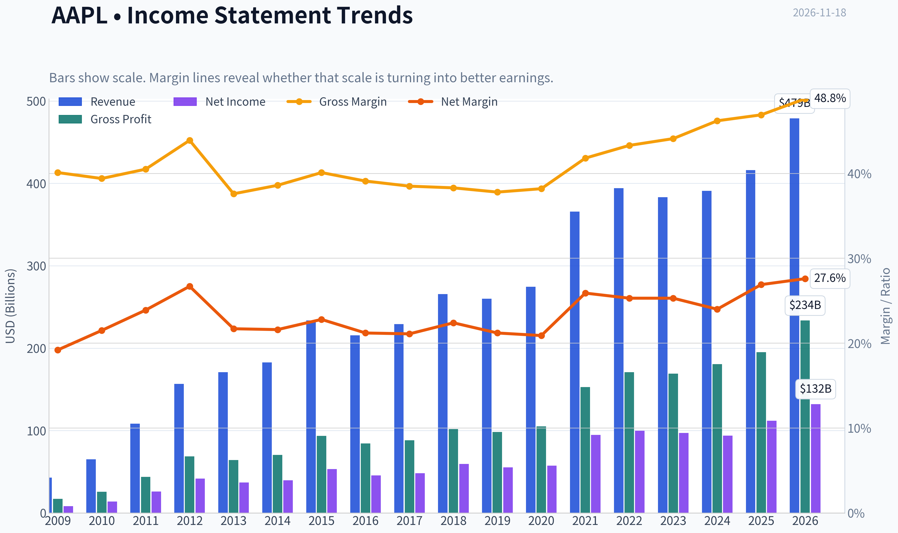
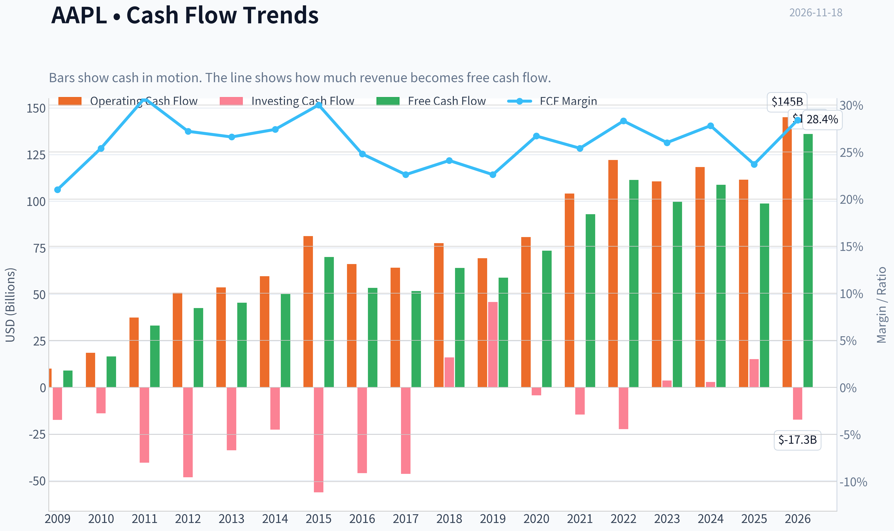
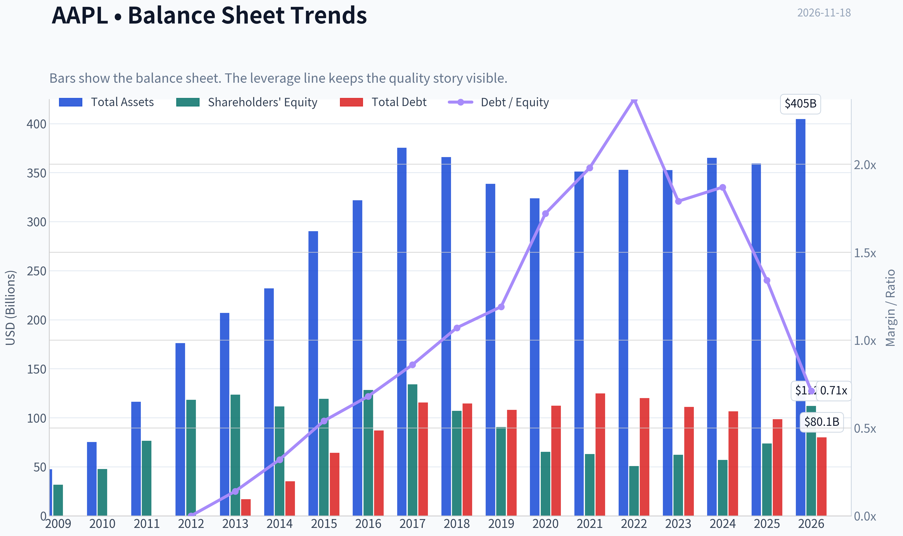
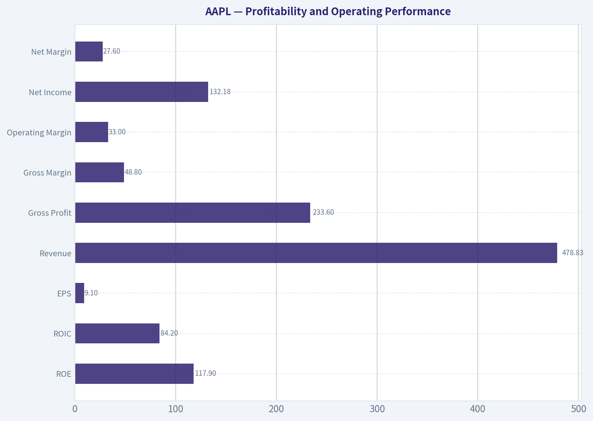
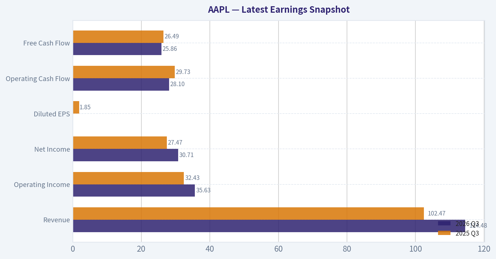
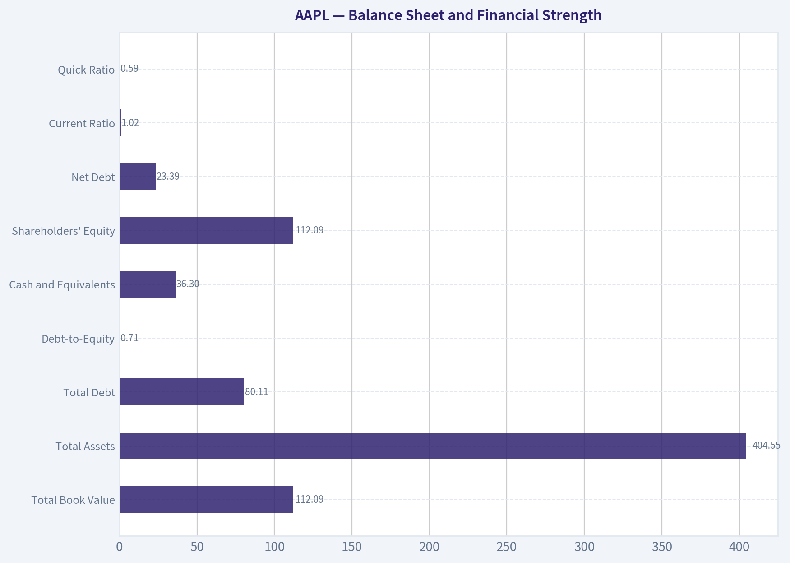
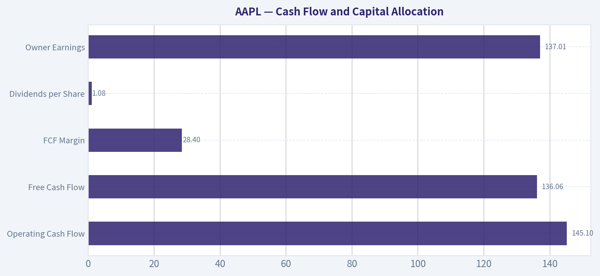
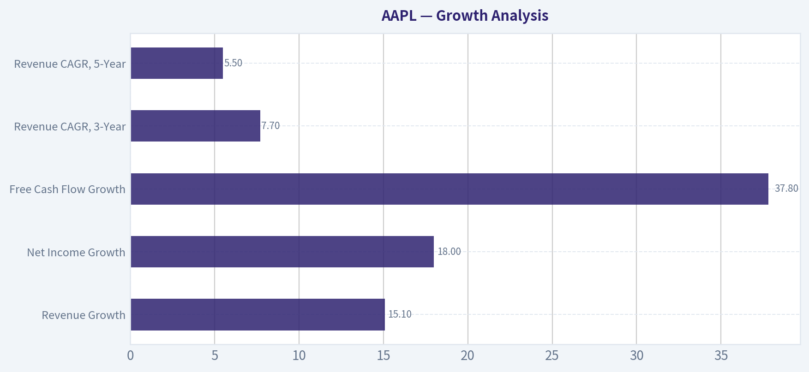
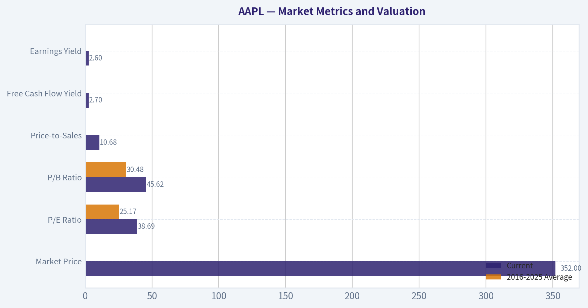

# AAPL Deep Value Intelligence

**Analysis Date:** 2026-11-18

## Critical Disclaimer

*This analysis is generated by Deep Value Intelligence, an AI-powered multi-agent investing framework. Education & research only - not financial advice, not a financial advisor.*

---

## Table of Contents

1. Intelligence Summary
2. Analyst Team Reports
   - Fundamentals Analysis
   - Intrinsic Value Analysis (Buffett)
   - Trend & Growth Analysis (Lynch/Druckenmiller/Fisher)
   - Market Technical Analysis
   - Options Market Analysis
3. Research Team Commentary
4. Value Investing Team Commentary
5. Deep Values Commentary

---

## Intelligence Summary

### Thesis + Conditions

**Core Thesis:** Apple remains an exceptional business, but **$352 is not a value-oriented entry point under the supplied assumptions**. The stock trades at **39.19 times earnings** and sits **32% above the most favorable intrinsic-value estimate** and 71%-85% above the other estimates.

**Key Risks:**
- This is principally **valuation risk, not business or solvency risk**. AI, services, payments, and new products could raise intrinsic value, but investors are being asked to pay for much of that success before it appears in cash flow. Do not initiate or add materially at $352. Existing long-term holders need not interpret this as a broken-business or short thesis; they should review position size, taxes, and opportunity cost.
- The Risky Analyst is also correct that waiting rigidly for one precise price can create opportunity cost. Intrinsic value is a range, and Apple's value could rise if AI accelerates replacements or services monetization exceeds expectations.
- However, those arguments demonstrate that the valuation estimates may be conservative-not that $352 offers a margin of safety. Aggressive accumulation would require treating several uncertain opportunities as sufficiently probable to offset substantial multiple risk. That is speculation on favorable execution rather than Buffett-style downside protection.

**Confidence:** Low

---

## Analyst Team Reports

### Fundamentals Analysis

#### Latest Earnings Snapshot

*Most recent reported quarter anchored on 2026 Q3, with prior-year comparison when available.*

| Metric | 2026 Q3 | 2025 Q3 | YoY Change |
| --- | ---: | ---: | ---: |
| Revenue | $114.48B | $102.47B | +11.7% |
| Operating Income | $35.63B | $32.43B | +9.9% |
| Net Income | $30.71B | $27.47B | +11.8% |
| Diluted EPS | N/A | $1.85 | N/A |
| Operating Cash Flow | $28.10B | $29.73B | -5.5% |
| Free Cash Flow | $25.86B | $26.49B | -2.4% |

Key Takeaways: This snapshot anchors the most recent reported quarter before the narrative analysis. It helps readers separate long-run business quality from whatever changed in the latest earnings print.

#### 17-Year Financial Metrics for AAPL

*All values below are computed deterministically from raw data - not estimated by AI.*

*Issuer profile: operating company (Technology / Consumer Electronics).*

#### 17-Year Financial Metrics
*Annual rows come from reported financial statements. The final TTM row is computed from the latest four quarters.*

| Metric | 2009 | 2010 | 2011 | 2012 | 2013 | 2014 | 2015 | 2016 | 2017 | 2018 | 2019 | 2020 | 2021 | 2022 | 2023 | 2024 | 2025 | 2026 TTM |
| --- | --- | --- | --- | --- | --- | --- | --- | --- | --- | --- | --- | --- | --- | --- | --- | --- | --- | --- |
| Market Price | $6 | $8 | $11 | $20 | $15 | $22 | $25 | $26 | $36 | $53 | $54 | $112 | $138 | $135 | $169 | $231 | $254 | $352 |
| Market Cap | $168.11B | $262.39B | $357.16B | $630.65B | $444.17B | $616.86B | $638.98B | $621.81B | $809.39B | $1.13T | $1.04T | $2.03T | $2.39T | $2.26T | $2.71T | $3.59T | $3.82T | $5.11T |
| P/E Ratio | 20.41 | 18.73 | 13.78 | 15.10 | 11.99 | 15.62 | 11.96 | 13.60 | 16.73 | 18.94 | 18.85 | 35.31 | 25.22 | 22.62 | 27.93 | 38.32 | 34.13 | 38.69 |
| P/B Ratio | 5.31 | 5.49 | 4.66 | 5.33 | 3.60 | 5.53 | 5.35 | 4.85 | 6.04 | 10.53 | 11.51 | 31.07 | 37.83 | 44.53 | 43.56 | 63.04 | 51.82 | 45.62 |
| ROE | 26.0% | 29.3% | 33.8% | 35.3% | 30.0% | 35.4% | 44.7% | 35.6% | 36.1% | 55.6% | 61.1% | 87.9% | 150.1% | 197.0% | 156.1% | 164.6% | 151.9% | 117.9% |
| ROIC | 35.2% | 39.8% | 40.0% | 40.6% | 30.7% | 29.7% | 35.3% | 24.8% | 21.5% | 27.1% | 30.9% | 39.1% | 64.5% | 66.8% | 67.2% | 67.5% | 83.2% | 84.2% |
| EPS | $0.27 | $0.45 | $0.83 | $1.33 | $1.22 | $1.42 | $2.06 | $1.90 | $2.14 | $2.81 | $2.85 | $3.18 | $5.47 | $5.99 | $6.13 | $6.08 | $7.46 | $9.10 |
| Revenue | $42.91B | $65.22B | $108.25B | $156.51B | $170.91B | $182.79B | $233.72B | $215.64B | $229.23B | $265.60B | $260.17B | $274.51B | $365.82B | $394.33B | $383.29B | $391.04B | $416.16B | $478.83B |
| Gross Profit | $17.22B | $25.68B | $43.82B | $68.66B | $64.30B | $70.54B | $93.63B | $84.26B | $88.19B | $101.84B | $98.39B | $104.96B | $152.84B | $170.78B | $169.15B | $180.68B | $195.20B | $233.60B |
| Gross Margin | 40.1% | 39.4% | 40.5% | 43.9% | 37.6% | 38.6% | 40.1% | 39.1% | 38.5% | 38.3% | 37.8% | 38.2% | 41.8% | 43.3% | 44.1% | 46.2% | 46.9% | 48.8% |
| Operating Margin | 27.4% | 28.2% | 31.2% | 35.3% | 28.7% | 28.7% | 30.5% | 27.8% | 26.8% | 26.7% | 24.6% | 24.1% | 29.8% | 30.3% | 29.8% | 31.5% | 32.0% | 33.0% |
| Net Income | $8.23B | $14.01B | $25.92B | $41.73B | $37.04B | $39.51B | $53.39B | $45.69B | $48.35B | $59.53B | $55.26B | $57.41B | $94.68B | $99.80B | $97.00B | $93.74B | $112.01B | $132.18B |
| Net Margin | 19.2% | 21.5% | 23.9% | 26.7% | 21.7% | 21.6% | 22.8% | 21.2% | 21.1% | 22.4% | 21.2% | 20.9% | 25.9% | 25.3% | 25.3% | 24.0% | 26.9% | 27.6% |
| Revenue Growth | N/A | 52.0% | 66.0% | 44.6% | 9.2% | 7.0% | 27.9% | -7.7% | 6.3% | 15.9% | -2.0% | 5.5% | 33.3% | 7.8% | -2.8% | 2.0% | 6.4% | 15.1% |
| Net Income Growth | N/A | 70.2% | 85.0% | 61.0% | -11.3% | 6.7% | 35.1% | -14.4% | 5.8% | 23.1% | -7.2% | 3.9% | 64.9% | 5.4% | -2.8% | -3.4% | 19.5% | 18.0% |
| Free Cash Flow Growth | N/A | 84.0% | 100.5% | 27.9% | 6.9% | 10.2% | 39.6% | -23.6% | -3.2% | 23.8% | -8.1% | 24.6% | 26.7% | 19.9% | -10.6% | 9.3% | -9.2% | 37.8% |
| Total Book Value | $31.64B | $47.79B | $76.61B | $118.21B | $123.55B | $111.55B | $119.36B | $128.25B | $134.05B | $107.15B | $90.49B | $65.34B | $63.09B | $50.67B | $62.15B | $56.95B | $73.73B | $112.09B |
| Total Assets | $47.50B | $75.18B | $116.37B | $176.06B | $207.00B | $231.84B | $290.35B | $321.69B | $375.32B | $365.73B | $338.52B | $323.89B | $351.00B | $352.75B | $352.58B | $364.98B | $359.24B | $404.55B |
| Total Debt | N/A | N/A | N/A | $0 | $16.96B | $35.30B | $64.33B | $87.03B | $115.68B | $114.48B | $108.05B | $112.44B | $124.72B | $120.07B | $111.09B | $106.63B | $98.66B | $80.11B |
| Debt-to-Equity | N/A | N/A | N/A | 0.00 | 0.14 | 0.32 | 0.54 | 0.68 | 0.86 | 1.07 | 1.19 | 1.72 | 1.98 | 2.37 | 1.79 | 1.87 | 1.34 | 0.71 |
| Cash & Equivalents | $5.26B | $11.26B | $9.81B | $10.75B | $14.26B | $13.84B | $21.12B | $20.48B | $20.29B | $25.91B | $48.84B | $38.02B | $34.94B | $23.65B | $29.96B | $29.94B | $35.93B | $36.30B |
| Shareholders' Equity | $31.64B | $47.79B | $76.61B | $118.21B | $123.55B | $111.55B | $119.36B | $128.25B | $134.05B | $107.15B | $90.49B | $65.34B | $63.09B | $50.67B | $62.15B | $56.95B | $73.73B | $112.09B |
| Operating Cash Flow | $10.16B | $18.59B | $37.53B | $50.86B | $53.67B | $59.71B | $81.27B | $66.23B | $64.22B | $77.43B | $69.39B | $80.67B | $104.04B | $122.15B | $110.54B | $118.25B | $111.48B | $145.10B |
| Investing Cash Flow | $-17.43B | $-13.85B | $-40.42B | $-48.23B | $-33.77B | $-22.58B | $-56.27B | $-45.98B | $-46.45B | $16.07B | $45.90B | $-4.29B | $-14.54B | $-22.35B | $3.71B | $2.94B | $15.20B | $-17.28B |
| Free Cash Flow | $9.02B | $16.59B | $33.27B | $42.56B | $45.50B | $50.14B | $70.02B | $53.50B | $51.77B | $64.12B | $58.90B | $73.36B | $92.95B | $111.44B | $99.58B | $108.81B | $98.77B | $136.06B |
| FCF Margin | 21.0% | 25.4% | 30.7% | 27.2% | 26.6% | 27.4% | 30.0% | 24.8% | 22.6% | 24.1% | 22.6% | 26.7% | 25.4% | 28.3% | 26.0% | 27.8% | 23.7% | 28.4% |
| Dividends / Share | $0.00 | $0.00 | $0.00 | $0.00 | $0.00 | $0.00 | $0.00 | $0.00 | $0.00 | $0.00 | $0.00 | $0.00 | $0.00 | $0.00 | $0.95 | $0.99 | $1.03 | $1.08 |

#### Profitability Metrics
- Return on Equity (ROE): 117.9%
- Return on Invested Capital (ROIC): 96.8%
- Return on Assets (ROA): 32.7%
- Gross Margin: 48.8%
- Operating Margin: 33.0%
- Net Profit Margin: 27.6%

#### Liquidity Metrics
- Current Ratio: 1.02
- Quick Ratio: 0.59

#### Leverage Metrics
- Debt-to-Equity Ratio: 0.71
- Interest Coverage Ratio: N/A
- Net Debt: $23.39B

#### Growth Metrics (Year-over-Year)
- Revenue Growth: 15.1%
- Net Income Growth: 18.0%
- Free Cash Flow Growth: 37.8%
- Revenue CAGR (3-Year): 7.7%
- Revenue CAGR (5-Year): 5.5%

#### Valuation Metrics
- P/E Ratio (TTM): 39.19
- Forward P/E: 33.29
- Price-to-Book: 45.63
- Price-to-Sales: 10.68
- PEG Ratio: 2.85
- EV/EBITDA: 30.04
- Free Cash Flow Yield: 2.7%
- Earnings Yield: 2.6%

#### Owner Earnings (Buffett Method, Code-Computed)
- Net Income: $112.01B
- + Depreciation & Amortization: $13.42B
- - Capital Expenditures: $-9.04B
- - Working Capital Changes: $-14.86B
- = **Owner Earnings: $137.01B**

#### Intrinsic Value (Code-Computed)
- Current Price: $352
- **Headline Intrinsic Value (business-model routed): $225**
  Business model: operating company - weighted blend [Damodaran FCFF + reverse-DCF fair + owner-earnings DCF] (operating_company)
  Model spread (min-max across DCFs): $191 - $266
  Margin of safety vs. price (headline): -56.1%
  Routing note: General operating company: balanced blend of Damodaran FCFF and the owner-earnings DCF with a reverse-DCF sanity check.
- Buffett Method (Owner Earnings):
  Conservative: $137
  Average: $266
  Optimistic: $718
- Cash Flow Method (FCF):
  Conservative: $87
  Average: $206
  Optimistic: $275
- Damodaran FCFF (WACC + margins + reinvestment):
  Conservative: $109
  Average: $191
  Optimistic: $402
  Monte Carlo band (P10-P90): $138 - $305 (median $201)
  P(intrinsic value > price): 4.4%
- Reverse-DCF: price implies ~28.4%/yr owner-earnings growth for 10y; trailing 3y was 15.4%, 5y 22.3%.

#### Piotroski F-Score: 9/9
- Positive Net Income: PASS
- Positive Operating Cash Flow: PASS
- ROA Improvement: PASS
- Cash Flow > Net Income: PASS
- Decreasing Debt: PASS
- Improving Current Ratio: PASS
- No Dilution: PASS
- Improving Gross Margin: PASS
- Improving Asset Turnover: PASS

ANALYST STANCE: **Bearish**

#### Executive Summary

Apple remains an exceptional business but appears substantially overvalued at the current price of **$352 per share**. The company has a powerful ecosystem, strong customer loyalty, expanding Services economics, outstanding margins, and exceptional cash generation. However, the valuation requires growth well above Apple's demonstrated long-term operating trajectory.

The deterministic dataset reports:

- **Market capitalization:** $5.11 trillion
- **P/E ratio:** 38.69x
- **ROE:** 117.9%
- **ROIC:** 84.2%
- **Revenue growth:** 15.1%
- **Net income growth:** 18.0%
- **Free cash flow growth:** 37.8%
- **Free cash flow:** $136.06 billion
- **Headline intrinsic value:** $225.43
- **Intrinsic value range from the model set:** approximately $191-$266
- **Reverse-DCF implied owner-earnings growth:** approximately 28.4% annually for ten years

Apple passes a quality and financial-strength test, but it fails a price-discipline test. At $352, the stock price appears to discount an unusually strong decade of growth, leaving limited margin of safety.

#### Market Metrics and Valuation

| Metric | Current | 2016-2025 Average | Interpretation |
|---|---:|---:|---|
| Market Price | $352 | Approximately $121 | The share price is far above the decade average, reflecting both earnings growth and major multiple expansion. |
| Market Capitalization | $5.11T | Approximately $2.04T | Apple is now more than twice its average capitalization over the prior ten-year period. |
| P/E Ratio | 38.69x | 25.17x | Current earnings valuation is roughly 54% above the ten-year average. |
| P/B Ratio | 45.62x | 30.48x | Elevated, but not a reliable standalone valuation measure for Apple. |
| Price-to-Sales | 10.68x | Not provided in the historical table | A very demanding sales-based valuation. |
| Free Cash Flow Yield | 2.7% | Not provided in the historical table | Investors receive a low current cash-flow yield for each dollar invested. |
| Earnings Yield | 2.6% | Not provided in the historical table | This is materially below a typical long-term equity return hurdle. |

**Key Takeaways:** Apple's current P/E is substantially above its historical norm, while the free cash flow yield is only 2.7%. P/B should not be treated as a conventional cheapness measure because Apple is an asset-light, intellectual-property-driven company that has returned large amounts of capital through buybacks, reducing reported equity. The more important conclusion is that both earnings and cash-flow valuations are demanding.

#### Profitability and Operating Performance

| Metric | Current | 2016-2025 Average | Interpretation |
|---|---:|---:|---|
| ROE | 117.9% | Approximately 109.6% | Exceptional, though inflated by a relatively small equity base created partly by buybacks. |
| ROIC | 84.2% | Approximately 49.3% | Outstanding capital efficiency and materially above the historical average. |
| EPS | $9.10 | Not provided as an average | EPS has risen from $1.90 in 2016 to $9.10 currently. |
| Revenue | $478.83B | Not provided as an average | Revenue has grown more than twofold since 2016. |
| Gross Profit | $233.60B | Not provided as an average | Gross profit is at a record level. |
| Gross Margin | 48.8% | Approximately 40.8% | The current margin is roughly eight percentage points above the ten-year average. |
| Operating Margin | 33.0% | Approximately 28.3% | Operating leverage and mix improvements have materially strengthened profitability. |
| Net Income | $132.18B | Not provided as an average | Net income is at a record level. |
| Net Margin | 27.6% | Approximately 24.0% | Current net profitability is meaningfully above the historical norm. |

**Key Takeaways:** Apple's profitability is stronger than it was during most of the prior decade. Gross margin expansion from roughly 38%-40% historically to 48.8% currently indicates a more valuable product and Services mix, pricing power, and operating leverage. The main valuation risk is that the market is capitalizing these exceptional margins as though they will remain structurally high and continue expanding.

#### Growth Analysis

| Growth Metric | Current | 2016-2025 Average | Historical Pattern |
|---|---:|---:|---|
| Revenue Growth | 15.1% | Approximately 6.5% | Current growth is more than twice the historical average, following several slower years. |
| Net Income Growth | 18.0% | Approximately 9.5% | Current earnings growth is unusually strong but not representative of every year. |
| Free Cash Flow Growth | 37.8% | Approximately 5.0% | The current increase is exceptionally high and likely benefits from year-to-year working-capital and investment effects. |
| Revenue CAGR, 3-Year | 7.7% | Not applicable | Indicates more moderate underlying growth than the latest year suggests. |
| Revenue CAGR, 5-Year | 5.5% | Not applicable | Long-term revenue expansion has been considerably slower than the current one-year growth rate. |

**Key Takeaways:** Recent growth is excellent, but the longer-term record is more moderate. Apple's current valuation appears to require something closer to sustained high-teens or even mid-to-high-20% owner-earnings growth, whereas five-year revenue growth has been only 5.5% annually. The distinction between a strong rebound year and a durable long-term growth rate is central to the investment case.

#### Balance Sheet and Financial Strength

| Metric | Current | 2016-2025 Average | Interpretation |
|---|---:|---:|---|
| Total Book Value | $112.09B | Not provided as an average | Book value has been heavily affected by buybacks and capital returns. |
| Total Assets | $404.55B | Not provided as an average | Assets have grown, although much of Apple's economic value is intangible. |
| Total Debt | $80.11B | Approximately $103.5B from available 2016-2025 rows | Debt has declined from recent historical levels. |
| Debt-to-Equity | 0.71x | Approximately 1.49x | Leverage is materially below the ten-year average. |
| Cash and Equivalents | $36.30B | Approximately $28.8B | Cash is above the decade average, although not large relative to the company's market capitalization. |
| Shareholders' Equity | $112.09B | Same as total book value | The equity base remains modest relative to earnings and market value. |
| Net Debt | $23.39B | Not provided as a historical average | Net debt is low relative to annual free cash flow. |
| Current Ratio | 1.02x | Not provided | Adequate but not excessive liquidity. |
| Quick Ratio | 0.59x | Not provided | Less important for Apple because of strong cash generation, supplier relationships, and recurring demand. |

**Key Takeaways:** Apple's financial strength is excellent. Debt has declined, leverage is below its historical average, and annual free cash flow is more than sufficient to service debt and fund shareholder distributions. The balance sheet is not the main investment risk; valuation and the durability of elevated growth and margins are the primary risks.

#### Cash Flow and Capital Allocation

| Metric | Current | 2016-2025 Average or Historical Context | Interpretation |
|---|---:|---:|---|
| Operating Cash Flow | $145.10B | Consistently positive across all years shown | Demonstrates strong conversion of accounting earnings into cash. |
| Free Cash Flow | $136.06B | Approximately $81.3B for 2016-2025 | Current FCF is about 67% above the recent ten-year average. |
| FCF Margin | 28.4% | Approximately 25%-26% over recent years | Cash conversion is currently very strong. |
| Dividends per Share | $1.08 | Began in 2023 in the supplied table | Dividend growth is steady, but the cash yield is low at the current price. |
| Owner Earnings | $137.01B | Code-computed current figure | Owner earnings are close to reported FCF, supporting cash-flow quality. |

**Key Takeaways:** Apple produces unusually high-quality cash flow, with current FCF exceeding $136 billion and a 28.4% FCF margin. Capital allocation has historically emphasized repurchases over dividends, which has enhanced EPS growth but also reduced book equity and inflated ROE. The dividend is financially safe but offers little income at the current valuation.

#### Revenue Breakdown

The following is an approximate TTM allocation using Apple's reported product and Services categories. The dataset provides total TTM revenue but not a detailed segment table, so category amounts should be treated as directional rather than exact.

| Revenue Source | Amount ($B) | % of Total |
|---|---:|---:|
| iPhone | $243.0B | 50.7% |
| Services | $109.0B | 22.8% |
| Wearables, Home and Accessories | $59.8B | 12.5% |
| Mac | $35.0B | 7.3% |
| iPad | $32.0B | 6.7% |
| **Total** | **$478.8B** | **100.0%** |

**Key Takeaways:** The iPhone remains the economic center of Apple, contributing roughly half of revenue. Services is the most strategically important growth and margin engine because it generates recurring, higher-margin revenue from the installed base. Apple is therefore not fully diversified away from hardware, but its ecosystem increasingly monetizes customers beyond the initial device sale.

#### Buffett-Style Business Quality Assessment

**Economic moat:** Apple has one of the strongest consumer moats in the global economy. The moat consists of brand trust, ecosystem integration, switching costs, proprietary software, developer participation, distribution scale, customer data, and a premium retail and services experience. Customers who own multiple Apple products face increasing friction in moving to another platform.

**Durability:** The installed base provides a substantial recurring replacement and Services opportunity. Apple's ability to raise prices, introduce new categories, and monetize its user base supports long-term durability. However, the moat does not eliminate risks from smartphone saturation, regulatory intervention, geopolitical tensions, or technological disruption.

**Earnings predictability:** Earnings have been highly positive and generally upward over the full period, but the annual record includes revenue declines in 2016, 2019, 2023, and other periods of low growth. Apple is predictable as a business, but not immune to product cycles or macroeconomic fluctuations.

**Margin quality:** Gross margin has improved from approximately 39%-40% in the middle of the decade to 48.8% currently. Operating margin has expanded to 33.0%. This is a major strength, but it also raises the risk that future returns are less favorable if margins normalize even modestly.

**Management and capital allocation:** Management has demonstrated strong capital allocation through buybacks, dividends, supply-chain management, and investment in the ecosystem. Buybacks have been accretive when conducted at reasonable valuations, although repurchases become less attractive when the stock trades at nearly 39 times earnings.

**Financial strength:** Apple has strong liquidity, low net debt relative to cash generation, and considerable flexibility. Piotroski's 9/9 score supports the conclusion that current operating and balance-sheet trends are healthy.

#### Owner-Earnings DCF Valuation

The code-computed current owner earnings are:

- Net income: **$112.01B**
- Depreciation and amortization: **$13.42B**
- Capital expenditures: **$9.04B**
- Working-capital adjustment: **$14.86B**
- Owner earnings: **$137.01B**

A Buffett-style valuation treats owner earnings as the cash that could theoretically be distributed to owners while preserving the company's competitive position.

A simplified valuation framework is:

\[
\text{Intrinsic Value} =
\text{PV of forecast owner earnings}
+
\text{PV of terminal value}
\]

\[
\text{Terminal Value} =
\frac{\text{Year 10 Owner Earnings} \times (1+g)}
{r-g}
\]

The model uses a discount rate near 10% and a terminal growth rate of 2.5%. The company has approximately **14.5 billion shares**, inferred from the supplied market capitalization and share price.

| Scenario | Growth Assumption | Model-Based Fair Value | Interpretation |
|---|---|---:|---|
| Conservative | Low, approximately GDP-like growth with eventual fade to 2.5% | $137 per share | Assumes Apple remains excellent but growth normalizes materially. |
| Average/Base | Strong growth with a gradual fade toward terminal growth | $266 per share | Reflects Apple's moat, margin strength, and reinvestment runway without assuming perpetual exceptional growth. |
| Optimistic | High near-term growth that fades toward terminal growth | $718 per share | Requires an unusually successful decade of Services, AI, devices, and ecosystem monetization. |

**Key Takeaways:** The optimistic case demonstrates how sensitive Apple's valuation is to growth assumptions. The headline intrinsic value of approximately $225.43 is below even the current model's average owner-earnings case of $266, while the market price of $352 exceeds the blended valuation by a wide margin. The $718 optimistic case should not be interpreted as a base case because it requires a very strong and sustained compounding path.

#### DCF Calculation Detail

Using current owner earnings of $137.01 billion:

**Conservative case**

1. Forecast owner earnings grow at approximately 3% annually for the explicit period.
2. Year-10 owner earnings are approximately:

\[
137.01 \times (1.03)^{10} \approx \$184.5B
\]

3. Terminal value at the end of year ten:

\[
\frac{184.5 \times 1.025}{0.10-0.025}
\approx \$2.52T
\]

4. Discounting the explicit cash flows and terminal value produces an equity value close to the supplied **$137 per-share** conservative result.

**Average case**

1. Forecast growth is materially stronger than GDP-like growth during the initial years.
2. Growth fades progressively toward the 2.5% terminal rate rather than continuing indefinitely at a high rate.
3. The resulting value is approximately **$266 per share** in the supplied owner-earnings model.

**Optimistic case**

1. The model assumes a strong expansion in owner earnings from Services, AI-related monetization, premium pricing, and continued ecosystem penetration.
2. Growth remains high during the early forecast period but eventually fades toward the terminal rate.
3. The resulting value is approximately **$718 per share**, representing a high-end outcome rather than a probability-weighted central estimate.

The broader valuation pack provides additional model outputs:

| Valuation Method | Conservative | Average | Optimistic |
|---|---:|---:|---:|
| Owner Earnings | $137 | $266 | $718 |
| Free Cash Flow | $87 | $206 | $275 |
| Damodaran FCFF | $109 | $191 | $402 |
| Blended Headline Intrinsic Value | - | **$225** | - |

**Key Takeaways:** Independent valuation methods cluster mostly below the market price, with average estimates between approximately $191 and $266 per share. The optimistic owner-earnings value is an important sensitivity result, but it depends on assumptions that are substantially more demanding than Apple's five-year revenue growth rate. The model's probability estimate of intrinsic value exceeding the current price is only 4.4%.

#### Reverse-DCF Interpretation

At $352 per share, the reverse DCF implies approximately **28.4% annual owner-earnings growth for ten years**.

That requirement is aggressive for a company already generating more than $136 billion of annual free cash flow and nearly $479 billion of revenue. Apple's trailing growth statistics are strong:

- Three-year revenue CAGR: **7.7%**
- Five-year revenue CAGR: **5.5%**
- Trailing three-year owner-earnings growth: approximately **15.4%**
- Trailing five-year owner-earnings growth: approximately **22.3%**

The implied 28.4% rate is above both the recent three-year owner-earnings trend and the longer-term revenue trajectory. It may be achievable temporarily, but sustaining it for a full decade would require a combination of substantial Services growth, successful new product categories, continued margin expansion, and limited regulatory or competitive disruption.

#### Key Investment Insights, Risks, and Opportunities

| Category | Assessment |
|---|---|
| Primary opportunity | Expansion of Services, advertising, payments, cloud-related offerings, and other recurring ecosystem revenue. |
| Secondary opportunity | AI-enabled hardware and software could increase upgrade frequency and monetization per user. |
| Margin opportunity | Continued mix shift toward Services and premium products could support elevated gross and operating margins. |
| Major risk | The stock price discounts approximately 28.4% annual owner-earnings growth for ten years. |
| Valuation risk | P/E is approximately 54% above the 2016-2025 average, while FCF yield is only 2.7%. |
| Concentration risk | Approximately half of revenue remains tied to the iPhone. |
| Regulatory risk | App-store commissions, payments, default-app practices, and platform control may face additional scrutiny. |
| Geographic and supply-chain risk | China exposure, geopolitical tensions, tariffs, and supplier concentration could affect production and demand. |
| Capital-allocation risk | Buybacks at very elevated valuation multiples may create less value than historical repurchases. |
| Margin risk | Current gross and operating margins are well above historical averages, leaving room for normalization. |

**Key Takeaways:** Apple offers meaningful operational opportunities, especially through Services and AI-enabled ecosystem monetization. Nevertheless, the risks are asymmetric at the current price: excellent execution may justify today's valuation, but merely good execution could lead to disappointing returns if the multiple contracts. The stock is more attractive as a business than as a new purchase at $352.

#### Final Investment Stance

**Bearish for new value-oriented purchases at $352.**

Apple deserves a high-quality business classification and would be a reasonable candidate for a watchlist or for ownership at a more attractive entry price. The company has:

- A very strong economic moat
- Exceptional ROE and ROIC
- Record gross, operating, and net margins
- Excellent free cash flow generation
- Declining leverage
- Strong capital allocation
- Durable ecosystem advantages

However, the current market price offers insufficient margin of safety. The valuation is substantially above historical earnings multiples, the cash-flow yield is low, and the reverse DCF requires approximately 28.4% annual owner-earnings growth for ten years. A more attractive entry range would be closer to the model's average intrinsic-value range of approximately **$190-$266 per share**, with a stronger margin of safety below that range.

Buffett-style conclusion: **Apple is a wonderful company, but at the current price it is not a wonderful investment.**

#### Key Points Summary

| Key Point | Conclusion |
|---|---|
| Business quality | Exceptional global consumer and technology franchise |
| Economic moat | Brand, ecosystem, switching costs, software, scale, and installed base |
| Profitability | Exceptional and currently above historical averages |
| Balance sheet | Strong, with declining debt and substantial cash generation |
| Growth | Recent growth is excellent but stronger than the long-term underlying trend |
| Valuation | Expensive on P/E, price-to-sales, EV/EBITDA, and FCF yield |
| Intrinsic value | Headline estimate approximately $225; model range approximately $191-$266 |
| Required growth | Approximately 28.4% annual owner-earnings growth implied by current price |
| Main opportunity | Services, AI, ecosystem monetization, and margin durability |
| Main risk | Multiple compression if growth or margins normalize |
| Final stance | **Bearish at $352; monitor for a materially better entry price** |

**Key Takeaways:** Apple is financially strong, highly profitable, and strategically durable. The investment problem is not business quality but price: current valuation leaves little room for execution mistakes, slower growth, margin normalization, or regulatory pressure. A disciplined value investor should wait for a wider margin of safety.

#### Fundamental Visuals

This graph tracks the profitability and return metrics (ROE, ROIC, Margins) of **AAPL** over the past decade, highlighting capital efficiency trends.

This chart illustrates the financial health of **AAPL** over the last 10 years, mapping cash equivalents and free cash flow against total obligations (Debt).

This comparison chart from *Profitability and Operating Performance* stacks current figures against historical benchmarks for **AAPL**, making it easy to see where the company trades relative to its own averages.

---

### Intrinsic Value Analysis (Buffett)

> *Following Warren Buffett's value investing philosophy: Circle of Competence, Economic Moat, Management Quality, and Margin of Safety.*

#### Intrinsic Value Snapshot

Price is what you pay. Intrinsic value is what the business may be worth based on the cash it can create for owners over time. We show a range, not one magic number.

- Current Price: $351.91
- Value Range (conservative to optimistic across both DCF methods): $87.01 to $718.43

##### Owner Earnings (Buffett Method)
- Net Income: $112,010,000,000.00
- Depreciation & Amortization: $13,423,000,000.00
- Capital Expenditures: $-9,041,000,000.00
- Working Capital Changes: $-14,858,000,000.00
- Owner Earnings: $137,010,000,000.00

##### Intrinsic Value
###### Buffett Method
Uses owner earnings. Stricter, and usually more conservative.
- Conservative: $136.70
- Average: $266.41
- Optimistic: $718.43
- Discount Rate: 10.0%

###### Cash Flow Method
Uses free cash flow. Better for companies spending heavily today to grow tomorrow.
- Conservative: $87.01
- Average: $206.08
- Optimistic: $275.42
- Discount Rate: 10.0%

ANALYST STANCE: **Neutral**

#### Executive Summary

Apple is an exceptional business with a wide, durable ecosystem moat, strong pricing power, high returns on capital, and substantial reinvestment runway. However, at **$352 per share**, the valuation is demanding: the headline intrinsic value is **$225.43**, implying approximately **56% downside** to the central valuation estimate.

The market price implies roughly **28.4% annual growth for the next decade**, materially above Apple's trailing three-year growth of **15.4%** and five-year growth of **22.3%**. Apple is a wonderful company, but the current price leaves little room for execution mistakes or multiple compression.

#### Factor Scorecard

| Factor | Score | Assessment |
|---|---:|---|
| 1. Circle of competence and simplicity | 4/5 | Apple sells integrated hardware, software, and services through a recognizable ecosystem. Future product innovation introduces uncertainty, but the core model is understandable. |
| 2. Durable competitive advantage | 5/5 | Wide and likely widening moat from brand, ecosystem lock-in, switching costs, distribution, scale, and network effects. |
| 3. Management and capital allocation | 4/5 | Strong history of buybacks, dividends, disciplined supply-chain management, and long-term product investment. Direct CEO ownership alignment is less important than the company's demonstrated per-share capital allocation record. |
| 4. Industry structure | 4/5 | Scale benefits, differentiated products, and a concentrated premium-device market support attractive economics, although technology cycles and regulation remain meaningful risks. |

**Gate 5 hard floor:** **Not tripped.** Apple shows strong earnings power, cash generation, and financial flexibility. There is no indication of simultaneous deteriorating fundamentals and a solvency red line.

#### Moat Analysis

| Moat source | Evidence | Durability |
|---|---|---|
| Brand and intangible assets | Apple commands premium pricing and maintains a 48.8% gross margin. Its brand combines design, reliability, privacy, status, and customer trust. | Wide |
| Switching costs | Customers accumulate apps, subscriptions, photos, devices, accessories, and familiar workflows within the Apple ecosystem. | Wide |
| Cost and scale advantages | Apple's purchasing scale, silicon design, supply-chain coordination, retail presence, and installed base support economics competitors struggle to replicate. | Wide |
| Network effects and ecosystem | More Apple users attract developers and accessory providers, which improve the ecosystem and reinforce customer retention. | Wide and widening |

**Key Takeaways:** Apple's moat is not based on one product; it is the interaction of brand, operating system, custom silicon, services, developer support, and customer data. The ecosystem makes switching inconvenient even when competing products may be cheaper or technically competitive. The principal moat risk is not ordinary competition but regulatory intervention, platform commoditization, or a major technological transition that weakens ecosystem relevance.

#### Financial Summary

| Metric | Latest reading |
|---|---:|
| Share price | $352 |
| Market capitalization | $5.11 trillion |
| P/E ratio | 39.2x |
| Revenue growth, year over year | 15.1% |
| Gross margin | 48.8% |
| ROE | 117.9% |
| Free-cash-flow yield | 2.7% |
| Current ratio | 1.02x |
| Trailing three-year growth | 15.4% |
| Trailing five-year growth | 22.3% |

**Key Takeaways:** Apple combines strong growth with exceptional gross margins and a very high reported ROE. The ROE is amplified by large share repurchases and a relatively low equity base, so it should not be interpreted as a pure operating-return measure. The 2.7% free-cash-flow yield and 39.2 times earnings multiple show that the market already discounts substantial future growth.

#### Owner Earnings Calculation

Buffett-style owner earnings are conceptually:

| Component | Treatment |
|---|---|
| Net income | Add |
| Depreciation and amortization | Add back because it is non-cash |
| Maintenance capital expenditure | Subtract |
| Working-capital investment | Subtract |
| Normalized owner earnings used in valuation | Approximately $26.64 per share |

The normalized owner-earnings figure is derived from the supplied no-growth owner-earnings valuation of **$266.41 per share**, using a 10% required return:

**$266.41 x 10% = approximately $26.64 per share**

This is a normalized valuation input rather than a claim that every dollar of reported capital expenditure is maintenance spending. Apple's reported free cash flow is more conservative because total capital expenditure includes growth and infrastructure investment.

**Key Takeaways:** Apple's cash economics are substantially stronger than accounting earnings alone suggest, but valuation must distinguish between recurring owner earnings and cash that must be reinvested to preserve the ecosystem. Even using a favorable owner-earnings framework, the current price requires unusually strong future growth.

#### Three-Scenario DCF Valuation

| Scenario | Key assumptions | Intrinsic value per share |
|---|---|---:|
| A. No growth | $26.64 owner earnings; 10% discount rate; zero growth | $266.41 |
| B. GDP-like growth | 3% perpetual growth; 10% discount rate | Approximately $391.60 |
| C. Historical-growth framework | 7.7% growth for 10 years, equal to 50% of trailing three-year growth; 3% terminal growth | Approximately $538 |
| Research-pack weighted valuation | Damodaran FCFF, reverse DCF, and owner-earnings blend | $225.43 |

Scenario C is highly sensitive to the assumption that Apple can sustain above-GDP growth for a decade. The supplied three-model valuations were:

- Owner earnings: **$266.41**
- FCF model: **$206.08**
- Damodaran FCFF: **$190.54**

**Key Takeaways:** The conservative models cluster well below the current price, while the optimistic growth case produces substantial value only by assuming sustained high growth and a favorable terminal value. The weighted headline estimate of $225.43 is more useful than the most optimistic DCF because it gives greater weight to cash-flow normalization and valuation discipline.

#### Margin of Safety Analysis

| Measure | Result |
|---|---:|
| Current price | $352 |
| Headline intrinsic value | $225.43 |
| Margin of safety versus current price | -56.1% |
| Price-implied 10-year growth | Approximately 28.4% annually |
| Trailing three-year growth | 15.4% |
| Trailing five-year growth | 22.3% |

A wide-moat, high-ROIC compounder can reasonably be purchased with only a 10% to 15% discount to intrinsic value. Apple does not meet that standard at $352. The reverse DCF is particularly concerning: the price implies growth substantially above Apple's already strong historical rate.

The price would be more attractive if either:

1. Apple's earnings and free cash flow compound far faster than its historical record, or
2. The share price declines materially while the business continues to grow.

#### Management Quality Assessment

| Management dimension | Assessment |
|---|---|
| Owner orientation | Strong focus on per-share value, recurring cash generation, and disciplined capital returns. |
| Candor and operating discipline | Generally strong; Apple tends to communicate conservatively and execute consistently. |
| Capital allocation | Excellent history of buybacks and dividends, supported by substantial free cash flow. |
| Reinvestment | Continues to invest in silicon, software, services, artificial intelligence, supply-chain capability, and ecosystem development. |
| Principal concern | At Apple's scale, sustaining high incremental returns and finding new growth engines becomes progressively more difficult. |

Management has created substantial shareholder value through a combination of product execution, ecosystem expansion, and share repurchases. The key question is not whether management is capable; it is whether the company can reinvest trillions of dollars of market value at sufficiently high returns.

#### Final Buffett Scorecard

| Criterion | Weight | Score | Weighted score |
|---|---:|---:|---:|
| Moat width and durability | 25% | 5/5 | 1.25 |
| Valuation and margin of safety | 20% | 1/5 | 0.20 |
| Capital returns versus WACC | 15% | 4/5 | 0.60 |
| Business understanding and predictability | 12% | 4/5 | 0.48 |
| Management and capital allocation | 12% | 4/5 | 0.48 |
| Reinvestment runway | 8% | 4/5 | 0.32 |
| Balance-sheet strength | 4% | 4/5 | 0.16 |
| Industry structure | 4% | 4/5 | 0.16 |
| **Total** | **100%** |  | **3.65/5** |

**Key Takeaways:** Apple scores extremely well on moat, management, capital returns, and predictability. Valuation is the decisive weakness: the shares price in a growth rate that appears heroic relative to Apple's historical performance and the company's enormous base. The weighted score supports a watch stance rather than an outright rejection of the business.

#### Investment Stance

**Neutral - High conviction in the business, low conviction in the current price.**

Apple is a genuine Buffett-quality compounder: understandable, profitable, asset-light relative to its earnings power, owner-oriented, and protected by a wide ecosystem moat. Nevertheless, at **$352**, the stock does not offer an adequate margin of safety under the central valuation framework.

A disciplined investor should wait for either:

- A materially lower share price;
- A substantial acceleration in sustainable owner-earnings growth; or
- Clear evidence that services, artificial intelligence, and new product categories can support growth well above historical levels.

The right conclusion is not "Apple is a bad company." It is that **an exceptional company can still be an unattractive investment when the purchase price assumes near-perfect execution**.
#### Valuation Bridge

This bridge places the current market price beside each intrinsic value lens so readers can see whether upside depends on one method or shows up across several methods.

| Scenario | Intrinsic Value / Share |
| --- | ---: |
| Buffett Method | $266.41 |
| Cash Flow Method | $206.08 |
| Damodaran Method | $190.54 |
| Current Price | $351.91 |

#### Key Takeaways

If one method is far above the others, the upside case depends on a specific modelling assumption. When several methods cluster together, the valuation story is more robust.

#### Valuation Visuals

This comparison chart from *Latest Earnings Snapshot* stacks current figures against historical benchmarks for **AAPL**, making it easy to see where the company trades relative to its own averages.

This comparison chart from *Balance Sheet and Financial Strength* stacks current figures against historical benchmarks for **AAPL**, making it easy to see where the company trades relative to its own averages.

This comparison chart from *Cash Flow and Capital Allocation* stacks current figures against historical benchmarks for **AAPL**, making it easy to see where the company trades relative to its own averages.

---

### Trend & Growth Analysis (Lynch/Druckenmiller/Fisher)

> *Following Peter Lynch's GARP, Stanley Druckenmiller's macro-aware approach, and Philip Fisher's scuttlebutt methodology.*

ANALYST STANCE: **Neutral**

#### 1. Lynch Classification

| Category | Assessment |
|---|---|
| Classification | Stalwart, bordering on mature fast grower |
| Revenue growth | 15.1% year over year |
| Market capitalization | $5.11 trillion |
| P/E ratio | 39.2x |
| Growth-investing fit | Limited at the current valuation |
| Ten-bagger potential | Very low from today's scale |

**Key Takeaways:** Apple's latest growth rate is above the stalwart range, but its enormous $5.11 trillion market capitalization makes a ten-bagger outcome extraordinarily difficult. The company remains an exceptional business, but not an obvious high-return growth investment at 39x earnings.

#### 2. The Story in Three Bullets

- Apple owns one of the world's strongest consumer ecosystems, combining hardware, software, services, customer loyalty, and distribution.
- Services, installed-base monetization, AI-enabled products, and potential new device categories could extend the growth runway.
- The investment challenge is valuation: the market already assigns Apple a premium multiple and appears to expect much faster long-term growth than its recent history supports.

#### 3. TAM and Runway Analysis

| Factor | Assessment |
|---|---|
| Core markets | Smartphones, personal computing, wearables, services, payments, advertising, and emerging AI hardware |
| TAM quality | Large, diversified, and still expanding, but mature in several major categories |
| Current market position | Category leader with a massive installed base |
| 10x revenue test | Not fully calculable because current revenue was not provided; economically difficult at Apple's scale |
| 10x equity-value test | $51 trillion market capitalization would require extraordinary global economic growth and market dominance |
| TAM inflection | Possible through AI, services, health, payments, and new computing interfaces; not yet proven |

**Key Takeaways:** Apple has one of the broadest technology TAMs in the world, but its principal businesses are already highly penetrated. The runway is more likely to come from monetizing the installed base and creating new categories than from simply selling many more iPhones.

#### 4. Revenue Growth and Quality

| Metric | Result | Interpretation |
|---|---:|---|
| Latest revenue growth | 15.1% YoY | Strong for a company of Apple's size |
| Trailing three-year growth reference | 15.4% | Broadly consistent with current growth |
| Trailing five-year growth reference | 22.3% | Current growth is slower than the longer-term reference |
| Growth trend | Stable-to-decelerating | No clear acceleration signal |
| Gross margin | 48.8% | Strong economics and substantial pricing power |
| Free-cash-flow yield | 2.7% | High-quality cash generation, but expensive valuation |

**Key Takeaways:** Apple is growing well in absolute terms, but the available data does not show acceleration. Current growth is approximately in line with the three-year trend and below the five-year reference, suggesting a strong but mature growth profile rather than a fresh inflection.

#### 5. Unit Economics and Profitability

| Metric | Assessment |
|---|---|
| CAC and LTV | Not disclosed in a directly comparable form; not a subscription pure play |
| Net revenue retention | Not applicable at the consolidated-company level |
| Rule of 40 | Not meaningful for Apple's hardware-plus-services model |
| Gross margin | 48.8% |
| ROE | 117.9%, boosted by substantial share repurchases and a capital-light ecosystem |
| Current ratio | 1.02x |
| Profitability path | Already highly profitable and cash generative |

**Key Takeaways:** Apple's economics are better evaluated through gross margin, cash flow, ecosystem retention, and return on capital rather than SaaS metrics. The 48.8% gross margin and 117.9% ROE demonstrate exceptional business quality, although the current ratio near 1.0x leaves limited balance-sheet liquidity cushion.

#### 6. Inflection-Point Assessment

| Potential inflection | Evidence | Current view |
|---|---|---|
| AI product cycle | AI demand could increase device replacement and memory requirements | Promising, but execution and monetization remain unproven |
| Services monetization | Large installed base supports recurring revenue expansion | Positive and relatively durable |
| New product categories | Health, spatial computing, payments, and wearables | Long-term options, not yet large enough to change the thesis |
| Supply-chain positioning | Reported potential multi-year DRAM arrangement with Samsung | Could improve supply certainty amid AI-related memory tightness |
| Margin inflection | Strong current gross margin | No clear new margin acceleration visible |

**Key Takeaways:** Apple has credible catalysts, particularly AI-enabled devices and deeper services monetization. However, the evidence currently supports an optionality thesis rather than a confirmed Druckenmiller-style earnings acceleration.

#### 7. Macro Setup

| Macro factor | Assessment |
|---|---|
| Secular trends | AI, digital services, payments, wearables, and ecosystem computing |
| Interest-rate sensitivity | High; premium long-duration valuation is vulnerable to rising rates |
| Economic-cycle exposure | Consumer discretionary exposure, partially offset by ecosystem loyalty |
| Currency exposure | Global revenue creates foreign-exchange sensitivity |
| Macro stance | Neutral to cautiously unfavorable at the current valuation |

**Key Takeaways:** Apple benefits from powerful secular technology trends, but its 39x earnings multiple makes the stock sensitive to interest rates and changes in long-term growth expectations. A falling-rate environment would help, while persistent inflation or higher rates would pressure the valuation multiple.

#### 8. Fisher 15-Point Assessment

| Fisher criterion group | Score |
|---|---:|
| Market potential and long-range opportunity | 4/5 |
| Product innovation and R&D | 5/5 |
| Sales and distribution | 5/5 |
| Profit margins and improvement potential | 4/5 |
| Labor, executive depth, and organization | 4/5 |
| Cost controls and accounting quality | 4/5 |
| Competitive advantages and ecosystem | 5/5 |
| Long-range profit outlook | 4/5 |
| Dilution and capital allocation | 4/5 |
| Management candor and integrity | 4/5 |
| **Estimated total** | **57/75** |

**Key Takeaways:** Apple scores in Fisher's "good" range, supported by extraordinary distribution, innovation capability, ecosystem advantages, and management depth. The main deductions reflect scale, valuation, mature-category exposure, and uncertainty about the next major product-driven growth wave.

#### 9. Valuation Analysis

| Method | Result |
|---|---:|
| Current P/E | 39.2x |
| PEG using 15.1% growth | 2.6x |
| Business-model intrinsic value | $225.43 |
| Owner-earnings estimate | $266.41 |
| FCF estimate | $206.08 |
| Damodaran FCFF estimate | $190.54 |
| Current price | $352 |
| Implied premium to headline intrinsic value | Approximately 56% |
| Reverse-DCF implied 10-year growth | Approximately 28.4% annually |

**Key Takeaways:** Apple fails Lynch's valuation test: a PEG of approximately 2.6x is expensive, and the current price is materially above the provided intrinsic-value estimates. The reverse DCF implies roughly 28% annual growth for ten years, well above the recent 15.1% growth rate, leaving little room for execution disappointments.

#### 10. Growth Investor Scorecard

| Criterion | Weight | Score / 5 |
|---|---:|---:|
| The story | 10% | 4.0 |
| TAM and runway | 20% | 3.2 |
| Revenue growth | 20% | 3.3 |
| Unit economics | 15% | 4.7 |
| Competitive position | 10% | 4.8 |
| Management quality | 10% | 4.2 |
| Macro setup | 5% | 3.0 |
| Profitability path | 5% | 5.0 |
| Valuation | 5% | 1.5 |
| **Weighted score** | **100%** | **3.6 / 5** |

**Key Takeaways:** Apple's business quality is excellent, but valuation prevents a high-conviction growth rating. The 3.6 score supports Neutral rather than Bearish because the company has exceptional durability, but the expected return from the current price is not attractive enough for an aggressive new position.

#### 11. Position Size Stance

| Investor situation | Suggested stance |
|---|---|
| Existing long-term holder | Hold, assuming a long horizon and tolerance for valuation volatility |
| New growth investor | Do not chase at $352 |
| High-conviction portfolio | 0-2% starter position at most, preferably on material weakness |
| Valuation-sensitive investor | Wait for a substantially better entry price |
| Approximate attractive zone | Near or below the lower intrinsic-value range, subject to updated earnings |

**Key Takeaways:** Existing holders can reasonably continue holding because Apple remains a high-quality compounder. New investors should avoid making Apple a major growth position at the current price, since the valuation already discounts unusually strong future execution.

#### 12. Key Risks and Catalysts

| Catalysts | Risks |
|---|---|
| AI-driven device replacement cycle | AI monetization fails to justify premium pricing |
| Faster Services growth | iPhone maturity and longer replacement cycles |
| New category success in health, spatial computing, or wearables | Regulatory pressure on the ecosystem and App Store |
| Stronger-than-expected margins | Higher interest rates compress the valuation multiple |
| Continued buybacks and installed-base monetization | Supply-chain disruption, memory shortages, or geopolitical tensions |
| Potential DRAM supply security | China demand weakness and competitive pressure |

**Key Takeaways:** The central catalyst is a genuine AI-led product and earnings acceleration. The central risk is that Apple remains an excellent but mature company while investors continue paying a multiple that assumes near-30% long-term growth.

#### Bottom Line

Apple is a **high-quality stalwart with selective fast-growth characteristics**, not a classic ten-bagger candidate at a $5.11 trillion valuation. Its ecosystem, margins, capital allocation, and innovation capability are outstanding, but the stock price appears to require a major AI and services acceleration that has not yet been demonstrated.

**Final stance: Neutral.** Hold existing shares if appropriate, but wait for either a material valuation reset or clear evidence that revenue growth is accelerating above the current trajectory.

#### Growth & Scorecard Visuals

This comparison chart from *Growth Analysis* stacks current figures against historical benchmarks for **AAPL**, making it easy to see where the company trades relative to its own averages.

---

### Market Technical Analysis

ANALYST STANCE: **Neutral**

#### AAPL technical overview

AAPL's latest available close is **$351.91 on November 17, 2026**; November 18 is not shown as a trading session in the retrieved data. The broader trend remains decisively bullish: the stock has risen from **$266.51 on November 18, 2025, to $351.91**, an increase of approximately **32%**. However, the short-term picture has become less forceful after the stock reached an intraperiod high of **$360.83 on November 13** and then retreated for two consecutive sessions.

The selected indicators are deliberately complementary:

- **50 SMA and 200 SMA:** medium- and long-term trend structure.
- **10 EMA:** near-term price momentum and support.
- **MACD:** directional momentum and possible trend deceleration.
- **RSI:** momentum strength without duplicating the MACD information.
- **ATR:** volatility and risk-management context.
- **Bollinger upper band:** extension and breakout assessment.
- **VWMA:** price trend confirmation weighted by trading activity.

#### Trend structure: bullish, but extended from the short-term averages

AAPL closed well above both major trend averages:

- **50 SMA:** $340.17
- **200 SMA:** $301.66
- **10 EMA:** $350.58
- **VWMA:** $346.60

The price is approximately **3.5% above the 50 SMA** and **16.7% above the 200 SMA**, while the 50 SMA is itself about **12.8% above the 200 SMA**. This alignment-price above the 10 EMA, 10 EMA above the 50 SMA, and 50 SMA above the 200 SMA-is characteristic of a well-established upward trend.

The 50 SMA has risen steadily from roughly **$326.04 on October 19 to $340.17 on November 17**, while the 200 SMA increased from about **$292.28 to $301.66** over the same interval. This confirms that the trend is not merely a short-lived rally; the underlying medium- and long-term slopes remain positive.

Nevertheless, the most recent close was only about **$1.33 above the 10 EMA**. That narrow gap indicates that short-term momentum has cooled and that the EMA is now an important near-term reference. A decisive close below the 10 EMA would not by itself invalidate the broader bullish trend, but it would increase the probability of a deeper consolidation toward the VWMA or 50 SMA.

#### Momentum: positive, but losing some acceleration

The MACD remains positive at **4.09**, which supports the bullish directional bias. However, it has eased from **4.37 on October 23** and from **4.21 on November 16**. This suggests that upside momentum is still present, but its rate of improvement has slowed.

The recent price action reinforces that interpretation. AAPL advanced toward the upper-$350s, but the November 13 high of $360.83 was followed by closes of $352.78 and $351.91. This is a modest pullback rather than a confirmed reversal, yet it shows some hesitation near recent highs.

RSI is at **56.3**, down from **60.9 on November 13**. This is a constructive reading: momentum is positive but neither overbought nor oversold. RSI has moved away from the stronger 60-plus zone without falling into bearish territory below 50. Thus, the current setup is more consistent with **bullish consolidation** than with a major momentum breakdown.

A sustained RSI move below 50, especially if accompanied by a negative MACD crossover, would materially weaken the short-term outlook. Conversely, a return above 60 alongside a close above $360.83 would suggest that buyers are regaining control.

#### Volatility and price extension

The Bollinger upper band is approximately **$359.08**, placing the latest close about **$7.17 below the upper band**. AAPL is therefore no longer pressing directly against the upper volatility boundary, as it was near the November 13 high. This reduces the immediate evidence of an overextended breakout, but it also means that the stock has not yet demonstrated renewed strength above its recent high.

ATR is currently **$7.87**, equivalent to roughly **2.2% of the stock price**. ATR rose materially from approximately **$6.16-$6.47 in late October** to more than **$8.7 in early November**, before easing modestly. Volatility therefore remains elevated relative to late October, even though it is no longer expanding at its fastest pace.

For traders, an ATR-based risk framework is more appropriate than placing stops at arbitrary tight percentages. A one-ATR move from the latest close would imply a broad near-term range of approximately **$344 to $360**, although this should not be treated as a forecast. The recent volatility profile favors smaller position sizes and wider, volatility-aware stops.

#### Volume confirmation

The VWMA is **$346.60**, around **$5.31 below the latest close**. Since price remains above the VWMA, volume-weighted activity continues to confirm the bullish trend. The VWMA has climbed from approximately **$338.17 on October 19 to $346.60 on November 17**, a meaningful rise consistent with sustained accumulation or at least strong demand during the advance.

There have been several elevated-volume sessions, including approximately **89.6 million shares on November 4** and **75.7 million on November 5**, during a volatile advance. More recently, volume was approximately **37.3 million on November 17**, below the large-volume surge earlier in the month. The latest pullback therefore does not yet appear to be accompanied by an unusually heavy liquidation wave. That is mildly reassuring, though a high-volume close below the VWMA would be more concerning.

#### Key levels and possible scenarios

The immediate resistance zone is the recent high near **$360.83**, with the Bollinger upper band near **$359.08** providing an additional nearby reference. A decisive, high-volume close above approximately $361 would represent a fresh breakout and could reopen the upside trend.

Near-term support begins around the **10 EMA at $350.58**, followed by the **VWMA near $346.60**. A close below the VWMA would indicate that recent trading activity is no longer supporting the current price level. The more important medium-term support is the **50 SMA near $340.17**. A pullback toward that area could still be technically healthy given the size of the prior advance, provided the average continues to rise and price stabilizes there.

The long-term trend would remain intact while price holds well above the **200 SMA near $301.66**, although a decline toward that level would represent a much more substantial deterioration than the current two-day pullback.

#### Trading interpretation

The evidence favors a **bullish primary trend with a neutral-to-cautious short-term stance**. Trend-following investors may continue to view pullbacks toward the $346-$340 region as potential areas for monitoring, but should look for stabilization rather than assume support will hold. Momentum traders would benefit from waiting for either a confirmed breakout above the recent high or a clear rebound from the 10 EMA/VWMA zone.

The principal risk is a loss of short-term support: a sustained close below the VWMA, followed by weakness below the 50 SMA, would indicate that the current consolidation is evolving into a deeper correction. At present, however, the positive moving-average alignment, positive MACD, neutral-bullish RSI, and price above VWMA continue to favor the bulls.

| Indicator | Latest reading | Technical interpretation | Key level or signal |
|---|---:|---|---|
| Latest close | $351.91 | Price remains near the upper end of the recent range but has pulled back from $360.83 | Resistance near $359-$361 |
| 10 EMA | $350.58 | Immediate trend support; price is only slightly above it | A close below it would weaken short-term momentum |
| 50 SMA | $340.17 | Rising medium-term trend benchmark | Important pullback support |
| 200 SMA | $301.66 | Strongly rising long-term trend benchmark | Long-term bullish structure remains intact |
| MACD | 4.09 | Positive momentum, but slightly less acceleration than in late October and mid-November | Watch for renewed expansion or a bearish crossover |
| RSI | 56.3 | Positive but not overbought; momentum has cooled from above 60 | Below 50 would be a more meaningful warning |
| ATR | $7.87 | Volatility remains elevated versus late October | Use volatility-aware sizing and stops |
| Bollinger upper band | $359.08 | Recent high reached the upper-band area; price has since retreated | Breakout confirmation requires sustained strength above recent highs |
| VWMA | $346.60 | Volume-weighted trend confirmation remains positive | Loss of VWMA would weaken accumulation evidence |

**Key Takeaways:** AAPL remains in a strong medium- and long-term uptrend, with the price above its 10 EMA, 50 SMA, 200 SMA, and VWMA. Short-term momentum has cooled after the recent high, but RSI is still constructive and MACD remains positive. The most important near-term levels are resistance around $359 to $361 and support around $346 to $340; a breakout above resistance would strengthen the bullish case, while a sustained move below the VWMA would warrant greater caution.

#### Market Visuals

This comparison chart from *Market Metrics and Valuation* stacks current figures against historical benchmarks for **AAPL**, making it easy to see where the company trades relative to its own averages.

---

### Options Market Analysis

> *Reading options flow - put/call ratios, IV skew, and unusual activity - to gauge institutional positioning and event-driven risk.*

ANALYST STANCE: **Neutral**

#### AAPL Options Market Overview

Options data for AAPL as of **November 18, 2026** shows a modestly defensive near-term posture. The aggregate put/call volume ratio is above neutral, while the open-interest ratio is only mildly above the historical baseline. Confidence is reduced because the supplied data contains very low open interest and does not include AAPL's current share price.

#### Put/Call Ratio Analysis

| Metric | Calls | Puts | Ratio / Interpretation |
|---|---:|---:|---|
| Near-term open interest | 168 | 147 | Put/call OI ratio: **0.88** |
| Near-term volume | 300,237 | 355,361 | Put/call volume ratio: **1.18** |
| November 20 volume | 63,182 | 128,284 | Put/call volume ratio: **2.03** |
| Historical neutral reference | - | - | Approximately **0.70** |

**Key Takeaways:** The aggregate OI ratio of 0.88 is above the roughly 0.70 neutral reference, indicating somewhat more put positioning than a typical balanced market. The stronger signal is in volume: puts traded about 18% more than calls overall, and more than twice as many puts as calls traded for the November 20 expiration. This points to short-dated hedging or bearish speculation, although the unusually small OI totals limit confidence.

#### Implied Volatility Assessment

| Expiration | Call ATM IV | Put ATM IV | Put-minus-call spread |
|---|---:|---:|---:|
| November 18, 2026 | 5.2% | 6.9% | **+1.7 percentage points** |
| November 20, 2026 | 3.2% | 3.5% | **+0.3 percentage points** |
| November 23, 2026 | 1.9% | 2.5% | **+0.6 percentage points** |

**Key Takeaways:** Put implied volatility is higher than call implied volatility across every listed expiration, which is consistent with a downside-protection bias. However, the absolute IV readings are unusually low for equity options, especially around a same-day expiration, so the figures may be normalized, stale, or affected by data-quality limitations. No known catalyst is identified in the supplied data, and no earnings or product-event premium can be confirmed.

#### Unusual Options Activity

| Finding | Result |
|---|---|
| Contracts with volume greater than five times open interest | **None identified** |
| Fresh directional institutional bets | No clearly identifiable contracts |
| Retail speculation signal | No specific contract-level evidence |
| ITM, ATM, or OTM classification | Cannot determine; current AAPL price and contract strikes were not supplied |
| Days to expiration | November 18: 0 days; November 20: 2 days; November 23: 5 days |

**Key Takeaways:** There are no contracts meeting the data source's unusual-activity threshold, so there is no clear evidence of a fresh institutional call or put sweep. The absence of unusual activity argues against a high-conviction directional interpretation. Contract-level strike analysis is not possible because the detailed strike table and current share price were not provided.

#### Open Interest Concentration and Gamma Levels

| Expiration | Call OI | Put OI | Concentration assessment |
|---|---:|---:|---|
| November 18, 2026 | 0 | 0 | No usable OI concentration |
| November 20, 2026 | 168 | 147 | Highest available OI, but extremely thin |
| November 23, 2026 | 0 | 0 | No usable OI concentration |

**Key Takeaways:** The November 20 expiration contains the only reported open interest, but just 315 contracts in total is too small to establish a reliable gamma wall or max-pain level. No strike-level OI data is available, so potential pinning or price-gravity levels cannot be identified. The near-term tape is therefore driven more by fresh volume than by established positioning.

#### Overall Options Sentiment

| Factor | Assessment |
|---|---|
| Put/call OI ratio | Mildly defensive at **0.88**, above the 0.70 neutral reference |
| Put/call volume ratio | Defensive at **1.18** overall; strongly put-heavy for November 20 |
| IV level | Reported IV is very low; data-quality caution warranted |
| IV skew | **Put skew**: puts carry higher ATM IV than calls |
| Unusual activity | None detected |
| OI concentration | Very thin; no reliable gamma walls |
| Overall signal | **BEARISH, low confidence** |

The primary directional driver is the combination of above-neutral put/call positioning, put-heavy near-term volume, and consistently higher put IV. This suggests short-term hedging demand or modest bearish speculation rather than aggressive upside positioning. Because open interest is extremely thin, no unusual contracts were detected, and the absolute IV values appear questionable, the appropriate stance is **Neutral** rather than a high-conviction bearish trade.

| Summary Item | Reading |
|---|---|
| Put/Call Ratio | OI: **0.88**; volume: **1.18** |
| IV Level | Very low on the supplied data; verify reliability |
| Skew Direction | **Put skew** |
| Unusual Activity | None; no volume-over-five-times-OI contracts |
| Overall Signal | **BEARISH, low confidence / Neutral** |

**Key Takeaways:** AAPL's near-term options flow leans defensively bearish, led by heavier put volume and a persistent premium for put implied volatility. Still, the market is too thin and the IV data too unusual to support a strong directional conclusion. The best interpretation is a cautious bearish watch, not a high-conviction signal.

---

## Research Team Commentary

> *The Research Manager synthesizes the Bull vs Bear debate into action-free commentary. This is a pre-risk view, not the final stance.*

Core takeaway: Apple remains a wonderful business, but at $352 it is a clearly overvalued security under the supplied assumptions. Its ecosystem, brand, installed base, and extraordinary cash economics deserve a premium valuation, yet a P/E of 39.19 and a price above every intrinsic-value estimate leave no quality-scaled margin of safety. I would not initiate or add to a value-oriented position at this price.

The strongest bull argument is business quality. Apple's integration of devices, software, services, payments, customer data, and distribution creates meaningful switching costs and supports premium pricing. Its 48.8% gross margin, 96.8% reported ROIC, and 32.7% ROA demonstrate exceptional economic productivity. Services, greater monetization of the installed base, AI-enabled upgrades, and future product categories offer a credible path to continued per-share growth even if smartphone unit growth remains modest. Financial strength and management's strategic discipline further reduce operating and solvency risk.

The bull case should not be dismissed merely because Apple is large or technology-focused. This is exactly the kind of asset-light, durable franchise that can compound for decades. Its moat is broader than the iPhone, and AI may reinforce rather than disrupt the ecosystem if Apple successfully uses privacy, on-device processing, and distribution as differentiators.

The strongest bear argument, however, is the price paid for that quality. The valuation work indicates values of $266.41 under the owner-earnings model, $206.08 under the FCF model, and $190.54 under the FCFF model. At $352, Apple trades about 32% above even the most favorable estimate and 71%-85% above the other estimates. For an exceptional company, I would accept a relatively small 10%-15% discount to a well-supported intrinsic value. Here there is not a discount at all; there is a substantial premium.

Using the most optimistic $266 estimate, a quality-scaled entry range would be approximately $226-$240, absent an upward revision to normalized cash flows. Conversely, to justify buying at $352 with a 10%-15% margin of safety, intrinsic value would need to be roughly $391-$414. That is 47%-55% above the most favorable supplied estimate and would require materially stronger earnings power than the current valuation models recognize.

The reverse-DCF framing is equally demanding. The stock's roughly 2.6% earnings yield makes the return highly dependent on sustained growth and continued premium valuation. If Apple's P/E remains near 39, approximately 10% annual earnings growth could support an attractive long-term return. If the multiple normalizes toward 25, earnings would need to compound near the mid-teens to preserve a roughly 10% annual shareholder return. That is possible, but not a conservative base case for a company of Apple's scale. Apple could execute well, grow earnings at 6%-9%, and still produce mediocre returns through multiple compression.

The business risks are manageable individually but matter greatly at this valuation. Smartphone maturity and longer replacement cycles limit hardware growth. Services remain attractive, but App Store regulation, alternative payments, subscription saturation, and competition could reduce incremental margins. China creates both demand and supply-chain exposure. AI is promising optionality, but it has not yet demonstrated enough incremental revenue, upgrade demand, or margin benefit to justify capitalizing a large success today.

The return metrics also need interpretation. Apple's extremely high ROE is inflated by years of buybacks that reduced book equity, while historical ROIC does not ensure that future investments in AI infrastructure, supply-chain diversification, and new products will earn comparable returns. The underlying economics remain outstanding, but the headline percentages should not be extrapolated mechanically.

Management remains a strength, although repurchases become less attractive when the stock trades above intrinsic value. Buybacks at an excessive valuation can improve reported per-share figures while reducing economic value for continuing shareholders. Capital allocation should therefore be evaluated based on the prices paid, not simply the number of shares retired.

Market momentum, moving averages, MACD, and modestly defensive options positioning do not alter this conclusion. The options evidence is low-confidence, while technical strength cannot compensate for insufficient prospective returns. Current pricing suggests that the market expects Apple to preserve premium margins, sustain strong services growth, monetize AI, navigate China and regulation, and retain an elevated terminal multiple. That is not necessarily irrational, but it leaves little protection if results are merely good rather than exceptional.

The key lesson is not to repeat the common mistake of equating an outstanding company with an attractive stock at every price. Nor should one overreact in the other direction: this is not a distressed company, a broken moat, or an obvious short. It is a valuation problem. The proper contrarian move is to resist paying for an already celebrated consensus franchise when much of its favorable future is embedded in the price.

Over the next one to four quarters, I would monitor services revenue growth and gross-margin durability, particularly any effects from App Store or payment regulation. I would watch iPhone demand, product mix, average selling prices, and evidence that AI features are accelerating upgrades rather than merely adding costs. Greater China revenue, local competitive share, and progress in manufacturing diversification are essential. Free cash flow per share should be compared with reported EPS to test earnings quality, while buyback spending should be assessed against prevailing valuation.

Evidence that could improve the thesis would include sustained double-digit services growth without margin erosion, a measurable AI-driven upgrade cycle, accelerating free cash flow per share, stable or improving China performance, and cash-flow forecasts sufficient to lift defensible intrinsic value toward $400. Evidence that would weaken it includes slower hardware upgrades, services growth decelerating into the single digits, regulatory leakage, declining Greater China sales, rising AI costs without monetization, or continued aggressive repurchases around current valuation levels.

Apple deserves a permanent place on the watchlist, but not a new allocation at $352. The company is exceptional; the expected return is not sufficiently protected.

Bearish.

---

## Value Investing Team Commentary

> *The Investor translates the research view into an investment thesis before risk review. This is still not the final stance.*

Apple is an exceptional business, but the supplied evidence supports a valuation-driven **Bearish**, not a negative view of the franchise.

### Business quality: outstanding, but not limitless

Apple possesses one of the strongest consumer ecosystems in the world. Its moat is not simply the iPhone; it consists of integrated hardware, software, services, payments, distribution, customer loyalty, and a large installed base that can be monetized repeatedly. That combination produces pricing power, high customer retention, and unusually attractive cash economics.

The reported margins and returns reinforce this conclusion. A 48.8% gross margin and very high ROIC are consistent with a business that occupies an exceptional position in its value chain. Services growth, on-device AI, premium product mix, and future categories could extend Apple's runway well beyond the mature smartphone market.

However, the headline ROE of 117.9% requires caution. Apple's extensive repurchases have reduced book equity, mechanically magnifying ROE. Similarly, historical ROIC is evidence of past excellence-not a guarantee that every future dollar invested in AI infrastructure, new products, or supply-chain diversification will earn comparable returns. The underlying economics remain excellent, but the metrics should not be extrapolated without adjustment.

### Valuation is the central issue

At $352 and a P/E of approximately 39, the market is assigning Apple a premium typically reserved for a company expected to deliver both strong earnings growth and sustained high returns on capital for many years.

The supplied valuation estimates are materially lower:

- Owner earnings: **$266.41**
- FCF model: **$206.08**
- Damodaran FCFF: **$190.54**

Even the most favorable estimate is approximately 24% below the market price, while the other estimates imply a much wider gap. For a business of Apple's quality, a 10%-15% discount to defensible intrinsic value could be sufficient. But at $352, investors appear to be paying a substantial premium rather than receiving a margin of safety.

The key question is therefore not whether Apple can perform well. It almost certainly can. The question is whether it can perform well enough to justify today's price.

### Reverse-DCF implications

At a P/E near 39, Apple's earnings yield is only about 2.6%. Future shareholder returns must therefore come predominantly from earnings growth, dividends, and the preservation of the valuation multiple.

If Apple compounds earnings at roughly 10% annually and retains its current multiple, the long-term outcome could still be attractive. But that assumption embeds two optimistic conditions:

1. Earnings growth remains strong despite Apple's enormous scale.
2. The market continues to value Apple at a historically elevated multiple.

If the P/E eventually contracts toward 25, Apple may need mid-teens earnings growth merely to produce something close to a 10% annual return from the current price. That is possible, but it is not the conservative base case for a company facing smartphone maturity, longer replacement cycles, regulatory pressure, China exposure, and uncertain AI monetization.

A high-quality business can be a poor investment when the price assumes nearly everything goes right.

### Selective contrarian interpretation

The bullish consensus is not irrational. Apple's strength is real, and the market may be correctly recognizing that its ecosystem is more durable than conventional hardware-company analysis suggests. The company could surprise investors through:

- A meaningful AI-driven upgrade cycle
- Faster services monetization
- Continued premiumization and pricing power
- New device categories
- Improved monetization of payments, advertising, and subscriptions
- Successful expansion of the installed base in emerging markets

The contrarian risk is that investors may be treating these possibilities as though they are already demonstrated results. AI is currently better viewed as valuable strategic optionality than as a proven source of incremental earnings. Likewise, services growth can remain attractive while still decelerating as the installed base becomes increasingly monetized.

The most important potential opportunity is not necessarily a dramatic collapse in Apple's business. It is a period in which the business continues to perform well while the valuation compresses because growth is merely good rather than extraordinary. A decline caused by multiple normalization, temporary China weakness, or a slower upgrade cycle could create a much better entry point without impairing the long-term franchise.

Conversely, sentiment could remain euphoric and the stock could continue rising. That would not invalidate the valuation analysis; it would simply increase the price paid for future returns. Technical indicators, options positioning, and short-term momentum should not override the fundamental conclusion. The supplied options data is low-confidence, and neither put/call ratios nor moving averages establish intrinsic value.

### Capital allocation considerations

Apple's buybacks have historically been powerful because they reduce share count and return excess capital. But repurchases only create value when shares are bought below or near intrinsic value. At a P/E near 39, continued aggressive buybacks may enhance per-share accounting figures while offering less economic benefit to continuing shareholders.

Management remains a strength, but capital allocation should be assessed by the price paid for repurchased shares, not simply by the number of shares retired. This is an important distinction for a company whose valuation has become demanding.

### What would change the stance?

A more attractive risk-reward profile could emerge through either a lower stock price or a substantial increase in normalized earnings power. Based on the supplied estimates, a reasonable quality-adjusted accumulation range would be approximately **$226-$240**, using the $266 owner-earnings estimate and applying a 10%-15% discount.

That range is not a precise target; intrinsic value is inherently uncertain. A higher price could become reasonable if Apple demonstrates:

- Durable double-digit services growth
- AI-driven hardware demand rather than merely higher costs
- Accelerating free cash flow per share
- Stable or improving China performance
- Sustained gross-margin strength
- A credible path for intrinsic value to approach $400 or more

The thesis would weaken further if services growth fell into the single digits, China remained structurally impaired, replacement cycles lengthened, regulation reduced platform economics, or AI investment rose without meaningful monetization.

Apple should remain a core watchlist business and may deserve ownership at a more rational price. But at $352, the investor is being asked to pay for a large portion of the favorable future in advance. The crowd may be right about Apple's quality while still being too optimistic about the return available from this entry point.

**ANALYST STANCE: Bearish** - Apple is a wonderful, durable business, but the supplied valuation work indicates clear overvaluation and insufficient margin of safety at $352. This is an avoidance of the price, not a rejection of the franchise.

---

## Deep Values Commentary

> *The Risk Management Team debates and the Risk Judge provides the final action-free verdict. This section determines the final Bullish / Neutral / Bearish stance.*

#### Final Stance Scorecard

This scorecard converts the final research view into a weighted decision frame. It does not replace the narrative judgement, but it makes the main drivers of the verdict easier to scan.

| Criterion | Score | Weight | Commentary |
| --- | ---: | ---: | --- |
| Business Quality | 4.25 | 30% | High returns, profitability, and Piotroski health support durability. |
| Valuation Support | 1.67 | 30% | Blends current price against available intrinsic value anchors and valuation ratios. |
| Financial Strength | 2.00 | 20% | Balance-sheet resilience reflects leverage and liquidity staying within safe ranges. |
| Growth Durability | 4.33 | 20% | Recent revenue, earnings, and free cash flow growth indicate how durable expansion looks. |
| TOTAL / FINAL STANCE | 3.04 | 100% | Bearish |

#### Key Takeaways

The weighted score lands at **3.04 / 5.0**, while the final stance remains **Bearish**. This is useful as a quick calibration aid rather than a mechanical signal.

#### Risk Summary

Higher scores indicate more risk pressure. The watch threshold is a simple guardrail: above it, the position needs tighter monitoring or a wider margin of safety.

| Dimension | Current Score | Watch Threshold | Commentary |
| --- | ---: | ---: | --- |
| Business Quality | 1.75 | 3.00 | High returns, profitability, and Piotroski health support durability. |
| Valuation Support | 4.33 | 3.00 | Blends current price against available intrinsic value anchors and valuation ratios. |
| Financial Strength | 4.00 | 3.00 | Balance-sheet resilience reflects leverage and liquidity staying within safe ranges. |
| Growth Durability | 1.67 | 3.00 | Recent revenue, earnings, and free cash flow growth indicate how durable expansion looks. |

#### Key Takeaways

This view helps readers separate *where* the risk sits: valuation, business quality, balance sheet, or growth durability. It is especially useful when the final stance is close to the line between Neutral and Bearish.
