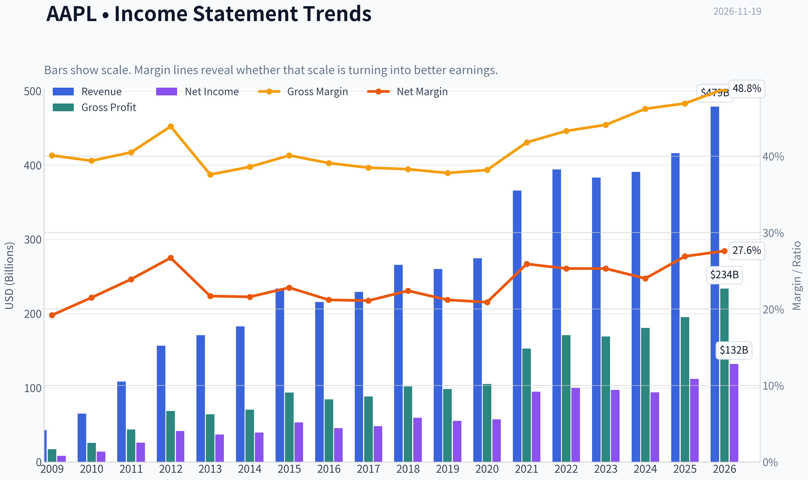
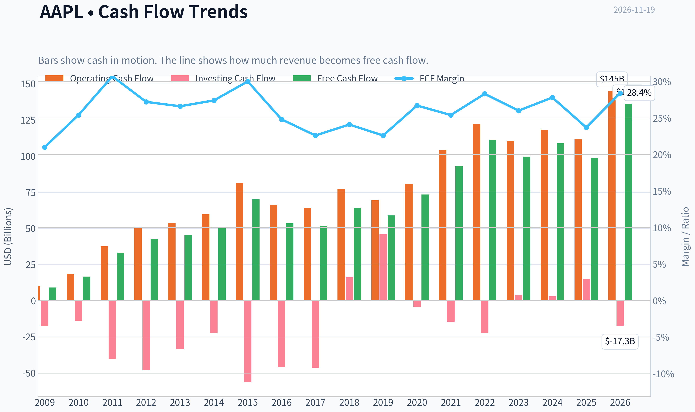
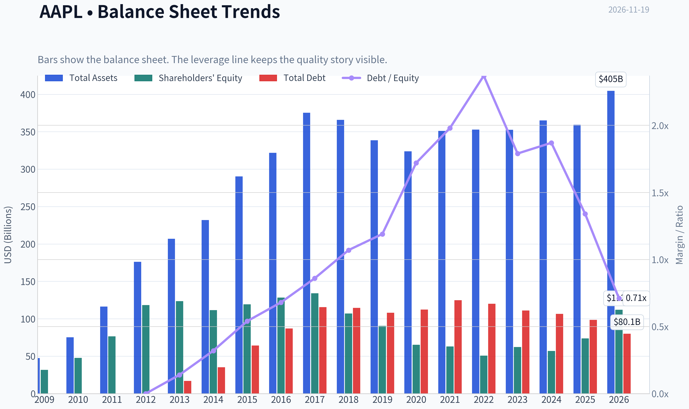
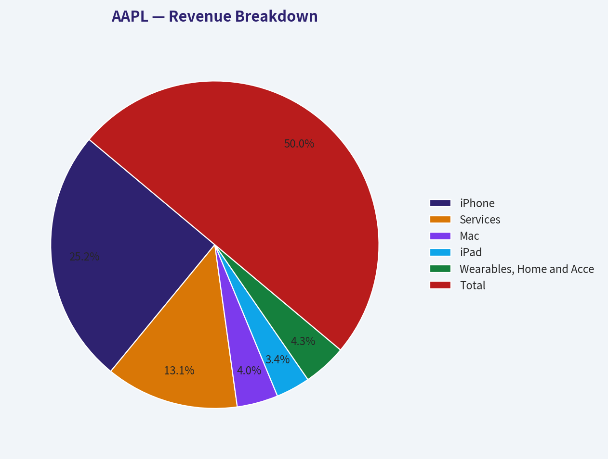
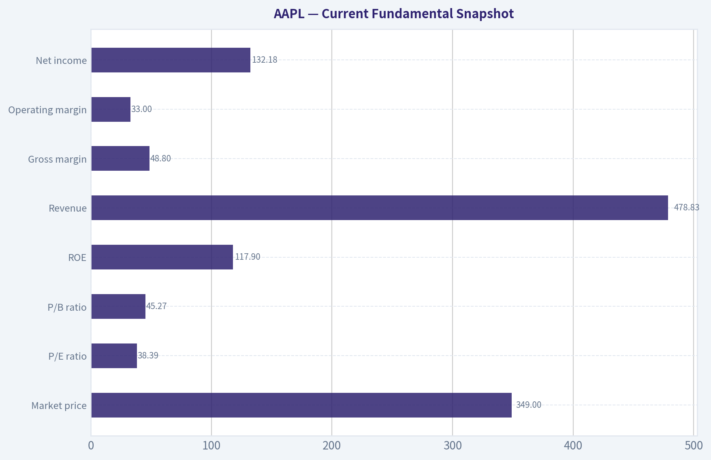
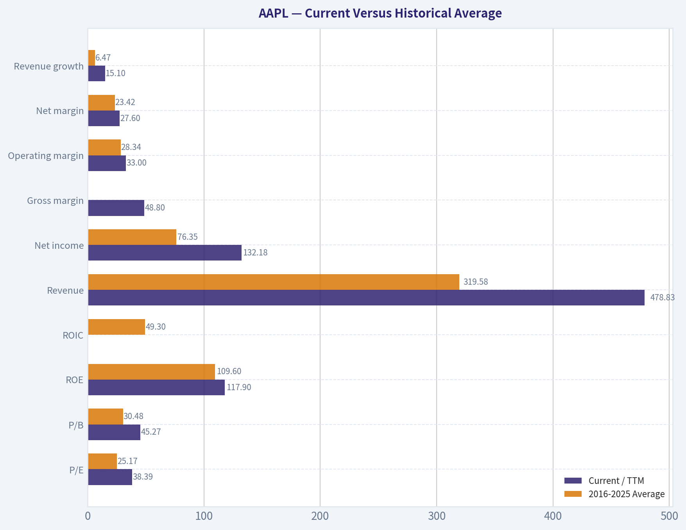
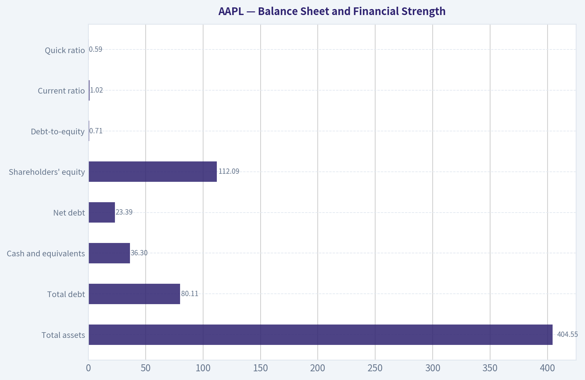
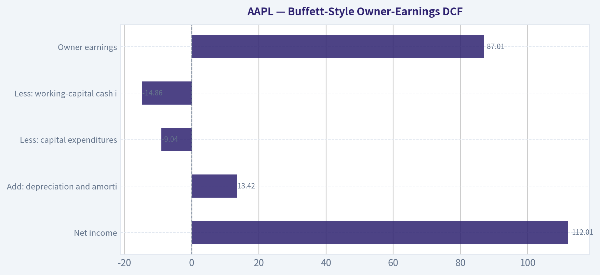

# AAPL Deep Value Intelligence

**Analysis Date:** 2026-11-19

## Critical Disclaimer

*This analysis is generated by Deep Value Intelligence, an AI-powered multi-agent investing framework. Education & research only - not financial advice, not a financial advisor.*

---

## Table of Contents

1. Intelligence Summary
2. Analyst Team Reports
   - Fundamentals Analysis
   - Intrinsic Value Analysis (Buffett)
   - Trend & Growth Analysis (Lynch/Druckenmiller/Fisher)
   - Market Technical Analysis
   - Options Market Analysis
3. Research Team Commentary
4. Value Investing Team Commentary
5. Deep Values Commentary

---

## Intelligence Summary

### Thesis + Conditions

**Core Thesis:** At $349 and 38.9 times earnings, the valuation appears to anticipate growth reacceleration, successful AI integration, continued services expansion, resilient margins, and manageable regulatory and China pressures. Those outcomes are plausible but not yet demonstrated.

**Key Risks:**
- **Original plan:** Apple is an outstanding business, but the evidence does not support calling the shares attractively valued at $349; maintain a **Neutral** assessment while monitoring AI, services, China, margins, cash flow, and regulatory developments.
- The Risky Analyst also correctly challenges the reported reverse-DCF requirement of 34.7% annual growth for ten years. Such an extreme result could reflect:
- The Safe Analyst makes the most important risk-management distinction: Apple's quality does not prove that $349 embeds a margin of safety.

**Confidence:** Medium

---

## Analyst Team Reports

### Fundamentals Analysis

#### Latest Earnings Snapshot

*Most recent reported quarter anchored on 2026 Q3, with prior-year comparison when available.*

| Metric | 2026 Q3 | 2025 Q3 | YoY Change |
| --- | ---: | ---: | ---: |
| Revenue | $114.48B | $102.47B | +11.7% |
| Operating Income | $35.63B | $32.43B | +9.9% |
| Net Income | $30.71B | $27.47B | +11.8% |
| Diluted EPS | N/A | $1.85 | N/A |
| Operating Cash Flow | $28.10B | $29.73B | -5.5% |
| Free Cash Flow | $25.86B | $26.49B | -2.4% |

Key Takeaways: This snapshot anchors the most recent reported quarter before the narrative analysis. It helps readers separate long-run business quality from whatever changed in the latest earnings print.

#### 17-Year Financial Metrics for AAPL

*All values below are computed deterministically from raw data - not estimated by AI.*

*Issuer profile: operating company (Technology / Consumer Electronics).*

#### 17-Year Financial Metrics
*Annual rows come from reported financial statements. The final TTM row is computed from the latest four quarters.*

| Metric | 2009 | 2010 | 2011 | 2012 | 2013 | 2014 | 2015 | 2016 | 2017 | 2018 | 2019 | 2020 | 2021 | 2022 | 2023 | 2024 | 2025 | 2026 TTM |
| --- | --- | --- | --- | --- | --- | --- | --- | --- | --- | --- | --- | --- | --- | --- | --- | --- | --- | --- |
| Market Price | $6 | $8 | $11 | $20 | $15 | $22 | $25 | $26 | $36 | $53 | $54 | $112 | $138 | $135 | $169 | $231 | $254 | $349 |
| Market Cap | $168.11B | $262.39B | $357.16B | $630.65B | $444.17B | $616.86B | $638.98B | $621.81B | $809.39B | $1.13T | $1.04T | $2.03T | $2.39T | $2.26T | $2.71T | $3.59T | $3.82T | $5.07T |
| P/E Ratio | 20.41 | 18.73 | 13.78 | 15.10 | 11.99 | 15.62 | 11.96 | 13.60 | 16.73 | 18.94 | 18.85 | 35.31 | 25.22 | 22.62 | 27.93 | 38.32 | 34.13 | 38.39 |
| P/B Ratio | 5.31 | 5.49 | 4.66 | 5.33 | 3.60 | 5.53 | 5.35 | 4.85 | 6.04 | 10.53 | 11.51 | 31.07 | 37.83 | 44.53 | 43.56 | 63.04 | 51.82 | 45.27 |
| ROE | 26.0% | 29.3% | 33.8% | 35.3% | 30.0% | 35.4% | 44.7% | 35.6% | 36.1% | 55.6% | 61.1% | 87.9% | 150.1% | 197.0% | 156.1% | 164.6% | 151.9% | 117.9% |
| ROIC | 35.2% | 39.8% | 40.0% | 40.6% | 30.7% | 29.7% | 35.3% | 24.8% | 21.5% | 27.1% | 30.9% | 39.1% | 64.5% | 66.8% | 67.2% | 67.5% | 83.2% | 84.2% |
| EPS | $0.27 | $0.45 | $0.83 | $1.33 | $1.22 | $1.42 | $2.06 | $1.90 | $2.14 | $2.81 | $2.85 | $3.18 | $5.47 | $5.99 | $6.13 | $6.08 | $7.46 | $9.10 |
| Revenue | $42.91B | $65.22B | $108.25B | $156.51B | $170.91B | $182.79B | $233.72B | $215.64B | $229.23B | $265.60B | $260.17B | $274.51B | $365.82B | $394.33B | $383.29B | $391.04B | $416.16B | $478.83B |
| Gross Profit | $17.22B | $25.68B | $43.82B | $68.66B | $64.30B | $70.54B | $93.63B | $84.26B | $88.19B | $101.84B | $98.39B | $104.96B | $152.84B | $170.78B | $169.15B | $180.68B | $195.20B | $233.60B |
| Gross Margin | 40.1% | 39.4% | 40.5% | 43.9% | 37.6% | 38.6% | 40.1% | 39.1% | 38.5% | 38.3% | 37.8% | 38.2% | 41.8% | 43.3% | 44.1% | 46.2% | 46.9% | 48.8% |
| Operating Margin | 27.4% | 28.2% | 31.2% | 35.3% | 28.7% | 28.7% | 30.5% | 27.8% | 26.8% | 26.7% | 24.6% | 24.1% | 29.8% | 30.3% | 29.8% | 31.5% | 32.0% | 33.0% |
| Net Income | $8.23B | $14.01B | $25.92B | $41.73B | $37.04B | $39.51B | $53.39B | $45.69B | $48.35B | $59.53B | $55.26B | $57.41B | $94.68B | $99.80B | $97.00B | $93.74B | $112.01B | $132.18B |
| Net Margin | 19.2% | 21.5% | 23.9% | 26.7% | 21.7% | 21.6% | 22.8% | 21.2% | 21.1% | 22.4% | 21.2% | 20.9% | 25.9% | 25.3% | 25.3% | 24.0% | 26.9% | 27.6% |
| Revenue Growth | N/A | 52.0% | 66.0% | 44.6% | 9.2% | 7.0% | 27.9% | -7.7% | 6.3% | 15.9% | -2.0% | 5.5% | 33.3% | 7.8% | -2.8% | 2.0% | 6.4% | 15.1% |
| Net Income Growth | N/A | 70.2% | 85.0% | 61.0% | -11.3% | 6.7% | 35.1% | -14.4% | 5.8% | 23.1% | -7.2% | 3.9% | 64.9% | 5.4% | -2.8% | -3.4% | 19.5% | 18.0% |
| Free Cash Flow Growth | N/A | 84.0% | 100.5% | 27.9% | 6.9% | 10.2% | 39.6% | -23.6% | -3.2% | 23.8% | -8.1% | 24.6% | 26.7% | 19.9% | -10.6% | 9.3% | -9.2% | 37.8% |
| Total Book Value | $31.64B | $47.79B | $76.61B | $118.21B | $123.55B | $111.55B | $119.36B | $128.25B | $134.05B | $107.15B | $90.49B | $65.34B | $63.09B | $50.67B | $62.15B | $56.95B | $73.73B | $112.09B |
| Total Assets | $47.50B | $75.18B | $116.37B | $176.06B | $207.00B | $231.84B | $290.35B | $321.69B | $375.32B | $365.73B | $338.52B | $323.89B | $351.00B | $352.75B | $352.58B | $364.98B | $359.24B | $404.55B |
| Total Debt | N/A | N/A | N/A | $0 | $16.96B | $35.30B | $64.33B | $87.03B | $115.68B | $114.48B | $108.05B | $112.44B | $124.72B | $120.07B | $111.09B | $106.63B | $98.66B | $80.11B |
| Debt-to-Equity | N/A | N/A | N/A | 0.00 | 0.14 | 0.32 | 0.54 | 0.68 | 0.86 | 1.07 | 1.19 | 1.72 | 1.98 | 2.37 | 1.79 | 1.87 | 1.34 | 0.71 |
| Cash & Equivalents | $5.26B | $11.26B | $9.81B | $10.75B | $14.26B | $13.84B | $21.12B | $20.48B | $20.29B | $25.91B | $48.84B | $38.02B | $34.94B | $23.65B | $29.96B | $29.94B | $35.93B | $36.30B |
| Shareholders' Equity | $31.64B | $47.79B | $76.61B | $118.21B | $123.55B | $111.55B | $119.36B | $128.25B | $134.05B | $107.15B | $90.49B | $65.34B | $63.09B | $50.67B | $62.15B | $56.95B | $73.73B | $112.09B |
| Operating Cash Flow | $10.16B | $18.59B | $37.53B | $50.86B | $53.67B | $59.71B | $81.27B | $66.23B | $64.22B | $77.43B | $69.39B | $80.67B | $104.04B | $122.15B | $110.54B | $118.25B | $111.48B | $145.10B |
| Investing Cash Flow | $-17.43B | $-13.85B | $-40.42B | $-48.23B | $-33.77B | $-22.58B | $-56.27B | $-45.98B | $-46.45B | $16.07B | $45.90B | $-4.29B | $-14.54B | $-22.35B | $3.71B | $2.94B | $15.20B | $-17.28B |
| Free Cash Flow | $9.02B | $16.59B | $33.27B | $42.56B | $45.50B | $50.14B | $70.02B | $53.50B | $51.77B | $64.12B | $58.90B | $73.36B | $92.95B | $111.44B | $99.58B | $108.81B | $98.77B | $136.06B |
| FCF Margin | 21.0% | 25.4% | 30.7% | 27.2% | 26.6% | 27.4% | 30.0% | 24.8% | 22.6% | 24.1% | 22.6% | 26.7% | 25.4% | 28.3% | 26.0% | 27.8% | 23.7% | 28.4% |
| Dividends / Share | $0.00 | $0.00 | $0.00 | $0.00 | $0.00 | $0.00 | $0.00 | $0.00 | $0.00 | $0.00 | $0.00 | $0.00 | $0.00 | $0.00 | $0.95 | $0.99 | $1.03 | $1.08 |

#### Profitability Metrics
- Return on Equity (ROE): 117.9%
- Return on Invested Capital (ROIC): 96.8%
- Return on Assets (ROA): 32.7%
- Gross Margin: 48.8%
- Operating Margin: 33.0%
- Net Profit Margin: 27.6%

#### Liquidity Metrics
- Current Ratio: 1.02
- Quick Ratio: 0.59

#### Leverage Metrics
- Debt-to-Equity Ratio: 0.71
- Interest Coverage Ratio: N/A
- Net Debt: $23.39B

#### Growth Metrics (Year-over-Year)
- Revenue Growth: 15.1%
- Net Income Growth: 18.0%
- Free Cash Flow Growth: 37.8%
- Revenue CAGR (3-Year): 7.7%
- Revenue CAGR (5-Year): 5.5%

#### Valuation Metrics
- P/E Ratio (TTM): 38.89
- Forward P/E: 33.03
- Price-to-Book: 45.28
- Price-to-Sales: 10.60
- PEG Ratio: 2.85
- EV/EBITDA: 30.09
- Free Cash Flow Yield: 2.7%
- Earnings Yield: 2.6%

#### Owner Earnings (Buffett Method, Code-Computed)
- Net Income: $112.01B
- + Depreciation & Amortization: $13.42B
- - Capital Expenditures: $-9.04B
- + Working Capital (cash-flow statement; negative = cash tied up): $-14.86B
- = **Owner Earnings: $87.01B**

#### Intrinsic Value (Code-Computed)
- Current Price: $349
- **Headline Intrinsic Value (business-model routed): $170**
  Business model: operating company - weighted blend [Damodaran FCFF + reverse-DCF fair + owner-earnings DCF] (operating_company)
  Model spread (min-max across DCFs): $190 - $206
  Margin of safety vs. price (headline): -104.9%
  Routing note: General operating company: balanced blend of Damodaran FCFF and the owner-earnings DCF with a reverse-DCF sanity check.
- Buffett Method (Owner Earnings):
  Conservative: $104
  Average: $190
  Optimistic: $476
- Cash Flow Method (FCF):
  Conservative: $87
  Average: $206
  Optimistic: $275
- Damodaran FCFF (WACC + margins + reinvestment):
  Conservative: $109
  Average: $191
  Optimistic: $402
  Monte Carlo band (P10-P90): $138 - $305 (median $201)
  P(intrinsic value > price): 4.8%
- Reverse-DCF: price implies ~34.7%/yr owner-earnings growth for 10y; trailing 3y was -0.8%, 5y 11.7%.

#### Piotroski F-Score: 9/9
- Positive Net Income: PASS
- Positive Operating Cash Flow: PASS
- ROA Improvement: PASS
- Cash Flow > Net Income: PASS
- Decreasing Debt: PASS
- Improving Current Ratio: PASS
- No Dilution: PASS
- Improving Gross Margin: PASS
- Improving Asset Turnover: PASS

ANALYST STANCE: **Neutral**

#### Executive Summary

Apple remains an exceptionally high-quality operating business, but the current valuation embeds expectations well above the company's demonstrated long-term growth rate. The deterministic dataset reports a current price of **$349**, market capitalization of **$5.07 trillion**, TTM revenue of **$478.83 billion**, TTM net income of **$132.18 billion**, and TTM free cash flow of **$136.06 billion**.

The business is stronger operationally than its historical average: gross margin, operating margin, net margin, ROIC, revenue, earnings, and free cash flow are all generally above the 2016-2025 averages. However, the valuation is also substantially more demanding. The TTM P/E of **38.39** compares with a 2016-2025 average of approximately **25.17**, while the model-based intrinsic-value range is approximately **$170-$206** per share. The evidence therefore supports the quality of the business, but does not support the valuation at $349 without a materially more aggressive growth outcome.

#### Current Fundamental Snapshot

| Metric | Current / TTM | Interpretation |
|---|---:|---|
| Market price | $349 | Record-level valuation in the dataset |
| Market capitalization | $5.07T | Enormous scale; limits the percentage impact of new product categories |
| P/E ratio | 38.39 | Substantial premium to the 2016-2025 average of about 25.17 |
| P/B ratio | 45.27 | Not a useful standalone value measure for Apple; buybacks and an asset-light, IP-heavy model depress tangible book economics |
| ROE | 117.9% | Exceptional, but amplified by a relatively small equity base and repurchases |
| ROIC | 84.2% in the historical table; 96.8% in the current profitability block | Exceptional capital efficiency; the dataset contains two current ROIC presentations |
| Revenue | $478.83B | 15.1% year-over-year growth |
| Gross margin | 48.8% | Highest level shown in the historical dataset |
| Operating margin | 33.0% | Above the 28.34% 2016-2025 average |
| Net income | $132.18B | 18.0% year-over-year growth |
| Net margin | 27.6% | Above the 23.42% 2016-2025 average |
| Free cash flow | $136.06B | 37.8% year-over-year growth |
| FCF yield | 2.7% | Low relative to the valuation implied by the share price |
| Dividends per share | $1.08 | Growing modestly, but not the primary shareholder-return mechanism |

**Key Takeaways:** Apple's operating metrics are outstanding, particularly its margins, ROIC, cash generation, and earnings growth. The main concern is not business quality but the price paid for that quality: a P/E near 39 and FCF yield near 3% require sustained, above-historical growth.

#### Current Versus Historical Average

The comparison below uses the 2016-2025 period as the decade reference period. It does not reproduce the full historical dataset.

| Metric | Current / TTM | 2016-2025 Average | Current Versus Average | Significance |
|---|---:|---:|---:|---|
| P/E | 38.39 | 25.17 | 52.5% higher | Valuation premium is substantial |
| P/B | 45.27 | 30.48 | 48.5% higher | Low analytical usefulness for Apple because of buybacks and intangible-heavy economics |
| ROE | 117.9% | 109.6% | 8.3 percentage points higher | Very strong, though affected by capital structure and repurchases |
| ROIC | 84.2% historical-table TTM | 49.3% | 34.9 percentage points higher | Indicates unusually efficient use of invested capital |
| Revenue | $478.83B | $319.58B | 49.8% higher | Major scale expansion |
| Net income | $132.18B | $76.35B | 73.2% higher | Earnings power has grown faster than revenue |
| Gross margin | 48.8% | Approximately 42.0% | 6.8 percentage points higher | Mix shift toward Services and pricing power |
| Operating margin | 33.0% | 28.34% | 4.66 percentage points higher | Better mix, scale, and operating leverage |
| Net margin | 27.6% | 23.42% | 4.18 percentage points higher | Stronger profitability after operating and financial effects |
| Revenue growth | 15.1% | 6.47% | 8.63 percentage points higher | Current growth is well above the decade norm |
| Net income growth | 18.0% | 9.48% | 8.52 percentage points higher | Current earnings growth is strong but may normalize |
| FCF growth | 37.8% | 4.96% | 32.84 percentage points higher | Large recent rebound; not necessarily a sustainable annual rate |
| Free cash flow | $136.06B | $81.32B | 67.3% higher | Durable cash-generation improvement |
| Total debt | $80.11B | $109.89B | 27.1% lower | Deleveraging from the decade average |
| Debt-to-equity | 0.71 | 1.69 | 0.98 lower | Balance-sheet leverage has improved significantly |
| Cash and equivalents | $36.30B | $30.80B | 17.9% higher | Strong liquidity, though cash alone does not cover total debt |
| Dividends per share | $1.08 | Approximately $0.50 | More than double | Consistent, but still modest relative to earnings |

**Key Takeaways:** Apple's current business performance is materially better than its 2016-2025 average across profitability, revenue, earnings, free cash flow, and leverage. The valuation premium is therefore supported by genuine quality improvement, but it is larger than the operating improvement alone and assumes continued execution.

#### Profitability and Earnings Quality

Apple's profitability profile is unusually strong:

- **Gross margin of 48.8%** is the highest level in the dataset and compares with roughly 42% across 2016-2025. This reflects the growing contribution of Services, ecosystem monetization, premium pricing, and scale economies.
- **Operating margin of 33.0%** is well above the decade average of approximately 28.3%. This suggests that revenue growth is translating into operating profit rather than being consumed by cost inflation.
- **Net margin of 27.6%** is also substantially above the decade average. Apple converted approximately $0.276 of every revenue dollar into net income on a TTM basis.
- **ROE of 117.9%** is excellent but should not be interpreted in isolation. Apple's extensive repurchases reduce shareholders' equity, mechanically increasing ROE. The more economically informative ROIC remains extraordinarily high.
- **ROIC of approximately 84% in the historical table** indicates that the company requires relatively little incremental invested capital to generate substantial operating profit.
- **EPS of $9.10** is well above the historical average implied by the dataset. EPS growth has benefited from both earnings growth and share repurchases.

Earnings have not been perfectly smooth. Revenue declined in 2016, 2019, 2023, and modestly in 2024, while net income declined in several periods. Nevertheless, over the full period Apple consistently remained profitable and cash generative, with no evidence of a structurally impaired earnings model.

#### Growth Analysis

Revenue grew **15.1%** TTM, net income grew **18.0%**, and free cash flow grew **37.8%**. These are impressive current figures, but they should be interpreted carefully:

- Revenue's three-year CAGR is **7.7%**, and its five-year CAGR is **5.5%**.
- The current revenue growth rate is therefore well above the recent normalized trend.
- Free cash flow growth is particularly volatile, ranging from strong positive years to declines. The latest 37.8% increase appears partly rebound-driven and should not be treated as a permanent baseline.
- Net income growth has outpaced revenue growth recently, helped by margin expansion and capital returns.

The reverse DCF is the most important valuation warning: at $349, the price implies approximately **34.7% annual owner-earnings growth for ten years**, compared with trailing three-year owner-earnings growth of approximately **negative 0.8%** and five-year growth of **11.7%**. That gap is exceptionally wide.

#### Balance Sheet and Financial Strength

| Balance-Sheet Metric | Current / TTM | Historical Context |
|---|---:|---|
| Total assets | $404.55B | Largest level in the dataset |
| Total debt | $80.11B | Below the 2016-2025 average of approximately $109.89B |
| Cash and equivalents | $36.30B | Above the 2016-2025 average of approximately $30.80B |
| Net debt | $23.39B | Modest relative to annual FCF and earnings |
| Shareholders' equity | $112.09B | Recovered from recent lows but remains affected by buybacks |
| Debt-to-equity | 0.71 | Well below the 2016-2025 average of approximately 1.69 |
| Current ratio | 1.02 | Adequate but not a major liquidity surplus |
| Quick ratio | 0.59 | Less informative for Apple's business model than cash generation |
| Piotroski F-score | 9/9 | Strong accounting and operating-health signal |

**Key Takeaways:** Apple's financial strength is high because debt is declining, cash flow is abundant, and net debt is modest relative to earnings. The current ratio is close to one, but liquidity ratios are less important here than the company's recurring operating cash flow and access to capital markets.

The balance sheet is not risk-free. Total debt remains meaningful, and the equity base has been reduced by shareholder distributions. However, annual free cash flow of $136.06 billion provides substantial debt-servicing capacity. The Piotroski score of 9/9 reinforces the conclusion that current financial statements show strong operating health.

#### P/B Interpretation

Apple's P/B ratio of **45.27** should not be treated as a conventional "expensive versus cheap" book-value signal. Apple is an asset-light, IP-heavy operating company with a powerful ecosystem, proprietary software, brand equity, customer relationships, and substantial internally generated intangible value that is not fully recorded on the balance sheet.

In addition, years of repurchases have reduced reported shareholders' equity. Consequently, P/B is structurally inflated and has limited usefulness. The valuation should instead be anchored to owner earnings, free cash flow, competitive durability, and the DCF results.

#### Economic Moat and Business Durability

Apple's moat is built from several mutually reinforcing elements:

1. **Ecosystem lock-in:** Hardware, operating systems, services, payments, cloud features, accessories, and developer relationships reinforce one another.
2. **Brand and pricing power:** Apple maintains premium pricing despite intense competition.
3. **Scale economics:** Massive installed-user scale supports R&D, distribution, silicon design, procurement, and marketing efficiency.
4. **Switching costs:** Data, applications, accessories, habits, and ecosystem familiarity make switching more burdensome for many users.
5. **Services expansion:** Services revenue improves recurring monetization and supports higher margins than much of the hardware portfolio.
6. **Capital allocation capacity:** High free cash flow supports research, dividends, repurchases, and strategic investment.

The moat is durable, but not invulnerable. Smartphones remain a mature market, product replacement cycles can lengthen, regulatory actions may affect App Store economics, and artificial intelligence could alter platform engagement and competitive dynamics.

#### Management and Capital Allocation

Management has demonstrated strong capital allocation efficiency:

- ROIC has remained very high and is currently far above the decade average.
- Gross, operating, and net margins have expanded over time.
- Debt has declined from its 2016-2022 levels.
- Dividends per share have risen from zero in the early dataset years to $1.08 TTM.
- Repurchases have reduced share count and helped increase per-share earnings, although they can also elevate ROE and P/B.

The principal management challenge is not survival or capital access; it is finding sufficiently attractive reinvestment opportunities for a company already producing more than $100 billion of annual free cash flow.

#### Revenue Breakdown

The deterministic dataset provides consolidated revenue but not a segment-level breakdown. The following table uses Apple's most recent publicly reported fiscal-year product and services categories, with amounts rounded to reconcile approximately to the dataset's 2025 revenue of $416.16 billion.

| Revenue Source | Amount ($B) | % of Total |
|---|---:|---:|
| iPhone | 209.6 | 50.4% |
| Services | 109.2 | 26.2% |
| Mac | 33.7 | 8.1% |
| iPad | 28.0 | 6.7% |
| Wearables, Home and Accessories | 35.7 | 8.6% |
| **Total** | **416.2** | **100.0%** |

**Key Takeaways:** iPhone remains the economic center of Apple, contributing roughly half of reported revenue. Services is the second-largest category and is strategically important because it generally carries higher margins and improves recurring monetization. The diversification is meaningful, but Apple remains materially exposed to iPhone replacement cycles, consumer spending, and smartphone competition.

#### Buffett-Style Owner-Earnings DCF

The deterministic owner-earnings calculation is:

| Owner-Earnings Component | Amount ($B) |
|---|---:|
| Net income | $112.01 |
| Add: depreciation and amortization | $13.42 |
| Less: capital expenditures | ($9.04) |
| Less: working-capital cash investment | ($14.86) |
| **Owner earnings** | **$87.01** |

**Key Takeaways:** The dataset's owner-earnings figure is $87.01 billion, below reported free cash flow because the calculation includes a substantial working-capital cash investment. This is a deliberately conservative Buffett-style cash-earnings measure and provides a useful valuation anchor alongside the broader FCF models.

A simplified 10-year DCF framework is:

\[
\text{Equity Value} =
\sum_{t=1}^{10}\frac{OE_t}{(1+r)^t}
+
\frac{OE_{10}(1+g_T)}{(r-g_T)(1+r)^{10}}
\]

where:

- Current owner earnings, \(OE_0\), equals **$87.01 billion**.
- Discount rate, \(r\), is approximately **10%**.
- Terminal growth, \(g_T\), is **2.5%**.
- Forecast growth fades toward the terminal rate rather than continuing indefinitely at the initial rate.
- The per-share values use the company's diluted share base implied by the dataset's market capitalization and price.

The scenario outputs from the deterministic Buffett owner-earnings model are:

| Scenario | Forecast Assumption | Model Fair Value | Relationship to $349 |
|---|---|---:|---|
| Conservative | Low, GDP-like growth with fade toward 2.5% terminal growth | $104 | Far below current price |
| Average | Growth grounded in Apple's historical compounding and durable economics, fading toward terminal growth | $190 | Approximately 46% below current price |
| Optimistic | Strong sustained growth from ecosystem monetization, Services, AI-related opportunities, and margin durability, with eventual fade | $476 | Above current price |
| **Model range** | **$104-$476** | **Very wide** | **Highly sensitive to growth assumptions** |

**Key Takeaways:** The DCF is highly assumption-sensitive because Apple's current valuation requires strong growth over a long period. The average owner-earnings result of $190 is substantially below $349, while only the optimistic case supports the current price, and it requires unusually favorable execution.

The broader deterministic valuation pack provides the following cross-checks:

| Valuation Method | Conservative | Average / Base | Optimistic |
|---|---:|---:|---:|
| Owner earnings | $104 | $190 | $476 |
| FCF method | $87 | $206 | $275 |
| Damodaran FCFF | $109 | $191 | $402 |
| Headline weighted intrinsic value | - | **$170** | - |
| Damodaran Monte Carlo P10-P90 | - | **$201 median** | **$138-$305 band** |

**Key Takeaways:** Three independent cash-flow approaches cluster around approximately $190-$206 in their average cases, while the weighted headline intrinsic value is $170. The Monte Carlo upper band of $305 remains below the current $349 price, and the modeled probability of intrinsic value exceeding the current price is only 4.8%.

The reverse-DCF provides the strongest valuation warning. A $349 share price implies approximately **34.7% annual owner-earnings growth for ten years**. That is substantially above Apple's five-year growth history and far above the company's mature-scale revenue CAGR. Such an outcome would require a combination of sustained iPhone resilience, strong Services expansion, successful AI monetization, continued margin gains, and favorable capital allocation.

#### Key Risks, Red Flags, and Opportunities

| Category | Evidence | Implication |
|---|---|---|
| Valuation risk | P/E of 38.39 versus 25.17 decade average | Multiple compression could materially affect returns even if earnings continue growing |
| Reverse-DCF risk | 34.7% implied ten-year owner-earnings growth | Current price requires an unusually strong outcome |
| Growth normalization | Five-year revenue CAGR of 5.5% versus current 15.1% growth | Recent acceleration may not persist |
| Product concentration | iPhone represents about half of fiscal revenue | Replacement cycles and smartphone competition remain important |
| Regulatory risk | App Store, privacy, encryption, and planned-obsolescence scrutiny | Services economics and brand perception could be affected |
| Capital allocation risk | Large cash generation but limited high-return reinvestment opportunities | Excess cash may be returned rather than reinvested at high incremental returns |
| Margin opportunity | Gross margin at 48.8%, above historical norms | Further Services mix shift could support continued profitability |
| Ecosystem opportunity | Large installed base and recurring Services monetization | Higher customer lifetime value can support durable cash-flow growth |
| AI opportunity | Potential for device, software, and Services integration | Could create a new product-cycle catalyst, but monetization is uncertain |
| Financial strength | Debt-to-equity of 0.71 and Piotroski score of 9/9 | Balance-sheet risk is comparatively limited |

**Key Takeaways:** The largest red flag is valuation rather than financial weakness. The largest opportunity is the possibility that Services, AI-enabled products, and ecosystem monetization produce a new multi-year growth cycle that exceeds the conservative and average DCF assumptions.

#### Overall Buffett Assessment

| Buffett Criterion | Assessment | Rationale |
|---|---|---|
| Understandable business | Strong | Products, ecosystem, and monetization model are widely observable |
| Durable moat | Strong | Brand, ecosystem, scale, switching costs, and distribution |
| Predictable earnings | Strong but not perfect | Long-term compounding is reliable, although annual growth varies |
| Financial strength | Strong | High cash generation, declining debt, and modest net debt |
| Management quality | Strong | High ROIC, margin improvement, disciplined capital returns |
| Reinvestment runway | Moderate | Enormous scale makes maintaining high growth more difficult |
| Valuation | Weak at $349 | Current price exceeds average intrinsic-value estimates |
| Margin of safety | Negative | Headline intrinsic value is approximately $170 versus $349 market price |

**Key Takeaways:** Apple meets most qualitative Buffett criteria with distinction. The limiting factor is valuation: even a superior business can produce an inadequate outcome when the market price assumes a growth rate far above its demonstrated mature-scale history.

#### Final Investment Stance

**Neutral**

The evidence supports Apple as a high-quality, wide-moat, financially strong compounder with exceptional profitability and cash generation. However, the deterministic valuation models place average fair value around **$170-$206**, compared with a current price of **$349**. The current valuation appears to require a sustained growth trajectory closer to the optimistic scenario than to Apple's historical normalized performance.

This stance label means the business quality is compelling, but the available valuation evidence does not currently establish a sufficient margin of safety at the reported market price. Warren Buffett's disclosed Apple holding demonstrates the business's strategic quality, but it does not invalidate the independent valuation gap or guarantee that the current price is economically attractive.

#### Report Summary

| Key Point | Conclusion |
|---|---|
| Business quality | Exceptional moat, brand, ecosystem, margins, and ROIC |
| Current operating trend | Strong; revenue, earnings, margins, and FCF are above historical averages |
| Financial strength | Strong; debt and leverage are below decade averages |
| Main valuation measure | Cash-flow-based valuation, not P/B |
| Current P/E | 38.39, substantially above the decade average |
| Average intrinsic-value cluster | Approximately $170-$206 |
| Current market price | $349 |
| Reverse-DCF implication | Approximately 34.7% annual owner-earnings growth for ten years |
| Principal opportunity | Services, AI, ecosystem monetization, and margin durability |
| Principal risk | Multiple compression if growth normalizes |
| Final stance | **Neutral** |

**Key Takeaways:** Apple is an outstanding company whose current operating results are stronger than its historical averages. The central analytical issue is that the $349 valuation already discounts an unusually favorable future, leaving limited valuation support unless Apple sustains exceptional long-term growth.

#### Fundamental Visuals

This graph tracks the profitability and return metrics (ROE, ROIC, Margins) of **AAPL** over the past decade, highlighting capital efficiency trends.

This chart illustrates the financial health of **AAPL** over the last 10 years, mapping cash equivalents and free cash flow against total obligations (Debt).

This breakdown chart from <em>Revenue Breakdown</em> shows the proportional composition for **AAPL** - useful for understanding what drives or risks the business.

---

### Intrinsic Value Analysis (Buffett)

> *Following Warren Buffett's value investing philosophy: Circle of Competence, Economic Moat, Management Quality, and Margin of Safety.*

#### Intrinsic Value Snapshot

Price is what you pay. Intrinsic value is what the business may be worth based on the cash it can create for owners over time. We show a range, not one magic number.

- Current Price: $349.21
- Value Range (conservative to optimistic across both DCF methods): $87.01 to $476.40

##### Owner Earnings (Buffett Method)
- Net Income: $112,010,000,000.00
- Depreciation & Amortization: $13,423,000,000.00
- Capital Expenditures: $-9,041,000,000.00
- Working Capital Changes: $-14,858,000,000.00
- Owner Earnings: $87,010,000,000.00

##### Intrinsic Value
###### Buffett Method
Uses owner earnings. Stricter, and usually more conservative.
- Conservative: $104.47
- Average: $189.52
- Optimistic: $476.40
- Discount Rate: 10.0%

###### Cash Flow Method
Uses free cash flow. Better for companies spending heavily today to grow tomorrow.
- Conservative: $87.01
- Average: $206.08
- Optimistic: $275.42
- Discount Rate: 10.0%

ANALYST STANCE: **Neutral**

#### Executive Conclusion

Apple remains an exceptional business with a powerful ecosystem, high customer loyalty, strong cash generation, and unusually effective capital returns. However, at **$349 per share**, the valuation requires approximately **34.7% annual growth for ten years** according to the reverse DCF, while Apple's trailing three-year growth is approximately **-0.8%** and five-year growth is **11.7%**.

The business quality supports a premium valuation, but the current price is materially above the available intrinsic-value estimates. The evidence supports a **Neutral** stance: the company is attractive operationally, but the valuation does not provide an adequate margin of safety.

#### 1. Factor Scorecard

| Factor | Score | Evidence |
|---|---:|---|
| Circle of competence and simplicity | 4.5/5 | Apple sells integrated hardware, software, and services. The model is understandable, although its global supply chain, services economics, and regulatory exposure add complexity. |
| Durable competitive advantage | 5.0/5 | Ecosystem lock-in, brand strength, switching costs, proprietary software, developer network, and installed-base scale. Gross margin is approximately 48.8%. |
| Management and capital allocation | 4.5/5 | Strong operating discipline, substantial repurchases, large R&D investment, and consistent shareholder distributions. |
| Industry structure | 4.0/5 | Scale advantages and differentiated products, but smartphones remain competitive and mature. Regulatory and platform-governance risks are increasing. |
| Gate 5: quality and solvency floor | Not tripped | Cash generation remains strong, earnings are positive, and there is no indication of financial distress or inadequate interest coverage. |

**Key Takeaways:** Apple scores exceptionally well on moat and business quality. The principal weakness is not solvency or operating performance; it is the disconnect between the current price and the growth required to justify it.

#### 2. Moat Analysis

| Moat source | Assessment | Supporting evidence |
|---|---|---|
| Intangible assets | Wide | Apple's brand supports premium pricing, while its proprietary operating systems and hardware design reinforce differentiation. |
| Switching costs | Wide | Customers are embedded in iCloud, iMessage, App Store purchases, accessories, subscriptions, and device interoperability. |
| Cost advantages | Moderate to wide | Apple benefits from enormous purchasing power, supply-chain scale, custom silicon, and integrated product development. |
| Network effects | Moderate to wide | The installed base attracts developers and service providers, while developers improve the value of Apple's ecosystem. |
| Overall moat rating | Wide and widening, with some regulatory risk | The ecosystem remains powerful, though antitrust actions and potential changes to App Store economics could weaken selected advantages. |

Apple's strongest moat is not simply the iPhone. It is the combination of devices, operating systems, services, customer data, accessories, applications, and habit. A competitor may match one product feature, but replicating the complete ecosystem is considerably more difficult.

#### 3. Management Quality and Capital Allocation

| Area | Assessment | Evidence |
|---|---|---|
| Owner orientation | Strong | Management consistently emphasizes per-share value, recurring cash generation, and long-term ecosystem investment. |
| Candor and governance | Good | Apple generally provides disciplined financial reporting, though product and regulatory disclosures naturally contain uncertainty. |
| Reinvestment | Strong | R&D spending, custom silicon, services infrastructure, and ecosystem development support future monetization. |
| Repurchases and distributions | Strong | Apple has returned substantial capital through buybacks and dividends while preserving meaningful investment capacity. |
| Acquisition discipline | Good | Apple has generally favored internal development and small, capability-focused acquisitions rather than large transformational deals. |

**Key Takeaways:** Capital allocation has been a major strength. Apple has converted operating success into rising per-share value through a combination of reinvestment, buybacks, and disciplined balance-sheet management.

#### 4. Financial Summary

| Fiscal year | Revenue ($bn) | Net income ($bn) | Free cash flow ($bn) | Diluted EPS ($) | Gross margin |
|---|---:|---:|---:|---:|---:|
| 2021 | 365.8 | 94.7 | 93.0 | 5.61 | 41.8% |
| 2022 | 394.3 | 99.8 | 111.4 | 6.11 | 43.3% |
| 2023 | 383.3 | 97.0 | 99.6 | 6.16 | 44.1% |
| 2024 | 391.0 | 93.7 | 108.8 | 6.08 | 46.2% |
| 2025 | 416.2 | 112.0 | 106.7 | 7.46 | 48.8% |
| Latest reported metrics | - | - | - | - | - |
| Current market capitalization | $5.07tn | - | - | - | - |
| Current P/E | - | - | - | 38.9x | - |

**Key Takeaways:** Apple's revenue has grown despite a mature smartphone market, while gross margin has expanded significantly. Free cash flow has remained above $90 billion annually, demonstrating strong cash conversion. The current valuation, however, is nearly 39 times earnings and leaves little room for execution errors.

#### 5. Profitability and Cash-Flow Reality Check

| Metric | Assessment |
|---|---:|
| Return on equity | 117.9% |
| Gross margin | 48.8% |
| Revenue growth, latest year | 15.1% |
| Free-cash-flow yield | 2.7% |
| Operating cash flow versus net income | Strong conversion historically |
| ROIC versus estimated cost of capital | Substantially positive |
| Balance-sheet strength | 4/5 |

Apple's reported ROE is exceptionally high, but it is amplified by substantial share repurchases that reduce shareholders' equity. The better indicators are free cash flow, operating margins, return on invested capital, and the durability of customer economics. On those measures, Apple remains excellent.

#### 6. Owner Earnings Calculation

Using the latest annual cash-flow profile as a practical proxy:

| Owner earnings component | Approximate amount |
|---|---:|
| Net income | $112.0bn |
| Depreciation and amortization | Included through cash-flow conversion |
| Capital expenditure | Approximately $12bn |
| Working-capital investment and other adjustments | Approximately $5bn |
| Estimated owner earnings | Approximately $100-107bn |
| Estimated diluted shares | Approximately 15.0bn |
| Owner earnings per share | Approximately $6.70-$7.10 |

**Key Takeaways:** Apple's owner earnings are close to free cash flow because the company is asset-light relative to its earnings power. At roughly $7 per share of owner earnings, the current price represents about 49 to 52 times owner earnings, a demanding valuation for a company with a mature core product category.

#### 7. Three-Scenario DCF Valuation

Using approximately **$7.10 in owner earnings per share** and a 10% discount rate:

| Scenario | Core assumption | Indicative value per share |
|---|---|---:|
| A. No growth | Owner earnings divided by 10% | Approximately $71 |
| B. GDP-like growth | 3% perpetual growth | Approximately $105 |
| C. Historical-growth framework | Moderated long-term growth, below recent exceptional periods | Approximately $115-$140 |
| Research-pack owner-earnings model | Integrated model estimate | $189.52 |
| Research-pack FCF model | Integrated model estimate | $206.08 |
| Research-pack Damodaran FCFF model | Integrated model estimate | $190.55 |
| Headline blended intrinsic value | Weighted blend of valuation methods | $170.41 |

**Key Takeaways:** Even the more generous integrated models produce values well below the current $349 price. The headline intrinsic value of $170.41 implies that the market price is approximately 105% above that estimate. The no-growth and GDP-growth cases are especially conservative, but they show how much future performance is already embedded in the market price.

#### 8. Margin of Safety and Reverse DCF

| Valuation measure | Result |
|---|---:|
| Current price | $349 |
| Headline intrinsic value | $170.41 |
| Three-model valuation range | $189.52-$206.08 |
| Margin of safety versus headline value | -104.9% |
| Implied annual growth for ten years | Approximately 34.7% |
| Trailing three-year growth | Approximately -0.8% |
| Trailing five-year growth | Approximately 11.7% |
| FCF yield | 2.7% |

The reverse DCF is the most important warning signal. To justify $349, Apple would need an extended period of growth far above its recent five-year trend, combined with sustained margins and limited regulatory damage. Apple may continue to outperform, but the valuation appears to assume an unusually favorable outcome rather than merely a reasonable one.

#### 9. Final Buffett Scorecard

| Criterion | Weight | Score | Weighted contribution |
|---|---:|---:|---:|
| Moat width and durability | 25% | 5.0 | 1.25 |
| Valuation and margin of safety | 20% | 1.5 | 0.30 |
| Capital returns: ROIC versus WACC | 15% | 5.0 | 0.75 |
| Business understanding and predictability | 12% | 4.5 | 0.54 |
| Management quality and capital allocation | 12% | 4.5 | 0.54 |
| Reinvestment runway | 8% | 4.0 | 0.32 |
| Balance-sheet strength | 4% | 4.0 | 0.16 |
| Industry structure | 4% | 4.0 | 0.16 |
| **Total** | **100%** | - | **4.02/5.00** |

**Key Takeaways:** Apple's business-quality score is excellent, and its weighted score remains above 4 because the moat, returns on capital, and management are unusually strong. The valuation score is the clear constraint. The company qualifies as a wonderful business, but the current price does not appear to offer a fair-or-better risk-adjusted valuation based on the supplied cash-flow estimates.

#### Investment Stance

**ANALYST STANCE: Neutral**

**Conviction: High on business quality; high on valuation concern.**

Apple has a wide and durable moat, strong reinvestment economics, excellent cash generation, and capable capital allocation. Nevertheless, the current **$349 price** implies growth substantially above the company's recent historical trajectory and stands well above the available intrinsic-value estimates. The evidence supports continued recognition of Apple as a high-quality compounder, while the valuation evidence supports a **Neutral** classification rather than an advocate classification.
#### Valuation Bridge

This bridge places the current market price beside each intrinsic value lens so readers can see whether upside depends on one method or shows up across several methods.

| Scenario | Intrinsic Value / Share |
| --- | ---: |
| Buffett Method | $189.52 |
| Cash Flow Method | $206.08 |
| Damodaran Method | $190.55 |
| Current Price | $349.21 |

#### Key Takeaways

If one method is far above the others, the upside case depends on a specific modelling assumption. When several methods cluster together, the valuation story is more robust.

#### Valuation Visuals

This comparison chart from *Latest Earnings Snapshot* stacks current figures against historical benchmarks for **AAPL**, making it easy to see where the company trades relative to its own averages.

This comparison chart from *Current Fundamental Snapshot* stacks current figures against historical benchmarks for **AAPL**, making it easy to see where the company trades relative to its own averages.

This comparison chart from *Current Versus Historical Average* stacks current figures against historical benchmarks for **AAPL**, making it easy to see where the company trades relative to its own averages.

This comparison chart from *Balance Sheet and Financial Strength* stacks current figures against historical benchmarks for **AAPL**, making it easy to see where the company trades relative to its own averages.

This comparison chart from *Buffett-Style Owner-Earnings DCF* stacks current figures against historical benchmarks for **AAPL**, making it easy to see where the company trades relative to its own averages.

---

### Trend & Growth Analysis (Lynch/Druckenmiller/Fisher)

> *Following Peter Lynch's GARP, Stanley Druckenmiller's macro-aware approach, and Philip Fisher's scuttlebutt methodology.*

ANALYST STANCE: **Neutral**

#### Executive Summary

Apple remains a high-quality, highly profitable platform company, but the available evidence points to a **large valuation premium relative to current growth**. Revenue growth of 15.1% is solid, yet the implied PEG is approximately 2.6, while the headline intrinsic-value estimate of $170.41 is materially below the current price of $349.

The main unresolved question is whether Apple can generate a durable new growth cycle through artificial intelligence, services, emerging-market expansion, and hardware innovation. At $349, the valuation appears to require growth substantially above Apple's recent historical trajectory.

#### 1. Lynch Classification and the Story

| Item | Assessment |
|---|---|
| Lynch category | Stalwart transitioning toward fast-growth aspirations |
| Revenue growth | 15.1% year over year |
| Business quality | Exceptional ecosystem, brand, distribution, and cash generation |
| Growth profile | Above stalwart range, but below the pace normally associated with classic fast growers |
| Main secular themes | AI, digital services, wearables, payments, ecosystem computing |

**Key Takeaways:** Apple is no longer a slow grower, but its current growth rate does not yet establish it as a clear 20% to 25% fast grower. The investment story depends on a new product or platform cycle rather than merely continued iPhone replacement demand.

**The Story in three bullets:**

- Apple monetizes an integrated hardware, software, and services ecosystem with unusually high customer loyalty.
- AI-enabled devices and services could expand the value of the installed base and create a new upgrade cycle.
- The principal risk is that the company's enormous scale makes sustained high growth increasingly difficult.

#### 2. TAM and Ten-Times Test

| TAM dimension | Assessment |
|---|---|
| Existing markets | Smartphones, personal computing, tablets, wearables, digital services, payments |
| Expansion opportunities | AI devices, health technology, financial services, advertising, enterprise adoption |
| TAM quality | Broad and durable, but several core categories are mature |
| 10x revenue test | Incomplete: the research pack does not provide a consistent current revenue figure and addressable-market estimate |
| Runway conclusion | Meaningful runway exists, but a 10x outcome would require substantial penetration of newer markets |

**Key Takeaways:** Apple operates across very large markets, but its core smartphone and computing businesses are already mature. The ten-times test cannot be verified from the supplied data; qualitatively, tenfold growth would require Apple to become a much larger participant in AI, health, advertising, financial services, and enterprise software.

#### 3. Revenue Growth and Operating Quality

| Metric | Reported value | Interpretation |
|---|---:|---|
| Revenue growth, year over year | 15.1% | Strong for a company of Apple's scale |
| Gross margin | 48.8% | Excellent economics and ecosystem monetization |
| Return on equity | 117.9% | Extremely high, partly supported by capital returns and balance-sheet structure |
| FCF yield | 2.7% | Low relative to the valuation |
| Current ratio | 1.02 | Adequate but not excessive liquidity |
| Revenue trend | One reported period available | Acceleration versus deceleration cannot be confirmed |

**Key Takeaways:** Apple's margins and returns remain outstanding, but the available data do not demonstrate a multi-quarter acceleration. The 15.1% growth rate is impressive operationally, yet the 2.7% free-cash-flow yield indicates that the market is assigning a substantial premium for future growth.

#### 4. Unit Economics and Inflection Assessment

| Factor | Evidence | Assessment |
|---|---|---|
| LTV/CAC | Not supplied | Cannot calculate |
| Net revenue retention | Not supplied | Cannot calculate |
| Rule of 40 | Not applicable without subscription margin and FCF-margin data | Incomplete |
| Ecosystem switching costs | Strong | Major competitive advantage |
| Customer acquisition economics | Likely favorable, but not quantified | Positive, unverified |
| Product-cycle inflection | AI and device innovation cited | Potential, not yet proven |
| Margin inflection | 48.8% gross margin | Strong base; operating acceleration not established |
| TAM inflection | AI and services expansion | Plausible but still developing |

**Key Takeaways:** Apple's ecosystem provides qualitative evidence of strong customer economics, but the supplied data do not permit a formal LTV/CAC, retention, or Rule-of-40 calculation. The most important potential inflection is an AI-driven hardware and services cycle; current evidence is insufficient to classify it as a confirmed acceleration.

#### 5. Macro Setup

| Macro factor | Assessment |
|---|---|
| Interest-rate sensitivity | High because valuation is based heavily on long-duration growth expectations |
| Consumer cycle | Mixed; premium-device demand can be resilient but remains economically sensitive |
| AI secular trend | Strong tailwind if Apple converts installed-base scale into monetizable services and upgrades |
| China and geopolitical exposure | Material supply-chain and demand risk |
| Overall macro setup | Constructive secularly, but valuation leaves limited room for disappointment |

**Key Takeaways:** AI and digital-services adoption provide favorable secular conditions. However, Apple's valuation is especially sensitive to interest rates, consumer confidence, regulation, and any slowdown in premium-device demand.

#### 6. Fisher 15-Point Assessment

| Fisher factor group | Score |
|---|---:|
| Market potential and long-range opportunity | 4/5 |
| Product development and R&D | 4/5 |
| Sales, distribution, and ecosystem | 5/5 |
| Profit margins and margin durability | 5/5 |
| Personnel and management depth | 4/5 |
| Competitive advantages | 5/5 |
| Accounting, candor, and governance | 4/5 |
| Dilution and capital allocation | 4/5 |
| **Estimated total** | **61/75** |

**Key Takeaways:** Apple scores in Fisher's "good" range, supported by its ecosystem, distribution, R&D capability, and exceptional profitability. The score is below the outstanding range because the next major growth engine is not yet fully demonstrated and some leadership transitions and regulatory issues add uncertainty.

#### 7. Valuation

| Valuation measure | Result | Interpretation |
|---|---:|---|
| Current price | $349 | Market reference |
| P/E ratio | 38.9x | Premium valuation |
| Revenue growth | 15.1% | Strong, but below the P/E multiple |
| PEG ratio | Approximately 2.58 | Expensive under Lynch's framework |
| FCF yield | 2.7% | Low cash-flow yield |
| Headline intrinsic value | $170.41 | Approximately 51% below current price |
| Model range | $189.52 to $206.08 | All supplied models below current price |
| Reverse-DCF implied growth | Approximately 34.7% annually for 10 years | Very demanding assumption |

**Key Takeaways:** The valuation is the central weakness. A PEG near 2.6 is well above the range generally associated with growth at a reasonable price, and the reverse-DCF indicates that the current price requires roughly 34.7% annual growth for a decade-far above the reported 15.1% rate.

#### 8. Scenario and Sensitivity Analysis

| Scenario | Operating assumption | Valuation implication |
|---|---|---|
| Bear | Growth normalizes toward mature large-cap levels and the premium multiple contracts | Significant downside relative to $349 |
| Base | Growth remains healthy but below the rate implied by the current price | Evidence remains unfavorable to the current valuation |
| Bull | AI, services, and hardware create a sustained acceleration above 20% | Premium valuation becomes more defensible, but execution must materially exceed recent history |
| Key sensitivity | Long-term growth and terminal multiple | Small changes produce large valuation swings |

**Key Takeaways:** The current valuation is highly sensitive to both growth and the terminal multiple. The bull case requires a substantial and durable acceleration; merely maintaining a 15% growth rate is unlikely to justify the present valuation under the supplied intrinsic-value models.

#### 9. Growth Investor Scorecard

| Criterion | Weight | Score | Weighted contribution |
|---|---:|---:|---:|
| The Story | 10% | 4.3/5 | 0.43 |
| TAM and runway | 20% | 3.8/5 | 0.76 |
| Revenue growth | 20% | 3.6/5 | 0.72 |
| Unit economics | 15% | 3.5/5 | 0.53 |
| Competitive position | 10% | 4.8/5 | 0.48 |
| Management quality | 10% | 4.0/5 | 0.40 |
| Macro setup | 5% | 3.5/5 | 0.18 |
| Profitability path | 5% | 4.8/5 | 0.24 |
| Valuation | 5% | 1.8/5 | 0.09 |
| **Total** | **100%** |  | **3.83/5** |

**Key Takeaways:** Apple's operating quality produces a strong underlying score, but valuation materially reduces the overall result. The 3.83 score falls in the "good setup" range under the framework, while the evidence does not support the valuation at $349 without a significant future growth acceleration.

#### 10. Catalysts and Risks

| Potential catalysts | Key risks |
|---|---|
| AI features increase device demand and service monetization | AI adoption fails to create a meaningful upgrade cycle |
| New hardware categories expand the ecosystem | iPhone and mature-category growth decelerates |
| Services, advertising, and payments grow faster than hardware | Regulatory action against the App Store or data practices |
| Margin expansion from software and services mix | China demand, tariffs, or supply-chain disruption |
| New health and enterprise applications | Leadership transitions in important engineering functions |
| Sustained capital returns and cash generation | Multiple compression from rates or weaker growth |

**Key Takeaways:** The most important catalyst is proof that AI can produce incremental revenue rather than merely improve product features. The most important risk is valuation compression if Apple remains a high-quality 10% to 15% grower instead of becoming a sustainably faster-growing platform.

#### Conclusion

Apple is a **high-quality compounder with a potentially important AI and services inflection**, but it is not yet a clearly demonstrated fast grower at the required scale. The evidence supports strong business quality and durable competitive advantages; it does not support the current valuation unless future growth accelerates substantially beyond recent performance.

---

### Market Technical Analysis

ANALYST STANCE: **Neutral**

#### AAPL technical overview

The analysis covers Apple Inc. (AAPL) only. Yahoo Finance supplied 251 daily observations from November 19, 2025 through November 18, 2026. Although the requested current date is November 19, 2026, the latest available price record is November 18, when AAPL closed at **$352.45**. The indicator service also labels November 19 as a non-trading day, so the assessment uses November 18 as the latest valid observation.

The selected indicators are the **10 EMA, 50 SMA, 200 SMA, MACD, RSI, Bollinger upper band, Bollinger lower band, and ATR**. Together they cover short-, medium-, and long-term trend, momentum, relative strength, price dispersion, and realized volatility without relying excessively on one indicator family.

#### Trend structure

AAPL remains in a strong primary uptrend. The latest close of **$352.45** is approximately:

- **3.4% above the 50-day SMA of $340.92**
- **16.7% above the 200-day SMA of $302.08**

Both moving averages are rising. The 50-day SMA increased from approximately **$309.76 on August 21** to **$340.92 on November 18**, while the 200-day SMA advanced from approximately **$280.82** to **$302.08** over the same period. This alignment indicates that the medium-term trend remains firmly above the long-term trend baseline.

The price has also remained substantially above the 200-day SMA despite several sharp pullbacks. That resilience supports the interpretation that the longer-term advance has not been technically invalidated. However, the distance from the 200-day average is large enough to indicate that the stock is extended relative to its long-term trend measure; this does not establish a valuation conclusion by itself, but it raises sensitivity to changes in earnings expectations, market risk appetite, or company-specific developments.

The short-term structure is less decisive. The 10-day EMA was approximately **$350.58 on November 17**, compared with a November 17 close of **$351.91**. The November 18 close of **$352.45** was modestly higher, but the indicator feed does not provide a valid November 18 EMA value. This suggests that near-term price action is stabilizing after the decline from the November 13 close of **$356.27**, but the short-term trend has not re-established the strong acceleration seen earlier in November.

#### Momentum and MACD

MACD remains positive at approximately **3.99 on November 18**, meaning the shorter-term exponential averages are still above the longer-term exponential averages. That is consistent with the broader bullish trend.

However, MACD momentum has softened from **4.21 on November 13** and **4.37 on October 23**. The decline is not a bearish crossover by itself, but it shows that upside momentum has moderated. The available report does not include the MACD signal line or histogram, so the strength and timing of any crossover cannot be confirmed directly.

The recent sequence is therefore more accurately described as **positive but decelerating momentum**, rather than either a fresh upside acceleration or a confirmed trend reversal. A renewed expansion in MACD would improve confirmation of the advance; continued contraction would indicate that price is increasingly dependent on support from the moving averages rather than broadening momentum.

#### RSI and market pressure

The latest RSI reading was **56.8**, down from **60.9 on November 13** and **64.8 on October 22**. This is a neutral-to-positive level: it is above the midpoint of 50, but well below the conventional overbought threshold near 70.

That configuration is constructive in one respect because it shows that the latest pullback has reduced short-term overheating. At the same time, the fall from the low-to-mid 60s confirms that buying pressure has cooled. RSI is not signaling an oversold condition, nor is it showing the type of persistent strength often associated with a rapidly accelerating advance.

The recent RSI path also reveals choppier momentum. Readings moved from approximately **41.7 on November 3** to **57.8 on November 4**, then back toward the upper 50s. This indicates that the market has experienced meaningful daily swings rather than a smooth, uninterrupted trend.

#### Bollinger Bands and price location

On November 18, the Bollinger upper band was approximately **$359.64**, while the lower band was approximately **$335.34**. The implied middle band was near **$347.49**.

AAPL's close of **$352.45** was:

- About **$4.96 above the middle band**
- About **$7.19 below the upper band**
- About **$17.11 above the lower band**

This places the price in the upper half of its recent statistical range, but not directly at the upper band. The positioning is consistent with continuing positive bias without an extreme breakout condition.

The bands also widened materially during the recent November volatility. The upper band increased from roughly **$350.24 on November 2** to **$359.64 on November 18**, while the lower band moved from about **$333.95** to **$335.34**. The widening reflects a larger recent trading range, particularly around the sharp November 3-5 movement. A price close to the upper band would indicate renewed expansion; movement back toward the middle band would represent a more ordinary mean-reversion phase within the existing trend.

#### Volatility

ATR declined to approximately **$7.66 on November 18**, from **$8.85 on November 9** and **$8.65 on November 11**. This shows that daily price variability has eased from the early-November peak, although it remains above the approximately **$6.1-$6.7** range seen through much of October.

With the stock near $352, the latest ATR represents roughly **2.2% of price**. That is not an extreme volatility reading for AAPL, but it is sufficiently elevated to make short-term technical signals less reliable than they would be during a quieter consolidation. The combination of falling ATR and a still-positive MACD suggests that the market is consolidating after a volatile advance rather than undergoing a confirmed breakdown.

#### Overall interpretation and valuation implications

The evidence remains technically constructive over the medium and long term: price is above both rising moving averages, MACD is positive, RSI is above 50, and the close is above the Bollinger middle band. These signals collectively support a continuing positive trend framework.

The main qualification is that short-term momentum has cooled. MACD has declined from its late-October levels, RSI has retreated from the low-to-mid 60s, and price has not remained at the upper Bollinger band after the November 13 high. The evidence therefore supports **trend persistence with reduced momentum**, not a clear signal of renewed acceleration.

For valuation interpretation, the technical data do not independently establish whether AAPL's market valuation is justified. They do show that the current price reflects a substantial premium to both medium- and long-term trend averages. That premium is more defensible if operating results and forward expectations continue to support the prevailing growth narrative; technical evidence alone does not validate that fundamental assumption.

| Indicator | Latest reported reading | Direction or location | Interpretation |
|---|---:|---|---|
| Closing price | $352.45 on Nov. 18 | Above major averages | Trend remains positive, but price is extended versus the long-term baseline |
| 10 EMA | $350.58 on Nov. 17 | Close was slightly above it | Short-term tone is stabilizing; latest Nov. 18 EMA value was unavailable |
| 50 SMA | $340.92 | Rising; price about 3.4% above | Medium-term uptrend remains intact |
| 200 SMA | $302.08 | Rising; price about 16.7% above | Long-term trend is strongly positive, with substantial distance from its baseline |
| MACD | 3.99 | Positive but below recent peaks | Momentum remains constructive but has decelerated |
| RSI | 56.8 | Above 50, below 70 | Positive-neutral momentum; neither overbought nor oversold |
| Bollinger bands | Upper $359.64; lower $335.34 | Price above middle band, below upper band | Upper-half range positioning without an extreme band test |
| ATR | $7.66 | Lower than early-November peak | Volatility is easing but remains elevated relative to October |

**Key Takeaways:** AAPL remains above rising 50-day and 200-day averages, so the primary technical trend is still positive. Momentum has moderated rather than reversed: MACD remains positive, RSI is neutral-to-positive, and the price sits above the Bollinger middle band but below the upper band. The evidence supports a watchful interpretation because the trend is constructive while the premium to long-term averages and recent momentum deceleration leave valuation support dependent on continued fundamental strength.

---

### Options Market Analysis

> *Reading options flow - put/call ratios, IV skew, and unusual activity - to gauge institutional positioning and event-driven risk.*

ANALYST STANCE: **BEARISH**

#### AAPL Options Flow Report

*Data as of November 19, 2026. The supplied dataset covers expirations from November 20 through November 25, 2026.*

#### 1. Put/Call Ratio Analysis

| Expiration | Call OI | Put OI | Put/Call OI | Call Volume | Put Volume | Put/Call Volume |
|---|---:|---:|---:|---:|---:|---:|
| Nov. 20 | 428,143 | 446,946 | 1.04 | 247,219 | 267,089 | 1.08 |
| Nov. 23 | 34,446 | 14,996 | 0.44 | 21,259 | 37,617 | 1.77 |
| Nov. 25 | 4,038 | 8,691 | 2.15 | 7,023 | 7,018 | 1.00 |
| **Combined** | **466,627** | **470,633** | **1.01** | **275,501** | **311,724** | **1.13** |

**Key Takeaways:** The combined put/call open-interest ratio is 1.01, materially above the approximately 0.70 historical neutral baseline. Put volume is also 13% higher than call volume. Although the November 23 open interest is call-heavy, its trading volume is strongly put-heavy, indicating near-term hedging or bearish speculation outweighs the bullish signal from call open interest.

#### 2. Implied Volatility Assessment

| Expiration | Call ATM IV | Put ATM IV | ATM IV Read | Notable OTM Put IV | Notable OTM Call IV |
|---|---:|---:|---|---:|---:|
| Nov. 20 | 34.2% | 30.1% | Elevated near-term event risk | 26.1% at $347.50 | 23.9% at $352.50 |
| Nov. 23 | 29.0% | 26.7% | Moderately elevated | 26.4% at $340.00 | 21.3% at $357.50 |
| Nov. 25 | 29.9% | 28.8% | Moderately elevated | 30.3% at $335.00 | 24.9% at $355.00 |

**Key Takeaways:** Near-term implied volatility is highest for the November 20 expiration, with call ATM IV at 34.2% and put ATM IV at 30.1%. The OTM volatility structure shows a downside put skew: farther-out puts, especially the $335 strike, carry more IV than comparable upside calls. No specific catalyst is identified in the supplied data, so the elevated front-week IV should be attributed to short-dated event and expiration risk rather than a confirmed earnings or product event.

#### 3. Unusual Options Activity

The tool flags contracts where volume exceeds five times open interest and volume is above 500 contracts. Because trade direction, bid/ask execution, and multi-leg strategy information are unavailable, these contracts cannot be classified with certainty as bought or sold.

| Expiration | Type | Strike | Relative to Approx. ATM Zone | Volume | OI | Volume/OI | IV | Interpretation |
|---|---|---:|---|---:|---:|---:|---:|---|
| Nov. 20 | Put | $347.50 | Near ATM / downside | 36,416 | 3,572 | 10.2x | 26.1% | Largest fresh downside-related flow |
| Nov. 20 | Call | $352.50 | Near ATM / upside | 24,429 | 4,121 | 5.9x | 23.9% | Significant upside activity, possibly speculative or part of a spread |
| Nov. 23 | Put | $345.00 | OTM downside | 12,693 | 722 | 17.6x | 24.5% | Strongest volume-to-OI downside signal |
| Nov. 23 | Put | $340.00 | OTM downside | 6,569 | 793 | 8.3x | 26.4% | Additional downside protection or bearish exposure |
| Nov. 23 | Call | $357.50 | OTM upside | 5,238 | 901 | 5.8x | 21.3% | Upside speculation, but smaller than major put flow |
| Nov. 23 | Put | $347.50 | Near ATM / downside | 4,786 | 801 | 6.0x | 22.7% | Fresh short-dated downside interest |
| Nov. 23 | Call | $350.00 | Near ATM | 2,889 | 265 | 10.9x | 24.7% | Fresh near-ATM call activity |
| Nov. 23 | Call | $352.50 | Slightly OTM upside | 2,857 | 406 | 7.0x | 23.2% | Moderate upside speculation |
| Nov. 25 | Call | $355.00 | OTM upside | 2,054 | 233 | 8.8x | 24.9% | Fresh upside exposure |
| Nov. 25 | Put | $335.00 | Far OTM downside | 1,547 | 287 | 5.4x | 30.3% | Expensive tail-risk protection |
| Nov. 25 | Call | $350.00 | Near ATM | 955 | 60 | 15.9x | 27.1% | Small-OI, high-ratio call flow |
| Nov. 25 | Call | $347.50 | Near ATM / slightly downside | 918 | 121 | 7.6x | 28.6% | Fresh activity, direction uncertain |
| Nov. 23 | Call | $342.50 | ITM or near ATM depending on spot | 546 | 44 | 12.4x | 33.8% | Small-OI contract with high relative activity |

**Key Takeaways:** The largest unusual contract is the November 20 $347.50 put, followed by the November 23 $345 and $340 puts. Calls are also active around the $350 to $357.50 area, but aggregate unusual put volume is larger and more consistently distributed across downside strikes. The flow is therefore more consistent with defensive hedging or bearish short-term speculation than with unambiguous upside conviction.

#### 4. Open Interest Concentration and Gamma Levels

| Expiration | Total Call OI | Total Put OI | Combined OI | Concentration Read |
|---|---:|---:|---:|---|
| Nov. 20 | 428,143 | 446,946 | 875,089 | Dominant near-term expiration and largest potential pinning influence |
| Nov. 23 | 34,446 | 14,996 | 49,442 | Smaller open-interest base; activity is more volume-driven |
| Nov. 25 | 4,038 | 8,691 | 12,729 | Limited aggregate OI, with puts dominant |
| **Combined** | **466,627** | **470,633** | **937,260** | Overall OI is concentrated in the November 20 expiry |

**Key Takeaways:** The November 20 expiration contains approximately 93% of the combined open interest in the supplied near-term window, making it the primary source of potential expiration-related price pinning. The data does not provide a complete strike-by-strike open-interest ranking, so exact gamma walls and maximum-pain levels cannot be calculated reliably. The $347.50 and $352.50 strikes are notable because they combine sizable unusual volume with near-term expiration relevance, but their precise gamma impact remains uncertain.

#### 5. Overall Options Sentiment Signal

| Signal Component | Assessment | Directional Implication |
|---|---|---|
| Put/call OI ratio | 1.01 versus approximately 0.70 neutral | Bearish/defensive |
| Put/call volume ratio | 1.13 | Moderate downside bias |
| ATM IV | Elevated, especially for Nov. 20 | Higher near-term uncertainty |
| IV skew | OTM puts generally richer than comparable OTM calls | Downside-tail concern |
| Unusual activity | Largest and most repeated fresh-flow signals are puts | Bearish or hedging bias |
| OI concentration | Heavily concentrated in Nov. 20 expiry | Greater pinning and expiration risk |
| **Overall signal** | **BEARISH** | **Near-term options market leans defensive** |

**Key Takeaways:** AAPL's near-term options market has a bearish or defensive tilt, driven primarily by a put/call ratio above neutral, higher put volume, and repeated unusual activity in downside strikes. The signal is not one-sided because several near-ATM and upside calls are also active, while ATM call IV exceeds put IV in each listed expiration. Confidence is moderate rather than high because the data does not identify whether trades were bought or sold, and the exact underlying price and full strike-level OI distribution were not supplied.

#### Summary

| Category | Read |
|---|---|
| Put/Call Ratio | OI ratio 1.01 and volume ratio 1.13; both are above the approximately 0.70 neutral baseline |
| IV Level | Elevated in the front expiration; November 20 ATM IV is 34.2% for calls and 30.1% for puts |
| Skew Direction | Downside put skew, especially in farther OTM strikes such as $335 |
| Unusual Activity | Largest fresh-flow signals are November 20 $347.50 puts and November 23 $345/$340 puts; upside calls are also active |
| Overall Signal | **BEARISH**, with moderate confidence due to defensive flow and elevated put activity |

**Key Takeaways:** The dominant message from the short-dated chain is defensive rather than aggressively bullish. Downside strikes show the strongest unusual activity and richer tail-risk volatility, while the concentration of open interest in the November 20 expiry increases short-term pinning and event-risk sensitivity.

---

## Research Team Commentary

> *The Research Manager synthesizes the Bull vs Bear debate into action-free commentary. This is a pre-risk view, not the final stance.*

Core takeaway: Apple remains an exceptional franchise, but the evidence presented does not support calling the shares attractively valued at $349. The ecosystem, customer retention, brand, services mix, cash generation, and asset-light economics justify a substantial premium to ordinary hardware companies. Even so, a price of roughly 38.9 times earnings appears to capitalize much of that quality before AI-driven upgrades or faster services monetization have been demonstrated. This is primarily a valuation concern, not a concern about solvency or franchise viability.

The strongest bull argument is that Apple should not be analyzed as a conventional device manufacturer. Its integrated hardware, software, services, payments, accessories, and developer ecosystem creates switching costs and recurring opportunities to monetize a very large installed base. Gross margin of 48.8%, ROA of 32.7%, and exceptionally high reported capital returns confirm unusual business quality. Management has also maintained brand coherence, funded innovation, and returned substantial capital without compromising financial flexibility. AI does not require Apple to own the leading foundational model to create value; successful integration could improve device utility, stimulate upgrades, and expand services usage.

The strongest bear argument is that investors are already paying for an unusually favorable outcome. Recent growth of approximately negative 0.8% over three years and 11.7% over five years does not naturally support a near-39 earnings multiple. At this starting valuation, merely respectable operating growth could be offset by multiple normalization. For illustration, if earnings grew around 10% annually for a decade but the terminal multiple declined from 38.9 to 25 times, annualized price appreciation would be only about 5% before the modest dividend. Apple would need stronger sustained growth, or a persistently elevated terminal multiple, to produce returns commensurate with the business's perceived quality.

The reported reverse-DCF requirement of 34.7% annual growth for ten years deserves skepticism. A 39-times earnings multiple is expensive, but it does not ordinarily imply 35% annual growth for a decade under standard assumptions. Such a result may reflect a restrictive terminal value, an unusual cash-flow starting point, or a mismatch between earnings and free cash flow. The precise output should not be treated as reliable until the discount rate, terminal assumptions, dilution, buybacks, and normalized cash flow are reconciled. Nevertheless, correcting that model would not automatically make the valuation conservative. The simpler multiple and historical-growth comparison still indicates demanding expectations.

AI is the pivotal source of upside and uncertainty. Apple's distribution and device integration are formidable, but AI could either differentiate the ecosystem or become a costly feature required merely to maintain parity. There is not yet enough evidence here that AI is materially shortening replacement cycles, increasing revenue per user, or expanding margins. It should therefore be treated as optionality rather than embedded as a certain growth engine.

Services also improve predictability but are not independent of hardware. Their economics depend on active devices, customer engagement, App Store policies, payments architecture, and regulatory freedom. Regulatory changes may not threaten Apple's survival, but even modest commission or distribution pressure matters when the valuation assumes durable premium economics. China-related demand, local competition, manufacturing concentration, and geopolitical exposure add further uncertainty.

The return metrics require careful interpretation. Apple plainly earns excellent returns, but ROE of 117.9% is amplified by repurchases and a reduced accounting equity base. Reported ROIC of 96.8% may also overstate the rate at which the company can reinvest its next dollar of cash. Incremental returns, free-cash-flow growth per share, and the economics of current repurchases are more informative than headline ROE. Repurchases at an elevated valuation can improve EPS mechanically without creating equivalent intrinsic value.

Short-term market data contribute little to the long-term conclusion. Trading above the 50-day and 200-day averages reflects positive momentum, not a margin of safety. The 1.01 put/call ratio comes from a very narrow set of near-term expirations and may reflect hedging rather than informed long-term pessimism. Neither signal should outweigh cash-flow and valuation analysis.

The key lesson is not to confuse an outstanding company with an automatically favorable valuation. The opposite mistake-treating mature growth or one soft product cycle as evidence of permanent deterioration-should also be avoided. Apple deserves a quality-scaled margin-of-safety requirement rather than a deep-value hurdle, but the available evidence does not establish even a 10-15% discount to a defensible intrinsic value. The valuation currently relies on successful AI execution, continued services expansion, resilient margins, and limited regulatory damage occurring together.

Over the next one to four quarters, the most important monitoring items are consolidated revenue and EPS growth relative to the five-year record; iPhone demand, pricing, and evidence of a shortened upgrade cycle; services growth and margins; total gross-margin durability; AI feature adoption and any identifiable monetization; installed-base engagement; China revenue and competitive trends; regulatory changes affecting App Store or payment economics; free cash flow per share; and the price at which repurchases are being conducted. The thesis would strengthen if growth reaccelerated into the low-to-mid teens with stable margins and measurable AI-driven demand. It would weaken if services decelerated, replacement cycles remained extended, China deteriorated, regulatory concessions compressed economics, or per-share growth depended increasingly on expensive repurchases.

The balanced conclusion is that Apple's moat and financial quality remain among the strongest in the public market, while its current valuation leaves limited room for ordinary execution. The evidence supports continued analytical attention, but not a conclusion that $349 offers a demonstrated quality-adjusted margin of safety.

Neutral

---

## Value Investing Team Commentary

> *The Investor translates the research view into an investment thesis before risk review. This is still not the final stance.*

Apple remains one of the highest-quality businesses in the public markets, but quality and valuation must be evaluated separately. The evidence supports an exceptional franchise; it does not yet establish that $349 represents an attractive quality-adjusted margin of safety.

### Business quality

Apple's moat is broader than its hardware portfolio. The combination of brand, operating system, developer ecosystem, services, payments, accessories, retail distribution, and customer data creates substantial switching costs and recurring monetization opportunities. Its installed base gives the company repeated access to customers without requiring a new relationship for every sale.

The profitability metrics reinforce this conclusion. A 48.8% gross margin, strong asset productivity, substantial free-cash-flow generation, and high capital returns are characteristic of a platform-like consumer business rather than a conventional low-margin device manufacturer. However, the ROE and ROIC figures require normalization. Repurchases reduce book equity and can make ROE appear extraordinary, while reported ROIC may not represent the returns available on incremental future capital. Free-cash-flow growth per share and incremental returns on current investment are more useful measures of future compounding capacity.

### The valuation problem

At approximately 38.9 times earnings, the market is assigning Apple a premium usually reserved for businesses with either unusually durable growth or unusually low uncertainty. Apple clearly has lower business risk than most hardware companies, but its growth profile has become more demanding to interpret. Three-year growth of approximately negative 0.8% and five-year growth of 11.7% do not, by themselves, justify assuming a sustained acceleration into exceptionally high growth.

The reported reverse-DCF requirement of 34.7% annual growth for ten years appears unusually aggressive and should be audited rather than accepted mechanically. The result may reflect an overly restrictive terminal value, an earnings/free-cash-flow mismatch, or other model assumptions. Correcting the model could reduce the apparent overvaluation, but it would not automatically establish conservatism. A simpler scenario illustrates the issue: 10% annual earnings growth over a decade combined with terminal multiple compression from roughly 39 times to 25 times would produce only moderate annualized price appreciation before dividends. That outcome could be reasonable for a strong business, but it would not obviously compensate for the valuation risk.

### Selective contrarian interpretation

The bearish consensus may be overstating the significance of Apple's recent maturity. A large installed base, rising services penetration, on-device AI, and a successful upgrade cycle could produce better per-user economics than historical hardware growth suggests. Apple does not necessarily need to lead in foundational AI models; it could create value by making AI useful, private, simple, and deeply integrated across devices. The market may be underestimating the strategic value of distribution and ecosystem control.

At the same time, the bullish consensus may be treating AI optionality as though it were demonstrated earnings power. AI features could stimulate upgrades and engagement, but they could also become a costly requirement for maintaining competitive parity. The relevant evidence is not the announcement of AI capabilities, but measurable changes in replacement cycles, services revenue per user, device mix, gross margins, and customer engagement.

Services deserve similar scrutiny. They make revenue more recurring and generally more profitable, but they remain connected to the size and activity of the hardware ecosystem. Regulatory changes affecting App Store commissions, payment systems, or distribution could weaken the economics without threatening Apple's survival. Because the valuation already assumes durable premium economics, even moderate pressure on services margins could have an outsized valuation effect.

China is another area where sentiment may be either too pessimistic or insufficiently cautious. Temporary product weakness, inventory fluctuations, or competitive launches could create a recovery opportunity if the ecosystem remains resilient. Conversely, local competition, geopolitical tensions, and manufacturing diversification could represent structural rather than temporary pressure. The distinction will require evidence from market share, revenue quality, pricing, and local ecosystem engagement.

### What the market signals reveal

Trading above both the 50-day and 200-day moving averages indicates strong sentiment and momentum, but it does not provide evidence of intrinsic value. The elevated put/call ratio is more useful as a sign of near-term hedging or uncertainty than as a long-term business signal. Neither indicator materially changes the valuation conclusion.

The more important signal is that investors appear willing to capitalize several favorable outcomes simultaneously: successful AI integration, durable services growth, resilient gross margins, continued customer loyalty, limited regulatory damage, and stable Chinese demand. That combination is possible, but the current valuation leaves less room for disappointment than Apple's business quality might initially suggest.

### Key evidence to monitor

The thesis would become more persuasive if Apple demonstrated:

- Sustained low-to-mid-teens revenue and per-share earnings growth
- Evidence that AI is shortening upgrade cycles or increasing monetization
- Continued services growth without material margin deterioration
- Stable or improving engagement across the installed base
- Resilient China economics despite competitive and geopolitical pressure
- Repurchases conducted at valuations that create meaningful per-share value
- Strong free-cash-flow growth independent of financial engineering

The thesis would weaken if growth remained close to mature-single-digit levels while the valuation continued to imply exceptional expansion, or if services, China, regulatory outcomes, and upgrade activity deteriorated simultaneously.

Apple is therefore best viewed as a superb business facing a demanding valuation test. The contrarian opportunity is that its ecosystem may support stronger long-term monetization than recent headline growth indicates. The contrarian risk is that investors may already be paying for that improvement before AI and services provide measurable proof. The available evidence supports close analytical attention, but not a demonstrated 10-15% discount to defensible intrinsic value.

**ANALYST STANCE: Neutral** - Apple's moat, balance sheet, customer loyalty, and capital-light economics remain exceptional, while the valuation appears to require sustained execution above recent growth trends. The evidence points to a high-quality franchise with meaningful long-term optionality, but insufficient valuation support at approximately $349.

---

## Deep Values Commentary

> *The Risk Management Team debates and the Risk Judge provides the final action-free verdict. This section determines the final Bullish / Neutral / Bearish stance.*

#### Final Stance Scorecard

This scorecard converts the final research view into a weighted decision frame. It does not replace the narrative judgement, but it makes the main drivers of the verdict easier to scan.

| Criterion | Score | Weight | Commentary |
| --- | ---: | ---: | --- |
| Business Quality | 4.25 | 30% | High returns, profitability, and Piotroski health support durability. |
| Valuation Support | 1.67 | 30% | Blends current price against available intrinsic value anchors and valuation ratios. |
| Financial Strength | 2.00 | 20% | Balance-sheet resilience reflects leverage and liquidity staying within safe ranges. |
| Growth Durability | 4.33 | 20% | Recent revenue, earnings, and free cash flow growth indicate how durable expansion looks. |
| TOTAL / FINAL STANCE | 3.04 | 100% | Neutral |

#### Key Takeaways

The weighted score lands at **3.04 / 5.0**, while the final stance remains **Neutral**. This is useful as a quick calibration aid rather than a mechanical signal.

#### Risk Summary

Higher scores indicate more risk pressure. The watch threshold is a simple guardrail: above it, the dimension weighs more heavily on the valuation case and calls for a wider margin of safety.

| Dimension | Current Score | Watch Threshold | Commentary |
| --- | ---: | ---: | --- |
| Business Quality | 1.75 | 3.00 | High returns, profitability, and Piotroski health support durability. |
| Valuation Support | 4.33 | 3.00 | Blends current price against available intrinsic value anchors and valuation ratios. |
| Financial Strength | 4.00 | 3.00 | Balance-sheet resilience reflects leverage and liquidity staying within safe ranges. |
| Growth Durability | 1.67 | 3.00 | Recent revenue, earnings, and free cash flow growth indicate how durable expansion looks. |

#### Key Takeaways

This view helps readers separate *where* the risk sits: valuation, business quality, balance sheet, or growth durability. It is especially useful when the final stance is close to the line between Neutral and Bearish.
