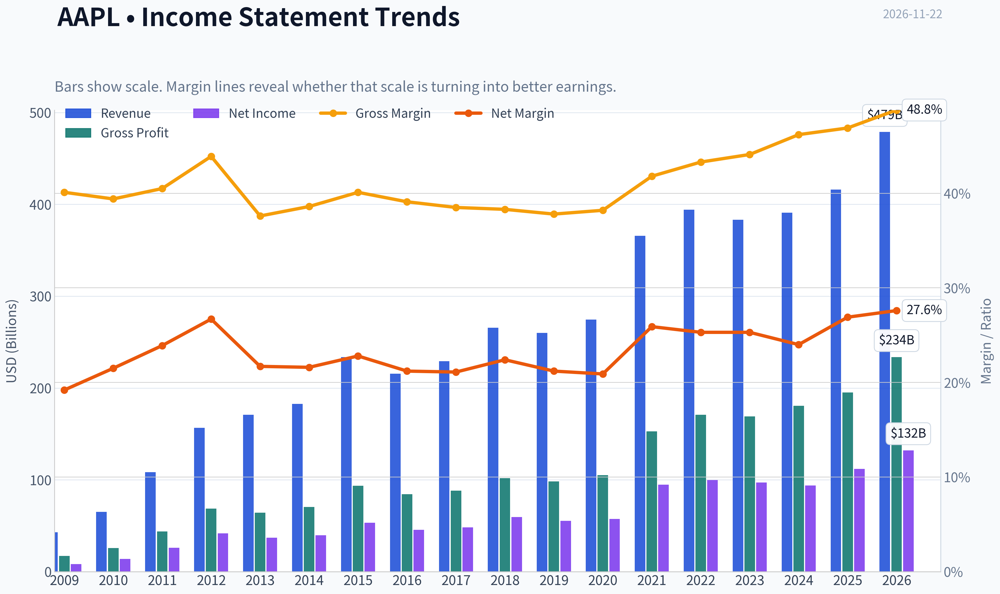
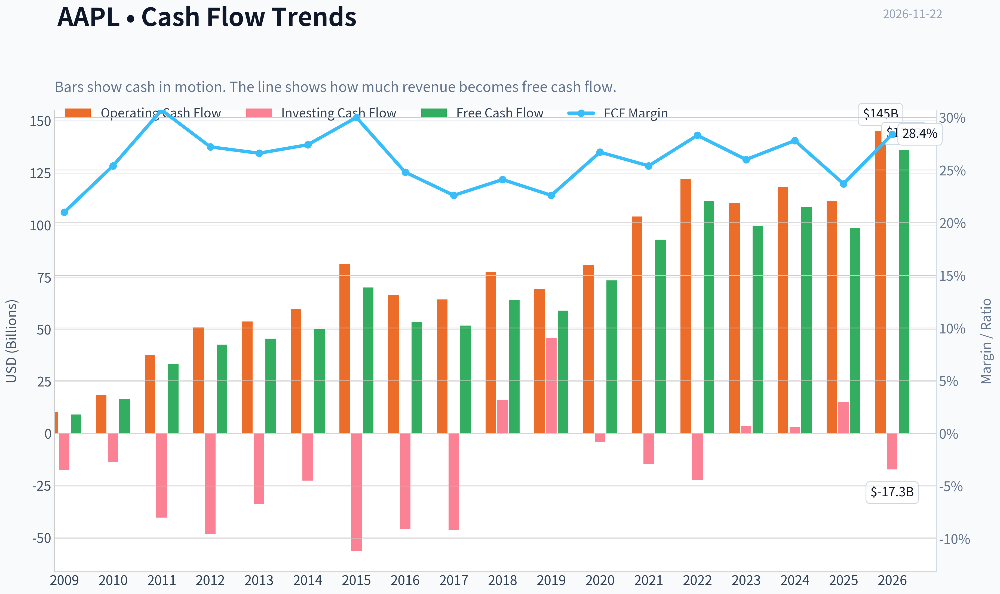
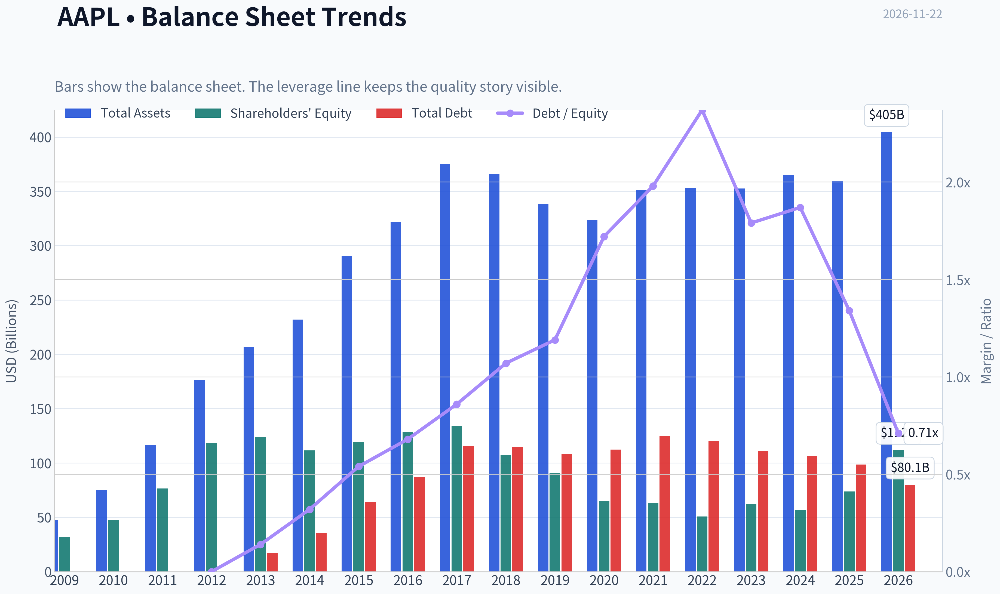
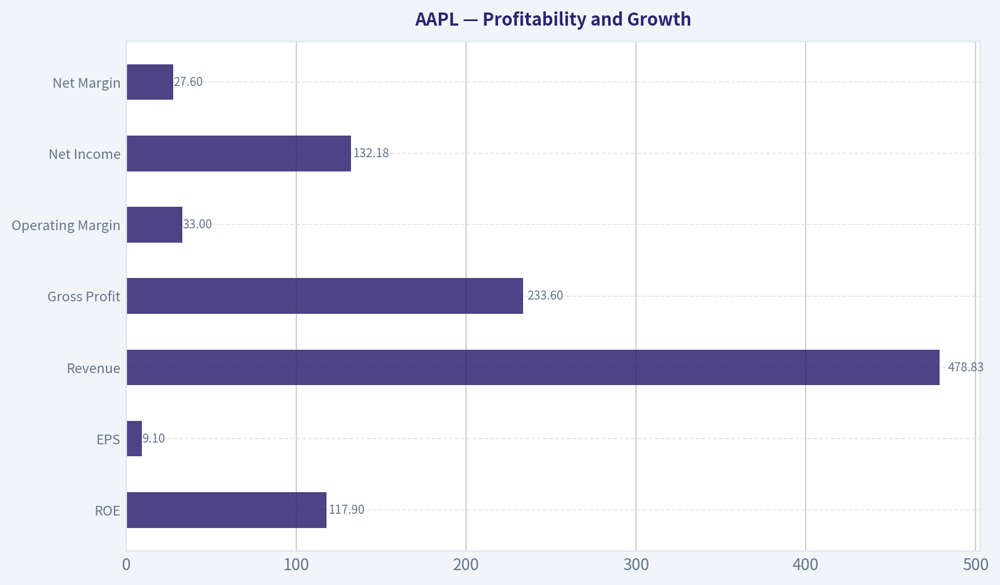
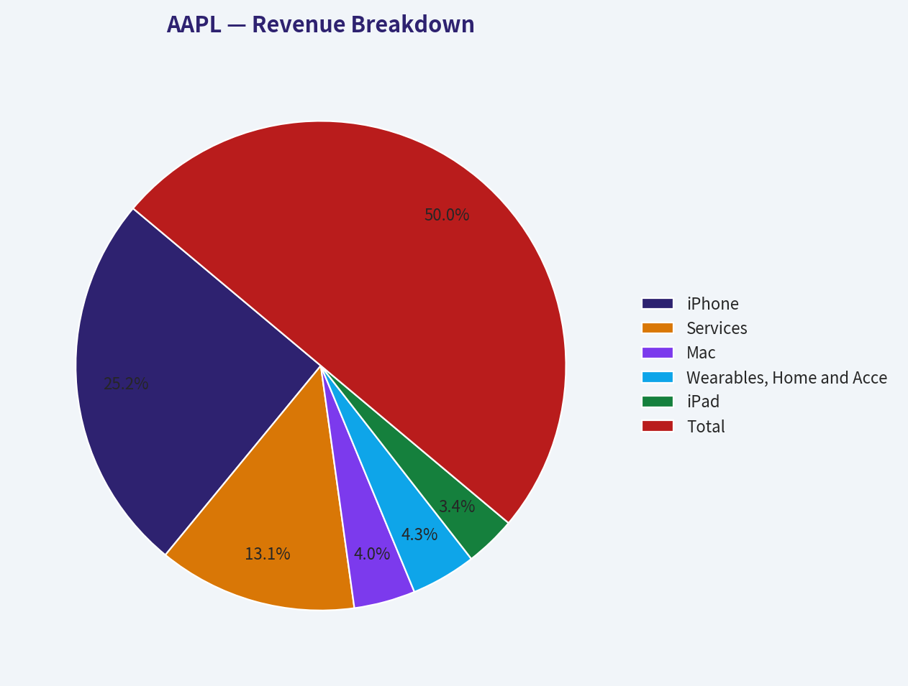
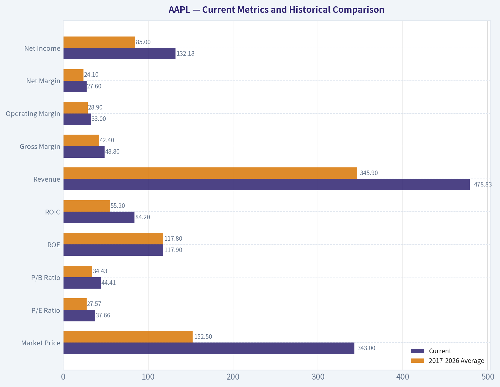
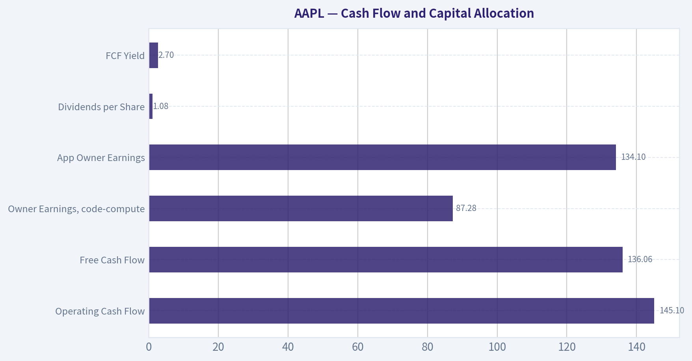
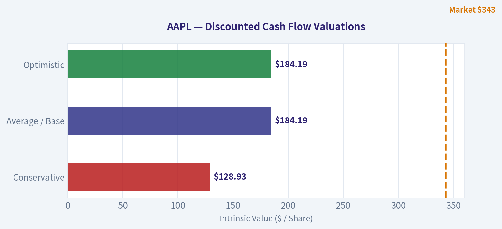

# AAPL Deep Value Intelligence

**Analysis Date:** 2026-11-22

## Critical Disclaimer

*This analysis is generated by Deep Value Intelligence, an AI-powered multi-agent investing framework. Education & research only - not financial advice, not a financial advisor.*

---

## Table of Contents

1. Intelligence Summary
2. Analyst Team Reports
   - Fundamentals Analysis
   - Intrinsic Value Analysis (Buffett)
   - Trend & Growth Analysis (Lynch/Druckenmiller/Fisher)
   - Market Technical Analysis
   - Options Market Analysis
3. Research Team Commentary
4. Value Investing Team Commentary
5. Deep Values Commentary

---

## Intelligence Summary

### Thesis + Conditions

**Core Thesis:** Apple remains an exceptional, financially productive franchise, but the supplied evidence does not support the approximately **$343 valuation**. The shares trade at **38.15 times earnings** and roughly **86% above** the DeepValues intrinsic-value estimate of **$184.19**.

**Key Risks:**
- The main risk is not franchise collapse. It is **permanent return impairment from overpayment** if Apple delivers merely good growth while margins, regulation, or the valuation multiple normalize. Exceptional quality merits a premium and a smaller margin-of-safety requirement, but the current price represents a substantial premium to estimated value rather than a modest discount.
- The Risky Analyst correctly challenges excessive confidence in the $184.19 estimate. Intrinsic value is sensitive to:
- However, the risky case does not quantify how these advantages reconcile the valuation gap. Showing that $184.19 may be conservative is not equivalent to showing that $343 is supported. Optionality remains valuable but unproven until it produces measurable revenue, margins, cash flow, or stronger competitive duration.

**Confidence:** Low

---

## Analyst Team Reports

### Fundamentals Analysis

#### Latest Earnings Snapshot

*Most recent reported quarter anchored on 2026 Q3, with prior-year comparison when available.*

| Metric | 2026 Q3 | 2025 Q3 | YoY Change |
| --- | ---: | ---: | ---: |
| Revenue | $114.48B | $102.47B | +11.7% |
| Operating Income | $35.63B | $32.43B | +9.9% |
| Net Income | $30.71B | $27.47B | +11.8% |
| Diluted EPS | N/A | $1.85 | N/A |
| Operating Cash Flow | $28.10B | $29.73B | -5.5% |
| Free Cash Flow | $25.86B | $26.49B | -2.4% |

Key Takeaways: This snapshot anchors the most recent reported quarter before the narrative analysis. It helps readers separate long-run business quality from whatever changed in the latest earnings print.

#### 17-Year Financial Metrics for AAPL

*All values below are computed deterministically from raw data - not estimated by AI.*

*Issuer profile: operating company (Technology / Consumer Electronics).*

#### 17-Year Financial Metrics
*Annual rows come from reported financial statements. The final TTM row is computed from the latest four quarters.*

| Metric | 2009 | 2010 | 2011 | 2012 | 2013 | 2014 | 2015 | 2016 | 2017 | 2018 | 2019 | 2020 | 2021 | 2022 | 2023 | 2024 | 2025 | 2026 TTM |
| --- | --- | --- | --- | --- | --- | --- | --- | --- | --- | --- | --- | --- | --- | --- | --- | --- | --- | --- |
| Market Price | $6 | $8 | $11 | $20 | $15 | $22 | $25 | $26 | $36 | $53 | $54 | $112 | $138 | $135 | $169 | $231 | $254 | $343 |
| Market Cap | $168.11B | $262.39B | $357.16B | $630.65B | $444.17B | $616.86B | $638.98B | $621.81B | $809.39B | $1.13T | $1.04T | $2.03T | $2.39T | $2.26T | $2.71T | $3.59T | $3.82T | $4.98T |
| P/E Ratio | 20.41 | 18.73 | 13.78 | 15.10 | 11.99 | 15.62 | 11.96 | 13.60 | 16.73 | 18.94 | 18.85 | 35.31 | 25.22 | 22.62 | 27.93 | 38.32 | 34.13 | 37.66 |
| P/B Ratio | 5.31 | 5.49 | 4.66 | 5.33 | 3.60 | 5.53 | 5.35 | 4.85 | 6.04 | 10.53 | 11.51 | 31.07 | 37.83 | 44.53 | 43.56 | 63.04 | 51.82 | 44.41 |
| ROE | 26.0% | 29.3% | 33.8% | 35.3% | 30.0% | 35.4% | 44.7% | 35.6% | 36.1% | 55.6% | 61.1% | 87.9% | 150.1% | 197.0% | 156.1% | 164.6% | 151.9% | 117.9% |
| ROIC | 35.2% | 39.8% | 40.0% | 40.6% | 30.7% | 29.7% | 35.3% | 24.8% | 21.5% | 27.1% | 30.9% | 39.1% | 64.5% | 66.8% | 67.2% | 67.5% | 83.2% | 84.2% |
| EPS | $0.27 | $0.45 | $0.83 | $1.33 | $1.22 | $1.42 | $2.06 | $1.90 | $2.14 | $2.81 | $2.85 | $3.18 | $5.47 | $5.99 | $6.13 | $6.08 | $7.46 | $9.10 |
| Revenue | $42.91B | $65.22B | $108.25B | $156.51B | $170.91B | $182.79B | $233.72B | $215.64B | $229.23B | $265.60B | $260.17B | $274.51B | $365.82B | $394.33B | $383.29B | $391.04B | $416.16B | $478.83B |
| Gross Profit | $17.22B | $25.68B | $43.82B | $68.66B | $64.30B | $70.54B | $93.63B | $84.26B | $88.19B | $101.84B | $98.39B | $104.96B | $152.84B | $170.78B | $169.15B | $180.68B | $195.20B | $233.60B |
| Gross Margin | 40.1% | 39.4% | 40.5% | 43.9% | 37.6% | 38.6% | 40.1% | 39.1% | 38.5% | 38.3% | 37.8% | 38.2% | 41.8% | 43.3% | 44.1% | 46.2% | 46.9% | 48.8% |
| Operating Margin | 27.4% | 28.2% | 31.2% | 35.3% | 28.7% | 28.7% | 30.5% | 27.8% | 26.8% | 26.7% | 24.6% | 24.1% | 29.8% | 30.3% | 29.8% | 31.5% | 32.0% | 33.0% |
| Net Income | $8.23B | $14.01B | $25.92B | $41.73B | $37.04B | $39.51B | $53.39B | $45.69B | $48.35B | $59.53B | $55.26B | $57.41B | $94.68B | $99.80B | $97.00B | $93.74B | $112.01B | $132.18B |
| Net Margin | 19.2% | 21.5% | 23.9% | 26.7% | 21.7% | 21.6% | 22.8% | 21.2% | 21.1% | 22.4% | 21.2% | 20.9% | 25.9% | 25.3% | 25.3% | 24.0% | 26.9% | 27.6% |
| Revenue Growth | N/A | 52.0% | 66.0% | 44.6% | 9.2% | 7.0% | 27.9% | -7.7% | 6.3% | 15.9% | -2.0% | 5.5% | 33.3% | 7.8% | -2.8% | 2.0% | 6.4% | 15.1% |
| Net Income Growth | N/A | 70.2% | 85.0% | 61.0% | -11.3% | 6.7% | 35.1% | -14.4% | 5.8% | 23.1% | -7.2% | 3.9% | 64.9% | 5.4% | -2.8% | -3.4% | 19.5% | 18.0% |
| Free Cash Flow Growth | N/A | 84.0% | 100.5% | 27.9% | 6.9% | 10.2% | 39.6% | -23.6% | -3.2% | 23.8% | -8.1% | 24.6% | 26.7% | 19.9% | -10.6% | 9.3% | -9.2% | 37.8% |
| Total Book Value | $31.64B | $47.79B | $76.61B | $118.21B | $123.55B | $111.55B | $119.36B | $128.25B | $134.05B | $107.15B | $90.49B | $65.34B | $63.09B | $50.67B | $62.15B | $56.95B | $73.73B | $112.09B |
| Total Assets | $47.50B | $75.18B | $116.37B | $176.06B | $207.00B | $231.84B | $290.35B | $321.69B | $375.32B | $365.73B | $338.52B | $323.89B | $351.00B | $352.75B | $352.58B | $364.98B | $359.24B | $404.55B |
| Total Debt | N/A | N/A | N/A | $0 | $16.96B | $35.30B | $64.33B | $87.03B | $115.68B | $114.48B | $108.05B | $112.44B | $124.72B | $120.07B | $111.09B | $106.63B | $98.66B | $80.11B |
| Debt-to-Equity | N/A | N/A | N/A | 0.00 | 0.14 | 0.32 | 0.54 | 0.68 | 0.86 | 1.07 | 1.19 | 1.72 | 1.98 | 2.37 | 1.79 | 1.87 | 1.34 | 0.71 |
| Cash & Equivalents | $5.26B | $11.26B | $9.81B | $10.75B | $14.26B | $13.84B | $21.12B | $20.48B | $20.29B | $25.91B | $48.84B | $38.02B | $34.94B | $23.65B | $29.96B | $29.94B | $35.93B | $36.30B |
| Shareholders' Equity | $31.64B | $47.79B | $76.61B | $118.21B | $123.55B | $111.55B | $119.36B | $128.25B | $134.05B | $107.15B | $90.49B | $65.34B | $63.09B | $50.67B | $62.15B | $56.95B | $73.73B | $112.09B |
| Operating Cash Flow | $10.16B | $18.59B | $37.53B | $50.86B | $53.67B | $59.71B | $81.27B | $66.23B | $64.22B | $77.43B | $69.39B | $80.67B | $104.04B | $122.15B | $110.54B | $118.25B | $111.48B | $145.10B |
| Investing Cash Flow | $-17.43B | $-13.85B | $-40.42B | $-48.23B | $-33.77B | $-22.58B | $-56.27B | $-45.98B | $-46.45B | $16.07B | $45.90B | $-4.29B | $-14.54B | $-22.35B | $3.71B | $2.94B | $15.20B | $-17.28B |
| Free Cash Flow | $9.02B | $16.59B | $33.27B | $42.56B | $45.50B | $50.14B | $70.02B | $53.50B | $51.77B | $64.12B | $58.90B | $73.36B | $92.95B | $111.44B | $99.58B | $108.81B | $98.77B | $136.06B |
| FCF Margin | 21.0% | 25.4% | 30.7% | 27.2% | 26.6% | 27.4% | 30.0% | 24.8% | 22.6% | 24.1% | 22.6% | 26.7% | 25.4% | 28.3% | 26.0% | 27.8% | 23.7% | 28.4% |
| Dividends / Share | $0.00 | $0.00 | $0.00 | $0.00 | $0.00 | $0.00 | $0.00 | $0.00 | $0.00 | $0.00 | $0.00 | $0.00 | $0.00 | $0.00 | $0.95 | $0.99 | $1.03 | $1.08 |

#### Profitability Metrics
- Return on Equity (ROE): 117.9%
- Return on Invested Capital (ROIC): 96.8%
- Return on Assets (ROA): 32.7%
- Gross Margin: 48.8%
- Operating Margin: 33.0%
- Net Profit Margin: 27.6%

#### Liquidity Metrics
- Current Ratio: 1.02
- Quick Ratio: 0.59

#### Leverage Metrics
- Debt-to-Equity Ratio: 0.71
- Interest Coverage Ratio: N/A
- Net Debt: $23.39B

#### Growth Metrics (Year-over-Year)
- Revenue Growth: 15.1%
- Net Income Growth: 18.0%
- Free Cash Flow Growth: 37.8%
- Revenue CAGR (3-Year): 7.7%
- Revenue CAGR (5-Year): 5.5%

#### Valuation Metrics
- P/E Ratio (TTM): 38.15
- Forward P/E: 32.40
- Price-to-Book: 44.41
- Price-to-Sales: 10.40
- PEG Ratio: 2.77
- EV/EBITDA: 29.25
- Free Cash Flow Yield: 2.7%
- Earnings Yield: 2.6%

#### Owner Earnings (Buffett Method, Code-Computed)
- Net Income: $112.01B
- + Depreciation & Amortization: $13.42B
- - Capital Expenditures: $-9.04B
- + Working Capital (cash-flow statement; negative = cash tied up): $-14.86B
- = **Owner Earnings: $87.28B**

#### Intrinsic Value (DeepValues app - SEC filings pipeline)
- **Intrinsic value (DeepValues app, the headline): $184.19** - Owner Earnings (Buffett), method buffett-1986-v2, as of 2026-11-21 (FY2026)
  Range (conservative - optimistic): $128.93 - $184.19
  Margin of safety vs. price: -86.0% (price $342.56)
  Inputs the app used (ttm_2026Q4): after-tax operating income $132.4B (operating income $158.1B, tax 16.2%) + D&A $13.4B - capex charge $11.7B (three-year average capex/revenue x trailing revenue; reported capex $9.0B) - working capital $0.0B = owner earnings $134.1B.
  Growth 5.5% fading to 2.5% terminal (min(owner-earnings CAGR, 5-year revenue CAGR), clamped [0, 10%]); discount rate 8.3% (30Y Treasury 5.31% + 3 pts (as of 2026-11-20)); net cash $55.4B (cash $36.3B + marketable securities $100.6B - debt $80.1B); 14,715M shares.
- Owner Earnings (Buffett): $128.93 / $184.19 / $184.19 (conservative / base / optimistic) ← headline
- Free cash flow DCF: $114.84 / $191.43 / $416.13 (conservative / base / optimistic)
- Damodaran two-stage FCFF: $104.84 / $151.62 / $164.40 (conservative / base / optimistic)
  This is THE intrinsic value: quote it as the intrinsic value and measure margin of safety against it. Any DVI scenario figures elsewhere are a secondary cross-check, not the value.

#### DVI scenario model (secondary cross-check - NOT the intrinsic value)
DVI's own Yahoo-based scenarios, shown only as a sensitivity check. Do not quote these as the intrinsic value; the intrinsic value is the DeepValues app value above.
- Current Price: $343
- DVI scenario value (business-model routed): $197
  Business model: operating company - weighted blend [Damodaran FCFF + reverse-DCF fair + owner-earnings DCF] (operating_company)
  Model spread (min-max across DCFs): $191 - $241
  Margin of safety vs. price (headline): -74.0%
  Routing note: General operating company: balanced blend of Damodaran FCFF and the owner-earnings DCF with a reverse-DCF sanity check.
- Buffett Method (Owner Earnings):
  Conservative: $139
  Average: $241
  Optimistic: $642
- Cash Flow Method (FCF):
  Conservative: $88
  Average: $207
  Optimistic: $277
- Damodaran FCFF (WACC + margins + reinvestment):
  Conservative: $109
  Average: $191
  Optimistic: $402
  Monte Carlo band (P10-P90): $138 - $305 (median $201)
  P(intrinsic value > price): 5.3%
- Reverse-DCF: price implies ~25.8%/yr owner-earnings growth for 10y; trailing 3y was 1.4%, 5y 14.1%.

#### Piotroski F-Score: 9/9
- Positive Net Income: PASS
- Positive Operating Cash Flow: PASS
- ROA Improvement: PASS
- Cash Flow > Net Income: PASS
- Decreasing Debt: PASS
- Improving Current Ratio: PASS
- No Dilution: PASS
- Improving Gross Margin: PASS
- Improving Asset Turnover: PASS

ANALYST STANCE: **Neutral**

#### Executive Summary

Apple remains an exceptionally profitable, cash-generative operating business with a powerful ecosystem, strong customer loyalty, expanding Services economics, and a durable capital-return program. The deterministic dataset shows major improvement in gross margin, operating margin, ROIC, free cash flow, and net income compared with the 2017-2026 historical average.

The central valuation issue is that the market price of approximately **$343** implies unusually strong future growth. The canonical DeepValues Buffett Owner Earnings model estimates intrinsic value at **$184.19 per share**, with a conservative-to-optimistic range of **$128.93 to $184.19**. At the current price, the evidence does not support the valuation unless Apple sustains growth materially above its recent durable trend for an extended period.

#### Current Metrics and Historical Comparison

The comparison below uses the latest 2026 TTM figures and the average of the ten displayed years from 2017 through 2026 TTM.

| Metric | Current | 2017-2026 Average | Interpretation |
|---|---:|---:|---|
| Market Price | $343 | $152.50 | 125% above the decade average |
| P/E Ratio | 37.66 | 27.57 | 37% above the decade average |
| P/B Ratio | 44.41 | 34.43 | Elevated, but not meaningful as a standalone value signal for Apple |
| ROE | 117.9% | 117.8% | In line with the decade average; affected by buybacks and reduced equity |
| ROIC | 84.2% | 55.2% | Substantially above the decade average |
| Revenue | $478.83B | $345.90B | 38% above the decade average |
| Gross Margin | 48.8% | 42.4% | 6.4 percentage points above average |
| Operating Margin | 33.0% | 28.9% | 4.1 percentage points above average |
| Net Margin | 27.6% | 24.1% | 3.5 percentage points above average |
| Net Income | $132.18B | $85.00B | 55% above the decade average |
| Free Cash Flow | $136.06B | $89.58B | 52% above the decade average |
| Total Debt | $80.11B | $109.19B | 27% below the decade average |
| Debt-to-Equity | 0.71 | 1.49 | Meaningfully stronger than the decade average |
| Cash and Equivalents | $36.30B | $32.38B | Slightly above average, excluding marketable securities |
| Shareholders' Equity | $112.09B | $81.57B | Above average after recent improvement |
| Dividends per Share | $1.08 | Approximately $0.61 | Long-term dividend growth, but still a modest yield at the current price |

**Key Takeaways:** Apple's operating performance is currently better than its recent historical norm across margins, ROIC, net income, and free cash flow. Debt and leverage are also below decade averages. However, the P/E ratio is materially above its historical norm, so the market is assigning a premium to an already improved business rather than merely recognizing past underperformance. P/B is not a useful valuation anchor here because Apple is an asset-light, intellectual-property-driven company that has materially reduced book equity through capital returns.

#### Market Metrics

- **Market price:** $343.
- **Market capitalization:** $4.98 trillion.
- **P/E ratio:** 38.15 in the current summary, versus 37.66 in the deterministic TTM row. Both indicate a valuation well above the 2017-2026 average of approximately 27.6.
- **P/B ratio:** 44.41. This should not be interpreted mechanically as a conventional "expensive book value" signal. Apple's book value is distorted by years of buybacks, substantial intangible economic value, and a business model that produces high returns without requiring a large tangible asset base.
- **Free cash flow yield:** 2.7%.
- **Earnings yield:** approximately 2.6%.

The key valuation contrast is between business quality and price. Apple's margins and ROIC justify a premium multiple, but a P/E near 38 requires continued earnings compounding, successful monetization of Services and AI-related capabilities, and limited competitive or regulatory deterioration.

#### Profitability and Growth

| Metric | Current | Historical Context |
|---|---:|---|
| ROE | 117.9% | Approximately equal to the 2017-2026 average of 117.8%; elevated by both profitability and buybacks |
| ROIC | 84.2% annual row; 96.8% current summary | Far above the 2017-2026 average of approximately 55.2% |
| EPS | $9.10 | Strongly above the 2025 figure of $7.46 and approximately 4.3 times the 2017 figure |
| Revenue | $478.83B | Up 15.1% year over year and substantially above the $345.9B decade average |
| Gross Profit | $233.60B | Supported by a 48.8% gross margin, the highest in the displayed history |
| Operating Margin | 33.0% | Above the 28.9% decade average |
| Net Income | $132.18B | Up 18.0% year over year and above the $85.0B decade average |
| Net Margin | 27.6% | Above the 24.1% decade average |

**Key Takeaways:** Apple is not merely growing revenue; it is converting revenue into profit more efficiently than in most of the displayed history. The combination of a 48.8% gross margin, 33.0% operating margin, and 27.6% net margin demonstrates considerable pricing power and mix improvement. ROE should be interpreted cautiously because buybacks have reduced equity, but the exceptionally high ROIC provides stronger evidence of genuine economic quality.

Current growth rates are also strong:

- **Revenue growth:** 15.1%, compared with a 5-year revenue CAGR of 5.5% and a 3-year CAGR of 7.7%.
- **Net income growth:** 18.0%, versus declines in 2023 and 2024.
- **Free cash flow growth:** 37.8%, following a 9.2% decline in 2025.
- **EPS growth:** The rise from $7.46 to $9.10 reflects both earnings growth and the impact of share repurchases.

The recent acceleration is favorable, but it is not yet sufficient by itself to justify assuming that 15%-18% growth will persist over a full decade. Historical revenue growth has included several unusually strong periods, particularly 2010-2012 and 2021.

#### Balance Sheet and Financial Strength

Apple has:

- **Total assets:** $404.55B.
- **Total debt:** $80.11B.
- **Cash and equivalents:** $36.30B.
- **Marketable securities:** $100.6B in the DeepValues valuation inputs.
- **Net cash used in the intrinsic-value model:** $55.4B.
- **Shareholders' equity:** $112.09B.
- **Debt-to-equity:** 0.71, versus approximately 1.49 for the 2017-2026 period.
- **Current ratio:** 1.02.
- **Quick ratio:** 0.59.

The current and quick ratios are relatively modest, but they are not necessarily alarming for Apple because of its powerful operating cash flow, rapid inventory turnover, supplier relationships, and recurring Services revenue. Nevertheless, liquidity ratios should not be dismissed entirely: a current ratio near 1.0 leaves less balance-sheet cushion than many traditional industrial businesses.

The decline in debt from approximately $124.7B in 2021 to $80.1B currently is a meaningful improvement. Apple's cash generation substantially exceeds its financing requirements, and the balance sheet remains financially resilient even after dividends and repurchases.

#### Cash Flow and Capital Allocation

| Cash-Flow Metric | Current | Historical Comparison |
|---|---:|---|
| Operating Cash Flow | $145.10B | Highest displayed level and materially above the 2017-2026 average |
| Free Cash Flow | $136.06B | 28.4% margin versus approximately 25% across the decade |
| Owner Earnings, code-computed | $87.28B | Lower than app-based owner earnings because of working-capital treatment |
| App Owner Earnings | $134.1B | Uses after-tax operating income, D&A, normalized capex, and minimal working-capital charge |
| Dividends per Share | $1.08 | Consistent long-term increases from $0.95 in 2023 |
| FCF Yield | 2.7% | Low relative to the quality of the business because the equity price is high |

**Key Takeaways:** Apple produces extraordinary cash flow relative to its capital requirements. The difference between the code-computed owner earnings of $87.28B and the app's $134.1B figure reflects methodology, particularly the treatment of working capital and normalized capital expenditures. The low 2.7% FCF yield shows that the current valuation capitalizes a large amount of future growth.

Capital allocation has historically emphasized share repurchases, which have supported EPS growth and contributed to the very high ROE. Dividends have risen consistently, but Apple remains primarily a capital-appreciation and cash-compounding business rather than a high-current-income business.

#### Economic Moat and Business Quality

Apple's moat has several reinforcing components:

1. **Ecosystem switching costs:** Hardware, operating systems, applications, cloud services, payments, accessories, and customer data create substantial friction around changing platforms.
2. **Brand and pricing power:** Apple's gross margin has risen from the high-30% range in much of the 2010s to 48.8% currently.
3. **Distribution and scale:** Apple's global retail, carrier, developer, and supplier network is difficult to reproduce.
4. **Installed base monetization:** Services revenue can grow through an existing customer base without requiring the same level of hardware unit growth.
5. **Custom silicon and vertical integration:** Control over chips, software, industrial design, and services improves product differentiation and operational efficiency.

The principal moat risk is technological displacement. Artificial intelligence could alter how users interact with software, applications, search, and devices. If AI reduces the strategic importance of Apple's current application and operating-system paradigm, some ecosystem advantages could weaken. Apple's future AI execution is therefore strategically significant even though current financial results remain strong.

#### Predictable Earnings

Apple's earnings record is strong but not perfectly linear.

- Revenue declined in 2016, 2019, and 2023.
- Net income declined in 2013, 2016, 2019, 2023, and 2024.
- Free cash flow declined in 2016, 2017, 2019, 2023, and 2025.
- Despite these interruptions, the long-term direction of revenue, EPS, operating cash flow, and free cash flow has been strongly upward.

The business is more predictable than most hardware companies because Services, software integration, brand loyalty, and a large installed base partially offset product-cycle volatility. However, iPhone concentration remains important, and consumer electronics demand can still be affected by replacement cycles, regional weakness, foreign exchange, tariffs, and macroeconomic conditions.

#### Management and Capital Allocation

Management has demonstrated:

- Sustained high ROIC.
- Improving margins.
- Declining debt.
- Large and persistent free cash flow generation.
- Disciplined capital returns.
- No-dilution performance in the Piotroski framework.
- A Piotroski F-Score of 9/9.

The main caveat is that high ROE is not entirely a measure of operating superiority because the denominator has been reduced through buybacks. ROIC, margin expansion, free cash flow, and operating cash conversion provide more reliable evidence of management effectiveness.

#### Revenue Breakdown

The latest precise public product-line breakdown available in the research pack is FY2025. It is shown below because the deterministic dataset provides total 2026 TTM revenue but not a corresponding product-level split.

| Revenue Source | Amount ($B) | % of FY2025 Total |
|---|---:|---:|
| iPhone | 209.6 | 50.4% |
| Services | 109.2 | 26.2% |
| Mac | 33.7 | 8.1% |
| Wearables, Home and Accessories | 35.7 | 8.6% |
| iPad | 28.0 | 6.7% |
| **Total** | **416.2** | **100.0%** |

**Key Takeaways:** iPhone remains the largest source of revenue at roughly half of the total, but Services already contributes more than one-quarter and has structurally attractive recurring characteristics. Mac, iPad, and Wearables diversify the product base, although none individually approaches iPhone scale. The principal revenue concentration risk remains dependence on the iPhone franchise and the health of the broader Apple ecosystem.

#### Buffett-Style Owner Earnings DCF

The canonical DeepValues app model is the primary intrinsic-value reference. Its latest inputs are:

- After-tax operating income: **$132.4B**
- Depreciation and amortization: **$13.4B**
- Normalized capital-expenditure charge: **$11.7B**
- Working-capital charge: **$0.0B**
- Owner earnings: **$134.1B**
- Net cash: **$55.4B**
- Shares outstanding: **14.715B**
- Discount rate: **8.3%**
- Terminal growth rate: **2.5%**

The basic owner-earnings framework is:

\[
\text{Owner Earnings}
=
\text{After-tax Operating Income}
+
\text{D\&A}
-
\text{Maintenance Capex}
-
\Delta\text{Working Capital}
\]

\[
\text{Equity Value per Share}
=
\frac{\text{PV of Explicit Owner Earnings}+\text{PV of Terminal Value}+\text{Net Cash}}{\text{Shares Outstanding}}
\]

For each scenario, growth fades toward the 2.5% terminal rate rather than continuing indefinitely at the initial growth rate.

| Scenario | Initial Growth Assumption | Discount Rate | Terminal Growth | Intrinsic Value per Share | Interpretation |
|---|---:|---:|---:|---:|---|
| Conservative | Low-growth / defensive case | 8.3% | 2.5% | $128.93 | Allows for normalization from unusually strong recent results |
| Average / Base | 5.5%, fading toward terminal growth | 8.3% | 2.5% | $184.19 | Canonical headline intrinsic value |
| Optimistic | Higher near-term growth, fading toward terminal growth | 8.3% | 2.5% | $184.19 | Capped by the model's valuation framework |

**Key Takeaways:** The canonical Buffett Owner Earnings valuation produces a range of $128.93 to $184.19 per share, with $184.19 as the headline intrinsic value. At approximately $343, the market price is about 86% above the headline intrinsic value. The optimistic case does not rise above the base case in this model, indicating that the valuation framework is already constrained by normalization and terminal-value discipline.

A simplified scenario schedule is:

| Scenario | Starting Owner Earnings | Forecast Treatment | Terminal Value Treatment | Result |
|---|---:|---|---|---:|
| Conservative | $134.1B | Low defensible growth, fading toward 2.5% | Gordon-growth terminal value at 2.5% | $128.93 per share |
| Base | $134.1B | 5.5% initial growth, fading toward 2.5% | Gordon-growth terminal value at 2.5% | $184.19 per share |
| Optimistic | $134.1B | Stronger near-term growth, but no permanent peak-rate extrapolation | Gordon-growth terminal value at 2.5% | $184.19 per share |

The DCF cross-checks are directionally consistent:

- **Free cash flow DCF:** $114.84 conservative, $191.43 base, $416.13 optimistic.
- **Damodaran FCFF:** $104.84 conservative, $151.62 base, $164.40 optimistic.
- **Secondary DVI model:** approximately $197, not the canonical intrinsic value.
- **Reverse DCF:** the current price implies approximately **25.8% annual owner-earnings growth for ten years**, substantially above the trailing 3-year growth rate of 1.4% and above the 5-year rate of 14.1%.

The reverse-DCF result is the most important valuation warning. Apple does not need to perform poorly for the current price to disappoint; it merely needs to grow materially below the rate implied by the price.

#### Key Risks

| Risk | Fundamental Implication |
|---|---|
| Valuation compression | A P/E near 38 leaves less room for growth disappointments or higher interest rates |
| iPhone concentration | Approximately half of FY2025 revenue remains tied to one product family |
| AI platform disruption | New user interfaces could weaken application, operating-system, or search-related ecosystem advantages |
| Regulatory pressure | App-store rules, payment restrictions, antitrust action, and regional regulation could affect Services economics |
| China exposure | Demand, supply-chain, geopolitical, and competitive risks remain material |
| Product-cycle volatility | Hardware upgrades can produce uneven annual revenue and earnings |
| Margin normalization | Recent margin expansion may prove difficult to repeat indefinitely |
| Capital-return dependence | EPS growth benefits from repurchases, but future returns depend increasingly on underlying earnings growth |

#### Opportunities

- Services penetration can continue increasing the recurring and higher-margin portion of revenue.
- Artificial intelligence could support device replacement, software monetization, and new service categories if execution is successful.
- A larger installed base provides a broad monetization platform without proportionate hardware growth.
- Margin improvement has been substantial and could remain durable through mix shift and vertical integration.
- Debt reduction and high cash generation increase financial flexibility.
- Continued innovation in custom silicon, health, payments, spatial computing, and connected devices could diversify revenue over time.

#### Final Assessment

Apple qualifies as a high-quality Buffett-style business based on:

- Exceptional ROIC.
- Strong and improving margins.
- Large and durable free cash flow.
- A powerful ecosystem moat.
- Substantial brand and customer switching costs.
- Declining debt and strong financial flexibility.
- Generally predictable long-term earnings, despite product-cycle fluctuations.

The valuation is the limiting factor. The current price of approximately $343 is well above the canonical intrinsic value of $184.19 and requires growth substantially above the company's durable historical trend. The evidence supports a **Neutral** stance: Apple's business quality is outstanding, but the current valuation leaves a wide gap between operating excellence and estimated intrinsic value.

| Category | Assessment | Evidence |
|---|---|---|
| Business quality | Excellent | Ecosystem, brand, pricing power, Services growth |
| Economic moat | Very strong | Switching costs, installed base, scale, vertical integration |
| Profitability | Exceptional | 48.8% gross margin, 33.0% operating margin, 84.2% ROIC |
| Financial strength | Strong | $80.1B debt, $55.4B modeled net cash, high cash generation |
| Earnings predictability | Strong but cyclical | Long-term growth with periodic revenue, earnings, and FCF declines |
| Capital allocation | Effective | Buybacks, rising dividends, debt reduction, no dilution |
| Current valuation | Stretched | 37.66x P/E versus 27.57x decade average |
| Intrinsic value | $184.19 headline | Buffett Owner Earnings model; $128.93-$184.19 range |
| Valuation implication | Evidence does not support $343 under base assumptions | Price implies approximately 25.8% annual owner-earnings growth for ten years |
| Final stance | **Neutral** | Exceptional company, but valuation requires unusually strong execution and growth |

**Key Takeaways:** Apple is one of the strongest operating businesses in the dataset, with superior profitability, cash generation, moat characteristics, and balance-sheet resilience. The investment question is not whether the company is high quality; it is whether future growth can justify a valuation materially above both historical multiples and the canonical Owner Earnings estimate. At approximately $343, the valuation evidence remains demanding enough to warrant a Neutral stance.

#### Fundamental Visuals

This graph tracks the profitability and return metrics (ROE, ROIC, Margins) of **AAPL** over the past decade, highlighting capital efficiency trends.

This chart illustrates the financial health of **AAPL** over the last 10 years, mapping cash equivalents and free cash flow against total obligations (Debt).

This comparison chart from *Profitability and Growth* stacks current figures against historical benchmarks for **AAPL**, making it easy to see where the company trades relative to its own averages.

This breakdown chart from <em>Revenue Breakdown</em> shows the proportional composition for **AAPL** - useful for understanding what drives or risks the business.

---

### Intrinsic Value Analysis (Buffett)

> *Following Warren Buffett's value investing philosophy: Circle of Competence, Economic Moat, Management Quality, and Margin of Safety.*

#### Intrinsic Value Snapshot

Price is what you pay. Intrinsic value is what the business may be worth based on the cash it can create for owners over time. We show a range, not one magic number.

- Current Price: $342.56
- Value Range (conservative to optimistic across both DCF methods): $114.84 to $416.13

##### Owner Earnings (Buffett Method)
- Net Income: $112,010,000,000.00
- Depreciation & Amortization: $13,423,000,000.00
- Capital Expenditures: $-9,041,000,000.00
- Working Capital Changes: $-14,858,000,000.00
- Owner Earnings: $87,280,891,892.50

##### Intrinsic Value
###### Buffett Method
Uses owner earnings. Stricter, and usually more conservative.
- Conservative: $128.93
- Average: $184.19
- Optimistic: $184.19
- Discount Rate: 8.3%

###### Cash Flow Method
Uses free cash flow. Better for companies spending heavily today to grow tomorrow.
- Conservative: $114.84
- Average: $191.43
- Optimistic: $416.13
- Discount Rate: 9.1%

ANALYST STANCE: **Neutral**

#### Executive Summary

Apple remains an exceptional business with a powerful ecosystem, strong customer loyalty, high margins, substantial cash generation, and unusually strong capital returns. Its principal weakness is valuation: at approximately **$343 per share**, the market price is about **86% above** the DeepValues Buffett-method intrinsic value of **$184.19**.

The business quality is high enough to justify a premium valuation, but the current price requires substantially stronger future growth than the base valuation assumptions support. The weighted Buffett score is **3.4 out of 5**, placing Apple in the **Neutral** category.

#### 1. Factor Scorecard

| Factor | Score | Assessment |
|---|---:|---|
| Circle of Competence & Simplicity | 4/5 | Apple sells integrated hardware, software, services, and subscriptions. The model is understandable, although future economics depend partly on AI, platform regulation, and product-cycle execution. |
| Durable Competitive Advantage | 4/5 | Wide and stable moat based on ecosystem integration, brand, switching costs, installed base, proprietary silicon, and distribution. |
| Management & Capital Allocation | 4/5 | Strong execution, disciplined buybacks, substantial shareholder distributions, and generally rational reinvestment. |
| Industry Structure | 4/5 | Large-scale technology markets are competitive, but Apple operates from a differentiated ecosystem position with strong customer economics. |
| Gate 5: Quality/Solvency Hard Floor | Not tripped | Earnings and cash generation remain strong, while net cash is positive and interest-bearing debt is manageable relative to operating earnings. |

**Key Takeaways:** Apple scores highly on business quality, competitive advantage, and management. The hard solvency floor is not triggered. The major deduction comes from valuation rather than financial distress or business deterioration.

#### 2. Moat Analysis

| Moat Source | Evidence | Assessment |
|---|---|---|
| Brand and intangible assets | 48.8% gross margin, premium pricing, strong global brand, and customer loyalty | Strong |
| Switching costs | Hardware, operating system, cloud services, payments, messaging, applications, and accessories reinforce one another | Strong |
| Cost advantages | Scale in chip design, procurement, distribution, retail, and software development | Strong |
| Network effects | Developers, users, accessories, services, and installed devices make the ecosystem more valuable | Moderate to strong |
| Financial evidence | 117.9% reported ROE, 15.1% year-over-year revenue growth, and $134.1 billion of owner earnings | Strong |

Apple's moat is best described as **wide and stable** rather than unquestionably widening. The ecosystem creates meaningful friction for customers considering a move to another platform, while the installed base supports recurring services revenue and developer participation. Apple's proprietary silicon and vertically integrated product design also create differentiation that is difficult to replicate.

The principal moat risks are regulatory restrictions on platform economics, potential changes in consumer interface behavior caused by artificial intelligence, and the possibility that future hardware innovation becomes less differentiated.

**Key Takeaways:** Apple's moat is supported by several mutually reinforcing advantages rather than a single product. Its high gross margin and enormous owner earnings provide financial evidence of pricing power and scale. The moat is durable, but AI and regulation could affect how value is captured inside the ecosystem.

#### 3. Management Quality and Capital Allocation

| Area | Assessment |
|---|---|
| Owner orientation | Management has returned substantial capital through repurchases and dividends while maintaining heavy investment in product development and infrastructure. |
| Execution | The company has repeatedly expanded from personal computers into smartphones, wearables, services, custom silicon, and financial services. |
| Capital allocation | Buybacks have materially reduced the share count over time, while research and development support the ecosystem. |
| Balance-sheet discipline | Apple maintains substantial cash and marketable securities, with debt below total liquid assets. |
| Candor and accounting | No major accounting restatement issue is indicated in the supplied record; the business reports significant recurring cash flows and clear segment economics. |

Warren Buffett's Berkshire Hathaway disclosed a **227.92 million-share Apple holding valued at approximately $75.9 billion as of September 30, 2026**. That disclosure reflects the attractiveness of Apple's business economics, although it does not establish that the current market price is reasonable.

**Key Takeaways:** Apple's management has demonstrated strong operational execution and disciplined capital allocation. The company has successfully reinvested in its ecosystem while returning excess capital. The quality of management supports a premium multiple, but it cannot by itself eliminate valuation risk.

#### 4. Financial Summary

| Metric | FY2026 / TTM 2026Q4 |
|---|---:|
| Current price | $343.00 |
| Market capitalization | $4.98 trillion |
| Revenue growth, year over year | 15.1% |
| Gross margin | 48.8% |
| Operating income | $158.1 billion |
| After-tax operating income | $132.4 billion |
| Owner earnings | $134.1 billion |
| Reported capital expenditures | $9.0 billion |
| D&A | $13.4 billion |
| Cash and marketable securities | $136.9 billion |
| Debt | $80.1 billion |
| Net cash | $55.4 billion |
| Shares outstanding | 14.715 billion |
| P/E ratio | 38.1x |
| FCF yield | 2.7% |
| Reported ROE | 117.9% |

**Key Takeaways:** Apple combines high growth with exceptional profitability and a net-cash balance sheet. The 2.7% free-cash-flow yield and 38.1-times earnings multiple show that the market already prices in considerable future success. The reported ROE is outstanding, though it is amplified by large share repurchases and therefore should not be interpreted as a pure measure of operating return.

#### 5. Owner Earnings Calculation

| Component | Amount |
|---|---:|
| After-tax operating income | $132.4 billion |
| Add: depreciation and amortization | $13.4 billion |
| Less: maintenance capital expenditure charge | $(11.7) billion |
| Less: working-capital investment | $0.0 billion |
| **Estimated owner earnings** | **$134.1 billion** |
| Owner earnings per share | Approximately $9.11 |

The calculation uses the DeepValues Buffett-method inputs:

**Owner earnings = $132.4B + $13.4B - $11.7B - $0.0B = $134.1B**

The maintenance-capital-expenditure charge exceeds reported capital expenditures because it uses a three-year average capital-expenditure-to-revenue ratio applied to trailing revenue. This is a conservative treatment.

**Key Takeaways:** Apple converts a very large share of operating profit into owner earnings. Estimated owner earnings of $134.1 billion represent approximately $9.11 per share. At $343, the market price equates to roughly 37.7 times current owner earnings.

#### 6. Three-Scenario DCF Valuation

These scenarios are independent cross-checks. The DeepValues app value remains the primary intrinsic-value reference.

| Scenario | Key Assumptions | Estimated Value Per Share |
|---|---|---:|
| A: No growth | Owner earnings capitalized at 10%; net cash included | Approximately $95 |
| B: GDP-like growth | 3% growth, 10% discount rate, terminal value at 3% growth | Approximately $138 |
| C: Historical-growth cross-check | 7.5% initial growth, fading toward 2.5% terminal growth, 10% discount rate | Approximately $178 |
| DeepValues Buffett-method intrinsic value | 5.5% growth fading to 2.5%; 8.3% discount rate; net cash included | **$184.19** |

Scenario A is calculated from current owner earnings divided by a 10% discount rate, then adjusted for net cash. Scenario B assumes only moderate long-term growth. Scenario C uses approximately half of the recent 15.1% revenue growth rate, with a fade toward a more mature terminal rate.

The DeepValues app's range is **$128.93 to $184.19**, with **$184.19** as the headline intrinsic value.

**Key Takeaways:** Even favorable cash-flow assumptions produce values materially below the current market price. The primary intrinsic-value estimate of $184.19 is substantially below $343, while the conservative scenarios show that the valuation is particularly sensitive to growth and discount-rate assumptions.

#### 7. Margin of Safety Analysis

| Measure | Result |
|---|---:|
| Current price | $343.00 |
| DeepValues intrinsic value | $184.19 |
| Premium to intrinsic value | Approximately 86% |
| Margin of safety versus intrinsic value | **-86.0%** |
| FCF yield | 2.7% |
| Earnings multiple | 38.1x |

For a wide-moat, high-return compounder, a modest premium can be rational because future reinvestment can compound intrinsic value. However, the current valuation is not merely a modest premium to a conservative estimate. It requires sustained growth, continued ecosystem strength, successful AI execution, and limited regulatory damage.

A reverse-DCF interpretation reaches the same conclusion: the price implies a demanding combination of long-duration growth and durable margins. The business may achieve strong growth, but the current valuation leaves limited room for execution errors, slower product cycles, or a higher long-term discount rate.

**Key Takeaways:** Apple's quality can justify paying more than a conventional value stock, but the current price is well above the intrinsic-value estimate. The valuation does not provide a margin of safety under the supplied assumptions; instead, it embeds substantial confidence in long-term execution.

#### 8. Final Buffett Scorecard

| Criterion | Weight | Score | Weighted Score |
|---|---:|---:|---:|
| Moat width and durability | 25% | 4/5 | 1.00 |
| Valuation and margin of safety | 20% | 1/5 | 0.20 |
| Capital returns: ROIC versus WACC | 15% | 4/5 | 0.60 |
| Business understanding and predictability | 12% | 4/5 | 0.48 |
| Management quality and capital allocation | 12% | 4/5 | 0.48 |
| Reinvestment runway | 8% | 4/5 | 0.32 |
| Balance-sheet strength | 4% | 4/5 | 0.16 |
| Industry structure | 4% | 4/5 | 0.16 |
| **Total** | **100%** |  | **3.40/5** |

**Key Takeaways:** Apple scores strongly across nearly every business-quality category. Valuation is the decisive weakness, reducing the overall score to 3.40. Under the stated decision matrix, that combination supports a Neutral stance rather than an Advocate classification.

#### 9. Investment Stance

**ANALYST STANCE: Neutral**

**Conviction: High on business quality; high on valuation concern.**

Apple is a high-quality, wide-moat compounder with strong owner earnings, exceptional scale, and a durable ecosystem. The balance sheet is sound, capital allocation has generally been rational, and the long-term reinvestment runway remains meaningful.

However, the evidence does not support the valuation of approximately **$343 per share** under the supplied intrinsic-value framework. The DeepValues Buffett-method estimate of **$184.19** implies that the market price requires considerably more growth and durability than the base assumptions provide. The appropriate analytical conclusion is therefore **Neutral**: an outstanding business, but a valuation that currently leaves little margin for error.
#### Valuation Bridge

This bridge places the current market price beside each intrinsic value lens so readers can see whether upside depends on one method or shows up across several methods.

| Scenario | Intrinsic Value / Share |
| --- | ---: |
| Buffett Method | $184.19 |
| Cash Flow Method | $191.43 |
| Damodaran Method | $151.62 |
| Current Price | $342.56 |

#### Key Takeaways

If one method is far above the others, the upside case depends on a specific modelling assumption. When several methods cluster together, the valuation story is more robust.

#### Valuation Visuals

This comparison chart from *Latest Earnings Snapshot* stacks current figures against historical benchmarks for **AAPL**, making it easy to see where the company trades relative to its own averages.

This comparison chart from *Current Metrics and Historical Comparison* stacks current figures against historical benchmarks for **AAPL**, making it easy to see where the company trades relative to its own averages.

This comparison chart from *Cash Flow and Capital Allocation* stacks current figures against historical benchmarks for **AAPL**, making it easy to see where the company trades relative to its own averages.

The following chart maps the **AAPL** Owner Earnings DCF valuation scenarios (Conservative, Average, Optimistic) to visually represent the margin of safety based on intrinsic value calculations.

---

### Trend & Growth Analysis (Lynch/Druckenmiller/Fisher)

> *Following Peter Lynch's GARP, Stanley Druckenmiller's macro-aware approach, and Philip Fisher's scuttlebutt methodology.*

ANALYST STANCE: **Neutral**

#### 1. Lynch Classification

Apple is a **stalwart with fast-grower characteristics in selected businesses**, rather than a classic fast grower. Company-wide revenue growth is currently strong at 15.1%, but Apple's enormous scale, premium valuation, and limited evidence of accelerating growth reduce its ten-bagger profile.

#### 2. The Story in Three Bullets

- Apple monetizes a large installed base through premium hardware, services, software, and ecosystem integration.
- Services, recurring customer engagement, custom silicon, and potential AI-driven product changes provide avenues for renewed growth.
- The central issue is valuation: at approximately $343 per share and a $4.98 trillion market capitalization, the market already assigns substantial value to Apple's quality and future growth.

#### 3. TAM and Runway Analysis

| Area | Current assessment | Growth implication |
|---|---|---|
| Global premium smartphones | Mature, replacement-driven market | Moderate runway; share gains and mix matter |
| Services and subscriptions | Expanding ecosystem monetization | Attractive recurring-revenue opportunity |
| Wearables and spatial computing | Large but competitive | New product-cycle potential |
| Artificial intelligence | Potentially expands device, software, and service use cases | Major but unproven catalyst |
| Installed-base monetization | Very large global user base | Supports durable cash generation |
| Ten-times revenue test | A 10x increase from Apple's current scale would require an exceptionally large global TAM and substantially higher share | Fails as a straightforward ten-bagger test |

**Key Takeaways:** Apple has a large and durable addressable market, especially in services and ecosystem monetization. However, a tenfold increase from its current scale is difficult to reconcile with mature smartphone markets and its already dominant position. The long runway is more credible as a compounding cash-flow story than as a conventional ten-bagger opportunity.

#### 4. Revenue Growth Trend

| Metric | Available data | Interpretation |
|---|---:|---|
| Year-over-year revenue growth | 15.1% | Strong for Apple's scale |
| Multi-year growth sequence | Not available in the research pack | Acceleration cannot be confirmed |
| Current classification | Above stalwart range, below clear high-growth profile | Growth is healthy but not demonstrably inflecting |
| Revenue quality | Hardware plus services ecosystem | Better durability than a single-product company |

**Key Takeaways:** The latest 15.1% growth rate is impressive for a company of Apple's size. Because only one year-over-year figure is available, there is insufficient evidence to classify growth as accelerating rather than simply recovering or remaining elevated.

#### 5. Unit Economics and Operating Metrics

| Metric | Result | Assessment |
|---|---:|---|
| LTV/CAC | Not disclosed | Cannot calculate reliably |
| Net revenue retention | Not applicable at the consolidated-company level | Services retention requires segment data |
| Rule of 40 | Not directly applicable | Apple is not primarily a SaaS company |
| Gross margin | 48.8% | Strong ecosystem and mix economics |
| Free-cash-flow yield | 2.7% | Low yield relative to valuation |
| Current ratio | 1.02 | Adequate but not excessive liquidity |
| Return on equity | 117.9% | Very high, partly reflecting buybacks and capital structure |

**Key Takeaways:** Apple's gross margin and cash generation demonstrate powerful economics, but SaaS metrics such as NRR and LTV/CAC are not meaningful or available at the consolidated level. The 2.7% free-cash-flow yield indicates that substantial future growth is already embedded in the valuation.

#### 6. Inflection Point Assessment

| Potential inflection | Evidence | Status |
|---|---|---|
| AI-enabled product cycle | AI could reshape the operating system and upgrade cycle | Potential, not yet demonstrated |
| Services monetization | Large installed base and recurring ecosystem revenue | Ongoing secular driver |
| Margin inflection | Gross margin is already high at 48.8% | Limited room for dramatic improvement |
| Market-share inflection | No quantified accelerating share gains provided | Unconfirmed |
| Competitive inflection | No major competitor disruption established | Unconfirmed |
| TAM expansion | AI and new form factors could expand use cases | Plausible but early |

**Key Takeaways:** The most important possible inflection is an AI-driven product and services cycle. At present, the evidence supports a catalyst thesis rather than a confirmed acceleration thesis. Apple's size also means that even successful new products may take time to materially change consolidated results.

#### 7. Macro Setup

| Macro factor | Current condition | Effect on Apple |
|---|---|---|
| Interest rates | Elevated; 30-year Treasury cited at 5.31% | Headwind to long-duration valuation |
| Equity environment | Nasdaq recently down approximately 10% | Risk appetite is weaker |
| Secular technology demand | AI, cloud, and digital ecosystems remain powerful themes | Positive for platform companies |
| Consumer cycle | Hardware demand remains exposed to replacement timing and global conditions | Mixed |
| Valuation sensitivity | High multiple and low FCF yield | Vulnerable to discount-rate changes |

**Key Takeaways:** Apple benefits from powerful secular technology themes, but the macro backdrop is not especially supportive of a premium long-duration multiple. Higher rates increase the importance of near-term earnings acceleration, which has not yet been established in the available data.

#### 8. Fisher's 15-Point Score

| Fisher criterion | Score, 1-5 | Rationale |
|---|---:|---|
| Market potential | 5 | Huge ecosystem and services opportunity |
| New-product determination | 5 | Long history of product development |
| R&D effectiveness | 4 | Strong engineering record; AI execution remains important |
| Sales organization | 5 | Global premium distribution and brand |
| Profit margins | 5 | Exceptional gross and operating economics |
| Margin trend | 4 | Strong but already mature |
| Labor relations | 3 | Limited public evidence for a full score |
| Executive relations | 4 | Generally stable senior leadership |
| Management depth | 4 | Broad operating and technical capabilities |
| Cost analysis/accounting | 5 | Strong disclosure and financial discipline |
| Outstanding competitive aspects | 5 | Ecosystem, brand, switching costs, scale |
| Long-range profit outlook | 4 | Durable, but growth rate is the question |
| Dilution | 5 | Large-scale repurchases offset dilution |
| Candor | 4 | Generally credible, though disclosure is selective |
| Integrity | 4 | Strong public-market record |

| Total | **61 / 75** | **Good** |

**Key Takeaways:** Apple scores as a high-quality Fisher company, particularly on market potential, product capability, ecosystem advantages, and financial discipline. The main deductions reflect uncertainty around future growth acceleration, limited disclosure on some operating metrics, and the difficulty of sustaining exceptional growth at Apple's scale.

#### 9. Valuation Analysis

| Method | Result | Interpretation |
|---|---:|---|
| Price | $343 | Current reference price |
| Market capitalization | $4.98T | Exceptional scale |
| P/E | 38.15x | Premium valuation |
| Revenue growth | 15.1% | Strong but below the P/E multiple |
| PEG ratio | **2.53** | Expensive under Lynch's framework |
| FCF yield | 2.7% | Low current cash-flow yield |
| DeepValues owner-earnings intrinsic value | **$184.19** | Materially below the reference price |
| Owner-earnings range | $128.93-$184.19 | Wide downside sensitivity to assumptions |
| FCFF DCF range | $104.84-$164.40 | Also below the reference price |
| FCF DCF range | $114.84-$416.13 | Highly assumption-sensitive |

**Key Takeaways:** The PEG ratio of approximately 2.53 indicates that Apple's valuation is high relative to its latest growth rate. The primary owner-earnings valuation of $184.19 is substantially below the $343 reference price, while alternative DCF methods produce a wide range and remain highly sensitive to growth, discount-rate, and terminal-value assumptions.

#### 10. Revenue-Multiple Scenario Framework

A precise price-based scenario cannot be calculated responsibly without current revenue, diluted share count, and defensible forward revenue estimates beyond the shared data. The qualitative framework is:

| Scenario | Operating outcome | Valuation implication |
|---|---|---|
| Bear | Growth returns to low-single digits and AI monetization is limited | Multiple compression risk |
| Base | Services and AI support mid-teens growth with stable margins | Valuation requires sustained execution |
| Bull | AI creates a major upgrade cycle and services growth accelerates | Premium valuation becomes more defensible |

**Key Takeaways:** The valuation is not primarily dependent on Apple remaining a strong company; it depends on Apple producing growth strong enough to justify a premium multiple from an already enormous base. The bull case requires a meaningful AI or product-cycle acceleration, not merely continued ecosystem strength.

#### 11. Growth Investor Scorecard

| Criterion | Weight | Score, 1-5 | Weighted contribution |
|---|---:|---:|---:|
| Story clarity | 10% | 5.0 | 0.50 |
| TAM and runway | 20% | 3.5 | 0.70 |
| Revenue growth | 20% | 3.5 | 0.70 |
| Unit economics | 15% | 4.5 | 0.68 |
| Competitive position | 10% | 5.0 | 0.50 |
| Management quality | 10% | 4.0 | 0.40 |
| Macro setup | 5% | 2.5 | 0.13 |
| Profitability path | 5% | 5.0 | 0.25 |
| Valuation | 5% | 1.5 | 0.08 |
| **Total** | **100%** |  | **3.94 / 5.00** |

**Key Takeaways:** Apple scores well on business quality, competitive position, profitability, and ecosystem durability. The score is held back primarily by valuation, high interest rates, and the lack of confirmed revenue acceleration. Under the stated matrix, the result falls in the lower end of the "Advocate" numerical range, but the valuation evidence supports a **Neutral** stance because the market price substantially exceeds the primary intrinsic-value estimate.

#### 12. Valuation Sensitivity

| Variable | More favorable outcome | Less favorable outcome |
|---|---|---|
| Revenue growth | AI and services lift growth above 15% | Growth normalizes toward high single digits |
| Discount rate | Falling rates support premium multiples | Rates remain elevated or rise |
| Services mix | Higher-margin recurring revenue expands | Hardware mix remains dominant |
| AI monetization | Creates upgrades and new recurring revenue | Primarily defensive or incremental |
| Terminal growth | Durable ecosystem supports higher terminal growth | Mature-market dynamics limit terminal growth |
| Multiple | Earnings growth sustains premium valuation | Multiple reverts toward large-cap technology norms |

**Key Takeaways:** Apple's valuation has meaningful sensitivity to both interest rates and future growth. A favorable outcome requires sustained double-digit growth plus successful AI monetization, while a less favorable outcome can arise even without operational deterioration if growth merely normalizes or rates remain elevated.

#### 13. Key Risks and Catalysts

| Catalysts | Risks |
|---|---|
| AI-enabled iPhone or platform cycle | AI fails to create a meaningful upgrade cycle |
| Faster Services growth | Smartphone market maturity |
| New wearables or spatial-computing categories | Regulatory and antitrust pressure |
| Higher-margin recurring revenue mix | China demand, competition, or supply-chain disruption |
| Falling interest rates | Premium multiple compression |
| Continued capital returns | Valuation remains ahead of intrinsic value |

**Key Takeaways:** The principal catalyst is a measurable AI-driven acceleration in upgrades, services, or ecosystem monetization. The principal risk is not Apple's financial fragility; it is that a mature, high-quality business fails to grow rapidly enough to justify a valuation materially above the primary intrinsic-value estimate.

---

### Market Technical Analysis

ANALYST STANCE: **Neutral**

#### AAPL technical overview

The latest available trading session is **November 20, 2026**, because November 22 is a weekend. AAPL closed at **$342.56**, down from its recent closing high of **$356.27 on November 13**, a decline of approximately **3.8%**. Despite that short-term pullback, the one-year trend remains materially positive: the stock rose from **$274.96 on November 24, 2025, to $342.56**, an increase of about **24.6%**.

The selected indicators are the **10 EMA, 50 SMA, 200 SMA, MACD, MACD Signal, RSI, ATR, and VWMA**. Together they cover short-, medium-, and long-term trend, momentum, volume confirmation, and volatility without adding redundant oscillators.

#### Trend structure

| Indicator | Latest value | Interpretation |
|---|---:|---|
| Close | $342.56 | Below the short-term averages, but above the medium- and long-term averages |
| 10 EMA | $349.15 | Short-term trend has weakened; price is about 1.9% below it |
| 50 SMA | $341.59 | Price remains marginally above the medium-term average |
| 200 SMA | $302.79 | Long-term trend remains strongly positive |
| VWMA | $348.02 | Volume-weighted reference is above the latest close |

The moving-average structure remains constructive over the strategic horizon. The **50 SMA is rising** and sits just below the latest close, while the **200 SMA is also rising**, indicating that the broad trend has not been technically broken. However, the latest close is below both the **10 EMA and VWMA**, showing that recent trading has weakened relative to the short-term trend and to the prices associated with heavier trading activity.

This creates a clear distinction between time horizons: the longer trend remains upward, while the immediate trend is undergoing a corrective phase. The close being only about **$0.97 above the 50 SMA** makes that medium-term reference particularly important for interpreting whether the recent decline is merely consolidation or the beginning of a deeper deterioration.

#### Momentum analysis

| Momentum indicator | Latest value | Recent change | Interpretation |
|---|---:|---:|---|
| MACD | 2.74 | Down from 4.21 on November 13 | Momentum remains positive in absolute terms but has decelerated |
| MACD Signal | 3.48 | Up from 3.29 on November 13 | Signal line is currently above MACD |
| RSI | 46.59 | Down from 60.90 on November 13 | Momentum has shifted from moderately strong to neutral |

The MACD configuration has weakened materially. MACD remains above zero, which is consistent with a still-positive medium-term trend, but it has fallen below its signal line. The spread between MACD and its signal was approximately **-0.74** on November 20, indicating negative short-term momentum. This is not the same as a fully bearish long-term signal, because the MACD itself remains positive, but it does show that the upward impulse has lost force.

RSI at **46.59** is close to neutral. It is well below the conventional overbought threshold of 70 and above the oversold threshold of 30. The drop from above 60 to the mid-40s confirms that the recent weakness is momentum-related rather than simply a sideways pause. At the same time, RSI does not indicate an extreme downside condition based on the supplied data.

#### Price action, volume, and volatility

AAPL's recent price action has become more volatile. The stock reached an intraday high of **$360.83 on November 13**, then experienced several sessions of failed upside follow-through before closing at **$342.56 on November 20**. The November 20 session traded between **$340.56 and $354.34**, a range of approximately **$13.78**, and volume reached **80.5 million shares**, substantially above many recent sessions.

The ATR was **$8.18**, equivalent to roughly **2.4% of the latest closing price**. ATR had declined toward the mid-$6 range in late October but subsequently rose above $8, confirming that daily price dispersion has expanded. The elevated volume and higher ATR suggest that the recent pullback carries more information than a low-volume drift, although they do not independently establish whether the next major move will be upward or downward.

VWMA at **$348.02** is approximately **$5.46 above the latest close**. This gap indicates that the price is trading below the recent volume-weighted consensus level. The VWMA itself has continued to rise over the past month, so the volume-supported trend has not yet reversed, but the latest close shows deterioration in near-term participation and price acceptance.

#### Market context and valuation implications

Technically, AAPL combines a strong long-term trend with deteriorating short-term momentum. The stock remains well above its 200 SMA-by approximately **13.1%**-and only slightly above its 50 SMA, while the MACD and RSI have both weakened. This is a more nuanced setup than a simple bullish or bearish classification: the long-term trend still provides constructive evidence, but the short-term indicators no longer confirm the strength implied by the recent high price.

For valuation interpretation, the evidence supports a distinction between **trend support and near-term momentum risk**. A higher valuation may remain technically defensible if the medium- and long-term averages continue rising and price reclaims the short-term volume-weighted and exponential averages. Conversely, continued trading below the 50 SMA, accompanied by further MACD deterioration and rising ATR, would weaken the technical evidence supporting the current valuation level. The data therefore support a **watch stance**, with particular attention to whether the recent weakness stabilizes near the 50 SMA or develops into a broader trend reversal.

#### Selected indicators

The eight indicators used here are:

1. **10 EMA** - captures immediate trend changes.
2. **50 SMA** - measures medium-term trend direction.
3. **200 SMA** - establishes the long-term trend regime.
4. **MACD** - measures directional momentum.
5. **MACD Signal** - provides the smoothed momentum comparison.
6. **RSI** - evaluates momentum intensity without duplicating the MACD framework.
7. **ATR** - measures changing price volatility.
8. **VWMA** - incorporates trading volume into the trend assessment.

| Area | Evidence | Current implication |
|---|---|---|
| Long-term trend | Close at $342.56 versus 200 SMA at $302.79 | Broad trend remains positive |
| Medium-term trend | Close slightly above 50 SMA at $341.59 | Trend is intact but vulnerable near this reference |
| Short-term trend | Close below 10 EMA at $349.15 | Recent price momentum has weakened |
| Volume-adjusted trend | Close below VWMA at $348.02 | Recent trading is below the volume-weighted reference level |
| Momentum | MACD 2.74 versus signal 3.48 | Negative short-term momentum crossover, while MACD remains above zero |
| RSI | 46.59 | Neutral momentum; neither overbought nor oversold |
| Volatility | ATR $8.18, about 2.4% of price | Daily price risk has increased |
| Price performance | Approximately +24.6% over the supplied one-year period | Strong historical trend, but recent gains are consolidating |

**Key Takeaways:** AAPL's long-term trend remains positive because the price is well above its rising 200-day average and marginally above its rising 50-day average. Short-term conditions are less favorable: price is below the 10-day EMA and VWMA, MACD is below its signal line, and RSI has fallen to neutral territory. Higher ATR and elevated recent volume indicate that the pullback is occurring amid increased market attention and wider daily price movement.

---

### Options Market Analysis

> *Reading options flow - put/call ratios, IV skew, and unusual activity - to gauge institutional positioning and event-driven risk.*

ANALYST STANCE: **BEARISH**

#### AAPL Near-Term Put/Call Analysis

| Expiration | Call OI | Put OI | Put/Call OI | Call Volume | Put Volume | Put/Call Volume |
|---|---:|---:|---:|---:|---:|---:|
| Nov. 23, 2026 | 39,951 | 24,994 | 0.63 | 49,569 | 87,960 | 1.77 |
| Nov. 25, 2026 | 5,681 | 10,922 | 1.92 | 14,016 | 32,692 | 2.33 |
| Nov. 27, 2026 | 81,173 | 93,753 | 1.15 | 45,018 | 120,007 | 2.67 |
| **Total** | **126,805** | **129,669** | **1.02** | **108,603** | **240,659** | **2.22** |

**Key Takeaways:** Aggregate put/call open interest is 1.02, materially above the historical neutral baseline of roughly 0.70. Put volume is more than twice call volume, indicating substantial near-term downside hedging or bearish speculation. The signal is bearish, although some put activity may represent portfolio protection rather than outright directional bets.

#### Implied Volatility Assessment

| Expiration | Call ATM IV | Put ATM IV | IV Comment |
|---|---:|---:|---|
| Nov. 23, 2026 | 46.6% | 44.5% | Very elevated for a one-day horizon |
| Nov. 25, 2026 | 46.7% | 44.3% | Very elevated |
| Nov. 27, 2026 | 42.6% | 37.7% | Elevated, but lower than earlier expirations |

| Skew Measure | Observation | Interpretation |
|---|---|---|
| Near-term ATM IV | Calls are slightly above puts | ATM pricing does not show a classic put-IV premium |
| OTM puts | Several downside strikes carry IVs from roughly 42% to 52% | Downside tail protection is expensive |
| $150 put, Nov. 27 | 187.5% IV | Extreme tail-risk or data/liquidity anomaly |

**Key Takeaways:** Near-term IV is elevated across all listed expirations, implying a large expected move over only a few trading days. Although ATM call IV is modestly higher than ATM put IV, the elevated IV on multiple OTM puts indicates meaningful demand for downside protection. No specific catalyst was supplied by the data, so the reason for the elevated event premium cannot be identified with confidence.

#### Unusual Options Activity

The available chain does not provide the current underlying price, so moneyness is classified approximately using the nearby $350-$355 strikes as the apparent trading region.

| Expiry | Type | Strike | Volume/OI | Approx. Moneyness | Days to Expiry | Interpretation |
|---|---|---:|---:|---|---:|---|
| Nov. 23 | Put | $335 | 5.3x | OTM | 1 | Fresh downside protection or bearish speculation |
| Nov. 27 | Put | $150 | 1,910.8x | Deep OTM | 5 | Extreme tail-risk trade or possible data/liquidity anomaly |
| Nov. 23 | Call | $355 | 7.0x | Near-ATM/OTM | 1 | Short-dated upside speculation or call overwriting activity |
| Nov. 23 | Call | $350 | 10.7x | Near-ATM | 1 | Strong short-term upside interest, but direction cannot be confirmed |
| Nov. 25 | Put | $335 | 6.6x | OTM | 3 | Downside hedge or bearish bet |
| Nov. 27 | Put | $332.50 | 6.0x | OTM | 5 | Repeated downside demand |
| Nov. 23 | Call | $352.50 | 6.7x | Near-ATM | 1 | Short-term upside speculation |
| Nov. 23 | Put | $337.50 | 10.7x | OTM | 1 | Concentrated downside protection |
| Nov. 25 | Put | $330 | 12.9x | OTM | 3 | Aggressive downside-tail activity |
| Nov. 23 | Put | $325 | 31.6x | OTM | 1 | High-volume downside protection or speculative hedge |
| Nov. 27 | Put | $322.50 | 11.6x | OTM | 5 | Bearish or protective downside exposure |
| Nov. 25 | Put | $325 | 10.0x | OTM | 3 | Repeated downside interest |
| Nov. 23 | Call | $347.50 | 11.2x | Near-ATM/ITM | 1 | Short-term upside activity |
| Nov. 25 | Call | $350 | 6.5x | Near-ATM | 3 | Upside speculation or covered-call-related flow |
| Nov. 23 | Put | $332.50 | 16.5x | OTM | 1 | Fresh downside-focused activity |

**Key Takeaways:** Unusual activity is dominated by puts, especially strikes from $325 to $337.50 with expirations inside five days. There is also meaningful near-ATM call activity around $347.50 to $355, but it is outweighed by the breadth and volume of downside trades. Volume-to-open-interest data alone cannot distinguish institutional opening trades from closing transactions, so "smart-money" attribution remains uncertain.

#### Open Interest Concentration and Gamma Levels

| Expiration | Highest Call OI Areas | Highest Put OI Areas | Market Structure Implication |
|---|---|---|---|
| Nov. 23 | Aggregate call OI: 39,951 | Aggregate put OI: 24,994 | Near-term call concentration may create localized upside resistance or pinning |
| Nov. 25 | Aggregate call OI: 5,681 | Aggregate put OI: 10,922 | Put-heavy structure may reinforce downside hedging flows |
| Nov. 27 | Aggregate call OI: 81,173 | Aggregate put OI: 93,753 | Largest concentration; elevated potential for expiration-related pinning and hedging flows |
| Overall | 126,805 calls | 129,669 puts | Balanced total OI, but put volume is substantially heavier |

**Key Takeaways:** The Nov. 27 expiration contains the largest open-interest concentration and is the most important near-term expiration for potential pinning or dealer-hedging effects. Aggregate put and call OI are nearly balanced, but the heavier put volume suggests more active downside hedging than upside demand. Exact gamma walls cannot be calculated from the supplied aggregate data because strike-level open interest and dealer positioning are not fully provided.

#### Overall Options Sentiment

| Factor | Assessment | Signal |
|---|---|---|
| Put/Call OI ratio | 1.02 versus approximately 0.70 neutral | Bearish |
| Put/Call volume ratio | 2.22 | Bearish |
| Near-term IV | Roughly 38%-47%, elevated for very short expirations | High-risk |
| IV skew | OTM puts show elevated premiums; extreme $150 put is anomalous | Downside-tail concern |
| Unusual activity | More unusual puts than calls, concentrated below the apparent trading area | Bearish |
| OI concentration | Large Nov. 27 concentration may amplify pinning and hedging effects | Neutral to risk-amplifying |
| **Overall signal** | **Put-heavy flow and downside protection dominate** | **BEARISH** |

**Key Takeaways:** The primary driver of the bearish signal is the combination of a 2.22 put/call volume ratio and repeated high-volume OTM put activity across the next several expirations. Elevated IV indicates substantial event-driven or short-term movement risk, while the absence of a clearly identified catalyst limits confidence about timing. The extreme $150 put reading should be treated cautiously because it may reflect an illiquid or anomalous contract rather than a conventional directional forecast.

#### Summary Table

| Category | Summary |
|---|---|
| Put/Call Ratio | OI ratio 1.02; volume ratio 2.22, both more defensive than the approximately 0.70 neutral baseline |
| IV Level | Elevated: approximately 38%-47% near-term ATM IV |
| Skew Direction | Downside-tail concern; OTM puts are generally expensive, despite slightly higher ATM call IV |
| Unusual Activity | Put activity dominates, particularly $325-$337.50 strikes; near-ATM calls also show notable volume |
| Overall Signal | **BEARISH**, with elevated event risk and moderate confidence due to incomplete trade-direction and spot-price data |

---

## Research Team Commentary

> *The Research Manager synthesizes the Bull vs Bear debate into action-free commentary. This is a pre-risk view, not the final stance.*

Core Takeaway: Apple remains one of the world's best businesses, but the evidence presented does not support its approximately $343 valuation. The decisive issue is the gap between price and estimated intrinsic value, not franchise quality. The shares trade around 86% above the DeepValues estimate of $184.19 and at roughly 38.15 times earnings. Even allowing Apple the smaller margin-of-safety requirement appropriate for a wide-moat compounder, that is an unusually demanding premium rather than a modest quality-adjusted discount.

The strongest bull argument is Apple's ecosystem. Its brand, installed base, custom silicon, operating systems, developer relationships, services, and switching costs reinforce one another. Gross margin of 48.8%, ROA of 32.7%, and reported ROIC of 96.8% confirm that this is an extraordinarily productive, asset-light franchise. Services can increase recurring revenue and customer lifetime value, while AI may stimulate upgrades or create additional monetization without requiring Apple to own the leading foundational model. Management also has an excellent record of protecting premium positioning and converting cash generation into product investment and shareholder distributions.

The strongest bear argument is that most of this quality is already reflected-and perhaps more than reflected-in the price. A 38.15 P/E corresponds to an earnings yield of only about 2.6%. Generating an attractive long-term return from that starting point requires substantial per-share earnings growth, continued exceptional margins, and a robust terminal valuation. Apple does not need to deteriorate for the valuation to disappoint; ordinary maturation or multiple normalization could be enough.

The $184.19 intrinsic-value estimate is model-dependent and may understate the duration of Apple's moat. Nevertheless, an 86% gap is too large to dismiss merely by citing quality. Apple would need materially stronger growth, margins, cash conversion, or competitive duration than the base valuation assumes. No detailed reverse DCF was supplied, so the precise implied growth hurdle cannot be calculated reliably, but the direction is clear: the market is capitalizing many years of successful execution in advance.

Rationale: From a Buffett perspective, business quality and investment value must be evaluated separately. Apple clearly passes the quality test. Its moat extends well beyond individual devices, its balance sheet is not distressed, and book-value-based metrics are largely irrelevant to its economic value. Reported ROE of 117.9% is inflated by accumulated repurchases and a reduced equity base, but the strong ROA, gross margin, cash generation, and ROIC still demonstrate genuine economic strength.

The valuation test is much harder to pass. A wonderful company deserves a premium to an average business, but quality does not justify any price. Under the stated framework, a predictable wide-moat compounder may require only a 10-15% discount to intrinsic value. Apple is instead priced substantially above the supplied estimate. That reverses the margin-of-safety logic and leaves little protection against slower upgrades, services deceleration, higher AI investment, regulatory intervention, or modest margin pressure.

Apple's scale compounds the concern. Services, payments, health, wearables, and AI are credible opportunities, but they must create very large incremental profit pools to move consolidated results meaningfully. Optionality should not be treated as established cash flow. AI is especially two-sided: Apple controls valuable device distribution, but new AI interfaces could shift bargaining power toward model and cloud providers or require greater infrastructure spending. Evidence of monetization matters more than feature announcements.

Services also deserve a balanced interpretation. They improve recurrence and deepen customer relationships, but much of their value remains downstream of Apple's hardware installed base. App-distribution rules, payment alternatives, and commission regulation could reduce profitability without stopping reported Services revenue from growing. Similarly, China is both a major consumer market and a supply-chain exposure, creating risks from local competition, trade policy, and manufacturing diversification costs.

The options signal is secondary. Elevated put activity indicates caution or hedging over the near term, but it says little about Apple's ten-year earning power. It should not be used to strengthen a valuation conclusion that already rests on fundamentals. If market fear eventually changed the relationship between price and intrinsic value, that would be relevant; present options activity alone does not create such a discrepancy.

One technical point also deserves caution: the bear's future-multiple examples are useful illustrations, but they are not substitutes for a reverse DCF because the outcome depends on the time horizon, dividends, repurchases, and interim cash flows. The more defensible conclusion is simply that today's low earnings yield requires durable growth and a favorable terminal outcome.

No specific past-error reflections were supplied. The applicable discipline is therefore to avoid the common analytical mistakes highlighted by the debate: confusing an outstanding company with an attractively valued security, assigning full value to unproven optionality, relying on repurchase-inflated ROE, and overinterpreting short-term market positioning. The opposite mistake-assuming a mature technology company cannot keep compounding-should also be avoided. Apple may outperform conservative assumptions, but the current valuation requires evidence of that outperformance rather than merely the possibility.

Monitoring Plan: Over the next one to four quarters, the most important evidence will be organic revenue, operating cash flow, and free-cash-flow-per-share growth, with the contribution from share-count reduction separated from underlying business growth. Services growth should be assessed alongside segment economics, regulatory changes, and indications of whether monetization per user is increasing without weakening ecosystem trust.

Hardware monitoring should focus on iPhone demand, pricing, upgrade-cycle duration, installed-base growth, and geographic performance-particularly China. Gross margin will reveal whether favorable services mix and premium pricing are offsetting component costs, competitive pressure, and manufacturing diversification.

AI should be judged by measurable commercial results: device upgrades, customer engagement, paid-service adoption, developer participation, and any associated increase in capital expenditures or operating costs. Product announcements alone would not validate the valuation thesis.

Capital allocation also matters. Changes in share count, repurchase spending, net cash, debt, research expenditure, and AI-related infrastructure commitments will indicate whether management is generating attractive incremental returns or increasingly spending to defend the franchise. Finally, the intrinsic-value estimate should be updated as actual cash flows arrive. A materially higher valuation would need to come from demonstrated improvement in growth, margins, cash conversion, or competitive duration-not simply from applying a higher multiple.

Apple's competitive position remains exceptional, but the present evidence indicates clear overvaluation relative to the supplied intrinsic-value framework and an insufficient margin of safety.

Stance label: Bearish.

---

## Value Investing Team Commentary

> *The Investor translates the research view into an investment thesis before risk review. This is still not the final stance.*

Apple remains an exceptional business, but the supplied evidence points to a material separation between business quality and valuation.

### Business quality

Apple's ecosystem is unusually durable. Hardware, software, services, custom silicon, developer relationships, brand loyalty, and customer data reinforce one another. This is more than a collection of products: it is an integrated platform with meaningful switching costs and a large installed base that supports recurring monetization.

The reported economics are consistent with a high-quality franchise:

- Gross margin: 48.8%
- ROA: 32.7%
- ROIC: 96.8%
- ROE: 117.9%

ROE requires qualification because extensive repurchases and a reduced book-equity base can mechanically inflate the figure. However, the strong gross margin, asset productivity, cash generation, and ROIC indicate that the underlying business is genuinely exceptional rather than merely benefiting from accounting optics.

Management has also demonstrated disciplined capital allocation, premium brand stewardship, and an ability to convert customer loyalty into substantial free cash flow. These characteristics justify a valuation premium relative to an average company.

### Valuation remains the central issue

At approximately $343 per share and 38.15 times earnings, the implied earnings yield is only about 2.6%. The supplied DeepValues intrinsic value of $184.19 implies that the market price is approximately 86% above the model estimate.

That estimate is model-dependent and may understate the duration of Apple's competitive advantage. Still, the gap is large enough that quality alone cannot explain it. At the current valuation, investors are implicitly underwriting several favorable outcomes at once:

- Continued high-single-digit or better earnings growth
- Durable premium pricing and gross margins
- Successful expansion of Services and newer monetization channels
- Productive AI investment
- Continued ecosystem strength across multiple hardware cycles
- Limited regulatory damage to App Store and payment economics
- A high terminal valuation despite Apple's enormous scale

This is a demanding combination. Apple does not need to become a weaker company for the valuation to disappoint. Merely experiencing slower upgrade cycles, moderate margin normalization, or a lower terminal multiple could produce results below what the current price appears to require.

### Selective contrarian interpretation

The common contrarian argument is that the market may be underestimating Apple's ability to compound. That argument has merit. Mature technology companies can remain powerful compounders when they possess a growing installed base, pricing power, recurring revenue, and a history of creating new profit pools. Assuming that Apple's growth must abruptly collapse would be an analytical error.

AI is a potentially important source of upside, particularly if it stimulates device replacement, strengthens ecosystem engagement, or supports new paid services. Apple does not necessarily need to control the leading foundational model to benefit; its distribution, hardware integration, and user trust may be valuable strategic assets.

However, contrarian optimism should be tied to measurable economics rather than product announcements. AI could also increase infrastructure spending, intensify competition among platforms, or shift value toward model providers and cloud infrastructure companies. Optionality has analytical value, but it should not be treated as established cash flow.

The same caution applies to Services. Services can improve revenue recurrence and customer lifetime value, but much of that business remains dependent on the hardware ecosystem. Regulatory changes involving app distribution, commissions, payments, or default arrangements could affect profitability even if reported Services revenue continues to grow.

### Sentiment and options

The elevated put/call ratio and put volume indicate near-term caution, hedging, or bearish speculation. That signal may reveal concern about valuation, macroeconomic conditions, product cycles, or event risk. But it has little bearing on Apple's ten-year earning power.

The contrarian implication is therefore limited: bearish options sentiment does not automatically make the valuation attractive. Short-term fear becomes fundamentally relevant only if it creates a meaningful improvement in the relationship between price and intrinsic value. The supplied figures do not establish that improvement.

### What would validate the premium

The valuation case would become more defensible if operating evidence showed that Apple is exceeding conservative assumptions through:

- Sustained organic revenue and free-cash-flow-per-share growth
- Expanding installed-base monetization
- Strong Services economics after regulatory effects
- Durable iPhone pricing power and upgrade engagement
- Commercially meaningful AI-driven demand or revenue
- Stable or improving gross margins
- Continued high-return capital allocation without excessive dependence on share-count reduction

Share repurchases can enhance per-share results, but they should not substitute for underlying operating growth. The important distinction is whether total business earnings and cash generation are compounding, rather than whether per-share figures are benefiting primarily from a shrinking denominator.

### Overall assessment

Apple clearly passes the quality test. Its moat is broad, its balance sheet is not distressed, and its returns reflect genuine economic strength. The supplied intrinsic-value estimate may be conservative, but an 86% premium is too substantial to dismiss through general references to ecosystem strength, AI optionality, or historical execution.

The central risk is not business failure. It is that an outstanding business produces only ordinary investment returns because the starting valuation already discounts many years of successful execution. The evidence currently supports caution on valuation rather than skepticism about the franchise itself.

**ANALYST STANCE: Bearish** - Apple is an extraordinary long-term business, but at approximately $343 per share and 38.15 times earnings, the evidence does not support the valuation relative to the supplied $184.19 intrinsic-value estimate. The principal analytical conclusion is valuation risk, not franchise deterioration.

---

## Deep Values Commentary

> *The Risk Management Team debates and the Risk Judge provides the final action-free verdict. This section determines the final Bullish / Neutral / Bearish stance.*

#### Final Stance Scorecard

This scorecard converts the final research view into a weighted decision frame. It does not replace the narrative judgement, but it makes the main drivers of the verdict easier to scan.

| Criterion | Score | Weight | Commentary |
| --- | ---: | ---: | --- |
| Business Quality | 4.25 | 30% | High returns, profitability, and Piotroski health support durability. |
| Valuation Support | 1.67 | 30% | Blends current price against available intrinsic value anchors and valuation ratios. |
| Financial Strength | 2.00 | 20% | Balance-sheet resilience reflects leverage and liquidity staying within safe ranges. |
| Growth Durability | 4.33 | 20% | Recent revenue, earnings, and free cash flow growth indicate how durable expansion looks. |
| TOTAL / FINAL STANCE | 3.04 | 100% | Neutral |

#### Key Takeaways

The weighted score lands at **3.04 / 5.0**, while the final stance remains **Neutral**. This is useful as a quick calibration aid rather than a mechanical signal.

#### Risk Summary

Higher scores indicate more risk pressure. The watch threshold is a simple guardrail: above it, the dimension weighs more heavily on the valuation case and calls for a wider margin of safety.

| Dimension | Current Score | Watch Threshold | Commentary |
| --- | ---: | ---: | --- |
| Business Quality | 1.75 | 3.00 | High returns, profitability, and Piotroski health support durability. |
| Valuation Support | 4.33 | 3.00 | Blends current price against available intrinsic value anchors and valuation ratios. |
| Financial Strength | 4.00 | 3.00 | Balance-sheet resilience reflects leverage and liquidity staying within safe ranges. |
| Growth Durability | 1.67 | 3.00 | Recent revenue, earnings, and free cash flow growth indicate how durable expansion looks. |

#### Key Takeaways

This view helps readers separate *where* the risk sits: valuation, business quality, balance sheet, or growth durability. It is especially useful when the final stance is close to the line between Neutral and Bearish.
