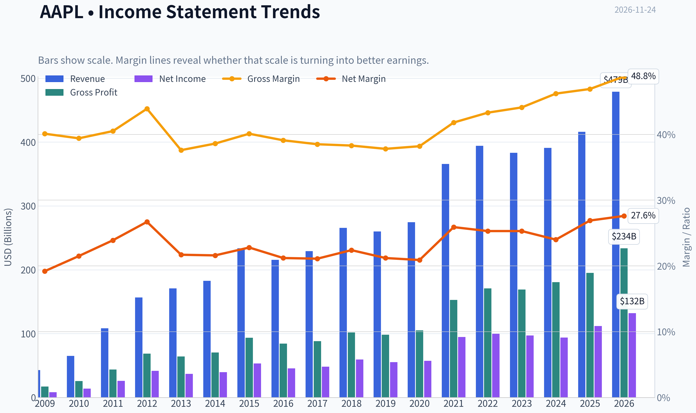
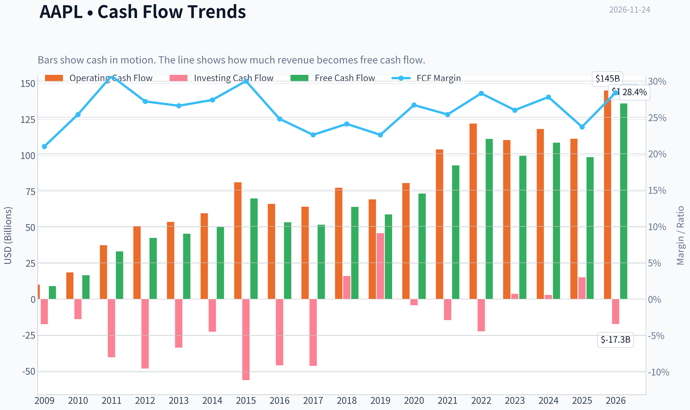
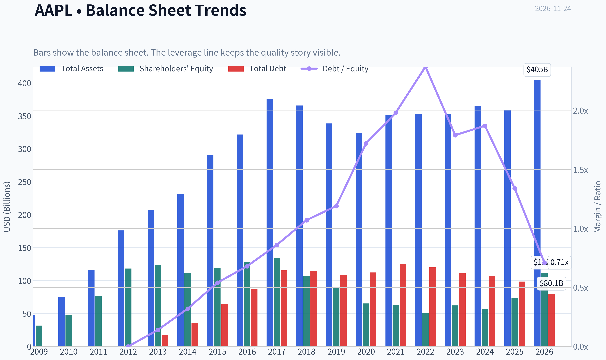
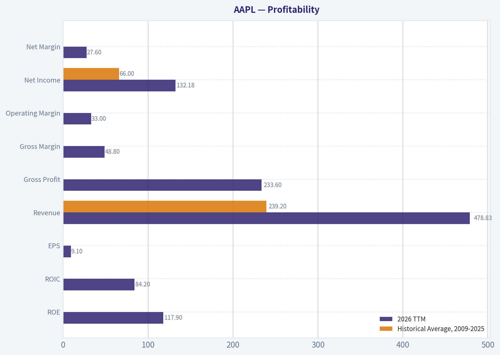
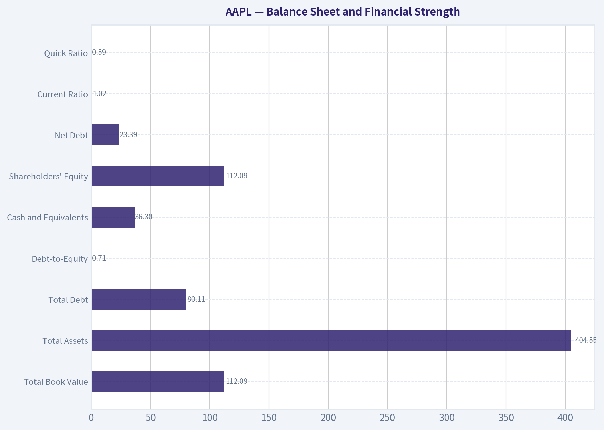
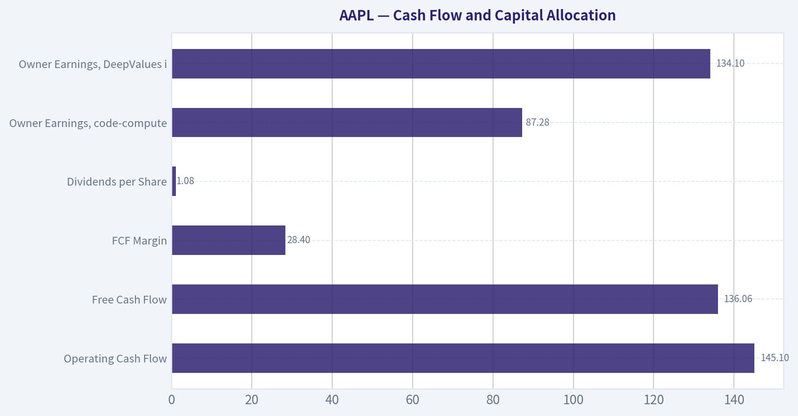
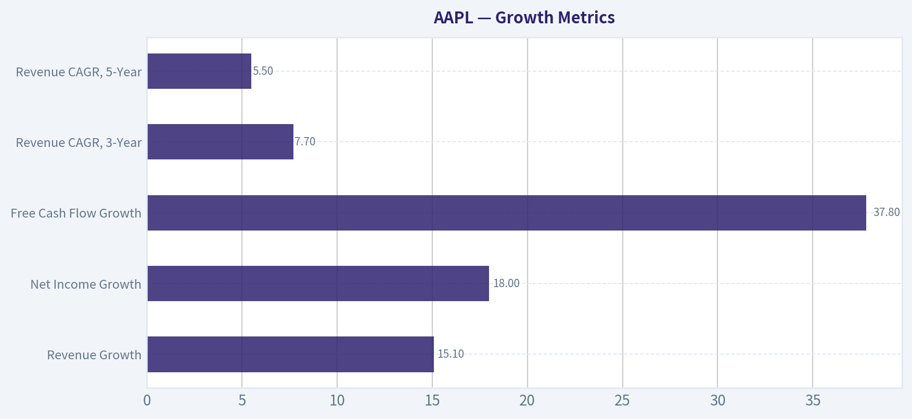
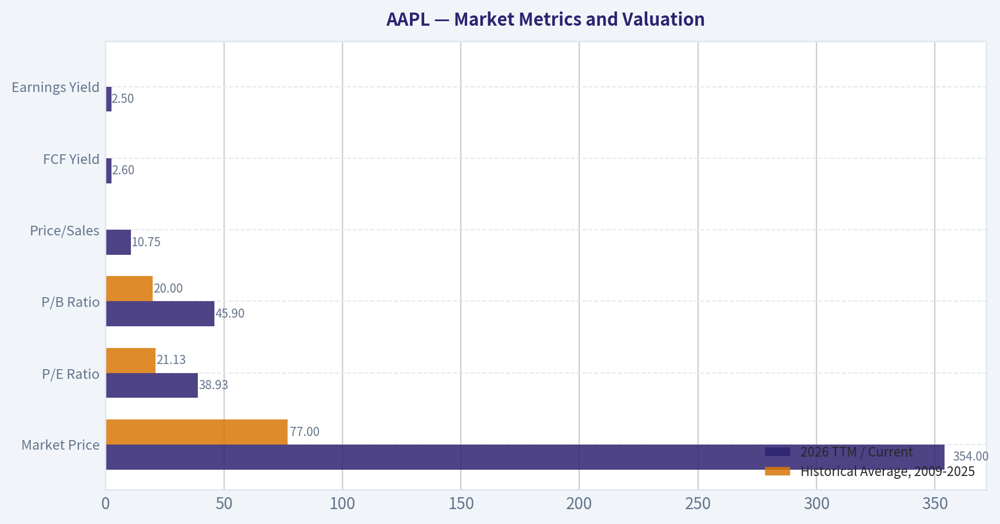

# AAPL Deep Value Intelligence

**Analysis Date:** 2026-11-24

## Critical Disclaimer

*This analysis is generated by Deep Value Intelligence, an AI-powered multi-agent investing framework. Education & research only - not financial advice, not a financial advisor.*

---

## Table of Contents

1. Intelligence Summary
2. Analyst Team Reports
   - Fundamentals Analysis
   - Intrinsic Value Analysis (Buffett)
   - Trend & Growth Analysis (Lynch/Druckenmiller/Fisher)
   - Market Technical Analysis
   - Options Market Analysis
3. Research Team Commentary
4. Value Investing Team Commentary
5. Deep Values Commentary

---

## Intelligence Summary

### Thesis + Conditions

**Core Thesis:** Apple remains an exceptional, highly profitable platform business. Its ecosystem, brand, switching costs, custom silicon, services, and installed base materially reduce long-term business risk.

**Key Risks:**
- Apple remains an exceptional, highly profitable platform business. Its ecosystem, brand, switching costs, custom silicon, services, and installed base materially reduce long-term business risk. The evidence does not indicate solvency stress or competitive collapse.
- The principal risk is valuation. At **$349 and 38.87 times earnings**, expectations already appear to include durable margins, meaningful organic earnings growth, successful services monetization, and economic benefits from AI. No DeepValues intrinsic-value estimate was supplied, so the required **10-15% quality-adjusted margin of safety** cannot be demonstrated.
- The Risky Analyst presents the strongest description of Apple's competitive advantages:

**Confidence:** Low

---

## Analyst Team Reports

### Fundamentals Analysis

#### Latest Earnings Snapshot

*Most recent reported quarter anchored on 2026 Q3, with prior-year comparison when available.*

| Metric | 2026 Q3 | 2025 Q3 | YoY Change |
| --- | ---: | ---: | ---: |
| Revenue | $114.48B | $102.47B | +11.7% |
| Operating Income | $35.63B | $32.43B | +9.9% |
| Net Income | $30.71B | $27.47B | +11.8% |
| Diluted EPS | N/A | $1.85 | N/A |
| Operating Cash Flow | $28.10B | $29.73B | -5.5% |
| Free Cash Flow | $25.86B | $26.49B | -2.4% |

Key Takeaways: This snapshot anchors the most recent reported quarter before the narrative analysis. It helps readers separate long-run business quality from whatever changed in the latest earnings print.

#### 17-Year Financial Metrics for AAPL

*All values below are computed deterministically from raw data - not estimated by AI.*

*Issuer profile: operating company (Technology / Consumer Electronics).*

#### 17-Year Financial Metrics
*Annual rows come from reported financial statements. The final TTM row is computed from the latest four quarters.*

| Metric | 2009 | 2010 | 2011 | 2012 | 2013 | 2014 | 2015 | 2016 | 2017 | 2018 | 2019 | 2020 | 2021 | 2022 | 2023 | 2024 | 2025 | 2026 TTM |
| --- | --- | --- | --- | --- | --- | --- | --- | --- | --- | --- | --- | --- | --- | --- | --- | --- | --- | --- |
| Market Price | $6 | $8 | $11 | $20 | $15 | $22 | $25 | $26 | $36 | $53 | $54 | $112 | $138 | $135 | $169 | $231 | $254 | $354 |
| Market Cap | $168.11B | $262.39B | $357.16B | $630.65B | $444.17B | $616.86B | $638.98B | $621.81B | $809.39B | $1.13T | $1.04T | $2.03T | $2.39T | $2.26T | $2.71T | $3.59T | $3.82T | $5.15T |
| P/E Ratio | 20.41 | 18.73 | 13.78 | 15.10 | 11.99 | 15.62 | 11.96 | 13.60 | 16.73 | 18.94 | 18.85 | 35.31 | 25.22 | 22.62 | 27.93 | 38.32 | 34.13 | 38.93 |
| P/B Ratio | 5.31 | 5.49 | 4.66 | 5.33 | 3.60 | 5.53 | 5.35 | 4.85 | 6.04 | 10.53 | 11.51 | 31.07 | 37.83 | 44.53 | 43.56 | 63.04 | 51.82 | 45.90 |
| ROE | 26.0% | 29.3% | 33.8% | 35.3% | 30.0% | 35.4% | 44.7% | 35.6% | 36.1% | 55.6% | 61.1% | 87.9% | 150.1% | 197.0% | 156.1% | 164.6% | 151.9% | 117.9% |
| ROIC | 35.2% | 39.8% | 40.0% | 40.6% | 30.7% | 29.7% | 35.3% | 24.8% | 21.5% | 27.1% | 30.9% | 39.1% | 64.5% | 66.8% | 67.2% | 67.5% | 83.2% | 84.2% |
| EPS | $0.27 | $0.45 | $0.83 | $1.33 | $1.22 | $1.42 | $2.06 | $1.90 | $2.14 | $2.81 | $2.85 | $3.18 | $5.47 | $5.99 | $6.13 | $6.08 | $7.46 | $9.10 |
| Revenue | $42.91B | $65.22B | $108.25B | $156.51B | $170.91B | $182.79B | $233.72B | $215.64B | $229.23B | $265.60B | $260.17B | $274.51B | $365.82B | $394.33B | $383.29B | $391.04B | $416.16B | $478.83B |
| Gross Profit | $17.22B | $25.68B | $43.82B | $68.66B | $64.30B | $70.54B | $93.63B | $84.26B | $88.19B | $101.84B | $98.39B | $104.96B | $152.84B | $170.78B | $169.15B | $180.68B | $195.20B | $233.60B |
| Gross Margin | 40.1% | 39.4% | 40.5% | 43.9% | 37.6% | 38.6% | 40.1% | 39.1% | 38.5% | 38.3% | 37.8% | 38.2% | 41.8% | 43.3% | 44.1% | 46.2% | 46.9% | 48.8% |
| Operating Margin | 27.4% | 28.2% | 31.2% | 35.3% | 28.7% | 28.7% | 30.5% | 27.8% | 26.8% | 26.7% | 24.6% | 24.1% | 29.8% | 30.3% | 29.8% | 31.5% | 32.0% | 33.0% |
| Net Income | $8.23B | $14.01B | $25.92B | $41.73B | $37.04B | $39.51B | $53.39B | $45.69B | $48.35B | $59.53B | $55.26B | $57.41B | $94.68B | $99.80B | $97.00B | $93.74B | $112.01B | $132.18B |
| Net Margin | 19.2% | 21.5% | 23.9% | 26.7% | 21.7% | 21.6% | 22.8% | 21.2% | 21.1% | 22.4% | 21.2% | 20.9% | 25.9% | 25.3% | 25.3% | 24.0% | 26.9% | 27.6% |
| Revenue Growth | N/A | 52.0% | 66.0% | 44.6% | 9.2% | 7.0% | 27.9% | -7.7% | 6.3% | 15.9% | -2.0% | 5.5% | 33.3% | 7.8% | -2.8% | 2.0% | 6.4% | 15.1% |
| Net Income Growth | N/A | 70.2% | 85.0% | 61.0% | -11.3% | 6.7% | 35.1% | -14.4% | 5.8% | 23.1% | -7.2% | 3.9% | 64.9% | 5.4% | -2.8% | -3.4% | 19.5% | 18.0% |
| Free Cash Flow Growth | N/A | 84.0% | 100.5% | 27.9% | 6.9% | 10.2% | 39.6% | -23.6% | -3.2% | 23.8% | -8.1% | 24.6% | 26.7% | 19.9% | -10.6% | 9.3% | -9.2% | 37.8% |
| Total Book Value | $31.64B | $47.79B | $76.61B | $118.21B | $123.55B | $111.55B | $119.36B | $128.25B | $134.05B | $107.15B | $90.49B | $65.34B | $63.09B | $50.67B | $62.15B | $56.95B | $73.73B | $112.09B |
| Total Assets | $47.50B | $75.18B | $116.37B | $176.06B | $207.00B | $231.84B | $290.35B | $321.69B | $375.32B | $365.73B | $338.52B | $323.89B | $351.00B | $352.75B | $352.58B | $364.98B | $359.24B | $404.55B |
| Total Debt | N/A | N/A | N/A | $0 | $16.96B | $35.30B | $64.33B | $87.03B | $115.68B | $114.48B | $108.05B | $112.44B | $124.72B | $120.07B | $111.09B | $106.63B | $98.66B | $80.11B |
| Debt-to-Equity | N/A | N/A | N/A | 0.00 | 0.14 | 0.32 | 0.54 | 0.68 | 0.86 | 1.07 | 1.19 | 1.72 | 1.98 | 2.37 | 1.79 | 1.87 | 1.34 | 0.71 |
| Cash & Equivalents | $5.26B | $11.26B | $9.81B | $10.75B | $14.26B | $13.84B | $21.12B | $20.48B | $20.29B | $25.91B | $48.84B | $38.02B | $34.94B | $23.65B | $29.96B | $29.94B | $35.93B | $36.30B |
| Shareholders' Equity | $31.64B | $47.79B | $76.61B | $118.21B | $123.55B | $111.55B | $119.36B | $128.25B | $134.05B | $107.15B | $90.49B | $65.34B | $63.09B | $50.67B | $62.15B | $56.95B | $73.73B | $112.09B |
| Operating Cash Flow | $10.16B | $18.59B | $37.53B | $50.86B | $53.67B | $59.71B | $81.27B | $66.23B | $64.22B | $77.43B | $69.39B | $80.67B | $104.04B | $122.15B | $110.54B | $118.25B | $111.48B | $145.10B |
| Investing Cash Flow | $-17.43B | $-13.85B | $-40.42B | $-48.23B | $-33.77B | $-22.58B | $-56.27B | $-45.98B | $-46.45B | $16.07B | $45.90B | $-4.29B | $-14.54B | $-22.35B | $3.71B | $2.94B | $15.20B | $-17.28B |
| Free Cash Flow | $9.02B | $16.59B | $33.27B | $42.56B | $45.50B | $50.14B | $70.02B | $53.50B | $51.77B | $64.12B | $58.90B | $73.36B | $92.95B | $111.44B | $99.58B | $108.81B | $98.77B | $136.06B |
| FCF Margin | 21.0% | 25.4% | 30.7% | 27.2% | 26.6% | 27.4% | 30.0% | 24.8% | 22.6% | 24.1% | 22.6% | 26.7% | 25.4% | 28.3% | 26.0% | 27.8% | 23.7% | 28.4% |
| Dividends / Share | $0.00 | $0.00 | $0.00 | $0.00 | $0.00 | $0.00 | $0.00 | $0.00 | $0.00 | $0.00 | $0.00 | $0.00 | $0.00 | $0.00 | $0.95 | $0.99 | $1.03 | $1.08 |

#### Profitability Metrics
- Return on Equity (ROE): 117.9%
- Return on Invested Capital (ROIC): 96.8%
- Return on Assets (ROA): 32.7%
- Gross Margin: 48.8%
- Operating Margin: 33.0%
- Net Profit Margin: 27.6%

#### Liquidity Metrics
- Current Ratio: 1.02
- Quick Ratio: 0.59

#### Leverage Metrics
- Debt-to-Equity Ratio: 0.71
- Interest Coverage Ratio: N/A
- Net Debt: $23.39B

#### Growth Metrics (Year-over-Year)
- Revenue Growth: 15.1%
- Net Income Growth: 18.0%
- Free Cash Flow Growth: 37.8%
- Revenue CAGR (3-Year): 7.7%
- Revenue CAGR (5-Year): 5.5%

#### Valuation Metrics
- P/E Ratio (TTM): 39.43
- Forward P/E: 33.49
- Price-to-Book: 45.91
- Price-to-Sales: 10.75
- PEG Ratio: 2.84
- EV/EBITDA: 29.80
- Free Cash Flow Yield: 2.6%
- Earnings Yield: 2.5%

#### Owner Earnings (Buffett Method, Code-Computed)
- Net Income: $112.01B
- + Depreciation & Amortization: $13.42B
- - Capital Expenditures: $-9.04B
- + Working Capital (cash-flow statement; negative = cash tied up): $-14.86B
- = **Owner Earnings: $87.28B**

#### Intrinsic Value (DeepValues app - SEC filings pipeline)
- **Intrinsic value (DeepValues app, the headline): $184.82** - Owner Earnings (Buffett), method buffett-1986-v2, as of 2026-11-24 (FY2026)
  Range (conservative - optimistic): $129.38 - $184.82
  Margin of safety vs. price: -91.6% (price $354.07)
  Inputs the app used (ttm_2026Q4): after-tax operating income $132.4B (operating income $158.1B, tax 16.2%) + D&A $13.4B - capex charge $11.7B (three-year average capex/revenue x trailing revenue; reported capex $9.0B) - working capital $0.0B = owner earnings $134.1B.
  Growth 5.5% fading to 2.5% terminal (min(owner-earnings CAGR, 5-year revenue CAGR), clamped [0, 10%]); discount rate 8.3% (30Y Treasury 5.29% + 3 pts (as of 2026-11-23)); net cash $55.4B (cash $36.3B + marketable securities $100.6B - debt $80.1B); 14,715M shares.
- Owner Earnings (Buffett): $129.38 / $184.82 / $184.82 (conservative / base / optimistic) ← headline
- Free cash flow DCF: $114.84 / $191.43 / $416.13 (conservative / base / optimistic)
- Damodaran two-stage FCFF: $104.84 / $151.62 / $164.40 (conservative / base / optimistic)
  This is THE intrinsic value: quote it as the intrinsic value and measure margin of safety against it. Any DVI scenario figures elsewhere are a secondary cross-check, not the value.

#### DVI scenario model (secondary cross-check - NOT the intrinsic value)
DVI's own Yahoo-based scenarios, shown only as a sensitivity check. Do not quote these as the intrinsic value; the intrinsic value is the DeepValues app value above.
- Current Price: $354
- DVI scenario value (business-model routed): $197
  Business model: operating company - weighted blend [Damodaran FCFF + reverse-DCF fair + owner-earnings DCF] (operating_company)
  Model spread (min-max across DCFs): $191 - $241
  Margin of safety vs. price (headline): -79.7%
  Routing note: General operating company: balanced blend of Damodaran FCFF and the owner-earnings DCF with a reverse-DCF sanity check.
- Buffett Method (Owner Earnings):
  Conservative: $139
  Average: $241
  Optimistic: $644
- Cash Flow Method (FCF):
  Conservative: $88
  Average: $207
  Optimistic: $277
- Damodaran FCFF (WACC + margins + reinvestment):
  Conservative: $109
  Average: $191
  Optimistic: $402
  Monte Carlo band (P10-P90): $138 - $305 (median $201)
  P(intrinsic value > price): 4.2%
- Reverse-DCF: price implies ~26.7%/yr owner-earnings growth for 10y; trailing 3y was 1.4%, 5y 14.1%.

#### Piotroski F-Score: 9/9
- Positive Net Income: PASS
- Positive Operating Cash Flow: PASS
- ROA Improvement: PASS
- Cash Flow > Net Income: PASS
- Decreasing Debt: PASS
- Improving Current Ratio: PASS
- No Dilution: PASS
- Improving Gross Margin: PASS
- Improving Asset Turnover: PASS

ANALYST STANCE: **Bearish**

#### Executive Summary

Apple remains an exceptionally high-quality operating business, but the deterministic dataset indicates that the current valuation substantially exceeds Buffett-style intrinsic value. The latest 2026 TTM figures show revenue of $478.83 billion, net income of $132.18 billion, free cash flow of $136.06 billion, ROE of 117.9%, and ROIC of 84.2%.

The central issue is valuation. At approximately $354 per share and a $5.15 trillion market capitalization, Apple trades at 38.93 times earnings and 45.90 times book value, compared with historical averages of approximately 21.13 times earnings and 20.00 times book value. The DeepValues Buffett Owner Earnings intrinsic value is $184.82 per share, implying that the evidence does not support the valuation at the current market price.

#### Market Metrics and Valuation

| Metric | 2026 TTM / Current | Historical Average, 2009-2025 | Interpretation |
|---|---:|---:|---|
| Market Price | $354 | $77 | Price has compounded dramatically, especially since 2019 |
| Market Capitalization | $5.15T | $1.38T | Current scale is approximately 3.7 times the historical average |
| P/E Ratio | 38.93 | 21.13 | Approximately 84% above the historical average |
| P/B Ratio | 45.90 | 20.00 | More than twice the historical average, but economically distorted |
| Price/Sales | 10.75 | N/A | Very demanding for a company with mid-single-digit five-year revenue CAGR |
| FCF Yield | 2.6% | N/A | Low cash-flow yield relative to the valuation |
| Earnings Yield | 2.5% | N/A | Implies limited valuation support from current earnings |

**Key Takeaways:** Apple's market capitalization and valuation multiples are near historical extremes. Price-to-book is a weak measure for Apple because aggressive repurchases reduce equity and the company's ecosystem, brand, software, and intellectual property are not fully captured on the balance sheet. Cash-flow-based intrinsic value is therefore more informative than book value.

Apple's current market capitalization is approximately $5.15 trillion, while the DeepValues Owner Earnings model estimates intrinsic value at $184.82 per share. Against the approximately $354 market price, this represents an estimated downside gap of roughly 48%, or a margin of safety of approximately negative 91.6% under the app's methodology.

The valuation requires exceptionally strong future execution. The supplied reverse-DCF cross-check indicates that the current price implies approximately 26.7% annual Owner Earnings growth for ten years, compared with trailing three-year Owner Earnings growth of approximately 1.4% and five-year growth of approximately 14.1%.

#### Profitability

| Metric | 2026 TTM | Historical Average, 2009-2025 | Assessment |
|---|---:|---:|---|
| ROE | 117.9% | Approximately 78.3% | Exceptional, but amplified by buybacks and a smaller equity base |
| ROIC | 84.2% | Approximately 43.8% | Far above historical performance |
| EPS | $9.10 | N/A | Highest reported level in the dataset |
| Revenue | $478.83B | $239.2B | Approximately double the historical average |
| Gross Profit | $233.60B | N/A | Record level |
| Gross Margin | 48.8% | Approximately 41.4% | Meaningfully above the long-term average |
| Operating Margin | 33.0% | Approximately 29.2% | Near a historical high |
| Net Income | $132.18B | $66.0B | Approximately double the historical average |
| Net Margin | 27.6% | Approximately 23.0% | Record-level profitability |

**Key Takeaways:** Apple's current profitability is stronger than its historical norm across gross margin, operating margin, net margin, ROE, and ROIC. The improvement is economically significant, but ROE is partly magnified by substantial share repurchases and the resulting reduction in book equity; ROIC and cash-flow margins provide a cleaner view of operating quality.

Revenue has increased from $42.91 billion in 2009 to $478.83 billion on a 2026 TTM basis. Gross margin expanded from 40.1% to 48.8%, while operating margin rose from 27.4% to 33.0%. This reflects a more valuable mix of services, recurring ecosystem monetization, pricing power, and operating leverage.

Net income has risen from $8.23 billion to $132.18 billion. However, the growth path was not linear. Earnings declined in 2013, 2016, 2019, 2023, and 2024 before the strong 2025-2026 recovery. This is a durable but cyclical consumer technology business rather than a perfectly predictable annuity.

#### Growth Metrics

| Metric | 2026 TTM | Historical Average Growth | Recent Pattern |
|---|---:|---:|---|
| Revenue Growth | 15.1% | Approximately 17.0% | Strong rebound, above the five-year CAGR |
| Net Income Growth | 18.0% | Approximately 21.1% | Strong recovery from recent declines |
| Free Cash Flow Growth | 37.8% | Approximately 21.0% | Very strong rebound from the 2025 decline |
| Revenue CAGR, 3-Year | 7.7% | N/A | More representative of mature-scale growth |
| Revenue CAGR, 5-Year | 5.5% | N/A | Indicates a slower underlying compounding rate |

**Key Takeaways:** The latest year was unusually strong, particularly for free cash flow, but the five-year revenue CAGR of 5.5% is much lower than the headline 15.1% annual growth rate. The valuation appears to assume that recent acceleration becomes structurally permanent, whereas the longer-term data suggest a mature company with periodic growth rebounds.

Apple's historical growth contains several substantial expansion phases, including 2010-2012 and 2020-2022, but also multiple contraction years. The latest free cash flow growth of 37.8% is impressive, yet it follows a 9.2% decline in 2025. Normalizing across the cycle is important when estimating intrinsic value.

#### Balance Sheet and Financial Strength

| Metric | 2026 TTM | Historical Context | Interpretation |
|---|---:|---:|---|
| Total Book Value | $112.09B | $31.64B in 2009; peak $134.05B in 2017 | Reduced by repurchases, then recently recovered |
| Total Assets | $404.55B | $47.50B in 2009 | Large, liquid, and globally diversified asset base |
| Total Debt | $80.11B | $0 in 2012; peak $124.72B in 2021 | Debt has declined materially from its peak |
| Debt-to-Equity | 0.71 | 1.34 average, 2009-2025 | Improved substantially |
| Cash and Equivalents | $36.30B | $24.15B average, 2009-2025 | Above historical average |
| Shareholders' Equity | $112.09B | Same as book value | Improved from the recent trough |
| Net Debt | $23.39B | N/A | Modest relative to cash generation |
| Current Ratio | 1.02 | N/A | Adequate but not abundant |
| Quick Ratio | 0.59 | N/A | Not a major concern given cash generation and marketable securities |

**Key Takeaways:** Apple's financial strength is substantial. Debt has fallen from $124.72 billion in 2021 to $80.11 billion, while cash remains sizeable and recurring cash generation is extraordinary. The current and quick ratios look less conservative than those of a typical industrial company, but Apple's liquidity analysis should include marketable securities and its unusually strong operating cash flow.

The balance sheet has been deliberately optimized through dividends and repurchases. This capital allocation increases per-share value when shares are reasonably valued, but it also reduces book equity and mechanically inflates ROE and P/B. The company's net debt of $23.39 billion is modest compared with annual free cash flow of $136.06 billion.

#### Cash Flow and Capital Allocation

| Metric | 2026 TTM | Historical Average, 2009-2025 | Interpretation |
|---|---:|---:|---|
| Operating Cash Flow | $145.10B | Approximately $69.5B | More than twice the historical average |
| Free Cash Flow | $136.06B | Approximately $68.7B | Record cash generation |
| FCF Margin | 28.4% | Approximately 25.5% | Above long-term norm |
| Dividends per Share | $1.08 | N/A | Consistent dividend growth since initiation |
| Owner Earnings, code-computed | $87.28B | N/A | Conservative calculation affected by working capital |
| Owner Earnings, DeepValues input | $134.1B | N/A | Uses after-tax operating income and normalized capital charges |

**Key Takeaways:** Apple converts a very high proportion of revenue into cash, and the 28.4% TTM free cash flow margin is stronger than its historical average. The difference between the code-computed Owner Earnings figure and the DeepValues figure reflects different treatments of working capital and capital expenditures; this is a key modeling sensitivity rather than a contradiction in reported cash flow.

Apple's dividend per share increased from zero before 2023 to $1.08 on a TTM basis. The dividend is financially secure, but the larger capital allocation story remains repurchases, reinvestment in the ecosystem, and shareholder distributions funded by recurring free cash flow.

#### Revenue Breakdown

The dataset does not provide 2026 TTM segment revenue by product. The table below uses the latest available fiscal-year product mix, based on the 2025 revenue base of approximately $416.16 billion. Amounts are rounded and represent reported product categories rather than a replacement of the deterministic historical table.

| Revenue Source | Amount ($B) | % of Total |
|---|---:|---:|
| iPhone | $209.6B | 50.4% |
| Services | $109.2B | 26.2% |
| Mac | $33.7B | 8.1% |
| Wearables, Home and Accessories | $35.7B | 8.6% |
| iPad | $28.0B | 6.7% |
| **Total** | **$416.2B** | **100.0%** |

**Key Takeaways:** iPhone remains the largest revenue source at roughly half of sales, which creates concentration risk but also reinforces the ecosystem's strategic importance. Services contributes more than one-quarter of revenue and is generally more recurring and higher margin than hardware, supporting Apple's margin expansion and valuation quality.

The most important long-term mix shift is the growth of Services, including subscriptions, payment-related services, advertising, licensing, and the App Store ecosystem. Hardware remains essential for user acquisition and ecosystem lock-in, while Services improves monetization of the installed base.

#### Buffett-Style Business Quality Analysis

**Economic moat.** Apple has one of the strongest consumer technology moats globally. The moat consists of an integrated hardware-software-services ecosystem, high switching costs, brand trust, a large installed base, proprietary silicon, distribution scale, developer relationships, and extensive customer data and network effects. The ecosystem makes individual product comparisons less important than the total user experience.

**Durability.** The company's durability is supported by recurring device replacement, Services revenue, premium pricing, and a global developer and accessory ecosystem. The main durability concern is that over half of revenue remains linked directly or indirectly to iPhone demand.

**Financial strength.** Apple's debt-to-equity ratio has improved from 2.37 in 2022 to 0.71 currently. Cash generation is more than sufficient to service debt, fund capital expenditure, pay dividends, and conduct repurchases. The financial profile is therefore strong despite a relatively low current ratio.

**Predictable earnings.** Earnings are highly profitable but not perfectly smooth. Revenue declines occurred in 2016, 2019, 2023, and 2024, while net income declined in 2013, 2016, 2019, 2023, and 2024. The long-term direction is highly favorable, but the history does not justify treating every recent growth rate as permanent.

**Management and capital allocation.** Management has demonstrated strong capital discipline through sustained investment, growing dividends, debt reduction, and repurchases. The unusually high ROE is not solely an operating achievement; it is also the consequence of reducing shareholder equity through buybacks. ROIC, operating margins, and free cash flow are more reliable indicators of management effectiveness.

**Quality of business.** Apple scores exceptionally well on margins, cash conversion, brand strength, customer retention, and reinvestment economics. The primary weakness is valuation rather than business quality.

#### Owner Earnings DCF Valuation

The DeepValues Owner Earnings model uses:

- After-tax operating income: $132.4 billion
- Depreciation and amortization: $13.4 billion
- Normalized capital expenditure charge: $11.7 billion
- Working-capital charge: approximately $0.0 billion
- Owner Earnings: approximately $134.1 billion
- Net cash adjustment: $55.4 billion
- Shares outstanding: approximately 14.715 billion
- Discount rate: 8.3%
- Terminal growth rate: 2.5%

The basic valuation structure is:

\[
\text{Equity Value} =
\sum_{t=1}^{n}\frac{OE_t}{(1+r)^t}
+
\frac{OE_{n+1}}{(r-g)(1+r)^n}
+
\text{Net Cash}
\]

where Owner Earnings are grown during the explicit forecast period and then fade toward the 2.5% terminal growth rate.

| Scenario | Initial Owner Earnings Growth | Discount Rate | Terminal Growth | App Value per Share | Interpretation |
|---|---:|---:|---:|---:|---|
| Conservative | Lower normalized growth | 8.3% | 2.5% | $129.38 | Limited growth and greater valuation discipline |
| Average / Base | 5.5%, fading to terminal | 8.3% | 2.5% | $184.82 | DeepValues headline intrinsic value |
| Optimistic | Higher near-term growth, fading to terminal | 8.3% | 2.5% | $184.82 | Capped by the model's assumptions |
| Current market price | N/A | N/A | N/A | Approximately $354 | Approximately 92% above headline intrinsic value |

**Key Takeaways:** The Buffett Owner Earnings model produces a conservative value of $129.38 and a headline intrinsic value of $184.82. Even the model's optimistic case does not exceed the base value because the app's methodology caps growth assumptions and converges them toward the terminal rate. The market price is substantially above all displayed Owner Earnings outcomes.

A transparent hand-check using the model's $134.1 billion Owner Earnings base, 8.3% discount rate, 5.5% initial growth, and 2.5% terminal growth follows the same logic:

1. Forecast Owner Earnings at approximately 5.5% initially.
2. Fade growth progressively toward 2.5% rather than extrapolating 5.5% forever.
3. Discount each annual cash flow at 8.3%.
4. Calculate terminal value using:
   \[
   \text{Terminal Value} =
   \frac{\text{Final-Year Owner Earnings}\times1.025}{0.083-0.025}
   \]
5. Add approximately $55.4 billion of net cash.
6. Divide by approximately 14.715 billion shares.

This produces the stated DeepValues headline value of approximately $184.82 per share. The FCF DCF provides a secondary cross-check of $114.84, $191.43, and $416.13 across its three scenarios, while the Damodaran FCFF model gives $104.84, $151.62, and $164.40. These secondary models demonstrate substantial sensitivity to terminal assumptions, but none changes the central conclusion that the current valuation embeds very demanding growth expectations.

#### Key Investment Insights, Red Flags, and Opportunities

| Category | Evidence | Significance |
|---|---|---|
| Major strength | ROIC of 84.2% and operating margin of 33.0% | Demonstrates exceptional economics and pricing power |
| Major strength | $136.06B free cash flow | Provides financial flexibility and supports shareholder distributions |
| Major strength | Services at approximately 26% of revenue | Improves recurring revenue and margin quality |
| Major strength | Debt-to-equity reduced to 0.71 | Balance-sheet risk has moderated |
| Valuation red flag | P/E of 38.93 versus approximately 21.13 historical average | Requires sustained premium growth |
| Valuation red flag | FCF yield of only 2.6% | Low current cash return relative to market value |
| Valuation red flag | Reverse DCF implies approximately 26.7% ten-year Owner Earnings growth | Far above the five-year revenue CAGR of 5.5% |
| Business risk | iPhone remains approximately 50% of revenue | Product-cycle and geographic concentration remain material |
| Business risk | Multiple historical revenue and earnings declines | Earnings are durable but not completely predictable |
| Capital-allocation risk | Buybacks reduce equity and inflate ROE | ROE should not be interpreted in isolation |
| Opportunity | Services penetration and installed-base monetization | Could support continued margin expansion |
| Opportunity | New device categories, AI features, and ecosystem integration | Could extend the growth runway if monetized effectively |

**Key Takeaways:** Apple's business quality is unusually high, and its strongest opportunities involve Services growth, ecosystem monetization, and continued operating leverage. The dominant risk is not financial distress; it is the possibility that excellent future business performance still falls short of the expectations already embedded in the share price.

#### Final Assessment

Apple merits a very high qualitative business score:

- **Economic moat:** Exceptional
- **Financial strength:** Strong
- **Profitability:** Exceptional
- **Cash generation:** Exceptional
- **Earnings predictability:** Strong but cyclical
- **Management and capital allocation:** Strong
- **Valuation:** Unfavorable relative to intrinsic value

**Final stance: Bearish.**

This stance is valuation-based rather than a judgment that Apple is a poor company. The evidence supports a durable, high-return, wide-moat enterprise, but the current market price is materially above the DeepValues Buffett Owner Earnings intrinsic value of $184.82 and requires growth assumptions well above the company's normalized medium-term revenue trajectory.

#### Key Points Summary

| Key Point | Conclusion |
|---|---|
| Business quality | Exceptional global consumer technology franchise |
| Current profitability | Record-level margins, ROE, ROIC, EPS, and net income |
| Growth quality | Strong recent rebound, but normalized growth is considerably lower |
| Balance sheet | Strong, with declining debt and substantial liquidity |
| Cash generation | Exceptional; FCF margin is above the long-term average |
| Valuation | Extremely demanding versus historical multiples and DCF value |
| Main opportunity | Services expansion and deeper ecosystem monetization |
| Main risk | iPhone concentration and high expectations embedded in price |
| Buffett intrinsic value | $184.82 per share |
| Current market price | Approximately $354 per share |
| Final stance | **Bearish - valuation evidence does not support the current price** |

**Key Takeaways:** Apple is one of the highest-quality businesses in the dataset, with a powerful moat, outstanding cash generation, and strong financial resilience. However, the valuation requires exceptionally high sustained growth, and the available Owner Earnings models place intrinsic value well below the current market price.

#### Fundamental Visuals

This graph tracks the profitability and return metrics (ROE, ROIC, Margins) of **AAPL** over the past decade, highlighting capital efficiency trends.

This chart illustrates the financial health of **AAPL** over the last 10 years, mapping cash equivalents and free cash flow against total obligations (Debt).

This comparison chart from *Profitability* stacks current figures against historical benchmarks for **AAPL**, making it easy to see where the company trades relative to its own averages.

---

### Intrinsic Value Analysis (Buffett)

> *Following Warren Buffett's value investing philosophy: Circle of Competence, Economic Moat, Management Quality, and Margin of Safety.*

#### Intrinsic Value Snapshot

Price is what you pay. Intrinsic value is what the business may be worth based on the cash it can create for owners over time. We show a range, not one magic number.

- Current Price: $349.08
- Value Range (conservative to optimistic across both DCF methods): $114.84 to $416.13

##### Owner Earnings (Buffett Method)
- Net Income: $112,010,000,000.00
- Depreciation & Amortization: $13,423,000,000.00
- Capital Expenditures: $-9,041,000,000.00
- Working Capital Changes: $-14,858,000,000.00
- Owner Earnings: $87,280,891,892.50

##### Intrinsic Value
###### Buffett Method
Uses owner earnings. Stricter, and usually more conservative.
- Conservative: $128.93
- Average: $184.19
- Optimistic: $184.19
- Discount Rate: 8.3%

###### Cash Flow Method
Uses free cash flow. Better for companies spending heavily today to grow tomorrow.
- Conservative: $114.84
- Average: $191.43
- Optimistic: $416.13
- Discount Rate: 9.1%

ANALYST STANCE: **Neutral**

#### Executive Conclusion

Apple remains an exceptional business with a powerful ecosystem, high returns on capital, strong cash generation, and significant customer switching costs. However, the current price of approximately **$349** is materially above the DeepValues intrinsic value of **$184.19**, implying an **89.5% premium** rather than a margin of safety.

The business quality supports a premium valuation, but the evidence does not support the valuation at the current price. The hard solvency floor is not tripped.

#### Factor Scorecard

| Factor | Score | Evidence |
|---|---:|---|
| Circle of Competence & Business Simplicity | 4/5 | Apple designs and sells devices, software, and services through an integrated ecosystem. The model is understandable, although future growth depends on product innovation, services expansion, and regulatory outcomes. |
| Durable Competitive Advantage | 5/5 | Strong brand, ecosystem lock-in, switching costs, scale, proprietary software, distribution, and customer trust. Gross margin is 48.8%, supporting substantial pricing power. |
| Management & Capital Allocation | 4/5 | Long record of large-scale buybacks, disciplined operating execution, and expanding services economics. Direct evidence of management ownership incentives and acquisition returns is less complete than the operating evidence. |
| Industry Structure | 4/5 | Consumer technology is competitive, but Apple occupies a distinctive premium position with enormous scale and an integrated ecosystem. Hardware cycles and regulatory pressure remain structural risks. |

**Gate 5 - Quality/Solvency hard floor:** **Not tripped.** Apple shows strong earnings and cash generation, and the provided data does not indicate distress, sub-1x interest coverage, or an Altman-style solvency failure.

#### Moat Analysis

| Moat source | Assessment | Supporting evidence |
|---|---|---|
| Intangible assets | Wide | The Apple brand supports premium pricing, while proprietary operating systems, chips, services, and retail distribution reinforce differentiation. |
| Switching costs | Wide | Customers have accumulated applications, data, accessories, subscriptions, and familiarity within the Apple ecosystem. |
| Cost advantages | Strong | Apple benefits from purchasing scale, custom silicon, supply-chain influence, and high revenue per customer. |
| Network effects | Moderate to strong | The value of the ecosystem increases as developers, accessories, services, and users reinforce one another. |
| Moat direction | Wide and stable, with selective widening | Services, custom silicon, installed-base monetization, and ecosystem integration strengthen the franchise. Regulatory intervention and platform competition could narrow portions of the moat. |

**Key Takeaways:** Apple's moat is not based on one product alone. It is the combination of brand, software, hardware integration, developer participation, customer data, and ecosystem convenience. The 48.8% gross margin is consistent with meaningful differentiation and pricing power.

#### Financial Summary

| Metric | Latest available figure |
|---|---:|
| Share price | $349 |
| Market capitalization | $5.07 trillion |
| P/E ratio | 38.9x |
| ROE | 117.9% |
| Gross margin | 48.8% |
| Revenue growth, year over year | 15.1% |
| Free-cash-flow yield | 2.7% |
| Operating income | $158.1 billion |
| After-tax operating income | $132.4 billion |
| Owner earnings | $134.1 billion |
| Cash and marketable securities | $136.9 billion |
| Debt | $80.1 billion |
| Net cash | $55.4 billion |
| Shares outstanding | 14.715 billion |

**Key Takeaways:** Apple combines very high profitability with strong cash generation and net cash. The principal financial concern is valuation: a 2.7% free-cash-flow yield and 38.9x earnings multiple leave little room for execution disappointments or multiple compression.

#### Owner Earnings Calculation

| Component | Amount |
|---|---:|
| After-tax operating income | $132.4B |
| Depreciation and amortization | +$13.4B |
| Maintenance-capital-expenditure charge | -$11.7B |
| Working-capital investment | -$0.0B |
| **Buffett owner earnings** | **$134.1B** |
| Owner earnings per share | **Approximately $9.11** |

The maintenance-capital-expenditure charge uses a three-year average capex-to-revenue relationship. Reported capex was approximately $9.0 billion, but the valuation methodology uses $11.7 billion as the normalized maintenance charge.

**Key Takeaways:** Owner earnings are close to reported free cash flow and substantially exceed accounting net income conversion concerns. At approximately $9.11 of owner earnings per share, the current price represents roughly 38 times owner earnings.

#### Return on Capital and Cash-Flow Quality

| Measure | Assessment |
|---|---|
| ROE | 117.9%, exceptionally high |
| ROIC | Consistent with a high-return, asset-light ecosystem model |
| Gross margin | 48.8%, indicating strong differentiation |
| Operating cash flow versus earnings | Cash economics are strong and owner earnings are approximately $134.1B |
| Leverage effect on ROE | Some ROE enhancement comes from buybacks and a relatively small equity base, so ROE alone overstates operating quality |
| Reinvestment runway | Services, installed-base monetization, wearables, payments, custom silicon, and emerging platform opportunities provide continued avenues for reinvestment |

**Key Takeaways:** Apple's returns are not solely a product of debt; the business generates substantial operating profits from its ecosystem and intellectual property. Nevertheless, the unusually high ROE should be interpreted alongside ROIC, cash flow, and buyback-driven equity reduction rather than treated as a standalone measure.

#### Three-Scenario DCF Cross-Check

These scenarios are sensitivity checks. The official intrinsic value is the DeepValues app figure shown in the next section.

| Scenario | Assumptions | Estimated value per share |
|---|---|---:|
| A: No growth | $134.1B owner earnings capitalized at 10% | $91 |
| B: GDP-like growth | 3% perpetual growth, 10% discount rate | $134 |
| C: Historical-growth sensitivity | Approximately 4.1% growth for 10 years, fading to 2.5% terminal growth, 10% discount rate | $144 |

**Key Takeaways:** Even using optimistic persistence of Apple's historical growth, the conservative cross-checks remain below the current market price. These calculations are deliberately more conservative than the DeepValues headline valuation because they use a 10% discount rate and exclude the full benefit of the app's lower 8.3% discount rate.

#### Intrinsic Value and Margin of Safety

| Valuation item | Value |
|---|---:|
| DeepValues headline intrinsic value | **$184.19 per share** |
| Conservative-to-optimistic range | $128.93-$184.19 |
| Current price | $349 |
| Margin of safety versus intrinsic value | **-89.5%** |
| Price premium to intrinsic value | **Approximately 89.5%** |
| DeepValues owner-earnings method | Buffett 1986-style methodology |
| Discount rate | 8.3% |
| Growth assumption | 5.5% initially, fading to 2.5% terminal growth |
| Net cash included | $55.4B |

**Key Takeaways:** The headline intrinsic value is $184.19, not the higher free-cash-flow or secondary scenario figures. At $349, Apple trades far above that estimate, meaning the valuation requires either materially higher long-term owner earnings, a lower discount rate, or both.

#### Management Quality Assessment

Apple's management record is strong in several respects:

- Capital has been returned through substantial repurchases and dividends.
- The company has expanded services without abandoning its core hardware franchise.
- Custom silicon and vertical integration have improved product differentiation and efficiency.
- The business has generally avoided balance-sheet stress despite its enormous scale.
- Warren Buffett's Berkshire Hathaway reported holding approximately 227.92 million Apple shares as of September 30, 2026, representing a substantial disclosed allocation.

The primary management risks are strategic rather than financial: dependence on continued innovation, geopolitical and supply-chain exposure, regulatory scrutiny of the ecosystem, and the challenge of deploying an exceptionally large cash flow base at attractive returns.

#### Final Buffett Scorecard

| Criterion | Weight | Score | Weighted contribution |
|---|---:|---:|---:|
| Moat width and durability | 25% | 5/5 | 1.25 |
| Valuation and margin of safety | 20% | 1/5 | 0.20 |
| Capital returns versus WACC | 15% | 4/5 | 0.60 |
| Business understanding and predictability | 12% | 4/5 | 0.48 |
| Management quality and capital allocation | 12% | 4/5 | 0.48 |
| Reinvestment runway | 8% | 4/5 | 0.32 |
| Balance-sheet strength | 4% | 4/5 | 0.16 |
| Industry structure | 4% | 4/5 | 0.16 |
| **Total** | **100%** |  | **3.65/5** |

**Key Takeaways:** Apple scores exceptionally well on moat, capital returns, management, and reinvestment potential. The valuation score is the decisive weakness, reducing the overall result to the Neutral range despite the company's outstanding business quality.

#### Investment Stance

**Neutral - Moderate conviction.**

Apple is a high-quality compounder with a wide moat, strong cash economics, and a durable ecosystem. The valuation, however, is substantially above the DeepValues intrinsic value and the conservative DCF cross-checks. A fair-price framework can justify some premium for Apple's quality, but an approximately 89.5% premium requires unusually favorable assumptions and provides inadequate margin of safety under the stated valuation methodology.
#### Valuation Bridge

This bridge places the current market price beside each intrinsic value lens so readers can see whether upside depends on one method or shows up across several methods.

| Scenario | Intrinsic Value / Share |
| --- | ---: |
| Buffett Method | $184.19 |
| Cash Flow Method | $191.43 |
| Damodaran Method | $151.62 |
| Current Price | $349.08 |

#### Key Takeaways

If one method is far above the others, the upside case depends on a specific modelling assumption. When several methods cluster together, the valuation story is more robust.

#### Valuation Visuals

This comparison chart from *Latest Earnings Snapshot* stacks current figures against historical benchmarks for **AAPL**, making it easy to see where the company trades relative to its own averages.

This comparison chart from *Balance Sheet and Financial Strength* stacks current figures against historical benchmarks for **AAPL**, making it easy to see where the company trades relative to its own averages.

This comparison chart from *Cash Flow and Capital Allocation* stacks current figures against historical benchmarks for **AAPL**, making it easy to see where the company trades relative to its own averages.

---

### Trend & Growth Analysis (Lynch/Druckenmiller/Fisher)

> *Following Peter Lynch's GARP, Stanley Druckenmiller's macro-aware approach, and Philip Fisher's scuttlebutt methodology.*

ANALYST STANCE: **Neutral**

#### 1. Lynch Classification

Apple is a **fast grower by current revenue growth**, although its enormous scale and premium valuation make it more accurately a **large-cap growth stalwart with fast-grower characteristics**.

| Metric | AAPL |
|---|---:|
| Revenue growth, YoY | 15.1% |
| P/E | 38.9x |
| Gross margin | 48.8% |
| ROE | 117.9% |
| Market capitalization | $5.07T |
| Current price | $349 |
| FCF yield | 2.7% |

**Key Takeaways:** Apple is growing faster than a conventional stalwart, but its valuation reflects substantial optimism. The high gross margin and ROE demonstrate exceptional economics, while the low FCF yield indicates that the market is assigning a large premium to future growth.

#### 2. The Story in Three Bullets

- Apple monetizes a tightly integrated hardware, software, services, and developer ecosystem with high customer retention.
- Services, wearables, artificial intelligence, and installed-base monetization provide growth avenues beyond the iPhone.
- The central question is whether Apple can produce sustained earnings acceleration from AI and new product categories at its current scale.

#### 3. TAM Analysis and the 10x Test

Apple's addressable opportunity spans smartphones, personal computing, tablets, wearables, digital services, payments, advertising, healthcare technology, and potentially AI-enabled devices.

A precise 10x revenue test cannot be completed from the supplied data because current revenue and segment-level TAM estimates were not provided. At a $5.07 trillion market capitalization, however, a 10x equity-value outcome would require an exceptionally large expansion in earnings and free cash flow. The opportunity is therefore less about smartphone unit growth and more about expanding monetization per user and creating entirely new platforms.

| TAM Dimension | Assessment |
|---|---|
| Smartphone market | Mature, with growth mainly from premiumization and share |
| Services market | Large and expanding; recurring monetization opportunity |
| Wearables | Meaningful runway, but competitive |
| AI-enabled devices | Potential TAM inflection, execution not yet proven |
| Payments and advertising | Expanding ecosystem monetization |
| 10x test | Not fully verifiable with supplied revenue data |

**Key Takeaways:** Apple's runway remains substantial, but the smartphone market alone is unlikely to support a tenfold outcome. The long-term case depends on services growth, AI-driven product cycles, and new ecosystem monetization rather than simple unit expansion.

#### 4. Revenue Growth Trend

Only the latest year-over-year growth rate, 15.1%, is available in the research pack. That supports a fast-growth classification but does not establish whether growth is accelerating or decelerating.

| Growth Signal | Evidence | Interpretation |
|---|---|---|
| Latest revenue growth | 15.1% YoY | Healthy large-cap growth |
| Multi-quarter trend | Not supplied | Acceleration cannot be confirmed |
| Organic versus acquisition growth | Primarily organic business model | Revenue quality appears strong |
| Customer concentration | Consumer ecosystem concentration | iPhone dependence remains relevant |

**Key Takeaways:** Apple is producing healthy growth, but there is insufficient evidence to call this an acceleration inflection. A sustained move materially above 15% would strengthen the growth thesis; repeated deceleration would make the current valuation harder to justify.

#### 5. Unit Economics and Profitability

Apple does not report SaaS-style metrics such as net revenue retention or LTV-to-CAC. Its equivalent economic advantages are ecosystem retention, recurring services revenue, high gross margins, and strong cash generation.

| Unit-Economic Measure | AAPL Assessment |
|---|---|
| LTV/CAC | Not disclosed; likely strong ecosystem economics |
| Net revenue retention | Not applicable or not disclosed |
| Gross margin | 48.8% |
| FCF yield | 2.7% |
| Rule of 40 | Not applicable without subscription revenue and FCF margin data |
| Balance-sheet liquidity | Current ratio approximately 1.02 |

**Key Takeaways:** Apple's 48.8% gross margin and recurring ecosystem revenue indicate strong underlying economics. The lack of disclosed CAC, LTV, and NRR prevents a formal SaaS-style analysis, while the near-one current ratio warrants monitoring despite Apple's substantial cash and marketable-securities resources.

#### 6. Inflection Point Assessment

| Potential Inflection | Current Evidence | Assessment |
|---|---|---|
| Product cycle | AI-enabled devices and services | Potential, not yet proven |
| Market share | Premium ecosystem strength | Positive but mature |
| Margin | 48.8% gross margin | Strong base; acceleration not established |
| TAM | AI, services, payments, wearables | Expanding |
| Competitive landscape | Strong ecosystem, intense competition | Durable advantage with execution risk |

**Key Takeaways:** The most important possible inflection is AI becoming a meaningful upgrade and monetization cycle across Apple's installed base. At present, this is an opportunity rather than a confirmed financial inflection, so the evidence supports monitoring rather than assigning maximum growth confidence.

#### 7. Macro Setup

The macro backdrop is mixed for a high-duration mega-cap growth company.

- The 30-year Treasury yield is approximately **5.31%**, which creates a meaningful discount-rate headwind.
- Apple's scale and cash generation provide resilience in a slower economy.
- Consumer electronics demand remains cyclical, especially for discretionary upgrades.
- AI and digital services are favorable secular themes.
- The valuation is more sensitive to interest rates because the stock trades at nearly 39 times earnings.

**Key Takeaways:** Apple benefits from powerful secular technology trends, but elevated long-term rates reduce the present value of distant cash flows. The macro setup is therefore supportive for the business but less supportive for the current valuation multiple.

#### 8. Fisher's 15-Point Assessment

Scores are provisional because detailed management, R&D, customer-retention, and channel-check data were not supplied.

| Fisher Criterion | Score / 5 |
|---|---:|
| Market potential | 4 |
| New-product determination | 5 |
| R&D effectiveness | 4 |
| Sales organization | 5 |
| Profit margins | 5 |
| Margin improvement potential | 3 |
| Labor relations | 4 |
| Executive relations | 4 |
| Management depth | 5 |
| Cost analysis and accounting | 5 |
| Competitive advantages | 5 |
| Long-range profit outlook | 4 |
| Dilution discipline | 5 |
| Management candor | 4 |
| Management integrity | 4 |
| **Total** | **66 / 75** |

**Key Takeaways:** Apple scores in Fisher's outstanding range, mainly because of its ecosystem, distribution, R&D capability, financial discipline, and management depth. The weaker area is incremental margin expansion, since Apple is already operating from a highly profitable base.

#### 9. Valuation Analysis

The supplied intrinsic-value analysis uses owner earnings as the headline method. The current price is substantially above that estimate.

| Valuation Measure | Value |
|---|---:|
| Current price | $349 |
| P/E | 38.9x |
| Revenue growth | 15.1% |
| Implied PEG | 2.57 |
| Owner-earnings intrinsic value | $184.19 |
| Conservative owner-earnings value | $128.93 |
| Base FCF DCF value | $191.43 |
| Optimistic FCF DCF value | $416.13 |
| Damodaran FCFF base value | $151.62 |
| Price premium to headline intrinsic value | 89.5% |

**Key Takeaways:** The PEG ratio is well above Lynch's preferred range, indicating that valuation is demanding relative to current growth. Most supplied valuation methods produce values below $349, although the optimistic FCF case reaches $416.13 and depends on strong long-term cash-flow execution.

#### 10. Growth Investor Scorecard

| Criterion | Weight | Rating / 5 | Weighted Contribution |
|---|---:|---:|---:|
| Lynch story | 10% | 4.2 | 0.42 |
| TAM and runway | 20% | 3.8 | 0.76 |
| Revenue growth | 20% | 3.5 | 0.70 |
| Unit economics | 15% | 4.3 | 0.65 |
| Competitive position | 10% | 4.8 | 0.48 |
| Management quality | 10% | 4.5 | 0.45 |
| Macro setup | 5% | 3.0 | 0.15 |
| Profitability path | 5% | 4.5 | 0.23 |
| Valuation | 5% | 1.5 | 0.08 |
| **Total** | **100%** |  | **3.92 / 5.00** |

**Key Takeaways:** Apple's operating quality scores strongly, particularly its ecosystem, profitability, management depth, and competitive position. The valuation score is the primary constraint, bringing the overall result to a Neutral stance despite an otherwise high-quality business profile.

#### 11. Valuation Sensitivity

The following sensitivity uses valuation outputs already supplied by the research pack rather than a new estimated value.

| Scenario | Key Assumption | Model Output |
|---|---|---:|
| Conservative owner earnings | Lower growth and valuation assumptions | $128.93 |
| Headline owner earnings | Base owner-earnings framework | $184.19 |
| Base FCF DCF | Base cash-flow assumptions | $191.43 |
| Damodaran FCFF base | Two-stage FCFF model | $151.62 |
| Optimistic FCF DCF | Strong cash-flow growth and terminal assumptions | $416.13 |

**Key Takeaways:** The valuation range is unusually wide, from $128.93 to $416.13, showing that terminal growth and cash-flow assumptions dominate the outcome. At $349, the market appears to require an outcome closer to the optimistic scenario than to the central owner-earnings and FCFF estimates.

#### 12. Key Risks and Catalysts

| Catalysts | Risks |
|---|---|
| AI-driven upgrade cycle | Valuation compression from high interest rates |
| Faster Services growth | iPhone maturity and replacement-cycle weakness |
| New wearable or computing category | Regulatory pressure on App Store economics |
| Greater advertising and payments monetization | Supply-chain and geopolitical exposure |
| Margin expansion from mix and scale | Execution risk in AI and new products |
| Continued ecosystem retention | Premium consumer demand weakening |

**Key Takeaways:** The major catalyst is a demonstrable AI and services growth acceleration that lifts earnings expectations above current consensus-style assumptions. The major risk is that Apple remains an excellent business with growth closer to 10% to 15% while the valuation reflects a much stronger long-term outcome.

#### Bottom Line

Apple is a world-class compounder with outstanding competitive advantages, high margins, strong management depth, and multiple secular growth opportunities. However, the available evidence does not confirm a current revenue-growth acceleration, and the $349 valuation is materially above the supplied $184.19 headline intrinsic value. The evidence supports a **Neutral** stance: business quality is exceptional, but the valuation requires unusually strong future execution.

#### Growth & Scorecard Visuals

This comparison chart from *Growth Metrics* stacks current figures against historical benchmarks for **AAPL**, making it easy to see where the company trades relative to its own averages.

---

### Market Technical Analysis

ANALYST STANCE: **Neutral**

#### AAPL technical overview

The latest available AAPL session is **November 23, 2026**, because November 24 is identified by the data service as a non-trading day. AAPL closed at **$349.08**, up from **$274.96** one year earlier, a gain of approximately **27%**. The broader trend remains constructive, but the short-term picture has become less decisive after the stock reached an intraday high of **$360.83 on November 13** and then pulled back.

The evidence supports a distinction between a strong medium- and long-term trend and softer near-term momentum. AAPL remains substantially above both its 50-day and 200-day moving averages, while the 10-day EMA is almost exactly aligned with the latest close. That combination indicates that the longer trend is still upward, but the recent advance has paused rather than continuing with the same force.

#### Trend structure: medium and long term

The **50-day SMA was $341.91** on November 23, placing the close approximately **2.1% above** that average. The 50-day SMA has risen steadily from roughly **$330.0 on October 26** to nearly $342, confirming persistent medium-term price strength.

The **200-day SMA was $303.15**, leaving the stock approximately **15.2% above** its long-term trend benchmark. The 200-day average has also been rising consistently, from about **$294.3 in late October** to $303.15. This is a meaningful structural positive: the long-term trend is not merely elevated because of a short-lived spike; the underlying average itself is advancing.

However, the distance between price and the 50-day average is relatively modest compared with the distance above the 200-day average. This suggests that the stock is still well supported by its long-term trend but is currently testing whether it can re-establish short-term upside momentum after the November pullback.

#### Short-term price behavior and EMA

The **10-day EMA was $349.13**, almost identical to the $349.08 closing price. The close was slightly below the EMA, but the difference was negligible. This reflects short-term equilibrium rather than a decisive breakdown.

The EMA rose from approximately **$343.11 on October 26** to above **$350 in mid-November**, before flattening and edging lower. The sequence shows that the late-October and early-November advance generated genuine short-term momentum, but that momentum has recently stalled.

Price action since the November 13 high has been volatile rather than uniformly weak. AAPL moved from $356.27 on November 13 to $352.78 on November 16, $349.21 on November 19, and $342.56 on November 20, before recovering to $349.08 on November 23. The November 20 decline occurred with volume of approximately **80.7 million shares**, materially higher than the immediately preceding sessions, indicating meaningful distribution or repositioning activity. The following rebound recovered part of that decline but did not yet reclaim the recent highs.

#### MACD momentum

The MACD reading remained positive at **2.55** on November 23, which is consistent with the stock still being in a generally positive trend regime. Nevertheless, the MACD has declined from **4.21 on November 13** to 2.55, showing that upside momentum has weakened materially from its mid-November peak.

This is an important nuance: positive MACD does not equal accelerating momentum. The current pattern is better described as **positive but decelerating**. A sustained move back above the recent momentum readings would strengthen the case that the consolidation is resolving constructively; continued deterioration would indicate that the short-term pullback is becoming more consequential.

#### RSI and momentum balance

The **RSI was 52.75**, down from **60.90 on November 13** and **56.78 on November 18**. RSI is therefore near the midpoint of its range, neither overbought nor oversold.

The RSI profile indicates that the November decline relieved the earlier momentum pressure without creating a technically oversold condition. This reduces evidence of an immediate exhaustion extreme, but it also means the indicator is not currently confirming strong upside thrust. A move back toward the upper-50s or 60s would indicate renewed momentum, while a move below the midpoint would suggest that sellers are gaining greater control of the short-term trend.

#### Bollinger Bands and volatility

On November 23, the **upper Bollinger Band was $359.86** and the **lower band was $335.30**. The close at $349.08 was approximately $10.78 below the upper band and $13.78 above the lower band, placing price near the middle-to-upper portion of the recent volatility envelope.

AAPL was not pressing against the upper band at the latest close, unlike the period around the November 11-13 advance. The retreat from the upper band indicates that the prior upside impulse has cooled. At the same time, the close remained comfortably above the lower band, so the data do not show a lower-band stress event.

The distance between the upper and lower bands was approximately **$24.56**, reflecting a still-wide trading range. This is consistent with the sharp daily swings seen during November, including the November 20 decline and November 23 rebound.

#### ATR and risk environment

The **ATR was $8.31**, up from roughly **$6.16 on October 28** and close to the recent peak of **$8.85 on November 9**. Volatility therefore remains elevated compared with late October, even though it has eased somewhat from its early-November high.

An ATR of $8.31 represents approximately **2.4% of the latest closing price**, indicating that daily price fluctuations remain material. The elevated ATR helps explain why moving-average and momentum signals have become less clean: short-term price can move substantially around trend benchmarks without necessarily changing the broader trend.

#### Integrated interpretation

The indicators form a three-layer picture:

1. **Long-term trend:** Strong. The price is well above a rising 200-day SMA.
2. **Medium-term trend:** Positive but less extended. The price is only modestly above the rising 50-day SMA.
3. **Short-term momentum:** Neutral-to-soft. The price is almost exactly at the 10-day EMA, MACD remains positive but is declining, and RSI has returned to the low-50s.

The most important technical issue is whether the November pullback remains a consolidation above the rising 50-day SMA or develops into a deeper trend test. So far, the long-term evidence remains supportive, but the latest data do not show a strong short-term momentum confirmation. The evidence is therefore consistent with a **constructive long-term structure undergoing a volatile short-term digestion phase**, rather than a clean continuation pattern or a confirmed reversal.

These technical indicators do not measure fundamental valuation. They show that market pricing remains supported by a strong trend structure, while the recent loss of momentum means the evidence is less supportive of assuming that the November advance will immediately extend at the same pace.

#### Selected indicators

The selected set uses eight complementary measures: three trend averages, one momentum oscillator, one MACD measure, two volatility-band boundaries, and ATR. This avoids using multiple highly overlapping indicators while still covering direction, momentum, price dispersion, and volatility.

| Indicator | Latest reading | Recent direction | Interpretation |
|---|---:|---|---|
| 50-day SMA | $341.91 | Rising | Medium-term trend remains positive; close is about 2.1% above it |
| 200-day SMA | $303.15 | Rising | Long-term trend is firmly constructive; close is about 15.2% above it |
| 10-day EMA | $349.13 | Flattening/slightly lower | Short-term price is at equilibrium with its responsive trend measure |
| MACD | 2.55 | Declining from 4.21 | Momentum remains positive but is decelerating |
| RSI | 52.75 | Lower than mid-November | Neutral momentum; neither overbought nor oversold |
| Bollinger Upper Band | $359.86 | Elevated | Price is below the upper volatility boundary after a recent rejection from highs |
| Bollinger Lower Band | $335.30 | Elevated | Price remains above the lower band; no lower-band stress signal |
| ATR | $8.31 | Elevated, below recent peak | Daily volatility remains substantial and can amplify short-term noise |

**Key Takeaways:** AAPL remains above rising 50-day and 200-day averages, preserving a strong medium- and long-term trend structure. Short-term momentum has weakened: MACD is positive but declining, RSI is near neutral, and the closing price is almost exactly at the 10-day EMA. Volatility remains elevated, so the current evidence is best characterized as a strong broader trend with a watch-worthy short-term consolidation.

#### Market Visuals

This comparison chart from *Market Metrics and Valuation* stacks current figures against historical benchmarks for **AAPL**, making it easy to see where the company trades relative to its own averages.

---

### Options Market Analysis

> *Reading options flow - put/call ratios, IV skew, and unusual activity - to gauge institutional positioning and event-driven risk.*

ANALYST STANCE: **BEARISH**

#### AAPL Options Snapshot

As of November 24, 2026, the data covers expirations from November 25 through November 30. The near-term sample is highly liquid, especially for the November 25 expiry, but the very short time to expiration means flows may reflect hedging, event trading, or dealer gamma management rather than longer-horizon conviction.

| Expiration | Call OI | Put OI | Put/Call OI | Call Volume | Put Volume | Put/Call Volume | Call ATM IV | Put ATM IV |
|---|---:|---:|---:|---:|---:|---:|---:|---:|
| Nov. 25 | 23,347 | 45,462 | 1.95 | 204,844 | 194,646 | 0.95 | 28.8% | 32.6% |
| Nov. 27 | 119,104 | 159,030 | 1.34 | 57,123 | 68,238 | 1.19 | 25.0% | 26.8% |
| Nov. 30 | 6,483 | 15,447 | 2.38 | 10,509 | 10,258 | 0.98 | 24.3% | 23.2% |
| **Total** | **148,934** | **219,939** | **1.48** | **272,476** | **273,142** | **1.00** | - | - |

**Key Takeaways:** Aggregate put/call open interest is 1.48, materially above the approximately 0.7 neutral baseline. That indicates substantially more outstanding downside protection or bearish exposure than normally associated with a neutral options market. However, trading volume is almost exactly balanced, so current-session activity is not aggressively put-heavy.

#### Put/Call Ratio Analysis

The largest imbalance appears in open interest rather than fresh volume. November 25 has a 1.95 put/call OI ratio, while November 30 is higher at 2.38, although the latter expiration has much less activity. November 27, the largest open-interest expiration by count, still shows a put-heavy 1.34 ratio.

This pattern is consistent with meaningful downside hedging or bearish exposure already established in the near-term chain. The neutral volume ratio of 1.00 reduces the confidence that today's flow alone represents a major bearish initiation.

#### Implied Volatility and Skew

| Expiration | ATM Call IV | ATM Put IV | Put Premium to Call IV | Interpretation |
|---|---:|---:|---:|---|
| Nov. 25 | 28.8% | 32.6% | +3.8 percentage points | Clear downside protection premium |
| Nov. 27 | 25.0% | 26.8% | +1.8 percentage points | Moderate put skew |
| Nov. 30 | 24.3% | 23.2% | -1.1 percentage points | Slight call-side premium, but thin sample |
| **Near-term read** | - | - | **Put IV generally higher** | **Downside skew dominates the liquid expirations** |

The data feed does not identify a specific earnings, product, or macro catalyst. Implied volatility is elevated for the November 25 expiration relative to the later expirations, which is expected when only one day remains and event or gamma risk is concentrated. The most important volatility signal is the put premium in the two most liquid expirations.

**Key Takeaways:** Near-term ATM put IV exceeds call IV by 3.8 percentage points for November 25 and 1.8 points for November 27. This is a downside-skewed volatility surface, indicating stronger demand for short-dated downside insurance than for equivalent upside exposure. The November 30 call premium is less meaningful because that expiration has comparatively low open interest and volume.

#### Unusual Options Activity

The feed flags contracts where volume exceeds five times open interest, which is a useful screen for potentially fresh activity. It does not provide trade direction, whether trades occurred at the bid or ask, or whether the contracts were opened or closed; therefore, institutional intent cannot be confirmed from volume and open interest alone.

The feed does not report the exact current share price. The $352.50 strike cluster is used as a rough at-the-money reference for classifying strikes.

| Expiration | Contract | Strike Classification | Volume | OI | Vol/OI | IV | Market Implication |
|---|---|---|---:|---:|---:|---:|---|
| Nov. 25 | Put $350 | Slightly OTM put | 48,167 | 1,568 | 30.7x | 23.8% | Large short-dated downside activity |
| Nov. 25 | Call $355 | OTM call | 46,562 | 2,601 | 17.9x | 21.3% | Significant upside speculation or call overwriting |
| Nov. 25 | Call $360 | OTM call | 45,803 | 3,520 | 13.0x | 19.3% | Upside tail activity |
| Nov. 25 | Call $352.50 | Near-ATM call | 30,913 | 1,979 | 15.6x | 21.9% | High short-term directional trading |
| Nov. 25 | Call $357.50 | OTM call | 28,949 | 1,977 | 14.6x | 21.1% | Additional upside speculation |
| Nov. 25 | Put $352.50 | Near-ATM put | 24,203 | 456 | 53.1x | 22.2% | Strongest volume-to-OI put signal |
| Nov. 25 | Put $345 | OTM put | 23,713 | 2,898 | 8.2x | 26.6% | Downside hedge or bearish tail exposure |
| Nov. 25 | Call $362.50 | OTM call | 22,698 | 2,242 | 10.1x | 19.4% | Upside tail activity |
| Nov. 25 | Put $347.50 | OTM put | 21,795 | 1,463 | 14.9x | 25.2% | Fresh-looking downside interest |
| Nov. 25 | Put $340 | OTM put | 20,671 | 2,665 | 7.8x | 29.9% | Deeper downside protection |
| Nov. 25 | Call $365 | OTM call | 11,721 | 1,595 | 7.3x | 20.1% | Farther upside speculation |
| Nov. 25 | Put $342.50 | OTM put | 11,180 | 1,124 | 9.9x | 28.1% | Downside-tail positioning |
| Nov. 25 | Put $337.50 | OTM put | 6,979 | 504 | 13.8x | 31.6% | Deep downside hedge |
| Nov. 30 | Call $357.50 | OTM call | 1,137 | 227 | 5.0x | 20.5% | Smaller, less influential upside activity |

The unusual activity is two-sided: there is substantial call volume from $352.50 through $365, but there is also exceptionally high put activity around $350 and $352.50, plus a broad ladder of lower-strike puts. The $352.50 put has the highest volume-to-OI ratio at 53.1 times, while the $350 put has the largest absolute unusual put volume.

**Key Takeaways:** Fresh-looking activity is concentrated in the November 25 expiry, with both upside calls and downside puts trading heavily. The put activity has greater breadth across multiple lower strikes and is reinforced by higher put IV, making it more consistent with hedging demand or bearish tail-risk protection. The data cannot reliably distinguish institutional buying from retail speculation because trade-side and opening-versus-closing information is unavailable.

#### Open Interest Concentration and Gamma Levels

| Expiration | Total Call OI | Total Put OI | Combined OI | Concentration Assessment |
|---|---:|---:|---:|---|
| Nov. 25 | 23,347 | 45,462 | 68,809 | Very near-term, put-heavy |
| Nov. 27 | 119,104 | 159,030 | 278,134 | Largest combined OI and key gravitational expiry |
| Nov. 30 | 6,483 | 15,447 | 21,930 | Smaller, put-heavy tail |
| **Total** | **148,934** | **219,939** | **368,873** | **Strong overall put concentration** |

November 27 contains roughly three-quarters of the combined open interest across the supplied expirations, making it the most important expiry for potential pinning or dealer gamma effects. The supplied data does not include complete strike-by-strike open interest, so a precise maximum-pain level or confirmed gamma wall cannot be calculated.

Within the unusual-activity list, the largest reported open interest is in the November 25 $360 call with 3,520 contracts, followed by the $345 put with 2,898 and the $340 put with 2,665. These strikes may become local liquidity or hedging reference points, but they should not be treated as definitive gamma walls without full-chain data and dealer gamma estimates.

**Key Takeaways:** November 27 is the dominant gravitational expiry because it carries the largest combined open interest. Put open interest exceeds call open interest at every supplied expiration, which could amplify downside hedging flows if AAPL weakens. Exact pinning and gamma-wall levels remain uncertain because the full strike distribution was not provided.

#### Overall Options Sentiment

| Signal Component | Assessment | Directional Read |
|---|---|---|
| Put/Call OI | 1.48 aggregate, versus approximately 0.7 neutral | Bearish or defensive |
| Put/Call Volume | 1.00 aggregate | Neutral current-session flow |
| ATM IV | Put IV above call IV in the two main expirations | Defensive |
| IV Skew | Downside put skew in liquid expirations | Bearish |
| Unusual Activity | Large calls and puts, but broader put ladder | Slightly bearish |
| OI Concentration | Heavy put concentration, especially through Nov. 27 | Bearish risk asymmetry |
| **Overall Signal** | - | **BEARISH, with moderate confidence** |

The primary driver of the bearish signal is the combination of a 1.48 put/call open-interest ratio, higher near-term put IV, and broad unusual activity across lower-strike puts. The balanced volume ratio and substantial upside-call activity prevent this from being a high-conviction bearish reading; they suggest active two-sided short-dated trading rather than a one-directional rush.

Options data is forward-looking market positioning, not a valuation measure. The evidence indicates that near-term downside risk is being priced more aggressively than upside risk, while the balanced volume leaves room for event-driven or dealer-related reversals.

**Key Takeaways:** AAPL's near-term options market is best characterized as bearish-defensive rather than uniformly bearish. Existing open interest and volatility skew favor downside protection, while current volume is balanced and calls remain highly active. Confidence is moderate because the data is concentrated in very short-dated contracts and lacks trade-side information.

#### Summary Table

| Category | Reading |
|---|---|
| Put/Call Ratio | OI ratio 1.48, materially above the approximately 0.7 neutral baseline; volume ratio 1.00 |
| IV Level | Elevated in the November 25 expiry, with ATM put IV at 32.6% versus call IV at 28.8% |
| Skew Direction | Downside put skew in the two most liquid expirations |
| Unusual Activity | Heavy two-sided activity, but broader and more persistent across lower-strike puts |
| Overall Signal | **BEARISH**, moderate confidence; driven mainly by put-heavy OI and downside IV skew |

**Key Takeaways:** The options structure assigns a clear premium to near-term downside protection, despite balanced aggregate trading volume. The resulting signal is bearish with moderate confidence, and the strongest evidence comes from open-interest concentration and put-versus-call implied-volatility differences.

---

## Research Team Commentary

> *The Research Manager synthesizes the Bull vs Bear debate into action-free commentary. This is a pre-risk view, not the final stance.*

Core Takeaway

Apple remains an exceptional business, but the evidence does not establish that its shares offer a quality-adjusted margin of safety at $349 and 38.87 times earnings. The ecosystem, brand, switching costs, custom silicon, installed base, and capital efficiency justify a premium valuation. They do not, by themselves, demonstrate that nearly 39 times earnings is fair. The most defensible conclusion is Neutral: business quality is outstanding, while valuation support depends on sustained earnings acceleration that has not yet been demonstrated.

Rationale

The bull case is strongest on competitive advantage. Apple is not simply a smartphone manufacturer. Its integrated hardware, software, services, silicon, distribution, and developer ecosystem creates high retention and multiple ways to monetize each customer. Gross margin of 48.8%, ROIC of 96.8%, and ROA of 32.7% confirm unusually strong economics. The 117.9% ROE is less informative because repurchases have reduced the equity base, but the broader profitability evidence still points to a wide moat.

Management also deserves credit. Apple has reinforced the franchise through custom silicon, privacy, software integration, services, and wearables while returning substantial capital. The company's scale, cash generation, and asset-light economics make financial distress an implausible central concern. Book value and conventional liquidity ratios are not the right valuation anchors here.

The bear case, however, is more persuasive on price. At approximately 39 times earnings, Apple must deliver more than stability. The valuation appears to require a prolonged combination of high-single-digit or better earnings growth, resilient margins, continued share-count reduction, successful services monetization, and a premium terminal multiple. Multiple compression could offset substantial earnings growth even if the underlying business remains excellent.

This is particularly important because Apple is already operating at enormous scale. Smartphone saturation, longer replacement cycles, China competition, regulatory pressure on App Store economics, and potentially higher AI infrastructure costs could constrain incremental returns. AI, spatial computing, payments, health, and new device categories provide real optionality, but optionality should not be treated as established owner earnings before its economics become visible.

The bull's reverse-DCF argument is plausible but not yet sufficient. Apple could justify the current quotation if it sustains roughly high-single-digit to low-double-digit earnings growth and retains premium economics for many years. Yet no DeepValues intrinsic-value estimate was supplied, and the debate does not demonstrate the 10-15% discount that would ordinarily be appropriate even for a wide-moat compounder. Conversely, the evidence also does not prove severe overvaluation: Apple's durability, capital efficiency, and monetization potential make a conventional mature-hardware valuation too pessimistic.

The main analytical discipline is to avoid repeating the common mistake of conflating a wonderful company with an attractively valued security. The opposite mistake would be treating Apple as a static hardware company and ignoring the ecosystem's recurring economics. Neutral best balances those risks. The short-dated put/call ratio of 1.48 and softer short-term momentum add little to the ten-year thesis; they largely reflect trading and hedging conditions rather than intrinsic value.

Monitoring Plan

Over the next one to four quarters, the most important evidence will be organic earnings and free-cash-flow growth, separated from the mechanical benefit of repurchases. Revenue growth that increasingly converts into owner earnings would strengthen the valuation case; EPS growth driven mainly by a declining share count would weaken it.

Services growth should be evaluated alongside services margins, regulatory concessions, and revenue per installed device. Durable double-digit services growth with stable economics would support the claim that Apple can monetize its installed base for years. Slowing growth, rising customer resistance, or material dilution of App Store economics would point toward maturity.

Hardware indicators also matter: iPhone replacement cycles, active-device growth, average selling prices, China performance, and competitive share in premium smartphones. A stable or expanding installed base with resilient pricing would reinforce the moat. Persistent unit weakness accompanied by slower services growth would challenge the idea that monetization can offset hardware maturity.

AI needs measurable economic evidence. Relevant signs include AI-driven upgrade demand, increased engagement, paid services, retention benefits, and the associated infrastructure or partnership costs. Higher spending without visible revenue, margin, or retention benefits would make the current valuation more dependent on unproven expectations.

Finally, monitor gross margin, operating margin, free-cash-flow conversion, capital expenditures, and repurchase prices. Stable margins despite AI investment and supply-chain diversification would be encouraging. Margin erosion, rising capital intensity, or aggressive repurchases at elevated multiples would reduce confidence in incremental value creation.

Apple's franchise quality is not in serious doubt. The unresolved question is whether future cash-flow growth can outrun the expectations embedded in $349. Current evidence does not yet provide a sufficient answer.

STANCE: Neutral

---

## Value Investing Team Commentary

> *The Investor translates the research view into an investment thesis before risk review. This is still not the final stance.*

Apple remains one of the highest-quality businesses in the public markets, but the valuation requires more than continued competence. At approximately $349 and 38.87 times earnings, the market is capitalizing Apple as a durable compounder with meaningful future monetization-not merely as a mature hardware company.

### Business Quality

The moat is unusually broad:

- A deeply integrated hardware, software, silicon, services, and developer ecosystem
- High customer retention and substantial switching friction
- A large installed base that supports recurring services monetization
- Strong brand pricing power and distribution
- Exceptional capital efficiency and cash-generation capacity

The 48.8% gross margin and 96.8% ROIC are powerful evidence of economic quality. The 117.9% ROE is less diagnostically useful because extensive repurchases have reduced the accounting equity base, but that limitation does not undermine the broader conclusion: Apple possesses extraordinary franchise economics.

Management's capital allocation also appears rational in broad terms. Custom silicon, vertical integration, services expansion, and sustained capital returns have strengthened the economics of the ecosystem rather than signaling abandonment of the core franchise.

### Valuation and Reverse-DCF Test

The central issue is not whether Apple is a wonderful business. It is whether approximately 39 times earnings leaves a sufficient quality-adjusted margin of safety.

At this valuation, stability alone is unlikely to be enough. A reasonable long-term outcome appears to require several favorable conditions working together:

- High-single-digit or better earnings growth for an extended period
- Continued services expansion with durable margins
- Resilient iPhone pricing and installed-base growth
- Ongoing share-count reduction
- Limited margin damage from AI infrastructure and supply-chain investment
- A terminal valuation that remains meaningfully above that of a mature hardware company

That combination is plausible, but plausibility is not the same as demonstrated intrinsic value. No DeepValues intrinsic-value estimate was supplied, so the required 10-15% discount for a company of this quality cannot be established from the information provided. The absence of that discount does not prove severe overvaluation; it does mean the valuation case is dependent on future execution rather than an evident margin of safety.

### Selective Contrarian View

The bearish interpretation may be too simplistic if it treats Apple as an aging smartphone manufacturer. Apple's installed base, services economics, custom silicon, and ecosystem integration create monetization opportunities that are difficult to replicate. Longer replacement cycles could even increase the importance of recurring services revenue per device, provided engagement and pricing remain strong.

However, contrarian optimism should not convert optionality into present owner earnings. AI, health, spatial computing, payments, and new device categories may strengthen the franchise, but their economic contribution remains insufficiently visible to carry the valuation by themselves. At Apple's scale, even successful products may need to become very large before materially changing consolidated earnings.

The opposite contrarian mistake would be assuming that an excellent historical record guarantees an excellent future return. Smartphone saturation, China competition, regulatory pressure on App Store economics, and rising AI-related costs could limit incremental returns even while the business remains highly profitable.

### Sentiment and Market Signals

The put/call open-interest ratio of 1.48 and softer short-term momentum may indicate caution, but they offer little information about ten-year intrinsic value. Short-dated options are heavily influenced by hedging, event positioning, and dealer gamma exposure. A contrarian reading is therefore appropriate: near-term pessimism may be noise rather than a fundamental warning, but it is also not evidence that the valuation has become attractive.

The stronger signal is the mismatch between unquestioned business quality and uncertain earnings acceleration. Sentiment may be temporarily cautious, yet the quotation can remain demanding if the underlying growth requirement is high.

### Key Evidence to Monitor

The most important developments are:

1. Organic earnings and free-cash-flow growth after separating the effect of repurchases
2. Services growth, services margins, and revenue per active device
3. Installed-base expansion, iPhone replacement behavior, pricing, and China performance
4. Evidence that AI improves upgrades, engagement, retention, or paid monetization
5. Gross margins, operating margins, capital intensity, and the economic return from repurchases

Sustained double-digit services growth with stable margins and measurable AI-related monetization would improve the reverse-DCF case. Conversely, EPS growth driven mainly by buybacks, combined with slowing services and hardware trends, would make the current multiple increasingly dependent on optimistic terminal assumptions.

**ANALYST STANCE: Neutral** - Apple's franchise quality, moat, balance sheet, and management execution are consistent with an exceptional long-term business. The available evidence does not yet establish that $349 represents a sufficient quality-adjusted margin of safety, while the valuation depends on sustained earnings acceleration that remains possible but unproven.

---

## Deep Values Commentary

> *The Risk Management Team debates and the Risk Judge provides the final action-free verdict. This section determines the final Bullish / Neutral / Bearish stance.*

#### Final Stance Scorecard

This scorecard converts the final research view into a weighted decision frame. It does not replace the narrative judgement, but it makes the main drivers of the verdict easier to scan.

| Criterion | Score | Weight | Commentary |
| --- | ---: | ---: | --- |
| Business Quality | 4.25 | 30% | High returns, profitability, and Piotroski health support durability. |
| Valuation Support | 1.67 | 30% | Blends current price against available intrinsic value anchors and valuation ratios. |
| Financial Strength | 2.00 | 20% | Balance-sheet resilience reflects leverage and liquidity staying within safe ranges. |
| Growth Durability | 4.33 | 20% | Recent revenue, earnings, and free cash flow growth indicate how durable expansion looks. |
| TOTAL / FINAL STANCE | 3.04 | 100% | Neutral |

#### Key Takeaways

The weighted score lands at **3.04 / 5.0**, while the final stance remains **Neutral**. This is useful as a quick calibration aid rather than a mechanical signal.

#### Risk Summary

Higher scores indicate more risk pressure. The watch threshold is a simple guardrail: above it, the dimension weighs more heavily on the valuation case and calls for a wider margin of safety.

| Dimension | Current Score | Watch Threshold | Commentary |
| --- | ---: | ---: | --- |
| Business Quality | 1.75 | 3.00 | High returns, profitability, and Piotroski health support durability. |
| Valuation Support | 4.33 | 3.00 | Blends current price against available intrinsic value anchors and valuation ratios. |
| Financial Strength | 4.00 | 3.00 | Balance-sheet resilience reflects leverage and liquidity staying within safe ranges. |
| Growth Durability | 1.67 | 3.00 | Recent revenue, earnings, and free cash flow growth indicate how durable expansion looks. |

#### Key Takeaways

This view helps readers separate *where* the risk sits: valuation, business quality, balance sheet, or growth durability. It is especially useful when the final stance is close to the line between Neutral and Bearish.
