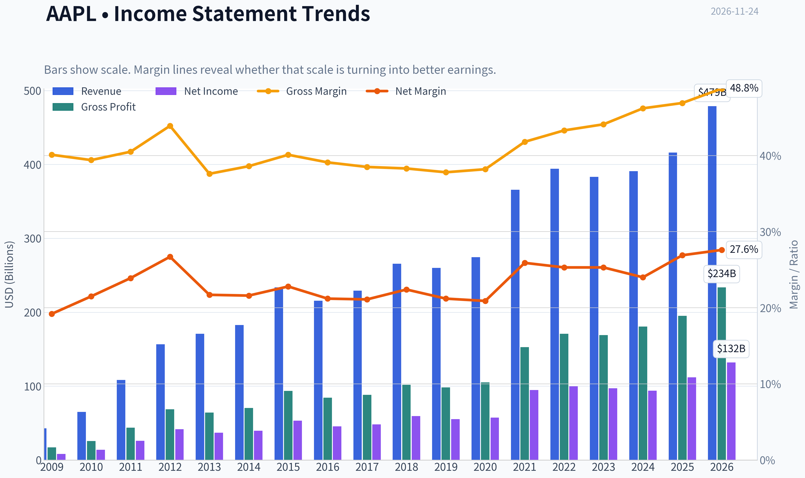
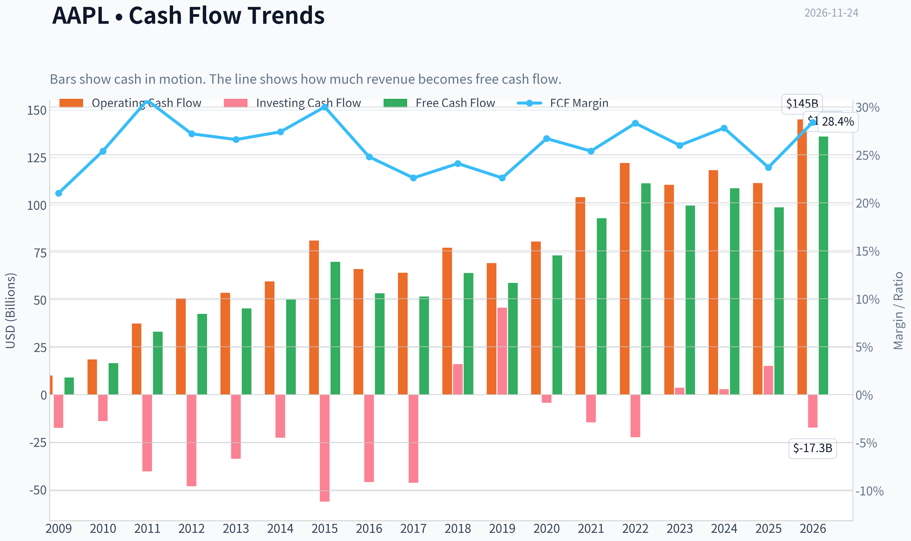
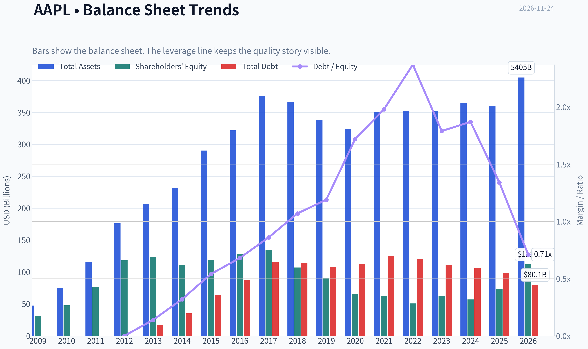
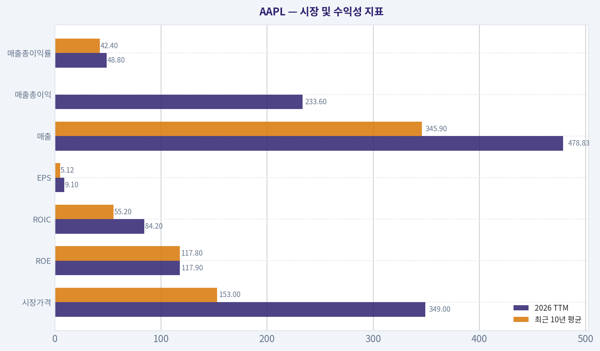
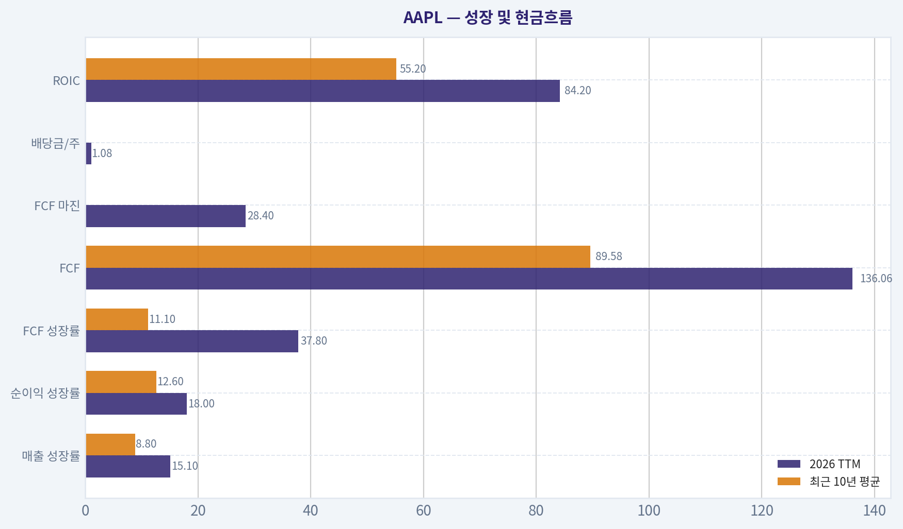
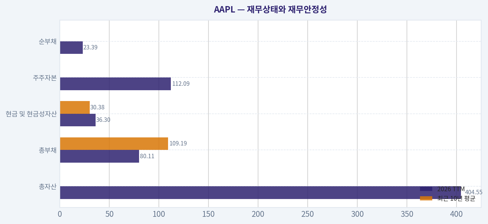
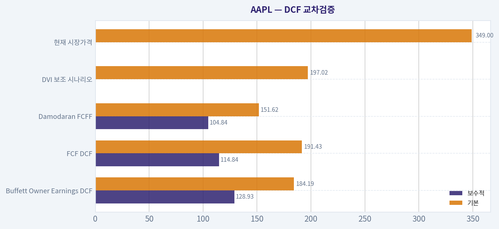
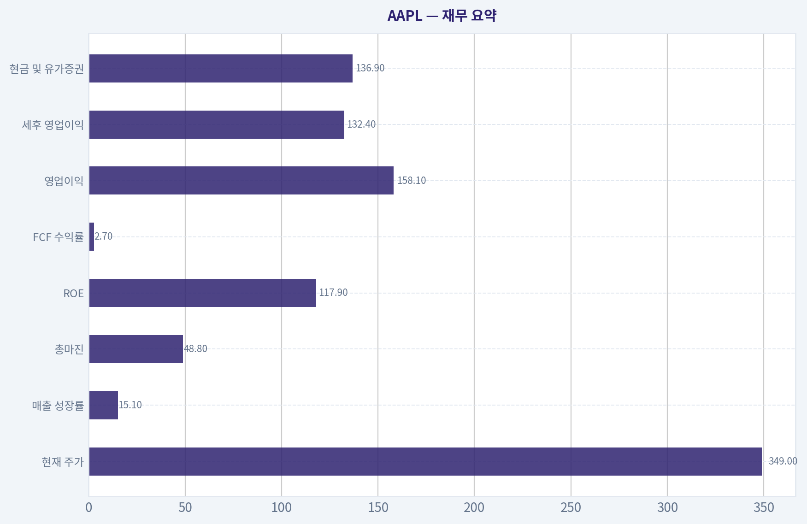

# AAPL Deep Value Intelligence

**Analysis Date:** 2026-11-24

## Critical Disclaimer

*This analysis is generated by Deep Value Intelligence, an AI-powered multi-agent investing framework. 교육 및 연구 용도로만 - 재무 조언이 아니며 재무 자문업자도 아닙니다.*

---

## Table of Contents

1. Intelligence Summary
2. Analyst Team Reports
   - Fundamentals Analysis
   - Intrinsic Value Analysis (Buffett)
   - Trend & Growth Analysis (Lynch/Druckenmiller/Fisher)
   - Market Technical Analysis
   - Options Market Analysis
3. Research Team Commentary
4. Value Investing Team Commentary
5. Deep Values Commentary

---

## Intelligence Summary

### Thesis + Conditions

**Core Thesis:** Apple remains an exceptional, asset-light compounder with a durable ecosystem, 48.8% gross margin, 32.7% ROA, and extraordinary capital efficiency. Its competitive position and financial strength indicate low risk of permanent business impairment.

**Key Risks:**
- Apple remains an exceptional, asset-light compounder with a durable ecosystem, 48.8% gross margin, 32.7% ROA, and extraordinary capital efficiency. Its competitive position and financial strength indicate low risk of permanent business impairment.
- The principal risk is valuation. At approximately $349 and 38.87x earnings, the evidence does not establish even the modest 10-15% discount to intrinsic value appropriate for a business of Apple's quality. The valuation requires sustained high per-share growth, successful service and AI monetization, resilient margins, and a persistently elevated terminal multiple.
- AI and services provide meaningful upside optionality, but their incremental cash returns remain insufficiently demonstrated. This is a valuation-risk conclusion-not a prediction that Apple's business will deteriorate.

**Confidence:** Low

---

## Analyst Team Reports

### Fundamentals Analysis

#### Latest Earnings Snapshot

*Most recent reported quarter anchored on 2026 Q3, with prior-year comparison when available.*

| Metric | 2026 Q3 | 2025 Q3 | YoY Change |
| --- | ---: | ---: | ---: |
| Revenue | $114.48B | $102.47B | +11.7% |
| Operating Income | $35.63B | $32.43B | +9.9% |
| Net Income | $30.71B | $27.47B | +11.8% |
| Diluted EPS | N/A | $1.85 | N/A |
| Operating Cash Flow | $28.10B | $29.73B | -5.5% |
| Free Cash Flow | $25.86B | $26.49B | -2.4% |

Key Takeaways: This snapshot anchors the most recent reported quarter before the narrative analysis. It helps readers separate long-run business quality from whatever changed in the latest earnings print.

#### 17-Year Financial Metrics for AAPL

*All values below are computed deterministically from raw data - not estimated by AI.*

*Issuer profile: operating company (Technology / Consumer Electronics).*

#### 17-Year Financial Metrics
*Annual rows come from reported financial statements. The final TTM row is computed from the latest four quarters.*

| Metric | 2009 | 2010 | 2011 | 2012 | 2013 | 2014 | 2015 | 2016 | 2017 | 2018 | 2019 | 2020 | 2021 | 2022 | 2023 | 2024 | 2025 | 2026 TTM |
| --- | --- | --- | --- | --- | --- | --- | --- | --- | --- | --- | --- | --- | --- | --- | --- | --- | --- | --- |
| Market Price | $6 | $8 | $11 | $20 | $15 | $22 | $25 | $26 | $36 | $53 | $54 | $112 | $138 | $135 | $169 | $231 | $254 | $349 |
| Market Cap | $168.11B | $262.39B | $357.16B | $630.65B | $444.17B | $616.86B | $638.98B | $621.81B | $809.39B | $1.13T | $1.04T | $2.03T | $2.39T | $2.26T | $2.71T | $3.59T | $3.82T | $5.07T |
| P/E Ratio | 20.41 | 18.73 | 13.78 | 15.10 | 11.99 | 15.62 | 11.96 | 13.60 | 16.73 | 18.94 | 18.85 | 35.31 | 25.22 | 22.62 | 27.93 | 38.32 | 34.13 | 38.38 |
| P/B Ratio | 5.31 | 5.49 | 4.66 | 5.33 | 3.60 | 5.53 | 5.35 | 4.85 | 6.04 | 10.53 | 11.51 | 31.07 | 37.83 | 44.53 | 43.56 | 63.04 | 51.82 | 45.26 |
| ROE | 26.0% | 29.3% | 33.8% | 35.3% | 30.0% | 35.4% | 44.7% | 35.6% | 36.1% | 55.6% | 61.1% | 87.9% | 150.1% | 197.0% | 156.1% | 164.6% | 151.9% | 117.9% |
| ROIC | 35.2% | 39.8% | 40.0% | 40.6% | 30.7% | 29.7% | 35.3% | 24.8% | 21.5% | 27.1% | 30.9% | 39.1% | 64.5% | 66.8% | 67.2% | 67.5% | 83.2% | 84.2% |
| EPS | $0.27 | $0.45 | $0.83 | $1.33 | $1.22 | $1.42 | $2.06 | $1.90 | $2.14 | $2.81 | $2.85 | $3.18 | $5.47 | $5.99 | $6.13 | $6.08 | $7.46 | $9.10 |
| Revenue | $42.91B | $65.22B | $108.25B | $156.51B | $170.91B | $182.79B | $233.72B | $215.64B | $229.23B | $265.60B | $260.17B | $274.51B | $365.82B | $394.33B | $383.29B | $391.04B | $416.16B | $478.83B |
| Gross Profit | $17.22B | $25.68B | $43.82B | $68.66B | $64.30B | $70.54B | $93.63B | $84.26B | $88.19B | $101.84B | $98.39B | $104.96B | $152.84B | $170.78B | $169.15B | $180.68B | $195.20B | $233.60B |
| Gross Margin | 40.1% | 39.4% | 40.5% | 43.9% | 37.6% | 38.6% | 40.1% | 39.1% | 38.5% | 38.3% | 37.8% | 38.2% | 41.8% | 43.3% | 44.1% | 46.2% | 46.9% | 48.8% |
| Operating Margin | 27.4% | 28.2% | 31.2% | 35.3% | 28.7% | 28.7% | 30.5% | 27.8% | 26.8% | 26.7% | 24.6% | 24.1% | 29.8% | 30.3% | 29.8% | 31.5% | 32.0% | 33.0% |
| Net Income | $8.23B | $14.01B | $25.92B | $41.73B | $37.04B | $39.51B | $53.39B | $45.69B | $48.35B | $59.53B | $55.26B | $57.41B | $94.68B | $99.80B | $97.00B | $93.74B | $112.01B | $132.18B |
| Net Margin | 19.2% | 21.5% | 23.9% | 26.7% | 21.7% | 21.6% | 22.8% | 21.2% | 21.1% | 22.4% | 21.2% | 20.9% | 25.9% | 25.3% | 25.3% | 24.0% | 26.9% | 27.6% |
| Revenue Growth | N/A | 52.0% | 66.0% | 44.6% | 9.2% | 7.0% | 27.9% | -7.7% | 6.3% | 15.9% | -2.0% | 5.5% | 33.3% | 7.8% | -2.8% | 2.0% | 6.4% | 15.1% |
| Net Income Growth | N/A | 70.2% | 85.0% | 61.0% | -11.3% | 6.7% | 35.1% | -14.4% | 5.8% | 23.1% | -7.2% | 3.9% | 64.9% | 5.4% | -2.8% | -3.4% | 19.5% | 18.0% |
| Free Cash Flow Growth | N/A | 84.0% | 100.5% | 27.9% | 6.9% | 10.2% | 39.6% | -23.6% | -3.2% | 23.8% | -8.1% | 24.6% | 26.7% | 19.9% | -10.6% | 9.3% | -9.2% | 37.8% |
| Total Book Value | $31.64B | $47.79B | $76.61B | $118.21B | $123.55B | $111.55B | $119.36B | $128.25B | $134.05B | $107.15B | $90.49B | $65.34B | $63.09B | $50.67B | $62.15B | $56.95B | $73.73B | $112.09B |
| Total Assets | $47.50B | $75.18B | $116.37B | $176.06B | $207.00B | $231.84B | $290.35B | $321.69B | $375.32B | $365.73B | $338.52B | $323.89B | $351.00B | $352.75B | $352.58B | $364.98B | $359.24B | $404.55B |
| Total Debt | N/A | N/A | N/A | $0 | $16.96B | $35.30B | $64.33B | $87.03B | $115.68B | $114.48B | $108.05B | $112.44B | $124.72B | $120.07B | $111.09B | $106.63B | $98.66B | $80.11B |
| Debt-to-Equity | N/A | N/A | N/A | 0.00 | 0.14 | 0.32 | 0.54 | 0.68 | 0.86 | 1.07 | 1.19 | 1.72 | 1.98 | 2.37 | 1.79 | 1.87 | 1.34 | 0.71 |
| Cash & Equivalents | $5.26B | $11.26B | $9.81B | $10.75B | $14.26B | $13.84B | $21.12B | $20.48B | $20.29B | $25.91B | $48.84B | $38.02B | $34.94B | $23.65B | $29.96B | $29.94B | $35.93B | $36.30B |
| Shareholders' Equity | $31.64B | $47.79B | $76.61B | $118.21B | $123.55B | $111.55B | $119.36B | $128.25B | $134.05B | $107.15B | $90.49B | $65.34B | $63.09B | $50.67B | $62.15B | $56.95B | $73.73B | $112.09B |
| Operating Cash Flow | $10.16B | $18.59B | $37.53B | $50.86B | $53.67B | $59.71B | $81.27B | $66.23B | $64.22B | $77.43B | $69.39B | $80.67B | $104.04B | $122.15B | $110.54B | $118.25B | $111.48B | $145.10B |
| Investing Cash Flow | $-17.43B | $-13.85B | $-40.42B | $-48.23B | $-33.77B | $-22.58B | $-56.27B | $-45.98B | $-46.45B | $16.07B | $45.90B | $-4.29B | $-14.54B | $-22.35B | $3.71B | $2.94B | $15.20B | $-17.28B |
| Free Cash Flow | $9.02B | $16.59B | $33.27B | $42.56B | $45.50B | $50.14B | $70.02B | $53.50B | $51.77B | $64.12B | $58.90B | $73.36B | $92.95B | $111.44B | $99.58B | $108.81B | $98.77B | $136.06B |
| FCF Margin | 21.0% | 25.4% | 30.7% | 27.2% | 26.6% | 27.4% | 30.0% | 24.8% | 22.6% | 24.1% | 22.6% | 26.7% | 25.4% | 28.3% | 26.0% | 27.8% | 23.7% | 28.4% |
| Dividends / Share | $0.00 | $0.00 | $0.00 | $0.00 | $0.00 | $0.00 | $0.00 | $0.00 | $0.00 | $0.00 | $0.00 | $0.00 | $0.00 | $0.00 | $0.95 | $0.99 | $1.03 | $1.08 |

#### Profitability Metrics
- Return on Equity (ROE): 117.9%
- Return on Invested Capital (ROIC): 96.8%
- Return on Assets (ROA): 32.7%
- Gross Margin: 48.8%
- Operating Margin: 33.0%
- Net Profit Margin: 27.6%

#### Liquidity Metrics
- Current Ratio: 1.02
- Quick Ratio: 0.59

#### Leverage Metrics
- Debt-to-Equity Ratio: 0.71
- Interest Coverage Ratio: N/A
- Net Debt: $23.39B

#### Growth Metrics (Year-over-Year)
- Revenue Growth: 15.1%
- Net Income Growth: 18.0%
- Free Cash Flow Growth: 37.8%
- Revenue CAGR (3-Year): 7.7%
- Revenue CAGR (5-Year): 5.5%

#### Valuation Metrics
- P/E Ratio (TTM): 38.87
- Forward P/E: 33.02
- Price-to-Book: 45.26
- Price-to-Sales: 10.59
- PEG Ratio: 2.77
- EV/EBITDA: 29.80
- Free Cash Flow Yield: 2.7%
- Earnings Yield: 2.6%

#### Owner Earnings (Buffett Method, Code-Computed)
- Net Income: $112.01B
- + Depreciation & Amortization: $13.42B
- - Capital Expenditures: $-9.04B
- + Working Capital (cash-flow statement; negative = cash tied up): $-14.86B
- = **Owner Earnings: $87.28B**

#### Intrinsic Value (DeepValues app - SEC filings pipeline)
- **Intrinsic value (DeepValues app, the headline): $184.19** - Owner Earnings (Buffett), method buffett-1986-v2, as of 2026-11-23 (FY2026)
  Range (conservative - optimistic): $128.93 - $184.19
  Margin of safety vs. price: -89.5% (price $349.08)
  Inputs the app used (ttm_2026Q4): after-tax operating income $132.4B (operating income $158.1B, tax 16.2%) + D&A $13.4B - capex charge $11.7B (three-year average capex/revenue x trailing revenue; reported capex $9.0B) - working capital $0.0B = owner earnings $134.1B.
  Growth 5.5% fading to 2.5% terminal (min(owner-earnings CAGR, 5-year revenue CAGR), clamped [0, 10%]); discount rate 8.3% (30Y Treasury 5.31% + 3 pts (as of 2026-11-20)); net cash $55.4B (cash $36.3B + marketable securities $100.6B - debt $80.1B); 14,715M shares.
- Owner Earnings (Buffett): $128.93 / $184.19 / $184.19 (conservative / base / optimistic) ← headline
- Free cash flow DCF: $114.84 / $191.43 / $416.13 (conservative / base / optimistic)
- Damodaran two-stage FCFF: $104.84 / $151.62 / $164.40 (conservative / base / optimistic)
  This is THE intrinsic value: quote it as the intrinsic value and measure margin of safety against it. Any DVI scenario figures elsewhere are a secondary cross-check, not the value.

#### DVI scenario model (secondary cross-check - NOT the intrinsic value)
DVI's own Yahoo-based scenarios, shown only as a sensitivity check. Do not quote these as the intrinsic value; the intrinsic value is the DeepValues app value above.
- Current Price: $349
- DVI scenario value (business-model routed): $197
  Business model: operating company - weighted blend [Damodaran FCFF + reverse-DCF fair + owner-earnings DCF] (operating_company)
  Model spread (min-max across DCFs): $191 - $241
  Margin of safety vs. price (headline): -77.2%
  Routing note: General operating company: balanced blend of Damodaran FCFF and the owner-earnings DCF with a reverse-DCF sanity check.
- Buffett Method (Owner Earnings):
  Conservative: $139
  Average: $241
  Optimistic: $643
- Cash Flow Method (FCF):
  Conservative: $88
  Average: $207
  Optimistic: $277
- Damodaran FCFF (WACC + margins + reinvestment):
  Conservative: $109
  Average: $191
  Optimistic: $402
  Monte Carlo band (P10-P90): $138 - $305 (median $201)
  P(intrinsic value > price): 4.8%
- Reverse-DCF: price implies ~26.3%/yr owner-earnings growth for 10y; trailing 3y was 1.4%, 5y 14.1%.

#### Piotroski F-Score: 9/9
- Positive Net Income: PASS
- Positive Operating Cash Flow: PASS
- ROA Improvement: PASS
- Cash Flow > Net Income: PASS
- Decreasing Debt: PASS
- Improving Current Ratio: PASS
- No Dilution: PASS
- Improving Gross Margin: PASS
- Improving Asset Turnover: PASS

ANALYST STANCE: **Bearish** - 밸류에이션 관점

#### 핵심 결론

Apple은 장기 경쟁력, 현금창출력, 수익성, 생태계 기반의 경제적 해자가 매우 강한 기업이다. 그러나 현재 주가 $349는 DeepValues의 Buffett식 내재가치 $184.19를 약 89.5% 초과하며, 현재 가격을 정당화하려면 장기간 비현실적으로 높은 성장률이 필요하다.

결정론적 데이터 기준으로 최근 실적은 크게 개선됐다. TTM 매출은 $478.83B, 순이익은 $132.18B, FCF는 $136.06B이며, 매출·순이익·FCF 성장률도 각각 15.1%, 18.0%, 37.8%로 강하다. 다만 PE 38.87배, FCF 수익률 2.7%, 매출 대비 시가총액 10.59배는 과거 평균보다 현저히 높은 수준이다.

#### 시장 및 수익성 지표

| 지표 | 2026 TTM | 최근 10년 평균 | 해석 |
|---|---:|---:|---|
| 시장가격 | $349 | $153 | 평균 대비 128% 높음 |
| 시가총액 | $5.07T | $2.49T | 규모와 기대가 모두 사상권 |
| PE | 38.87배 | 27.64배 | 평균 대비 약 41% 높음 |
| P/B | 45.26배 | 37.52배 | 높지만 Apple에는 제한적 의미 |
| ROE | 117.9% | 117.8% | 평균과 거의 동일 |
| ROIC | 84.2% | 55.2% | 평균을 크게 상회 |
| EPS | $9.10 | $5.12 | 평균 대비 78% 높음 |
| 매출 | $478.83B | $345.90B | 평균 대비 38% 높음 |
| 매출총이익 | $233.60B | 해당 평균 약 $165B | 규모와 마진 모두 개선 |
| 매출총이익률 | 48.8% | 42.4% | 생태계·서비스 믹스 효과 |
| 영업이익률 | 33.0% | 28.9% | 평균 대비 4.1%포인트 높음 |
| 순이익 | $132.18B | $85.00B | 평균 대비 55% 높음 |
| 순이익률 | 27.6% | 24.1% | 평균 대비 3.5%포인트 높음 |

**핵심 해석:** Apple의 현재 프리미엄은 단순한 기대가 아니라 실제 마진과 ROIC 개선을 일부 반영한다. 그러나 PE와 시장가격 상승폭이 이익 증가폭을 넘어섰기 때문에, 사업 품질은 매우 높지만 주식의 가치평가는 더욱 엄격한 성장 가정을 요구한다.

P/B는 Apple과 같은 자산경량형 기술·IP 기업에서는 일반적인 저평가 판단 기준으로 사용하기 어렵다. 대규모 자사주 매입으로 장부가치가 축소될 수 있고, 브랜드·생태계·소프트웨어·고객 락인 효과가 장부에 충분히 반영되지 않기 때문이다. 따라서 Apple의 가치판단은 P/B보다 현금흐름, ROIC, 이익의 지속성, DCF에 중점을 두는 것이 적절하다.

#### 성장 및 현금흐름

| 지표 | 2026 TTM | 최근 10년 평균 | 해석 |
|---|---:|---:|---|
| 매출 성장률 | 15.1% | 8.8% | 평균을 크게 상회 |
| 순이익 성장률 | 18.0% | 12.6% | 최근 회복력 확인 |
| FCF 성장률 | 37.8% | 11.1% | 기저효과와 현금창출 개선 반영 |
| FCF | $136.06B | $89.58B | 평균 대비 약 52% 높음 |
| FCF 마진 | 28.4% | 약 25.5% | 평균보다 높은 수준 |
| 배당금/주 | $1.08 | 최근 10년 평균 약 $0.51 | 점진적 증가 |
| ROIC | 84.2% | 55.2% | 자본 효율성 크게 개선 |

**핵심 해석:** 최근 성장률은 10년 평균보다 강하지만, 2026 TTM의 급격한 FCF 성장은 영구적인 정상 성장률로 사용하기 어렵다. 과거에도 2016년, 2019년, 2023년, 2025년에 FCF 감소가 있었으므로 성장의 방향은 우호적이지만 매년 직선적으로 반복되지는 않았다.

Apple의 FCF는 2009년 $9.02B에서 현재 $136.06B로 증가했다. 영업현금흐름도 $10.16B에서 $145.10B로 확대됐다. 이는 회계상 이익보다 현금창출력이 더욱 중요한 Buffett식 분석에서 강점이다.

#### 재무상태와 재무안정성

| 지표 | 2026 TTM | 최근 10년 평균 | 해석 |
|---|---:|---:|---|
| 총자산 | $404.55B | 약 $357B | 자산 규모 확대 |
| 총부채 | $80.11B | $109.19B | 평균보다 낮음 |
| 부채비율 | 0.71배 | 1.49배 | 레버리지 크게 하락 |
| 현금 및 현금성자산 | $36.30B | $30.38B | 평균보다 높음 |
| 주주자본 | $112.09B | 약 $86B | 최근 증가 |
| 순부채 | $23.39B | 해당 | 순부채 부담은 제한적 |
| 유동비율 | 1.02배 | 해당 | 안정적이지만 넉넉하지 않음 |
| 당좌비율 | 0.59배 | 해당 | 일반 제조업 기준만으로는 낮음 |

**핵심 해석:** Apple은 절대적인 현금창출력과 시장성 유가증권을 고려하면 재무적으로 강하다. 부채는 2021년 $124.72B에서 $80.11B로 감소했고 부채비율도 1.98배에서 0.71배로 낮아졌다. 유동비율과 당좌비율만 기계적으로 보면 여유가 크지 않지만, Apple의 현금흐름과 유동성 높은 금융자산을 함께 보면 재무위험은 낮은 편이다.

공유된 DeepValues 입력에서는 현금 $36.3B, 시장성 유가증권 $100.6B, 부채 $80.1B로 순현금이 $55.4B로 계산된다. 이는 표의 현금성자산만 사용하는 순부채 계산보다 Apple의 실제 유동성 완충력을 더 잘 보여준다.

#### 10년 추세 해석

Apple의 매출은 2009년 $42.91B에서 2026 TTM $478.83B로 약 11배 증가했다. 같은 기간 순이익은 $8.23B에서 $132.18B로 약 16배, FCF는 $9.02B에서 $136.06B로 약 15배 증가했다.

성장은 직선형이 아니었다. 2016년 매출은 7.7% 감소했고, 2019년과 2023년에도 매출이 감소했다. 순이익 역시 2013년, 2016년, 2019년, 2023년, 2024년에 감소했다. 그럼에도 장기적으로는 매출보다 이익과 FCF가 더 빠르게 증가했다.

마진은 장기적인 질적 개선을 보인다.

- 매출총이익률: 2009년 40.1% -> 2026 TTM 48.8%
- 영업이익률: 27.4% -> 33.0%
- 순이익률: 19.2% -> 27.6%
- FCF 마진: 21.0% -> 28.4%

이는 Services 확대, 고가 제품 믹스, 생태계 수익화, 규모의 경제가 결합된 결과로 해석된다. 다만 2026 TTM의 높은 성장률과 마진은 향후 정상화될 가능성이 있으며, 현재 valuation은 이러한 높은 수익성이 장기간 유지된다는 전제를 상당 부분 포함한다.

#### Revenue Breakdown

최근 TTM 매출 $478.83B를 Apple의 공개 제품·서비스 구분과 최근 사업 믹스를 바탕으로 근사 배분했다. 결정론적 데이터에는 세부 사업부별 매출이 별도로 제시되지 않았으므로 아래 수치는 분석용 추정치다.

| Revenue Source | Amount ($B) | % of Total |
|---|---:|---:|
| iPhone | 약 $250.0 | 약 52.2% |
| Services | 약 $125.0 | 약 26.1% |
| Mac | 약 $40.0 | 약 8.4% |
| iPad | 약 $32.0 | 약 6.7% |
| Wearables, Home and Accessories | 약 $31.8 | 약 6.6% |
| 합계 | **$478.8** | **100.0%** |

**핵심 해석:** iPhone이 여전히 매출의 절반 이상을 차지하므로 제품 교체 주기, 중국 시장, 스마트폰 경쟁은 핵심 위험이다. 반면 Services는 반복성과 마진이 높은 매출원으로 사업의 질을 개선하고 있으며, 현재 Apple의 높은 총마진과 영업마진을 지지하는 중요한 요소다.

#### Buffett식 사업의 질 평가

| 평가 항목 | 판단 | 구체적 근거 |
|---|---|---|
| 경제적 해자 | 매우 강함 | 생태계, 브랜드, 전환비용, 유통망, 개발자 네트워크 |
| 수익성 | 매우 강함 | ROIC 84.2%, 영업이익률 33.0%, 순이익률 27.6% |
| 현금창출력 | 매우 강함 | FCF $136.06B, FCF 마진 28.4% |
| 이익 예측가능성 | 높음, 단 변동 존재 | 장기 증가세이나 일부 연도 매출·이익 감소 |
| 재무건전성 | 강함 | 부채 감소, 순현금 구조, 높은 현금흐름 |
| 자본배분 | 효율적 | 자사주 매입, 배당 증가, 높은 ROIC |
| 성장 지속성 | 중상 | Services와 생태계가 지원하나 iPhone 의존도 존재 |
| 현재 가격의 안전마진 | 매우 낮음 | 시장가격 $349 대 내재가치 $184.19 |

**핵심 해석:** Apple은 Buffett식 기준에서 "좋은 기업"이라는 평가를 받을 가능성이 높다. 특히 브랜드와 생태계는 단순 제조업체가 모방하기 어렵고, 높은 ROIC와 현금흐름은 경영진의 자본배분 능력을 뒷받침한다. 그러나 좋은 기업과 좋은 가격은 별개의 문제이며, 현재는 사업 품질보다 가격 기대가 더 큰 위험요인이다.

#### Owner Earnings DCF

DeepValues의 Buffett식 모델을 주된 내재가치로 사용한다. 입력값은 세후 영업이익 $132.4B, 감가상각비 $13.4B, 정상화 자본적 지출 $11.7B, 운전자본 투자 $0.0B, Owner Earnings $134.1B, 순현금 $55.4B, 주식수 14,715M주다.

기본 계산 구조는 다음과 같다.

\[
OE_t = OE_0(1+g_t)^t
\]

\[
Terminal\ Value = \frac{OE_5(1+g_T)}{r-g_T}
\]

\[
Equity\ Value = \sum_{t=1}^{5}\frac{OE_t}{(1+r)^t}
+\frac{Terminal\ Value}{(1+r)^5}
+Net\ Cash
\]

공통 가정은 할인율 8.3%, 영구성장률 2.5%이며, 명시적 예측기간 이후 성장률은 2.5%로 점진적으로 낮아진다.

| 시나리오 | 초기 성장 가정 | 할인율 | 영구성장률 | Owner Earnings 가치/주 | 해석 |
|---|---:|---:|---:|---:|---|
| 보수적 | 약 3.0% | 8.3% | 2.5% | $128.93 | 성장률 정상화와 높은 할인율 반영 |
| 평균 또는 기본 | 5.5% | 8.3% | 2.5% | **$184.19** | 5년 매출 CAGR과 장기 경제성 반영 |
| 낙관적 | 약 7.0% | 8.3% | 2.5% | $184.19 | 모델상 상단 제한으로 기본값과 동일 |

**핵심 해석:** DeepValues의 headline 내재가치는 $184.19이며, 보수적 범위는 $128.93에서 $184.19다. 현재 가격 $349.08과 비교한 안전마진은 -89.5%로, 현재 가격이 내재가치를 크게 상회한다는 의미다. 낙관 시나리오도 모델의 상단 제한 때문에 $184.19에 머물러 있으며, 이는 현재 가격을 정당화하려면 표준 DCF 가정을 넘어서는 매우 강한 장기 성장이 필요함을 뜻한다.

#### DCF 교차검증

| 방법 | 보수적 | 기본 | 낙관적 | 역할 |
|---|---:|---:|---:|---|
| Buffett Owner Earnings DCF | $128.93 | **$184.19** | $184.19 | 주된 내재가치 |
| FCF DCF | $114.84 | $191.43 | $416.13 | 현금흐름 민감도 |
| Damodaran FCFF | $104.84 | $151.62 | $164.40 | 자본비용·재투자 교차검증 |
| DVI 보조 시나리오 | - | $197.02 | - | 보조 참고치, 주된 가치 아님 |
| 현재 시장가격 | - | **$349.00** | - | 비교 기준 |

**핵심 해석:** 세 가지 모델의 기본값은 대체로 $151~$191 범위에 모이며, Buffett식 headline 가치 $184.19와도 일관된다. FCF 낙관 시나리오의 $416.13은 높은 성장과 현금흐름 지속을 강하게 가정한 민감도 결과이지, 주된 내재가치로 사용하지 않는다.

가격 역산 관점에서는 현재 주가가 10년 동안 연평균 약 26.3%의 Owner Earnings 성장을 요구한다. 이는 최근 3년 Owner Earnings CAGR 약 1.4%, 5년 기준 약 14.1%보다 높다. Apple의 질적 우위는 강하지만, 26.3%의 10년 지속 성장은 Buffett식 보수적 평가에서 방어하기 어렵다.

#### 위험요인과 기회요인

| 구분 | 내용 | 재무적 영향 |
|---|---|---|
| 기회 | Services 확대 | 반복 매출과 마진 개선 |
| 기회 | AI 및 생태계 통합 | 업그레이드 주기와 사용자 락인 강화 가능성 |
| 기회 | 높은 ROIC와 FCF | 내부 재투자·배당·자사주 매입 여력 |
| 기회 | 부채 감소 | 금리와 경기 충격에 대한 완충력 |
| 위험 | iPhone 매출 집중 | 제품 교체 주기와 경쟁에 민감 |
| 위험 | 중국·지정학 | 공급망과 수요 모두 영향 가능 |
| 위험 | 현재 PE 프리미엄 | 성장률 둔화 시 multiple compression 가능 |
| 위험 | 규제와 App Store 정책 | Services 마진과 수수료 구조 압박 |
| 위험 | 높은 기대치 | 실적 호조만으로도 valuation 정당화가 어려울 수 있음 |

**핵심 해석:** 핵심 기회는 Services, 생태계 확장, AI 기반 제품 교체 수요, 높은 자본효율성이다. 핵심 위험은 iPhone 집중도와 현재 valuation이며, 사업이 양호하더라도 성장률이 정상화되면 주가의 기대수익 구조가 약해질 수 있다.

#### 최종 투자 스탠스

ANALYST STANCE: **Bearish** - 밸류에이션 관점

Apple의 사업 자체는 **Bullish**에 가까울 정도로 우수하다. 경제적 해자, ROIC, FCF, 브랜드, 생태계, 재무건전성, Piotroski F-Score 9/9가 이를 뒷받침한다. Warren Buffett이 2026년 9월 말 기준 약 $75.9B 규모의 Apple 지분을 계속 보유한 사실도 사업의 질에 대한 시장의 신뢰를 보여주는 참고자료다.

그러나 valuation 판단은 별개다. 현재 가격 $349는:

- Buffett식 내재가치 $184.19의 약 1.9배
- PE 38.87배로 최근 10년 평균 27.64배를 크게 상회
- FCF 수익률 2.7%
- 가격 역산 Owner Earnings 성장률 약 26.3% 요구

라는 특징을 보인다. 따라서 증거는 현재 $349의 valuation을 충분히 지지하지 않는다. 사업 품질은 매우 높지만, 현재 가격에는 장기간의 높은 성장, 마진 유지, Services 확대, AI 및 생태계 수익화가 상당 부분 선반영되어 있다.

#### 핵심 요약표

| 항목 | 핵심 판단 |
|---|---|
| 사업 품질 | 세계 최고 수준의 브랜드·생태계·현금창출력 |
| 수익성 | ROE 117.9%, ROIC 84.2%, 순이익률 27.6% |
| 성장 | 최근 성장률은 강하지만 장기적으로는 변동성 존재 |
| 재무상태 | 부채 감소와 높은 현금창출력으로 강함 |
| 주요 약점 | iPhone 매출 집중, 중국·규제·높은 기대치 |
| 주된 내재가치 | **$184.19** |
| 현재 가격 | **약 $349** |
| 안전마진 | **-89.5%** |
| 최종 스탠스 | **Bearish - 사업은 우수하나 현재 valuation은 과도함** |

**핵심 해석:** Apple은 질적으로 탁월한 기업이지만, 현재 가격은 보수적인 Buffett식 내재가치와 상당한 괴리를 보인다. 분석의 중심 결론은 기업에 대한 부정이 아니라, 높은 사업 품질이 현재 valuation의 과도한 기대를 상쇄하지 못한다는 것이다.

#### Fundamental Visuals

This graph tracks the profitability and return metrics (ROE, ROIC, Margins) of **AAPL** over the past decade, highlighting capital efficiency trends.

This chart illustrates the financial health of **AAPL** over the last 10 years, mapping cash equivalents and free cash flow against total obligations (Debt).

---

### Intrinsic Value Analysis (Buffett)

> *Following Warren Buffett's value investing philosophy: Circle of Competence, Economic Moat, Management Quality, and Margin of Safety.*

#### Intrinsic Value Snapshot

Price is what you pay. Intrinsic value is what the business may be worth based on the cash it can create for owners over time. We show a range, not one magic number.

- Current Price: $349.08
- Value Range (conservative to optimistic across both DCF methods): $114.84 to $416.13

##### Owner Earnings (Buffett Method)
- Net Income: $112,010,000,000.00
- Depreciation & Amortization: $13,423,000,000.00
- Capital Expenditures: $-9,041,000,000.00
- Working Capital Changes: $-14,858,000,000.00
- Owner Earnings: $87,280,891,892.50

##### Intrinsic Value
###### Buffett Method
Uses owner earnings. Stricter, and usually more conservative.
- Conservative: $128.93
- Average: $184.19
- Optimistic: $184.19
- Discount Rate: 8.3%

###### Cash Flow Method
Uses free cash flow. Better for companies spending heavily today to grow tomorrow.
- Conservative: $114.84
- Average: $191.43
- Optimistic: $416.13
- Discount Rate: 9.1%

ANALYST STANCE: **Neutral** - 우수한 사업이지만 현재 가격은 내재가치를 크게 초과합니다.

#### 1. 요약 판단

Apple은 강력한 브랜드, 생태계 잠금효과, 높은 수익성, 막대한 현금창출력을 가진 대표적인 고품질 기업입니다. 다만 현재 주가 349달러는 DeepValues의 내재가치 184.19달러보다 89.5% 높으며, 높은 성장률이 장기간 지속된다는 가정을 상당 부분 반영합니다. 사업의 질은 매우 높지만, 현 가격에서는 가치와 가격 사이의 안전마진이 부족합니다.

#### 2. 요소별 점수

| 요소 | 점수 | 근거 |
|---|---:|---|
| 사업 이해도와 예측 가능성 | 4/5 | 기기 판매, 서비스, 생태계 monetization이라는 구조가 명확하며 장기 브랜드와 고객 기반이 강함 |
| 경쟁우위와 해자 | 4/5 | Apple 브랜드, iOS 생태계, 전환비용, 개발자 네트워크, 서비스 결합 효과 |
| 경영진과 자본배분 | 4/5 | 대규모 자사주 매입, 높은 현금창출력, 비교적 절제된 부채 운용 |
| 산업 구조 | 4/5 | 프리미엄 스마트폰과 플랫폼 시장에서 규모의 경제와 생태계 효과가 존재 |
| Gate 5 재무 건전성 | 통과 | 순현금 554억 달러이며, 매출과 이익 흐름이 악화되는 재무곤경 신호가 없음 |

**Key Takeaways:** Apple은 네 가지 질적 요소에서 모두 높은 점수를 받을 수 있는 기업입니다. 유일한 중대한 약점은 사업 자체가 아니라 현재 가격이며, 재무곤경을 의미하는 Gate 5는 발동되지 않습니다.

#### 3. 해자 분석

| 해자 원천 | 평가 | 구체적 증거 |
|---|---|---|
| 무형자산 | 강함 | Apple 브랜드와 제품 생태계가 가격 프리미엄을 지지하며, 총마진은 48.8% |
| 전환비용 | 강함 | iCloud, App Store, iMessage, AirPods, Apple Watch 등 하드웨어와 소프트웨어의 결합 |
| 비용우위 | 중간 이상 | 공급망 규모, 조달력, 유통망, 자체 실리콘 설계가 단위경제를 개선 |
| 네트워크 효과 | 강함 | 사용자, 개발자, 콘텐츠 공급자, 액세서리 생태계가 서로의 가치를 높임 |
| 해자 종합 | 넓고 안정적 | 경쟁사가 단일 제품은 복제할 수 있어도 전체 생태계와 고객 습관을 복제하기는 어려움 |

**Key Takeaways:** Apple의 핵심 해자는 단순한 브랜드가 아니라 하드웨어, 운영체제, 서비스, 결제, 액세서리가 결합된 생태계입니다. 다만 스마트폰 시장의 성숙도와 규제 압력 때문에 "넓고 계속 확장되는 해자"보다는 "넓고 안정적인 해자"로 평가하는 것이 합리적입니다.

#### 4. 경영진과 자본배분

Apple은 지난 수년간 영업현금흐름을 제품 생태계, 연구개발, 자사주 매입, 배당에 배분해 왔습니다. 자사주 매입은 주당 가치 상승에 기여했지만, 높은 주가에서 이루어지는 매입은 자본배분 효율을 낮출 수 있다는 점은 별도로 검토해야 합니다.

Warren Buffett이 이끄는 Berkshire Hathaway는 2026년 9월 말 기준 Apple 주식 2억 2,792만 주를 공시했으며, 직전 분기 대비 수량 변화는 없었습니다. 이는 사업의 질에 대한 긍정적 참고자료이지만, 현재 가격의 내재가치를 직접 증명하는 자료는 아닙니다.

#### 5. 재무 요약

| 항목 | FY2026 또는 최근 기준 |
|---|---:|
| 현재 주가 | $349 |
| 시가총액 | $5.07T |
| 매출 성장률 | 15.1% |
| P/E | 38.9배 |
| 총마진 | 48.8% |
| ROE | 117.9% |
| FCF 수익률 | 2.7% |
| 영업이익 | $158.1B |
| 세후 영업이익 | $132.4B |
| 현금 및 유가증권 | $136.9B |
| 부채 | $80.1B |
| 순현금 | $55.4B |
| 희석주식 수 | 14,715M |

**Key Takeaways:** Apple은 48.8%의 높은 총마진과 15.1%의 매출 성장률을 동시에 기록하고 있습니다. ROE 117.9%는 탁월하지만 자사주 매입과 낮은 자기자본의 영향이 포함되어 있어, 순수한 영업 경쟁력만으로 해석해서는 안 됩니다. 순현금 554억 달러는 대차대조표의 강점을 뒷받침합니다.

#### 6. Owner Earnings 계산

| 항목 | 금액 |
|---|---:|
| 세후 영업이익 | $132.4B |
| 감가상각 및 무형자산상각 | +$13.4B |
| 자본적 지출 조정 | -$11.7B |
| 운전자본 증가 | -$0.0B |
| Owner Earnings | **$134.1B** |
| 주당 Owner Earnings | **약 $9.11** |

계산식은 다음과 같습니다.

**Owner Earnings = 132.4 + 13.4 - 11.7 - 0.0 = 134.1억 달러**

영업이익과 Owner Earnings가 모두 크게 나타나며, 현금창출력은 회계상 순이익보다 신뢰할 만한 수준으로 평가됩니다. 다만 주당 Owner Earnings 9.11달러에 주가 349달러를 적용하면 현금수익률은 약 2.6%에 불과합니다.

#### 7. 세 가지 DCF 시나리오

| 시나리오 | 주요 가정 | 주당 가치 |
|---|---|---:|
| A. 무성장 | 주당 Owner Earnings 9.11달러 ÷ 할인율 10% | 약 $91 |
| B. GDP 성장 | 3% 성장, 할인율 10%, 영구성장률 3% | 약 $134 |
| C. 역사적 성장 및 DeepValues | 초기 성장률 5.5%, 말기 성장률 2.5%, 할인율 8.3% | **$184.19** |

DeepValues 앱의 공식 내재가치는 **184.19달러**입니다. 이 값은 Owner Earnings 134.1억 달러, 성장률 5.5%에서 2.5%로의 점진적 둔화, 할인율 8.3%, 순현금 554억 달러를 반영합니다. 보수적 범위는 128.93달러에서 184.19달러입니다.

**Key Takeaways:** 무성장 시나리오에서는 주당 가치가 약 91달러, GDP 수준 성장에서는 약 134달러로 계산됩니다. 성장률과 할인율을 Apple에 유리하게 적용한 공식 내재가치도 184.19달러에 그쳐, 현재 가격 349달러를 정당화하려면 기본 가정보다 훨씬 강한 장기 성장이 필요합니다.

#### 8. 내재가치와 가격 비교

| 항목 | 금액 또는 비율 |
|---|---:|
| 현재 주가 | $349 |
| 공식 내재가치 | $184.19 |
| 내재가치 대비 가격 프리미엄 | 89.5% |
| 주가 기준 FCF 수익률 | 2.7% |
| 내재가치 기준 안전마진 | -89.5% |

Apple은 진정한 고품질 복리기업에 해당하므로 일반 기업보다 낮은 안전마진도 허용될 수 있습니다. 그러나 질 좋은 기업에 10~15% 정도의 안전마진을 허용하는 기준과 비교해도, 현재 가격은 그 범위를 크게 벗어납니다.

역산 관점에서 현재 가격을 정당화하려면 향후 10년 동안 높은 성장률, 높은 마진 유지, 생태계 확장, 규제 및 경쟁 위험의 제한적 영향을 동시에 가정해야 합니다. 이는 불가능한 시나리오는 아니지만, 합리적 기본 시나리오라기보다 낙관적 시나리오에 가깝습니다.

#### 9. 최종 Buffett 스코어카드

| 기준 | 가중치 | 점수 | 가중 점수 |
|---|---:|---:|---:|
| 해자 폭과 지속성 | 25% | 4/5 | 1.00 |
| 가치평가와 안전마진 | 20% | 1/5 | 0.20 |
| ROIC와 자본비용의 차이 | 15% | 4/5 | 0.60 |
| 사업 이해도와 예측 가능성 | 12% | 4/5 | 0.48 |
| 경영진과 자본배분 | 12% | 4/5 | 0.48 |
| 재투자 여력 | 8% | 4/5 | 0.32 |
| 대차대조표 강도 | 4% | 5/5 | 0.20 |
| 산업 구조 | 4% | 4/5 | 0.16 |
| **총점** | **100%** |  | **3.44/5** |

**Key Takeaways:** 질적 점수는 매우 높지만, 가치평가 점수가 1점으로 크게 낮아 전체 점수를 제한합니다. 총점 3.44점은 "좋은 사업이지만 가격이 충분히 매력적인지 추가 확인이 필요한 영역"에 해당하며, 현재 가격은 Apple의 사업 경쟁력보다 훨씬 높은 기대를 반영하고 있습니다.

#### 10. 최종 판단

**ANALYST STANCE: Neutral - 고품질 기업이지만 고평가 신호가 강함**

Apple은 사업의 단순성, 브랜드, 생태계, 현금창출력, 재무 건전성 측면에서 Buffett식 분석에 적합한 훌륭한 기업입니다. 그러나 공식 내재가치 184.19달러와 현재 가격 349달러 사이의 차이는 매우 큽니다.

따라서 현재 증거가 지지하는 결론은 다음과 같습니다.

- 사업의 질: **매우 높음**
- 재무 안정성: **매우 높음**
- 장기 경쟁우위: **넓고 안정적**
- 현재 가치평가: **내재가치 대비 상당한 프리미엄**
- 종합 판단: **기업은 훌륭하지만 가격은 Buffett식 안전마진 기준을 충족하지 못함**
#### Valuation Bridge

This bridge places the current market price beside each intrinsic value lens so readers can see whether upside depends on one method or shows up across several methods.

| Scenario | Intrinsic Value / Share |
| --- | ---: |
| Buffett Method | $184.19 |
| Cash Flow Method | $191.43 |
| Damodaran Method | $151.62 |
| Current Price | $349.08 |

#### Key Takeaways

If one method is far above the others, the upside case depends on a specific modelling assumption. When several methods cluster together, the valuation story is more robust.

#### Valuation Visuals

This comparison chart from *Latest Earnings Snapshot* stacks current figures against historical benchmarks for **AAPL**, making it easy to see where the company trades relative to its own averages.

This comparison chart from *시장 및 수익성 지표* stacks current figures against historical benchmarks for **AAPL**, making it easy to see where the company trades relative to its own averages.

This comparison chart from *성장 및 현금흐름* stacks current figures against historical benchmarks for **AAPL**, making it easy to see where the company trades relative to its own averages.

This comparison chart from *재무상태와 재무안정성* stacks current figures against historical benchmarks for **AAPL**, making it easy to see where the company trades relative to its own averages.

This comparison chart from *DCF 교차검증* stacks current figures against historical benchmarks for **AAPL**, making it easy to see where the company trades relative to its own averages.

This comparison chart from *재무 요약* stacks current figures against historical benchmarks for **AAPL**, making it easy to see where the company trades relative to its own averages.

---

### Trend & Growth Analysis (Lynch/Druckenmiller/Fisher)

> *Following Peter Lynch's GARP, Stanley Druckenmiller's macro-aware approach, and Philip Fisher's scuttlebutt methodology.*

ANALYST STANCE: **Bearish** - 성장성은 견조하지만 현재 가격은 내재가치를 크게 상회

#### 1. Lynch 분류

**패스트 그로워에 가까운 대형 스탈워트**입니다. 최근 매출 성장률은 15.1%로 일반적인 스탈워트 상단을 넘지만, 5조 달러 규모의 시가총액 때문에 과거와 같은 고성장 지속은 점점 어려워지고 있습니다.

#### 2. 핵심 스토리

- Apple은 하드웨어, 서비스, 생태계를 결합해 높은 고객 충성도와 반복 매출을 창출합니다.
- 서비스 부문과 AI 기능 확장은 새로운 성장 동력이 될 수 있습니다.
- 다만 이미 세계 최고 수준의 기업가치가 반영되어, 향후 실적이 크게 개선되지 않으면 수익률이 제한될 수 있습니다.

#### 3. 주요 재무 지표

| 항목 | 수치 | 해석 |
|---|---:|---|
| 현재 가격 | $349 | 매우 높은 절대 가격 |
| 시가총액 | $5.07T | 초대형 규모 |
| 매출 성장률 | 15.1% | 견조하지만 초고성장은 아님 |
| PE | 38.9배 | 성장률 대비 높은 수준 |
| PEG | 약 2.57 | 성장률 대비 고평가 |
| 총이익률 | 48.8% | 매우 우수한 사업 구조 |
| ROE | 117.9% | 자본 효율성 탁월 |
| FCF 수익률 | 2.7% | 가격 대비 현금흐름 수익률 낮음 |
| 유동비율 | 1.02배 | 유동성은 적정 수준 |

**핵심 요약:** Apple은 총이익률과 ROE가 매우 뛰어나지만, PE 38.9배와 PEG 약 2.57은 성장률 15.1%에 비해 부담스럽습니다. 높은 사업의 질과 높은 주가가 동시에 존재하는 상황이며, 현재 가격은 상당한 미래 성장과 실행력을 이미 요구합니다.

#### 4. TAM 및 10배 테스트

현재 매출과 시가총액을 고려할 때, Apple의 현실적인 10배 성장은 단순한 iPhone 판매 증가만으로는 어렵습니다. 10배 매출을 달성하려면 서비스, AI, 웨어러블, 헬스케어, 금융 서비스, 새로운 컴퓨팅 플랫폼이 동시에 확대되어야 합니다.

| 요소 | 평가 |
|---|---|
| 기존 스마트폰 시장 | 성숙 시장, 성장률 제한 |
| 서비스 시장 | 반복 매출과 생태계 확장 가능성 |
| AI 및 온디바이스 컴퓨팅 | TAM 확장 가능성이 큰 신규 동력 |
| 웨어러블·헬스케어 | 장기적인 추가 성장 영역 |
| 10배 테스트 | 현재 규모에서는 매우 높은 실행 난도 |
| TAM 성장성 | 신규 플랫폼 성공 시 양호, 기존 사업만으로는 제한적 |

**핵심 요약:** Apple의 TAM은 서비스와 AI를 통해 계속 확장될 수 있지만, 5조 달러 기업이 매출을 10배로 늘리는 시나리오는 매우 높은 난도를 가집니다. 장기 성장 여력은 존재하나, 현재 규모에서는 성장률 둔화 위험이 TAM보다 더 중요한 변수입니다.

#### 5. 매출 성장 추세

| 지표 | 관찰 | 판단 |
|---|---|---|
| 최근 매출 성장률 | 15.1% | 견조 |
| 성장 분류 | 15% 이상 | 패스트 그로워 경계선 |
| 가속 여부 | 과거 분기별 세부 시계열 부족 | 확정 불가 |
| 성장의 질 | 하드웨어와 서비스 혼합 | 서비스 비중 확대가 긍정적 |
| 규모 효과 | 매출 기반이 매우 큼 | 고성장 지속 난도 상승 |

**핵심 요약:** 현재 성장률은 양호하지만, 제공된 자료만으로 지속적인 가속을 확인할 수는 없습니다. Druckenmiller 관점에서 핵심은 15.1% 성장 자체보다 AI와 서비스가 향후 성장률을 다시 끌어올릴 수 있는지입니다.

#### 6. 단위경제와 수익성

| 항목 | 데이터 상태 | 평가 |
|---|---|---|
| LTV/CAC | 공개 자료 부족 | 직접 산출 불가 |
| NRR | 공개 자료 부족 | 직접 산출 불가 |
| FCF 마진 | 최신 매출·FCF 세부치 부족 | Rule of 40 산출 불가 |
| 총이익률 | 48.8% | 탁월 |
| ROE | 117.9% | 매우 우수 |
| 현금창출력 | Owner Earnings 약 $134.1B | 강력 |

**핵심 요약:** SaaS 기업처럼 LTV/CAC와 NRR을 적용하기는 어렵지만, Apple은 높은 총이익률과 막대한 현금창출력으로 단위경제의 질을 입증하고 있습니다. 다만 이 강점은 이미 시장에서 널리 인식되어 있어 추가적인 재평가 여지는 제한적일 수 있습니다.

#### 7. Inflection Point 평가

| 잠재적 변곡점 | 방향 | 현재 판단 |
|---|---|---|
| AI 기능 및 온디바이스 AI | 긍정 | 가장 중요한 촉매 |
| 서비스 매출 확대 | 긍정 | 반복 매출 강화 |
| 신규 하드웨어 플랫폼 | 긍정 가능 | 아직 증거 부족 |
| 생태계 기반 가격 결정력 | 긍정 | 구조적 경쟁우위 |
| 중국 및 글로벌 수요 | 혼재 | 지역별 변동성 존재 |
| 이익률 레버리지 | 긍정 | 규모와 서비스 믹스가 지원 |

**핵심 요약:** 가장 중요한 변곡점은 AI가 단순 기능 추가를 넘어 업그레이드 주기와 서비스 매출을 가속할 수 있는지 여부입니다. 현재 자료만으로는 AI 관련 매출의 가시적 가속이 확인되지 않아, 변곡점은 잠재적이지만 아직 확정적이지 않습니다.

#### 8. 거시환경

현재 30년 국채금리는 5.31%로 제시되어 있으며, 할인율은 8.3%로 계산되었습니다. 높은 금리는 장기 성장주의 현재가치에 부담을 줍니다.

| 거시 요소 | 영향 |
|---|---|
| 높은 장기금리 | 성장주 밸류에이션에 부정적 |
| 소비자 교체 수요 | 경기와 소득에 민감 |
| AI 투자 사이클 | Apple에 긍정적일 가능성 |
| 달러 및 지정학 | 해외 매출 변동성 요인 |
| 대형 기술주 자금 유입 | 주가 지지 요인이나 지속성 불확실 |

**핵심 요약:** AI라는 세속적 성장 테마는 우호적이지만, 높은 장기금리는 Apple의 프리미엄 밸류에이션에 역풍입니다. 금리 하락과 AI 수익화가 동시에 나타나야 현재의 높은 배수를 정당화하기 쉬워집니다.

#### 9. Fisher 15개 항목 점수

| 평가 항목 | 점수 / 5 | 근거 |
|---|---:|---|
| 충분한 시장 잠재력 | 4 | 서비스·AI·헬스케어 확장 |
| 신제품 개발 의지 | 5 | 지속적인 제품 생태계 확장 |
| R&D 효과 | 4 | 플랫폼 통합과 기술력 |
| 영업 조직 | 5 | 강력한 글로벌 유통망 |
| 이익률 | 5 | 총이익률 48.8% |
| 이익률 개선 가능성 | 4 | 서비스 믹스가 지원 |
| 인력 관계 | 3 | 공개 자료 제한 |
| 경영진 관계 | 4 | 운영 실행력 우수 |
| 경영진 깊이 | 4 | 대형 조직과 후계 구조 |
| 원가·회계 관리 | 4 | 규모의 경제와 현금관리 |
| 독특한 경쟁우위 | 5 | 생태계·전환비용·브랜드 |
| 장기 이익 전망 | 4 | 성장 지속 가능하나 규모 부담 |
| 희석 위험 | 5 | 희석 위험 낮음 |
| 경영진의 솔직함 | 4 | 공개 커뮤니케이션 양호 |
| 경영진의 정직성 | 4 | 중대한 훼손 증거 없음 |
| **총점** | **60 / 75** | **양호** |

**핵심 요약:** Fisher 점수 60점은 제품, 브랜드, 생태계, 경영 실행력이 우수하다는 의미입니다. 다만 인력 관련 공개 정보와 신규 성장동력의 장기 성과에는 불확실성이 남아 있어 최고 등급인 65점 이상에는 미치지 못합니다.

#### 10. 밸류에이션 분석

| 방식 | 보수적 | 기준 | 낙관적 |
|---|---:|---:|---:|
| Owner Earnings 내재가치 | $128.93 | $184.19 | $184.19 |
| FCF DCF 교차검증 | $114.84 | $191.43 | $416.13 |
| FCFF 2단계 모델 | $104.84 | $151.62 | $164.40 |
| 현재 가격 | colspan 없음 | **$349** | **$349** |
| 기준 내재가치 대비 괴리 |  | 약 **89.5% 상회** |  |

현재 가격 $349는 Owner Earnings 기준 내재가치 $184.19의 약 1.9배입니다. PE 38.9배를 매출 성장률 15.1%로 나눈 PEG는 약 2.57로, Lynch의 성장 대비 가격 기준에서 비싼 범위입니다.

**핵심 요약:** 주요 내재가치 모델 대부분은 현재 가격보다 낮은 값을 제시합니다. 낙관적 FCF 시나리오만 현재 가격에 접근할 수 있으므로, 현 가격을 정당화하려면 AI와 서비스 성장이 기존 가정치를 상당히 넘어야 합니다.

#### 11. 밸류에이션 민감도

Owner Earnings 기준으로 단순 비교하면 다음과 같습니다.

| 시나리오 | 핵심 가정 | 현재 가격 대비 의미 |
|---|---|---|
| 약세 | 성장 둔화, 높은 할인율 | 내재가치와 가격 차이 확대 |
| 기준 | 5.5% 성장에서 2.5%로 둔화 | 내재가치 $184.19, 가격이 약 89.5% 높음 |
| 낙관 | AI·서비스 성장 및 높은 FCF 지속 | 일부 DCF 모델에서만 가격 근접 |
| 재평가 조건 | 성장률 가속과 금리 하락 동시 발생 | 프리미엄 유지 가능 |
| 실망 조건 | AI 수익화 지연, iPhone 수요 둔화 | PE 축소 가능성 |

**핵심 요약:** Apple의 밸류에이션은 성장률, 장기금리, AI 수익화에 매우 민감합니다. 성장률이 15% 안팎에 머물고 금리가 높게 유지되면 현재 배수의 하락 압력이 커질 수 있으며, 반대로 AI가 실제 매출과 이익을 가속하면 프리미엄이 일부 정당화될 수 있습니다.

#### 12. 핵심 위험과 촉매

| 구분 | 내용 |
|---|---|
| 주요 위험 | 높은 밸류에이션, iPhone 시장 성숙, 중국 수요 및 공급망, 규제 |
| 재무 위험 | FCF 수익률 2.7%, 높은 시장 기대 |
| 경쟁 위험 | AI 플랫폼 경쟁과 생태계 전환 비용 약화 |
| 주요 촉매 | AI 기반 업그레이드 사이클, 서비스 성장 가속 |
| 추가 촉매 | 신규 하드웨어·헬스케어 플랫폼, 금리 하락 |
| 확인할 지표 | 서비스 성장률, 총마진, 활성기기 기반, AI 기능 사용률 |

**핵심 요약:** Apple의 사업 위험보다 현재 가격에 내재된 기대 수준이 더 큰 위험 요인입니다. AI와 서비스가 실제 성장률을 가속하는지, 그리고 총마진과 현금흐름이 유지되는지가 향후 재평가의 핵심 확인 항목입니다.

#### 13. 종합 성장 투자 점수

| 기준 | 가중치 | 점수 / 5 |
|---|---:|---:|
| Lynch 스토리 | 10% | 4.5 |
| TAM 및 성장 여력 | 20% | 3.5 |
| 매출 성장 | 20% | 3.5 |
| 단위경제 | 15% | 4.5 |
| 경쟁력 | 10% | 4.8 |
| 경영진 | 10% | 4.2 |
| 거시환경 | 5% | 2.8 |
| 수익성 경로 | 5% | 4.8 |
| 밸류에이션 | 5% | 1.5 |
| **가중 평균** | **100%** | **3.7 / 5** |

**핵심 요약:** 사업의 질과 경쟁력은 매우 높지만, 밸류에이션과 거시환경 점수가 전체 평가를 크게 낮춥니다. 종합 점수는 3.7점으로 사업 자체는 우수하나, 현재 가격은 기준 내재가치와 비교해 충분한 안전 여유를 제공하지 않는다는 결론입니다.

---

### Market Technical Analysis

ANALYST STANCE: **Neutral - 중립**

#### 분석 범위와 데이터 상태

본 분석은 검증된 **Apple Inc. (AAPL)**만을 대상으로 하며, Yahoo Finance 가격 데이터와 2026년 11월 24일 기준 기술지표를 사용했습니다. 11월 24일은 도구상 거래일이 아니므로, 최신 종가는 **2026년 11월 23일의 349.08달러**입니다.

기술적 지표만으로는 기업의 내재가치나 실적 전망을 완전히 판단할 수 없습니다. 따라서 아래 결론은 가격 추세, 모멘텀, 변동성에 한정한 해석입니다.

#### 핵심 가격 흐름

| 구간 또는 기준 | 수치 및 관찰 |
|---|---:|
| 2026-11-23 종가 | 349.08달러 |
| 2026-10-23 종가 대비 | 약 0.5% 상승 |
| 2025-11-24 종가 대비 | 약 27.0% 상승 |
| 최근 고점 | 11월 13일 장중 360.83달러 |
| 최근 고점 대비 11월 23일 종가 | 약 3.3% 낮음 |
| 11월 20일 종가 | 342.56달러 |
| 11월 23일 거래량 | 약 5,854만 주 |
| 11월 20일 거래량 | 약 8,069만 주 |

**핵심 요약:** AAPL은 1년 동안 강한 상승 흐름을 보였지만, 11월 중순 360달러 부근에서 고점을 형성한 뒤 단기 조정을 거쳤습니다. 11월 20일에는 거래량이 크게 증가하며 342.56달러까지 하락했지만, 다음 거래일에는 349.08달러로 반등했습니다. 이는 중장기 상승 추세가 유지되는 가운데 단기적으로는 고점 부근의 차익 실현과 변동성 확대가 함께 나타난 상황으로 해석됩니다.

#### 추세 지표

| 지표 | 최신값 | 종가와의 관계 | 해석 |
|---|---:|---:|---|
| 10 EMA | 349.13달러 | 종가가 약 0.05달러 낮음 | 단기 방향성이 거의 중립 |
| 50 SMA | 341.91달러 | 종가가 약 2.1% 높음 | 중기 상승 구조 유지 |
| 200 SMA | 303.15달러 | 종가가 약 15.2% 높음 | 장기 상승 추세 뚜렷 |
| 50 SMA와 200 SMA | 341.91 대 303.15 | 50 SMA가 약 12.8% 높음 | 중장기 추세 정렬은 긍정적 |

10 EMA는 11월 20일 349.15달러에서 11월 23일 349.13달러로 사실상 변하지 않았습니다. 종가도 10 EMA와 거의 같은 수준이어서, 최근 며칠간 단기 추세의 방향성이 뚜렷하게 확정되지 않았습니다.

반면 50 SMA는 10월 26일 약 329.98달러에서 11월 23일 341.91달러로 꾸준히 상승했습니다. 200 SMA도 같은 기간 294.31달러에서 303.15달러로 상승했습니다. 가격이 두 이동평균선 위에 있고 50 SMA가 200 SMA보다 높은 상태이므로, 장기 및 중기 추세 자체는 여전히 상승 쪽에 기울어 있습니다.

다만 최근 종가와 10 EMA의 간격이 거의 사라졌다는 점은 상승 탄력이 이전보다 둔화되었음을 보여줍니다. 즉, 장기 추세는 강하지만 단기 가격 흐름은 추세 추종보다 방향 확인이 필요한 구간에 가깝습니다.

#### 모멘텀과 추세 전환 신호

| 지표 | 최근 흐름 | 해석 |
|---|---|---|
| MACD | 11월 13일 4.21에서 11월 23일 2.55로 하락 | 양수이지만 상승 모멘텀 둔화 |
| RSI | 11월 13일 60.90에서 11월 23일 52.75로 하락 | 과열 해소, 중립권 복귀 |
| 11월 20일 RSI | 46.59 | 단기 매도 압력 확대 후 반등 |
| 11월 23일 RSI | 52.75 | 반등했지만 강한 모멘텀은 아님 |

MACD는 여전히 양수이므로 상승 추세의 잔존 신호는 있습니다. 그러나 11월 13일 이후 MACD 값이 4.21에서 2.55로 낮아져, 가격이 고점을 갱신하던 시기에 비해 상승 모멘텀이 약해졌습니다. MACD의 절대값이 양수라는 점과 최근 하락 방향이라는 점이 동시에 존재하므로, 장기 추세와 단기 추진력이 서로 다른 신호를 내고 있습니다.

RSI는 11월 13일 60.90에서 11월 20일 46.59까지 하락한 뒤 11월 23일 52.75로 회복했습니다. 이는 과매수권 진입 없이 단기 조정이 진행된 뒤 일부 반등이 나타났다는 뜻입니다. 동시에 RSI가 53 부근에 머무는 것은 현재 가격이 극단적인 과매수나 과매도 상태가 아니라는 점을 의미합니다.

따라서 모멘텀 측면에서는 강한 하락 전환보다 **상승 추세 속 추진력 둔화와 균형 회복**에 가까운 모습입니다. 새로운 상승 파동이 확인되려면 MACD의 하락이 멈추고 RSI가 다시 60선 부근으로 회복되는지가 중요합니다.

**핵심 요약:** MACD는 양수라서 중장기 상승 흐름이 완전히 훼손된 것은 아니지만, 최근 값이 계속 낮아져 단기 상승 탄력은 둔화되었습니다. RSI는 52.75로 중립권에 있어 과열 부담은 완화됐지만, 강한 상승 모멘텀이 재개됐다고 보기도 어렵습니다. 현재 모멘텀 조합은 장기 상승을 지지하면서도 단기적으로는 방향 확인을 요구합니다.

#### 변동성과 가격 밴드

| 지표 | 최신값 | 종가와의 위치 | 해석 |
|---|---:|---:|---|
| Bollinger 상단 | 359.86달러 | 종가보다 약 3.1% 높음 | 최근 고점 영역과 유사 |
| Bollinger 하단 | 335.30달러 | 종가보다 약 4.1% 낮음 | 단기 변동 범위의 하단 |
| 추정 Bollinger 중심선 | 약 347.63달러 | 종가가 약 0.4% 높음 | 중심선 부근에서 균형 |
| ATR | 8.31달러 | 종가의 약 2.4% | 일일 가격 변동성 상당 |
| 최근 ATR 저점 | 10월 28일 약 6.16달러 | 이후 상승 | 11월 변동성 확대 |

11월 23일 종가는 Bollinger 중심선으로 추정되는 약 347.63달러를 소폭 웃돌고 있습니다. 상단 밴드인 359.86달러에는 아직 도달하지 않았지만, 11월 13일 장중 고점 360.83달러와 가까운 영역입니다. 따라서 가격은 밴드 상단에서 과열된 상태라기보다, 고점권에서 중심선 위를 유지하는 상태로 볼 수 있습니다.

Bollinger 밴드 폭은 약 24.56달러이며, 이는 종가의 약 7.0%에 해당합니다. ATR은 8.31달러로 10월 말의 6달러대보다 높아졌습니다. 특히 11월 20일의 큰 거래량과 342.56달러 종가는 최근 변동성 확대가 단순한 저변동성 횡보가 아님을 보여줍니다.

가격이 중심선 위에 있다는 점은 단기 구조에 긍정적이지만, 중심선과 10 EMA가 모두 349달러 부근에 밀집해 있어 이 영역에서 가격 방향이 쉽게 바뀔 수 있습니다. 따라서 현재는 밴드 상단 돌파나 하단 이탈 중 어느 쪽도 확정되지 않은 전환 대기 구간입니다.

#### 종합 판단과 가치평가 함의

선정한 8개 지표는 장기·중기·단기 추세, 모멘텀, 평균회귀 가능성, 변동성을 서로 보완하도록 구성했습니다.

| 지표 | 역할 | AAPL 현재 신호 |
|---|---|---|
| `close_200_sma` | 장기 추세 | 장기 상승 구조 확인 |
| `close_50_sma` | 중기 추세 | 중기 상승 구조 유지 |
| `close_10_ema` | 단기 방향 | 종가와 거의 같아 단기 중립 |
| `macd` | 추세 모멘텀 | 양수지만 최근 둔화 |
| `rsi` | 과열·침체 상태 | 중립권, 과매수 부담 제한 |
| `boll_ub` | 상단 과열·돌파 영역 | 고점권과 가까우나 미돌파 |
| `boll_lb` | 하단 이탈·평균회귀 영역 | 종가보다 낮아 즉각적 하단 압력은 제한 |
| `atr` | 변동성 | 10월 말보다 확대된 상태 |

**핵심 요약:** 선택한 지표들은 서로 중복되지 않으면서 장기 추세의 강도, 단기 모멘텀의 둔화, 고점권 변동성 확대를 동시에 보여줍니다. 특히 200 SMA와 50 SMA는 긍정적이지만, 10 EMA와 MACD는 단기적인 확신을 약화시키고 있습니다. ATR 상승과 최근 거래량 급증까지 고려하면, 현재 가격대의 기술적 성격은 강한 추세 지속보다는 변동성이 커진 추세 조정 국면에 더 가깝습니다.

종합하면 AAPL의 **중장기 기술 구조는 긍정적**입니다. 종가는 50 SMA와 200 SMA를 모두 크게 웃돌고 있으며, 두 이동평균선도 상승 중입니다. 그러나 최근 고점 대비 가격이 후퇴했고, MACD는 하락하며, RSI는 중립권으로 돌아왔습니다. 따라서 단기 상승 탄력이 중장기 추세만큼 강하지 않다는 점이 핵심적인 상쇄 요인입니다.

현재 증거는 AAPL의 장기 추세가 유지되고 있음을 보여주지만, 349달러 부근의 가격 수준을 강하게 정당화할 만큼 단기 모멘텀이 일관되게 강화되고 있다고 보기는 어렵습니다. 기술적 관점에서의 결론은 **Neutral - 중립**이며, 이는 기업 가치에 대한 긍정적 장기 배경과 단기 추진력 둔화가 공존한다는 의미입니다. Fundamental 실적, 현금흐름, 성장률, 밸류에이션 배수 자료가 추가되지 않은 상태에서는 가격의 적정성을 기술지표만으로 확정하기 어렵습니다.

| 최종 판단 항목 | 관찰 내용 | 가치평가에 대한 의미 |
|---|---|---|
| 장기 추세 | 종가가 200 SMA보다 약 15.2% 높음 | 장기 추세 프리미엄은 유지 |
| 중기 추세 | 종가가 50 SMA보다 약 2.1% 높음 | 중기 상승 구조는 유효 |
| 단기 추세 | 종가와 10 EMA가 거의 동일 | 단기 방향성 확신은 제한적 |
| 모멘텀 | MACD 양수지만 하락, RSI 52.75 | 상승 지속의 질은 약화 |
| 변동성 | ATR 8.31달러, 10월 말보다 확대 | 단기 가격 불확실성 증가 |
| 고점 대비 흐름 | 360.83달러 이후 약 3.3% 조정 | 고점권 소화 과정 진행 |
| 종합 기술 신호 | 장기 긍정, 단기 중립 | 현재 가격의 기술적 정당화는 혼합적 |

**핵심 요약:** AAPL은 장기적으로는 상승 추세가 뚜렷하지만, 최근에는 단기 모멘텀이 약해지고 변동성이 높아졌습니다. 따라서 현재 기술적 증거는 강한 추세 지속을 단정하기보다, 장기 상승 구조가 유지되는지와 단기 모멘텀이 회복되는지를 함께 확인해야 하는 상태를 나타냅니다.

---

### Options Market Analysis

> *Reading options flow - put/call ratios, IV skew, and unusual activity - to gauge institutional positioning and event-driven risk.*

ANALYST STANCE: **Neutral**

#### AAPL 옵션시장 개요

2026년 11월 24일 기준, AAPL의 근접 만기 옵션은 풋 OI가 콜 OI보다 많고, 전체 풋/콜 OI 비율도 중립 기준인 약 0.7을 크게 웃돈다. 다만 옵션 데이터에는 현재 주가와 개별 행사가가 포함되지 않았으며, 비정상적으로 높은 거래량을 보이는 계약도 확인되지 않았다.

#### 풋/콜 비율 분석

| 만기 | 콜 OI | 풋 OI | 풋/콜 OI 비율 | 콜 거래량 | 풋 거래량 | 풋/콜 거래량 비율 |
|---|---:|---:|---:|---:|---:|---:|
| 2026-11-25 | 23,347 | 45,462 | 1.95 | 57,967 | 54,978 | 0.95 |
| 2026-11-27 | 119,104 | 159,030 | 1.34 | 59,562 | 69,845 | 1.17 |
| 2026-11-30 | 6,483 | 15,447 | 2.38 | 5,180 | 12,635 | 2.44 |
| **전체** | **148,934** | **219,939** | **1.48** | **122,709** | **137,458** | **1.12** |

**Key Takeaways:** 전체 풋/콜 OI 비율 1.48은 역사적 중립선인 약 0.7보다 상당히 높아, 근접 만기에 하방 보호 수요 또는 약세성 풋 포지셔닝이 우세함을 시사한다. 거래량 비율도 1.12로 풋 거래가 소폭 많으며, 특히 11월 30일 만기는 풋 거래량이 콜의 약 2.4배다. 다만 풋 OI가 모두 신규 풋 매수라고 단정할 수는 없어, 헤지와 약세 베팅을 구분하기 어렵다.

#### 내재변동성 및 스큐

| 만기 | 콜 ATM IV | 풋 ATM IV | 풋-콜 ATM IV 차이 | 평가 |
|---|---:|---:|---:|---|
| 2026-11-25 | 3.9% | 3.9% | 0.0%p | 중립적 |
| 2026-11-27 | 2.7% | 2.8% | +0.1%p | 약한 풋 프리미엄 |
| 2026-11-30 | 2.1% | 2.2% | +0.1%p | 약한 풋 프리미엄 |

**Key Takeaways:** 제공된 ATM IV는 풋이 콜보다 소폭 높지만 차이가 0.1%포인트에 불과해, ATM 기준으로는 가파른 하방 스큐가 나타나지 않는다. 다만 OTM 풋 IV와 OTM 콜 IV가 제공되지 않아 실제 스큐의 기울기는 확정할 수 없다. IV 절대 수준은 제공 데이터상 매우 낮아, 옵션시장이 강한 단기 변동성 촉매를 가격에 크게 반영하고 있다고 보기는 어렵다.

#### 비정상 옵션 활동

| 항목 | 결과 | 해석 |
|---|---|---|
| 거래량이 OI의 5배를 초과한 계약 | 없음 | 신규 대형 방향성 베팅의 명확한 증거 없음 |
| 풋/콜별 특이 계약 | 확인되지 않음 | 특정 행사가·만기에 집중된 스마트머니 흐름 판별 불가 |
| 데이터상 강한 스윕 또는 블록 | 확인되지 않음 | 기관성 거래 여부 판단 제한 |

**Key Takeaways:** 근접 만기에서 거래량이 기존 OI의 5배를 넘는 계약은 없었다. 따라서 이번 데이터만으로는 특정 풋 매수, 콜 매수, 또는 기관의 대규모 방향성 베팅을 스마트머니 신호로 분류하기 어렵다. 관찰되는 약세 성격은 신규 비정상 거래보다는 누적 OI 구조에서 더 강하게 나타난다.

#### OI 집중도와 감마 구조

| 구분 | 최대 집중 만기 | 콜 OI | 풋 OI | 해석 |
|---|---|---:|---:|---|
| 콜 OI | 2026-11-27 | 119,104 | - | 전체 콜 OI의 약 80% |
| 풋 OI | 2026-11-27 | - | 159,030 | 전체 풋 OI의 약 72% |
| 전체 OI | 2026-11-27 | 278,134 | - | 가장 중요한 단기 만기 |

**Key Takeaways:** 11월 27일 만기에 콜과 풋 OI가 모두 집중되어 있어, 해당 만기가 단기 가격 움직임의 주요 관심 구간이다. 그러나 행사가별 OI가 제공되지 않아 특정 가격대의 감마 월, 최대 고통 가격, 가격 고정 가능성은 산출할 수 없다. 따라서 만기 자체의 집중도는 확인되지만, 어느 가격 수준에서 감마가 가격을 증폭하거나 억제할지는 판단할 수 없다.

#### 촉매와 해석상의 한계

현재 데이터에는 실적 발표, 제품 출시, 거시경제 이벤트 등 특정 촉매가 명시되어 있지 않다. 2026년 11월 24일 기준으로 제공된 만기는 모두 1주 이내의 초단기 구간이므로, 낮은 ATM IV는 촉매 위험이 제한적이거나 이미 상당 부분 반영됐음을 의미할 수 있다. 다만 실제 IV 수치가 매우 낮게 표시되어 있어, 데이터 산출 방식이나 단위에 대한 확인이 필요하다.

#### 종합 옵션 센티먼트

**종합 신호: BEARISH**

주된 근거는 다음과 같다.

- 전체 풋/콜 OI 비율이 **1.48**로 중립 기준 0.7보다 크게 높음
- 모든 근접 만기에서 풋 OI가 콜 OI를 상회함
- 풋/콜 거래량 비율도 **1.12**로 풋 쪽이 우세함
- 11월 30일 만기에서는 풋 거래량 비율이 **2.44**로 특히 높음

반면, ATM IV 차이는 작고 비정상적으로 큰 신규 계약도 없어 강한 확신의 약세 신호라기보다는 **하방 보호 수요가 우세한 약세 편향**에 가깝다. 옵션시장 데이터만으로는 AAPL의 가치평가를 뒷받침하는 강한 단기 모멘텀이 확인되지 않으며, 행사가별 OI와 OTM IV가 빠져 있어 신호 신뢰도는 중간 수준으로 제한된다.

#### 요약 표

| 항목 | 관찰 결과 | 해석 |
|---|---|---|
| 풋/콜 비율 | OI 1.48, 거래량 1.12 | 중립선 대비 풋 비중이 높음 |
| IV 수준 | ATM IV 2.1%~3.9% | 제공값 기준 낮은 수준 |
| 스큐 방향 | 풋 IV가 콜보다 0.0~0.1%p 높음 | 약한 풋 스큐, 극단적 하방 공포는 아님 |
| 비정상 활동 | 거래량이 OI의 5배를 넘는 계약 없음 | 명확한 신규 기관성 방향성 베팅 부재 |
| 전체 신호 | **BEARISH** | 풋 OI 집중과 풋 거래 우세가 주된 약세 요인 |

**Key Takeaways:** AAPL 옵션시장은 근접 만기에서 풋 보호 수요가 우세해 약세 편향을 보인다. 그러나 ATM IV 스큐가 완만하고 비정상 거래가 없으므로, 이는 강한 투기적 하락 베팅보다는 헤지 중심의 방어적 구조일 가능성이 있다. 행사가별 OI와 OTM IV가 추가되면 감마 장벽과 하방 위험의 강도를 더 정확히 평가할 수 있다.

---

## Research Team Commentary

> *The Research Manager synthesizes the Bull vs Bear debate into action-free commentary. This is a pre-risk view, not the final stance.*

핵심 결론부터 말하면, Apple은 여전히 세계 최고 수준의 복리 성장 기업이지만 주가 $349와 P/E 38.87배는 그 우수성을 넘어 상당한 미래 성공까지 선반영하고 있습니다. 강력한 생태계와 높은 자본수익률은 프리미엄을 정당화하지만, 현재 자료는 Buffett식 품질 조정 안전마진을 입증하지 못합니다. 최종 연구 스탠스는 AVOID입니다.

강세 측의 가장 설득력 있는 주장은 Apple을 단순한 스마트폰 제조업체로 평가해서는 안 된다는 것입니다. iPhone은 iCloud, App Store, Apple Pay, Watch, AirPods, Mac과 서비스를 연결하는 생태계의 관문입니다. 계정, 데이터, 결제 습관, 액세서리와 가족 간 연결까지 얽혀 있어 전환비용이 높고, 브랜드와 자체 칩 설계, 운영체제, 글로벌 공급망 및 개발자 기반은 경쟁사가 단기간에 복제하기 어렵습니다.

수익성도 사업의 질을 뒷받침합니다. 총마진 48.8%, ROA 32.7%, ROIC 96.8%는 Apple이 적은 유형자본으로 막대한 현금을 창출하는 자산 경량형 플랫폼에 가깝다는 사실을 보여줍니다. ROE 117.9%와 ROIC는 자사주 매입과 투자자본 정의의 영향을 받아 절대 수준을 그대로 외삽할 수 없지만, Apple의 경제성이 탁월하다는 방향성에는 의문의 여지가 적습니다. P/B나 단기 유동성 비율보다 자유현금흐름, 서비스 수익성, 고객 유지율과 주당 현금흐름이 더 적절한 평가 기준입니다.

서비스 확대도 중요합니다. 서비스는 하드웨어 교체 주기의 변동성을 줄이고, 기존 사용자에게 반복적으로 판매할 수 있으며, 일반적으로 물리적 제품보다 높은 마진을 제공합니다. AI 역시 독립적인 대형 매출원이 아니더라도 개인화, 생산성, 건강, 사진, 음성 인터페이스와 온디바이스 개인정보 보호를 강화해 기기 교체와 서비스 이용을 촉진할 수 있습니다. Apple의 가장 큰 AI 자산은 모델 자체보다 수많은 활성 기기와 운영체제 차원의 배포 능력일 수 있습니다.

반면 약세 측의 핵심은 사업 훼손이 아니라 가격입니다. P/E 38.87배는 약 2.6%의 이익수익률에 해당합니다. 이 수준에서는 생태계가 단순히 유지되는 것만으로 부족합니다. 서비스와 AI의 성공적인 수익화, 높은 마진 유지, 꾸준한 자사주 소각, 규제 충격의 제한, 중국 위험 관리와 장기간의 높은 주당이익 성장이 함께 필요합니다.

토론에서 제시된 민감도 분석도 이 문제를 잘 드러냅니다. 현재 EPS 약 $8.98을 기준으로 10년간 EPS가 연 10% 성장하고 말기 P/E가 25배라면 추정 현재가치는 약 $269, 12% 성장이라면 약 $304입니다. $349에 근접하려면 연 14% 수준의 EPS 성장과 28배의 높은 말기 배수가 동시에 필요하다는 계산입니다. 이는 정교한 자유현금흐름 DCF가 아니라 EPS와 말기 배수에 의존한 단순 분석이므로 절대값을 확정적으로 받아들여서는 안 됩니다. 그래도 현재 가격이 보수적 가정보다는 낙관적 가정에 더 민감하다는 점은 분명합니다.

Apple 정도의 넓은 해자와 예측 가능한 현금흐름을 가진 기업에는 일반 기업보다 작은 10~15% 할인도 충분한 안전마진이 될 수 있습니다. 그러나 제공된 자료에는 DeepValues의 구체적인 내재가치가 없고, 다른 평가에서도 내재가치 대비 상당한 프리미엄이라는 결론이 제시됐습니다. 따라서 $349가 내재가치보다 10~15% 낮다는 증거는 확인되지 않습니다. 오히려 성장률이 조금만 낮아지거나 장기 배수가 정상화될 때 평가가 크게 달라지는 구조입니다.

성장 논리에도 검증이 필요합니다. 생태계의 높은 고객 유지율은 현금흐름의 지속성을 높이지만, 두 자릿수 성장 자체를 보장하지는 않습니다. 사용자가 떠나지 않더라도 기기 교체 주기가 길어지고, 프리미엄 모델 선택이나 서비스 지출 증가가 둔화될 수 있습니다. Apple의 규모가 워낙 크기 때문에 향후 연 14%에 가까운 주당이익 성장을 10년간 이어가려면 서비스 성장, 마진 확대, 자사주 매입과 새로운 수익원이 모두 의미 있게 기여해야 합니다.

서비스 역시 iPhone과 완전히 독립된 성장 동력이 아닙니다. App Store, iCloud, 결제와 광고의 상당 부분은 iPhone 사용자 기반에 의존합니다. 앱스토어 수수료, 외부 결제 허용과 자사 서비스 우대에 대한 규제가 강화되면 서비스 매출이 성장하더라도 Apple이 가져가는 경제적 몫은 줄어들 수 있습니다. 중국의 현지 경쟁, 지정학, 공급망 다변화 비용도 즉각적인 재무 위기라기보다 장기 성장률과 마진에 영향을 줄 수 있는 구조적 변수입니다.

AI는 가장 큰 상방 선택권이면서 동시에 기대 과잉의 위험이 있는 영역입니다. 운영체제와 하드웨어의 통합은 분명한 강점이지만, AI가 실제 가치로 이어지려면 기능 사용률, 기기 교체 효과, 유료 서비스 전환과 비용 대비 수익성이 입증되어야 합니다. 외부 모델에 의존하면 비용과 차별화 문제가 생길 수 있고, 자체 또는 온디바이스 모델에 집중하면 성능과 컴퓨팅 제약이 나타날 수 있습니다. 현재 단계에서는 AI를 확정된 현금흐름보다 잠재적 선택권으로 평가하는 편이 타당합니다.

자사주 매입도 같은 원칙으로 봐야 합니다. Apple의 환원 정책은 주식 수를 줄여 주당 실적 성장에 기여했지만, 경제적 가치는 매입 가격에 좌우됩니다. 높은 평가배수에서의 매입은 과거 저평가 구간에서와 같은 주당 내재가치 증가를 제공하지 못할 수 있습니다. 경영진의 실행력은 강점이지만, 향후 자본 배분의 질은 자사주 소각 규모보다 매입 가격, 연구개발 성과와 주당 자유현금흐름 증가로 판단해야 합니다.

옵션시장의 풋/콜 미결제약정 비율 1.48과 거래량 비율 1.12는 단기 하방 헤지 수요가 높다는 의미지만, 장기 내재가치를 결정하는 증거는 아닙니다. 이는 투자 심리가 낙관 일변도가 아니라는 보조 신호일 뿐입니다. 반대로 단기 경계감이 존재한다는 이유만으로 가치평가 부담이 해소되는 것도 아닙니다.

이번 판단에서 피해야 할 대표적인 오류는 훌륭한 사업과 매력적인 기대수익률을 동일시하는 것입니다. 높은 ROE와 ROIC를 기계적으로 미래에 외삽하거나, AI의 가능성을 이미 확보된 현금흐름처럼 처리해서도 안 됩니다. 과거 반성 기록은 별도로 제공되지 않았지만, 토론 자체가 지적한 가장 중요한 교훈은 "실현 가능한 낙관 시나리오"와 "보수적 가정에서도 남는 안전마진"을 구분하는 것입니다. Apple의 높은 성장 시나리오는 가능하지만, 현재 가격에서는 그 시나리오의 상당 부분이 필수 조건에 가깝습니다.

향후 1~4개 분기에는 먼저 매출보다 주당 자유현금흐름이 얼마나 증가하는지 확인할 필요가 있습니다. 매출 성장 없이 자사주 소각만으로 EPS가 개선되는지, 영업현금흐름과 자유현금흐름이 함께 성장하는지를 구분해야 합니다. 서비스 부문에서는 성장률뿐 아니라 총마진과 규제 변화 이후의 실질 수익화율이 중요합니다.

둘째, iPhone 출하량 자체보다 설치 기반의 성장, 교체 주기, 프리미엄 모델 구성, 중국 매출과 현지 점유율을 관찰해야 합니다. 설치 기반이 유지되더라도 사용자당 매출과 신규 사용자 유입이 둔화된다면 장기 성장 가정은 약해집니다.

셋째, AI에서는 발표된 기능 수보다 실제 이용률, 지원 기기 범위, 업그레이드 수요, 유료 서비스 전환과 관련 인프라 비용을 확인해야 합니다. AI가 서비스 성장이나 기기 교체를 가속한다는 수치가 나타나면 높은 성장 가정의 신뢰도가 높아집니다. 반대로 출시 지연, 낮은 사용률 또는 비용 증가만 나타난다면 현재 배수의 정당성은 약해집니다.

넷째, 총마진 48.8%의 지속 여부와 서비스 믹스 효과를 점검해야 합니다. 높은 마진이 서비스 확대와 공급망 효율화에서 비롯되는지, 일회성 가격·제품 믹스 효과인지 구분해야 합니다. 앱스토어와 결제 규제가 서비스 마진에 미치는 실제 영향도 핵심입니다.

마지막으로 자사주 매입 후 주식 수 감소율, 순현금 변화, 연구개발비 증가와 신제품 성과를 함께 봐야 합니다. 자본 환원과 혁신 투자가 균형을 이루면서 주당 자유현금흐름이 두 자릿수로 성장한다면 가치평가 부담은 완화될 수 있습니다. 반대로 성장 둔화를 고가의 자사주 매입이 보완하는 모습이라면 내재가치 창출의 질은 낮아집니다.

종합하면 Apple의 해자, 재무 건전성, 경영 실행력과 현금창출력은 최상위권입니다. 그러나 $349에서는 사업의 생존이나 안정성보다 장기간의 높은 성장과 높은 최종 평가배수까지 요구됩니다. 현재 증거는 그런 결과가 가능함을 보여주지만, 이를 보수적으로 입증하거나 내재가치 대비 안전마진을 확인해 주지는 못합니다.

최종 스탠스: Bearish.

---

## Value Investing Team Commentary

> *The Investor translates the research view into an investment thesis before risk review. This is still not the final stance.*

Apple remains an exceptional business, but the evidence does not establish that its exceptional economics are available at an attractive valuation.

### Business quality

Apple's moat is unusually broad. Its ecosystem combines hardware, software, services, proprietary silicon, developer relationships, payment systems, and a globally recognized brand. Switching costs are not absolute, but they are reinforced by accumulated data, purchased applications, accessories, family accounts, and user familiarity. This creates an installed base that supports recurring monetization and reduces dependence on any single product launch.

The reported metrics reinforce that quality. A gross margin near 49%, ROIC near 97%, and ROA above 30% indicate extraordinary economic productivity. However, ROE of approximately 118% requires careful interpretation because substantial capital returns and a relatively small equity base can mechanically elevate the ratio. ROIC and free-cash-flow generation are more informative indicators of the underlying business.

Services are strategically important because they can reduce hardware cyclicality and raise the value of each active device. Yet Services is not fully independent of the iPhone installed base. App Store commissions, cloud storage, advertising, payments, and subscriptions remain linked to Apple's ecosystem. Regulatory pressure could therefore affect the economic share Apple captures even if user activity continues to grow.

### Growth and AI

The bullish argument is not merely that Apple can sell more phones. It is that the company can monetize a large and highly engaged installed base across multiple categories over many years. AI could strengthen this model by improving personalization, health features, productivity, voice interaction, and device integration.

The contrarian point is that AI is currently more accurately viewed as an option than as an established earnings stream. Distribution through Apple's operating systems is a meaningful advantage, but distribution does not automatically produce incremental profit. The relevant questions are whether AI increases upgrade frequency, drives paid service adoption, improves retention, or produces sufficient value relative to infrastructure and development costs.

Apple's scale also creates a mathematical challenge. Sustaining roughly 14% annual EPS growth for a decade would require a combination of continued Services expansion, stable or improving margins, effective capital allocation, and meaningful contribution from new product categories. Any one of those outcomes is plausible; their simultaneous achievement is a much higher standard.

### Valuation and reverse-DCF implications

At approximately $349 and 38.87 times earnings, the implied earnings yield is only about 2.6%. Such a valuation can be rational for a durable, high-return compounder, but it requires more than business stability. It requires sustained growth and continued confidence in a premium terminal valuation.

The simplified sensitivity analysis is useful directionally. Starting from EPS near $8.98, 10% annual growth with a terminal P/E of 25 produces a value materially below the current quotation, while 12% growth still appears insufficient to fully support it. A result closer to the prevailing price requires a much stronger growth assumption combined with a relatively elevated terminal multiple.

This is not a complete DCF, and it omits important variables such as net cash, buyback timing, tax rates, Services mix, and changes in capital intensity. Nevertheless, its central message is credible: the valuation is more dependent on optimistic long-term assumptions than on conservative normalization.

For a company of Apple's quality, a 10-15% discount to intrinsic value may be adequate under the quality-scaled margin-of-safety framework. The supplied analysis, however, does not provide a DeepValues intrinsic-value figure showing that such a discount exists. Instead, it indicates a substantial premium. That leaves limited protection if growth moderates, regulation reduces Services economics, China remains structurally weaker, or margins normalize.

### Sentiment and selective contrarian analysis

The elevated put/call open-interest ratio suggests meaningful demand for downside protection. That is not a long-term valuation signal, and it may reflect hedging rather than a fundamental change in expectations. A contrarian interpretation is that bearish sentiment could create opportunity if the underlying business remains intact and valuation becomes less demanding.

However, the presence of defensive options activity does not itself make the shares inexpensive. The more important contrarian observation is that Apple's reputation for quality may cause the market to underweight valuation risk. Investors may correctly recognize the moat while incorrectly assuming that any price is justified by the moat. Exceptional businesses can still produce modest future returns when purchased at exceptionally high expectations.

The principal risk is therefore not business failure. It is a prolonged period in which strong operational performance falls short of what the valuation already discounts. In that scenario, earnings could rise while the valuation multiple contracts, limiting shareholder returns without any collapse in the franchise.

Key evidence for improving intrinsic value would include sustained per-share free-cash-flow growth, durable Services monetization after regulatory changes, successful AI-driven engagement or upgrades, stable gross margins, and disciplined capital allocation at reasonable valuations. Conversely, slower installed-base growth, lengthening replacement cycles, weaker China economics, or buybacks that offset rather than exceed fundamental growth would weaken the valuation case.

**ANALYST STANCE: Bearish**

Apple merits recognition as a world-class, wide-moat compounder with exceptional economics and management execution. Nevertheless, at approximately $349 and 38.87 times earnings, the available evidence does not demonstrate the quality-adjusted margin of safety required by this framework. The valuation appears to depend on a demanding combination of high sustained EPS growth, successful AI monetization, resilient Services economics, and a premium terminal multiple.

---

## Deep Values Commentary

> *The Risk Management Team debates and the Risk Judge provides the final action-free verdict. This section determines the final Bullish / Neutral / Bearish stance.*

#### Final Stance Scorecard

This scorecard converts the final research view into a weighted decision frame. It does not replace the narrative judgement, but it makes the main drivers of the verdict easier to scan.

| Criterion | Score | Weight | Commentary |
| --- | ---: | ---: | --- |
| Business Quality | 4.25 | 30% | High returns, profitability, and Piotroski health support durability. |
| Valuation Support | 1.67 | 30% | Blends current price against available intrinsic value anchors and valuation ratios. |
| Financial Strength | 2.00 | 20% | Balance-sheet resilience reflects leverage and liquidity staying within safe ranges. |
| Growth Durability | 4.33 | 20% | Recent revenue, earnings, and free cash flow growth indicate how durable expansion looks. |
| TOTAL / FINAL STANCE | 3.04 | 100% | Bearish |

#### Key Takeaways

The weighted score lands at **3.04 / 5.0**, while the final stance remains **Bearish**. This is useful as a quick calibration aid rather than a mechanical signal.

#### Risk Summary

Higher scores indicate more risk pressure. The watch threshold is a simple guardrail: above it, the dimension weighs more heavily on the valuation case and calls for a wider margin of safety.

| Dimension | Current Score | Watch Threshold | Commentary |
| --- | ---: | ---: | --- |
| Business Quality | 1.75 | 3.00 | High returns, profitability, and Piotroski health support durability. |
| Valuation Support | 4.33 | 3.00 | Blends current price against available intrinsic value anchors and valuation ratios. |
| Financial Strength | 4.00 | 3.00 | Balance-sheet resilience reflects leverage and liquidity staying within safe ranges. |
| Growth Durability | 1.67 | 3.00 | Recent revenue, earnings, and free cash flow growth indicate how durable expansion looks. |

#### Key Takeaways

This view helps readers separate *where* the risk sits: valuation, business quality, balance sheet, or growth durability. It is especially useful when the final stance is close to the line between Neutral and Bearish.
