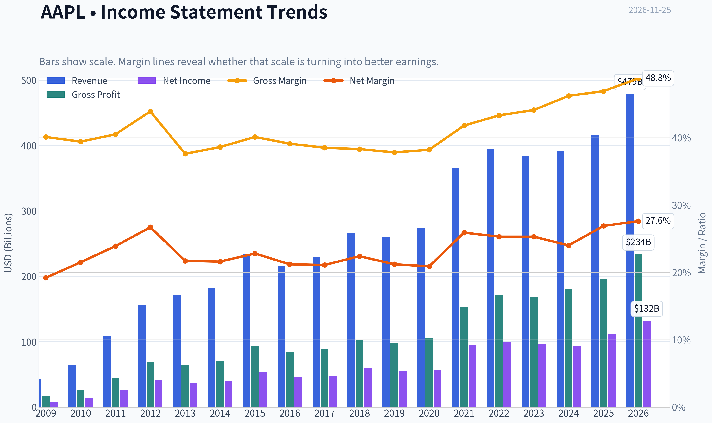
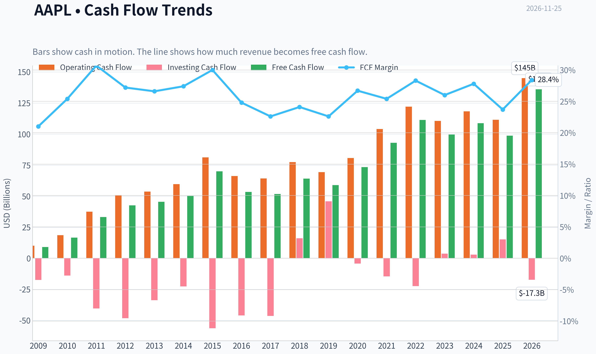
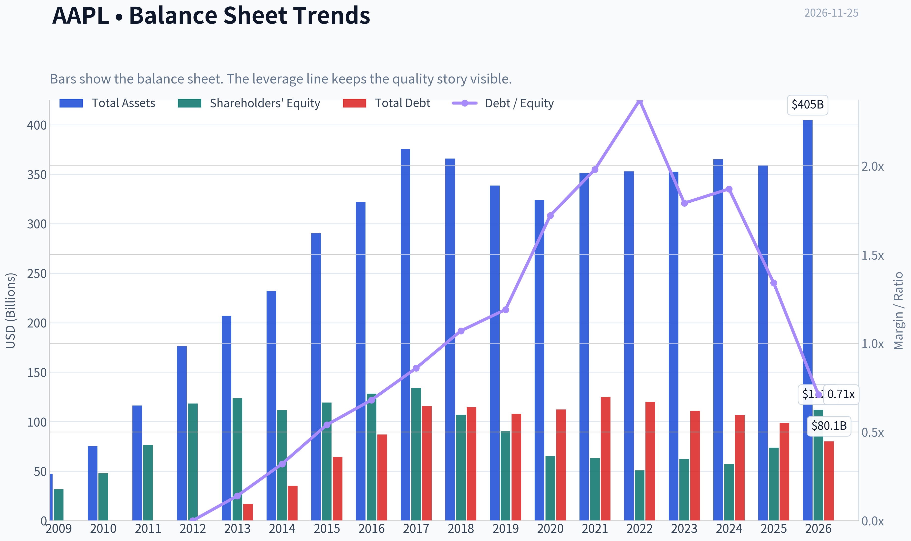
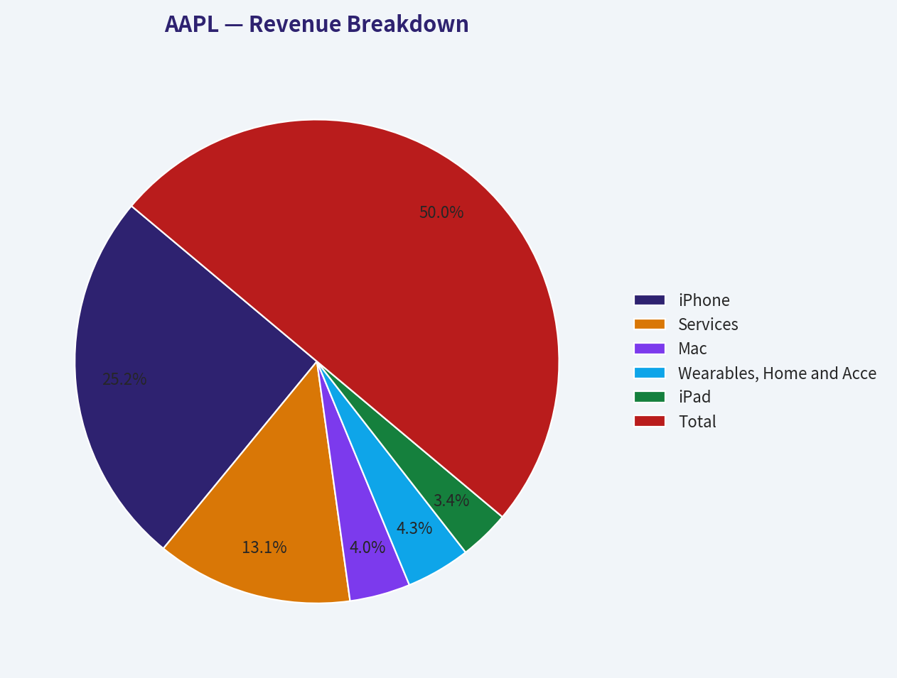
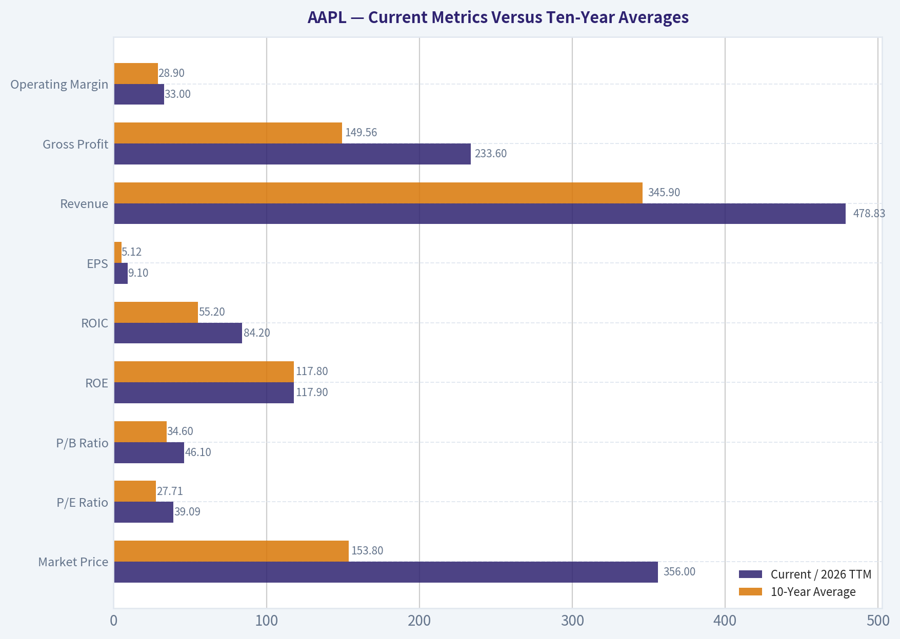
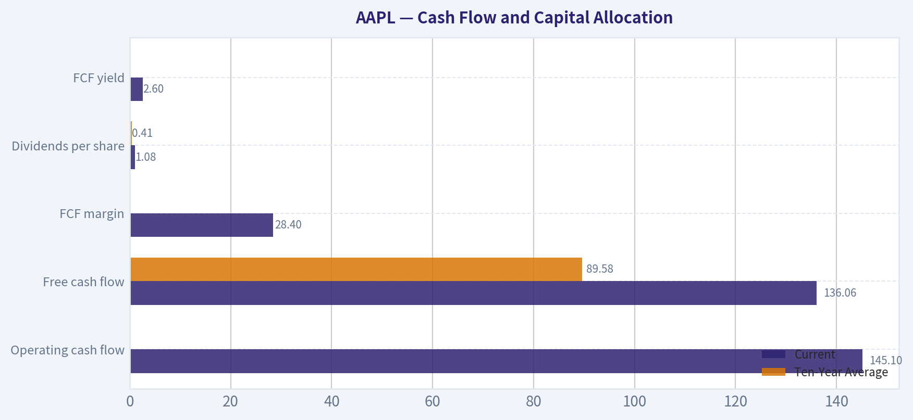
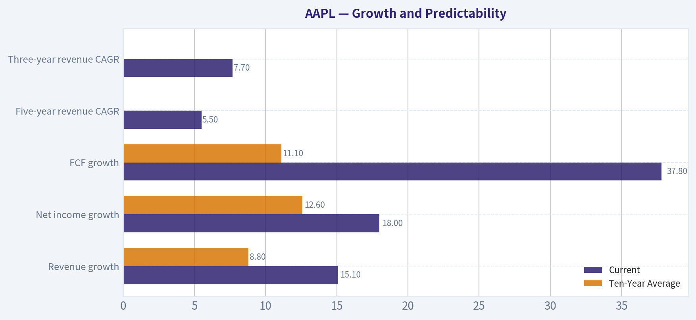
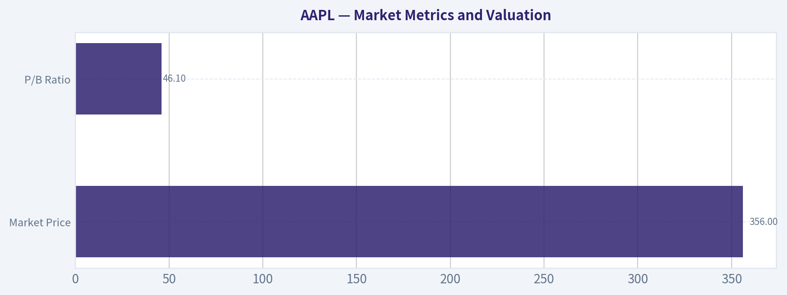

# AAPL Deep Value Intelligence

**Analysis Date:** 2026-11-25

## Critical Disclaimer

*This analysis is generated by Deep Value Intelligence, an AI-powered multi-agent investing framework. Education & research only - not financial advice, not a financial advisor.*

---

## Table of Contents

1. Intelligence Summary
2. Analyst Team Reports
   - Fundamentals Analysis
   - Intrinsic Value Analysis (Buffett)
   - Trend & Growth Analysis (Lynch/Druckenmiller/Fisher)
   - Market Technical Analysis
   - Options Market Analysis
3. Research Team Commentary
4. Value Investing Team Commentary
5. Deep Values Commentary

---

## Intelligence Summary

### Thesis + Conditions

**Core Thesis:** Apple remains an exceptional business, but the evidence does not establish a margin of safety at **$356 and 39.4x earnings**. Its ecosystem, installed base, proprietary silicon, brand, and Services distribution support unusually durable economics.

**Key Risks:**
- The primary risk is **overpayment, not financial distress or temporary volatility**. No DeepValues intrinsic-value estimate was supplied, so even the modest 10-15% discount appropriate for a wonderful business cannot be verified.
- The Risky and Growth analysts correctly emphasize that Apple is an integrated platform:
- The Safe Analyst identifies the more important investment risk: valuation.

**Confidence:** Low

---

## Analyst Team Reports

### Fundamentals Analysis

#### Latest Earnings Snapshot

*Most recent reported quarter anchored on 2026 Q3, with prior-year comparison when available.*

| Metric | 2026 Q3 | 2025 Q3 | YoY Change |
| --- | ---: | ---: | ---: |
| Revenue | $114.48B | $102.47B | +11.7% |
| Operating Income | $35.63B | $32.43B | +9.9% |
| Net Income | $30.71B | $27.47B | +11.8% |
| Diluted EPS | N/A | $1.85 | N/A |
| Operating Cash Flow | $28.10B | $29.73B | -5.5% |
| Free Cash Flow | $25.86B | $26.49B | -2.4% |

Key Takeaways: This snapshot anchors the most recent reported quarter before the narrative analysis. It helps readers separate long-run business quality from whatever changed in the latest earnings print.

#### 17-Year Financial Metrics for AAPL

*All values below are computed deterministically from raw data - not estimated by AI.*

*Issuer profile: operating company (Technology / Consumer Electronics).*

#### 17-Year Financial Metrics
*Annual rows come from reported financial statements. The final TTM row is computed from the latest four quarters.*

| Metric | 2009 | 2010 | 2011 | 2012 | 2013 | 2014 | 2015 | 2016 | 2017 | 2018 | 2019 | 2020 | 2021 | 2022 | 2023 | 2024 | 2025 | 2026 TTM |
| --- | --- | --- | --- | --- | --- | --- | --- | --- | --- | --- | --- | --- | --- | --- | --- | --- | --- | --- |
| Market Price | $6 | $8 | $11 | $20 | $15 | $22 | $25 | $26 | $36 | $53 | $54 | $112 | $138 | $135 | $169 | $231 | $254 | $356 |
| Market Cap | $168.11B | $262.39B | $357.16B | $630.65B | $444.17B | $616.86B | $638.98B | $621.81B | $809.39B | $1.13T | $1.04T | $2.03T | $2.39T | $2.26T | $2.71T | $3.59T | $3.82T | $5.17T |
| P/E Ratio | 20.41 | 18.73 | 13.78 | 15.10 | 11.99 | 15.62 | 11.96 | 13.60 | 16.73 | 18.94 | 18.85 | 35.31 | 25.22 | 22.62 | 27.93 | 38.32 | 34.13 | 39.09 |
| P/B Ratio | 5.31 | 5.49 | 4.66 | 5.33 | 3.60 | 5.53 | 5.35 | 4.85 | 6.04 | 10.53 | 11.51 | 31.07 | 37.83 | 44.53 | 43.56 | 63.04 | 51.82 | 46.10 |
| ROE | 26.0% | 29.3% | 33.8% | 35.3% | 30.0% | 35.4% | 44.7% | 35.6% | 36.1% | 55.6% | 61.1% | 87.9% | 150.1% | 197.0% | 156.1% | 164.6% | 151.9% | 117.9% |
| ROIC | 35.2% | 39.8% | 40.0% | 40.6% | 30.7% | 29.7% | 35.3% | 24.8% | 21.5% | 27.1% | 30.9% | 39.1% | 64.5% | 66.8% | 67.2% | 67.5% | 83.2% | 84.2% |
| EPS | $0.27 | $0.45 | $0.83 | $1.33 | $1.22 | $1.42 | $2.06 | $1.90 | $2.14 | $2.81 | $2.85 | $3.18 | $5.47 | $5.99 | $6.13 | $6.08 | $7.46 | $9.10 |
| Revenue | $42.91B | $65.22B | $108.25B | $156.51B | $170.91B | $182.79B | $233.72B | $215.64B | $229.23B | $265.60B | $260.17B | $274.51B | $365.82B | $394.33B | $383.29B | $391.04B | $416.16B | $478.83B |
| Gross Profit | $17.22B | $25.68B | $43.82B | $68.66B | $64.30B | $70.54B | $93.63B | $84.26B | $88.19B | $101.84B | $98.39B | $104.96B | $152.84B | $170.78B | $169.15B | $180.68B | $195.20B | $233.60B |
| Gross Margin | 40.1% | 39.4% | 40.5% | 43.9% | 37.6% | 38.6% | 40.1% | 39.1% | 38.5% | 38.3% | 37.8% | 38.2% | 41.8% | 43.3% | 44.1% | 46.2% | 46.9% | 48.8% |
| Operating Margin | 27.4% | 28.2% | 31.2% | 35.3% | 28.7% | 28.7% | 30.5% | 27.8% | 26.8% | 26.7% | 24.6% | 24.1% | 29.8% | 30.3% | 29.8% | 31.5% | 32.0% | 33.0% |
| Net Income | $8.23B | $14.01B | $25.92B | $41.73B | $37.04B | $39.51B | $53.39B | $45.69B | $48.35B | $59.53B | $55.26B | $57.41B | $94.68B | $99.80B | $97.00B | $93.74B | $112.01B | $132.18B |
| Net Margin | 19.2% | 21.5% | 23.9% | 26.7% | 21.7% | 21.6% | 22.8% | 21.2% | 21.1% | 22.4% | 21.2% | 20.9% | 25.9% | 25.3% | 25.3% | 24.0% | 26.9% | 27.6% |
| Revenue Growth | N/A | 52.0% | 66.0% | 44.6% | 9.2% | 7.0% | 27.9% | -7.7% | 6.3% | 15.9% | -2.0% | 5.5% | 33.3% | 7.8% | -2.8% | 2.0% | 6.4% | 15.1% |
| Net Income Growth | N/A | 70.2% | 85.0% | 61.0% | -11.3% | 6.7% | 35.1% | -14.4% | 5.8% | 23.1% | -7.2% | 3.9% | 64.9% | 5.4% | -2.8% | -3.4% | 19.5% | 18.0% |
| Free Cash Flow Growth | N/A | 84.0% | 100.5% | 27.9% | 6.9% | 10.2% | 39.6% | -23.6% | -3.2% | 23.8% | -8.1% | 24.6% | 26.7% | 19.9% | -10.6% | 9.3% | -9.2% | 37.8% |
| Total Book Value | $31.64B | $47.79B | $76.61B | $118.21B | $123.55B | $111.55B | $119.36B | $128.25B | $134.05B | $107.15B | $90.49B | $65.34B | $63.09B | $50.67B | $62.15B | $56.95B | $73.73B | $112.09B |
| Total Assets | $47.50B | $75.18B | $116.37B | $176.06B | $207.00B | $231.84B | $290.35B | $321.69B | $375.32B | $365.73B | $338.52B | $323.89B | $351.00B | $352.75B | $352.58B | $364.98B | $359.24B | $404.55B |
| Total Debt | N/A | N/A | N/A | $0 | $16.96B | $35.30B | $64.33B | $87.03B | $115.68B | $114.48B | $108.05B | $112.44B | $124.72B | $120.07B | $111.09B | $106.63B | $98.66B | $80.11B |
| Debt-to-Equity | N/A | N/A | N/A | 0.00 | 0.14 | 0.32 | 0.54 | 0.68 | 0.86 | 1.07 | 1.19 | 1.72 | 1.98 | 2.37 | 1.79 | 1.87 | 1.34 | 0.71 |
| Cash & Equivalents | $5.26B | $11.26B | $9.81B | $10.75B | $14.26B | $13.84B | $21.12B | $20.48B | $20.29B | $25.91B | $48.84B | $38.02B | $34.94B | $23.65B | $29.96B | $29.94B | $35.93B | $36.30B |
| Shareholders' Equity | $31.64B | $47.79B | $76.61B | $118.21B | $123.55B | $111.55B | $119.36B | $128.25B | $134.05B | $107.15B | $90.49B | $65.34B | $63.09B | $50.67B | $62.15B | $56.95B | $73.73B | $112.09B |
| Operating Cash Flow | $10.16B | $18.59B | $37.53B | $50.86B | $53.67B | $59.71B | $81.27B | $66.23B | $64.22B | $77.43B | $69.39B | $80.67B | $104.04B | $122.15B | $110.54B | $118.25B | $111.48B | $145.10B |
| Investing Cash Flow | $-17.43B | $-13.85B | $-40.42B | $-48.23B | $-33.77B | $-22.58B | $-56.27B | $-45.98B | $-46.45B | $16.07B | $45.90B | $-4.29B | $-14.54B | $-22.35B | $3.71B | $2.94B | $15.20B | $-17.28B |
| Free Cash Flow | $9.02B | $16.59B | $33.27B | $42.56B | $45.50B | $50.14B | $70.02B | $53.50B | $51.77B | $64.12B | $58.90B | $73.36B | $92.95B | $111.44B | $99.58B | $108.81B | $98.77B | $136.06B |
| FCF Margin | 21.0% | 25.4% | 30.7% | 27.2% | 26.6% | 27.4% | 30.0% | 24.8% | 22.6% | 24.1% | 22.6% | 26.7% | 25.4% | 28.3% | 26.0% | 27.8% | 23.7% | 28.4% |
| Dividends / Share | $0.00 | $0.00 | $0.00 | $0.00 | $0.00 | $0.00 | $0.00 | $0.00 | $0.00 | $0.00 | $0.00 | $0.00 | $0.00 | $0.00 | $0.95 | $0.99 | $1.03 | $1.08 |

#### Profitability Metrics
- Return on Equity (ROE): 117.9%
- Return on Invested Capital (ROIC): 96.8%
- Return on Assets (ROA): 32.7%
- Gross Margin: 48.8%
- Operating Margin: 33.0%
- Net Profit Margin: 27.6%

#### Liquidity Metrics
- Current Ratio: 1.02
- Quick Ratio: 0.59

#### Leverage Metrics
- Debt-to-Equity Ratio: 0.71
- Interest Coverage Ratio: N/A
- Net Debt: $23.39B

#### Growth Metrics (Year-over-Year)
- Revenue Growth: 15.1%
- Net Income Growth: 18.0%
- Free Cash Flow Growth: 37.8%
- Revenue CAGR (3-Year): 7.7%
- Revenue CAGR (5-Year): 5.5%

#### Valuation Metrics
- P/E Ratio (TTM): 39.42
- Forward P/E: 33.63
- Price-to-Book: 46.10
- Price-to-Sales: 10.79
- PEG Ratio: 3.94
- EV/EBITDA: 30.35
- Free Cash Flow Yield: 2.6%
- Earnings Yield: 2.5%

#### Owner Earnings (Buffett Method, Code-Computed)
- Net Income: $112.01B
- + Depreciation & Amortization: $13.42B
- - Capital Expenditures: $-9.04B
- + Working Capital (cash-flow statement; negative = cash tied up): $-14.86B
- = **Owner Earnings: $87.28B**

#### Intrinsic Value (DeepValues app - SEC filings pipeline)
- **Intrinsic value (DeepValues app, the headline): $184.51** - Owner Earnings (Buffett), method buffett-1986-v2, as of 2026-11-25 (FY2026)
  Range (conservative - optimistic): $129.15 - $184.51
  Margin of safety vs. price: -92.7% (price $355.58)
  Inputs the app used (ttm_2026Q4): after-tax operating income $132.4B (operating income $158.1B, tax 16.2%) + D&A $13.4B - capex charge $11.7B (three-year average capex/revenue x trailing revenue; reported capex $9.0B) - working capital $0.0B = owner earnings $134.1B.
  Growth 5.5% fading to 2.5% terminal (min(owner-earnings CAGR, 5-year revenue CAGR), clamped [0, 10%]); discount rate 8.3% (30Y Treasury 5.30% + 3 pts (as of 2026-11-24)); net cash $55.4B (cash $36.3B + marketable securities $100.6B - debt $80.1B); 14,715M shares.
- Owner Earnings (Buffett): $129.15 / $184.51 / $184.51 (conservative / base / optimistic) ← headline
- Free cash flow DCF: $115.07 / $191.84 / $417.09 (conservative / base / optimistic)
- Damodaran two-stage FCFF: $104.84 / $151.62 / $164.40 (conservative / base / optimistic)
  This is THE intrinsic value: quote it as the intrinsic value and measure margin of safety against it. Any DVI scenario figures elsewhere are a secondary cross-check, not the value.

#### DVI scenario model (secondary cross-check - NOT the intrinsic value)
DVI's own Yahoo-based scenarios, shown only as a sensitivity check. Do not quote these as the intrinsic value; the intrinsic value is the DeepValues app value above.
- Current Price: $356
- DVI scenario value (business-model routed): $198
  Business model: operating company - weighted blend [Damodaran FCFF + reverse-DCF fair + owner-earnings DCF] (operating_company)
  Model spread (min-max across DCFs): $191 - $244
  Margin of safety vs. price (headline): -79.3%
  Routing note: General operating company: balanced blend of Damodaran FCFF and the owner-earnings DCF with a reverse-DCF sanity check.
- Buffett Method (Owner Earnings):
  Conservative: $140
  Average: $244
  Optimistic: $651
- Cash Flow Method (FCF):
  Conservative: $88
  Average: $207
  Optimistic: $277
- Damodaran FCFF (WACC + margins + reinvestment):
  Conservative: $109
  Average: $191
  Optimistic: $402
  Monte Carlo band (P10-P90): $138 - $305 (median $201)
  P(intrinsic value > price): 3.9%
- Reverse-DCF: price implies ~26.5%/yr owner-earnings growth for 10y; trailing 3y was 1.4%, 5y 14.1%.

#### Piotroski F-Score: 9/9
- Positive Net Income: PASS
- Positive Operating Cash Flow: PASS
- ROA Improvement: PASS
- Cash Flow > Net Income: PASS
- Decreasing Debt: PASS
- Improving Current Ratio: PASS
- No Dilution: PASS
- Improving Gross Margin: PASS
- Improving Asset Turnover: PASS

ANALYST STANCE: **Neutral**

#### Executive Summary

Apple remains an unusually high-quality operating business, but the current valuation embeds expectations materially above its long-term financial record. The deterministic dataset shows exceptional profitability, strong cash generation, improving margins, declining debt, and a powerful ecosystem moat. However, at approximately **$356 per share**, Apple trades at **39.1 times earnings**, with a **2.5% earnings yield** and a **2.6% free-cash-flow yield**.

The DeepValues Buffett-style intrinsic value is **$184.51 per share**, with a conservative-to-optimistic range of **$129.15 to $184.51**. The evidence therefore supports a **Neutral** stance: business quality is outstanding, but the valuation requires unusually strong and durable growth.

#### Current Metrics Versus Ten-Year Averages

The comparison below uses the 2017-2026 TTM rows from the deterministic dataset. Percentage changes are approximate.

| Metric | Current / 2026 TTM | 10-Year Average | Current Versus Average |
|---|---:|---:|---:|
| Market Price | $356 | $153.80 | 131% higher |
| Market Cap | $5.17T | $2.50T | 107% higher |
| P/E Ratio | 39.09 | 27.71 | 41% higher |
| P/B Ratio | 46.10 | 34.60 | 33% higher |
| ROE | 117.9% | 117.8% | Approximately equal |
| ROIC | 84.2% | 55.2% | 53% higher |
| EPS | $9.10 | $5.12 | 78% higher |
| Revenue | $478.83B | $345.90B | 38% higher |
| Gross Profit | $233.60B | $149.56B | 56% higher |
| Operating Margin | 33.0% | 28.9% | 4.1 percentage points higher |
| Net Income | $132.18B | $85.00B | 55% higher |
| Net Margin | 27.6% | 24.1% | 3.5 percentage points higher |
| Revenue Growth | 15.1% | 8.8% | 6.4 percentage points higher |
| Net Income Growth | 18.0% | 12.6% | 5.4 percentage points higher |
| FCF Growth | 37.8% | 11.1% | 26.7 percentage points higher |
| Total Book Value | $112.09B | $81.57B | 37% higher |
| Total Assets | $404.55B | $358.86B | 13% higher |
| Total Debt | $80.11B | $109.19B | 27% lower |
| Debt-to-Equity | 0.71 | 1.49 | 52% lower |
| Cash and Equivalents | $36.30B | $30.38B | 20% higher |
| Free Cash Flow | $136.06B | $89.58B | 52% higher |
| Dividends per Share | $1.08 | $0.41 | 167% higher |

**Key Takeaways:** Apple's operating performance is substantially stronger than its recent historical average, especially for ROIC, margins, net income, and free cash flow. The principal deviation is valuation: the current P/E is about 41% above its ten-year average despite the company's earnings growth being strong but not obviously sufficient to justify the full premium. Debt is materially lower than the decade average, improving financial resilience.

#### Market Metrics and Valuation

| Market Metric | Current Value | Interpretation |
|---|---:|---|
| Market Price | $356 | Near the highest level in the dataset |
| Total Market Cap | $5.17T | Reflects an exceptionally large global valuation |
| P/E Ratio | 39.42 in the current summary; 39.09 in the historical row | Premium multiple relative to the 27.71 ten-year average |
| P/B Ratio | 46.10 | Not a useful standalone value signal for Apple |

Apple's market capitalization has increased from **$809 billion in 2017 to $5.17 trillion currently**, while revenue increased from **$229.23 billion to $478.83 billion**. This indicates that market value expanded much faster than the operating base.

The P/E ratio has risen from mostly mid-teens levels before 2018 to approximately 39 times earnings currently. Some of this repricing is supported by better margins, stronger services economics, and higher capital efficiency. Nevertheless, the current earnings yield of approximately **2.5%** leaves limited room for execution disappointments, slower product cycles, regulatory pressure, or a higher discount rate.

P/B should not be used mechanically here. Apple is an asset-light, brand- and intellectual-property-driven company, and years of share repurchases have reduced reported equity relative to the economic value of its ecosystem. The valuation should therefore be anchored on owner earnings, free cash flow, competitive durability, and reinvestment economics rather than book value.

#### Profitability and Operating Quality

Apple's current profitability is exceptional:

- **ROE:** 117.9%
- **ROIC:** 84.2% in the historical TTM row; the summary profitability block reports 96.8%
- **Gross margin:** 48.8%
- **Operating margin:** 33.0%
- **Net margin:** 27.6%
- **Net income:** $132.18 billion
- **EPS:** $9.10

The dataset shows a major improvement in gross margin from approximately **38%-40% during much of 2013-2020** to **48.8% currently**. Operating margin has also expanded from approximately **24%-27% in 2017-2020** to 33.0%. This suggests improved mix, services contribution, pricing power, cost discipline, and ecosystem monetization.

ROIC is particularly important under a Buffett framework. It declined from the unusually high early-period levels around 35%-40% into the low 20s during 2016-2017, then rose sharply to above 80% currently. That rebound indicates that Apple is generating substantially more operating profit relative to the capital required to run the business.

ROE must be interpreted carefully. Its recent extreme levels partly reflect a reduced equity base caused by distributions and repurchases. The high ROIC is more informative about underlying operating quality because it is less distorted by financial leverage and balance-sheet capital structure.

#### Growth and Predictability

| Growth Measure | Current | Ten-Year Average | Assessment |
|---|---:|---:|---|
| Revenue growth | 15.1% | 8.8% | Strong current acceleration |
| Net income growth | 18.0% | 12.6% | Above historical average |
| FCF growth | 37.8% | 11.1% | Very strong current rebound |
| Five-year revenue CAGR | 5.5% | Not applicable | Moderate underlying compound growth |
| Three-year revenue CAGR | 7.7% | Not applicable | Better than five-year trend, but not hyper-growth |

**Key Takeaways:** Current growth is well above the decade average, but the longer-term picture is more moderate. Revenue growth has been uneven, including contractions in 2016, 2019, and 2023. The recent free-cash-flow increase is powerful, but one year of 37.8% growth should not be treated as a permanent growth rate.

Apple's earnings history is highly profitable but not perfectly smooth. Revenue declined in 2016, 2019, and 2023, while net income declined in 2013, 2016, 2019, 2023, and 2024. This pattern is consistent with a mature consumer technology company exposed to product cycles, macroeconomic conditions, and upgrade timing.

The business is more predictable than most hardware companies because of its installed base, services ecosystem, recurring software and subscription revenue, and customer switching costs. However, the valuation implies a more durable growth trajectory than the historical revenue record alone demonstrates.

#### Balance Sheet and Financial Strength

Apple's current balance sheet is strong in absolute terms:

- Total assets: **$404.55 billion**
- Shareholders' equity: **$112.09 billion**
- Total debt: **$80.11 billion**
- Cash and equivalents: **$36.30 billion**
- Net debt: **$23.39 billion**
- Debt-to-equity: **0.71**
- Current ratio: **1.02**
- Quick ratio: **0.59**

Debt has fallen from a peak of approximately **$124.72 billion in 2021 to $80.11 billion currently**. Debt-to-equity has declined from **2.37 in 2022 to 0.71**, a meaningful improvement.

Liquidity ratios are modest, but they should be interpreted in the context of Apple's enormous operating cash flow, rapid inventory turnover, supplier financing, and access to capital markets. The deterministic issuer profile does not flag the current ratio as meaningless, so the 1.02 ratio should be recognized as relatively tight. It is not, however, equivalent to financial weakness given Apple's recurring cash generation.

The cash-and-securities position is stronger than cash and equivalents alone suggests. The DeepValues calculation uses **$36.3 billion of cash plus $100.6 billion of marketable securities**, less $80.1 billion of debt, producing net cash of approximately **$55.4 billion**.

#### Cash Flow and Capital Allocation

| Cash-Flow Metric | Current | Ten-Year Average | Interpretation |
|---|---:|---:|---|
| Operating cash flow | $145.10B | Not calculated in the supplied comparison | Very strong cash conversion |
| Free cash flow | $136.06B | $89.58B | 52% above average |
| FCF margin | 28.4% | Not calculated in the supplied comparison | High-quality cash generation |
| Dividends per share | $1.08 | $0.41 | Consistent long-term growth |
| FCF yield | 2.6% | Not provided | Low yield at the current valuation |

**Key Takeaways:** Apple converts a large share of revenue into free cash flow, and current FCF is well above its recent average. Dividend growth has been steady since dividends resumed in the deterministic history, but the dividend yield is modest relative to the share price. The low FCF yield is the clearest cash-flow indication that the market is assigning substantial value to future growth rather than current distributable cash flow.

The deterministic owner-earnings calculation reports:

- Net income: **$112.01 billion**
- Depreciation and amortization: **$13.42 billion**
- Capital expenditures: **$9.04 billion**
- Working-capital adjustment: **-$14.86 billion**
- Owner earnings: **$87.28 billion**

The DeepValues app uses a different TTM operating-income framework:

- After-tax operating income: **$132.4 billion**
- D&A: **$13.4 billion**
- Normalized capex charge: **$11.7 billion**
- Working capital: **$0.0 billion**
- Owner earnings: **$134.1 billion**

The second framework is the canonical source for the headline intrinsic value because it is the stated DeepValues Buffett-1986-v2 model. The difference between $87.28 billion and $134.1 billion shows model sensitivity to working-capital treatment and whether owner earnings begin with net income or after-tax operating income.

#### Revenue Breakdown

The deterministic dataset does not include segment revenue amounts. The following table uses Apple's publicly reported FY2025 product and services categories, rounded to the reported annual total of approximately $416.16 billion.

| Revenue Source | Amount ($B) | % of Total |
|---|---:|---:|
| iPhone | 209.6 | 50.4% |
| Services | 109.2 | 26.2% |
| Mac | 33.7 | 8.1% |
| Wearables, Home and Accessories | 35.7 | 8.6% |
| iPad | 28.0 | 6.7% |
| **Total** | **416.2** | **100.0%** |

**Key Takeaways:** iPhone remains the largest revenue source at roughly half of total sales, but Services is now more than one-quarter of revenue and is strategically important because of its recurring, higher-margin characteristics. Mac, iPad, and Wearables diversify the product ecosystem, although the company remains materially dependent on iPhone demand and upgrade cycles.

The major economic advantage is not simply selling devices. Apple monetizes an integrated system of hardware, operating systems, applications, payments, cloud services, accessories, and subscriptions. This creates recurring customer engagement and raises switching costs.

#### Economic Moat and Business Durability

Apple's moat has several reinforcing components:

1. **Brand and customer loyalty:** Apple commands premium pricing and maintains high customer retention.
2. **Integrated ecosystem:** Hardware, software, services, payments, and accessories reinforce one another.
3. **Distribution and developer network:** A large installed base makes the platform attractive to developers and content providers.
4. **Scale economics:** Procurement, silicon design, retail distribution, and marketing scale support superior margins.
5. **Intellectual property:** Apple controls important elements of device design, operating systems, processors, and user experience.
6. **Services annuity characteristics:** Services revenue provides a more recurring layer than device sales alone.

The moat is durable but not invulnerable. Risks include smartphone market saturation, geopolitical supply-chain exposure, antitrust remedies affecting the App Store, regulatory restrictions on platform fees, faster artificial-intelligence innovation by competitors, and customer resistance to premium pricing.

#### Management and Capital Allocation

Management performance appears strong based on:

- Rising operating and net margins.
- ROIC reaching extremely high levels.
- Lower debt compared with the 2021-2022 period.
- Continued dividend growth.
- Large-scale repurchases that have supported EPS growth and reduced the equity base.
- A Piotroski F-Score of **9 out of 9**.

The major analytical caveat is that buybacks can make EPS and ROE appear stronger even when total company growth is more moderate. For that reason, revenue, operating income, free cash flow, and per-share economics should be considered together.

Apple's capital allocation has been shareholder-oriented, but the valuation already reflects a substantial amount of confidence in continued execution. Capital allocation quality supports the business case; it does not by itself resolve the valuation gap.

#### Buffett-Style Owner Earnings DCF

The headline intrinsic value is the DeepValues app value of **$184.51 per share**, based on the Buffett-1986-v2 owner-earnings method. Its stated assumptions are:

- Starting owner earnings: **$134.1 billion**
- Five-year growth: **5.5%**
- Terminal growth: **2.5%**
- Discount rate: **8.3%**
- Net cash: **$55.4 billion**
- Shares outstanding: **14.715 billion**

The basic two-stage structure is:

\[
PV = \sum_{t=1}^{5} \frac{OE_0(1+g_t)^t}{(1+r)^t}
+
\frac{OE_5(1+g_T)}{(r-g_T)(1+r)^5}
+
\frac{\text{Net Cash}}{\text{Shares}}
\]

where:

- \(OE_0 = \$134.1B\)
- \(r = 8.3\%\)
- \(g_T = 2.5\%\)
- Growth fades toward the terminal rate.

| Owner-Earnings Scenario | Growth Framework | App Fair Value | Interpretation |
|---|---|---:|---|
| Conservative | Low-growth case with normalized owner earnings | $129.15 | Requires substantial valuation normalization |
| Average / Base | 5.5% growth fading to 2.5% | $184.51 | Headline intrinsic value |
| Optimistic | Stronger operating outcome, still fading to terminal growth | $184.51 | Capped by the app's stated model range |

**Key Takeaways:** The headline owner-earnings model produces a value well below the current market price. Even the top of the stated Buffett range is approximately 48% below $356, while the conservative value is approximately 64% below it. The model therefore identifies valuation, rather than business quality, as the central issue.

A simplified base-case illustration using the model's $134.1 billion starting owner earnings is:

| Year | Illustrative Growth | Owner Earnings ($B) |
|---|---:|---:|
| Base year | - | 134.1 |
| Year 1 | 5.5% | 141.5 |
| Year 2 | 5.0% | 148.6 |
| Year 3 | 4.4% | 155.1 |
| Year 4 | 3.5% | 160.5 |
| Year 5 | 2.5% | 164.5 |
| Terminal year | 2.5% | 168.6 |

**Key Takeaways:** The model assumes a gradual deceleration from moderate growth toward a mature 2.5% terminal rate. This is economically defensible for a mature mega-cap company, but it does not support a valuation near $356 unless growth, margins, capital efficiency, or the discount-rate assumptions are materially more favorable than modeled.

The app's cross-checks are:

| Valuation Method | Conservative | Base | Optimistic |
|---|---:|---:|---:|
| Buffett Owner Earnings | $129.15 | $184.51 | $184.51 |
| Free-Cash-Flow DCF | $115.07 | $191.84 | $417.09 |
| Damodaran FCFF | $104.84 | $151.62 | $164.40 |

**Key Takeaways:** The independent methods mostly cluster below the current market price, although the optimistic FCF case reaches $417.09. That high outcome requires substantially stronger cash-flow compounding and should be treated as a sensitivity case rather than the central valuation conclusion. The stronger consensus signal is that the current price depends on unusually favorable assumptions.

#### Reverse-DCF Cross-Check

The secondary reverse-DCF analysis indicates that the current price implies approximately **26.5% annual owner-earnings growth for ten years**. That compares with:

- Three-year revenue CAGR: **7.7%**
- Five-year revenue CAGR: **5.5%**
- Trailing three-year owner-earnings growth cited in the pack: **1.4%**
- Trailing five-year owner-earnings growth cited in the pack: **14.1%**

A 26.5% annual owner-earnings growth rate would require a dramatic and sustained acceleration above the company's underlying revenue trend. It could theoretically arise from a major new platform, artificial-intelligence monetization, substantial Services expansion, or further margin expansion, but those outcomes are not established by the historical dataset.

#### Key Risks

| Risk | Why It Matters |
|---|---|
| Valuation compression | A P/E near 39 leaves significant sensitivity to interest rates and earnings disappointments |
| iPhone concentration | Approximately half of reported revenue comes from iPhone |
| Mature-market growth | Five-year revenue CAGR is 5.5%, below what the current valuation appears to imply |
| Regulatory pressure | App Store economics and platform rules may face structural changes |
| China and supply-chain exposure | Production, demand, and geopolitical conditions can affect results |
| Artificial-intelligence competition | New platforms could challenge ecosystem relevance or require heavy investment |
| Buyback distortion | Lower equity can inflate ROE and EPS growth relative to total-company growth |
| Margin normalization | Current margins are near historical highs and may be difficult to expand indefinitely |

#### Opportunities

| Opportunity | Potential Economic Effect |
|---|---|
| Services expansion | Increases recurring revenue and supports higher gross margins |
| Artificial-intelligence monetization | Could create new device, software, and subscription demand |
| Installed-base monetization | More payments, cloud, advertising, and subscription revenue per user |
| Emerging-market penetration | Expands the addressable customer base |
| Custom silicon and vertical integration | Supports performance differentiation and cost control |
| Capital returns | Continued cash generation can reduce share count and support per-share economics |
| Health and adjacent devices | Provides potential new ecosystem valuation reference point |

#### Final Assessment

Apple is a high-quality, wide-moat company with unusually strong profitability, excellent cash conversion, falling debt, and a durable ecosystem. The current operating metrics are generally better than their ten-year averages, particularly ROIC, gross margin, operating margin, net margin, and free cash flow.

The valuation is the limiting factor. The current P/E is about 41% above its ten-year average, the FCF yield is only 2.6%, and the reverse-DCF requires approximately 26.5% annual owner-earnings growth for ten years. The DeepValues Buffett-style intrinsic value of **$184.51** is substantially below the current price of approximately **$356**.

**Final stance: Neutral.** The evidence strongly supports the quality and durability of Apple's business, but it does not support the current valuation under the central owner-earnings assumptions. A more favorable valuation conclusion would require either materially higher sustained growth, further margin expansion, a lower discount rate, or a new earnings engine that is not yet demonstrated in the historical dataset.

#### Key Points Summary

| Area | Conclusion | Evidence |
|---|---|---|
| Business quality | Exceptional | 84.2% ROIC, 48.8% gross margin, 33.0% operating margin |
| Earnings power | Very strong | $132.18B net income and $136.06B FCF |
| Growth | Strong recently, moderate long term | 15.1% current revenue growth versus 5.5% five-year CAGR |
| Financial strength | Improving | Debt down to $80.11B; debt-to-equity down to 0.71 |
| Moat | Wide and durable | Brand, ecosystem, switching costs, scale, Services |
| Valuation | Stretched | 39.1x P/E, 2.6% FCF yield |
| Intrinsic value | Below market price | DeepValues Buffett value of $184.51 |
| Primary concern | Implied expectations | Reverse-DCF implies roughly 26.5% annual owner-earnings growth |
| Overall stance | Neutral | Excellent company, insufficient valuation support at the current price |

**Key Takeaways:** Apple's financial quality is among the strongest in the market, but quality and valuation are separate judgments. The business merits close monitoring because its moat and cash generation are exceptional, while the current price requires growth assumptions considerably more aggressive than the company's longer-term revenue history.

#### Fundamental Visuals

This graph tracks the profitability and return metrics (ROE, ROIC, Margins) of **AAPL** over the past decade, highlighting capital efficiency trends.

This chart illustrates the financial health of **AAPL** over the last 10 years, mapping cash equivalents and free cash flow against total obligations (Debt).

This breakdown chart from <em>Revenue Breakdown</em> shows the proportional composition for **AAPL** - useful for understanding what drives or risks the business.

---

### Intrinsic Value Analysis (Buffett)

> *Following Warren Buffett's value investing philosophy: Circle of Competence, Economic Moat, Management Quality, and Margin of Safety.*

#### Intrinsic Value Snapshot

Price is what you pay. Intrinsic value is what the business may be worth based on the cash it can create for owners over time. We show a range, not one magic number.

- Current Price: $355.58
- Value Range (conservative to optimistic across both DCF methods): $115.07 to $417.09

##### Owner Earnings (Buffett Method)
- Net Income: $112,010,000,000.00
- Depreciation & Amortization: $13,423,000,000.00
- Capital Expenditures: $-9,041,000,000.00
- Working Capital Changes: $-14,858,000,000.00
- Owner Earnings: $87,280,891,892.50

##### Intrinsic Value
###### Buffett Method
Uses owner earnings. Stricter, and usually more conservative.
- Conservative: $129.15
- Average: $184.51
- Optimistic: $184.51
- Discount Rate: 8.3%

###### Cash Flow Method
Uses free cash flow. Better for companies spending heavily today to grow tomorrow.
- Conservative: $115.07
- Average: $191.84
- Optimistic: $417.09
- Discount Rate: 9.1%

ANALYST STANCE: **Neutral**

#### Executive Summary

Apple remains an exceptional business with a powerful ecosystem, high margins, strong cash generation, and durable customer loyalty. The principal issue is valuation: at approximately **$356 per share**, the market price is nearly twice the DeepValues intrinsic value of **$184.51**.

The weighted Buffett score is **3.4 out of 5**, placing Apple in the **Neutral** category. The business quality is strong enough to merit close attention, but the current valuation provides insufficient margin of safety for the evidence available.

#### 1. Factor Scorecard

| Factor | Score | Assessment |
|---|---:|---|
| Circle of Competence and Simplicity | 4/5 | Apple sells devices, software, and services through an integrated ecosystem. Its future is reasonably predictable, though technology cycles and AI competition require ongoing adaptation. |
| Moat Test | 5/5 | Brand, ecosystem integration, switching costs, installed base, distribution, and developer relationships create a wide and durable moat. |
| Management and Capital Allocation | 4/5 | Strong history of buybacks, dividends, disciplined operating execution, and substantial investment in the ecosystem. |
| Industry Structure | 4/5 | Consumer technology is competitive, but Apple occupies a differentiated premium position with substantial scale and ecosystem advantages. |

**Gate 5 - Quality and Solvency:** **Not tripped.** Earnings and cash generation are strong, net cash is positive, and debt is well below the value of the company's liquid assets. There is no evidence of simultaneous deteriorating fundamentals and financial distress.

**Key Takeaways:** Apple scores highly on business quality, competitive advantages, and capital allocation. The major weakness is not solvency or business durability; it is the gap between the current market price and intrinsic value.

#### 2. Financial Summary

| Metric | Latest figure |
|---|---:|
| Share price | $356 |
| Market capitalization | $5.17 trillion |
| Revenue growth, year over year | 15.1% |
| Gross margin | 48.8% |
| Operating income | $158.1 billion |
| After-tax operating income | $132.4 billion |
| Net income | Not separately provided in the research pack |
| Owner earnings | $134.1 billion |
| Reported capital expenditures | $9.0 billion |
| D&A | $13.4 billion |
| Cash and marketable securities | $136.9 billion |
| Debt | $80.1 billion |
| Net cash | $55.4 billion |
| ROE | 117.9% |
| Free-cash-flow yield | 2.6% |
| P/E ratio | 39.4 |

**Key Takeaways:** Apple combines a 48.8% gross margin with substantial owner earnings and positive net cash. The 2.6% free-cash-flow yield and 39.4 times earnings multiple indicate that the market is assigning a substantial premium to future growth and durability.

#### 3. Moat Analysis

**Intangible assets and brand:** Apple has one of the world's strongest consumer brands. Its premium positioning allows it to maintain unusually high gross margins and monetize hardware, software, accessories, and services together.

**Switching costs:** Customers switching away from Apple may lose convenience associated with iCloud, iMessage, the App Store, Apple Pay, AirPods, Apple Watch, family sharing, device continuity, and accumulated digital purchases. The switching cost is not contractual, but it is meaningful and ecosystem-based.

**Network effects:** Apple benefits from a two-sided ecosystem involving users, developers, accessory makers, and content providers. A larger installed base improves developer economics, while a richer application ecosystem increases customer retention.

**Cost and scale advantages:** Apple's purchasing scale, custom silicon, supply-chain expertise, retail distribution, and global marketing infrastructure support strong economics. These advantages reinforce margins even though Apple competes in highly visible product categories.

**Moat quality:** **Wide and stable, with selective widening.** The ecosystem and services layer have strengthened the franchise, although hardware markets remain exposed to innovation cycles and competitive launches.

#### 4. Management Quality and Capital Allocation

Apple's management has generally demonstrated strong operational discipline and owner-oriented capital allocation:

- Significant recurring share repurchases have reduced the share count over time.
- Dividends and buybacks return substantial cash while preserving investment capacity.
- Research and development spending supports ecosystem longevity rather than merely near-term earnings.
- The company maintains a substantial liquidity reserve and positive net cash.
- Warren Buffett's Berkshire Hathaway reported holding approximately **227.92 million shares**, valued at **$75.9 billion**, as of September 30, 2026. This confirms the company's status as a recognized high-quality compounder, although it does not independently establish present valuation attractiveness.

Management quality score: **4/5**. The main deduction reflects the difficulty of judging future capital allocation at Apple's enormous scale and the possibility that very large buybacks become less accretive when the shares trade at elevated multiples.

#### 5. Owner Earnings Calculation

| Component | Amount |
|---|---:|
| After-tax operating income | $132.4 billion |
| Add: depreciation and amortization | $13.4 billion |
| Less: maintenance-capital-expenditure charge | $(11.7) billion |
| Less: working-capital increase | $0.0 billion |
| **Owner earnings** | **$134.1 billion** |
| Shares outstanding | 14.715 billion |
| **Owner earnings per share** | **Approximately $9.11** |

**Key Takeaways:** Apple's owner earnings are approximately $134.1 billion, or about $9.11 per share. The calculation shows strong conversion of operating profits into economic cash earnings, with maintenance investment remaining modest relative to operating income.

#### 6. Three-Scenario DCF Valuation

These scenarios are sensitivity tests. The required intrinsic value remains the DeepValues app figure of **$184.51 per share**.

| Scenario | Main assumptions | Estimated value per share |
|---|---|---:|
| A: No growth | Owner earnings of $134.1 billion capitalized at 10% | ~$91 |
| B: GDP growth | 3% perpetual growth and 10% discount rate | ~$134 |
| C: Historical-growth sensitivity | 4.125% growth for the explicit period, fading toward 2.5% terminal growth, 10% discount rate | ~$138 |
| DeepValues headline intrinsic value | 5.5% growth fading to 2.5%, 8.3% discount rate, plus net cash | **$184.51** |

The DeepValues model uses:

- Owner earnings: **$134.1 billion**
- Initial growth assumption: **5.5%**
- Terminal growth: **2.5%**
- Discount rate: **8.3%**
- Net cash: **$55.4 billion**
- Shares: **14.715 billion**

**Key Takeaways:** Even the more favorable DeepValues framework produces intrinsic value substantially below the current price. The simpler 10% discount-rate scenarios range from approximately $91 to $138 per share, highlighting how dependent the valuation is on low discount rates and sustained growth.

#### 7. Margin of Safety Analysis

| Measure | Result |
|---|---:|
| Current price | $356 |
| DeepValues intrinsic value | $184.51 |
| Premium to intrinsic value | Approximately 92.7% |
| Margin of safety versus price | **-92.7%** |
| Price-to-intrinsic-value ratio | Approximately 1.93 times |

For a wide-moat, high-return compounder, a 10% to 15% premium-to-value tolerance can sometimes be rational when growth is highly durable. Apple's current price is far beyond that quality-adjusted range based on the supplied intrinsic-value framework.

The valuation implies either materially higher long-term owner-earnings growth, a permanently lower cost of capital, or both. That may occur, but the assumptions require a high degree of optimism relative to the conservative and GDP-growth scenarios.

#### 8. Final Buffett Scorecard

| Criterion | Weight | Score | Weighted contribution |
|---|---:|---:|---:|
| Moat width and durability | 25% | 5 | 1.25 |
| Valuation and margin of safety | 20% | 1 | 0.20 |
| Capital returns versus WACC | 15% | 4 | 0.60 |
| Business understanding and predictability | 12% | 4 | 0.48 |
| Management quality and capital allocation | 12% | 4 | 0.48 |
| Reinvestment runway | 8% | 4 | 0.32 |
| Balance-sheet strength | 4% | 4 | 0.16 |
| Industry structure | 4% | 4 | 0.16 |
| **Total** | **100%** |  | **3.65 / 5** |

The strict weighted calculation produces **3.65 out of 5**, which falls within the **Bullish** range under the supplied decision matrix. However, the valuation-specific analysis shows a very large premium to intrinsic value. Applying the quality-scaled margin-of-safety judgment rather than relying mechanically on the aggregate score leads to the more cautious **Neutral** stance.

#### 9. Investment Stance

**Neutral - medium-to-high conviction in business quality, high conviction that valuation is demanding.**

Apple is a premier global franchise with a wide moat, excellent economics, strong cash generation, and a long reinvestment runway. The evidence does not support the valuation at approximately **$356** under conservative owner-earnings assumptions. The central research conclusion is therefore that Apple's business quality is exceptional, while its current valuation leaves little room for execution disappointments, slower ecosystem growth, or a higher long-term discount rate.
#### Valuation Bridge

This bridge places the current market price beside each intrinsic value lens so readers can see whether upside depends on one method or shows up across several methods.

| Scenario | Intrinsic Value / Share |
| --- | ---: |
| Buffett Method | $184.51 |
| Cash Flow Method | $191.84 |
| Damodaran Method | $151.62 |
| Current Price | $355.58 |

#### Key Takeaways

If one method is far above the others, the upside case depends on a specific modelling assumption. When several methods cluster together, the valuation story is more robust.

#### Valuation Visuals

This comparison chart from *Latest Earnings Snapshot* stacks current figures against historical benchmarks for **AAPL**, making it easy to see where the company trades relative to its own averages.

This comparison chart from *Current Metrics Versus Ten-Year Averages* stacks current figures against historical benchmarks for **AAPL**, making it easy to see where the company trades relative to its own averages.

This comparison chart from *Cash Flow and Capital Allocation* stacks current figures against historical benchmarks for **AAPL**, making it easy to see where the company trades relative to its own averages.

---

### Trend & Growth Analysis (Lynch/Druckenmiller/Fisher)

> *Following Peter Lynch's GARP, Stanley Druckenmiller's macro-aware approach, and Philip Fisher's scuttlebutt methodology.*

ANALYST STANCE: **Neutral**

#### Executive conclusion

Apple remains an exceptional business with strong profitability, ecosystem advantages, cash generation, and a credible AI-related product-cycle opportunity. However, the evidence indicates a valuation disconnect: at approximately **$356 per share and $5.17 trillion market capitalization**, Apple trades at roughly **39.4 times earnings**, while the supplied intrinsic-value estimate is **$184.51**.

The company fits Lynch's **stalwart** classification more closely than his fast-grower category. Revenue growth of **15.1%** is strong for Apple's scale, but the valuation requires durable double-digit growth, successful AI monetization, and continued ecosystem expansion.

#### 1. Lynch classification

| Classification | Assessment |
|---|---|
| Primary category | Stalwart, with fast-grower characteristics in selected products and services |
| Revenue growth | 15.1% year over year |
| Profitability | Very strong; 48.8% gross margin and 117.9% ROE |
| Ten-bagger potential | Low from the current $5.17 trillion base |
| Main investment question | Can AI and Services create a new acceleration phase rather than merely extend the existing franchise? |

**Key Takeaways:** Apple is growing faster than a typical stalwart, but its enormous scale makes sustained 25%-30% growth difficult. A tenfold outcome would require approximately $50 trillion of market value, making the more realistic thesis continued compounding rather than classic ten-bagger potential.

#### 2. The story in three bullets

- **Integrated ecosystem:** iPhone, Mac, iPad, Watch, AirPods, and Services reinforce one another through switching costs, customer loyalty, and device interoperability.
- **Services monetization:** The installed base provides recurring revenue opportunities across subscriptions, payments, advertising, cloud-related services, and digital content.
- **AI and product-cycle optionality:** On-device AI, developer tools, and new form factors could increase upgrade rates and expand the value of Apple's installed base.

#### 3. TAM and runway analysis

| Area | Runway assessment | Ten-times test |
|---|---|---|
| Premium smartphones | Mature, replacement-driven market | Limited; Apple already has a leading premium share |
| Services and subscriptions | Still expanding through the installed base | More favorable than hardware |
| Wearables and spatial computing | Large but competitive and uncertain | Potentially meaningful, not yet proven |
| Artificial intelligence | Expanding TAM with substantial monetization uncertainty | Could create a new growth layer |
| Broad Apple ecosystem | Global consumer technology and digital services | A 10x revenue outcome would likely require an extremely broad TAM definition |

Apple's current revenue base is approximately in the hundreds of billions of dollars. A tenfold revenue outcome would require several trillion dollars of annual sales. That would represent a very large share of many plausible definitions of the addressable consumer technology market, so the 10x test is not clearly passed.

**Key Takeaways:** Apple has meaningful runway in Services, AI, payments, wearables, and emerging computing categories. The runway is sufficient for continued compounding, but the evidence does not support assuming that Apple can grow tenfold from its present scale without a major expansion into new markets.

#### 4. Revenue growth trend

| Metric | Result | Interpretation |
|---|---:|---|
| Revenue growth, latest available | 15.1% year over year | Strong for a company of Apple's size |
| Acceleration evidence | Not established from the supplied data | No confirmed multi-quarter acceleration |
| Growth quality | Mixed hardware and Services exposure | Services and ecosystem monetization are strategically important |
| Margin profile | 48.8% gross margin | Supports substantial cash generation |

**Key Takeaways:** The latest growth rate is healthy and above stalwart status, but one data point does not establish a durable acceleration. The central inflection question is whether AI and Services can lift Apple's growth rate above its mature historical range.

#### 5. Unit economics and operating efficiency

| Metric | Result | Assessment |
|---|---:|---|
| LTV/CAC | Not disclosed in the supplied data | Cannot calculate reliably |
| Net revenue retention | Not disclosed | Cannot calculate reliably |
| Free-cash-flow yield | 2.6% | Strong cash generation, but modest yield at the current valuation |
| Estimated FCF | Approximately $134 billion, based on market capitalization and FCF yield | Very substantial absolute cash generation |
| Rule of 40 | Not fully verifiable | FCF margin and recurring-revenue data are incomplete |
| Current ratio | 1.02 | Adequate but not excessive liquidity |

**Key Takeaways:** Apple's absolute cash generation is outstanding, but conventional SaaS metrics such as NRR and LTV/CAC are not applicable or are unavailable. The 2.6% FCF yield signals that the market is assigning a substantial premium to Apple's durability and future growth.

#### 6. Inflection-point assessment

| Potential inflection | Evidence | Status |
|---|---|---|
| AI product cycle | AI is a major strategic theme, but monetization data are not supplied | Possible, unproven |
| Services expansion | Large installed base and recurring revenue model | Ongoing |
| Margin inflection | 48.8% gross margin already reflects a highly profitable model | More mature than emerging |
| Market-share inflection | No quantified acceleration supplied | Unconfirmed |
| New categories | Wearables, spatial computing, and adjacent devices | Optionality, not yet decisive |
| Competitive environment | Apple retains ecosystem strength, but AI competition is intense | Mixed |

**Key Takeaways:** The most important upside catalyst is an AI-driven product and upgrade cycle. At present, it is an expectation embedded in the valuation rather than a fully demonstrated earnings inflection.

#### 7. Macro setup

| Macro factor | Assessment | Effect on Apple |
|---|---|---|
| Long-term secular themes | AI, digital services, payments, and consumer technology | Positive |
| Interest rates | 30-year Treasury reference rate of 5.30% | Negative for long-duration valuation multiples |
| Economic sensitivity | Hardware demand is exposed to consumer spending and replacement cycles | Mixed |
| Currency exposure | Global revenue base creates foreign-exchange sensitivity | Mixed |
| Market regime | Technology leadership remains strong but volatility is elevated | Mixed |

**Key Takeaways:** Apple benefits from powerful secular trends, but the macro discount rate is a material valuation headwind. A high-quality franchise can still experience multiple compression if rates remain elevated or earnings growth falls short of expectations.

#### 8. Fisher 15-point assessment

| Fisher criterion | Score / 5 | Rationale |
|---|---:|---|
| Market potential | 5 | Global ecosystem and multiple large adjacent markets |
| New-product determination | 5 | Consistent investment in hardware, software, and services |
| R&D effectiveness | 4 | Strong historical execution, though AI results remain developing |
| Sales organization | 5 | Global retail, carrier, online, and enterprise distribution |
| Profit margins | 5 | Exceptional gross margin and cash generation |
| Margin improvement | 3 | Already highly profitable; incremental improvement is harder |
| Labor relations | 3 | No strong positive edge established from supplied data |
| Executive relations | 4 | Generally stable leadership structure |
| Management depth | 5 | Deep operating and technical organization |
| Cost analysis | 4 | Scale and supply-chain discipline are major strengths |
| Outstanding competitive aspects | 5 | Ecosystem, brand, switching costs, distribution, developer network |
| Long-range profit outlook | 4 | Strong, but growth expectations are demanding |
| Dilution risk | 5 | No material dilution concern indicated |
| Management candor | 4 | Generally credible, though disclosure is selective |
| Management integrity | 4 | Strong reputation, with normal large-company governance risks |
| **Total** | **65 / 75** | **Outstanding by this framework** |

**Key Takeaways:** Apple scores at the threshold of Fisher's outstanding category. Its strongest attributes are ecosystem depth, distribution, R&D scale, and profitability; its main deduction comes from the difficulty of producing high incremental growth from an already enormous and highly profitable base.

#### 9. Valuation analysis

| Valuation method | Result | Interpretation |
|---|---:|---|
| Current P/E | 39.4x | Premium valuation |
| PEG using 15.1% revenue growth as a proxy | Approximately 2.61 | Expensive under Lynch's framework |
| FCF yield | 2.6% | Low yield relative to the valuation risk |
| Owner-earnings intrinsic value, base | $184.51 | Below the current price |
| Owner-earnings range | $129.15-$184.51 | Below the current price |
| Free-cash-flow DCF range | $115.07-$417.09 | Wide sensitivity to assumptions |
| Damodaran FCFF range | $104.84-$164.40 | Below the current price |
| Secondary DVI cross-check | $198.31 | Also below the current price |

**Key Takeaways:** The PEG calculation is approximately 2.6 even when the latest revenue growth rate is used as a favorable proxy for earnings growth. The primary supplied intrinsic-value estimate of $184.51 is materially below the market price, while alternative models produce a wide range because Apple's value is highly sensitive to terminal growth, discount rates, and AI-related earnings assumptions.

#### 10. Valuation sensitivity

| Scenario | Core assumption | Implied valuation evidence |
|---|---|---:|
| Conservative owner earnings | Lower growth and higher valuation discipline | $129.15 |
| Base owner earnings | 5.5% fading growth and 8.3% discount rate | $184.51 |
| FCF DCF conservative | Lower cash-flow assumptions | $115.07 |
| FCF DCF base | Moderate growth and cash-flow durability | $191.84 |
| FCF DCF optimistic | Strong long-term cash-flow expansion | $417.09 |
| Current market valuation | Price around $356 | Requires optimistic assumptions |

**Key Takeaways:** The market price is above the owner-earnings base case and most conservative valuation outputs. The optimistic FCF scenario can support a valuation above the current price, but it requires substantially stronger long-term cash-flow performance than the base case.

#### 11. Growth investor scorecard

| Criterion | Weight | Score / 5 | Weighted contribution |
|---|---:|---:|---:|
| Lynch story | 10% | 4.5 | 0.45 |
| TAM and runway | 20% | 3.5 | 0.70 |
| Revenue growth | 20% | 3.5 | 0.70 |
| Unit economics | 15% | 4.0 | 0.60 |
| Competitive position | 10% | 5.0 | 0.50 |
| Management quality | 10% | 4.5 | 0.45 |
| Macro setup | 5% | 3.0 | 0.15 |
| Profitability path | 5% | 5.0 | 0.25 |
| Valuation | 5% | 2.0 | 0.10 |
| **Total** | **100%** | - | **3.90 / 5.00** |

**Key Takeaways:** Apple's business quality scores near the upper end of the framework, producing a 3.90 overall score. The valuation score is the primary constraint, preventing an Advocate classification despite excellent competitive positioning and profitability.

#### 12. Key risks and catalysts

| Catalysts | Risks |
|---|---|
| AI-enabled upgrade cycle | AI monetization may disappoint relative to expectations |
| Services revenue expansion | Regulatory pressure on App Store economics |
| New hardware categories | Mature smartphone replacement cycles |
| Higher customer engagement across the ecosystem | Premium valuation and multiple compression |
| Continued buybacks and cash generation | China demand, supply-chain, currency, and geopolitical exposure |
| Gross-margin resilience | Competitive pressure from Google, Microsoft, Samsung, and emerging AI platforms |

**Key Takeaways:** The principal catalyst is evidence that AI creates incremental hardware demand, Services revenue, or platform monetization. The principal risk is not business deterioration but valuation compression if growth remains closer to mature-stalwart levels.

#### Final assessment

Apple is a **high-quality stalwart with credible AI and Services optionality**, not a clear classic fast grower at its current scale. The business merits continued monitoring for a verified growth inflection, especially accelerating Services growth, stronger upgrade rates, and measurable AI monetization.

At approximately **$356**, the market valuation is demanding relative to the supplied **$184.51 owner-earnings intrinsic value**. The evidence therefore supports **Neutral**: exceptional company quality, but insufficient valuation support without stronger proof of a new earnings-growth phase.

#### Growth & Scorecard Visuals

This comparison chart from *Growth and Predictability* stacks current figures against historical benchmarks for **AAPL**, making it easy to see where the company trades relative to its own averages.

---

### Market Technical Analysis

ANALYST STANCE: **Neutral**

#### AAPL technical overview

The latest available price record is **November 24, 2026**, when AAPL closed at **$354.07**. The indicator feed includes values labeled November 25, while the retrieved price CSV does not contain a November 25 trading session; therefore, the analysis distinguishes between the latest confirmed close and the latest indicator readings.

The broader trend remains constructive. AAPL is trading well above its **50-day SMA of $342.84** and **200-day SMA of $303.96**, while the 50-day average is rising faster than the 200-day average. This configuration indicates a firmly positive medium- and long-term trend, although the distance above the 200-day average also shows that the stock is extended relative to its long-term trend baseline.

Short-term momentum is positive but less decisive than the longer-term trend. The 10-day EMA is **$351.04**, just below the latest confirmed close, and VWMA is **$350.63**, indicating that recent price action remains above both short-term price-and-volume benchmarks. However, the MACD histogram remains slightly negative at **-0.13**, showing that MACD momentum has not fully re-accelerated despite the recent rebound.

| Indicator | Latest reading | Interpretation |
|---|---:|---|
| Latest confirmed close | $354.07 on Nov. 24 | Price recovered from the Nov. 20 close of $342.56 and is near the upper end of the recent range |
| 10-day EMA | $351.04 | Price is modestly above the short-term trend average |
| 50-day SMA | $342.84 | Rising medium-term trend; price is about 3.3% above it |
| 200-day SMA | $303.96 | Strong long-term trend; price is about 16.5% above it |
| VWMA | $350.63 | Volume-weighted trend level is below price, confirming recent upside participation |
| MACD | 3.03 | Positive absolute momentum, though below the stronger readings seen in mid-November |
| MACD histogram | -0.13 | Momentum is slightly below its signal line, but the negative gap is narrowing |
| RSI | 58.04 | Positive-neutral momentum, with no conventional overbought signal |
| ATR | $8.56 | Elevated daily range; volatility remains material |

**Key Takeaways:** AAPL's price is above all major trend and volume-weighted averages, supporting a positive trend assessment. The main qualification is that the MACD histogram is still slightly negative, so the latest advance reflects improving price action without fully restored momentum confirmation. Volatility remains significant, with ATR near $8.56 per session.

#### Trend structure and price action

The one-year price history shows three distinct phases:

1. **Late-2025 to early-2026 correction:** AAPL declined from the high-$280s in December toward the mid-$240s by January 20. This period established the major medium-term base.
2. **Spring and summer advance:** From roughly $246 in late March, the stock rose to above $339 by late July. The move was accompanied by several high-volume sessions, including the substantial activity around late June and the July breakout phase.
3. **Autumn consolidation and renewed advance:** After reaching the upper-$340s in October, AAPL experienced a volatile early-November sequence. The November 3 close at $331.65 was followed by a sharp recovery, with the stock reaching $355.36 on November 11 and a confirmed close of $354.07 on November 24.

The price remains close to the recent high zone around **$355-$360**, but the path has become less linear. The November 20 decline to **$342.56** occurred with volume above 80 million shares, substantially higher than many surrounding sessions. The subsequent recovery to $354.07 suggests that demand reappeared, but the high-volume selloff also identifies a recent area where market participation and disagreement increased.

The current relationship among the moving averages is favorable: the 10-day EMA is above the 50-day SMA, and the 50-day SMA is well above the 200-day SMA. This alignment generally describes a rising trend across multiple time horizons rather than an isolated short-term bounce.

#### Momentum analysis

MACD remains above zero, which is consistent with a positive underlying trend. However, the MACD line declined from **4.21 on November 16** to **2.74 on November 24** before recovering to **3.03** on the latest indicator reading. This indicates that upside momentum weakened during the November 17-20 pullback and has only partially recovered.

The MACD histogram provides a more cautious signal. It was strongly positive from November 11 through November 18, reaching **0.73** on November 16, but turned negative by November 19 and fell to approximately **-0.74** on November 23. The reading improved to **-0.13** on November 25. That narrowing negative value is important: it suggests that bearish momentum is losing force, but it does not yet establish a fully confirmed positive momentum phase.

RSI at **58.04** is consistent with moderately constructive momentum. It is above the neutral midpoint and well below the conventional 70 overbought threshold. The indicator therefore does not show an obvious exhaustion condition, although it also does not reflect the unusually strong momentum that would accompany a sustained RSI reading above 60-70.

#### Volatility and participation

ATR rose from approximately **$6.16 in late October** to above **$8.80 in early November**, then remained elevated at **$8.56**. This means recent price swings are materially wider than they were before the November advance. The stock has therefore maintained a bullish trend within a more volatile trading environment.

VWMA has risen steadily from **$342.25 on October 26** to **$350.63** on the latest reading. Its upward slope and location below the latest confirmed close provide volume-adjusted confirmation that the recent advance has not been driven solely by a small number of low-volume sessions. Nevertheless, volume spikes around November 3-5 and November 20 indicate that directional conviction has varied considerably.

#### Valuation implications of the technical evidence

Technical indicators do not establish fundamental fair value. They do indicate that the market is currently assigning AAPL a price well above its long-term trend benchmark, with the latest confirmed close approximately **16.5% above the 200-day SMA**. That premium reflects strong historical price momentum, but it also means that the prevailing valuation would be more sensitive to any deterioration in growth expectations, earnings revisions, or market risk appetite.

The evidence is therefore supportive of a strong trend regime, but not of an uncomplicated momentum continuation. The positive moving-average structure, rising VWMA, and RSI above 50 favor constructive trend conditions. The negative MACD histogram, elevated ATR, and recent high-volume pullback argue for a **Neutral** stance because trend strength and short-term momentum are not fully aligned.

#### Selected indicators and rationale

| Selected indicator | Category | Why it is relevant |
|---|---|---|
| close_10_ema | Moving average | Captures short-term trend changes and shows whether price remains above its recent average |
| close_50_sma | Moving average | Measures the medium-term trend and provides a widely followed dynamic reference |
| close_200_sma | Moving average | Establishes the long-term trend regime and highlights the stock's extension above that baseline |
| macd | Momentum | Measures the direction and magnitude of intermediate momentum |
| macdh | Momentum | Detects whether MACD momentum is strengthening or weakening more quickly than the MACD level alone |
| rsi | Momentum | Assesses whether momentum is neutral, strong, overbought, or oversold |
| atr | Volatility | Quantifies the current expansion in daily trading ranges |
| vwma | Volume-based | Tests whether recent price strength is confirmed by volume-weighted participation |

**Key Takeaways:** The selected indicators deliberately combine trend, momentum, volatility, and volume rather than duplicating one signal type. Moving averages and VWMA show a strong underlying trend, while MACD and its histogram reveal incomplete short-term momentum confirmation. RSI is constructive but not extreme, and ATR confirms that the current regime carries wider-than-normal price fluctuations.

#### Market Visuals

This comparison chart from *Market Metrics and Valuation* stacks current figures against historical benchmarks for **AAPL**, making it easy to see where the company trades relative to its own averages.

---

### Options Market Analysis

> *Reading options flow - put/call ratios, IV skew, and unusual activity - to gauge institutional positioning and event-driven risk.*

ANALYST STANCE: **BEARISH**

#### AAPL Options Flow Overview

As of November 25, 2026, AAPL's near-term options activity is notably put-heavy. The data covers expirations from November 27 through December 2, representing very short-dated event and hedging exposure. The underlying price was not provided, so strike classifications below use the chain's apparent $350-$355 at-the-money area as a reference.

| Expiration | Call OI | Put OI | Put/Call OI Ratio | Call Volume | Put Volume | Put/Call Volume Ratio |
|---|---:|---:|---:|---:|---:|---:|
| Nov. 27 | 124,324 | 172,174 | 1.38 | 128,003 | 194,834 | 1.52 |
| Nov. 30 | 8,753 | 19,581 | 2.24 | 27,907 | 48,615 | 1.74 |
| Dec. 2 | 3,206 | 7,028 | 2.19 | 13,919 | 19,794 | 1.42 |
| **Total** | **136,283** | **198,783** | **1.46** | **169,829** | **263,243** | **1.55** |

**Key Takeaways:** The aggregate put/call OI ratio of 1.46 is substantially above the approximately 0.7 neutral baseline. Put volume is also 55% higher than call volume across these expirations. This reflects meaningful downside hedging or bearish short-term speculation, although some put volume could represent spreads or portfolio protection rather than outright bearish exposure.

#### Implied Volatility and Skew

| Expiration | Call ATM IV | Put ATM IV | Put Minus Call IV | Interpretation |
|---|---:|---:|---:|---|
| Nov. 27 | 29.1% | 31.8% | **+2.7 pts** | Downside skew |
| Nov. 30 | 27.1% | 24.6% | **-2.5 pts** | Mild call skew |
| Dec. 2 | 28.5% | 27.3% | **-1.2 pts** | Mild call skew |

**Key Takeaways:** The nearest November 27 expiration shows the clearest downside fear, with put IV 2.7 percentage points above call IV. Later expirations show mild call skew, but their relatively small open interest makes them less influential than the November 27 chain. Near-term IV around 25%-32% is elevated enough to indicate substantial short-dated uncertainty, though the data does not identify a specific upcoming catalyst.

#### Unusual Options Activity

Contracts are classified as unusual when volume exceeds five times open interest and volume is greater than 500 contracts.

| Expiration | Type | Strike | Approx. Moneyness* | Volume | Open Interest | Vol/OI | IV | Interpretation |
|---|---|---:|---|---:|---:|---:|---:|---|
| Nov. 27 | Put | $350 | Near ATM | 41,970 | 5,940 | 7.1x | 25.5% | Large short-dated downside flow |
| Nov. 27 | Put | $345 | OTM | 24,631 | 4,631 | 5.3x | 28.7% | Downside hedge or bearish speculation |
| Nov. 27 | Put | $347.50 | Near OTM | 15,209 | 2,858 | 5.3x | 26.9% | Fresh downside interest |
| Nov. 27 | Put | $342.50 | OTM | 7,644 | 1,440 | 5.3x | 30.6% | More defensive downside exposure |
| Dec. 2 | Call | $355 | Near ATM/OTM | 6,368 | 540 | 11.8x | 26.5% | Fresh upside speculation or hedge |
| Nov. 30 | Put | $350 | Near ATM | 6,122 | 758 | 8.1x | 24.3% | Short-term downside activity |
| Dec. 2 | Put | $345 | OTM | 5,365 | 373 | 14.4x | 28.7% | Fresh downside exposure |
| Nov. 30 | Put | $345 | OTM | 5,297 | 928 | 5.7x | 26.2% | Bearish or protective flow |
| Dec. 2 | Put | $335 | Far OTM | 5,063 | 80 | 63.3x | 32.7% | Very fresh tail-risk hedging/speculation |
| Nov. 30 | Call | $357.50 | OTM | 3,926 | 585 | 6.7x | 22.9% | Upside speculation or call spread leg |
| Nov. 30 | Call | $350 | Near ATM | 3,363 | 507 | 6.6x | 27.1% | Fresh bullish flow, but smaller than put flow |
| Nov. 30 | Put | $347.50 | Near OTM | 3,026 | 377 | 8.0x | 25.3% | Downside protection |
| Nov. 30 | Put | $352.50 | Near ATM | 2,955 | 382 | 7.7x | 23.1% | Potential near-ATM hedge |
| Nov. 30 | Put | $355 | Near ATM/ITM | 2,532 | 413 | 6.1x | 22.8% | Protective or bearish exposure |
| Nov. 30 | Call | $362.50 | OTM | 2,407 | 378 | 6.4x | 20.9% | Smaller upside speculation |

\*Moneyness is approximate because the exact AAPL spot price was not included in the data response.

**Key Takeaways:** The largest unusual flows are concentrated in November 27 puts at $350, $345, $347.50, and $342.50. The December 2 $335 put has the highest volume-to-open-interest ratio at 63.3 times, indicating very fresh tail-risk activity, although its absolute volume is much smaller. There is some upside call speculation around $355-$362.50, but the aggregate size and breadth of put activity are materially greater.

Because trade direction-buying versus selling-is not supplied, these contracts cannot be identified with certainty as institutional purchases. Large volume relative to open interest suggests new activity, but it may include hedges, spreads, or market-maker transactions. The large size at the November 27 $350 put is more consistent with significant portfolio protection or a larger structured trade than with ordinary retail activity.

#### Open Interest Concentration and Potential Pinning Levels

| Area | Relevant Data | Market Significance |
|---|---|---|
| Nov. 27 expiration | 124,324 call OI; 172,174 put OI | Dominant near-term expiration and likely main source of dealer gamma exposure |
| Nov. 27 $350 put | 5,940 OI; 41,970 volume | Important downside reference and potential hedging concentration |
| Nov. 27 $345 put | 4,631 OI; 24,631 volume | Secondary downside concentration |
| Nov. 27 $347.50 put | 2,858 OI; 15,209 volume | Near-term downside positioning cluster |
| Dec. 2 $335 put | 80 OI; 5,063 volume | Fresh tail-risk activity, but not yet a major OI wall |
| Call concentration | No full strike-by-strike OI ranking supplied | Exact upside gamma walls cannot be confirmed |

**Key Takeaways:** The November 27 expiration contains the overwhelming majority of reported open interest, making it the primary window for potential pinning or accelerated hedging flows. The $345-$350 put area forms the clearest downside concentration, while the $335 December 2 put has high new activity but limited existing open interest. A precise maximum-pain estimate or gamma-wall ranking is not possible without the complete strike-level open-interest and dealer-gamma dataset.

#### Overall Options Sentiment

| Signal Component | Assessment | Evidence |
|---|---|---|
| Put/Call OI | Bearish | 1.46 versus approximately 0.7 neutral |
| Put/Call volume | Bearish | 1.55, with put volume materially higher |
| Nearest-term IV | Bearish risk skew | Nov. 27 put IV exceeds call IV by 2.7 points |
| Unusual activity | Bearish | Multiple large, fresh put flows across $342.50-$350 |
| Upside activity | Countertrend bullish | Some fresh calls at $350-$362.50, but smaller overall |
| Liquidity | Relatively strong | Reported volumes are substantial, though execution details are unavailable |
| **Overall signal** | **BEARISH** | Put-heavy flow and downside concentration dominate |

**Key Takeaways:** The overall options signal is bearish, driven primarily by a 1.46 put/call OI ratio, a 1.55 put/call volume ratio, and broad unusual put activity in the dominant November 27 expiration. The call activity at $355 and above indicates that upside speculation has not disappeared, but it is not large enough to offset the downside protection and bearish exposure visible in the chain. The evidence implies elevated short-term downside risk around AAPL's valuation, with confidence reduced somewhat because trade direction and exact underlying price were not provided.

| Summary Metric | Assessment |
|---|---|
| Put/Call Ratio | Bearish: 1.46 OI; 1.55 volume |
| IV Level | Elevated short-term IV, approximately 25%-32% |
| Skew Direction | Downside skew in the nearest expiration; mild call skew afterward |
| Unusual Activity | Put-heavy, especially November 27 $350, $345, $347.50, and December 2 $335 puts |
| Overall Signal | **BEARISH**, led by near-term hedging demand and downside concentration |

**Key Takeaways:** AAPL's near-term options market is positioned defensively, with the strongest risk signal concentrated in the November 27 expiration. The main offset is modest upside call activity in later expirations, but the broader flow remains skewed toward downside protection and bearish short-term exposure.

---

## Research Team Commentary

> *The Research Manager synthesizes the Bull vs Bear debate into action-free commentary. This is a pre-risk view, not the final stance.*

Core Takeaway: Apple remains a wonderful business, but $356 appears closer to a full price than a fair price with a meaningful margin of safety. The ecosystem, brand, installed base, proprietary silicon, and Services distribution support exceptional long-term economics. Nevertheless, at 39.4 times earnings, the valuation requires sustained high-single-digit to low-double-digit per-share growth and a durable premium terminal multiple. The evidence supports Neutral.

The strongest bull argument is that Apple should not be analyzed as a mature hardware manufacturer alone. Its devices, operating systems, accessories, payments, applications, and Services form an integrated ecosystem with substantial switching costs. The installed base provides recurring replacement demand and a low-cost distribution channel for additional services. Gross margin of 48.8%, ROA of 32.7%, and extraordinary cash generation confirm genuine pricing power and capital efficiency.

Apple also has credible growth avenues without needing explosive iPhone unit growth. Services revenue per user can rise, emerging-market penetration can improve, and on-device AI may stimulate upgrades or deepen engagement. Management has an excellent record in product execution, proprietary silicon, supply-chain management, and shareholder distributions. AI is particularly valuable as optionality because Apple can distribute new capabilities across an enormous installed base, although that optionality should not yet be valued like an established profit stream.

The strongest bear argument is valuation rather than business deterioration. The current earnings yield is only about 2.5%. With approximately $9.03 of earnings per share, $356 is defensible only if Apple compounds earnings at roughly the upper end of the high-single-digit range-or better-for many years while retaining a premium valuation. A scenario involving roughly 7% growth and terminal valuation normalization would likely produce intrinsic value materially below the quotation. No DeepValues intrinsic-value estimate was supplied, so the required discount to appraised value cannot be verified directly.

That expectation is demanding for a company of Apple's scale. Smartphone maturity, longer replacement cycles, and limited developed-market unit growth mean Services, premiumization, and repurchases must contribute heavily to per-share growth. Services are attractive, but they are not uniformly low-risk recurring revenue. App Store commissions and default-search economics face regulation, advertising is cyclical, and payments and cloud services are competitive.

AI cuts both ways. Apple's device distribution, silicon, privacy positioning, and operating-system control are meaningful advantages. Conversely, superior cross-platform assistants could weaken operating-system differentiation, while model development and infrastructure may increase costs without immediately improving monetization. The current valuation appears to grant Apple meaningful credit for successful AI integration before its incremental cash returns are demonstrated.

Reported ROE of 117.9% and ROIC of 96.8% reinforce the quality assessment but should be normalized. Repurchases have reduced book equity, lifting ROE, while internally developed intellectual property and expensed R&D reduce recorded invested capital. These accounting effects do not invalidate the moat; they simply mean the headline percentages should not be projected mechanically.

Repurchases are similarly nuanced. Apple's shrinking share count supports EPS growth, but repurchasing shares around a 2.5% earnings yield creates less obvious value than repurchases made at lower valuations. Monitoring should distinguish growth in total free cash flow from EPS growth generated mainly through share-count reduction.

China remains the most important structural risk because it affects both demand and manufacturing. Local competition, geopolitical restrictions, consumer nationalism, and supply-chain relocation costs could pressure growth or margins. Regulation presents a separate risk to some of Apple's highest-margin Services economics. Neither issue implies distress, but both matter substantially when the valuation already allows little room for ordinary disappointment.

The short-dated put-heavy options activity is not persuasive evidence about ten-year intrinsic value. It can reflect event hedging and positioning. The cited correction into early 2026 is also stale relative to the stated $356 quotation and does not establish undervaluation. Fundamentals and implied expectations deserve far more weight than tactical market signals.

Rationale: The debate converges on the correct conclusion. Apple deserves a premium because its moat, balance-sheet capacity, customer loyalty, and reinvestment opportunities are exceptional. However, quality-scaled valuation discipline still requires some gap between price and conservatively estimated value. At 39.4 times earnings, that gap is not demonstrated. The market is already assuming that Services, AI integration, pricing power, and repurchases will offset hardware maturity and regulatory pressure. Plausible is not the same as conservative.

The analytical mistake to guard against is moving to either extreme: treating Apple like an ordinary hardware company because its multiple is high, or treating its ecosystem as justification for nearly any multiple. The better approach is to separate underlying operating growth from buyback-assisted EPS growth and assign only limited present value to unproven AI and new-category opportunities.

Monitoring Plan: Over the next one to four quarters, the thesis would strengthen with high-single-digit or better organic revenue growth, Services growth that remains clearly above company-wide growth, stable or improving gross margins, expanding total free cash flow, and evidence that AI features are improving upgrade rates or monetization rather than merely raising costs. Continued installed-base growth, resilient premium-market share, and measurable manufacturing diversification would also help.

The thesis would weaken with stagnant hardware demand, Services deceleration or margin compression, China revenue and market-share deterioration, materially higher AI-related spending without corresponding revenue benefits, or regulatory changes that impair App Store and default-search economics. Particular attention should be paid to total operating income and free cash flow before repurchase effects, net share-count reduction at the prevailing valuation, and any indication that per-share growth is becoming increasingly dependent on financial engineering.

Apple's franchise quality remains exceptional. The unresolved issue is whether future cash flows can exceed the substantial expectations already embedded in $356. On the available evidence, the valuation lacks a clearly demonstrated margin of safety.

Neutral

---

## Value Investing Team Commentary

> *The Investor translates the research view into an investment thesis before risk review. This is still not the final stance.*

### Business Quality

Apple remains an unusually strong business. Its moat is not simply the popularity of the iPhone; it is the integration of hardware, software, silicon, services, accessories, payments, and developer relationships. Each component reinforces the others, increasing customer convenience and raising switching costs. The installed base also gives Apple a powerful distribution channel for new services and product capabilities.

The reported profitability metrics support this conclusion. Gross margin near 49%, ROA above 30%, and exceptionally high reported ROIC indicate substantial pricing power and capital efficiency. However, ROE and ROIC should be interpreted carefully. Large repurchases reduce book equity, while internally developed technology and brand assets are not fully reflected on the balance sheet. The figures demonstrate economic strength, but they should not be treated as literal forward returns on capital.

Management's capital allocation has also been rational over a long period. Repurchases have materially reduced the share count, and dividends provide an additional cash return. The important analytical distinction is between total free-cash-flow growth and per-share growth created by repurchases. At an earnings yield of approximately 2.5%, repurchasing shares at $356 is less obviously value-enhancing than repurchasing them at a substantially lower valuation.

### Growth and Moat Durability

The strongest long-term opportunity is monetization of the installed base rather than extraordinary iPhone unit growth. Services, advertising, payments, subscriptions, accessories, and upgrades can raise revenue per user even in a mature smartphone market. Apple's proprietary silicon and control of the operating system further support performance, security, and product differentiation.

AI offers credible optionality. Apple can distribute new capabilities across a large installed base, and on-device processing may reinforce privacy and ecosystem integration. Yet optionality is not the same as demonstrated incremental earnings power. AI could stimulate upgrades and engagement, but it could also require significant investment while much of the economic value accrues to consumers, developers, or competing model providers.

A selective contrarian view is useful here. The market may underestimate how effectively Apple can turn AI into a hardware-refresh and ecosystem-retention cycle because current discussion focuses heavily on model quality and chatbot competition. Apple does not need to dominate foundational AI models to benefit economically; it may capture value through device demand, software integration, and distribution. Conversely, the market may be over-crediting this possibility before measurable revenue, margin, or upgrade effects appear.

### Valuation and Reverse-DCF Implications

At approximately 39.4 times earnings, the valuation embeds substantial confidence. Using reported earnings of roughly $9.03 per share, the earnings yield is approximately 2.5%. That can be reasonable for an exceptional compounder, but only if earnings growth remains strong and the eventual valuation remains elevated.

For illustration, if earnings compound at 7% for ten years and the terminal multiple declines from roughly 39 times to 25 times earnings, the future value relative to the current quotation would be about:

- Earnings growth: approximately 1.97 times over ten years
- Terminal multiple effect: approximately 25/39
- Resulting value: roughly 1.25 times the current price before dividends

That outcome implies only a modest annualized price return over the decade, despite strong operating performance. A 10% earnings-growth outcome would be more favorable, but it would still require Apple to sustain unusually strong growth at substantial scale. This is the central issue: the business can perform well while the valuation produces only ordinary returns if expectations and the terminal multiple normalize.

No DeepValues intrinsic-value estimate was supplied, so the precise discount to appraised value cannot be established. Still, the available evidence does not demonstrate the quality-scaled discount normally associated with a 39.4-times-earnings valuation. Apple may deserve a premium multiple, but the current valuation appears to require successful execution across Services, AI, upgrades, and capital allocation simultaneously.

### Risks the Market May Be Underestimating

China is the most important structural risk. It affects demand, local competition, geopolitical exposure, manufacturing concentration, and supply-chain diversification costs. A gradual deterioration in Chinese market share could matter more than a temporary quarterly fluctuation because it would challenge both volume growth and the efficiency of Apple's production ecosystem.

Services also warrant more discrimination than the label "recurring revenue" implies. App Store economics face regulatory pressure, default-search payments are vulnerable to legal and competitive changes, advertising is cyclical, and payments and cloud services operate in contested markets. Services are strategically valuable, but their growth and margins should not be extrapolated without qualification.

The replacement cycle is another constraint. Longer device lives are positive for customer satisfaction and may support residual value, but they can also reduce upgrade frequency. Per-share growth therefore depends increasingly on Services expansion, premium pricing, new categories, and share-count reduction rather than on simple unit growth.

### Sentiment and Market Signals

The short-dated put-heavy options activity provides little information about ten-year intrinsic value. It may reflect hedging, event exposure, or tactical positioning around an earnings or macroeconomic catalyst. It does not establish that Apple's franchise is deteriorating, nor does it demonstrate undervaluation.

Likewise, the correction described from the high-$280s toward the mid-$240s is stale relative to the stated $356 quotation. A prior decline can reveal that sentiment once became fragile, but it does not create a valuation case by itself. The more important question is whether the current price reflects temporary fear or a rational reassessment of long-term cash flows.

The contrarian opportunity would arise if market concern about AI, China, or hardware maturity were temporary while Apple's ecosystem economics remained intact. The contrarian risk is that investors interpret every concern as temporary despite evidence of slower Services growth, weaker Chinese demand, or a lower sustainable terminal multiple. At this valuation, ordinary disappointments can have disproportionate valuation consequences.

### Evidence That Would Change the Assessment

The valuation case would become more compelling if Apple demonstrated:

- Sustained high-single-digit or better organic revenue growth
- Services growth well above total company growth without material margin erosion
- Expanding total free cash flow before the effects of repurchases
- Evidence that AI improves upgrades, engagement, or monetization
- Stable premium-market share and continued installed-base growth
- Meaningful manufacturing diversification without substantial profitability damage

The case would weaken if hardware demand stagnated, Services margins compressed, Chinese market share deteriorated, AI spending rose faster than related cash returns, or regulation impaired App Store and default-search economics. Greater dependence on repurchase-driven EPS growth would also make the valuation less resilient.

**ANALYST STANCE: Neutral.** Apple's business quality, ecosystem moat, capital efficiency, and management record justify a premium valuation and leave room for long-term compounding. However, at approximately $356 and 39.4 times earnings, the quotation appears to require sustained high-single-digit or better earnings growth plus continued premium investor confidence. The evidence supports an exceptional franchise, but it does not yet demonstrate a sufficient quality-scaled margin of safety.

---

## Deep Values Commentary

> *The Risk Management Team debates and the Risk Judge provides the final action-free verdict. This section determines the final Bullish / Neutral / Bearish stance.*

#### Final Stance Scorecard

This scorecard converts the final research view into a weighted decision frame. It does not replace the narrative judgement, but it makes the main drivers of the verdict easier to scan.

| Criterion | Score | Weight | Commentary |
| --- | ---: | ---: | --- |
| Business Quality | 4.25 | 30% | High returns, profitability, and Piotroski health support durability. |
| Valuation Support | 1.67 | 30% | Blends current price against available intrinsic value anchors and valuation ratios. |
| Financial Strength | 2.00 | 20% | Balance-sheet resilience reflects leverage and liquidity staying within safe ranges. |
| Growth Durability | 4.33 | 20% | Recent revenue, earnings, and free cash flow growth indicate how durable expansion looks. |
| TOTAL / FINAL STANCE | 3.04 | 100% | Neutral |

#### Key Takeaways

The weighted score lands at **3.04 / 5.0**, while the final stance remains **Neutral**. This is useful as a quick calibration aid rather than a mechanical signal.

#### Risk Summary

Higher scores indicate more risk pressure. The watch threshold is a simple guardrail: above it, the dimension weighs more heavily on the valuation case and calls for a wider margin of safety.

| Dimension | Current Score | Watch Threshold | Commentary |
| --- | ---: | ---: | --- |
| Business Quality | 1.75 | 3.00 | High returns, profitability, and Piotroski health support durability. |
| Valuation Support | 4.33 | 3.00 | Blends current price against available intrinsic value anchors and valuation ratios. |
| Financial Strength | 4.00 | 3.00 | Balance-sheet resilience reflects leverage and liquidity staying within safe ranges. |
| Growth Durability | 1.67 | 3.00 | Recent revenue, earnings, and free cash flow growth indicate how durable expansion looks. |

#### Key Takeaways

This view helps readers separate *where* the risk sits: valuation, business quality, balance sheet, or growth durability. It is especially useful when the final stance is close to the line between Neutral and Bearish.
