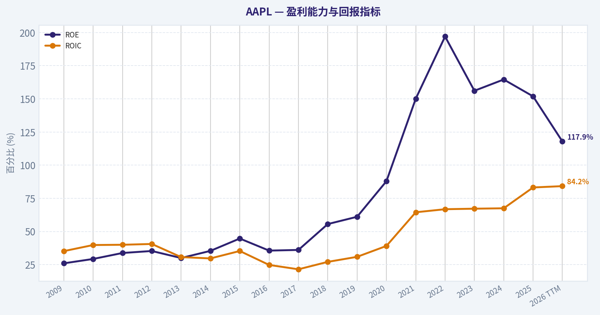
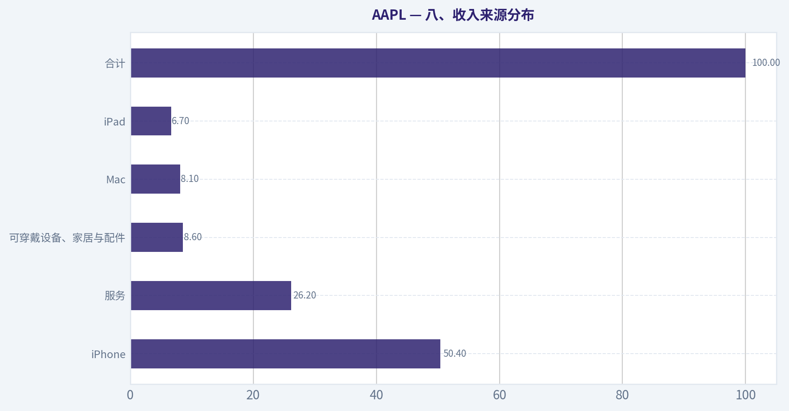
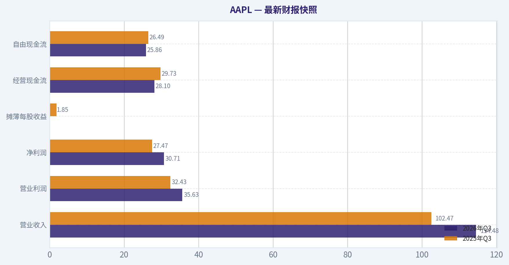
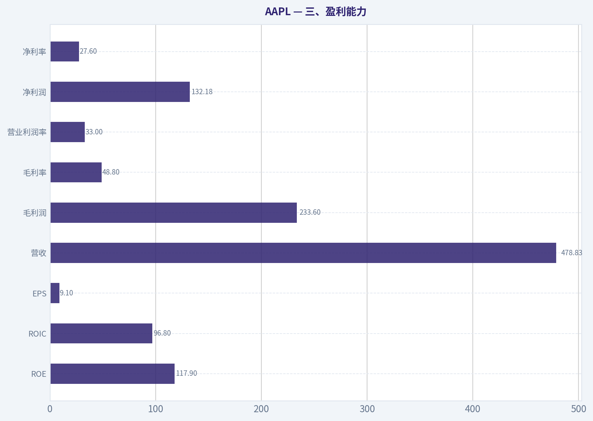
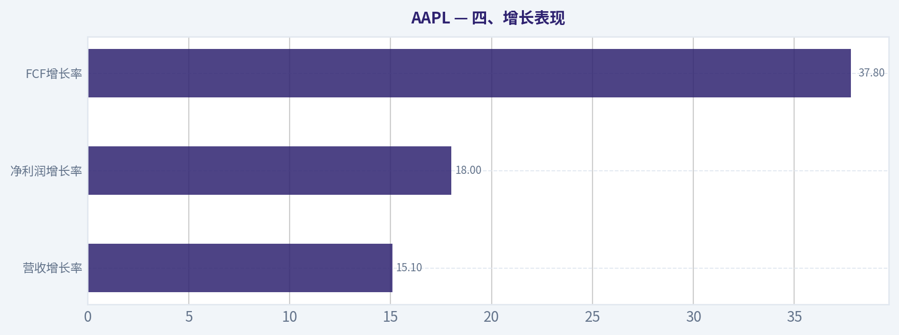
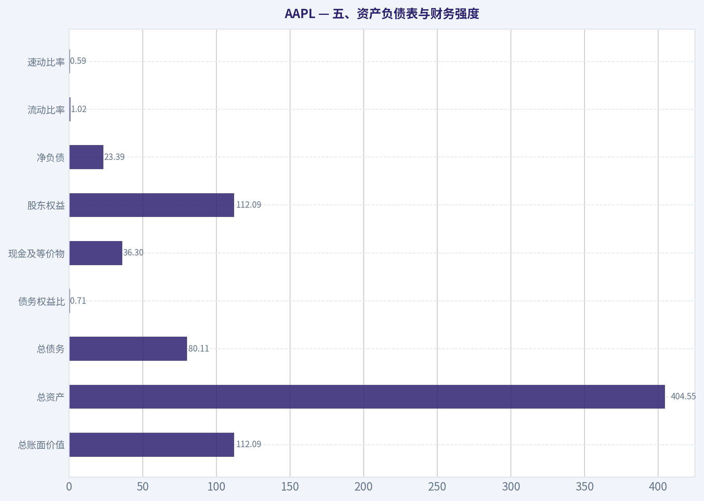
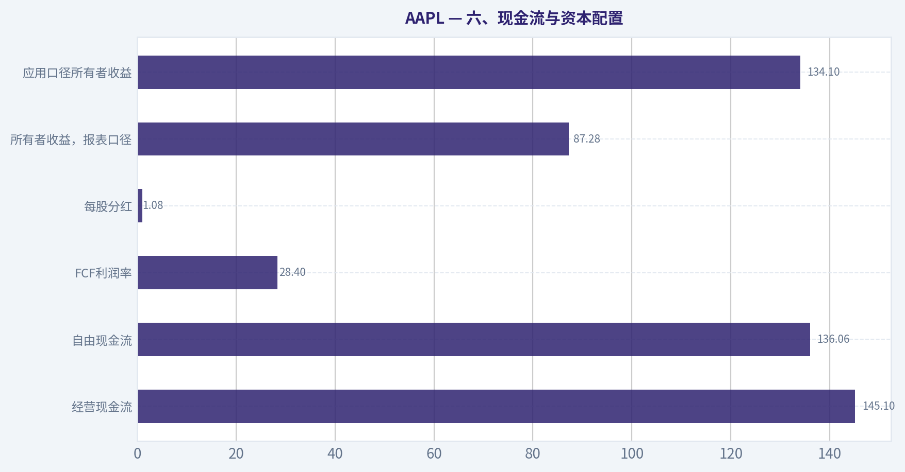
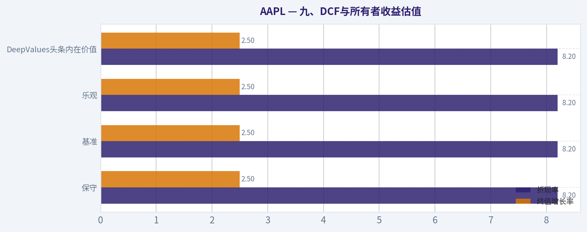

# AAPL 深度价值情报

**调研日期:** 2026-11-27

## 关键免责声明

*本报告由 Deep Value Intelligence（一个基于 AI 的多智能体投资分析框架）自动生成。 仅供教育和研究用途 - 非财务建议，非财务顾问。*

---

## 目录

1. 情报摘要
2. 分析师团队报告
   - 基本面分析
   - 价值分析 (巴菲特)
   - 成长性分析 (林奇/德鲁肯米勒/费雪)
   - 市场分析
   - 期权市场分析
3. 研究团队评论
4. 投资团队评论
5. Deep Values 团队洞察

---

## 情报摘要

### 核心观点与前提条件

**核心论点:** **结论：Apple 的永久性经营风险较低，主要风险来自估值。**

**主要风险:**
- 原计划为 **中性**，并重点观察总自由现金流、服务、AI、毛利率、中国业务及动态 DCF。该框架应予保留，但可进一步明确验证顺序：
- **中性**

**置信度:** 中

---

## 分析师团队报告

### 基本面分析

#### 最新财报快照

*以下数据基于最近一期已披露财报（2026年Q3），并尽量与上一年同期对比。*

| 指标 | 2026年Q3 | 2025年Q3 | 同比变化 |
| --- | ---: | ---: | ---: |
| 营业收入 | $114.48B | $102.47B | +11.7% |
| 营业利润 | $35.63B | $32.43B | +9.9% |
| 净利润 | $30.71B | $27.47B | +11.8% |
| 摊薄每股收益 | N/A | $1.85 | N/A |
| 经营现金流 | $28.10B | $29.73B | -5.5% |
| 自由现金流 | $25.86B | $26.49B | -2.4% |

关键结论：这张快照先把最新一期财报放在桌面上，再去看长周期分析。这样读者能更清楚地区分"公司长期质量"和"这次财报发生了什么"。

#### AAPL 17年财务指标

*以下数值均由原始数据确定性计算得出，并非 AI 估算。*

*发行人类型：operating company（Technology / Consumer Electronics）。*

#### 17年财务指标
*年度行来自已披露财务报表，最后一行 TTM 由最近四个季度滚动计算得出。*

| 指标 | 2009 | 2010 | 2011 | 2012 | 2013 | 2014 | 2015 | 2016 | 2017 | 2018 | 2019 | 2020 | 2021 | 2022 | 2023 | 2024 | 2025 | 2026 TTM |
| --- | --- | --- | --- | --- | --- | --- | --- | --- | --- | --- | --- | --- | --- | --- | --- | --- | --- | --- |
| 市场价格 | $6 | $8 | $11 | $20 | $15 | $22 | $25 | $26 | $36 | $53 | $54 | $112 | $138 | $135 | $169 | $231 | $254 | $356 |
| 总市值 | $168.11B | $262.39B | $357.16B | $630.65B | $444.17B | $616.86B | $638.98B | $621.81B | $809.39B | $1.13T | $1.04T | $2.03T | $2.39T | $2.26T | $2.71T | $3.59T | $3.82T | $5.17T |
| 市盈率 | 20.41 | 18.73 | 13.78 | 15.10 | 11.99 | 15.62 | 11.96 | 13.60 | 16.73 | 18.94 | 18.85 | 35.31 | 25.22 | 22.62 | 27.93 | 38.32 | 34.13 | 39.09 |
| 市净率 | 5.31 | 5.49 | 4.66 | 5.33 | 3.60 | 5.53 | 5.35 | 4.85 | 6.04 | 10.53 | 11.51 | 31.07 | 37.83 | 44.53 | 43.56 | 63.04 | 51.82 | 46.10 |
| ROE | 26.0% | 29.3% | 33.8% | 35.3% | 30.0% | 35.4% | 44.7% | 35.6% | 36.1% | 55.6% | 61.1% | 87.9% | 150.1% | 197.0% | 156.1% | 164.6% | 151.9% | 117.9% |
| ROIC | 35.2% | 39.8% | 40.0% | 40.6% | 30.7% | 29.7% | 35.3% | 24.8% | 21.5% | 27.1% | 30.9% | 39.1% | 64.5% | 66.8% | 67.2% | 67.5% | 83.2% | 84.2% |
| 每股收益 | $0.27 | $0.45 | $0.83 | $1.33 | $1.22 | $1.42 | $2.06 | $1.90 | $2.14 | $2.81 | $2.85 | $3.18 | $5.47 | $5.99 | $6.13 | $6.08 | $7.46 | $9.10 |
| 营收 | $42.91B | $65.22B | $108.25B | $156.51B | $170.91B | $182.79B | $233.72B | $215.64B | $229.23B | $265.60B | $260.17B | $274.51B | $365.82B | $394.33B | $383.29B | $391.04B | $416.16B | $478.83B |
| 毛利润 | $17.22B | $25.68B | $43.82B | $68.66B | $64.30B | $70.54B | $93.63B | $84.26B | $88.19B | $101.84B | $98.39B | $104.96B | $152.84B | $170.78B | $169.15B | $180.68B | $195.20B | $233.60B |
| 毛利率 | 40.1% | 39.4% | 40.5% | 43.9% | 37.6% | 38.6% | 40.1% | 39.1% | 38.5% | 38.3% | 37.8% | 38.2% | 41.8% | 43.3% | 44.1% | 46.2% | 46.9% | 48.8% |
| 营业利润率 | 27.4% | 28.2% | 31.2% | 35.3% | 28.7% | 28.7% | 30.5% | 27.8% | 26.8% | 26.7% | 24.6% | 24.1% | 29.8% | 30.3% | 29.8% | 31.5% | 32.0% | 33.0% |
| 净利润 | $8.23B | $14.01B | $25.92B | $41.73B | $37.04B | $39.51B | $53.39B | $45.69B | $48.35B | $59.53B | $55.26B | $57.41B | $94.68B | $99.80B | $97.00B | $93.74B | $112.01B | $132.18B |
| 净利率 | 19.2% | 21.5% | 23.9% | 26.7% | 21.7% | 21.6% | 22.8% | 21.2% | 21.1% | 22.4% | 21.2% | 20.9% | 25.9% | 25.3% | 25.3% | 24.0% | 26.9% | 27.6% |
| 营收增长 | N/A | 52.0% | 66.0% | 44.6% | 9.2% | 7.0% | 27.9% | -7.7% | 6.3% | 15.9% | -2.0% | 5.5% | 33.3% | 7.8% | -2.8% | 2.0% | 6.4% | 15.1% |
| 净利润增长 | N/A | 70.2% | 85.0% | 61.0% | -11.3% | 6.7% | 35.1% | -14.4% | 5.8% | 23.1% | -7.2% | 3.9% | 64.9% | 5.4% | -2.8% | -3.4% | 19.5% | 18.0% |
| 自由现金流增长 | N/A | 84.0% | 100.5% | 27.9% | 6.9% | 10.2% | 39.6% | -23.6% | -3.2% | 23.8% | -8.1% | 24.6% | 26.7% | 19.9% | -10.6% | 9.3% | -9.2% | 37.8% |
| 总账面价值 | $31.64B | $47.79B | $76.61B | $118.21B | $123.55B | $111.55B | $119.36B | $128.25B | $134.05B | $107.15B | $90.49B | $65.34B | $63.09B | $50.67B | $62.15B | $56.95B | $73.73B | $112.09B |
| 总资产 | $47.50B | $75.18B | $116.37B | $176.06B | $207.00B | $231.84B | $290.35B | $321.69B | $375.32B | $365.73B | $338.52B | $323.89B | $351.00B | $352.75B | $352.58B | $364.98B | $359.24B | $404.55B |
| 总债务 | N/A | N/A | N/A | $0 | $16.96B | $35.30B | $64.33B | $87.03B | $115.68B | $114.48B | $108.05B | $112.44B | $124.72B | $120.07B | $111.09B | $106.63B | $98.66B | $80.11B |
| 债务股权比 | N/A | N/A | N/A | 0.00 | 0.14 | 0.32 | 0.54 | 0.68 | 0.86 | 1.07 | 1.19 | 1.72 | 1.98 | 2.37 | 1.79 | 1.87 | 1.34 | 0.71 |
| 现金及等价物 | $5.26B | $11.26B | $9.81B | $10.75B | $14.26B | $13.84B | $21.12B | $20.48B | $20.29B | $25.91B | $48.84B | $38.02B | $34.94B | $23.65B | $29.96B | $29.94B | $35.93B | $36.30B |
| 股东权益 | $31.64B | $47.79B | $76.61B | $118.21B | $123.55B | $111.55B | $119.36B | $128.25B | $134.05B | $107.15B | $90.49B | $65.34B | $63.09B | $50.67B | $62.15B | $56.95B | $73.73B | $112.09B |
| 经营现金流 | $10.16B | $18.59B | $37.53B | $50.86B | $53.67B | $59.71B | $81.27B | $66.23B | $64.22B | $77.43B | $69.39B | $80.67B | $104.04B | $122.15B | $110.54B | $118.25B | $111.48B | $145.10B |
| 投资现金流 | $-17.43B | $-13.85B | $-40.42B | $-48.23B | $-33.77B | $-22.58B | $-56.27B | $-45.98B | $-46.45B | $16.07B | $45.90B | $-4.29B | $-14.54B | $-22.35B | $3.71B | $2.94B | $15.20B | $-17.28B |
| 自由现金流 | $9.02B | $16.59B | $33.27B | $42.56B | $45.50B | $50.14B | $70.02B | $53.50B | $51.77B | $64.12B | $58.90B | $73.36B | $92.95B | $111.44B | $99.58B | $108.81B | $98.77B | $136.06B |
| 自由现金流利润率 | 21.0% | 25.4% | 30.7% | 27.2% | 26.6% | 27.4% | 30.0% | 24.8% | 22.6% | 24.1% | 22.6% | 26.7% | 25.4% | 28.3% | 26.0% | 27.8% | 23.7% | 28.4% |
| 每股分红 | $0.00 | $0.00 | $0.00 | $0.00 | $0.00 | $0.00 | $0.00 | $0.00 | $0.00 | $0.00 | $0.00 | $0.00 | $0.00 | $0.00 | $0.95 | $0.99 | $1.03 | $1.08 |

#### 盈利能力指标
- 净资产收益率 (ROE): 117.9%
- 投入资本回报率 (ROIC): 96.8%
- 总资产收益率 (ROA): 32.7%
- 毛利率: 48.8%
- 营业利润率: 33.0%
- 净利率: 27.6%

#### 流动性指标
- 流动比率: 1.02
- 速动比率: 0.59

#### 杠杆指标
- 债务股权比: 0.71
- 利息覆盖倍数: N/A
- 净负债: $23.39B

#### 增长指标（同比）
- 营收增长: 15.1%
- 净利润增长: 18.0%
- 自由现金流增长: 37.8%
- 营收复合增长率（3年）: 7.7%
- 营收复合增长率（5年）: 5.5%

#### 估值指标
- 市盈率 (TTM): 39.60
- 预期市盈率: 33.63
- 市净率: 46.10
- 市销率: 10.79
- PEG 比率: 3.94
- 企业价值/EBITDA: 30.35
- 自由现金流收益率: 2.6%
- 盈利收益率: 2.5%

#### 所有者收益（巴菲特方法，代码计算）
- 净利润: $112.01B
- + 折旧与摊销: $13.42B
- - 资本开支: $-9.04B
- + 营运资本（现金流量表口径；负数=占用现金）: $-14.86B
- = **所有者收益: $87.28B**

#### 内在价值（DeepValues 应用 - SEC 申报数据管道）
- **内在价值（DeepValues 应用，头条）: $186.42** - Owner Earnings (Buffett), 方法 buffett-1986-v2, 截至 2026-11-26 (FY2026)
  区间（保守-乐观）: $130.50 - $186.42
  相对价格的安全边际: -90.7% (价格 $355.58)
  应用使用的输入 (ttm_2026Q4): after-tax operating income $132.4B (operating income $158.1B, tax 16.2%) + D&A $13.4B - capex charge $11.7B (three-year average capex/revenue x trailing revenue; reported capex $9.0B) - working capital $0.0B = owner earnings $134.1B.
  Growth 5.5% fading to 2.5% terminal (min(owner-earnings CAGR, 5-year revenue CAGR), clamped [0, 10%]); discount rate 8.2% (30Y Treasury 5.24% + 3 pts (as of 2026-11-25)); net cash $55.4B (cash $36.3B + marketable securities $100.6B - debt $80.1B); 14,715M shares.
- Owner Earnings (Buffett): $130.50 / $186.42 / $186.42 (保守 / 基准 / 乐观) ← headline
- Free cash flow DCF: $116.45 / $194.32 / $422.92 (保守 / 基准 / 乐观)
- Damodaran two-stage FCFF: $104.84 / $151.62 / $164.40 (保守 / 基准 / 乐观)
  这就是内在价值：引用它作为内在价值，并据此衡量安全边际。其他地方的 DVI 情景数字仅为辅助交叉检查，不是估值。

#### DVI 情景模型（辅助交叉检查 - 不是内在价值）
DVI 基于 Yahoo 数据的情景，仅作敏感性检查。请勿将其作为内在价值引用；内在价值是上方的 DeepValues 应用估值。
- 当前价格: $356
- DVI 情景值（按商业模式路由）: $198
  商业模式: operating company - weighted blend [Damodaran FCFF + reverse-DCF fair + owner-earnings DCF] (operating_company)
  模型区间（各 DCF 最小-最大）: $191 - $244
  相对价格的安全边际（头条）: -79.3%
  路由说明: General operating company: balanced blend of Damodaran FCFF and the owner-earnings DCF with a reverse-DCF sanity check.
- 巴菲特方法（所有者收益）:
  保守: $140
  平均: $244
  乐观: $651
- 现金流方法（FCF）:
  保守: $88
  平均: $207
  乐观: $277
- Damodaran FCFF（WACC + 利润率 + 再投资）:
  保守: $109
  平均: $191
  乐观: $402
  蒙特卡洛区间（P10-P90）：$138 - $305（中位数 $201）
  P(内在价值 > 当前价格)：3.9%
- 反向 DCF：当前价格隐含约 26.5%/年 的所有者收益增长（10年）；过去 3 年为 1.4%，5 年为 14.1%。

#### Piotroski F分数: 9/9
- 净利润为正: 通过
- 经营现金流为正: 通过
- 资产回报率改善: 通过
- 现金流大于净利润: 通过
- 债务下降: 通过
- 流动比率改善: 通过
- 未稀释股本: 通过
- 毛利率改善: 通过
- 资产周转率改善: 通过

ANALYST STANCE: **中性**

#### 一、结论摘要

Apple 仍是全球最强的消费科技与生态平台之一，拥有极高的现金创造能力、宽阔的品牌与生态护城河，以及优秀的资本回报率。最新 TTM 数据显示，营收同比增长 15.1%，净利润增长 18.0%，自由现金流增长 37.8%，毛利率提升至 48.8%，经营利润率提升至 33.0%。

但估值已经明显脱离历史常态。当前股价约 356 美元，市盈率约 39.6 倍，远高于 2009-2025 年约 21.1 倍的年度平均水平；DeepValues 的巴菲特式所有者收益内在价值为 186.42 美元，保守至乐观区间为 130.50-186.42 美元。当前价格隐含的所有者收益长期增长要求非常高，证据尚不足以支持这一估值水平。

#### 二、市场指标与估值

| 指标 | 当前值 | 2009-2025年年度平均 | 当前相对历史 | 解读 |
|---|---:|---:|---:|---|
| 市场价格 | $356 | 约$93 | 显著高于 | 反映长期盈利增长、回购和估值扩张 |
| 总市值 | $5.17T | 约$1.57T | 显著高于 | 已进入超大市值阶段，维持高增长的难度上升 |
| PE | 39.60倍 | 约21.13倍 | 约高87% | 对未来增长和利润稳定性要求很高 |
| PB | 46.10倍 | 约20.00倍 | 高于历史 | 对Apple不具备可靠的便宜或昂贵判断意义 |
| 盈利收益率 | 2.5% | - | 偏低 | 与无风险利率相比，现金流回报要求较高 |
| FCF收益率 | 2.6% | - | 偏低 | 现金流相对于市值的即时回报有限 |

**关键结论：** PE是当前最有参考价值的估值指标之一，39.6倍明显高于历史均值。PB不应机械解读，Apple属于品牌、软件、生态和知识产权驱动的轻资产运营公司，回购会持续压低账面权益，因此估值应主要锚定自由现金流和所有者收益，而不是账面价值。

当前市值约 5.17 万亿美元，而最新自由现金流约 136.06 十亿美元，对应 FCF收益率仅约 2.6%。这意味着市场已经为持续的高质量增长、服务业务扩张、AI催化以及资本回报预先支付了较高溢价。

#### 三、盈利能力

| 指标 | 当前值 | 2009-2025年年度平均 | 当前表现 |
|---|---:|---:|---|
| ROE | 117.9% | 约78.3% | 显著高于历史平均 |
| ROIC | 96.8% | 约43.8% | 显著高于历史平均 |
| EPS | $9.10 | 约$3.23 | 创历史新高区间 |
| 营收 | $478.83B | 约$244.48B | 约为历史平均的1.96倍 |
| 毛利润 | $233.60B | - | 创新高 |
| 毛利率 | 48.8% | 约41.1% | 明显改善 |
| 营业利润率 | 33.0% | 约29.1% | 高于长期平均 |
| 净利润 | $132.18B | 约$57.84B | 创新高 |
| 净利率 | 27.6% | 约23.2% | 明显高于长期平均 |

**关键结论：** Apple当前盈利质量明显优于十年前，尤其是毛利率从约40%附近提高至48.8%，说明服务业务、产品组合、定价能力和生态变现能力持续改善。ROE和ROIC极高，但ROE受到大规模回购和较低账面权益的放大，ROIC更能说明业务本身的资本效率。

#### 四、增长表现

| 增长指标 | 当前同比 | 近期历史参照 | 评价 |
|---|---:|---:|---|
| 营收增长率 | 15.1% | 3年复合约7.7%；5年复合约5.5% | 明显高于中期趋势 |
| 净利润增长率 | 18.0% | 近年经历负增长后恢复 | 强劲反弹 |
| FCF增长率 | 37.8% | 3年波动较大 | 当前异常强劲 |
| EPS增长 | 当前$9.10 | 长期持续上升 | 受盈利增长与回购共同推动 |

**关键结论：** 当前增长率明显高于Apple近五年的收入增长趋势，但单年强劲增长不能直接视为永久增长率。历史上Apple经历过2013、2016、2019、2023和2024等收入或净利润压力年份，因此增长具有周期性，且超大规模基数会限制长期增速。

收入增长从早期的30%-60%高增长，逐渐下降到成熟企业常见的个位数区间。当前15.1%的增长是积极信号，但估值已经隐含比历史中期趋势更高的持续增长。

#### 五、资产负债表与财务强度

| 指标 | 当前值 | 历史趋势或参照 | 解读 |
|---|---:|---:|---|
| 总账面价值 | $112.09B | 2009-2025年平均约$89B | 受盈利保留和资本结构影响 |
| 总资产 | $404.55B | 2009-2025年平均约$264B | 资产规模持续扩张 |
| 总债务 | $80.11B | 2020年约$112.44B | 近年下降 |
| 债务权益比 | 0.71 | 2021年高达1.98 | 明显改善 |
| 现金及等价物 | $36.30B | 2009-2025年平均约$25B | 现金基础稳健 |
| 股东权益 | $112.09B | 近年回购后波动 | 低账面权益放大ROE |
| 净负债 | $23.39B | - | 可由经营现金流覆盖 |
| 流动比率 | 1.02 | - | 接近1，流动性不算宽裕 |
| 速动比率 | 0.59 | - | 依赖持续经营现金流 |

**关键结论：** Apple的绝对债务已经从2021年高点下降，债务权益比也从1.98降至0.71，财务杠杆风险正在缓和。虽然流动比率仅约1.02、速动比率约0.59，但Apple拥有极强的经营现金流和资本市场融资能力，短期偿债能力主要由现金生成能力而非高额流动资产支撑。

资产负债表的主要局限是，账面权益受到大规模回购影响，不能完整反映品牌、生态、软件、用户关系和知识产权价值。因此PB为46.1倍并不适合单独判断估值。

#### 六、现金流与资本配置

| 指标 | 当前值 | 2009-2025年年度平均 | 趋势 |
|---|---:|---:|---|
| 经营现金流 | $145.10B | - | 创历史高位 |
| 自由现金流 | $136.06B | 约$63.55B | 约为历史平均2.14倍 |
| FCF利润率 | 28.4% | 约25.5% | 高于长期平均 |
| 每股分红 | $1.08 | 2012年前为$0 | 持续增长 |
| 所有者收益，报表口径 | $87.28B | - | 受营运资本现金流影响 |
| 应用口径所有者收益 | $134.1B | - | 采用税后经营利润和标准化资本开支 |

**关键结论：** Apple的现金流转换能力是投资逻辑的核心。当前自由现金流达到1361亿美元，且自由现金流利润率升至28.4%，说明利润质量较高。报表口径所有者收益为872.8亿美元，而DeepValues模型采用税后经营利润、折旧摊销、标准化资本开支和零营运资本调整，得到约1341亿美元；两者差异主要来自口径不同，不能直接混用。

Apple长期通过分红和回购返还资本。分红本身相对市值的回报率不高，但其持续增长体现出现金流稳定性；回购则降低股本并提高EPS和ROE，但也会压低账面权益，使PB和ROE受到资本结构影响。

#### 七、经济护城河与业务质量

Apple的护城河主要来自以下几个方面：

1. **生态系统转换成本**：硬件、操作系统、应用商店、云服务、支付和配件共同构成体系，用户迁移不仅是更换手机，也涉及数据、应用、服务和设备协同。
2. **品牌与定价能力**：毛利率从长期约40%提高至48.8%，显示品牌溢价、产品组合和服务收入提升了单位用户价值。
3. **规模与供应链能力**：全球采购、芯片设计、零售渠道和供应链管理形成较高进入壁垒。
4. **软件与服务复利**：服务业务具有较高毛利率、较强重复性和更好的收入可见度，有助于降低单纯硬件换机周期的波动。
5. **资本配置能力**：长期回购和分红配合高ROIC，使每股盈利增长可能高于总收入增长。

但护城河并非没有压力。智能手机市场已高度成熟，产品创新必须持续证明换机价值；服务业务面临监管、分成比例和竞争压力；AI功能可能提高生态黏性，也可能增加基础设施成本并加速竞争者追赶。

#### 八、收入来源分布

由于确定性数据包没有提供2026 TTM的产品分部明细，以下采用最近可获得的Apple年度产品收入结构估算，金额为约数，合计与2025年度总收入约4162亿美元基本一致。

| 收入来源 | 金额（十亿美元） | 占比 |
|---|---:|---:|
| iPhone | 约209.6 | 50.4% |
| 服务 | 约109.2 | 26.2% |
| 可穿戴设备、家居与配件 | 约35.7 | 8.6% |
| Mac | 约33.7 | 8.1% |
| iPad | 约28.0 | 6.7% |
| 合计 | 约416.2 | 100.0% |

**关键结论：** iPhone仍贡献约一半收入，是Apple最大的单一业务来源；服务收入已经超过四分之一，且通常具备更高毛利率和更强重复性。收入结构正在从单一硬件驱动转向硬件加服务驱动，但iPhone集中度仍然较高，换机周期、区域需求和产品创新依然是关键变量。

#### 九、DCF与所有者收益估值

DeepValues头条内在价值采用Owner Earnings方法，不能用辅助模型替代。核心输入为：

- 当前价格：约356美元；
- 税后经营利润：132.4十亿美元；
- 折旧与摊销：13.4十亿美元；
- 标准化资本开支：11.7十亿美元；
- 营运资本调整：约0；
- 模型所有者收益：约134.1十亿美元；
- 净现金：55.4十亿美元；
- 股份数：约14.715十亿股；
- 折现率：8.2%；
- 终值增长率：2.5%；
- 基准显式增长率：5.5%，之后逐步降至2.5%。

简化的两阶段计算逻辑为：

\[
企业价值=\sum_{t=1}^{10}\frac{OE_0(1+g_t)^t}{(1+r)^t}
+\frac{OE_{10}(1+g_T)}{(r-g_T)(1+r)^{10}}
\]

再加净现金并除以流通股数，得到每股内在价值。

| 情景 | 所有者收益增长假设 | 折现率 | 终值增长率 | 每股估值 |
|---|---|---:|---:|---:|
| 保守 | 低增长并逐步降至2.5% | 8.2% | 2.5% | $130.50 |
| 基准 | 约5.5%，逐步降至2.5% | 8.2% | 2.5% | $186.42 |
| 乐观 | 较高早期增长，逐步降至2.5% | 8.2% | 2.5% | $186.42 |
| DeepValues头条内在价值 | Owner Earnings模型 | 8.2% | 2.5% | **$186.42** |

辅助交叉检查结果如下：

- FCF DCF：116.45-422.92美元；
- FCFF模型：104.84-164.40美元；
- DVI辅助情景值：约198美元；
- 当前价格反向DCF隐含的十年所有者收益增长率：约26.5%；
- 历史3年收入复合增长率：约7.7%；
- 历史5年收入复合增长率：约5.5%。

**关键结论：** DeepValues头条内在价值为186.42美元，保守区间下限为130.50美元，均显著低于当前约356美元。反向DCF要求所有者收益在十年内接近每年26.5%的增长，而Apple过去3年收入复合增长仅约7.7%，因此当前价格对增长的要求明显高于历史经营表现。辅助FCF和FCFF模型虽然给出更宽的估值区间，但大部分结果仍低于当前价格。

#### 十、巴菲特式综合判断

**经济护城河：强。** 品牌、生态、服务、供应链和规模形成多层防御体系，竞争优势具有长期性。

**财务实力：强。** 经营现金流1451亿美元，自由现金流1361亿美元，债务下降，净负债相对于现金生成能力较低。

**盈利可预测性：较强但非线性。** 长期趋势稳定向上，但收入和净利润曾出现负增长，硬件周期和宏观需求仍会造成波动。

**管理层与资本配置：优秀。** ROIC长期极高，资本开支纪律较好，分红和回购持续进行。不过高回购也会压低账面权益，使ROE不宜单独作为经营改善的证据。

**质量与估值的匹配：估值偏紧。** Apple是高质量企业，但高质量不等于任何价格都合理。当前PE接近40倍，FCF收益率约2.6%，而模型内在价值约186美元，说明市场已经把相当多的未来增长计入价格。

#### 十一、关键投资洞见、风险与机会

| 类型 | 具体内容 | 对估值的影响 |
|---|---|---|
| 机会 | 服务收入持续增长，改善收入重复性和毛利率 | 支持较高质量溢价 |
| 机会 | AI功能提高设备换机和生态使用频率 | 可能提升长期现金流增长 |
| 机会 | 回购与分红持续，EPS增长可能高于收入增长 | 支持每股价值增长 |
| 风险 | iPhone收入占比仍约50% | 产品周期和换机放缓会放大波动 |
| 风险 | 当前PE远高于历史均值 | 估值压缩风险较大 |
| 风险 | 中国市场竞争与供应链地缘风险 | 可能影响收入和利润率 |
| 风险 | App Store监管和服务分成压力 | 可能压低服务利润率 |
| 风险 | AI投入增加且商业化仍需验证 | 可能造成资本开支和运营费用上升 |
| 风险 | 当前价格隐含约26.5%长期增长 | 实际增长若回归5%-8%，估值难以维持 |

**关键结论：** 最重要的机会在于服务、AI和生态变现可能延长Apple的增长周期；最重要的风险则是估值已经假设了非常高的长期现金流增长。即使公司经营质量保持优秀，只要增长低于市场隐含水平，估值回归也可能显著影响每股价值。

#### 十二、最终立场

**中性**

依据并非公司质量不足，而是估值与可验证增长之间存在明显缺口：

- 当前PE约39.6倍，约为历史平均的1.87倍；
- FCF收益率仅约2.6%；
- DeepValues Owner Earnings内在价值为186.42美元；
- 保守至乐观区间为130.50-186.42美元；
- 当前价格约356美元，明显高于模型内在价值；
- 反向DCF隐含的十年所有者收益增长率约26.5%，显著高于Apple中期收入增长趋势。

因此，研究证据支持"高质量、强护城河、强现金流"的企业判断，但不支持当前价格已经充分反映安全边际的估值判断。最终观察重点应是：服务收入增速、AI商业化、毛利率能否维持、iPhone周期是否重新加速，以及自由现金流增长能否长期显著高于5%-8%的中期趋势。

#### 十三、报告要点汇总

| 维度 | 核心判断 | 证据 |
|---|---|---|
| 企业质量 | 极高 | ROIC约96.8%，毛利率48.8%，FCF1361亿美元 |
| 护城河 | 强 | 品牌、生态、服务、供应链和规模 |
| 盈利趋势 | 长期向上，短期加速 | 营收增长15.1%，净利润增长18.0% |
| 财务安全 | 强 | 债务80.11亿美元，债务权益比0.71，现金流充沛 |
| 账面估值 | PB不适用作主要判断 | 轻资产、回购压低权益 |
| 市场估值 | 偏高 | PE39.6倍，FCF收益率2.6% |
| 内在价值 | 低于现价 | DeepValues估值186.42美元 |
| 主要催化 | 服务、AI、生态变现 | 可能延长增长周期 |
| 主要风险 | 高估值、iPhone集中、监管、AI投入 | 可能导致增长或估值回落 |
| 最终立场 | **中性** | 公司优秀，但当前估值缺乏足够安全边际 |

**关键结论：** Apple具备巴菲特偏好的高质量特征：品牌护城河、持续现金流、高资本回报和优秀资本配置。但在约356美元的价格水平上，估值要求远高于历史平均和多数现金流模型结果，因此当前最核心的判断不是企业是否优秀，而是未来增长是否足以兑现已经计入价格的高预期。

#### 基本面关键图表

本图追踪 **AAPL** 过去十年的盈利能力与回报指标（ROE、ROIC、利润率），突出呈现资本效率的变化趋势。

本对比图（来自「八、收入来源分布」）将 **AAPL** 的当前数据与历史基准并排呈现，直观反映公司相对自身历史均值的估值水平。

---

### 价值分析 (巴菲特)

> *基于沃伦·巴菲特的价值投资哲学：能力圈、经济护城河、管理层质量与安全边际。*

#### 内在价值快照

价格是你付的钱，内在价值是企业未来可能为股东创造的现金价值。我们给出一个区间，而不是假装只有一个神奇数字。

- 当前价格: $355.58
- 估值区间（两种 DCF 方法、保守到乐观）: $116.45 至 $422.92

##### 所有者收益（巴菲特方法）
- 净利润: $112,010,000,000.00
- 折旧与摊销: $13,423,000,000.00
- 资本支出: $-9,041,000,000.00
- 营运资金变化: $-14,858,000,000.00
- 所有者收益: $87,280,891,892.50

##### 内在价值
###### 所有者收益法
使用所有者收益，更严格，通常更保守。
- 保守: $130.50
- 平均: $186.42
- 乐观: $186.42
- 折现率: 8.2%

###### 自由现金流法
使用自由现金流，更适合今天投入很多、为未来增长铺路的公司。
- 保守: $116.45
- 平均: $194.32
- 乐观: $422.92
- 折现率: 9.0%

ANALYST STANCE: **中性**

#### 一、核心结论

Apple 是具有全球品牌、生态系统和高资本回报率的卓越企业，但当前估值明显脱离现金流内在价值。DeepValues 应用给出的基准内在价值为每股 **186.42美元**，当前股价约 **356美元**，价格较该内在价值高约 **90.7%**。

业务质量足以支持较低的安全边际要求，但目前的估值差距远超过"优质企业合理溢价"的范围。研究结论为 **中性**：企业质量很高，估值证据不足以支持当前价格。

#### 二、因素评分

| 因素 | 评分 | 主要依据 |
|---|---:|---|
| 因素1：能力圈与业务简单性 | 4/5 | 通过硬件、软件、服务和生态系统向消费者收费；业务易于理解，但AI、监管和产品周期增加未来不确定性 |
| 因素2：护城河 | 4/5 | 品牌、软硬件协同、用户生态、应用商店和数据迁移成本构成宽阔且稳定的护城河 |
| 因素3：管理层与资本配置 | 4/5 | 持续回购、现金流分配纪律较强，资本回报长期优秀；但外部投资者对未来AI资本配置仍需观察 |
| 因素4：行业结构 | 3/5 | 高端智能设备和平台服务具有规模优势，但行业竞争激烈、创新周期快、供应链和监管压力较高 |

**关键结论：** Apple 的核心竞争力真实且持久，尤其体现在品牌、生态黏性和现金创造能力上。主要扣分来自估值，而不是企业质量；AI竞争、监管和成熟市场增长放缓限制了可预测性评分。

#### 三、护城河分析

| 护城河来源 | 具体证据 | 强度判断 |
|---|---|---|
| 无形资产 | 全球品牌溢价、设计能力、操作系统和开发者生态 | 强 |
| 转换成本 | 用户数据、应用购买记录、设备互联、家庭设备协同 | 强 |
| 成本优势 | 采购规模、芯片设计、供应链管理和分销效率 | 中强 |
| 网络效应 | 用户规模吸引开发者，开发者内容反过来增强用户留存 | 中强 |
| 财务表现 | 毛利率约48.8%，ROE约117.9%，自由现金流持续充沛 | 强 |

Apple 的护城河并非单一品牌优势，而是"设备-系统-服务-开发者"的组合优势。消费者更换单一设备并不一定困难，但离开整个生态系统会带来数据迁移、应用重购、配件替换和使用习惯变化等综合成本。

需要注意的是，护城河评级为 **宽阔且稳定，4/5**，而不是"宽阔且持续扩张"。原因在于智能手机市场已经成熟，未来护城河的扩张更多依赖服务、AI能力和新产品，而不是单纯扩大设备销量。

#### 四、管理层与资本配置

| 观察项目 | 评价 | 结论 |
|---|---|---|
| 经营纪律 | 长期维持高毛利、高现金流和高资本回报 | 优秀 |
| 回购政策 | 大量自由现金流通过回购返还股东，减少股份数量 | 整体理性，但回购价格始终重要 |
| 研发投入 | 持续投入芯片、软件、AI和新产品 | 有利于维持护城河 |
| 并购纪律 | 未依赖大规模高价并购维持增长 | 正面 |
| 透明度 | 财务披露成熟，资本结构相对清晰 | 良好 |
| 主要风险 | AI投入和监管政策可能改变资本配置回报 | 需要中性 |

巴菲特旗下伯克希尔披露截至2026年9月30日仍持有约2.2792亿股Apple股票，披露市值约759亿美元。该信息支持Apple长期经济特征较强，但并不能证明当前市场价格具有足够安全边际。

#### 五、财务摘要

| 指标 | 最新数据 |
|---|---:|
| 股价 | 356美元 |
| 总市值 | 5.17万亿美元 |
| PE | 39.6倍 |
| 营收同比增长 | 15.1% |
| 毛利率 | 48.8% |
| ROE | 117.9% |
| 自由现金流收益率 | 2.6% |
| 流动比率 | 1.02 |
| 现金及有价证券 | 1,369亿美元 |
| 总债务 | 801亿美元 |
| 净现金 | 554亿美元 |
| 稀释后股数 | 147.15亿股 |
| 税后经营利润 | 1,324亿美元 |

**关键结论：** Apple 同时具备高毛利、高ROE和强现金流，这是典型的资产轻、品牌强、资本回报优秀的商业模式。问题在于2.6%的自由现金流收益率和约39.6倍PE已经反映了大量未来增长，估值对增长放缓、AI投入回报不及预期或利率维持高位都较为敏感。

#### 六、所有者收益计算

| 项目 | 金额 |
|---|---:|
| 税后经营利润 | 1,324亿美元 |
| 加：折旧与摊销 | 134亿美元 |
| 减：维持性资本开支 | 117亿美元 |
| 减：营运资本增加 | 0亿美元 |
| 所有者收益 | **1,341亿美元** |
| 每股所有者收益 | **约9.11美元** |

计算公式为：

> 所有者收益 = 净利润或税后经营利润 + 折旧摊销 - 维持性资本开支 - 营运资本增加

DeepValues 使用的所有者收益为 **1,341亿美元**，与上述口径一致。Apple 的经营现金流质量较高，利润能够较好地转化为现金；其低流动比率更多反映高效的供应商付款和递延收入结构，而不是传统意义上的流动性危机。

#### 七、三情景DCF估值

以下情景为现金流交叉检验。正式内在价值采用DeepValues应用的基准值，而不是自行情景的结果。

| 情景 | 主要假设 | 企业价值及净现金调整 | 每股估值 |
|---|---|---:|---:|
| 情景A：零增长 | 所有者收益1,341亿美元，折现率10% | 加入净现金后约1.396万亿美元 | 约94.91美元 |
| 情景B：GDP增长 | 永续增长3%，折现率10% | 加入净现金后约1.983万亿美元 | 约134.75美元 |
| 情景C：历史增长 | 前10年增长5.5%，终值增长2.5%，折现率8.2% | 约3.10万亿美元 | 约210.90美元 |
| DeepValues基准内在价值 | 所有者收益增长5.5%逐步降至2.5%，折现率8.2% | 应用基准值 | **186.42美元** |

**关键结论：** 即使采用相对积极的5.5%前期增长假设，交叉检验结果仍低于356美元。零增长和GDP增长情景显示，当前价格需要明显高于成熟大型企业通常能够稳定实现的长期增长质量；正式内在价值仍以DeepValues的186.42美元为准。

#### 八、内在价值与安全边际

| 项目 | 数值 |
|---|---:|
| 当前股价 | 356美元 |
| DeepValues保守值 | 130.50美元 |
| DeepValues基准内在价值 | **186.42美元** |
| DeepValues乐观值 | 186.42美元 |
| 当前价格相对基准内在价值的溢价 | **约90.7%** |
| 应用使用折现率 | 8.2% |
| 应用使用长期增长 | 5.5%逐步降至2.5% |
| 应用使用净现金 | 554亿美元 |

**关键结论：** 对于宽阔护城河、高ROIC、强预测性的企业，10%至15%的安全边际要求通常已经合理；Apple当前约90.7%的估值溢价远超这一范围。除非未来所有者收益显著高于当前模型假设，否则当前价格缺乏足够的现金流安全边际。

#### 九、巴菲特综合评分卡

| 评价标准 | 权重 | 评分 | 加权得分 |
|---|---:|---:|---:|
| 护城河宽度与耐久性 | 25% | 4/5 | 1.00 |
| 估值与安全边际 | 20% | 1/5 | 0.20 |
| 资本回报：ROIC相对WACC | 15% | 4/5 | 0.60 |
| 业务理解度与可预测性 | 12% | 4/5 | 0.48 |
| 管理层与资本配置 | 12% | 4/5 | 0.48 |
| 再投资空间 | 8% | 3/5 | 0.24 |
| 资产负债表强度 | 4% | 4/5 | 0.16 |
| 行业结构 | 4% | 3/5 | 0.12 |
| **综合评分** | **100%** |  | **3.28/5** |

**关键结论：** 综合评分为3.28，落在"企业优秀但估值需要更多验证"的区间。Apple的经营质量足以抵消部分估值风险，却不足以抵消接近内在价值两倍的市场价格。

#### 十、质量与偿债硬门槛

| 项目 | 判断 |
|---|---|
| 盈利趋势 | 最新营收同比增长15.1%，未显示明显恶化 |
| 现金流趋势 | 自由现金流和所有者收益均保持强劲 |
| 净现金 | 约554亿美元，现金及有价证券高于债务 |
| 利息覆盖与偿债能力 | 未见接近偿债危机的迹象 |
| Gate 5硬门槛 | **未触发** |

**关键结论：** Apple不存在"盈利恶化与偿债红线同时出现"的财务困境。估值偏高是主要问题，而不是破产风险、现金流断裂或资产负债表失衡。

#### 十一、最终研究观点

**ANALYST STANCE: 中性**

- **企业质量：** 卓越，具备全球品牌、生态系统、规模优势和高现金回报。
- **护城河评级：** 宽阔且稳定，4/5。
- **财务安全性：** 强，净现金为正，现金流质量高。
- **估值判断：** 当前价格约356美元，显著高于186.42美元基准内在价值。
- **主要变量：** AI变现速度、服务业务增长、硬件更新周期、监管压力和长期资本回报率。
- **结论含义：** 研究证据支持Apple是一家优质复利型企业，但不支持当前价格已经提供足够的估值安全边际。
#### 估值桥

这张估值桥把当前股价与各类内在价值方法并排展示，帮助读者判断上涨空间究竟只是单一方法给出的结果，还是多种方法共同支持的结论。

| 项目 | 每股内在价值 |
| --- | ---: |
| 巴菲特方法 | $186.42 |
| 现金流方法 | $194.32 |
| Damodaran 方法 | $151.62 |
| 当前价格 | $355.58 |

#### 关键结论

如果只有一种方法显著高于其他方法，说明上行空间更依赖特定建模假设。若多种方法的估值接近，则说明估值逻辑更加稳健。

#### 估值图表

本对比图（来自「最新财报快照」）将 **AAPL** 的当前数据与历史基准并排呈现，直观反映公司相对自身历史均值的估值水平。

本对比图（来自「三、盈利能力」）将 **AAPL** 的当前数据与历史基准并排呈现，直观反映公司相对自身历史均值的估值水平。

本对比图（来自「四、增长表现」）将 **AAPL** 的当前数据与历史基准并排呈现，直观反映公司相对自身历史均值的估值水平。

本对比图（来自「五、资产负债表与财务强度」）将 **AAPL** 的当前数据与历史基准并排呈现，直观反映公司相对自身历史均值的估值水平。

本对比图（来自「六、现金流与资本配置」）将 **AAPL** 的当前数据与历史基准并排呈现，直观反映公司相对自身历史均值的估值水平。

本对比图（来自「九、DCF与所有者收益估值」）将 **AAPL** 的当前数据与历史基准并排呈现，直观反映公司相对自身历史均值的估值水平。

---

### 成长性分析 (林奇/德鲁肯米勒/费雪)

> *基于彼得·林奇的GARP成长投资法、斯坦利·德鲁肯米勒的宏观拐点分析法，以及菲利普·费雪的深度调研法。*

分析师立场：**中性**

#### 一、核心结论

Apple 属于"**稳健型大盘成长股／兼具护城河的成熟公司**"，而非典型 15%-25% 年增长的快速成长股。收入同比增长 15.1%，生态、品牌和现金流质量仍然突出，但当前约 39.6 倍 PE 对应约 2.62 的收入增长口径 PEG，且独立估值明显低于市价，说明市场已经为 AI、生态扩张和持续盈利能力计入较高预期。

| 项目 | 数据或判断 |
|---|---:|
| 当前股价 | 356 美元 |
| 总市值 | 5.17 万亿美元 |
| PE | 39.6 倍 |
| 收入同比增长 | 15.1% |
| 毛利率 | 48.8% |
| ROE | 117.9% |
| 自由现金流收益率 | 2.6% |
| DeepValues 基准内在价值 | 186.42 美元 |
| 市价相对基准内在价值 | 高约 90.7% |

**关键结论：** Apple 的经营质量很强，但估值要求未来多年持续实现高质量增长。按提供的内在价值模型，356 美元明显高于 186.42 美元，当前证据不足以支持这一估值水平。

#### 二、Lynch 分类与三句话故事

**分类：稳健型成长股，接近 Stalwart；尚未充分满足 Fast Grower 条件。**

1. Apple 把硬件、系统、应用商店、支付和服务收入整合成高黏性生态，用户更换成本较高。
2. AI 可能推动设备升级、服务使用和新型智能代理，打开下一阶段产品周期。
3. 公司拥有极强品牌、分销和现金流能力，但体量已经极大，未来增长更依赖新市场和更高的用户变现，而非单纯扩大存量设备销量。

#### 三、TAM 与十倍测试

Apple 的精确可服务市场规模未在研究包中提供，因此不能把全球消费电子、服务、支付和 AI 市场简单相加。若以约 4300 亿美元级别的年收入作数量级参考，十倍收入意味着约 4.3 万亿美元，要求 Apple 在多个大型市场形成极高综合份额，现实难度显著高于中小型成长公司。

| TAM 维度 | 研究判断 | 对长期增长的含义 |
|---|---|---|
| 智能手机 | 成熟市场，主要依靠换机与高端化 | 增长有限但现金流稳定 |
| 服务生态 | 仍可通过订阅、广告、支付和内容扩张 | 中等增长来源 |
| 可穿戴设备 | 产品创新和生态绑定仍有空间 | 具备增量潜力 |
| AI 设备与智能代理 | TAM 可能快速扩张，但商业模式尚未验证 | 最大潜在再加速来源 |
| 十倍收入测试 | 难以在不占据极高综合市场份额的情况下完成 | 不符合典型十倍成长股特征 |

**关键结论：** Apple 的可扩张市场仍然很大，但公司当前规模使"收入十倍且市场份额仍低于 20%"这一测试难以通过。长期增长的关键不在传统 iPhone 市场，而在 AI、服务和新设备能否形成新的收入曲线。

#### 四、收入趋势与增长质量

| 指标 | 当前信息 | 评价 |
|---|---:|---|
| 收入同比增长 | 15.1% | 接近稳健成长下限 |
| 增长方向 | 缺少连续季度序列 | 无法确认加速 |
| 收入来源 | 硬件、服务、生态变现 | 结构较多元 |
| 有机增长 | 未充分披露 | 需区分销量、价格和服务增长 |
| 客户集中度 | 未提供 | 需关注 iPhone 及单一产品依赖 |
| 毛利率 | 48.8% | 显示较强定价权与产品组合能力 |

**关键结论：** 目前只能确认 Apple 保持较高质量的双位数增长，不能确认收入已经出现 Druckenmiller 所关注的加速拐点。AI 若带来设备换机、服务渗透或新产品放量，才可能把公司从成熟型增长重新推向更快增长阶段。

#### 五、单位经济与盈利效率

| 指标 | 数据或判断 | 结论 |
|---|---:|---|
| LTV/CAC | 未披露 | 无法精确计算 |
| NRR | 不适用于整体硬件公司，未披露 | 不采用 SaaS 标准 |
| 自由现金流收益率 | 2.6% | 现金流强，但市值对应收益率偏低 |
| 毛利率 | 48.8% | 高于多数硬件公司 |
| ROE | 117.9% | 极高，但受到回购和资本结构影响 |
| 流动比率 | 1.02 | 短期流动性尚可，缓冲不宽 |
| SaaS Rule of 40 | 不适用 | 非订阅型纯 SaaS 企业 |

**关键结论：** Apple 的经济性主要体现为品牌溢价、生态黏性、服务交叉销售和规模采购，而不是 SaaS 式 NRR 或 LTV/CAC。高 ROE 不能单独视为增长证据，因为回购和较低权益基数会放大该指标。

#### 六、Inflection Point 评估

| 潜在拐点 | 当前证据 | 判断 |
|---|---|---|
| AI 产品周期 | 正在开发可控制应用、编写代码和执行复杂任务的 AI 代理 | 机会较大，尚未验证 |
| 设备换机周期 | AI 可能提高新设备吸引力 | 需观察实际渗透率 |
| 服务收入增长 | 生态和订阅仍提供扩张空间 | 偏正面 |
| 毛利率拐点 | 当前毛利率较高，但未提供连续改善趋势 | 尚未确认 |
| 竞争格局 | AI 领域面对 OpenAI、Anthropic、Meta 等竞争 | 公司拥有分发优势，但技术领先尚未确立 |
| 市场预期 | AI 叙事已受到关注 | 估值可能已提前反映部分乐观情景 |

**关键结论：** 最大潜在拐点是"AI 从功能升级变成设备和服务收入驱动器"。目前这更像早期产品与战略拐点，而不是已经被财务数据确认的盈利拐点。

#### 七、宏观环境

| 宏观因素 | 当前判断 | 对 Apple 的影响 |
|---|---|---|
| 长期利率 | 30 年期美国国债约 5.24% | 对高估值成长资产形成折现压力 |
| 经济周期 | 研究包未提供明确周期判定 | 宏观方向不确定 |
| AI 主题 | 处于强势长期趋势 | 有利于产品创新和估值叙事 |
| 消费电子周期 | 成熟且受换机周期影响 | 限制传统收入增速 |
| 美元与全球消费 | 未提供最新数据 | 存在汇率和区域需求风险 |

**关键结论：** AI 是顺风的长期主题，但较高利率削弱远期现金流估值。Apple 的宏观暴露低于纯高估值软件公司，却无法完全免受消费周期和利率变化影响。

#### 八、Fisher 15 点评分

| Fisher 维度 | 评分（满分 5） | 简要判断 |
|---|---:|---|
| 市场潜力 | 4 | 服务、AI、穿戴设备提供增量 |
| 新产品决心 | 4 | 研发和产品迭代能力强 |
| R&D 效率 | 4 | 生态整合能力突出 |
| 销售组织 | 5 | 全球分销和品牌能力顶级 |
| 利润率 | 5 | 毛利率接近 49% |
| 利润率改善 | 3 | 当前未确认持续上行 |
| 劳资关系 | 3 | 公开信息不足 |
| 高管关系 | 4 | 管理连续性较好 |
| 管理层深度 | 5 | 全球化管理体系成熟 |
| 成本与会计 | 4 | 财务披露和现金流质量较强 |
| 特殊优势 | 5 | 生态、品牌、芯片、数据与切换成本 |
| 长期利润前景 | 4 | 取决于 AI 和服务扩张 |
| 股权稀释 | 5 | 回购为主，稀释压力低 |
| 坦诚度 | 4 | 整体较好，具体战略兑现仍需跟踪 |
| 管理层诚信 | 5 | 长期治理记录较强 |
| **总分** | **61/75** | **良好，但未达卓越区间** |

**关键结论：** Fisher 评分为 61 分，说明 Apple 具备高质量管理、强销售组织和显著护城河。扣分主要来自体量限制、传统业务成熟，以及 AI 新增长尚未经过充分财务验证。

#### 九、估值分析

**PEG：** 若以 15.1% 收入增长代替缺失的盈利增长，PEG 约为 **39.6 ÷ 15.1 = 2.62**。这只是替代口径，不能等同于严格盈利 PEG；即使按收入增长计算，也显示估值并不便宜。

| 估值方法 | 保守情景 | 基准情景 | 乐观情景 |
|---|---:|---:|---:|
| Owner Earnings 内在价值 | 130.50 美元 | 186.42 美元 | 186.42 美元 |
| 自由现金流 DCF | 116.45 美元 | 194.32 美元 | 422.92 美元 |
| Damodaran 两阶段 FCFF | 104.84 美元 | 151.62 美元 | 164.40 美元 |
| 当前股价 | 356 美元 | 356 美元 | 356 美元 |

**关键结论：** 独立估值结果分歧较大，主要取决于 AI 是否带来超预期增长以及终值假设。即便采用自由现金流的乐观情景，356 美元仍要求较强的长期兑现；Owner Earnings 和 FCFF 基准模型则明显低于当前价格。

#### 十、成长投资评分卡

| 评分维度 | 权重 | 得分（5 分制） | 加权得分 |
|---|---:|---:|---:|
| Lynch 故事 | 10% | 4.2 | 0.42 |
| TAM 与增长空间 | 20% | 3.1 | 0.62 |
| 收入增长 | 20% | 3.4 | 0.68 |
| 单位经济 | 15% | 4.3 | 0.65 |
| 竞争地位 | 10% | 4.8 | 0.48 |
| 管理层质量 | 10% | 4.5 | 0.45 |
| 宏观环境 | 5% | 3.0 | 0.15 |
| 盈利路径 | 5% | 4.6 | 0.23 |
| 估值 | 5% | 1.8 | 0.09 |
| **总分** | **100%** | - | **3.77/5** |

**关键结论：** 3.77 分落入"良好设置"区间，但估值是明显短板。公司质量足以支撑持续研究，然而当前价格隐含的增长与 AI 兑现要求高于已有财务数据所能确认的程度。

#### 十一、估值敏感性

| 变量变化 | 对估值的方向性影响 |
|---|---|
| 长期收入增长高于 15% | 显著改善估值支撑 |
| AI 代理推动换机与服务增长 | 可能形成估值上修 |
| 收入增长降至 5%-10% | PE 压缩风险上升 |
| 长期无风险利率维持高位 | 远期现金流折现值下降 |
| 毛利率维持约 49% | 支撑高质量盈利 |
| 毛利率持续下降 | 削弱品牌和生态溢价 |
| 服务收入占比提升 | 提高收入稳定性与利润质量 |
| AI 竞争中落后 | 降低未来增长溢价 |

**关键结论：** 估值对两个变量最敏感：长期增长率和折现率。只有 AI、服务和新设备推动增长持续高于成熟公司水平，同时利润率保持稳定，当前高估值才有更强的基本面支撑。

#### 十二、关键风险与催化剂

| 类型 | 内容 |
|---|---|
| 主要风险 | iPhone 市场成熟、换机周期拉长、AI 竞争落后、监管限制、供应链和关税、利率长期偏高 |
| 估值风险 | PE 约 39.6 倍，而自由现金流收益率仅 2.6%，对增长失速较敏感 |
| 经营风险 | 流动比率约 1.02，短期流动性缓冲不算宽裕 |
| 主要催化剂 | AI 代理商业化、AI 驱动换机、服务收入加速、可穿戴设备突破、新产品类别形成规模 |
| 需要验证的数据 | 连续季度收入是否加速、服务收入增速、毛利率变化、AI 功能使用率、活跃设备和付费订阅增长 |

**最终判断：** Apple 是高质量、强护城河、具备 AI 再加速可能性的成熟成长公司；但当前数据更支持"优质公司、高估值、等待增长验证"的结论，而不是已经确认的十倍成长拐点。估值证据与当前 356 美元之间存在明显落差，因此维持 **中性**。

---

### 市场分析

ANALYST STANCE: **中性**

#### 数据范围与结论摘要

本次分析仅针对 Apple Inc.（AAPL）。Yahoo Finance 返回的数据覆盖至 2026 年 11 月 25 日，11 月 26 日与 11 月 27 日未提供有效收盘数据，因此最新可用收盘价为 355.58 美元。技术面呈现"长期趋势偏强、短期动能降温、价格仍处高位"的组合，尚不足以形成单边确认信号。

#### 核心指标选择

本报告选取 8 个互补指标：

- **close_50_sma**：观察中期趋势与动态支撑。
- **close_200_sma**：确认长期趋势结构。
- **close_10_ema**：衡量短期价格强弱。
- **macd**：判断中短期趋势动能。
- **macdh**：识别动能加速或衰减。
- **rsi**：评估动量水平及极端状态。
- **atr**：衡量近期波动风险。
- **vwma**：结合成交量验证价格趋势。

没有同时纳入 MACD Signal、布林中轨及上下轨，以减少与均线和 MACD 动能指标的重复解释。

#### 趋势结构：长期仍然明显偏强

AAPL 最新收盘价为 355.58 美元，显著高于 50 日 SMA 的 342.84 美元，也明显高于 200 日 SMA 的 303.96 美元。价格相对 50 日均线高约 3.7%，相对 200 日均线高约 17.0%，说明中长期趋势仍处于上行结构，而不是单纯的横向震荡。

50 日 SMA 从 10 月 28 日的 331.48 美元逐步升至 11 月 25 日的 342.84 美元；200 日 SMA 同期从 295.18 美元升至 303.96 美元。两条均线均向上，且 50 日均线持续位于 200 日均线之上，构成较稳定的趋势确认。

不过，价格距离 200 日均线较远，意味着长期趋势强度较高的同时，也存在估值与趋势透支的解释空间。技术指标能够确认价格趋势，却不能单独证明当前市场定价已经充分反映或低估了 Apple 的基本面。

#### 短期价格行为：高位整理后重新回升

11 月 13 日，AAPL 盘中最高触及 360.83 美元，随后在 11 月 20 日回落至 342.56 美元，最大回撤约 5.1%。之后价格连续修复，11 月 25 日收于 355.58 美元，已经收复 10 日 EMA 和 VWMA。

这种走势说明 11 月中旬的回落暂未破坏中期趋势，但也显示 360 美元附近存在明显的短线供给压力。当前价格距离近期高点约低 1.5%，处于前高附近，而不是处在趋势初始阶段。对于估值含义而言，价格位于历史近期高位区域，市场通常需要持续的盈利增长、产品周期或现金流改善来支撑进一步的溢价扩张。

#### 均线与成交量加权趋势：价格重新站上短期基准

11 月 25 日收盘价为 355.58 美元，略高于：

- 10 日 EMA：351.04 美元；
- VWMA：350.63 美元；
- 50 日 SMA：342.84 美元；
- 200 日 SMA：303.96 美元。

价格重新位于 VWMA 上方，说明最近成交量较大的交易日总体仍对价格形成正向支撑。与此同时，10 日 EMA 低于当前价格，但其自身从 11 月 13 日的 349.73 美元上升至 11 月 25 日的 351.04 美元，表明短期趋势并未转为明显下降。

需要注意的是，价格与 10 日 EMA、VWMA 的距离并不大，分别只有约 1.3% 和 1.4%。这意味着短期趋势有所修复，但尚未形成非常强的价格加速状态；若价格继续横向整理，短期均线可能重新趋平。

#### MACD 动能：方向仍为正，但推进速度放缓

MACD 在 11 月 25 日为 3.03，仍处于正值，表明中短期指数均线结构仍偏向上行。可是，MACD 柱状图为 -0.127，且从 11 月 13 日的 0.919 逐步降至负值，说明 MACD 线虽然仍在信号线之上或附近，但多头动能已经明显减弱。

这一组合很关键：它并不等同于趋势反转，而更接近"上升趋势中的动能降速"。11 月 20 日柱状图曾降至 -0.736，随后价格反弹，但截至 11 月 25 日柱状图仍略低于零，说明反弹更多体现为价格修复，而不是新的强动能扩张。

如果后续 MACD 柱状图重新回到正值并扩大，技术面将显示上行动能重新增强；如果负值继续扩大，则代表价格接近前高时的突破质量不足。

#### RSI：偏强但远未进入极端超买

RSI 从 11 月 20 日的 46.59 回升至 11 月 25 日的 58.04，说明价格动量已经从中性偏弱区域恢复至中性偏强区域。当前 RSI 低于通常使用的 70 这一高位阈值，因此没有显示出典型的极端超买状态。

但 RSI 仍低于 60 附近的较强动量区间，且尚未形成持续上冲。这与 MACD 柱状图为负的结论相互印证：价格表现偏强，但推动价格继续快速上行的动能并不充分。换言之，当前走势更像高位修复与整固，而不是无条件加速。

#### 波动率：近期波动有所抬升

ATR 从 10 月 28 日的 6.16 美元升至 11 月 25 日的 8.56 美元，期间最高达到 8.85 美元。以 355.58 美元的最新收盘价计算，ATR 约相当于价格的 2.4%，说明单日价格波动幅度仍然不低。

波动率上升主要与 11 月初至中旬的大幅日内波动有关，包括 11 月 4 日的快速反弹、11 月 5 日的回落以及 11 月 20 日的明显下跌。近期 ATR 已从 8.85 美元附近回落，但尚未回到 10 月底的低波动水平，说明市场对高位价格的重新定价仍可能较为敏感。

#### 综合判断与估值含义

技术面可以分成三层：

1. **长期层面偏强**：价格高于 50 日和 200 日均线，且两条均线同步向上。
2. **中期层面稳定但非加速**：价格重新站上 VWMA 与 10 日 EMA，但距离近期高点较近。
3. **短期动能存在分歧**：RSI 回升至 58，MACD 仍为正，但 MACD 柱状图转负，显示上涨推进速度放缓。

因此，AAPL 的技术结构支持"长期趋势仍有韧性"的判断，但不支持"短期动能已经全面重新加速"的判断。对估值的含义是：当前价格能够获得一定的成长溢价与趋势溢价，但进一步扩张的合理性需要更强的盈利增长、收入动能、服务业务表现或资本回报改善来配合；仅凭现有技术指标，尚不能证明高位定价已经获得充分基本面验证。

| 观察维度 | 最新数据 | 变化与含义 | 对估值解读 |
|---|---:|---|---|
| 最新收盘价 | 355.58 美元 | 高于多数趋势基准，接近近期高点 | 市场仍给予较高趋势溢价 |
| 50 日 SMA | 342.84 美元 | 均线持续上行，价格高约 3.7% | 中期趋势偏强，但价格已有一定偏离 |
| 200 日 SMA | 303.96 美元 | 均线持续上行，价格高约 17.0% | 长期结构强，但长期趋势溢价较明显 |
| 10 日 EMA | 351.04 美元 | 价格高约 1.3%，短期趋势修复 | 短线偏强，但尚未形成明显加速 |
| VWMA | 350.63 美元 | 价格重新站上成交量加权均线 | 近期成交量结构对价格有一定支持 |
| MACD | 3.03 | 仍为正，趋势方向尚偏强 | 中短期趋势未破坏 |
| MACD 柱状图 | -0.127 | 从正值逐步转负，动能降温 | 前高附近继续扩张需要更多基本面确认 |
| RSI | 58.04 | 从 46.59 回升，未达超买区 | 动量偏强但不极端，尚未显示明显过热 |
| ATR | 8.56 美元 | 高于 10 月底水平，波动仍偏高 | 高位定价对信息与情绪变化较敏感 |
| 综合结论 | - | 长期偏强，短期修复，动能放缓 | **中性**：趋势支持溢价，但证据不足以确认更高估值的充分性 |

关键结论：AAPL 的长期上升结构仍然完整，价格位于 50 日和 200 日均线之上，且成交量加权趋势保持正面。可是，MACD 柱状图转负、价格接近近期高点、ATR仍处较高水平，说明短期上涨动能正在降温。综合来看，技术面支持一定的成长与趋势溢价，但当前证据不足以单独证明更高估值已经得到充分验证。

---

### 期权市场分析

> *解读期权流向--认沽/认购比、隐含波动率偏斜与异常活跃合约--以判断机构定位与事件驱动风险。*

ANALYST STANCE: 中性

#### AAPL 期权市场概览

数据截至 **2026年11月27日**，覆盖当日及未来数个近期期权到期日。需要特别注意：所有近期期权的未平仓合约数均显示为零，因此未平仓量相关指标、筹码集中度和异常活动识别的可靠性明显受限。

#### 1. 看跌/看涨比率

| 到期日 | 看涨成交量 | 看跌成交量 | 看涨未平仓量 | 看跌未平仓量 | 成交量看跌/看涨比 |
|---|---:|---:|---:|---:|---:|
| 2026-11-27 | 128,003 | 194,834 | 0 | 0 | 1.52 |
| 2026-11-30 | 27,907 | 48,615 | 0 | 0 | 1.74 |
| 2026-12-02 | 13,919 | 19,794 | 0 | 0 | 1.42 |
| **合计** | **169,829** | **263,243** | **0** | **0** | **1.55** |

| 指标 | 当前读数 | 与中性基线比较 |
|---|---:|---|
| 看跌/看涨未平仓量比 | 不可计算 | 未平仓量均为零 |
| 看跌/看涨成交量比 | 1.55 | 明显高于约0.70的历史中性水平 |

**关键结论：** 近期期权成交量明显偏向看跌期权，成交量比1.55显著高于约0.70的中性基线，反映短线保护性需求或看跌押注较强。不过，由于未平仓量全部为零，这一信号无法确认是新增风险敞口，也可能受到当日到期交易、平仓或数据缺失影响。

#### 2. 隐含波动率评估

| 到期日 | 看涨ATM IV | 看跌ATM IV | 看跌相对看涨 |
|---|---:|---:|---:|
| 2026-11-27 | 5.6% | 5.2% | 看涨高0.4个百分点 |
| 2026-11-30 | 2.8% | 3.3% | 看跌高0.5个百分点 |
| 2026-12-02 | 2.3% | 2.2% | 看涨高0.1个百分点 |

| 评估项目 | 观察 |
|---|---|
| 近端ATM IV水平 | 约2.2%至5.6%，整体极低 |
| IV偏斜 | 各到期日方向不一致，未形成持续性看跌或看涨偏斜 |
| 催化剂风险 | 数据未提供明确的财报、产品发布或宏观事件信息 |
| 数据可信度 | 极低IV与零未平仓量同时出现，可能存在数据覆盖或报价异常 |

**关键结论：** AAPL近期期权的ATM IV处于极低水平，市场定价的短期波动预期有限。看跌期权并未在所有到期日持续呈现更高IV，因此尚不能确认存在系统性的下行恐慌；但极低IV与零未平仓量并存，降低了该指标的可解释性。

#### 3. 异常期权活动

工具定义的异常标准为：成交量超过未平仓量5倍。本次数据未识别出符合条件的具体合约。

| 项目 | 结果 |
|---|---|
| 异常合约数量 | 0 |
| 具体执行价 | 无 |
| 看涨/看跌方向 | 无法判定 |
| ITM、ATM或OTM分类 | 无法判定 |
| 到期天数 | 无法逐合约分析 |
| 机构或散户属性 | 无法判断 |

**关键结论：** 当前没有可验证的单一合约出现成交量远高于未平仓量，因此没有明确的新增机构方向性押注信号。由于未平仓量普遍为零，该结论更应理解为数据限制，而不是市场确定没有大额交易。

#### 4. 未平仓量集中度与潜在Gamma墙

| 项目 | 结果 |
|---|---|
| 最高看涨未平仓量执行价 | 无法识别 |
| 最高看跌未平仓量执行价 | 无法识别 |
| 主要未平仓量到期日 | 无法识别 |
| 最大痛点参考 | 无法计算 |
| 看涨Gamma墙 | 无法确认 |
| 看跌Gamma墙 | 无法确认 |
| 价格钉住或放大效应 | 无法从当前数据判断 |

**关键结论：** 未平仓量全部为零，使得最大痛点、Gamma墙和潜在价格钉住水平均无法建立。短期期权成交量虽较高，但缺乏存量合约结构支持，不能据此推断明确的支撑或阻力区域。

#### 5. 综合期权情绪信号

| 信号维度 | 判断 | 影响 |
|---|---|---|
| 成交量看跌/看涨比 | 偏看跌 | 短线保护需求或看跌交易占优 |
| 未平仓量比 | 不可用 | 无法确认新增或持续性资金方向 |
| ATM IV | 极低 | 市场隐含短期波动预期有限，但可能存在数据异常 |
| IV偏斜 | 不一致 | 没有稳定的下行恐慌或上行追逐信号 |
| 异常活动 | 未发现 | 缺乏可验证的大额新增方向性合约 |
| 流动性与数据质量 | 谨慎 | 成交量不低，但未平仓量数据异常 |
| 综合信号 | **中性，略偏空** | 主要由看跌成交量占比驱动，确认度有限 |

**关键结论：** 综合判断为 **中性，略偏空**，主要依据是近期期权成交量比达到1.55，明显高于历史中性基线。不过，零未平仓量、极低IV以及缺少逐合约异常活动，使得该信号的置信度偏低。当前证据更支持"短线保护需求上升"，而不是明确、持续的机构看空定价。

#### 汇总表

| 项目 | 结论 |
|---|---|
| 看跌/看涨比率 | 成交量比1.55，明显偏向看跌；未平仓量比不可用 |
| IV水平 | 近端ATM IV约2.2%至5.6%，整体极低 |
| 偏斜方向 | 不一致，未形成稳定的看跌偏斜 |
| 异常活动 | 未发现成交量超过未平仓量5倍的具体合约 |
| 整体信号 | **中性，略偏空**；数据质量导致置信度偏低 |

---

## 研究团队评论

> *研究经理将多空辩论综合为中性评论。此为风险评审前的初步观点，并非最终立场。*

核心结论

Apple 依然是极少数具备全球品牌、生态转换成本、自研芯片、平台分发能力、高资本回报和强劲自由现金流的卓越企业。争议不在企业质量，而在于股价已经预先计入了相当多的未来成功。

在股价356美元、PE约39.6倍的情况下，市场给予当前盈利的收益率只有约2.5%。现有示意 DCF 显示：保守情景价值约235至245美元，基准情景约290至305美元，乐观情景约390至400美元。356美元比基准估值高约17%至23%，距离乐观估值仅低约9%至11%。

对于 Apple 这种宽护城河企业，所需安全边际可以低至约10%至15%；但要让356美元本身包含这一安全边际，内在价值大致需要达到396至419美元。这已经接近或超过现有乐观情景。由此看，当前证据支持"卓越企业获得合理质量溢价"，却尚不支持"价格明显低于内在价值"。

多头最有力的观点

多头最强的依据是 Apple 的护城河具有系统性，而不是依赖单一产品。硬件、操作系统、芯片、账户、支付、应用分发和服务共同形成生态，用户迁移涉及数据、配件、应用、家庭共享和使用习惯等多重成本。竞争者可以复制某些功能，却很难同时复制完整体系。

财务质量同样突出。48.8%的毛利率、96.8%的 ROIC、32.7%的 ROA、净现金以及强劲现金流，说明 Apple 仍具有顶级资本效率。117.9%的 ROE 受回购和低账面权益放大，不能机械解读，但不改变整体经营质量很高的结论。

服务业务是长期论点的重要支柱。庞大的活跃设备基础为订阅、云存储、支付、广告和应用分发提供了持续变现渠道。只要每用户收入继续提高，Apple 不需要恢复早期 iPhone 时代的销量增速，也可以保持可观的每股现金流增长。

AI 也具有真实的战略价值。Apple 未必需要拥有最领先的基础模型；它可以通过设备、芯片、操作系统和分发入口，把 AI 转化为换机需求、生态黏性和服务使用。如果 AI 能够提高设备升级率和每用户经济价值，其庞大用户基础将形成显著放大效应。

管理层过去在产品整合、供应链、研发和资本返还方面执行良好，也没有明显的破坏性并购或财务冒险。对于十年以上的分析周期，这种执行稳定性值得给予估值溢价。

空头最有力的观点

最关键的空头依据是，企业规模已经非常庞大，而当前价格仍要求多年接近低双位数的每股现金流增长。近三年收入 CAGR 只有7.7%，如果未来收入维持这一水平、利润率不再明显提高，那么356美元缺少估值缓冲。

服务业务虽然重复性更强，却并非没有结构性风险。App Store 佣金、第三方支付、默认分发和搜索合作均面临监管压力。即使生态继续稳定，利润分配也可能逐步向开发者、监管要求或外部合作伙伴倾斜。护城河可以保护用户关系，但不必然保护现有抽成比例。

AI 目前仍主要是选择权，而不是已经验证的现金流。新增功能可能改善体验，却不一定形成额外收费；云端推理和芯片投入还可能增加成本。如果关键能力依赖外部模型，部分经济价值可能由合作方获取。只有设备升级率、服务收入和自由现金流出现可验证改善，AI 才应进入较高确定性的估值部分。

中国市场、供应链多元化和地缘政治也是持续性风险。它们不一定破坏 Apple 的全球生态，但只要压低几个百分点的增长率或毛利率，就会显著影响接近40倍 PE 下的估值结果。

回购同样需要按价格评估。股份数量下降可以提高 EPS 和每股自由现金流，但高估值下的回购未必创造同等幅度的每股内在价值。总自由现金流增长如果持续落后于每股指标，就说明部分表面增长来自资本结构，而不是核心经营扩张。

综合判断依据

这轮辩论中，空头在估值层面更具说服力，多头在企业质量层面明显占优。两者并不矛盾：Apple 可以继续是一家卓越企业，同时在356美元附近缺少足够安全边际。

反向 DCF 的关键含义是，当前价格并非只要求中个位数的成熟企业增长，而是要求服务扩张、AI 商业化、利润率韧性和有效回购共同推动多年较高的每股现金流复合增长。具体隐含增速会随折现率和永续增长率明显变化，但整体大致处于低双位数至更高区间。这个要求并非不可能，却已经包含较高执行成功率。

市场心理也没有呈现明显恐慌。看跌与看涨成交量比约1.55，但未平仓量为零，使该信号缺乏可靠性；极低的短期期权隐含波动率反而表明市场没有为明显波动支付高额保险费。因此，这不是典型的"短期恐惧压低卓越资产价格"场景，更像是市场充分认可企业质量，同时对未来增长保持较高信心。

需要避免两个方向的分析错误。第一，不能因为 Apple 是好公司，就把 AI 和服务潜力全部提前计入确定性价值。第二，也不能仅凭39.6倍 PE 就把它当作普通成熟硬件企业，从而低估生态、资本效率和长期复利能力。正是这种质量与估值之间的张力，使中性判断比极端结论更合适。

未来一至四个季度的监测重点

首先看总收入、总自由现金流和每股自由现金流能否同步改善。若每股指标增长主要来自回购，而总自由现金流持续停滞，估值论点会减弱；若总自由现金流恢复接近低双位数增长，则当前价格的合理性会增强。

其次看服务收入增速、服务毛利率以及每用户变现。服务增速持续高于公司整体、毛利率稳定，并且监管变化未明显削弱佣金或默认分发收入，将强化长期现金流判断。反之，收入仍增长但利润贡献下降，会削弱服务业务的估值价值。

第三看 AI 的经济证据，而不是功能数量。需要关注支持 AI 的设备是否带来更快换机、相关功能的实际使用率、是否形成新增服务收入，以及推理和基础设施成本是否侵蚀利润率。用户体验改善但现金流没有变化，不足以支撑高增长假设。

第四看产品毛利率和公司整体毛利率。服务组合提升、自研芯片和定价能力若能抵消供应链、关税及 AI 成本，说明护城河仍在转化为经济利润；若毛利率连续下降，则当前估值对增长的要求会进一步提高。

第五看中国区域收入、市场份额和供应链成本。短期波动并不等于永久价值受损，但持续数季的份额下降、本土高端品牌竞争加剧或供应链多元化成本上升，将对十年现金流假设产生实质影响。

最后应持续重估 DCF，而不是依赖单一数值。若未来业绩证明约11%至13%的每股自由现金流增长可以持续，且折现率保持较低，内在价值可能向乐观情景靠拢；若增长回落至约7%至8%，现有基准估值与市场价格之间的差距将更难解释。

最终来看，Apple 的护城河、财务实力和管理执行足以排除低质量或财务困境式的看空结论，但356美元已经要求多个增长引擎顺利兑现。当前证据更能证明企业卓越，而不能证明估值具有明确安全边际。

中性

---

## 投资团队评论

> *投资经理将研究观点转化为投资论点，等待风险评审。此仍非最终立场。*

### 核心判断

Apple 仍是全球最优质的消费科技企业之一，但当前争议主要集中在估值，而不是商业模式。全球品牌、软硬件一体化生态、自研芯片、庞大设备基础、服务收入和高资本回报共同构成了宽阔护城河。48.8%的毛利率、96.8%的 ROIC、32.7%的 ROA 以及强劲自由现金流，说明这并非普通硬件公司。

不过，117.9%的 ROE 受到回购和较低账面权益的放大，不能单独作为经营质量指标。更有意义的是总自由现金流、服务利润贡献、用户变现能力和资本配置效率能否持续改善。

### 选择性逆向观察：市场可能忽略了什么

市场对 Apple 的普遍认知已经相当积极，短期估值并没有明显反映恐慌。期权看跌/看涨成交量比约为1.55，看似体现出保护性需求上升，但所有近期期权未平仓量为零，意味着这一信号可能来自到期交易、平仓或数据缺失，不能被解释为可靠的机构看空证据。

同时，极低的 ATM 隐含波动率表明市场没有为显著短期波动支付较高保险成本。真正的逆向机会通常出现在优质企业遭遇暂时性恐慌、而长期现金流没有同步恶化的阶段。当前数据更接近"市场高度认可企业质量，但尚未明显担忧估值风险"，因此暂时缺乏典型的情绪错杀特征。

市场可能低估的部分，是 Apple 生态的长期变现深度。即使 iPhone 销量增长趋缓，设备基础仍可以支持云存储、支付、广告、应用分发、订阅和未来 AI 服务。Apple 不一定需要恢复早期硬件销量增速，只要每用户收入、服务利润率和设备生命周期内的现金流持续提高，每股现金流仍可能保持较强增长。

AI 的战略价值也可能被简单地理解为"模型竞争"。Apple 的优势未必在于拥有最强基础模型，而在于把 AI 嵌入设备、芯片、操作系统和分发入口。如果 AI 真正提高换机意愿、系统黏性和服务使用率，庞大用户基础会产生明显的规模放大效应。

### 估值层面的主要风险

在356美元和约39.6倍 PE 下，当前盈利对应的收益率约为2.5%。这意味着估值不仅要求 Apple 维持高质量，还要求多个增长因素同时兑现，包括：

- 服务收入持续快于整体收入增长；
- AI 推动设备升级或形成新的现金流来源；
- 毛利率保持韧性；
- 回购在合理价格下继续改善每股经济价值；
- 中国业务和供应链压力不出现长期恶化；
- 折现率维持在对高质量成长企业较友好的水平。

示意 DCF 的保守情景约为235至245美元，基准情景约为290至305美元，乐观情景约为390至400美元。356美元高于基准区间，且距离乐观区间并不远。对于宽护城河、高 ROIC 企业，10%至15%的安全边际要求确实可以低于普通公司，但要让356美元本身对应这种安全边际，内在价值需要接近396至419美元。这已经要求接近或超过乐观情景的假设。

因此，当前价格并非要求 Apple 成为一家平庸公司，而是要求它在未来多年同时展现增长、利润率和资本回报的高执行成功率。这个结果并非不可能，但估值缓冲有限。

### 反向 DCF 所揭示的市场假设

近三年收入 CAGR 为7.7%，而当前估值隐含的每股现金流增长要求明显更高。即使总收入只保持中高个位数增长，服务占比提升、利润率改善和股份数量下降也可以推动每股现金流达到低双位数增长；但这几项因素不能被无限叠加。

尤其需要区分总自由现金流增长和每股自由现金流增长。如果后者主要依靠回购，而前者长期停滞，那么表面上的每股复合增长会高估核心经营扩张。高估值下的回购还必须比较每股价值创造与现金使用成本，单纯减少股份数量并不自动等于内在价值同步增长。

### 未来基本面最重要的验证点

1. **总自由现金流与每股自由现金流是否同步改善**
   两者共同增长，才更能证明经营扩张而非资本结构优化。

2. **服务收入的质量**
   需要观察服务增速、服务毛利率、每用户收入，以及监管是否削弱 App Store、支付和默认分发的经济利益。

3. **AI 的现金流转化率**
   功能数量本身不是关键。更重要的是支持 AI 的设备是否带来更快升级、实际使用率提升、新服务收入和可控的推理成本。

4. **整体毛利率的稳定性**
   服务组合、自研芯片和定价能力能否抵消供应链、关税与 AI 基础设施成本，将直接影响估值合理性。

5. **中国市场与供应链变化**
   单季波动不必然改变长期价值，但若市场份额持续下降、竞争加剧或供应链多元化显著推高成本，现金流假设需要下调。

### 综合结论

多头在企业质量层面占据明显优势：Apple 拥有难以复制的生态、品牌、分发网络和资本效率，低质量或财务困境式的看空逻辑缺乏基础。真正需要关注的是，市场已经给予这些优势较高溢价，未来回报更多依赖服务变现、AI 商业化、利润率稳定和有效回购共同兑现。

选择性逆向观点在这里并不是简单地否定高估值，而是指出：市场情绪尚未表现出明显恐慌，期权数据的看跌信号也缺乏未平仓量支持。因此，356美元附近更像是"卓越企业被充分认可、但安全边际尚不充分"的估值状态，而不是"基本面未被市场发现"的机会状态。

**ANALYST STANCE: 中性**--证据支持 Apple 具备长期复利能力和宽阔护城河，但当前估值已包含较高的增长兑现要求；在服务现金流、AI 变现、总自由现金流和利润率出现更强验证前，现有数据尚不足以证明价格明显低于内在价值。

---

## Deep Values 团队洞察

> *风险管理团队进行辩论，由风险裁判给出最终不含操作建议的裁定。本章节决定最终的「看多 / 中性 / 看空」立场。*

#### 最终立场评分卡

这张评分卡把最终研究结论转成加权决策框架。它不替代文字判断，但能让读者更快看清楚这次结论的核心驱动因素。

| 维度 | 评分 | 权重 | 说明 |
| --- | ---: | ---: | --- |
| 业务质量 | 4.25 | 30% | 高回报率、盈利能力与 Piotroski 评分共同支撑业务韧性。 |
| 估值支撑 | 1.67 | 30% | 综合当前股价相对内在价值锚点以及常用估值比率。 |
| 财务强度 | 2.00 | 20% | 资产负债表韧性主要取决于杠杆与流动性是否处于安全区间。 |
| 成长持续性 | 4.33 | 20% | 近期营收、利润与自由现金流增长共同反映增长是否可持续。 |
| 总分 / 最终立场 | 3.04 | 100% | 中性 |

#### 关键结论

加权总分为 **3.04 / 5.0**，最终立场为 **中性**。它更适合作为快速校准工具，而不是机械买卖信号。

#### 风险摘要

分数越高代表风险压力越大。观察阈值是一个简单的护栏：一旦高于该阈值，该维度对估值判断的影响更大，需要更大的安全边际。

| 维度 | 当前分数 | 观察阈值 | 说明 |
| --- | ---: | ---: | --- |
| 业务质量 | 1.75 | 3.00 | 高回报率、盈利能力与 Piotroski 评分共同支撑业务韧性。 |
| 估值支撑 | 4.33 | 3.00 | 综合当前股价相对内在价值锚点以及常用估值比率。 |
| 财务强度 | 4.00 | 3.00 | 资产负债表韧性主要取决于杠杆与流动性是否处于安全区间。 |
| 成长持续性 | 1.67 | 3.00 | 近期营收、利润与自由现金流增长共同反映增长是否可持续。 |

#### 关键结论

这张图帮助读者区分风险究竟来自哪里：估值、业务质量、资产负债表，还是增长持续性。尤其当最终结论处在「观望」与「回避」边缘时，这种拆解非常有帮助。
