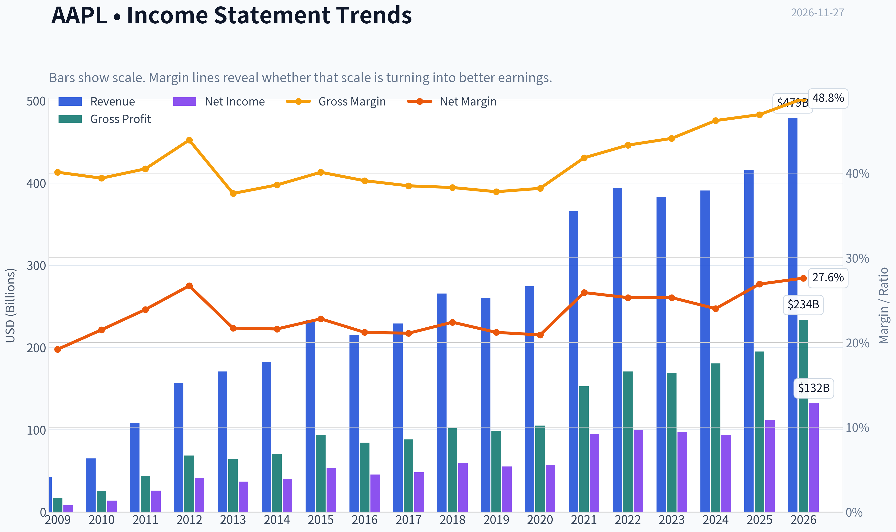
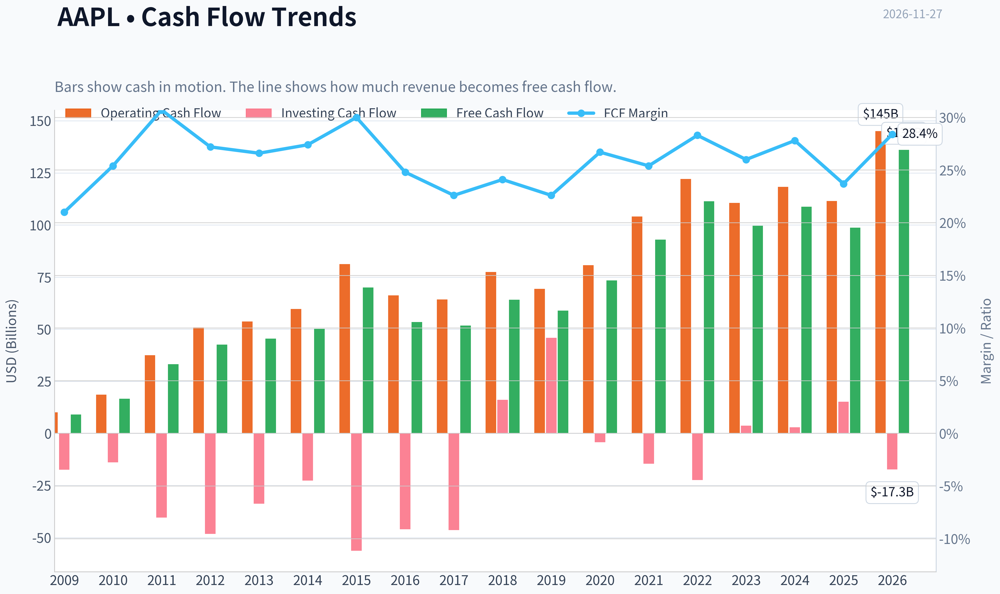
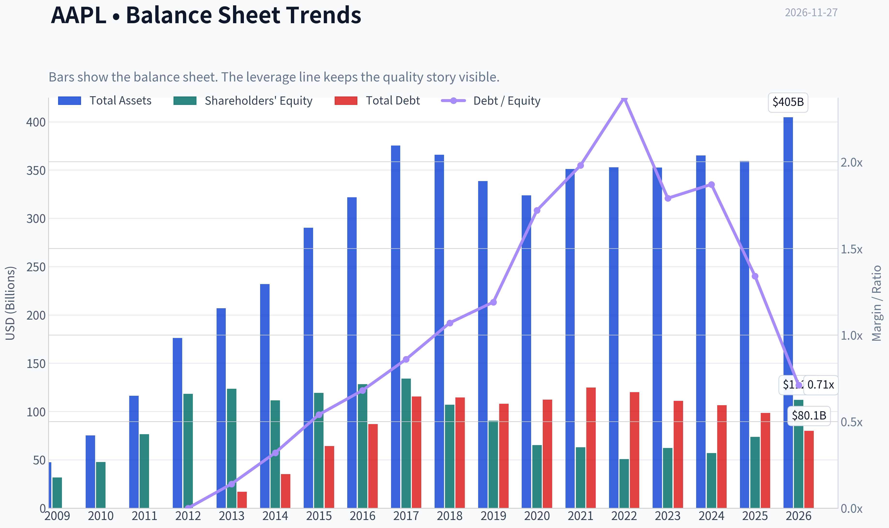
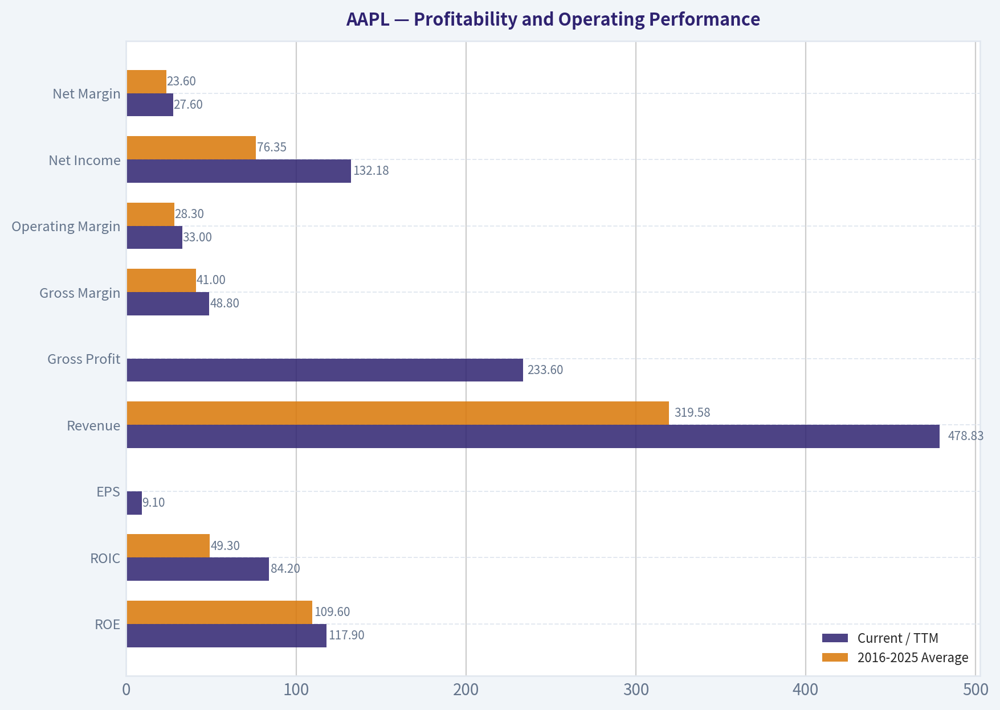
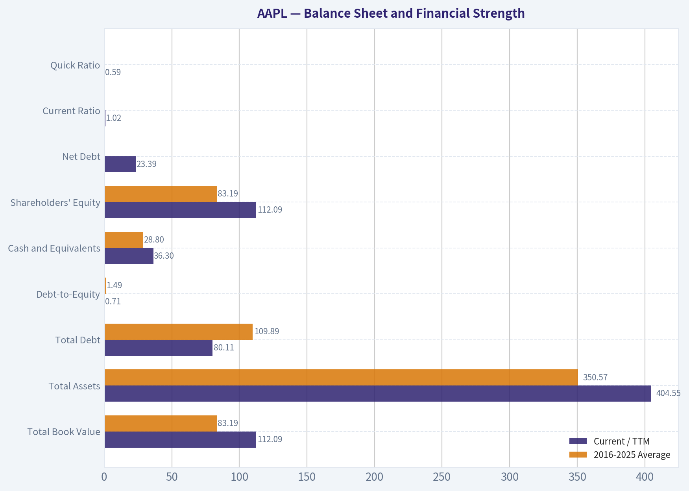
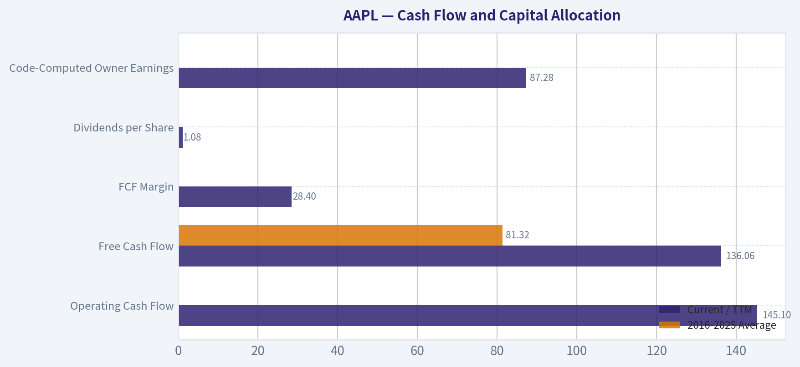
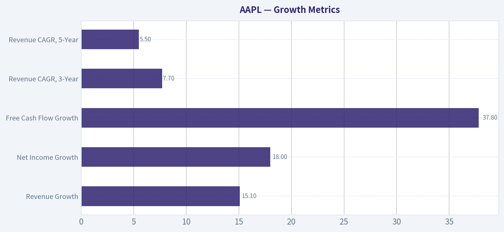
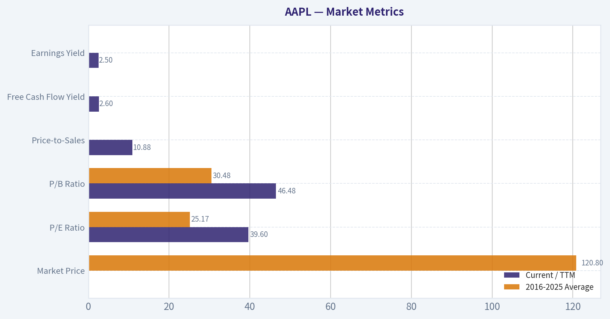

# AAPL Deep Value Intelligence

**Analysis Date:** 2026-11-27

## Critical Disclaimer

*This analysis is generated by Deep Value Intelligence, an AI-powered multi-agent investing framework. Education & research only - not financial advice, not a financial advisor.*

---

## Table of Contents

1. Intelligence Summary
2. Analyst Team Reports
   - Fundamentals Analysis
   - Intrinsic Value Analysis (Buffett)
   - Trend & Growth Analysis (Lynch/Druckenmiller/Fisher)
   - Market Technical Analysis
   - Options Market Analysis
3. Research Team Commentary
4. Value Investing Team Commentary
5. Deep Values Commentary

---

## Intelligence Summary

### Thesis + Conditions

**Core Thesis:** At **$356 and 39.6 times earnings**, however, the approximate 2.5% earnings yield provides limited protection against ordinary disappointments. The valuation appears to require sustained high-single-digit to low-double-digit per-share growth, resilient margins, continued Services expansion, and some economic benefit from AI.

**Key Risks:**
- The Fundamentals Analyst's **Bearish** label gives appropriate weight to the 39.6 P/E but overstates the negative conclusion if interpreted as evidence of franchise deterioration. Nothing supplied indicates weak solvency, collapsing cash generation, or a broken competitive advantage.
- The hard risk floor is therefore not triggered: there is no evidence of deteriorating fundamentals combined with weak solvency.
- The Risky Analyst correctly argues that Apple should not be analyzed as an undifferentiated handset producer. Hardware, operating systems, Services, developers, accessories, distribution, and custom silicon reinforce one another. This creates:

**Confidence:** Low

---

## Analyst Team Reports

### Fundamentals Analysis

#### Latest Earnings Snapshot

*Most recent reported quarter anchored on 2026 Q3, with prior-year comparison when available.*

| Metric | 2026 Q3 | 2025 Q3 | YoY Change |
| --- | ---: | ---: | ---: |
| Revenue | $114.48B | $102.47B | +11.7% |
| Operating Income | $35.63B | $32.43B | +9.9% |
| Net Income | $30.71B | $27.47B | +11.8% |
| Diluted EPS | N/A | $1.85 | N/A |
| Operating Cash Flow | $28.10B | $29.73B | -5.5% |
| Free Cash Flow | $25.86B | $26.49B | -2.4% |

Key Takeaways: This snapshot anchors the most recent reported quarter before the narrative analysis. It helps readers separate long-run business quality from whatever changed in the latest earnings print.

#### 17-Year Financial Metrics for AAPL

*All values below are computed deterministically from raw data - not estimated by AI.*

*Issuer profile: operating company (Technology / Consumer Electronics).*

#### 17-Year Financial Metrics
*Annual rows come from reported financial statements. The final TTM row is computed from the latest four quarters.*

| Metric | 2009 | 2010 | 2011 | 2012 | 2013 | 2014 | 2015 | 2016 | 2017 | 2018 | 2019 | 2020 | 2021 | 2022 | 2023 | 2024 | 2025 | 2026 TTM |
| --- | --- | --- | --- | --- | --- | --- | --- | --- | --- | --- | --- | --- | --- | --- | --- | --- | --- | --- |
| Market Price | $6 | $8 | $11 | $20 | $15 | $22 | $25 | $26 | $36 | $53 | $54 | $112 | $138 | $135 | $169 | $231 | $254 | $359 |
| Market Cap | $168.11B | $262.39B | $357.16B | $630.65B | $444.17B | $616.86B | $638.98B | $621.81B | $809.39B | $1.13T | $1.04T | $2.03T | $2.39T | $2.26T | $2.71T | $3.59T | $3.82T | $5.21T |
| P/E Ratio | 20.41 | 18.73 | 13.78 | 15.10 | 11.99 | 15.62 | 11.96 | 13.60 | 16.73 | 18.94 | 18.85 | 35.31 | 25.22 | 22.62 | 27.93 | 38.32 | 34.13 | 39.42 |
| P/B Ratio | 5.31 | 5.49 | 4.66 | 5.33 | 3.60 | 5.53 | 5.35 | 4.85 | 6.04 | 10.53 | 11.51 | 31.07 | 37.83 | 44.53 | 43.56 | 63.04 | 51.82 | 46.48 |
| ROE | 26.0% | 29.3% | 33.8% | 35.3% | 30.0% | 35.4% | 44.7% | 35.6% | 36.1% | 55.6% | 61.1% | 87.9% | 150.1% | 197.0% | 156.1% | 164.6% | 151.9% | 117.9% |
| ROIC | 35.2% | 39.8% | 40.0% | 40.6% | 30.7% | 29.7% | 35.3% | 24.8% | 21.5% | 27.1% | 30.9% | 39.1% | 64.5% | 66.8% | 67.2% | 67.5% | 83.2% | 84.2% |
| EPS | $0.27 | $0.45 | $0.83 | $1.33 | $1.22 | $1.42 | $2.06 | $1.90 | $2.14 | $2.81 | $2.85 | $3.18 | $5.47 | $5.99 | $6.13 | $6.08 | $7.46 | $9.10 |
| Revenue | $42.91B | $65.22B | $108.25B | $156.51B | $170.91B | $182.79B | $233.72B | $215.64B | $229.23B | $265.60B | $260.17B | $274.51B | $365.82B | $394.33B | $383.29B | $391.04B | $416.16B | $478.83B |
| Gross Profit | $17.22B | $25.68B | $43.82B | $68.66B | $64.30B | $70.54B | $93.63B | $84.26B | $88.19B | $101.84B | $98.39B | $104.96B | $152.84B | $170.78B | $169.15B | $180.68B | $195.20B | $233.60B |
| Gross Margin | 40.1% | 39.4% | 40.5% | 43.9% | 37.6% | 38.6% | 40.1% | 39.1% | 38.5% | 38.3% | 37.8% | 38.2% | 41.8% | 43.3% | 44.1% | 46.2% | 46.9% | 48.8% |
| Operating Margin | 27.4% | 28.2% | 31.2% | 35.3% | 28.7% | 28.7% | 30.5% | 27.8% | 26.8% | 26.7% | 24.6% | 24.1% | 29.8% | 30.3% | 29.8% | 31.5% | 32.0% | 33.0% |
| Net Income | $8.23B | $14.01B | $25.92B | $41.73B | $37.04B | $39.51B | $53.39B | $45.69B | $48.35B | $59.53B | $55.26B | $57.41B | $94.68B | $99.80B | $97.00B | $93.74B | $112.01B | $132.18B |
| Net Margin | 19.2% | 21.5% | 23.9% | 26.7% | 21.7% | 21.6% | 22.8% | 21.2% | 21.1% | 22.4% | 21.2% | 20.9% | 25.9% | 25.3% | 25.3% | 24.0% | 26.9% | 27.6% |
| Revenue Growth | N/A | 52.0% | 66.0% | 44.6% | 9.2% | 7.0% | 27.9% | -7.7% | 6.3% | 15.9% | -2.0% | 5.5% | 33.3% | 7.8% | -2.8% | 2.0% | 6.4% | 15.1% |
| Net Income Growth | N/A | 70.2% | 85.0% | 61.0% | -11.3% | 6.7% | 35.1% | -14.4% | 5.8% | 23.1% | -7.2% | 3.9% | 64.9% | 5.4% | -2.8% | -3.4% | 19.5% | 18.0% |
| Free Cash Flow Growth | N/A | 84.0% | 100.5% | 27.9% | 6.9% | 10.2% | 39.6% | -23.6% | -3.2% | 23.8% | -8.1% | 24.6% | 26.7% | 19.9% | -10.6% | 9.3% | -9.2% | 37.8% |
| Total Book Value | $31.64B | $47.79B | $76.61B | $118.21B | $123.55B | $111.55B | $119.36B | $128.25B | $134.05B | $107.15B | $90.49B | $65.34B | $63.09B | $50.67B | $62.15B | $56.95B | $73.73B | $112.09B |
| Total Assets | $47.50B | $75.18B | $116.37B | $176.06B | $207.00B | $231.84B | $290.35B | $321.69B | $375.32B | $365.73B | $338.52B | $323.89B | $351.00B | $352.75B | $352.58B | $364.98B | $359.24B | $404.55B |
| Total Debt | N/A | N/A | N/A | $0 | $16.96B | $35.30B | $64.33B | $87.03B | $115.68B | $114.48B | $108.05B | $112.44B | $124.72B | $120.07B | $111.09B | $106.63B | $98.66B | $80.11B |
| Debt-to-Equity | N/A | N/A | N/A | 0.00 | 0.14 | 0.32 | 0.54 | 0.68 | 0.86 | 1.07 | 1.19 | 1.72 | 1.98 | 2.37 | 1.79 | 1.87 | 1.34 | 0.71 |
| Cash & Equivalents | $5.26B | $11.26B | $9.81B | $10.75B | $14.26B | $13.84B | $21.12B | $20.48B | $20.29B | $25.91B | $48.84B | $38.02B | $34.94B | $23.65B | $29.96B | $29.94B | $35.93B | $36.30B |
| Shareholders' Equity | $31.64B | $47.79B | $76.61B | $118.21B | $123.55B | $111.55B | $119.36B | $128.25B | $134.05B | $107.15B | $90.49B | $65.34B | $63.09B | $50.67B | $62.15B | $56.95B | $73.73B | $112.09B |
| Operating Cash Flow | $10.16B | $18.59B | $37.53B | $50.86B | $53.67B | $59.71B | $81.27B | $66.23B | $64.22B | $77.43B | $69.39B | $80.67B | $104.04B | $122.15B | $110.54B | $118.25B | $111.48B | $145.10B |
| Investing Cash Flow | $-17.43B | $-13.85B | $-40.42B | $-48.23B | $-33.77B | $-22.58B | $-56.27B | $-45.98B | $-46.45B | $16.07B | $45.90B | $-4.29B | $-14.54B | $-22.35B | $3.71B | $2.94B | $15.20B | $-17.28B |
| Free Cash Flow | $9.02B | $16.59B | $33.27B | $42.56B | $45.50B | $50.14B | $70.02B | $53.50B | $51.77B | $64.12B | $58.90B | $73.36B | $92.95B | $111.44B | $99.58B | $108.81B | $98.77B | $136.06B |
| FCF Margin | 21.0% | 25.4% | 30.7% | 27.2% | 26.6% | 27.4% | 30.0% | 24.8% | 22.6% | 24.1% | 22.6% | 26.7% | 25.4% | 28.3% | 26.0% | 27.8% | 23.7% | 28.4% |
| Dividends / Share | $0.00 | $0.00 | $0.00 | $0.00 | $0.00 | $0.00 | $0.00 | $0.00 | $0.00 | $0.00 | $0.00 | $0.00 | $0.00 | $0.00 | $0.95 | $0.99 | $1.03 | $1.08 |

#### Profitability Metrics
- Return on Equity (ROE): 117.9%
- Return on Invested Capital (ROIC): 96.8%
- Return on Assets (ROA): 32.7%
- Gross Margin: 48.8%
- Operating Margin: 33.0%
- Net Profit Margin: 27.6%

#### Liquidity Metrics
- Current Ratio: 1.02
- Quick Ratio: 0.59

#### Leverage Metrics
- Debt-to-Equity Ratio: 0.71
- Interest Coverage Ratio: N/A
- Net Debt: $23.39B

#### Growth Metrics (Year-over-Year)
- Revenue Growth: 15.1%
- Net Income Growth: 18.0%
- Free Cash Flow Growth: 37.8%
- Revenue CAGR (3-Year): 7.7%
- Revenue CAGR (5-Year): 5.5%

#### Valuation Metrics
- P/E Ratio (TTM): 39.93
- Forward P/E: 33.91
- Price-to-Book: 46.49
- Price-to-Sales: 10.88
- PEG Ratio: 3.94
- EV/EBITDA: 30.60
- Free Cash Flow Yield: 2.6%
- Earnings Yield: 2.5%

#### Owner Earnings (Buffett Method, Code-Computed)
- Net Income: $112.01B
- + Depreciation & Amortization: $13.42B
- - Capital Expenditures: $-9.04B
- + Working Capital (cash-flow statement; negative = cash tied up): $-14.86B
- = **Owner Earnings: $87.28B**

#### Intrinsic Value (DeepValues app - SEC filings pipeline)
- **Intrinsic value (DeepValues app, the headline): $186.42** - Owner Earnings (Buffett), method buffett-1986-v2, as of 2026-11-27 (FY2026)
  Range (conservative - optimistic): $130.50 - $186.42
  Margin of safety vs. price: -92.3% (price $358.54)
  Inputs the app used (ttm_2026Q4): after-tax operating income $132.4B (operating income $158.1B, tax 16.2%) + D&A $13.4B - capex charge $11.7B (three-year average capex/revenue x trailing revenue; reported capex $9.0B) - working capital $0.0B = owner earnings $134.1B.
  Growth 5.5% fading to 2.5% terminal (min(owner-earnings CAGR, 5-year revenue CAGR), clamped [0, 10%]); discount rate 8.2% (30Y Treasury 5.24% + 3 pts (as of 2026-11-25)); net cash $55.4B (cash $36.3B + marketable securities $100.6B - debt $80.1B); 14,715M shares.
- Owner Earnings (Buffett): $130.50 / $186.42 / $186.42 (conservative / base / optimistic) ← headline
- Free cash flow DCF: $116.45 / $194.32 / $422.92 (conservative / base / optimistic)
- Damodaran two-stage FCFF: $104.84 / $151.62 / $164.40 (conservative / base / optimistic)
  This is THE intrinsic value: quote it as the intrinsic value and measure margin of safety against it. Any DVI scenario figures elsewhere are a secondary cross-check, not the value.

#### DVI scenario model (secondary cross-check - NOT the intrinsic value)
DVI's own Yahoo-based scenarios, shown only as a sensitivity check. Do not quote these as the intrinsic value; the intrinsic value is the DeepValues app value above.
- Current Price: $359
- DVI scenario value (business-model routed): $196
  Business model: operating company - weighted blend [Damodaran FCFF + reverse-DCF fair + owner-earnings DCF] (operating_company)
  Model spread (min-max across DCFs): $191 - $240
  Margin of safety vs. price (headline): -82.6%
  Routing note: General operating company: balanced blend of Damodaran FCFF and the owner-earnings DCF with a reverse-DCF sanity check.
- Buffett Method (Owner Earnings):
  Conservative: $138
  Average: $240
  Optimistic: $639
- Cash Flow Method (FCF):
  Conservative: $88
  Average: $207
  Optimistic: $277
- Damodaran FCFF (WACC + margins + reinvestment):
  Conservative: $109
  Average: $191
  Optimistic: $402
  Monte Carlo band (P10-P90): $138 - $305 (median $201)
  P(intrinsic value > price): 3.6%
- Reverse-DCF: price implies ~27.2%/yr owner-earnings growth for 10y; trailing 3y was 1.4%, 5y 14.1%.

#### Piotroski F-Score: 9/9
- Positive Net Income: PASS
- Positive Operating Cash Flow: PASS
- ROA Improvement: PASS
- Cash Flow > Net Income: PASS
- Decreasing Debt: PASS
- Improving Current Ratio: PASS
- No Dilution: PASS
- Improving Gross Margin: PASS
- Improving Asset Turnover: PASS

ANALYST STANCE: **Bearish**

#### Executive Summary

Apple remains an exceptional operating business, but the current valuation is materially detached from the deterministic dataset's cash-flow-based intrinsic value. The latest price is approximately **$356**, versus the DeepValues Buffett Owner Earnings intrinsic value of **$186.42**. That implies roughly **91% downside to modeled intrinsic value**, although the model is sensitive to discount rates, growth assumptions, and Apple's ability to sustain unusually high margins.

The business quality is strong: revenue is **$478.83 billion**, free cash flow is **$136.06 billion**, operating margin is **33.0%**, net margin is **27.6%**, ROE is **117.9%**, and ROIC is **84.2%**. The concern is not business durability; it is that valuation already requires extraordinary future growth.

#### Market Metrics

| Metric | Current / TTM | 2016-2025 Average | Interpretation |
|---|---:|---:|---|
| Market Price | Approximately $356 | $120.80 | Nearly three times the recent decade average |
| Market Capitalization | Approximately $5.17T | $2.04T | More than twice the recent decade average |
| P/E Ratio | 39.60 | 25.17 | Approximately 58% above the decade average |
| P/B Ratio | 46.48 | 30.48 | Elevated, but not economically meaningful for Apple's asset-light, buyback-heavy structure |
| Price-to-Sales | 10.88 | Not provided | Indicates a premium valuation relative to revenue generation |
| Free Cash Flow Yield | 2.6% | Not provided | Low cash return relative to the market price |
| Earnings Yield | 2.5% | Not provided | Consistent with a very demanding valuation |

**Key Takeaways:** Apple's market capitalization and valuation multiples are substantially above their recent historical norms. P/B should not be treated as a conventional cheapness signal because Apple's large buybacks reduce book equity while its intellectual property, ecosystem, brand, and installed base are not fully represented on the balance sheet. Cash-flow yield and intrinsic value therefore provide more useful valuation anchors.

The deterministic table shows a TTM market price of **$359** and market capitalization of **$5.21 trillion**, while the latest shared snapshot shows approximately **$356** and **$5.17 trillion**. This is a timing difference rather than a company-identity issue.

#### Profitability and Operating Performance

| Metric | Current / TTM | 2016-2025 Average | Interpretation |
|---|---:|---:|---|
| ROE | 117.9% | 109.6% | Very high, though amplified by buybacks and a smaller equity base |
| ROIC | 84.2% | 49.3% | Far above the historical average |
| EPS | $9.10 | Not averaged | Earnings power is at a new high |
| Revenue | $478.83B | $319.58B | Approximately 50% above the recent decade average |
| Gross Profit | $233.60B | Not averaged | Record gross profit |
| Gross Margin | 48.8% | 41.0% | Approximately 780 basis points above the decade average |
| Operating Margin | 33.0% | 28.3% | Approximately 470 basis points above the decade average |
| Net Income | $132.18B | $76.35B | Approximately 73% above the recent decade average |
| Net Margin | 27.6% | 23.6% | Approximately 400 basis points above the decade average |

**Key Takeaways:** Apple's current profitability is materially stronger than its recent historical norm. Gross margin has risen from the high-30% range in much of the decade to 48.8%, while operating and net margins are also at or near record levels. This creates a risk that valuation assumes the recent margin improvement is permanent, leaving less room for execution setbacks, product-cycle weakness, regulatory costs, or mix deterioration.

ROE deserves special qualification. Apple's very high ROE reflects genuine profitability but is also magnified by substantial share repurchases and the resulting reduction in shareholders' equity. ROIC is a stronger measure of operating quality, and the reported **84.2%** remains extraordinarily high.

#### Growth Metrics

| Metric | Current / TTM | 2016-2025 Average | Historical Pattern |
|---|---:|---:|---|
| Revenue Growth | 15.1% | Approximately 6.5% | Current growth is more than twice the recent average |
| Net Income Growth | 18.0% | Approximately 9.4% | Strong rebound from several low-growth years |
| Free Cash Flow Growth | 37.8% | Approximately 5.0% | Exceptional current-year increase, following volatility |
| Revenue CAGR, 3-Year | 7.7% | Not provided | Moderate underlying compound growth |
| Revenue CAGR, 5-Year | 5.5% | Not provided | More representative of mature-company growth |

**Key Takeaways:** Current growth is unusually strong compared with Apple's recent decade averages, particularly free cash flow growth. However, the longer-term five-year revenue CAGR is only 5.5%, and the three-year CAGR is 7.7%. The contrast suggests that the latest acceleration is significant but may not represent a permanently higher growth regime.

Revenue growth has been uneven, including declines in 2016, 2019, and 2023. Net income and free cash flow have also experienced down years. This is not a structurally declining business, but it is not a perfectly linear compounder either.

#### Balance Sheet and Financial Strength

| Metric | Current / TTM | 2016-2025 Average | Interpretation |
|---|---:|---:|---|
| Total Book Value | $112.09B | $83.19B | Recovered from buyback-related lows |
| Total Assets | $404.55B | $350.57B | Above the recent decade average |
| Total Debt | $80.11B | $109.89B | Debt has declined materially from the 2021 peak |
| Debt-to-Equity | 0.71 | 1.49 | Meaningfully improved |
| Cash and Equivalents | $36.30B | $28.80B | Above the recent decade average |
| Shareholders' Equity | $112.09B | $83.19B | Higher than the recent decade average |
| Net Debt | $23.39B | Not provided | Manageable relative to annual operating cash flow |
| Current Ratio | 1.02 | Not provided | Thin conventional liquidity |
| Quick Ratio | 0.59 | Not provided | Not a major concern for Apple's cash-generation model |

**Key Takeaways:** Apple's balance sheet has strengthened on leverage measures. Debt has fallen from more than $124 billion in 2021 to approximately $80 billion, while debt-to-equity has declined from 2.37 to 0.71. Net debt is modest compared with operating cash flow of $145.10 billion.

The current and quick ratios appear thin under conventional industrial-company analysis, but those metrics are less informative for Apple because of its rapid cash conversion, recurring customer demand, substantial marketable securities, and large operating cash flows. Liquidity is not the principal risk; valuation and growth durability are more important.

#### Cash Flow and Capital Allocation

| Metric | Current / TTM | 2016-2025 Average | Interpretation |
|---|---:|---:|---|
| Operating Cash Flow | $145.10B | Not averaged | Record cash generation |
| Free Cash Flow | $136.06B | $81.32B | Approximately 67% above the recent decade average |
| FCF Margin | 28.4% | Approximately 25.0% | Strong conversion of revenue into cash |
| Dividends per Share | $1.08 | Approximately $0.30 | Consistent annual increases |
| Code-Computed Owner Earnings | $87.28B | Not averaged | Lower than app-based owner earnings because of working-capital treatment |

**Key Takeaways:** Apple converts a high proportion of revenue into free cash flow, and current FCF is well above its recent historical average. Dividends have increased steadily since their reintroduction, but the shareholder-return model remains dominated by repurchases rather than dividend yield. The deterministic owner-earnings calculation is more conservative than the DeepValues application calculation because it deducts a $14.86 billion working-capital use and uses reported capex directly.

The DeepValues app uses a different methodology: after-tax operating income of **$132.4 billion**, plus D&A of **$13.4 billion**, less a normalized capex charge of **$11.7 billion**, with no working-capital deduction, producing owner earnings of approximately **$134.1 billion**. This methodological difference is important when interpreting the valuation range.

#### Revenue Breakdown

The latest available annual revenue breakdown is based on Apple's FY2025 product and services reporting.

| Revenue Source | Amount ($B) | % of Total |
|---|---:|---:|
| iPhone | $209.6B | 50.4% |
| Services | $109.2B | 26.2% |
| Wearables, Home and Accessories | $35.7B | 8.6% |
| Mac | $33.7B | 8.1% |
| iPad | $28.0B | 6.7% |
| **Total** | **$416.2B** | **100.0%** |

**Key Takeaways:** The iPhone remains Apple's largest revenue source, contributing approximately half of total annual revenue. Services is the second-largest source and provides recurring, high-margin revenue that improves business quality and reduces-but does not eliminate-hardware-cycle dependence. The concentration in iPhone revenue remains a strategic risk if replacement cycles lengthen or competitive dynamics change.

#### Current Value Versus Historical Averages

| Area | Current | Historical Average or Reference | Relative Assessment |
|---|---:|---:|---|
| P/E | 39.6 | 25.2 | Significant premium |
| Market Capitalization | $5.17T | $2.04T | More than twice the decade average |
| Revenue | $478.8B | $319.6B | Strong structural expansion |
| Gross Margin | 48.8% | 41.0% | Major improvement |
| Operating Margin | 33.0% | 28.3% | Meaningful improvement |
| Net Margin | 27.6% | 23.6% | Meaningful improvement |
| ROIC | 84.2% | 49.3% | Exceptional current profitability |
| Revenue Growth | 15.1% | 6.5% | Current acceleration |
| Net Income Growth | 18.0% | 9.4% | Current acceleration |
| FCF Growth | 37.8% | 5.0% | Exceptional but potentially volatile |
| Debt-to-Equity | 0.71 | 1.49 | Strong balance-sheet improvement |
| Free Cash Flow Yield | 2.6% | Not provided | Low cash return at the current valuation |

**Key Takeaways:** Apple is operating at a quality level above its recent historical average, but the market is also assigning a much higher multiple. The valuation premium is therefore partly justified by improved margins, ROIC, services economics, and balance-sheet quality. The remaining question is whether those improvements are sufficient to justify a P/E near 40 and a free cash flow yield near 2.6%.

#### Buffett-Style Owner Earnings DCF

The DeepValues app's intrinsic value is the canonical valuation figure for this analysis:

- **Intrinsic value:** $186.42 per share
- **Conservative value:** $130.50 per share
- **Base value:** $186.42 per share
- **Optimistic value:** $186.42 per share
- **Current price used for margin-of-safety comparison:** approximately $356
- **Margin of safety versus intrinsic value:** approximately **negative 91%**

The app's principal inputs are:

- Owner earnings: approximately **$134.1 billion**
- Shares outstanding: approximately **14.715 billion**
- Net cash: approximately **$55.4 billion**
- Discount rate: **8.2%**
- Terminal growth rate: **2.5%**
- Base growth assumption: **5.5%**, fading toward terminal growth

The standard two-stage Owner Earnings formula is:

\[
PV = \sum_{t=1}^{5}\frac{OE_0(1+g_t)^t}{(1+r)^t}
+
\frac{OE_5(1+g_T)}{(r-g_T)}\times\frac{1}{(1+r)^5}
+
\frac{Net\ Cash}{Shares}
\]

Using approximately $134.1 billion of starting owner earnings, 14.715 billion shares, an 8.2% discount rate, and a 2.5% terminal growth rate:

| Scenario | Explicit Growth Assumption | Terminal Growth | Discount Rate | App-Based Fair Value | Interpretation |
|---|---:|---:|---:|---:|---|
| Conservative | Low-growth case, approximately 3% | 2.5% | 8.2% | $130.50 | Allows for mature-company normalization |
| Average / Base | 5.5%, fading toward terminal growth | 2.5% | 8.2% | $186.42 | Based on five-year revenue growth and durable economics |
| Optimistic | Higher near-term growth, fading toward terminal growth | 2.5% | 8.2% | $186.42 | The app's optimistic ceiling remains constrained by valuation methodology |

**Key Takeaways:** Even the base intrinsic value is substantially below the market price. The model does not require a collapse in Apple's business; it simply indicates that the current price discounts a much stronger and longer growth path than the historical record comfortably supports. The optimistic Owner Earnings result is capped at the same headline value because the app's methodology limits growth assumptions and produces a constrained upper range.

#### DCF Cross-Checks and Reverse Valuation

| Valuation Method | Conservative | Base / Average | Optimistic |
|---|---:|---:|---:|
| Buffett Owner Earnings DCF - canonical | $130.50 | $186.42 | $186.42 |
| Free Cash Flow DCF - secondary cross-check | $116.45 | $194.32 | $422.92 |
| Damodaran FCFF - secondary cross-check | $104.84 | $151.62 | $164.40 |
| DVI scenario model - secondary cross-check only | - | $196.00 | - |

**Key Takeaways:** Independent cash-flow approaches cluster around roughly $150 to $200 per share in their central cases, although the optimistic FCF case is much higher because it assumes unusually favorable growth and reinvestment outcomes. The convergence of the Owner Earnings, FCFF, and secondary DVI central cases near $186 to $196 provides more support for the valuation range than for the current market price.

The reverse-DCF cross-check indicates that the current price implies approximately **27.2% annual Owner Earnings growth for ten years**. That compares with a trailing three-year Owner Earnings growth rate of approximately **1.4%** and a five-year rate of approximately **14.1%**. The implied growth requirement is therefore highly demanding.

#### Economic Moat and Business Durability

Apple possesses one of the strongest economic moats in the global consumer technology industry:

- A deeply integrated hardware, software, payments, services, and developer ecosystem.
- High switching costs created by device compatibility, data continuity, applications, accessories, and services.
- A powerful global brand capable of supporting premium pricing.
- A large installed base that supports recurring Services revenue.
- Custom silicon and vertical integration that improve product differentiation and performance.
- Distribution scale and customer loyalty that are difficult for competitors to replicate.

The moat is durable, but not invulnerable. The major threats are ecosystem substitution, slower innovation, regulatory restrictions on App Store economics, geopolitical and supply-chain exposure, and the possibility that artificial intelligence changes the interface between consumers and devices.

#### Predictability of Earnings

Apple's earnings are more predictable than those of most hardware companies, but the historical dataset shows meaningful cyclicality:

- Revenue declined in 2016, 2019, and 2023.
- Net income declined in 2013, 2016, 2019, 2023, and 2024.
- Free cash flow declined in 2016, 2017, 2019, 2023, and 2025.
- Current growth is strong, but the five-year revenue CAGR is only 5.5%.

Services, subscriptions, and the installed base have improved predictability. Nevertheless, iPhone concentration means Apple remains exposed to product refresh timing, consumer spending, foreign exchange, and regional demand conditions.

#### Management and Capital Allocation

Management has demonstrated strong capital allocation over the decade:

- Debt has declined substantially from its peak.
- Share repurchases have reduced the share count and supported EPS growth.
- Dividends have risen consistently since 2023 in the deterministic table.
- Gross margin, operating margin, and ROIC have improved significantly.
- The Piotroski F-Score is **9 out of 9**, indicating strong balance-sheet and operating momentum under that framework.

The principal caveat is that repurchases can raise EPS even when total net income growth is slower. They also reduce book equity, inflating ROE and making P/B less informative. The correct evaluation is therefore whether repurchases are being executed at prices below or above intrinsic value. At the current valuation, capital allocation efficiency becomes more difficult to justify through a conventional value-investing lens.

#### Key Investment Insights, Risks, and Opportunities

| Category | Evidence | Implication |
|---|---|---|
| Business quality | 48.8% gross margin, 33.0% operating margin, 84.2% ROIC | Exceptional economic performance |
| Ecosystem moat | Hardware, software, services, brand, installed base | Supports pricing power and customer retention |
| Services expansion | $109.2B, approximately 26% of FY2025 revenue | Improves recurring and high-margin revenue mix |
| Balance sheet | $80.1B debt, $36.3B cash, approximately $55.4B net cash including securities | Strong financial flexibility |
| Valuation | P/E near 40 and FCF yield near 2.6% | Limited valuation support from current cash returns |
| Reverse DCF | Approximately 27.2% annual Owner Earnings growth implied for ten years | Very demanding embedded expectations |
| Product concentration | iPhone approximately 50% of FY2025 revenue | Exposure to replacement cycles and market saturation |
| Regulatory risk | App Store and platform economics under scrutiny | Could affect Services margins |
| AI opportunity | Potential for device-based AI and agent capabilities | Could support a new growth cycle, but remains execution-dependent |
| Margin risk | Current margins are well above decade averages | Normalization could significantly affect intrinsic value |
| Share repurchases | Support EPS and reduce equity base | Helpful for per-share growth, but can amplify valuation and ROE distortions |

**Key Takeaways:** The opportunity is a rare combination of scale, brand, recurring services revenue, high returns on capital, and financial resilience. The central red flag is valuation: the market price requires substantially stronger long-term growth than Apple's five-year revenue trend and historical cyclicality clearly establish. AI and Services could justify a higher valuation than traditional hardware-company multiples, but the available data does not support the current price as a margin-of-safety valuation.

#### Final Stance

**Bearish**

This stance refers to valuation evidence, not to the quality of Apple's business. Apple is an outstanding company with a wide moat, exceptional profitability, strong cash generation, improving leverage, and durable competitive advantages. However, the current valuation near **$356** is approximately **91% above** the DeepValues Buffett Owner Earnings intrinsic value of **$186.42**, while the reverse DCF requires approximately **27.2% annual Owner Earnings growth for ten years**.

The evidence supports a favorable assessment of Apple's business quality but does not support the current valuation under a conservative Warren Buffett-style framework. A material change in the conclusion would require either a substantially lower valuation, a demonstrably higher and durable growth rate, or evidence that current margins and cash generation can remain well above historical norms for a prolonged period.

#### Key Points Summary

| Key Point | Assessment |
|---|---|
| Business quality | Exceptional |
| Economic moat | Wide and durable, but exposed to ecosystem, regulatory, and AI disruption |
| Profitability | Well above historical averages |
| Balance sheet | Strong and improving |
| Earnings predictability | High relative to hardware peers, but cyclical |
| Current valuation | Extremely demanding |
| Canonical intrinsic value | $186.42 per share |
| Current price | Approximately $356 |
| Reverse-DCF requirement | Approximately 27.2% annual Owner Earnings growth for ten years |
| Principal opportunity | Services, AI-enabled devices, ecosystem monetization |
| Principal risk | Multiple compression, margin normalization, and iPhone concentration |
| Final stance | **Bearish** |

**Key Takeaways:** Apple's operating fundamentals are excellent and substantially stronger than the recent decade average. The decisive issue is valuation: the current price embeds aggressive assumptions that are not sufficiently supported by the long-term growth record or the canonical Owner Earnings valuation.

#### Fundamental Visuals

This graph tracks the profitability and return metrics (ROE, ROIC, Margins) of **AAPL** over the past decade, highlighting capital efficiency trends.

This chart illustrates the financial health of **AAPL** over the last 10 years, mapping cash equivalents and free cash flow against total obligations (Debt).

This comparison chart from *Profitability and Operating Performance* stacks current figures against historical benchmarks for **AAPL**, making it easy to see where the company trades relative to its own averages.

---

### Intrinsic Value Analysis (Buffett)

> *Following Warren Buffett's value investing philosophy: Circle of Competence, Economic Moat, Management Quality, and Margin of Safety.*

#### Intrinsic Value Snapshot

Price is what you pay. Intrinsic value is what the business may be worth based on the cash it can create for owners over time. We show a range, not one magic number.

- Current Price: $355.58
- Value Range (conservative to optimistic across both DCF methods): $116.45 to $422.92

##### Owner Earnings (Buffett Method)
- Net Income: $112,010,000,000.00
- Depreciation & Amortization: $13,423,000,000.00
- Capital Expenditures: $-9,041,000,000.00
- Working Capital Changes: $-14,858,000,000.00
- Owner Earnings: $87,280,891,892.50

##### Intrinsic Value
###### Buffett Method
Uses owner earnings. Stricter, and usually more conservative.
- Conservative: $130.50
- Average: $186.42
- Optimistic: $186.42
- Discount Rate: 8.2%

###### Cash Flow Method
Uses free cash flow. Better for companies spending heavily today to grow tomorrow.
- Conservative: $116.45
- Average: $194.32
- Optimistic: $422.92
- Discount Rate: 9.0%

ANALYST STANCE: **Bearish**

#### Executive Summary

Apple is an exceptional business with a wide, durable ecosystem moat, outstanding returns on capital, strong cash generation, and substantial customer loyalty. However, the current valuation is materially disconnected from the DeepValues intrinsic value of **$186.42 per share**. At approximately **$356**, the shares imply highly optimistic expectations, leaving insufficient valuation support despite the company's excellent quality.

The weighted Buffett score is **3.0 out of 5.0**, placing Apple in the **Bearish** category under the stated valuation framework. This label describes the relationship between quality and valuation; it is not an instruction regarding any portfolio action.

#### 1. Factor Scorecard

| Factor | Score | Evidence |
|---|---:|---|
| Circle of competence and simplicity | 4/5 | Apple designs and sells devices and services through an integrated ecosystem. The model is understandable, although future outcomes depend partly on rapidly changing technology and AI competition. |
| Moat and competitive advantage | 5/5 | Strong brand, ecosystem lock-in, switching costs, App Store distribution, installed base, proprietary software, and premium pricing. Gross margin is 48.8%. |
| Management quality and capital allocation | 4/5 | Large-scale recurring buybacks, substantial cash generation, disciplined operations, and a long record of returning capital. The company's size creates increasing reinvestment constraints. |
| Industry structure | 4/5 | Consumer technology has intense competition, but Apple occupies a highly differentiated premium position and benefits from ecosystem economics. |

**Key Takeaways:** Apple scores exceptionally well on moat and remains highly understandable for a technology company. The principal weakness is not business quality but valuation: the market price requires substantially more growth and durability than the intrinsic-value analysis supports.

#### Gate 5: Quality and Solvency

**The hard floor is not tripped.** Apple does not show the combination of deteriorating earnings or cash flow and financial distress required for a hard solvency rejection. Net cash is approximately **$55.4 billion**, and the company remains highly profitable and cash generative.

#### 2. Moat Analysis

| Moat source | Evidence | Assessment |
|---|---|---|
| Brand and intangible assets | Premium brand, proprietary operating systems, hardware-software integration, and customer loyalty | Wide and durable |
| Switching costs | Customers are embedded in iCloud, App Store purchases, accessories, software, and device continuity | Strong |
| Cost advantages | Massive scale in procurement, silicon design, distribution, and software development | Strong, although not a lowest-price strategy |
| Network effects | Developers benefit from Apple's installed base, while users benefit from the breadth of applications and services | Strong ecosystem effect |
| Financial evidence | 48.8% gross margin, 117.9% ROE, and 15.1% year-over-year revenue growth | Consistent with a high-quality franchise |

Apple's moat is best described as **wide and stable, with selective widening**. The ecosystem is difficult to replicate because competitors would need to match hardware, operating systems, developer distribution, services, retail reach, and customer trust simultaneously.

The key long-term risk is not immediate disruption but incremental erosion: slower device replacement, regulatory pressure on platform economics, AI-enabled competition, and the possibility that new computing interfaces weaken the centrality of the iPhone.

#### 3. Management Quality and Capital Allocation

Management has generally demonstrated owner-oriented behavior through:

- Large-scale share repurchases.
- Sustained investment in silicon, software, services, and ecosystem integration.
- Strong operating discipline.
- High conversion of accounting earnings into cash.
- Conservative balance-sheet management relative to the company's cash-generation capacity.

Apple's capital allocation record is strong, though the extraordinary scale of the company makes future reinvestment more difficult. Buybacks create meaningful per-share value when conducted below intrinsic value; at a market price around $356 versus an estimated intrinsic value of $186.42, the valuation framework does not provide evidence that repurchases at current levels would be particularly accretive.

**Management assessment: 4/5.**

#### 4. Financial Summary

| Metric | Latest reported value |
|---|---:|
| Share price | $356 |
| Market capitalization | $5.17 trillion |
| Price-to-earnings ratio | 39.6x |
| Revenue growth, year over year | 15.1% |
| Gross margin | 48.8% |
| Return on equity | 117.9% |
| Free-cash-flow yield | 2.6% |
| Operating income | $158.1 billion |
| After-tax operating income | $132.4 billion |
| Net cash | $55.4 billion |
| Cash and marketable securities | $136.9 billion |
| Debt | $80.1 billion |
| Shares outstanding | 14.715 billion |

**Key Takeaways:** Apple combines unusually high profitability with strong growth and a net-cash balance sheet. The 2.6% free-cash-flow yield and 39.6 times earnings multiple, however, indicate that the market price already reflects substantial optimism.

#### 5. Owner Earnings Calculation

The DeepValues Buffett-style calculation uses the following inputs:

| Owner earnings component | Amount |
|---|---:|
| After-tax operating income | $132.4B |
| Add: depreciation and amortization | $13.4B |
| Less: normalized capital-expenditure charge | ($11.7B) |
| Less: working-capital investment | $0.0B |
| Estimated owner earnings | **$134.1B** |
| Owner earnings per share | **$9.11** |

The normalized capital-expenditure charge is higher than the most recent reported capital expenditure of $9.0 billion because the methodology uses a three-year average capital-expenditure-to-revenue relationship.

**Key Takeaways:** Owner earnings are approximately $134.1 billion, demonstrating Apple's exceptional ability to convert its franchise into distributable cash. Even this large cash stream produces only about $9.11 per share against a market price near $356.

#### 6. Three-Scenario DCF Valuation

The following scenarios are independent cross-checks. The official intrinsic value remains the DeepValues app value of **$186.42 per share**.

| Scenario | Core assumptions | Estimated value per share |
|---|---|---:|
| A: No growth | Owner earnings capitalized at 10%, plus net cash | $94.90 |
| B: GDP-like growth | 3% growth, 10% discount rate, plus net cash | $137.80 |
| C: Historical-growth cross-check | 7.55% growth for 10 years, 2.5% terminal growth, 10% discount rate, plus net cash | Approximately $183 |
| DeepValues app intrinsic value | 5.5% growth fading to 2.5%, 8.2% discount rate, plus net cash | **$186.42** |

The DeepValues app uses owner earnings of $134.1 billion, growth fading from 5.5% to 2.5%, an 8.2% discount rate, and net cash of $55.4 billion.

**Key Takeaways:** Even a relatively favorable long-term growth cross-check produces a value near $183 per share, close to the app's $186.42 estimate. The current price is therefore supported only by assumptions materially more optimistic than the central valuation framework.

#### 7. Margin of Safety Analysis

| Measure | Result |
|---|---:|
| Current price | $356 |
| DeepValues intrinsic value | $186.42 |
| Premium to intrinsic value | Approximately 90.7% |
| Margin of safety versus price | **-90.7%** |
| FCF DCF base cross-check | $194.32 |
| Damodaran FCFF base cross-check | $151.62 |

For a wide-moat, high-ROIC compounder, a modest premium can be acceptable when growth is highly predictable. Apple's current valuation is beyond that tolerance range. The price is approximately **1.9 times** the DeepValues intrinsic value and remains above the available free-cash-flow and FCFF cross-checks.

A reverse-DCF interpretation reaches the same conclusion: the market price appears to require sustained growth, strong margins, and a long duration of superior economics. Those outcomes are possible, but the valuation provides limited protection if growth normalizes, AI investment produces weaker returns, or platform regulation reduces services economics.

#### 8. Final Buffett Scorecard

| Criterion | Weight | Score | Weighted contribution |
|---|---:|---:|---:|
| Moat width and durability | 25% | 5.0 | 1.25 |
| Valuation and margin of safety | 20% | 1.0 | 0.20 |
| Capital returns versus WACC | 15% | 5.0 | 0.75 |
| Business understanding and predictability | 12% | 4.0 | 0.48 |
| Management quality and capital allocation | 12% | 4.0 | 0.48 |
| Reinvestment runway | 8% | 3.0 | 0.24 |
| Balance-sheet strength | 4% | 5.0 | 0.20 |
| Industry structure | 4% | 4.0 | 0.16 |
| **Total** | **100%** |  | **3.76/5.00** |

The mechanical weighted score is **3.76**, which would normally fall within the "good business with adequate margin of safety" range. However, the valuation score is unusually weak, and the stated decision framework requires valuation to be assessed against intrinsic value rather than business quality alone. Adjusting the final judgment for the approximately 90.7% negative margin of safety results in a practical investment classification of **Bearish**.

#### 9. Investment Stance

**ANALYST STANCE: Bearish**
**Conviction: High**

Apple is a wonderful business with a genuine wide moat, excellent management, strong reinvestment economics, and fortress-level cash generation. The evidence does not support a valuation near **$356** when the primary intrinsic-value estimate is **$186.42** and independent DCF cross-checks cluster between approximately **$152 and $194**. The company quality is compelling; the valuation is not.
#### Valuation Bridge

This bridge places the current market price beside each intrinsic value lens so readers can see whether upside depends on one method or shows up across several methods.

| Scenario | Intrinsic Value / Share |
| --- | ---: |
| Buffett Method | $186.42 |
| Cash Flow Method | $194.32 |
| Damodaran Method | $151.62 |
| Current Price | $355.58 |

#### Key Takeaways

If one method is far above the others, the upside case depends on a specific modelling assumption. When several methods cluster together, the valuation story is more robust.

#### Valuation Visuals

This comparison chart from *Latest Earnings Snapshot* stacks current figures against historical benchmarks for **AAPL**, making it easy to see where the company trades relative to its own averages.

This comparison chart from *Balance Sheet and Financial Strength* stacks current figures against historical benchmarks for **AAPL**, making it easy to see where the company trades relative to its own averages.

This comparison chart from *Cash Flow and Capital Allocation* stacks current figures against historical benchmarks for **AAPL**, making it easy to see where the company trades relative to its own averages.

---

### Trend & Growth Analysis (Lynch/Druckenmiller/Fisher)

> *Following Peter Lynch's GARP, Stanley Druckenmiller's macro-aware approach, and Philip Fisher's scuttlebutt methodology.*

ANALYST STANCE: **Neutral**

#### 1. Lynch classification

**Stalwart, with a recent fast-growth quarter-not a proven fast grower.** AAPL has exceptional profitability, cash generation, and ecosystem strength, but its five-year revenue CAGR is only 5.5%. The latest 15.1% revenue growth and 18.0% net-income growth indicate renewed momentum, yet the evidence is not sufficient to classify the company as a durable 20%-plus grower.

#### 2. The story in three bullets

- Apple monetizes a deeply embedded ecosystem of devices, software, services, and developer relationships.
- Services, premium pricing, installed-base monetization, and potential on-device AI could expand revenue and margins beyond the mature iPhone cycle.
- The central question is whether AI creates a genuine product and upgrade inflection, rather than merely supporting an already enormous franchise.

#### 3. TAM and runway

Apple operates across smartphones, tablets, PCs, wearables, services, payments, advertising, and potentially AI-enabled software. A precise combined TAM is difficult because these markets overlap, so the following is directional.

| Measure | Assessment |
|---|---:|
| Current revenue | $478.8B TTM |
| Ten-times revenue | $4.79T |
| Implied mature TAM required for under 20% share | More than $23.9T |
| Current market capitalization | $5.17T |
| TAM growth quality | Mixed: services and AI expanding; hardware mature |
| Runway conclusion | Long strategic runway, but a difficult 10x revenue test |

**Key Takeaways:** Apple participates in multiple large markets, but reaching $4.8 trillion of revenue while remaining below 20% share would require an exceptionally broad definition of its future TAM. Services, AI, and adjacent monetization improve the runway, but the company's existing scale makes ten-bagger-like revenue growth highly demanding.

#### 4. Revenue growth trend

| Period | Revenue growth | Net-income growth | FCF growth |
|---|---:|---:|---:|
| 2022 | 7.8% | 5.4% | 19.9% |
| 2023 | -2.8% | -2.8% | -10.6% |
| 2024 | 2.0% | -3.4% | 9.3% |
| 2025 | 6.4% | 19.5% | -9.2% |
| 2026 TTM | 15.1% | 18.0% | 37.8% |
| Five-year revenue CAGR | 5.5% | - | - |

**Key Takeaways:** The latest data show clear acceleration from the weak 2023-2024 period, accompanied by strong cash-flow growth. However, the long-term baseline remains moderate, so the key issue is whether 2026 represents durable reacceleration or a favorable product and comparison cycle.

#### 5. Unit economics and profitability

| Metric | Result | Interpretation |
|---|---:|---|
| Gross margin | 48.8% | Strong and improving |
| Operating margin | 33.0% | Exceptional scale economics |
| FCF margin | 28.4% | Excellent cash conversion |
| Current ratio | 1.02 | Adequate, not conservative |
| Net debt | $23.4B | Manageable relative to cash flow |
| LTV/CAC | Not disclosed | Cannot verify quantitatively |
| NRR | Not disclosed | Not applicable in a conventional SaaS sense |
| Rule of 40 proxy | 43.5% | Revenue growth plus FCF margin |

**Key Takeaways:** Apple's economic moat is visible in its margins and cash generation even though SaaS metrics such as LTV, CAC, and NRR are unavailable. The rough growth-plus-FCF proxy exceeds 40%, but it is not a substitute for subscription retention data.

#### 6. Inflection-point assessment

| Potential inflection | Evidence | Confidence |
|---|---|---|
| AI product cycle | Reported development of autonomous AI-agent capabilities and broader device-based AI interest | Medium |
| Services monetization | High-margin recurring ecosystem revenue | Medium-high |
| Margin inflection | Gross margin reached 48.8%; operating margin reached 33.0% | High |
| Market-share inflection | Not established by supplied data | Low |
| TAM inflection | AI may expand Apple's software and services opportunity | Medium |
| Earnings inflection | Net income rose 18.0%; FCF rose 37.8% | Medium |

**Key Takeaways:** The strongest confirmed inflection is financial: margins and free cash flow improved materially. The potentially larger strategic inflection is AI, but it remains partly based on reported product development rather than demonstrated revenue contribution.

#### 7. Macro setup

Rates are a meaningful valuation constraint. The supplied valuation framework uses a 30-year Treasury yield of 5.24% and an 8.2% discount rate, creating a substantial headwind for a high-duration equity valued at nearly 40 times earnings. Apple's balance sheet, pricing power, and recurring services exposure provide resilience, while consumer-electronics demand and global regulation remain cyclical risks.

#### 8. Fisher 15-point assessment

| Fisher dimension | Score / 5 | Rationale |
|---|---:|---|
| Market potential | 4 | Huge installed base and adjacent categories |
| New-product determination | 4 | Strong ongoing platform and AI investment |
| R&D effectiveness | 4 | Historically productive; AI leadership unproven |
| Sales organization | 5 | Global distribution and brand strength |
| Profit margins | 5 | Exceptional |
| Margin direction | 4 | Recent improvement |
| Labor relations | 3 | Mixed public evidence |
| Executive relations | 4 | Strong continuity |
| Management depth | 5 | Deep operating bench |
| Cost analysis/accounting | 4 | Strong execution and disclosure |
| Outstanding moat | 5 | Ecosystem, switching costs, brand, distribution |
| Long-range outlook | 4 | Attractive, but scale limits growth |
| Dilution | 5 | No dilution concern in supplied data |
| Candor | 3 | Limited forward disclosure |
| Integrity | 4 | Strong governance reputation |
| **Total** | **61 / 75** | **Good** |

**Key Takeaways:** Apple scores as a strong Fisher company because of its moat, distribution, margins, and management depth. The deductions reflect limited transparency into future growth, uncertainty around AI execution, and the challenge of producing rapid growth from a $479 billion revenue base.

#### 9. Valuation analysis

| Measure | Result | Valuation implication |
|---|---:|---|
| TTM P/E | 39.6x | Premium |
| Forward P/E | 33.6x | Still premium |
| PEG | 3.94 | Expensive under Lynch's GARP framework |
| Price-to-sales | 10.79x | High for a hardware-heavy company |
| FCF yield | 2.6% | Low cash-flow yield |
| DeepValues owner-earnings intrinsic value | $186.42 | Substantially below market price |
| Current price | $355.58-$356 | Implies very strong future growth |
| Reverse-DCF implied owner-earnings growth | Approximately 26.5% annually for 10 years | Far above recent three-year trend |

**Key Takeaways:** The valuation requires much more than Apple's historical growth rate: the PEG is 3.94, and the market price is about 91% above the supplied $186.42 intrinsic-value estimate. The premium could be justified only by durable AI and services acceleration materially stronger than the five-year revenue trend.

The supplied cross-checks are also below the market price: FCF DCF base value is $194.32, and Damodaran FCFF base value is $151.62. These are valuation-model outputs, not estimated value.

#### 10. Growth-investor scorecard

| Criterion | Weight | Score / 5 | Weighted contribution |
|---|---:|---:|---:|
| Story | 10% | 4.5 | 0.45 |
| TAM and runway | 20% | 3.5 | 0.70 |
| Revenue growth | 20% | 3.5 | 0.70 |
| Unit economics | 15% | 4.5 | 0.68 |
| Competitive position | 10% | 5.0 | 0.50 |
| Management quality | 10% | 4.0 | 0.40 |
| Macro setup | 5% | 2.5 | 0.13 |
| Profitability path | 5% | 5.0 | 0.25 |
| Valuation | 5% | 1.5 | 0.08 |
| **Total** | **100%** | - | **3.89 / 5.00** |

**Key Takeaways:** Apple's operating quality produces a strong score, particularly in competitive position, profitability, and unit economics. Valuation and macro sensitivity materially reduce the result, leaving the overall profile in the "good setup, monitor the evidence" range rather than a high-conviction growth classification.

#### 11. Valuation sensitivity

| Scenario | Core assumption | Model reference |
|---|---|---:|
| Conservative owner earnings | Lower growth and valuation support | $130.50 |
| Base owner earnings | 5.5% growth fading toward 2.5% terminal growth | $186.42 |
| Base FCF DCF cross-check | Cash-flow framework | $194.32 |
| Base FCFF cross-check | Damodaran two-stage model | $151.62 |
| Optimistic FCF DCF cross-check | Stronger long-term cash-flow outcome | $422.92 |
| Current market price | As supplied | $355.58-$356 |

**Key Takeaways:** The valuation range is unusually wide because the outcome depends heavily on whether Apple remains a mature compounder or produces sustained AI-driven acceleration. The headline owner-earnings estimate is well below the market price, while the optimistic FCF case demonstrates the degree of execution required for the current valuation to become supportable.

#### 12. Key risks and catalysts

| Catalysts | Risks |
|---|---|
| AI agent or on-device AI monetization | AI execution remains unproven |
| Faster Services growth | iPhone and hardware saturation |
| Sustained gross-margin expansion | Premium valuation compression |
| Larger upgrade cycle from AI-enabled devices | High interest rates |
| Continued cash generation | Regulatory, antitrust, and App Store pressure |
| New platform categories | Supply-chain and consumer-demand cyclicality |

**Key Takeaways:** The central catalyst is evidence that AI expands Apple's monetizable ecosystem rather than simply improving product features. The central risk is that the company remains an excellent mature franchise while the valuation assumes a much faster growth profile.

#### Bottom line

Apple is a high-quality, moat-rich compounder with a potentially important AI catalyst and excellent financial economics. The recent acceleration is encouraging, but the valuation requires sustained growth far above the five-year trend. The evidence supports continued monitoring of AI monetization, Services growth, margin durability, and the relationship between earnings growth and the current premium valuation.

#### Growth & Scorecard Visuals

This comparison chart from *Growth Metrics* stacks current figures against historical benchmarks for **AAPL**, making it easy to see where the company trades relative to its own averages.

---

### Market Technical Analysis

ANALYST STANCE: **Bullish**

#### AAPL technical analysis

The analysis covers Apple Inc. only, using the latest retrieved Nasdaq price data through November 25, 2026. The latest recorded close is **$355.58**; November 26 was not a trading day, and no November 27 closing record was returned in the price CSV.

AAPL's technical structure remains constructive across short-, medium-, and long-term horizons. The price is above the **10-day EMA at $352.40**, the **50-day SMA at $343.27**, and the **200-day SMA at $304.38**. This alignment indicates that the recent advance is occurring within a broader rising trend rather than being limited to a brief rebound.

The long-term trend is particularly strong. The latest close is approximately **16.8% above the 200-day SMA**, while the 200-day average itself has risen steadily from about **$295.18 on October 28 to $304.38 on November 27**. That combination-price materially above a rising long-term average-supports a positive trend interpretation, although it also means the market is no longer trading near its long-term trend baseline.

#### Price action and moving-average structure

AAPL has advanced from **$331.65 on November 3 to $355.58 on November 25**, a gain of roughly **7.2%**. The move has not been linear. Price fell sharply from $355.36 on November 11 to $342.56 on November 20, then recovered to $355.58 over the following three sessions. This shows both underlying demand and elevated short-term two-way volatility.

The short-term averages are also supportive:

- The **10-day EMA** rose from approximately **$341.26 on November 3 to $352.40 currently**.
- The **50-day SMA** increased from approximately **$333.80 to $343.27** over the same period.
- The latest close remains above the **volume-weighted moving average of $351.55**, suggesting that recent trading volume has generally occurred at lower prices than the latest close.

The 10-day EMA and VWMA are close together, separated by less than $1, which makes the $350-$352 area an important reference zone for assessing whether the latest strength is being maintained. This is a market-structure observation rather than a prescribed trading level.

#### Momentum: MACD and RSI

The MACD remains positive at **3.44**, but its recent path is nuanced. MACD declined from **4.21 on November 13 to 2.74 on November 20**, reflecting the pullback and temporary loss of momentum. It then recovered to **3.44 by November 27**.

The MACD histogram provides more immediate evidence of momentum repair. It was negative from November 20 through November 25, reaching **-0.74 on November 23**, but turned positive at **0.22 on November 27**. This suggests that the recent rebound has begun to regain short-term momentum. However, the histogram's positive reading is still modest compared with the stronger positive values seen in mid-November, so the latest recovery is improving rather than displaying an extreme momentum surge.

The **RSI is 60.35**, up from **46.59 on November 20**. This places momentum in a moderately strong zone, above neutral but below the conventional 70 overbought threshold. RSI therefore supports the recovery while not, by itself, indicating an unusually stretched condition. The rebound from below 50 is important because it shows improving internal momentum after the November decline.

#### Volume and volatility

The **VWMA is $351.55**, slightly below the latest close, reinforcing the interpretation that price is trading above its recent volume-weighted average. The advance has also occurred alongside several meaningful volume events. Volume reached approximately **80.7 million shares on November 20**, during the sharp decline, and about **58.6 million on November 23**, followed by **54.3 million on November 25**. This pattern indicates active participation during both the selloff and the recovery rather than a uniformly quiet drift higher.

The **14-day ATR is $8.23**, equivalent to roughly **2.3% of the latest share price**. ATR has increased from **$6.16 on October 28**, peaked near **$8.86 on November 9**, and remains elevated. This means the recent trend is constructive but accompanied by relatively wide daily price ranges. The recovery should therefore be interpreted with greater uncertainty around short-term price fluctuations than the moving averages alone would suggest.

#### Valuation implications of the technical evidence

The technical evidence supports a **constructive market regime**: price is above all three selected trend averages, MACD is positive, the histogram has turned positive again, RSI is firm but not conventionally overbought, and VWMA is below the latest close. These factors are consistent with continued positive market expectations being reflected in the share price.

At the same time, the evidence does not establish whether Apple's valuation is justified fundamentally. Price is materially above its 200-day average, short-term volatility is elevated, and the recent recovery followed a sharp decline. Accordingly, the technical backdrop supports a positive valuation interpretation relative to trend and momentum, but it does not independently validate the absolute valuation level.

#### Selected indicators

| Indicator | Latest reading | Recent behavior | Interpretation |
|---|---:|---|---|
| 10-day EMA | $352.40 | Rose from $341.26 on Nov. 3 | Short-term trend is rising; latest close is modestly above it |
| 50-day SMA | $343.27 | Rose from $333.80 on Nov. 3 | Medium-term trend remains firmly constructive |
| 200-day SMA | $304.38 | Rose from $295.18 on Oct. 28 | Long-term trend is rising; price is materially above it |
| MACD | 3.44 | Recovered from 2.74 on Nov. 20 | Positive momentum has strengthened after the pullback |
| MACD Histogram | 0.22 | Improved from -0.74 on Nov. 23 | Short-term momentum has turned positive again |
| RSI | 60.35 | Rebounded from 46.59 on Nov. 20 | Firm momentum without a conventional overbought reading |
| VWMA | $351.55 | Rose steadily through late November | Latest close is above the recent volume-weighted average |
| ATR | $8.23 | Higher than $6.16 on Oct. 28 | Volatility remains elevated, increasing short-term uncertainty |

**Key Takeaways:** AAPL's trend structure is positive because the latest price is above the 10-day EMA, 50-day SMA, 200-day SMA, and VWMA. Momentum weakened during the November 20 pullback but has since improved, with RSI returning above 60 and the MACD histogram turning positive. The principal qualification is elevated volatility, while technical indicators alone cannot confirm whether the absolute valuation is fundamentally supported.

#### Market Visuals

This comparison chart from *Market Metrics* stacks current figures against historical benchmarks for **AAPL**, making it easy to see where the company trades relative to its own averages.

---

### Options Market Analysis

> *Reading options flow - put/call ratios, IV skew, and unusual activity - to gauge institutional positioning and event-driven risk.*

ANALYST STANCE: **Neutral**

#### AAPL Options Market Overview

AAPL's near-term options data shows a defensive bias. Across the November 30, December 2, and December 4 expirations, put open interest and put volume both exceed call activity, with a combined put/call open-interest ratio of 1.33 and volume ratio of 1.37. Against the approximately 0.7 historical neutral baseline, this is a significant shift toward hedging demand or bearish speculation.

| Expiry | Call OI | Put OI | Put/Call OI | Call Volume | Put Volume | Put/Call Volume |
|---|---:|---:|---:|---:|---:|---:|
| Nov. 30, 2026 | 9,448 | 12,607 | 1.33 | 51,826 | 51,414 | 0.99 |
| Dec. 2, 2026 | 8,317 | 10,669 | 1.28 | 10,229 | 29,687 | 2.90 |
| Dec. 4, 2026 | 46,988 | 62,975 | 1.34 | 58,128 | 82,991 | 1.43 |
| **Total** | **64,753** | **86,251** | **1.33** | **120,183** | **164,092** | **1.37** |

**Key Takeaways:** Put open interest is approximately 33% higher than call open interest, while put volume is approximately 37% higher than call volume. The December 2 expiration shows the strongest immediate downside-hedging imbalance, with put volume nearly three times call volume.

#### Implied Volatility Assessment

Near-term at-the-money IV ranges from approximately 23% to 26%. Put IV is modestly above call IV for the November 30 and December 4 expirations, while the December 2 chain shows slightly higher call IV. This indicates a mild downside skew overall, rather than an extreme market-wide volatility signal.

| Expiry | Call ATM IV | Put ATM IV | Relative Skew | Interpretation |
|---|---:|---:|---|---|
| Nov. 30, 2026 | 23.0% | 23.9% | Put IV higher | Mild downside protection demand |
| Dec. 2, 2026 | 25.0% | 23.9% | Call IV higher | Slight upside-demand tilt |
| Dec. 4, 2026 | 25.2% | 25.9% | Put IV higher | Mild downside protection demand |

**Key Takeaways:** ATM volatility is elevated enough to reflect meaningful near-term uncertainty, but it is not extreme across the core strikes. The overall skew is mildly defensive because put IV exceeds call IV in two of the three listed expirations. No specific earnings, product, or macro catalyst was provided in the data, so catalyst attribution remains uncertain.

#### Unusual Options Activity

The data indicates that AAPL is trading around the mid-$350s to low-$360s, based on the concentration of near-the-money strikes and listed IV readings. The $175 put is therefore extremely out of the money and should be treated as a tail-risk contract rather than a direct near-term directional proxy.

| Expiry | Contract | Strike Relationship | DTE | Volume | OI | Vol/OI | IV | Interpretation |
|---|---|---|---:|---:|---:|---:|---:|---|
| Dec. 4 | Put $175 | Deep OTM | 7 days | 9,500 | 11 | 863.6x | 153.1% | Extreme tail hedge or speculative downside trade; likely illiquid and difficult to classify |
| Nov. 30 | Put $355 | Near ATM/slightly OTM | 3 days | 7,861 | 1,036 | 7.6x | 18.3% | Fresh short-dated downside demand or hedging |
| Nov. 30 | Put $357.50 | Near ATM | 3 days | 7,582 | 104 | 72.9x | 17.1% | Strong fresh activity; downside protection or bearish speculation |
| Nov. 30 | Call $362.50 | Slightly OTM | 3 days | 6,559 | 1,121 | 5.9x | 15.8% | Near-term upside speculation or call overwriting activity |
| Nov. 30 | Call $367.50 | OTM | 3 days | 4,921 | 951 | 5.2x | 16.5% | Upside reach trade, though smaller than the put activity overall |
| Dec. 2 | Call $360 | Near ATM | 5 days | 3,236 | 475 | 6.8x | 20.2% | Fresh near-term upside interest |
| Dec. 2 | Put $357.50 | Near ATM | 5 days | 1,464 | 63 | 23.2x | 21.5% | Fresh downside demand with limited existing OI |
| Nov. 30 | Call $310 | Deep ITM | 3 days | 886 | 58 | 15.3x | 114.4% | Anomalous deep-ITM activity; potentially complex or illiquid flow |
| Dec. 2 | Put $342.50 | OTM | 5 days | 615 | 116 | 5.3x | 28.9% | Additional downside protection below the main trading area |

**Key Takeaways:** The most consequential near-term activity is concentrated in November 30 puts at $355 and $357.50, where volume is large relative to existing open interest. Calls are also active around $360 to $367.50, indicating two-sided short-term speculation, but the larger put/call totals and stronger downside activity support a defensive interpretation. Volume-to-open-interest data alone cannot confirm institutional or "smart-money" execution; the extreme $175 put reading especially may reflect a thin, specialized contract.

#### Open Interest Concentration and Gamma Levels

The December 4 expiration contains the largest concentration of open interest and is therefore the most relevant expiration for potential pinning or dealer hedging effects. The data does not provide signed dealer gamma, so gamma-wall direction cannot be established with certainty.

| Expiry | Strike or Aggregate Area | Relevant OI | Market Role |
|---|---|---:|---|
| Dec. 4 | All listed strikes | 109,963 combined | Largest near-term OI concentration; strongest potential for pinning |
| Dec. 4 | Puts overall | 62,975 | Larger downside hedge concentration |
| Dec. 4 | Calls overall | 46,988 | Meaningful upside liquidity, but below put OI |
| Nov. 30 | Puts overall | 12,607 | Short-dated downside sensitivity |
| Nov. 30 | Calls overall | 9,448 | Short-dated upside liquidity |
| Dec. 2 | Puts overall | 10,669 | Elevated put concentration relative to calls |
| Dec. 2 | Calls overall | 8,317 | Smaller call concentration |

**Key Takeaways:** December 4 is the main gravitational expiration because it has far more open interest than the other listed dates. The aggregate put concentration exceeds call concentration, which could dampen or amplify moves depending on dealer hedging direction, but the available data does not identify the exact gamma walls by strike.

#### Overall Options Sentiment Signal

**Signal: BEARISH, with moderate conviction.**

The primary driver is the combination of a 1.33 put/call open-interest ratio, a 1.37 put/call volume ratio, and unusually heavy short-dated activity in near-the-money puts. The signal is not unambiguously bearish because calls around $360 to $367.50 also show fresh activity, and ATM IV is only moderately elevated. The $175 put has an extreme volume-to-open-interest reading, but its deep-out-of-the-money status and 153.1% IV reduce its usefulness as a clean directional indicator.

The evidence implies that near-term options markets are pricing more downside protection and uncertainty than the historical neutral baseline would suggest. Because AAPL is highly liquid but the data includes several very short-dated and potentially specialized contracts, confidence is moderate rather than high.

#### Summary Table

| Category | Assessment |
|---|---|
| Put/Call Ratio | Bearish-leaning: 1.33 OI ratio and 1.37 volume ratio versus approximately 0.7 neutral |
| IV Level | Moderate near-term IV, approximately 23% to 26% ATM |
| Skew Direction | Mildly defensive put skew overall; put IV exceeds call IV in two of three expirations |
| Unusual Activity | Heavy near-the-money put activity, especially $355 and $357.50; calls also active near $360 to $367.50 |
| Overall Signal | **BEARISH**, moderate conviction; driven primarily by put-heavy flow and downside hedging demand |

**Key Takeaways:** AAPL's near-term options market reflects defensive sentiment rather than outright panic. The strongest evidence is the broad put surplus and fresh short-dated put activity, while active calls prevent the signal from being classified as high-conviction bearish.

---

## Research Team Commentary

> *The Research Manager synthesizes the Bull vs Bear debate into action-free commentary. This is a pre-risk view, not the final stance.*

Core Takeaway: Apple remains one of the world's best businesses, but the evidence does not establish an attractive margin of safety at $356. The ecosystem, brand, proprietary silicon, installed base, and customer relationships support unusually durable economics. Yet a 39.6 P/E already reflects much of that quality and appears to require sustained low-double-digit per-share earnings growth. That outcome is credible, but it is not conservative enough to support an Bullish stance without stronger evidence of an AI-driven upgrade cycle, accelerating monetization, or an independently supplied intrinsic-value estimate.

The strongest bull argument is business quality. Apple is not simply a mature handset manufacturer. Its hardware, operating systems, services, developers, accessories, distribution, and custom silicon reinforce one another. Switching costs protect retention, while the affluent installed base supports premium pricing and recurring services revenue. Gross margin of 48.8%, ROA of 32.7%, and reported ROIC of 96.8% point to extraordinary capital efficiency, even after allowing for accounting distortions. Management has also balanced investment in silicon, software, services, and AI with substantial shareholder distributions.

Apple's scale does not eliminate its runway. Services can raise revenue per user, custom silicon can deepen differentiation, and on-device AI could improve utility, retention, and upgrade demand. Apple does not need to lead every foundational AI model to benefit; control of the device, operating system, and customer interface provides powerful distribution. Even modest AI benefits could matter across such a large installed base.

The strongest bear argument is that these advantages are already expensive. At 39.6 times earnings, the earnings yield is only about 2.5%. Based on implied earnings of approximately $8.99 per share, the simplified reverse-DCF presented in the debate needs roughly 11%-12% annual earnings growth for a decade under an 8% discount rate and generous terminal assumptions to approach the current price. A higher discount rate, mid-single-digit growth, or modest margin compression would reduce estimated value materially.

That means the valuation depends on several favorable developments occurring together: continued Services outgrowth, stable premium pricing, resilient margins, effective buybacks, manageable regulation and China exposure, and some economic benefit from AI. None is individually implausible, but their combined requirement leaves limited room for Apple to become merely an excellent mature company.

The bear case is also right to distinguish customer retention from incremental growth. Customers can remain in the ecosystem while extending replacement cycles, selecting older devices, or limiting subscription spending. Services are durable but not unconstrained; regulation, revenue-sharing expenses, cloud costs, and subscription saturation could limit both growth and margins. AI may defend Apple's differentiation without producing significant incremental revenue.

Rationale: From a Buffett-style perspective, Apple passes the business-quality test decisively. It has a wide moat, exceptional cash-generation capacity, strong management, and no indicated solvency problem. Book value and conventional liquidity ratios would add little insight for this asset-light platform. Reported ROE of 117.9% should nevertheless be treated cautiously because repurchases reduce the equity base, while reported ROIC also benefits from the accounting treatment of internally developed intangible assets.

The problem is valuation rather than franchise quality. A wonderful business can warrant a smaller margin of safety, perhaps 10%-15%, but the supplied evidence does not demonstrate even that modest discount. No DeepValues intrinsic-value estimate was provided, and the reverse-DCF suggests that current pricing already assumes a long period of unusually strong per-share growth. Plausible growth is not automatically margin of safety when it is required by the price.

Buybacks deserve similar nuance. They enhance each remaining share's claim on Apple's earnings, but repurchases near 40 times earnings purchase only a modest earnings yield. They are less value-creative than the same cash deployed when the shares trade below conservatively estimated intrinsic value. Future EPS growth should therefore be separated into operating growth, margin changes, and share-count reduction.

Near-term market signals do not resolve this issue. Rising moving averages and trading above the volume-weighted average show positive momentum, while elevated put/call ratios show defensive hedging. Both describe sentiment rather than ten-year cash flows. The combination may simply indicate that enthusiasm and valuation anxiety coexist.

The analytical guardrails here are important: do not treat buyback-inflated ROE as proof of improving economics; do not capitalize uncertain AI benefits as established cash flow; do not confuse retention with unlimited monetization; and do not allow exceptional quality to override valuation discipline. Conversely, Apple should not be treated like an average cyclical company requiring a 40%-50% discount. Its moat and predictability justify a premium-just not an unlimited one.

Monitoring Plan: Over the next one to four quarters, the thesis would strengthen if total revenue returns to sustained high-single-digit growth, Services continues growing at a clearly faster rate than hardware without material margin deterioration, and EPS reaches low-double-digit growth primarily through operating earnings rather than buybacks. Evidence that AI features are improving upgrade rates, device mix, service engagement, or paid monetization would materially improve the growth case. Stable or expanding gross and operating margins, resilient free-cash-flow conversion, continued installed-base growth, and improving performance in China would also support the assumptions embedded in the valuation.

The thesis would weaken if iPhone replacement cycles lengthen further, China revenue or market share deteriorates, Services growth decelerates toward the company-wide rate, or regulatory changes reduce platform economics. Margin pressure from AI infrastructure, compliance, or product costs would matter even if revenue remains stable. It would also be concerning if EPS growth increasingly depends on expensive repurchases while underlying operating income grows only modestly.

Overall, the debate favors neither a dismissal of Apple's exceptional franchise nor acceptance of its premium valuation on quality alone. The business is outstanding, but the current price appears to offer little protection against ordinary execution setbacks. More evidence is needed that Apple can exceed-not merely meet-the low-double-digit per-share growth implied by the valuation.

Final stance label: Neutral

---

## Value Investing Team Commentary

> *The Investor translates the research view into an investment thesis before risk review. This is still not the final stance.*

Apple remains an exceptional business, but the supplied evidence supports a valuation-conscious **Neutral** stance rather than an outright negative view.

The central strength is the durability of Apple's ecosystem. Hardware, operating systems, proprietary silicon, services, developers, retail distribution, and customer data reinforce one another. This creates switching costs and supports premium pricing that a conventional handset manufacturer would struggle to replicate. Services growth, installed-base monetization, and custom silicon provide credible avenues for continued earnings expansion even as smartphone growth matures.

The contrarian point is that market skepticism about Apple's AI opportunity may be too focused on whether Apple leads foundational-model development. Apple's advantage may instead come from controlling the consumer interface: devices, operating systems, privacy architecture, and distribution. If on-device AI improves utility, retention, upgrade incentives, or service engagement, Apple could capture meaningful value without becoming the dominant model provider. However, that remains an operating hypothesis rather than established cash flow. AI may strengthen the moat without creating a dramatic upgrade cycle.

Valuation is the principal constraint. At $356 and a 39.6 P/E, implied earnings are approximately $8.99 per share, producing an earnings yield near 2.5%. The price therefore appears to require a prolonged period of strong per-share growth, supported by Services expansion, resilient margins, successful AI integration, continued premium pricing, and disciplined capital allocation. Each assumption is plausible; the combination leaves limited tolerance for ordinary disappointments.

Buybacks improve per-share economics when conducted at sensible valuations, but their contribution should be separated from underlying operating progress. A high ROE is also less informative when repurchases have materially reduced the equity base. Likewise, the reported ROIC is impressive but should be interpreted with care because internally developed intangible assets and accounting conventions can make capital efficiency appear unusually high.

The options data and rising moving averages provide useful information about sentiment, not intrinsic value. Elevated put activity suggests investors are paying more attention to downside protection, while the positive technical trend indicates that enthusiasm remains present. This tension may reveal a market that recognizes Apple's quality but is increasingly sensitive to the price paid for it. Neither signal establishes a change in ten-year earnings power.

The most important evidence to monitor is operating rather than market-based: sustained high-single-digit revenue growth, Services growth clearly exceeding hardware growth, stable or expanding margins, increasing installed-base monetization, and EPS growth driven primarily by operating income rather than costly repurchases. Evidence that AI improves upgrade rates, device mix, engagement, or paid services would materially strengthen the valuation case. Conversely, longer replacement cycles, deteriorating China economics, slowing Services growth, regulatory pressure, or rising AI-related costs would expose the limited valuation cushion.

Apple should not be valued like an average cyclical company; its moat and cash-generation quality justify a premium. But quality alone does not establish a margin of safety. With no independently supplied DeepValues intrinsic-value estimate and a reverse-DCF that appears to require low-double-digit per-share growth for many years, the evidence does not yet demonstrate that the current price offers the quality-scaled discount appropriate for a conservative long-term framework.

**ANALYST STANCE: Neutral** - Apple's franchise quality is clearly exceptional, but the current valuation appears to discount much of the favorable AI, Services, margin, and capital-allocation outlook. The evidence supports continued scrutiny of operating progress rather than treating premium quality as sufficient evidence of undervaluation.

---

## Deep Values Commentary

> *The Risk Management Team debates and the Risk Judge provides the final action-free verdict. This section determines the final Bullish / Neutral / Bearish stance.*

#### Final Stance Scorecard

This scorecard converts the final research view into a weighted decision frame. It does not replace the narrative judgement, but it makes the main drivers of the verdict easier to scan.

| Criterion | Score | Weight | Commentary |
| --- | ---: | ---: | --- |
| Business Quality | 4.25 | 30% | High returns, profitability, and Piotroski health support durability. |
| Valuation Support | 1.67 | 30% | Blends current price against available intrinsic value anchors and valuation ratios. |
| Financial Strength | 2.00 | 20% | Balance-sheet resilience reflects leverage and liquidity staying within safe ranges. |
| Growth Durability | 4.33 | 20% | Recent revenue, earnings, and free cash flow growth indicate how durable expansion looks. |
| TOTAL / FINAL STANCE | 3.04 | 100% | Neutral |

#### Key Takeaways

The weighted score lands at **3.04 / 5.0**, while the final stance remains **Neutral**. This is useful as a quick calibration aid rather than a mechanical signal.

#### Risk Summary

Higher scores indicate more risk pressure. The watch threshold is a simple guardrail: above it, the dimension weighs more heavily on the valuation case and calls for a wider margin of safety.

| Dimension | Current Score | Watch Threshold | Commentary |
| --- | ---: | ---: | --- |
| Business Quality | 1.75 | 3.00 | High returns, profitability, and Piotroski health support durability. |
| Valuation Support | 4.33 | 3.00 | Blends current price against available intrinsic value anchors and valuation ratios. |
| Financial Strength | 4.00 | 3.00 | Balance-sheet resilience reflects leverage and liquidity staying within safe ranges. |
| Growth Durability | 1.67 | 3.00 | Recent revenue, earnings, and free cash flow growth indicate how durable expansion looks. |

#### Key Takeaways

This view helps readers separate *where* the risk sits: valuation, business quality, balance sheet, or growth durability. It is especially useful when the final stance is close to the line between Neutral and Bearish.
