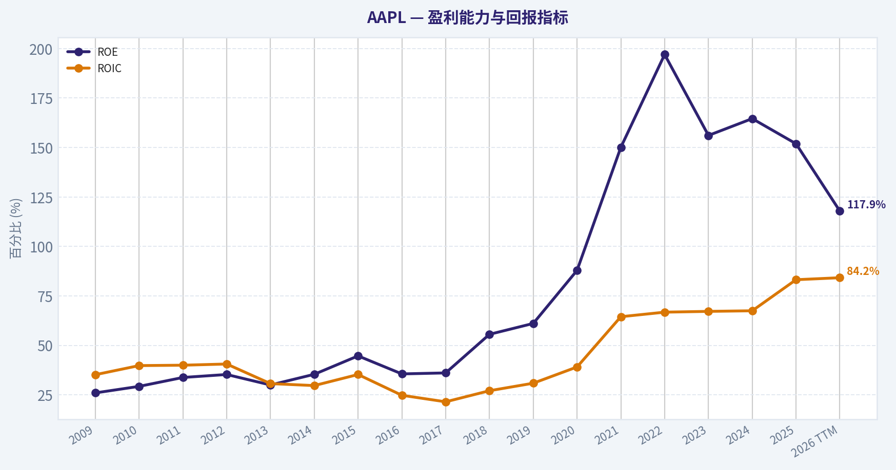
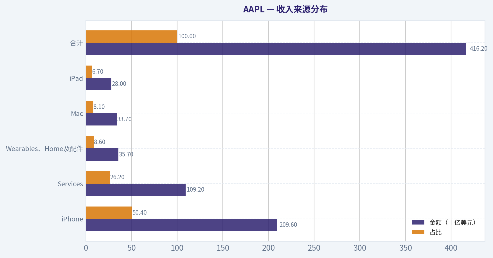
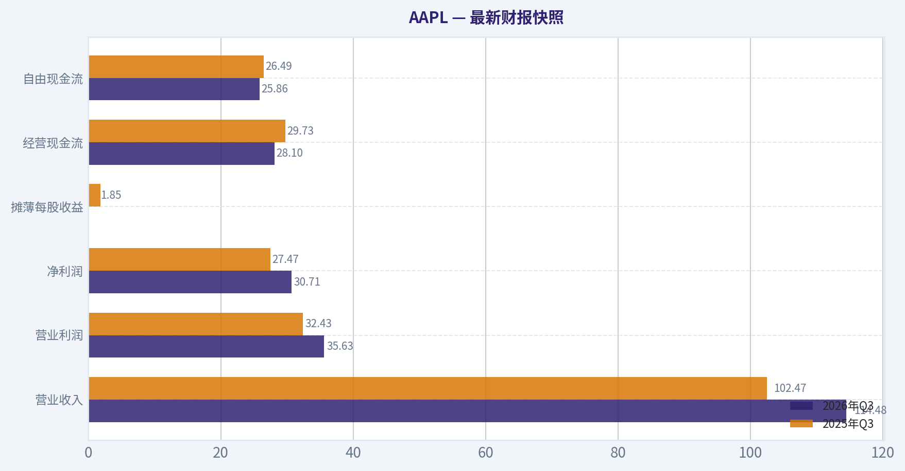
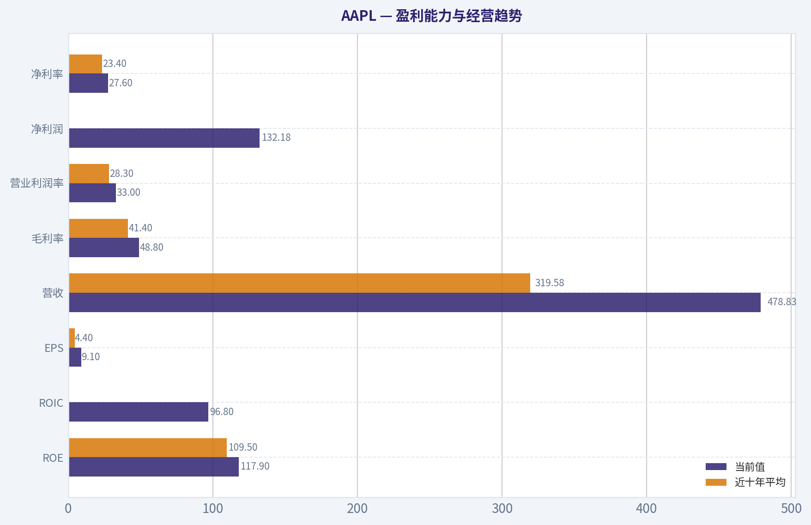
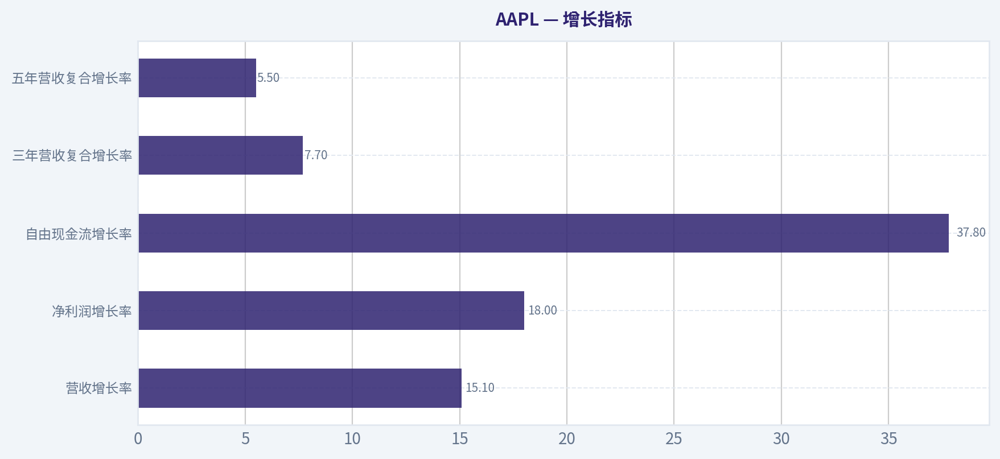
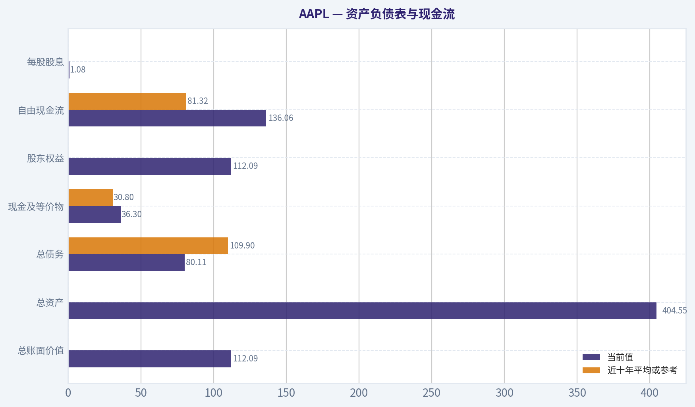
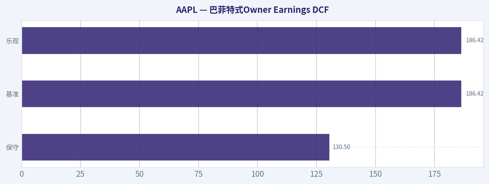
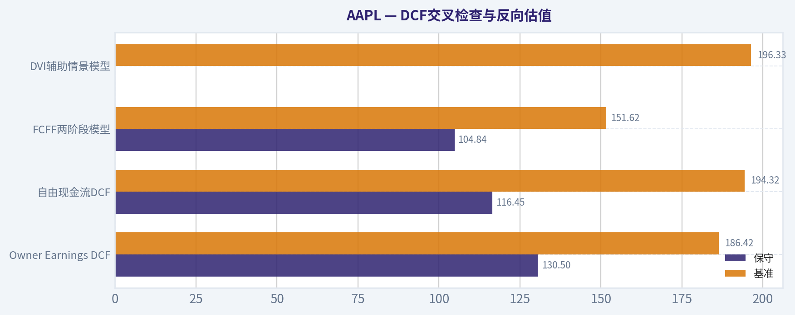

# AAPL 深度价值情报

**调研日期:** 2026-11-28

## 关键免责声明

*本报告由 Deep Value Intelligence（一个基于 AI 的多智能体投资分析框架）自动生成。 仅供教育和研究用途 - 非财务建议，非财务顾问。*

---

## 目录

1. 情报摘要
2. 分析师团队报告
   - 基本面分析
   - 价值分析 (巴菲特)
   - 成长性分析 (林奇/德鲁肯米勒/费雪)
   - 市场分析
   - 期权市场分析
3. 研究团队评论
4. 投资团队评论
5. Deep Values 团队洞察

---

## 情报摘要

### 核心观点与前提条件

**核心论点:** **原研究计划**将Apple概括为"优秀企业、估值较充分"，并定为WATCH（中性）。辩论后的证据支持保留这一结论，但应进一步明确：

**主要风险:**
- **原研究计划**将Apple概括为"优秀企业、估值较充分"，并定为WATCH（中性）。辩论后的证据支持保留这一结论，但应进一步明确：
- 这也是为什么Apple的**企业质量接近ADVOCATE（看多）级别，但价格证据仍停留在WATCH（中性）级别**。
- **最终立场：中性**

**置信度:** 中

---

## 分析师团队报告

### 基本面分析

#### 最新财报快照

*以下数据基于最近一期已披露财报（2026年Q3），并尽量与上一年同期对比。*

| 指标 | 2026年Q3 | 2025年Q3 | 同比变化 |
| --- | ---: | ---: | ---: |
| 营业收入 | $114.48B | $102.47B | +11.7% |
| 营业利润 | $35.63B | $32.43B | +9.9% |
| 净利润 | $30.71B | $27.47B | +11.8% |
| 摊薄每股收益 | N/A | $1.85 | N/A |
| 经营现金流 | $28.10B | $29.73B | -5.5% |
| 自由现金流 | $25.86B | $26.49B | -2.4% |

关键结论：这张快照先把最新一期财报放在桌面上，再去看长周期分析。这样读者能更清楚地区分"公司长期质量"和"这次财报发生了什么"。

#### AAPL 17年财务指标

*以下数值均由原始数据确定性计算得出，并非 AI 估算。*

*发行人类型：operating company（Technology / Consumer Electronics）。*

#### 17年财务指标
*年度行来自已披露财务报表，最后一行 TTM 由最近四个季度滚动计算得出。*

| 指标 | 2009 | 2010 | 2011 | 2012 | 2013 | 2014 | 2015 | 2016 | 2017 | 2018 | 2019 | 2020 | 2021 | 2022 | 2023 | 2024 | 2025 | 2026 TTM |
| --- | --- | --- | --- | --- | --- | --- | --- | --- | --- | --- | --- | --- | --- | --- | --- | --- | --- | --- |
| 市场价格 | $6 | $8 | $11 | $20 | $15 | $22 | $25 | $26 | $36 | $53 | $54 | $112 | $138 | $135 | $169 | $231 | $254 | $359 |
| 总市值 | $168.11B | $262.39B | $357.16B | $630.65B | $444.17B | $616.86B | $638.98B | $621.81B | $809.39B | $1.13T | $1.04T | $2.03T | $2.39T | $2.26T | $2.71T | $3.59T | $3.82T | $5.21T |
| 市盈率 | 20.41 | 18.73 | 13.78 | 15.10 | 11.99 | 15.62 | 11.96 | 13.60 | 16.73 | 18.94 | 18.85 | 35.31 | 25.22 | 22.62 | 27.93 | 38.32 | 34.13 | 39.42 |
| 市净率 | 5.31 | 5.49 | 4.66 | 5.33 | 3.60 | 5.53 | 5.35 | 4.85 | 6.04 | 10.53 | 11.51 | 31.07 | 37.83 | 44.53 | 43.56 | 63.04 | 51.82 | 46.48 |
| ROE | 26.0% | 29.3% | 33.8% | 35.3% | 30.0% | 35.4% | 44.7% | 35.6% | 36.1% | 55.6% | 61.1% | 87.9% | 150.1% | 197.0% | 156.1% | 164.6% | 151.9% | 117.9% |
| ROIC | 35.2% | 39.8% | 40.0% | 40.6% | 30.7% | 29.7% | 35.3% | 24.8% | 21.5% | 27.1% | 30.9% | 39.1% | 64.5% | 66.8% | 67.2% | 67.5% | 83.2% | 84.2% |
| 每股收益 | $0.27 | $0.45 | $0.83 | $1.33 | $1.22 | $1.42 | $2.06 | $1.90 | $2.14 | $2.81 | $2.85 | $3.18 | $5.47 | $5.99 | $6.13 | $6.08 | $7.46 | $9.10 |
| 营收 | $42.91B | $65.22B | $108.25B | $156.51B | $170.91B | $182.79B | $233.72B | $215.64B | $229.23B | $265.60B | $260.17B | $274.51B | $365.82B | $394.33B | $383.29B | $391.04B | $416.16B | $478.83B |
| 毛利润 | $17.22B | $25.68B | $43.82B | $68.66B | $64.30B | $70.54B | $93.63B | $84.26B | $88.19B | $101.84B | $98.39B | $104.96B | $152.84B | $170.78B | $169.15B | $180.68B | $195.20B | $233.60B |
| 毛利率 | 40.1% | 39.4% | 40.5% | 43.9% | 37.6% | 38.6% | 40.1% | 39.1% | 38.5% | 38.3% | 37.8% | 38.2% | 41.8% | 43.3% | 44.1% | 46.2% | 46.9% | 48.8% |
| 营业利润率 | 27.4% | 28.2% | 31.2% | 35.3% | 28.7% | 28.7% | 30.5% | 27.8% | 26.8% | 26.7% | 24.6% | 24.1% | 29.8% | 30.3% | 29.8% | 31.5% | 32.0% | 33.0% |
| 净利润 | $8.23B | $14.01B | $25.92B | $41.73B | $37.04B | $39.51B | $53.39B | $45.69B | $48.35B | $59.53B | $55.26B | $57.41B | $94.68B | $99.80B | $97.00B | $93.74B | $112.01B | $132.18B |
| 净利率 | 19.2% | 21.5% | 23.9% | 26.7% | 21.7% | 21.6% | 22.8% | 21.2% | 21.1% | 22.4% | 21.2% | 20.9% | 25.9% | 25.3% | 25.3% | 24.0% | 26.9% | 27.6% |
| 营收增长 | N/A | 52.0% | 66.0% | 44.6% | 9.2% | 7.0% | 27.9% | -7.7% | 6.3% | 15.9% | -2.0% | 5.5% | 33.3% | 7.8% | -2.8% | 2.0% | 6.4% | 15.1% |
| 净利润增长 | N/A | 70.2% | 85.0% | 61.0% | -11.3% | 6.7% | 35.1% | -14.4% | 5.8% | 23.1% | -7.2% | 3.9% | 64.9% | 5.4% | -2.8% | -3.4% | 19.5% | 18.0% |
| 自由现金流增长 | N/A | 84.0% | 100.5% | 27.9% | 6.9% | 10.2% | 39.6% | -23.6% | -3.2% | 23.8% | -8.1% | 24.6% | 26.7% | 19.9% | -10.6% | 9.3% | -9.2% | 37.8% |
| 总账面价值 | $31.64B | $47.79B | $76.61B | $118.21B | $123.55B | $111.55B | $119.36B | $128.25B | $134.05B | $107.15B | $90.49B | $65.34B | $63.09B | $50.67B | $62.15B | $56.95B | $73.73B | $112.09B |
| 总资产 | $47.50B | $75.18B | $116.37B | $176.06B | $207.00B | $231.84B | $290.35B | $321.69B | $375.32B | $365.73B | $338.52B | $323.89B | $351.00B | $352.75B | $352.58B | $364.98B | $359.24B | $404.55B |
| 总债务 | N/A | N/A | N/A | $0 | $16.96B | $35.30B | $64.33B | $87.03B | $115.68B | $114.48B | $108.05B | $112.44B | $124.72B | $120.07B | $111.09B | $106.63B | $98.66B | $80.11B |
| 债务股权比 | N/A | N/A | N/A | 0.00 | 0.14 | 0.32 | 0.54 | 0.68 | 0.86 | 1.07 | 1.19 | 1.72 | 1.98 | 2.37 | 1.79 | 1.87 | 1.34 | 0.71 |
| 现金及等价物 | $5.26B | $11.26B | $9.81B | $10.75B | $14.26B | $13.84B | $21.12B | $20.48B | $20.29B | $25.91B | $48.84B | $38.02B | $34.94B | $23.65B | $29.96B | $29.94B | $35.93B | $36.30B |
| 股东权益 | $31.64B | $47.79B | $76.61B | $118.21B | $123.55B | $111.55B | $119.36B | $128.25B | $134.05B | $107.15B | $90.49B | $65.34B | $63.09B | $50.67B | $62.15B | $56.95B | $73.73B | $112.09B |
| 经营现金流 | $10.16B | $18.59B | $37.53B | $50.86B | $53.67B | $59.71B | $81.27B | $66.23B | $64.22B | $77.43B | $69.39B | $80.67B | $104.04B | $122.15B | $110.54B | $118.25B | $111.48B | $145.10B |
| 投资现金流 | $-17.43B | $-13.85B | $-40.42B | $-48.23B | $-33.77B | $-22.58B | $-56.27B | $-45.98B | $-46.45B | $16.07B | $45.90B | $-4.29B | $-14.54B | $-22.35B | $3.71B | $2.94B | $15.20B | $-17.28B |
| 自由现金流 | $9.02B | $16.59B | $33.27B | $42.56B | $45.50B | $50.14B | $70.02B | $53.50B | $51.77B | $64.12B | $58.90B | $73.36B | $92.95B | $111.44B | $99.58B | $108.81B | $98.77B | $136.06B |
| 自由现金流利润率 | 21.0% | 25.4% | 30.7% | 27.2% | 26.6% | 27.4% | 30.0% | 24.8% | 22.6% | 24.1% | 22.6% | 26.7% | 25.4% | 28.3% | 26.0% | 27.8% | 23.7% | 28.4% |
| 每股分红 | $0.00 | $0.00 | $0.00 | $0.00 | $0.00 | $0.00 | $0.00 | $0.00 | $0.00 | $0.00 | $0.00 | $0.00 | $0.00 | $0.00 | $0.95 | $0.99 | $1.03 | $1.08 |

#### 盈利能力指标
- 净资产收益率 (ROE): 117.9%
- 投入资本回报率 (ROIC): 96.8%
- 总资产收益率 (ROA): 32.7%
- 毛利率: 48.8%
- 营业利润率: 33.0%
- 净利率: 27.6%

#### 流动性指标
- 流动比率: 1.02
- 速动比率: 0.59

#### 杠杆指标
- 债务股权比: 0.71
- 利息覆盖倍数: N/A
- 净负债: $23.39B

#### 增长指标（同比）
- 营收增长: 15.1%
- 净利润增长: 18.0%
- 自由现金流增长: 37.8%
- 营收复合增长率（3年）: 7.7%
- 营收复合增长率（5年）: 5.5%

#### 估值指标
- 市盈率 (TTM): 39.93
- 预期市盈率: 33.91
- 市净率: 46.49
- 市销率: 10.88
- PEG 比率: 3.94
- 企业价值/EBITDA: 30.60
- 自由现金流收益率: 2.6%
- 盈利收益率: 2.5%

#### 所有者收益（巴菲特方法，代码计算）
- 净利润: $112.01B
- + 折旧与摊销: $13.42B
- - 资本开支: $-9.04B
- + 营运资本（现金流量表口径；负数=占用现金）: $-14.86B
- = **所有者收益: $87.28B**

#### 内在价值（DeepValues 应用 - SEC 申报数据管道）
- **内在价值（DeepValues 应用，头条）: $186.42** - Owner Earnings (Buffett), 方法 buffett-1986-v2, 截至 2026-11-27 (FY2026)
  区间（保守-乐观）: $130.50 - $186.42
  相对价格的安全边际: -92.3% (价格 $358.54)
  应用使用的输入 (ttm_2026Q4): after-tax operating income $132.4B (operating income $158.1B, tax 16.2%) + D&A $13.4B - capex charge $11.7B (three-year average capex/revenue x trailing revenue; reported capex $9.0B) - working capital $0.0B = owner earnings $134.1B.
  Growth 5.5% fading to 2.5% terminal (min(owner-earnings CAGR, 5-year revenue CAGR), clamped [0, 10%]); discount rate 8.2% (30Y Treasury 5.24% + 3 pts (as of 2026-11-25)); net cash $55.4B (cash $36.3B + marketable securities $100.6B - debt $80.1B); 14,715M shares.
- Owner Earnings (Buffett): $130.50 / $186.42 / $186.42 (保守 / 基准 / 乐观) ← headline
- Free cash flow DCF: $116.45 / $194.32 / $422.92 (保守 / 基准 / 乐观)
- Damodaran two-stage FCFF: $104.84 / $151.62 / $164.40 (保守 / 基准 / 乐观)
  这就是内在价值：引用它作为内在价值，并据此衡量安全边际。其他地方的 DVI 情景数字仅为辅助交叉检查，不是估值。

#### DVI 情景模型（辅助交叉检查 - 不是内在价值）
DVI 基于 Yahoo 数据的情景，仅作敏感性检查。请勿将其作为内在价值引用；内在价值是上方的 DeepValues 应用估值。
- 当前价格: $359
- DVI 情景值（按商业模式路由）: $196
  商业模式: operating company - weighted blend [Damodaran FCFF + reverse-DCF fair + owner-earnings DCF] (operating_company)
  模型区间（各 DCF 最小-最大）: $191 - $240
  相对价格的安全边际（头条）: -82.6%
  路由说明: General operating company: balanced blend of Damodaran FCFF and the owner-earnings DCF with a reverse-DCF sanity check.
- 巴菲特方法（所有者收益）:
  保守: $138
  平均: $240
  乐观: $639
- 现金流方法（FCF）:
  保守: $88
  平均: $207
  乐观: $277
- Damodaran FCFF（WACC + 利润率 + 再投资）:
  保守: $109
  平均: $191
  乐观: $402
  蒙特卡洛区间（P10-P90）：$138 - $305（中位数 $201）
  P(内在价值 > 当前价格)：3.6%
- 反向 DCF：当前价格隐含约 27.2%/年 的所有者收益增长（10年）；过去 3 年为 1.4%，5 年为 14.1%。

#### Piotroski F分数: 9/9
- 净利润为正: 通过
- 经营现金流为正: 通过
- 资产回报率改善: 通过
- 现金流大于净利润: 通过
- 债务下降: 通过
- 流动比率改善: 通过
- 未稀释股本: 通过
- 毛利率改善: 通过
- 资产周转率改善: 通过

ANALYST STANCE: **中性**

#### 结论摘要

AAPL 仍是全球最具竞争力的消费科技与生态平台之一，盈利质量、现金创造能力、资本回报率和资产负债表韧性都非常突出。问题不在于企业质量，而在于估值：当前股价约 **359美元**，市盈率约 **39.93倍**，明显高于近十年平均水平；DeepValues 巴菲特式所有者收益内在价值为 **186.42美元**，保守至乐观区间为 **130.50-186.42美元**。

因此，当前证据支持"高质量公司、估值要求极高"的判断。除非未来盈利增长显著高于历史长期水平，否则现有价格包含了非常激进的增长预期。

#### 市场指标与估值

| 指标 | 当前值 | 近十年平均 | 当前相对历史 |
|---|---:|---:|---|
| 市场价格 | $359 | $120.8 | 约为平均值的2.97倍 |
| 总市值 | $5.21T | $2.04T | 约为平均值的2.55倍 |
| PE | 39.93倍 | 25.17倍 | 高出约58.6% |
| PB | 46.48倍 | 30.48倍 | 高出约52.5% |
| 盈利收益率 | 2.5% | - | 明显偏低 |
| 自由现金流收益率 | 2.6% | - | 对长期回报形成约束 |

关键结论：AAPL 的 PE 已显著超过十年平均水平，市场不仅在为当前盈利定价，也在提前计入持续的高质量增长。PB 对苹果这类资产较轻、品牌和软件生态价值较高、并长期回购股票的公司参考意义有限，不能机械地将高PB解释为资产泡沫，但现金流收益率仅约2.6%，说明估值对利率和增长预期都十分敏感。

#### 盈利能力与经营趋势

| 指标 | 当前值 | 近十年平均 | 主要含义 |
|---|---:|---:|---|
| ROE | 117.9% | 109.5% | 极高，受强盈利、回购及较低账面权益共同推动 |
| ROIC | 96.8% | 约49.3% | 资本使用效率极强；不同口径下历史最新值为84.2% |
| EPS | $9.10 | $4.40 | 当前约为平均值的2.1倍 |
| 营收 | $478.83B | $319.58B | 规模显著扩大 |
| 毛利率 | 48.8% | 41.4% | 高出约7.4个百分点 |
| 营业利润率 | 33.0% | 28.3% | 高出约4.7个百分点 |
| 净利润 | $132.18B | - | 创纪录水平 |
| 净利率 | 27.6% | 23.4% | 盈利结构持续改善 |

关键结论：苹果当前利润率明显高于十年均值，说明产品组合、服务业务、芯片自研、定价能力和规模效应共同提升了经济质量。ROE超过100%并不意味着普通经营资产能产生同等比例的回报，因为多年回购压低了账面权益；但ROIC持续处于极高水平，仍然说明业务本身具有强大的资本效率。

#### 增长指标

| 指标 | 当前增长 | 近十年样本平均 | 趋势判断 |
|---|---:|---:|---|
| 营收增长率 | 15.1% | 约8.0% | 当前明显高于常态 |
| 净利润增长率 | 18.0% | 约12.1% | 当前加速 |
| 自由现金流增长率 | 37.8% | 约8.1% | 当前大幅高于常态，但波动较大 |
| 三年营收复合增长率 | 7.7% | - | 中个位数增长 |
| 五年营收复合增长率 | 5.5% | - | 更接近成熟期长期速度 |

关键结论：最近一个滚动年度的数据非常强，但不能把37.8%的自由现金流增长永久化。五年营收复合增长率只有5.5%，更接近成熟大型平台企业的长期增长基础；当前估值要求未来增长持续高于这个长期基准。

#### 资产负债表与现金流

| 指标 | 当前值 | 近十年平均或参考 | 评价 |
|---|---:|---:|---|
| 总账面价值 | $112.09B | - | 回购后仍明显回升 |
| 总资产 | $404.55B | - | 资产规模稳步扩大 |
| 总债务 | $80.11B | $109.9B | 低于近十年平均 |
| 债务权益比 | 0.71倍 | - | 较2022年2.37倍显著改善 |
| 现金及等价物 | $36.30B | $30.8B | 高于近十年平均 |
| 股东权益 | $112.09B | - | 受回购影响，历史波动较大 |
| 自由现金流 | $136.06B | $81.32B | 当前约为平均值的1.67倍 |
| 每股股息 | $1.08 | 2023-2025平均约$0.99 | 稳步上升 |
| 流动比率 | 1.02倍 | - | 略高于1 |
| 速动比率 | 0.59倍 | - | 较低，但需结合现金流和市场证券观察 |
| 净负债 | $23.39B | - | 规模相对经营现金流较小 |

关键结论：苹果的债务绝对额并不构成主要风险，且总债务已从历史高位下降。流动比率和速动比率不算宽裕，但苹果拥有稳定的经营现金流、约100.6亿美元市场证券以及强大的资本市场融资能力，因此短期流动性风险有限。真正需要关注的是现金回报如何在高估值下继续增长，而不是债务偿付能力。

#### 现金流质量与所有者收益

数据集中的传统所有者收益计算为：

- 净利润：112.01亿美元
- 加：折旧与摊销：13.42亿美元
- 减：资本开支：9.04亿美元
- 减：营运资本现金占用：14.86亿美元
- 所有者收益：**87.28亿美元**

DeepValues 使用另一套TTM经营口径计算：

- 税后经营利润：132.4亿美元
- 加：折旧与摊销：13.4亿美元
- 减：维持性资本开支：11.7亿美元
- 营运资本调整：0
- Owner Earnings：**134.1亿美元**

两者差异主要来自净利润与税后经营利润的起点不同，以及营运资本和资本开支的估算口径不同。估值部分按研究包要求，以DeepValues的 **134.1亿美元Owner Earnings** 和 **186.42美元内在价值**为主，并以传统自由现金流模型作交叉检查。

#### 收入来源分布

| 收入来源 | 金额（十亿美元） | 占比 |
|---|---:|---:|
| iPhone | $209.6 | 50.4% |
| Services | $109.2 | 26.2% |
| Wearables、Home及配件 | $35.7 | 8.6% |
| Mac | $33.7 | 8.1% |
| iPad | $28.0 | 6.7% |
| 合计 | $416.2 | 100.0% |

关键结论：iPhone仍贡献约一半收入，是苹果最大的单一业务和生态入口。Services已占约四分之一，并且通常具有更高的毛利率和更强的重复性，这有助于提高整体利润率；但收入结构仍然高度依赖iPhone换机周期、产品创新和全球消费电子需求。

#### 经营质量与护城河

| 维度 | 证据 | 判断 |
|---|---|---|
| 品牌与定价权 | 高端智能手机、电脑、平板和可穿戴产品长期维持高毛利 | 强 |
| 生态锁定 | 硬件、操作系统、应用商店、云服务和支付体系互相强化 | 强 |
| 服务收入 | Services规模已超过1000亿美元，重复性高 | 增强中 |
| 芯片与系统整合 | 自研芯片提升性能、能效和产品差异化 | 强 |
| 规模经济 | 巨大的安装基数、供应链和研发投入形成成本优势 | 强 |
| 转换成本 | 用户数据、应用、配件和跨设备协同提高迁移成本 | 强 |
| 技术风险 | 人工智能设备、生成式AI和新型终端竞争加剧 | 需观察 |
| 单品集中度 | iPhone仍占约50%收入 | 结构性风险 |

关键结论：苹果的护城河不是单一产品，而是品牌、生态、开发者体系、芯片、供应链和用户迁移成本的组合。护城河仍然稳固，但公司规模已极大，未来增速更依赖服务渗透率、人工智能功能变现、新硬件类别和用户生命周期价值，而不是单纯扩大硬件销量。

#### 预测性盈利与管理层资本配置

过去十多年中，苹果经历了2016年、2019年、2023年和2024年等收入或利润放缓阶段，但整体盈利趋势仍然向上。自由现金流在2016年、2017年、2019年、2023年和2025年出现过同比下降，表明现金流并非每年线性增长；不过长期现金创造能力极强。

资本配置方面，公司持续进行股票回购，同时保持股息逐步增长。回购提高了EPS和ROE，但也使账面权益减少，导致PB和ROE受到会计结构影响。Piotroski F分数为9/9，说明当前盈利、现金流、债务变化、毛利率和资产周转等基础指标整体健康。

#### 巴菲特式Owner Earnings DCF

DeepValues内在价值采用：

- 当前Owner Earnings：134.1亿美元
- 折现率：8.2%
- 终值增长率：2.5%
- 净现金：554亿美元
- 总股数：147.15亿股
- 基准增长：5.5%，随后逐步衰减至2.5%

基本公式为：

\[
\text{每股价值}
=
\frac{\sum_{t=1}^{5}\frac{OE_t}{(1+r)^t}
+
\frac{OE_5(1+g_T)}{(r-g_T)}\times\frac{1}{(1+r)^5}
+
\text{净现金}}
{\text{股数}}
\]

| 情景 | 核心增长假设 | Owner Earnings估值 | 结果解释 |
|---|---|---:|---|
| 保守 | 低增长或接近成熟企业长期增长，终值增长2.5%，折现率约8.2% | $130.50 | 反映硬件周期、竞争和估值收缩风险 |
| 基准 | 约5.5%增长，逐步衰减至2.5% | $186.42 | DeepValues头条内在价值 |
| 乐观 | 更高的短期增长，仍然衰减至2.5%，不假设永久高增长 | $186.42 | 受模型估值上限约束 |

关键结论：即使使用较高质量的Owner Earnings和较低于传统股权资本成本的8.2%折现率，DeepValues给出的基准内在价值仍为186.42美元，明显低于当前359美元。自由现金流DCF的保守、基准和乐观结果分别为116.45美元、194.32美元和422.92美元；其中乐观值对增长假设极其敏感，不能作为核心结论。

#### DCF交叉检查与反向估值

| 模型 | 保守 | 基准 | 乐观 | 当前价格含义 |
|---|---:|---:|---:|---|
| Owner Earnings DCF | $130.50 | $186.42 | $186.42 | 当前价格显著高于核心估值 |
| 自由现金流DCF | $116.45 | $194.32 | $422.92 | 乐观情景依赖较强增长 |
| FCFF两阶段模型 | $104.84 | $151.62 | $164.40 | 仍低于当前价格 |
| DVI辅助情景模型 | - | $196.33 | - | 仅作交叉检查 |
| 反向DCF隐含增长 | - | 约27.2%年化，十年 | - | 远高于历史长期增速 |

关键结论：不同模型的基准结果大多集中在约150-200美元区间，明显低于359美元。反向DCF显示，当前价格大致要求未来十年Owner Earnings年增长约27.2%，而过去三年营收复合增长率为7.7%、五年为5.5%；这表明市场定价包含了远高于成熟期历史趋势的增长假设。

#### 风险、机会与估值触发因素

| 类型 | 具体因素 | 对基本面的可能影响 |
|---|---|---|
| 机会 | Services继续扩大 | 提高收入可预测性和整体毛利率 |
| 机会 | 人工智能功能与新设备类别 | 可能延长用户生命周期并创造新收入 |
| 机会 | iPhone高端化及市场份额提升 | 支持ASP和利润率 |
| 机会 | 回购与现金流持续 | 支持EPS增长和资本回报 |
| 风险 | iPhone收入占比约50% | 单一产品周期仍然重要 |
| 风险 | 当前PE约40倍 | 盈利预期稍有下修，估值可能重新定价 |
| 风险 | 反向DCF隐含增长约27.2% | 远超五年营收复合增速 |
| 风险 | AI竞争和人才争夺 | 可能削弱生态差异化或增加研发费用 |
| 风险 | 中国及全球监管、供应链风险 | 影响销售、生产和服务业务 |
| 风险 | PB失真 | 回购压低账面权益，传统资产估值指标失效 |

#### 最终研究判断

AAPL符合许多巴菲特式优质企业标准：

- 护城河深且多层次；
- ROIC和自由现金流长期强劲；
- 资产负债表稳健；
- 收入和利润规模持续扩大；
- Services提高了收入质量；
- 资本配置以回购和股息为主，且历史上具有较高效率。

但估值层面存在明显矛盾：

- PE高于十年均值约59%；
- 自由现金流收益率仅约2.6%；
- DeepValues内在价值为186.42美元，较当前价格低约48%；
- 反向DCF要求约27.2%的十年Owner Earnings增长；
- 这一要求明显高于5.5%的五年营收复合增长率。

因此，最终立场为 **中性**。这不是对公司质量的否定，而是对当前估值与长期增长要求之间缺口的反映。研究证据支持苹果是高质量、强护城河、强现金流企业，但尚不足以支持359美元价格已经充分体现安全边际。

| 关键项目 | 当前判断 | 估值含义 |
|---|---|---|
| 企业质量 | 极高 | 支持长期竞争力 |
| 护城河 | 强 | 品牌、生态、芯片和服务协同明显 |
| 盈利能力 | 极强 | 毛利率、营业利润率和ROIC均处于历史高位 |
| 财务安全 | 良好 | 债务下降、现金流强、净负债较低 |
| 增长质量 | 良好但已成熟 | 当前增速强，长期趋势更接近中个位数 |
| 估值水平 | 偏高 | PE、PB和市值均显著高于历史常态 |
| DeepValues内在价值 | $186.42 | 低于当前价格约48% |
| 反向DCF要求 | 约27.2%年增长 | 明显高于长期历史增长 |
| 综合立场 | 中性 | 公司优质，但当前价格对增长兑现要求极高 |

#### 基本面关键图表

本图追踪 **AAPL** 过去十年的盈利能力与回报指标（ROE、ROIC、利润率），突出呈现资本效率的变化趋势。

本对比图（来自「收入来源分布」）将 **AAPL** 的当前数据与历史基准并排呈现，直观反映公司相对自身历史均值的估值水平。

---

### 价值分析 (巴菲特)

> *基于沃伦·巴菲特的价值投资哲学：能力圈、经济护城河、管理层质量与安全边际。*

#### 内在价值快照

价格是你付的钱，内在价值是企业未来可能为股东创造的现金价值。我们给出一个区间，而不是假装只有一个神奇数字。

- 当前价格: $358.54
- 估值区间（两种 DCF 方法、保守到乐观）: $116.45 至 $422.92

##### 所有者收益（巴菲特方法）
- 净利润: $112,010,000,000.00
- 折旧与摊销: $13,423,000,000.00
- 资本支出: $-9,041,000,000.00
- 营运资金变化: $-14,858,000,000.00
- 所有者收益: $87,280,891,892.50

##### 内在价值
###### 所有者收益法
使用所有者收益，更严格，通常更保守。
- 保守: $130.50
- 平均: $186.42
- 乐观: $186.42
- 折现率: 8.2%

###### 自由现金流法
使用自由现金流，更适合今天投入很多、为未来增长铺路的公司。
- 保守: $116.45
- 平均: $194.32
- 乐观: $422.92
- 折现率: 9.0%

分析师立场：**中性**

#### 一、结论摘要

Apple 仍是全球最强的消费科技生态之一，拥有品牌、用户黏性、服务业务和资本回报等多重优势。其盈利质量、现金创造能力和资产负债表均支持"优秀企业"判断，但当前股价约为 **359美元**，而 DeepValues 应用给出的内在价值为 **186.42美元**，价格约高于内在价值 **92.7%**。因此，当前证据支持公司质量，却不支持当前估值水平。

#### 二、因素评分

| 因素 | 评分 | 主要证据 |
|---|---:|---|
| 圆能力与业务简单性 | 4/5 | 通过硬件、软件与服务生态向消费者收费，模式清晰；但AI、设备形态和全球供应链增加未来预测复杂度 |
| 护城河 | 4/5 | 品牌、生态系统、应用分发、账户体系、服务订阅和开发者网络形成复合型优势；护城河宽且相对稳定，但规模已极大 |
| 管理层与资本配置 | 4/5 | 长期重视每股价值、现金回报和研发投入；资本配置总体理性，回购与分红规模庞大 |
| 行业结构 | 4/5 | 高端智能设备与生态平台具有规模优势和较高集中度；但硬件市场成熟，竞争与技术变迁持续存在 |

**关键结论：** Apple 的核心经济特征明显优于普通硬件公司，真正的价值来源是生态黏性、品牌溢价和高额现金流，而不是单一产品销量。主要扣分来自公司规模、行业成熟度及未来AI竞争的不确定性，而不是商业模式本身。

#### 三、护城河分析

| 护城河来源 | 具体表现 | 评价 |
|---|---|---|
| 无形资产 | 全球高端品牌，产品设计、隐私定位和用户体验形成较强溢价 | 强 |
| 转换成本 | 用户数据、应用购买记录、设备互联、云服务和配件体系提高迁移成本 | 强 |
| 网络效应 | 用户、开发者、内容和支付体系相互强化，生态规模越大，平台吸引力越强 | 强 |
| 成本优势 | 芯片设计、采购规模、零售与供应链管理带来单位经济优势 | 中强 |
| 财务证据 | 毛利率约48.8%，ROE约117.9%，自由现金流收益率约2.6% | 盈利强、估值贵 |

**关键结论：** Apple 的护城河不是单一品牌优势，而是品牌、系统、服务、开发者和设备互联共同构成的生态护城河。毛利率接近50%说明定价权和产品结构较强，但自由现金流收益率只有2.6%，说明市场已经为这种护城河支付了非常高的价格。

#### 四、管理层与资本配置

Apple 的管理层延续了长期主义框架，重点体现在三方面：

1. **持续研发与生态投入：** 通过芯片、操作系统、服务和设备协同扩大用户黏性。
2. **资本回报纪律：** 公司长期进行大规模回购与分红，减少股本并提高每股收益。
3. **资产负债表管理：** 现金及有价证券规模显著高于债务，净现金约 **554亿美元**。

需要关注的是，Apple 的高ROE部分来自持续回购造成的净资产收缩，因此不能将117.9%的ROE全部解释为经营效率。判断企业质量时，更应结合毛利率、经营利润、自由现金流和投入资本回报率。

#### 五、财务摘要

| 指标 | FY2026或最新数据 |
|---|---:|
| 股价 | 359美元 |
| 总市值 | 5.21万亿美元 |
| 市盈率 | 39.9倍 |
| 营收同比增长 | 15.1% |
| 毛利率 | 48.8% |
| ROE | 117.9% |
| 自由现金流收益率 | 2.6% |
| 税后经营利润 | 1324亿美元 |
| 净利润口径所有者收益 | 1341亿美元 |
| 折旧与摊销 | 134亿美元 |
| 资本开支扣除额 | 117亿美元 |
| 营运资本增加 | 约0亿美元 |
| 现金及有价证券 | 1369亿美元 |
| 债务 | 801亿美元 |
| 净现金 | 554亿美元 |
| 流动比率 | 1.02倍 |

**关键结论：** Apple 仍然具备极强的现金创造能力，税后经营利润超过1300亿美元，且净现金为正。流动比率接近1倍对这种负营运资本、预收款和高现金流企业并非核心风险；真正的问题是2.6%的自由现金流收益率和接近40倍的市盈率。

#### 六、所有者收益计算

根据研究包提供的Buffett口径：

| 项目 | 金额 |
|---|---:|
| 税后经营利润 | 1324亿美元 |
| 加：折旧与摊销 | 134亿美元 |
| 减：资本开支扣除额 | 117亿美元 |
| 减：营运资本增加 | 0亿美元 |
| 所有者收益 | **1341亿美元** |
| 摊薄股数 | 147.15亿股 |
| 每股所有者收益 | **约9.11美元** |

**关键结论：** 所有者收益约1341亿美元，与公司庞大市值相比仍显不足。以359美元股价计算，市场隐含的所有者收益回报率约为2.5%至2.6%，这意味着估值高度依赖未来多年持续增长、利润率维持以及资本回报。

#### 七、三情景DCF估值

以下为独立的辅助计算，DeepValues应用内在价值仍以186.42美元为主。

| 情景 | 核心假设 | 估算每股价值 |
|---|---|---:|
| A：零增长 | 所有者收益按10%折现率资本化 | 约91美元 |
| B：GDP增长 | 未来增长3%，折现率10% | 约134美元 |
| C：历史增长 | 所有者收益增长约4.1%，持续10年后进入终值 | 约155美元 |
| DeepValues应用内在价值 | 增长5.5%逐步降至2.5%，折现率8.2%，加净现金 | **186.42美元** |

**关键结论：** 即使采用较为积极的历史增长情景，辅助模型仍低于当前股价。DeepValues应用使用更低的8.2%折现率和5.5%的初始增长率，得到186.42美元，已经明显比保守模型宽松，但仍不足以解释359美元的价格。

#### 八、内在价值与安全边际

| 项目 | 数值 |
|---|---:|
| 当前股价 | 359美元 |
| DeepValues内在价值 | 186.42美元 |
| 保守-乐观价值区间 | 130.50-186.42美元 |
| 股价相对内在价值溢价 | 约92.7% |
| 相对价格的安全边际 | **-92.3%** |
| 当前市盈率 | 39.9倍 |
| 自由现金流收益率 | 2.6% |

**关键结论：** 对于真正宽护城河、高ROIC且高度可预测的企业，10%至15%的安全边际通常已经可以接受；但Apple当前不是小幅溢价，而是显著高于研究包内在价值。要证明359美元合理，市场需要假设更高、更持久的增长，或者接受显著低于正常水平的长期折现率。

#### 九、最终Buffett评分卡

| 评分标准 | 权重 | 评分 | 加权得分 |
|---|---:|---:|---:|
| 护城河宽度与持久性 | 25% | 4 | 1.00 |
| 估值与安全边际 | 20% | 1 | 0.20 |
|资本回报：ROIC相对WACC | 15% | 4 | 0.60 |
| 业务理解与可预测性 | 12% | 4 | 0.48 |
| 管理质量与资本配置 | 12% | 4 | 0.48 |
| 再投资空间 | 8% | 3 | 0.24 |
| 资产负债表强度 | 4% | 4 | 0.16 |
| 行业结构 | 4% | 4 | 0.16 |
| **总分** | **100%** |  | **3.32/5.00** |

**关键结论：** 评分显示Apple是高质量企业，但不是当前估值下的高性价比企业。护城河、资本回报、管理质量和资产负债表为主要加分项；估值单项的显著拖累足以把总体评价从"优秀企业合理估值"降至"等待估值改善"。

#### 十、Gate 5质量与偿债底线

**Gate 5未触发。**

公司拥有正净现金、强劲经营现金流、持续盈利和较高利润率，现有证据不显示"盈利与现金流恶化同时叠加偿债危机"。因此，Apple不属于财务困境企业；当前核心矛盾是估值，而不是偿债能力。

#### 十一、投资立场

**中性｜信心：高**

Apple的企业质量接近全球上市公司中的顶级水平，护城河和现金流均具有长期可预测性。然而，在股价约359美元时，价格显著高于DeepValues应用内在价值186.42美元，也高于三种辅助DCF情景。综合评分3.32分，证据支持"优秀企业但估值缺乏安全边际"的判断。
#### 估值桥

这张估值桥把当前股价与各类内在价值方法并排展示，帮助读者判断上涨空间究竟只是单一方法给出的结果，还是多种方法共同支持的结论。

| 项目 | 每股内在价值 |
| --- | ---: |
| 巴菲特方法 | $186.42 |
| 现金流方法 | $194.32 |
| Damodaran 方法 | $151.62 |
| 当前价格 | $358.54 |

#### 关键结论

如果只有一种方法显著高于其他方法，说明上行空间更依赖特定建模假设。若多种方法的估值接近，则说明估值逻辑更加稳健。

#### 估值图表

本对比图（来自「最新财报快照」）将 **AAPL** 的当前数据与历史基准并排呈现，直观反映公司相对自身历史均值的估值水平。

本对比图（来自「盈利能力与经营趋势」）将 **AAPL** 的当前数据与历史基准并排呈现，直观反映公司相对自身历史均值的估值水平。

本对比图（来自「增长指标」）将 **AAPL** 的当前数据与历史基准并排呈现，直观反映公司相对自身历史均值的估值水平。

本对比图（来自「资产负债表与现金流」）将 **AAPL** 的当前数据与历史基准并排呈现，直观反映公司相对自身历史均值的估值水平。

本对比图（来自「巴菲特式Owner Earnings DCF」）将 **AAPL** 的当前数据与历史基准并排呈现，直观反映公司相对自身历史均值的估值水平。

本对比图（来自「DCF交叉检查与反向估值」）将 **AAPL** 的当前数据与历史基准并排呈现，直观反映公司相对自身历史均值的估值水平。

---

### 成长性分析 (林奇/德鲁肯米勒/费雪)

> *基于彼得·林奇的GARP成长投资法、斯坦利·德鲁肯米勒的宏观拐点分析法，以及菲利普·费雪的深度调研法。*

ANALYST STANCE: **看空**

#### 一、结论摘要

Apple 当前兼具优质商业模式、强现金流和高用户黏性，但研究数据更接近"高质量成熟型公司"，而不是典型的十倍增长股。营收同比增长约 15.1%，但 PE 约 39.9 倍，PEG 约 2.64，且市场隐含估值明显高于主要内在价值模型。

核心证据显示：公司基本面仍然强健，但 $359 股价对应的估值需要持续的高增长、AI 产品成功和生态变现加速才能得到充分支撑。现有数据不支持该估值具备足够安全边际。

#### 二、Lynch 分类

| 项目 | 判断 |
|---|---:|
| 营收同比增长 | 15.1% |
| PE | 39.93 倍 |
| 毛利率 | 48.8% |
| ROE | 117.9% |
| Lynch 分类 | 成熟型公司，接近快速增长门槛 |
| 十倍股属性 | 较弱 |

关键结论：Apple 的最新增长率达到快速增长股的最低门槛，但公司市值已达约 $5.21T，规模效应和基数效应显著。按照 Lynch 框架，更适合被视为高质量成熟型公司，而非早期快速增长型公司。

#### 三、故事：三个简单要点

1. Apple 通过 iPhone、服务、可穿戴设备和生态系统，把硬件用户转化为长期消费与订阅收入。
2. 强品牌、软硬件整合、开发者生态和高客户黏性构成较深护城河。
3. AI 设备、服务业务和潜在新产品可能带来下一轮产品周期，但目前仍缺乏足够数据证明已经形成加速拐点。

#### 四、TAM 与十倍测试

| 项目 | 结果 |
|---|---:|
| 当前市值 | $5.21T |
| 十倍市值 | $52.1T |
| 当前营收 | 研究包未提供精确数值 |
| 十倍营收测试 | 缺少审计口径营收，无法精确计算 |
| 规模约束 | 十倍后仍低于 20% 全球相关市场份额，可信度较低 |
| TAM 评价 | 大，但相对于 Apple 当前体量已明显收窄 |

关键结论：Apple 所处的智能手机、服务、可穿戴设备和消费电子市场仍然庞大，但公司当前体量已经极高。要实现十倍增长，需要多个新市场同时达到极大规模，现有公开数据不足以证明这一点。

#### 五、收入增长趋势

| 指标 | 数据 | 解读 |
|---|---:|---|
| 最新营收同比增长 | 15.1% | 健康，但不是超高速 |
| 连续季度趋势 | 未提供 | 无法判断是否加速 |
| 有机增长质量 | 未提供分部拆分 | 无法区分销量、价格、服务和汇率贡献 |
| 客户集中度 | 未提供 | 需关注 iPhone 依赖度 |
| 增长分类 | 暂定稳定增长 | 尚未确认加速 |

关键结论：15.1% 的增长优于成熟大型科技公司的常见水平，但单一同比数据不足以证明增长正在加速。若未来出现连续季度营收、服务收入和活跃设备数量同步提速，才更接近 Druckenmiller 所关注的正向拐点。

#### 六、单位经济与盈利效率

| 指标 | 数据 | 评价 |
|---|---:|---|
| 毛利率 | 48.8% | 很强 |
| 自由现金流收益率 | 2.6% | 对应估值偏高 |
| 流动比率 | 1.02 | 流动性可用，但缓冲有限 |
| LTV/CAC | 不适用于硬件生态，未披露 | 无法直接计算 |
| NRR | 未披露 | 不适用于传统硬件主体 |
| Rule of 40 | 不适用 | 非纯订阅型 SaaS 公司 |
| ROE | 117.9% | 很高，但受回购和资本结构影响 |

关键结论：Apple 的毛利率和现金创造能力是核心优势，但 2.6% 的自由现金流收益率反映出估值已经很昂贵。极高 ROE 并不等于未来增长很高，因为它部分受到资本回购和较低账面股东权益的影响。

#### 七、拐点评估

| 潜在拐点 | 当前证据 | 判断 |
|---|---|---|
| AI 产品周期 | AI 设备竞争升温，OpenAI 与 Apple 相关竞争报道 | 尚处早期，未验证商业贡献 |
| 服务业务扩张 | 研究包未提供服务分部增速 | 方向积极，数据不足 |
| 智能手机份额 | 2027 年行业出货量或下降，但 Apple 可能提升份额 | 可能是份额拐点，不一定是行业增长 |
| 利润率拐点 | 毛利率 48.8% | 已高，进一步扩张空间有限 |
| 竞争格局 | AI 人才和设备竞争加剧 | 既是机会也是压力 |
| 总体评级 | 可能存在产品拐点 | 尚未达到确认级别 |

关键结论：最重要的潜在催化剂是 AI 设备和服务生态的重新加速，而不是传统 iPhone 数量增长。当前证据只能说明机会正在形成，尚不能证明盈利预期将在两到三年内显著超出市场共识。

#### 八、宏观环境

| 宏观因素 | 当前状态 | 对 Apple 的含义 |
|---|---|---|
| 30 年期美国国债收益率 | 5.24% | 对高估值成长资产形成折现压力 |
| 折现率 | 8.2% | 对长期现金流估值不利 |
| 消费电子周期 | 2026 年行业出货量预计收缩 | 需求环境偏谨慎 |
| Apple 相对竞争力 | 可能提升手机份额 | 可部分抵消行业下行 |
| AI 主题 | 长期顺风 | 需要产品化和商业化证明 |
| 宏观评级 | 中性偏逆风 | 利率压力大于周期支持 |

关键结论：AI 是长期有利的结构性主题，但较高的无风险利率和消费电子行业收缩构成近期估值压力。Apple 的份额提升可能改善相对表现，却未必足以支撑整个行业和公司的高估值同步扩张。

#### 九、Fisher 15 项评分

| Fisher 项目 | 评分（5分制） | 简要判断 |
|---|---:|---|
| 市场潜力 | 4 | 服务、设备和生态市场仍大 |
| 新产品决心 | 4 | 长期研发和产品扩展能力强 |
| R&D 效率 | 4 | 研发规模大，但 AI 成果待验证 |
| 销售组织 | 5 | 全球渠道和品牌能力突出 |
| 利润率 | 5 | 毛利率和现金创造能力强 |
| 利润率改善 | 3 | 已处高位，提升空间有限 |
| 员工与人才关系 | 3 | AI 人才竞争加剧 |
| 高管协作 | 4 | 管理连续性较强 |
| 管理层深度 | 4 | 组织和供应链能力突出 |
| 成本分析 | 4 | 规模化运营成熟 |
| 特殊护城河 | 5 | 生态、品牌、转换成本和开发者网络 |
| 长期盈利前景 | 4 | 取决于 AI 和服务扩张 |
| 股权稀释 | 5 | 未见重大稀释风险 |
| 坦诚度 | 4 | 信息披露总体成熟 |
| 管理层诚信 | 4 | 长期治理记录较强 |
| 总分 | **61/75** | 良好，但未达卓越区间 |

关键结论：Apple 的 Fisher 评分为 61 分，说明其管理、品牌、生态和盈利能力属于优秀水平。扣分主要来自估值、成熟度、利润率继续扩张空间有限，以及 AI 产品商业化尚未验证。

#### 十、估值分析

| 方法 | 结果 | 估值含义 |
|---|---:|---|
| 当前股价 | $359 | 市场定价很高 |
| PE | 39.93 倍 | 对成熟型公司偏贵 |
| 增长代理 | 15.1% | 使用最新营收增速作近似 |
| PEG | 约 2.64 | 明显高于 2.0 的昂贵区间 |
| Owner Earnings 内在价值 | $186.42 | 显著低于当前价格 |
| Owner Earnings 区间 | $130.50-$186.42 | 安全边际不足 |
| FCF DCF 基准值 | $194.32 | 低于当前价格 |
| FCFF 两阶段基准值 | $151.62 | 低于当前价格 |
| 辅助情景值 | $196.33 | 仍明显低于当前价格 |

关键结论：无论采用 PEG、Owner Earnings、FCF DCF 还是 FCFF 两阶段模型，当前价格都高于主要估值结果。研究包中的"安全边际 -92.3%"与 $186.42 对比 $358.54 的数学关系不一致；按价格与估值直接计算，价格约高于基准内在价值 92.5%，对应估值相对价格约低 48.0%。

#### 十一、估值敏感性

| 情景 | 关键假设 | 估值参考 |
|---|---|---:|
| 保守 | 增长衰减更快，折现压力较大 | $104.84-$130.50 |
| 基准 | Owner Earnings 增长约 5.5%，终值增长 2.5% | $151.62-$194.32 |
| 乐观 | AI、服务和生态变现显著加速 | $164.40-$422.92 |
| 当前市场价格 | $359 | 高于多数模型中枢 |

关键结论：只有较乐观的自由现金流情景能够接近或超过当前价格，但该情景要求 AI 和服务业务明显超预期。基准估值区间集中在约 $150-$195，说明市场已经提前计入了较多长期成功因素。

#### 十二、增长投资者评分卡

| 维度 | 权重 | 评分（5分制） | 加权分 |
|---|---:|---:|---:|
| Lynch 故事 | 10% | 4.5 | 0.45 |
| TAM 与增长跑道 | 20% | 3.0 | 0.60 |
| 收入增长 | 20% | 3.5 | 0.70 |
| 单位经济 | 15% | 4.0 | 0.60 |
| 竞争地位 | 10% | 4.8 | 0.48 |
| 管理质量 | 10% | 4.2 | 0.42 |
| 宏观环境 | 5% | 2.5 | 0.13 |
| 盈利路径 | 5% | 4.5 | 0.23 |
| 估值 | 5% | 1.5 | 0.08 |
| 总分 | 100% | - | **3.69/5** |

关键结论：业务质量评分很高，但估值和宏观环境显著拖累综合结果。3.69 分代表公司本身优秀、增长故事仍有吸引力，但当前定价对未来执行提出了很高要求，因此综合立场为 看空。

#### 十三、关键风险与催化剂

| 类型 | 因素 | 影响 |
|---|---|---|
| 风险 | AI 产品推出延迟或商业化弱 | 估值缺少新的增长支撑 |
| 风险 | 智能手机行业继续收缩 | 可能压低硬件收入增速 |
| 风险 | AI 人才和设备竞争加剧 | 研发成本与竞争压力上升 |
| 风险 | 高利率持续 | 长期现金流折现值下降 |
| 风险 | 服务业务增速放缓 | 降低生态变现预期 |
| 催化剂 | AI 设备形成新产品周期 | 可能扩大 TAM |
| 催化剂 | 服务收入持续高于整体收入增长 | 改善收入质量 |
| 催化剂 | 智能手机份额继续提升 | 抵消行业收缩 |
| 催化剂 | 毛利率和现金流同步改善 | 支持盈利预期上修 |
| 催化剂 | 新硬件品类成功 | 为成熟业务重新打开增长跑道 |

关键结论：Apple 的主要上行催化剂来自 AI 产品和新硬件品类，而不是传统业务自然增长。主要风险是公司已经足够庞大，任何新业务都需要达到极大规模，才能改变整体估值逻辑。

---

### 市场分析

ANALYST STANCE: **中性**

#### 数据范围与指标选择

本次仅分析 **Apple Inc.（AAPL）**。行情数据覆盖 2025 年 11 月 28 日至 2026 年 11 月 27 日；2026 年 11 月 28 日为非交易日，因此最新有效收盘价为 2026 年 11 月 27 日的 **358.54**。

选取的 8 项指标分别覆盖长期趋势、中期趋势、短期动量、趋势动能、超买超卖、波动率、价格区间和成交量确认，尽量避免只重复描述同一类信息：

- **close_200_sma**：判断长期趋势背景。
- **close_50_sma**：判断中期趋势及动态支撑区域。
- **close_10_ema**：观察短线价格节奏。
- **macd**：判断趋势动能是否扩张或收缩。
- **rsi**：衡量动量强弱及是否接近极端区间。
- **boll_ub**：观察价格是否接近短期波动区间上沿。
- **atr**：衡量近期波动幅度。
- **vwma**：结合成交量判断价格趋势的参与度。

#### 价格趋势与均线结构

AAPL 在 2026 年年初经历明显回撤，1 月 2 日收盘价为 270.07，1 月 20 日下探至 245.84；随后在 2 月至 4 月间经历反复筑底和修复。5 月至 7 月价格加速上行，7 月 29 日收盘达到 337.64，之后出现较大幅度调整，7 月 31 日收于 308.41。

8 月至 11 月，价格重新形成阶梯式上升结构。11 月 3 日收盘一度回落至 331.65，但 11 月 4 日快速反弹至 349.24，随后价格在 340 至 356 区间内震荡，并于 11 月 27 日升至 358.54。由此可见，当前价格仍处于中长期上升趋势中，但近几周的上行更多表现为高位震荡中的修复，而不是连续、低波动的单边推进。

截至最新交易日：

- 50 日 SMA 为 **343.27**，价格高出约 **4.4%**。
- 200 日 SMA 为 **304.38**，价格高出约 **17.8%**。
- 10 日 EMA 为 **352.40**，价格高出约 **1.7%**。
- 50 日 SMA 和 200 日 SMA 均持续向上，且 50 日 SMA 明显高于 200 日 SMA，长期趋势结构偏强。
- 价格重新站上 10 日 EMA，说明最近一轮从 11 月 20 日 342.56 的回落中已经出现短线修复。

然而，价格与 200 日 SMA 的距离已经较大，意味着长期趋势强度较高，同时也意味着价格对短期情绪和估值变化可能更敏感。50 日 SMA 仍在稳步上升，说明中期趋势没有被破坏，但 10 日 EMA 在 11 月中旬至下旬出现先走弱、后重新拐升的过程，显示短线仍存在较明显的节奏切换。

#### 动能：MACD 与 RSI

MACD 在整个观察期内保持正值，11 月 27 日为 **3.44**，说明短期与中期均线之间仍维持正向差异，趋势动能总体偏正面。

不过，MACD 并非持续扩张：

- 10 月 29 日为 **4.06**。
- 11 月 16 日升至阶段高点约 **4.21**。
- 11 月 20 日降至 **2.74**。
- 11 月 27 日反弹至 **3.44**。

这体现出两个层次的变化。第一，MACD 仍在零轴上方，因而趋势背景尚未转弱。第二，11 月中旬之后动能曾明显收缩，最近的回升更像是价格重新走强后带来的动量修复，而不是持续增强的趋势突破。若价格继续创新高，但 MACD 无法同步超过前期高点，则需要关注潜在的动能背离风险。

RSI 最新为 **60.35**，高于 50 的中性分界，但低于通常意义上的 70 超买线。RSI 从 11 月 20 日的 **46.59** 回升至 60.35，说明下跌阶段的弱势动量已被扭转，买方动能重新占据优势。与此同时，RSI 尚未进入极端区间，因此单凭 RSI 并不能说明短线已经处于明显过热状态。

综合 MACD 和 RSI，当前更准确的描述是：**动能偏强但仍处于修复和再确认阶段，而非无条件扩张。**

#### 波动率与布林带位置

11 月 27 日 ATR 为 **8.23**，相对于 358.54 的收盘价约为 **2.3%**。这一水平说明 AAPL 的日常价格波动仍然较为显著，尤其是在 11 月 20 日成交量放大、价格下探至 340.56 后，市场风险感知有所升高。

ATR 在 10 月 29 日为 **6.26**，11 月初一度升至约 **8.86**，随后回落至当前水平。也就是说，近期波动率虽已从高点回落，但尚未回到 10 月底的低波动状态，价格仍可能出现较宽的日内波动。

11 月 27 日布林上轨为 **362.66**，价格距离上轨约 **4.12**，约相当于收盘价的 **1.15%**。这表明价格已经靠近近期统计波动区间的上沿。靠近上轨本身并不等同于反转信号，因为强趋势中价格可以沿着上轨运行；但从风险收益结构角度看，继续上行需要新的成交量或基本面催化来确认，否则更容易表现为高位震荡，而不是平滑延续。

#### 成交量与 VWMA

最新 VWMA 为 **351.55**，价格高出约 **1.99%**。价格位于 VWMA 上方，说明近期成交量加权后的平均成本区域仍低于现价，成交量结构对当前上升趋势构成一定确认。

不过，11 月 27 日成交量为 **2,268 万股**，低于：

- 11 月 20 日的约 **8,069 万股**。
- 11 月 23 日的约 **5,859 万股**。
- 11 月 25 日的约 **5,429 万股**。

这意味着最近价格重新升至 358.54，并没有伴随显著放量。11 月 20 日的大成交量下跌显示市场在高位存在重新定价或获利兑现压力；随后价格修复，但成交量逐步回落，说明反弹的参与广度目前不如此前的剧烈波动阶段。

因此，VWMA 对趋势方向的确认偏正面，但成交量尚不足以证明近期上行具有强烈的增量资金支持。价格高于 VWMA、50 日 SMA 和 200 日 SMA，形成了良好的趋势排列；但接近布林上轨且量能偏弱，使短线估值扩张的确认度有所下降。

#### 综合判断与估值含义

AAPL 当前呈现出清晰的长期上升趋势：价格明显高于 200 日 SMA，50 日 SMA 持续上行，MACD 位于零轴上方，RSI 也从弱势区域回升至偏强区间。中期趋势方面，11 月 20 日的回撤尚未破坏均线结构，随后价格重新回到 10 日 EMA 和 VWMA 上方。

但短期信号并非完全一致。价格接近布林上轨，ATR 仍高于 10 月底水平，MACD 虽然重新回升却尚未超过前期动能高点，且最新上涨伴随的成交量相对有限。这一组合通常更接近"强趋势中的高位再确认"，而不是低风险、低波动的趋势起点。

对估值含义而言，技术面支持市场继续给予 AAPL 较高的趋势溢价，但当前价格已经充分反映了相当一部分上行趋势成果。要支撑进一步的估值扩张，需要看到更持续的成交量确认、MACD 动能重新加速，或价格在高位震荡后仍能保持对 10 日 EMA 和 VWMA 的稳定占位。若这些确认没有出现，技术面更可能对应"高估值下的强趋势震荡"，而不是估值压力已经明显释放。

| 观察维度 | 最新数据或状态 | 关键含义 | 对趋势判断的影响 |
|---|---:|---|---|
| 最新收盘价 | 358.54 | 处于观察期高位区域 | 偏强，但高位波动风险增加 |
| 50 日 SMA | 343.27 | 价格高出约 4.4%，均线向上 | 中期趋势保持正面 |
| 200 日 SMA | 304.38 | 价格高出约 17.8%，均线向上 | 长期趋势明显偏强 |
| 10 日 EMA | 352.40 | 价格高出约 1.7% | 短线重新恢复强势 |
| MACD | 3.44 | 位于零轴上方，但低于 11 月中旬高点 | 动能为正，扩张程度仍需确认 |
| RSI | 60.35 | 高于中性水平，低于 70 超买线 | 动量偏强，尚未达到极端 |
| ATR | 8.23 | 约为收盘价的 2.3% | 波动仍较高，短线不确定性偏大 |
| 布林上轨 | 362.66 | 价格距离上轨约 1.15% | 接近区间上沿，估值扩张需更多确认 |
| VWMA | 351.55 | 价格高出约 1.99% | 成交量加权趋势偏正面 |
| 最新成交量 | 2,268 万股 | 低于近期多次放量日 | 上行方向获得确认，但参与度尚不充分 |
| 综合结论 | 趋势偏强、短线高位 | 长期趋势和均线结构支持正面判断，动能与量能仍需改善 | **中性**，技术面尚不足以完全确认当前估值的进一步扩张 |

关键结论：AAPL 的长期和中期趋势仍然明显偏强，价格高于主要均线，MACD 位于零轴上方，RSI 也处于偏强但未极端的区域。与此同时，价格接近布林上轨，ATR 仍偏高，最新上涨缺少明显放量，说明当前更像是强趋势中的高位再确认阶段；这些证据支持趋势溢价，但尚不足以完全证明当前估值可以继续无阻力扩张。

---

### 期权市场分析

> *解读期权流向--认沽/认购比、隐含波动率偏斜与异常活跃合约--以判断机构定位与事件驱动风险。*

ANALYST STANCE: **看空**

#### AAPL期权市场概览

数据截至2026年11月28日。期权链显示，AAPL近月ATM合约主要集中在约360美元附近，因此以下ITM、ATM与OTM判断以约360美元作为近似现货参考；工具未提供明确现货价格。

| 到期日 | 剩余日历日 | 看涨未平仓量 | 看跌未平仓量 | 看涨成交量 | 看跌成交量 | 看跌/看涨未平仓量比 | 看跌/看涨成交量比 |
|---|---:|---:|---:|---:|---:|---:|---:|
| 2026-11-30 | 2 | 9,448 | 12,607 | 51,826 | 51,414 | 1.33 | 0.99 |
| 2026-12-02 | 4 | 8,317 | 10,669 | 10,229 | 29,687 | 1.28 | 2.90 |
| 2026-12-04 | 6 | 46,988 | 62,975 | 58,128 | 82,991 | 1.34 | 1.43 |
| **合计** | - | **64,753** | **86,251** | **120,183** | **164,092** | **1.33** | **1.37** |

**关键结论：**近月看跌未平仓量约为看涨未平仓量的1.33倍，明显高于约0.7的历史中性基线。成交量比为1.37，说明看跌期权不仅是存量保护，也有较明显的近期交易需求；其中12月2日到期合约的看跌成交量尤其突出。

#### 隐含波动率与偏斜

| 到期日 | 看涨ATM IV | 看跌ATM IV | 看跌相对看涨 | 解读 |
|---|---:|---:|---:|---|
| 2026-11-30 | 23.0% | 23.9% | +0.9个百分点 | 轻微下行保护溢价 |
| 2026-12-02 | 25.0% | 23.9% | -1.1个百分点 | ATM层面看涨IV略高 |
| 2026-12-04 | 25.2% | 25.9% | +0.7个百分点 | 轻微看跌偏斜 |
| **近月观察** | - | - | - | **整体偏中等，尾部看跌需求更突出** |

工具没有提供完整的标准化OTM波动率曲线，因此无法严格计算同一距离、同一到期日的看跌与看涨IV差值。不过，异常活动中12月4日175美元看跌期权IV高达153.1%，而11月30日310美元看涨期权IV为114.4%，显示极端尾部合约的定价明显高于ATM合约。

**关键结论：**ATM IV大致处于23%至26%，并未显示所有近月合约都处于极端高波动状态。可是，深度虚值看跌期权出现非常高的IV，说明市场对尾部下行风险支付了显著溢价。数据未标注明确的公司催化剂，因而不能仅凭IV确认存在财报或产品发布事件溢价。

#### 异常期权活动

| 到期日 | 类型 | 行权价 | 相对约360美元状态 | 成交量 | 未平仓量 | 成交量/未平仓量 | IV | 剩余日历日 | 可能含义 |
|---|---|---:|---|---:|---:|---:|---:|---:|---|
| 2026-12-04 | 看跌 | 175美元 | 深度虚值 | 9,500 | 11 | 863.6倍 | 153.1% | 6 | 极端尾部保护或投机性下行押注 |
| 2026-11-30 | 看跌 | 355美元 | 轻度虚值 | 7,861 | 1,036 | 7.6倍 | 18.3% | 2 | 短期下行保护，亦可能是方向性看跌 |
| 2026-11-30 | 看跌 | 357.5美元 | 轻度虚值 | 7,582 | 104 | 72.9倍 | 17.1% | 2 | 新增交易特征较强，偏下行 |
| 2026-11-30 | 看涨 | 362.5美元 | 轻度虚值 | 6,559 | 1,121 | 5.9倍 | 15.8% | 2 | 短线反弹或上方突破押注 |
| 2026-11-30 | 看涨 | 367.5美元 | 虚值 | 4,921 | 951 | 5.2倍 | 16.5% | 2 | 短线看涨投机，但规模弱于看跌总量 |
| 2026-12-02 | 看涨 | 360美元 | 近ATM | 3,236 | 475 | 6.8倍 | 20.2% | 4 | 近价位短期方向性看涨交易 |
| 2026-12-02 | 看跌 | 357.5美元 | 轻度虚值 | 1,464 | 63 | 23.2倍 | 21.5% | 4 | 新增下行保护或看跌押注 |
| 2026-11-30 | 看涨 | 310美元 | 深度实值 | 886 | 58 | 15.3倍 | 114.4% | 2 | 可能是复杂组合的一部分，方向解释需谨慎 |
| 2026-12-02 | 看跌 | 342.5美元 | 虚值 | 615 | 116 | 5.3倍 | 28.9% | 4 | 温和偏下行 |

**关键结论：**异常活动同时包含看涨和看跌合约，但看跌合约数量、成交规模及极端IV更具主导性。175美元看跌期权的成交量远超原有未平仓量，表明新交易成分很高；但由于缺乏买卖方向、价差和大宗成交信息，不能确认其一定来自机构，亦可能是零售尾部投机。

#### 未平仓量集中与潜在价格牵引

| 到期日 | 看涨未平仓量 | 看跌未平仓量 | 总未平仓量 | 主要观察 |
|---|---:|---:|---:|---|
| 2026-11-30 | 9,448 | 12,607 | 22,055 | 看跌未平仓量占优，临近到期，价格牵引效应较快衰减 |
| 2026-12-02 | 8,317 | 10,669 | 18,986 | 看跌未平仓量占优，短期保护需求较明显 |
| 2026-12-04 | 46,988 | 62,975 | 109,963 | 全部近月中最集中，可能形成最显著的到期日价格牵引 |
| **合计** | **64,753** | **86,251** | **151,004** | **看跌未平仓量占比约57.1%** |

工具未返回逐行权价的完整未平仓量分布，因此无法可靠确认具体的最大看涨墙、最大看跌墙或精确最大痛点。现有数据只能确认12月4日是未平仓量最集中的到期日，而看跌一侧明显高于看涨一侧。

**关键结论：**12月4日到期合约贡献了约73%的近月总未平仓量，是最重要的短期价格牵引区间。看跌未平仓量占比约57.1%，意味着下方保护与潜在看跌压力强于上方看涨牵引；但缺少逐执行价数据，无法把某个具体行权价认定为确定的"墙"。

#### 综合期权情绪判断

| 维度 | 观测结果 | 对情绪的影响 |
|---|---|---|
| 看跌/看涨未平仓量比 | 1.33，显著高于0.7中性基线 | 偏空 |
| 看跌/看涨成交量比 | 1.37 | 偏空 |
| ATM IV | 约23%至26% | 中性至轻度风险溢价 |
| IV偏斜 | ATM轻度看跌偏斜，尾部看跌IV极高 | 偏空 |
| 异常活动 | 多个近到期看跌合约成交量远超未平仓量 | 偏空，但交易目的存在不确定性 |
| 流动性 | 近月成交量和未平仓量充足 | 信号可信度中等偏高 |
| 催化剂风险 | 数据未明确列出财报、发布会或宏观事件 | 无法确认事件驱动程度 |
| **总体信号** | **看空** | **下行保护和看跌交易占主导** |

AAPL近月期权的主要驱动因素是看跌未平仓量和成交量均明显高于看涨一侧，并且多个近到期看跌合约出现成交量相对未平仓量的异常放大。虽然仍有362.5美元、367.5美元及360美元看涨期权的短线交易，但其规模不足以抵消整体看跌偏斜。就估值含义而言，当前期权定价反映的风险补偿更偏向下行，而不是强烈的上行重估预期。

| 项目 | 总结 |
|---|---|
| 看跌/看涨比率 | 未平仓量比1.33，成交量比1.37，显著高于0.7中性基线 |
| IV水平 | ATM IV约23%至26%，属于中等；尾部看跌IV明显偏高 |
| 偏斜方向 | 轻度看跌偏斜，深度虚值看跌保护溢价尤其突出 |
| 异常活动 | 近到期看跌合约大量放量，175美元看跌期权成交量/未平仓量达863.6倍 |
| 总体信号 | **BEARISH（看空）**，但部分异常合约可能属于尾部投机或复杂组合 |

**关键结论：**综合未平仓量、成交量、IV偏斜和异常合约，AAPL近月期权情绪明确偏空。信号并非来自ATM IV全面飙升，而是来自看跌交易的广度、短期集中度及尾部风险溢价；由于缺少逐笔成交方向，方向判断的置信度为中等偏高而非绝对确定。

---

## 研究团队评论

> *研究经理将多空辩论综合为中性评论。此为风险评审前的初步观点，并非最终立场。*

核心结论

这轮辩论最有说服力的结论是：Apple 仍是罕见的高质量复利企业，但359美元、约39.9倍PE已经提前计入了相当顺利的增长路径。护城河足以解释估值溢价，却尚不足以证明当前价格具备10%-15%的质量调整后安全边际。

多头对企业质量的判断更强，熊方对价格的判断更强。综合来看，现有证据既不支持把Apple视为基本面正在恶化的低质量企业，也不支持把当前估值认定为具有明显吸引力。因此，最合理的定性是WATCH（中性）。

多头最有力的依据

Apple的优势不是某一代iPhone，而是品牌、设备、操作系统、自研芯片、开发者和服务共同构成的生态。用户迁移成本、软硬件协同和庞大安装基础，使竞争者很难通过单点创新复制整个系统。

财务质量也非常突出：毛利率48.8%、ROA 32.7%、ROIC 96.8%，并有约554亿美元净现金。即使ROE和ROIC受到回购、低账面权益以及无形资产会计处理的放大，Apple依然显著优于一般硬件公司。服务收入、产品组合升级和持续回购，也使每股现金流增长可以长期高于收入增长。

管理层的资本配置记录总体可靠：研发保护生态，供应链管理维持规模优势，现金返还减少流通股数。AI如果能够推动换机、提高高端机型占比或增强服务黏性，会成为额外增长来源。不过，目前它更适合被视作上行情景，而不是已经得到验证的基础现金流。

熊方最有力的依据

当前约39.9倍PE对应约2.5%的盈利收益率，容错空间有限。359美元大致要求Apple未来多年维持接近两位数的每股现金流增长，同时还隐含服务扩张、利润率稳定、回购持续以及估值倍数不明显下修。

这比三年营收复合增长率7.7%更高，但并非完全不可能。问题在于，差额必须由服务组合、利润率和股数下降共同弥补。若收入增长降至中个位数、监管压低App Store经济性，或AI主要增加成本而没有推动换机与变现，每股增长便可能不足以支撑当前价格。

高ROIC也不能直接证明未来新增资本仍能获得同样回报。Apple的存量业务极其优秀，但智能手机成熟、换机周期延长、中国竞争、供应链重构和平台监管，都可能降低未来增量回报。回购同样只有在支付价格合理时才增加每股内在价值；在高估值下，它对每股指标的帮助可能大于对内在价值的帮助。

估值判断

由于资料没有提供DeepValues的内在价值，不能声称359美元相对某个精确估值存在折价。反向DCF提供了更可靠的判断框架：当前价格大致要求未来十年每股自由现金流增长约9%-11%，具体结果高度依赖折现率和终值假设。

这一要求对Apple而言是"可实现但不保守"，而不是明显脱离现实。若服务、产品组合和回购共同带来接近两位数的每股增长，估值可以获得支持；若每股增长长期只有5%-7%，即使公司依然优秀，倍数收缩也可能造成明显的估值落差。

因此，现有证据没有证明当前价格较合理内在价值低10%-15%。这正是企业质量达到ADVOCATE级别、整体估值判断仍停留在WATCH的原因。

市场情绪解读

近期看跌期权未平仓量和成交量均高于看涨期权，说明短期保护需求较强。不过，深度虚值合约的高隐含波动率容易受到流动性和尾部定价影响，不能据此推断十年期内在价值。

市场真正担忧的不是偿债或经营存续，而是高估值下的预期落差。这里不宜机械反向操作：短期偏空情绪尚未伴随足够明显的估值折价，因此还不能认定恐慌创造了显著错价。

未来1-4个季度的监测计划

首先看服务收入增速、服务毛利率和付费账户增长。若服务保持较快增长且利润率稳定，说明安装基础仍能转化为更高生命周期价值；若增长主要来自提价，或监管导致变现率下降，估值支撑会减弱。

其次看iPhone收入、活跃设备基础、换机周期和中国市场表现。安装基础继续扩大比单季出货量更重要，但若高端份额和用户留存同时走弱，就可能是护城河边际变薄，而不只是产品周期波动。

第三看AI的可量化结果，包括兼容设备销量、功能使用率、高端机型占比、相关服务收入，以及AI基础设施投入对自由现金流的影响。需要区分"战略防御性投入"和"新增盈利引擎"。

第四看每股自由现金流，而不只看EPS。若收入增长一般，但自由现金流率稳定、股数持续下降，每股复利逻辑仍然成立；若回购掩盖总自由现金流停滞，质量判断需要下调。

第五看监管、供应链和资本配置。重点包括App Store抽成规则、第三方支付开放、供应链多元化成本，以及高估值环境下回购是否仍具经济合理性。

复盘后的判断纪律

这类案例最容易犯两种相反错误：一是因为PE高就忽略卓越企业可以长期超预期；二是因为企业卓越就默认任何价格都合理。本次更稳健的做法，是把AI作为尚未验证的上行情景，把短期期权偏空视为情绪信息，并将判断核心放在未来每股自由现金流能否持续超过市场隐含增速。

Apple的护城河、财务实力和管理能力使其不符合基本面看空案例；但当前价格也没有展示明确的质量调整后安全边际。证据指向的是"优秀企业、较充分定价、需要经营数据继续验证"。

最终立场：中性

---

## 投资团队评论

> *投资经理将研究观点转化为投资论点，等待风险评审。此仍非最终立场。*

### 核心判断

Apple 仍然是极少数兼具品牌、生态、资本回报和高盈利能力的超大型企业。其竞争优势并不依赖某一代 iPhone，而是来自硬件、系统、自研芯片、开发者生态、服务业务与庞大安装基础的协同。这个体系带来的转换成本和用户黏性，足以支持明显高于普通硬件企业的估值溢价。

但企业质量与股票估值是两个不同问题。按股价359美元和约39.9倍 PE 计算，市场隐含的盈利收益率约为2.5%。这意味着估值已经提前反映了较长时期的稳定增长、利润率韧性、持续回购和服务业务扩张。Apple不需要成为一家糟糕的企业，估值才可能承受压力；只要未来增长略低于市场预期，长期回报就可能被估值收缩削弱。

### 企业质量：护城河仍然深，但边际增量更重要

Apple的高毛利率、ROA和ROIC显示出极强的商业模式。不过，117.9%的ROE和96.8%的ROIC需要谨慎解读。大规模回购、较低账面净资产以及无形资产的会计处理，会放大这些指标。更重要的问题不是存量业务过去创造了多高的回报，而是未来新增投入能否继续获得类似回报。

目前看，生态系统依然具有较强韧性：

- 服务业务提高了用户生命周期价值，并改善收入的经常性特征；
- 自研芯片和软硬件一体化支持产品差异化与利润率；
- 规模化供应链和品牌影响力降低了单一产品失败的风险；
- 回购在股价合理时能够提升每股现金流增长。

但成熟市场中的换机周期、智能手机渗透率、中国市场竞争和监管约束，意味着未来增量回报未必与过去相同。Apple的护城河尚未消失，真正需要观察的是护城河能否继续转化为更高的每股自由现金流。

### 增长与AI：有潜力，但尚非已验证的基本情景

AI可能通过几个渠道影响Apple：

1. 促进兼容设备升级；
2. 提高高端机型占比；
3. 增强服务使用频率和订阅价值；
4. 提高生态黏性，降低用户流失；
5. 创造新的软件或服务收入。

然而，AI也可能带来更高的芯片、云计算和研发支出。如果功能使用率、换机率和付费转化没有同步改善，AI就可能主要体现为防御性投入，而不是新增盈利引擎。

因此，AI更适合作为估值的上行选项，而不是当前估值必须依赖的基础假设。只有当兼容设备销量、功能活跃度、服务收入和自由现金流出现可量化改善时，市场对AI的溢价才更具经营数据支撑。

### 估值：优秀企业并不等于任何价格都合理

现有资料没有提供DeepValues内在价值，因此不能声称359美元相对某个精确价值存在折价。反向DCF显示，当前价格大致要求未来十年每股自由现金流保持约9%-11%的增长，具体结果取决于折现率、终值增长率和利润率假设。

这一要求并非不可能，但也不保守。三年营收复合增长率为7.7%，低于市场隐含的每股增长要求。差额需要由以下因素共同弥补：

- 服务收入增长快于整体收入；
- 毛利率和经营利润率保持稳定；
- 回购持续降低股数；
- 产品组合继续向高端移动；
- AI推动换机或产生新的变现渠道。

若收入增长长期降至5%-7%，同时监管压低App Store经济性，或AI成本增长快于新增现金流，当前估值的容错空间会明显收窄。反过来，如果服务业务和每股自由现金流能够持续接近两位数增长，较高估值也可能得到基本面支持。

这里的关键不是Apple是否"便宜"，而是未来现金流增长是否足以覆盖当前价格包含的高预期。基于现有数据，尚未出现明确的质量调整后折价。

### 情绪与期权信号：说明短期担忧，不代表长期错价

看跌期权未平仓量约为看涨期权的1.33倍，成交量比约为1.37，表明市场近期存在较强的下行保护需求。这可能反映出投资者对高估值、财报预期、宏观利率或AI投入回报的担忧。

但期权数据的解释力有限：

- 临近到期合约容易受到事件交易和对冲需求影响；
- 深度虚值合约的隐含波动率可能包含较高的尾部保险溢价；
- 175美元看跌期权的极端高波动率，更可能反映流动性与尾部定价，而非市场对Apple基本价值的统一判断；
- 期权情绪通常偏向数周或数月，而企业内在价值需要用多年现金流评估。

因此，短期偏空情绪确实揭示了估值敏感性，却没有单独证明长期基本面恶化，也没有证明市场已经形成显著错价。选择性逆向思考的重点应是：市场担忧可能是合理的估值纪律，而不一定是过度悲观。

### 需要重点验证的经营信号

未来几个季度，以下指标比单纯的股价趋势或期权偏斜更重要：

- 服务收入、服务利润率和付费账户增长是否同步改善；
- 活跃设备基础是否继续扩大，还是仅依赖提价维持收入；
- iPhone高端份额、换机周期和中国市场用户留存是否稳定；
- AI功能是否转化为设备升级、使用率和服务收入；
- 总自由现金流是否增长，而非仅由回购推动 EPS；
- 回购价格是否仍具备提升每股内在价值的经济合理性；
- App Store监管变化是否压低平台变现率；
- 供应链多元化是否带来结构性成本上升。

### 综合结论

多头对企业质量的判断更有说服力：Apple的品牌、生态、资本实力和管理层执行能力仍构成深厚护城河。熊方对估值的担忧同样成立：约40倍 PE要求未来多年实现接近两位数的每股现金流增长，而当前收入增速尚未充分证明这一点。

选择性逆向分析后的结论不是简单地站在期权市场的相反方向，而是区分"企业风险"和"估值风险"。Apple面临的主要风险不是偿债危机、商业模式崩溃或竞争者轻易复制，而是高预期下的增长兑现不足。市场可能低估生态的长期耐久性，但目前也没有足够证据表明市场明显低估了企业价值。

**ANALYST STANCE: 中性**--Apple仍属于高质量、深护城河和高资本回报企业，但359美元附近的估值已反映相当顺利的长期增长路径；在缺乏DeepValues内在价值折价证据、且AI与服务增长尚需进一步验证的情况下，现有证据更支持"优秀企业、较充分定价"，而非明显的估值吸引力。

---

## Deep Values 团队洞察

> *风险管理团队进行辩论，由风险裁判给出最终不含操作建议的裁定。本章节决定最终的「看多 / 中性 / 看空」立场。*

#### 最终立场评分卡

这张评分卡把最终研究结论转成加权决策框架。它不替代文字判断，但能让读者更快看清楚这次结论的核心驱动因素。

| 维度 | 评分 | 权重 | 说明 |
| --- | ---: | ---: | --- |
| 业务质量 | 4.25 | 30% | 高回报率、盈利能力与 Piotroski 评分共同支撑业务韧性。 |
| 估值支撑 | 1.67 | 30% | 综合当前股价相对内在价值锚点以及常用估值比率。 |
| 财务强度 | 2.00 | 20% | 资产负债表韧性主要取决于杠杆与流动性是否处于安全区间。 |
| 成长持续性 | 4.33 | 20% | 近期营收、利润与自由现金流增长共同反映增长是否可持续。 |
| 总分 / 最终立场 | 3.04 | 100% | 中性 |

#### 关键结论

加权总分为 **3.04 / 5.0**，最终立场为 **中性**。它更适合作为快速校准工具，而不是机械买卖信号。

#### 风险摘要

分数越高代表风险压力越大。观察阈值是一个简单的护栏：一旦高于该阈值，该维度对估值判断的影响更大，需要更大的安全边际。

| 维度 | 当前分数 | 观察阈值 | 说明 |
| --- | ---: | ---: | --- |
| 业务质量 | 1.75 | 3.00 | 高回报率、盈利能力与 Piotroski 评分共同支撑业务韧性。 |
| 估值支撑 | 4.33 | 3.00 | 综合当前股价相对内在价值锚点以及常用估值比率。 |
| 财务强度 | 4.00 | 3.00 | 资产负债表韧性主要取决于杠杆与流动性是否处于安全区间。 |
| 成长持续性 | 1.67 | 3.00 | 近期营收、利润与自由现金流增长共同反映增长是否可持续。 |

#### 关键结论

这张图帮助读者区分风险究竟来自哪里：估值、业务质量、资产负债表，还是增长持续性。尤其当最终结论处在「观望」与「回避」边缘时，这种拆解非常有帮助。
