# ABBV Deep Value Intelligence

**Analysis Date:** 2026-03-31

## Critical Disclaimer

*This analysis is generated by Deep Value Intelligence, an AI-powered multi-agent investing framework. This report is for informational and educational purposes only and does not constitute financial advice. Always conduct your own research and consult with qualified financial advisors before making investment decisions.*

---

## Table of Contents

1. Intelligence Summary
2. Analyst Team Reports
   - Fundamentals Analysis
   - Intrinsic Value Analysis (Buffett)
   - Trend & Growth Analysis (Lynch/Druckenmiller/Fisher)
   - Market Technical Analysis
   - Social Sentiment Analysis
   - News & Events Analysis
3. Research Team Commentary
4. Value Investing Team Commentary
5. Deep Values Commentary

---

## Intelligence Summary

### Thesis + Conditions

**Core Thesis:** Executive Summary
AbbVie is a highly profitable pharmaceutical franchise navigating a major product transition. The core business-immunology therapies with ~70% gross margins and ~22% ROIC-remains economically strong, and early traction from Skyrizi and Rinvoq suggests the Humira cliff may be temporary rather than structural.

**Key Risks:**
- AbbVie is a highly profitable pharmaceutical franchise navigating a major product transition. The core business-immunology therapies with ~70% gross margins and ~22% ROIC-remains economically strong, and early traction from Skyrizi and Rinvoq suggests the Humira cliff may be temporary rather than structural. However, at ~$217 the stock already reflects a largely successful transition scenario. The key risk for a Buffett-style investor is not volatility but durability: AbbVie's moat relies heavily on patent cycles and continued clinical success, which introduces periodic earnings uncertainty. With valuation near fair value and limited margin of safety, the prudent stance is to monitor execution rather than commit aggressively.
- Risky Analyst (Upside Execution Thesis)
- The bullish argument centers on AbbVie's ability to rebuild its immunology dominance after Humira. Skyrizi and Rinvoq are expanding across multiple autoimmune indications and could collectively surpass Humira's ~$21B peak revenue. If successful, AbbVie would shift from a single-blockbuster dependency to a multi-drug immunology platform potentially generating $25B-$30B annually. Combined with the Allergan acquisition-particularly Botox's cash-pay aesthetics segment-this could create diversified cash flows that are more durable than the old Humira-centric model. High margins and strong ROIC indicate the company still converts scientific IP into cash effectively.
- The cautious perspective emphasizes structural pharmaceutical risk. AbbVie's competitive advantage relies heavily on patent protection rather than enduring brand or network effects. The Humira decline illustrates how quickly revenue can erode after exclusivity ends. The current thesis depends heavily on two drugs replicating Humira's scale, which introduces pipeline and regulatory risk. Financial signals such as negative ROE and modest ROA highlight balance-sheet pressure following the Allergan acquisition. Most importantly, the stock trades close to estimated intrinsic value (~$216 FCF estimate), leaving little margin of safety for investors if the transition falters.
- Risk Commentary for Long-Term Investors

**What Would Change Our View:**
- AbbVie is a highly profitable pharmaceutical franchise navigating a major product transition. The core business-immunology therapies with ~70% gross margins and ~22% ROIC-remains economically strong, and early traction from Skyrizi and Rinvoq suggests the Humira cliff may be temporary rather than structural. However, at ~$217 the stock already reflects a largely successful transition scenario. The key risk for a Buffett-style investor is not volatility but durability: AbbVie's moat relies heavily on patent cycles and continued clinical success, which introduces periodic earnings uncertainty. With valuation near fair value and limited margin of safety, the prudent stance is to monitor execution rather than commit aggressively.
- Risky Analyst (Upside Execution Thesis)
- The bullish argument centers on AbbVie's ability to rebuild its immunology dominance after Humira. Skyrizi and Rinvoq are expanding across multiple autoimmune indications and could collectively surpass Humira's ~$21B peak revenue. If successful, AbbVie would shift from a single-blockbuster dependency to a multi-drug immunology platform potentially generating $25B-$30B annually. Combined with the Allergan acquisition-particularly Botox's cash-pay aesthetics segment-this could create diversified cash flows that are more durable than the old Humira-centric model. High margins and strong ROIC indicate the company still converts scientific IP into cash effectively.
- The cautious perspective emphasizes structural pharmaceutical risk. AbbVie's competitive advantage relies heavily on patent protection rather than enduring brand or network effects. The Humira decline illustrates how quickly revenue can erode after exclusivity ends. The current thesis depends heavily on two drugs replicating Humira's scale, which introduces pipeline and regulatory risk. Financial signals such as negative ROE and modest ROA highlight balance-sheet pressure following the Allergan acquisition. Most importantly, the stock trades close to estimated intrinsic value (~$216 FCF estimate), leaving little margin of safety for investors if the transition falters.
- Risk Commentary for Long-Term Investors

**Confidence:** Low

---

## Analyst Team Reports

### Fundamentals Analysis

#### Latest Earnings Snapshot

*Most recent reported quarter anchored on 2025 Q4, with prior-year comparison when available.*

| Metric | 2025 Q4 | 2024 Q4 | YoY Change |
| --- | ---: | ---: | ---: |
| Revenue | $16.62B | $15.10B | +10.0% |
| Operating Income | $5.81B | $84.0M | +6815.5% |
| Net Income | $1.82B | $-22.0M | +8354.5% |
| Diluted EPS | $1.02 | $-0.02 | +5200.0% |
| Operating Cash Flow | $5.22B | $7.05B | -26.0% |
| Free Cash Flow | $4.89B | $6.76B | -27.6% |

Key Takeaways: This snapshot anchors the most recent reported quarter before the narrative analysis. It helps readers separate long-run business quality from whatever changed in the latest earnings print.

#### 10-Year Financial Metrics for ABBV

*All values below are computed deterministically from raw data - not estimated by AI.*

*Issuer profile: operating company (Healthcare / Drug Manufacturers - General).*

#### 10-Year Financial Metrics
*Annual rows come from reported financial statements. The final TTM row is computed from the latest four quarters.*

| Metric | 2016 | 2017 | 2018 | 2019 | 2020 | 2021 | 2022 | 2023 | 2024 | 2025 | 2026 TTM |
| --- | --- | --- | --- | --- | --- | --- | --- | --- | --- | --- | --- |
| Market Price | $43 | $69 | $69 | $70 | $89 | $118 | $144 | $143 | $170 | $227 | $217 |
| Market Cap | $70.50B | $110.91B | $105.94B | $103.19B | $148.57B | $208.98B | $287.34B | $274.76B | $315.06B | $405.11B | $384.37B |
| P/E Ratio | 50.40 | 2123.58 | N/A | 36.77 | 4112.26 | 51.47 | 24.38 | 56.97 | 74.35 | 96.41 | 91.81 |
| P/B Ratio | 15.21 | 21.76 | -12.54 | -12.63 | 11.36 | 13.56 | 16.65 | 26.52 | 94.76 | -123.89 | -117.55 |
| ROE | 30.0% | 1.0% | 21.6% | -34.3% | 0.3% | 26.2% | 68.6% | 46.9% | 128.7% | -129.2% | -129.2% |
| ROIC | 41.3% | 12.3% | N/A | 7.3% | 1.9% | 6.4% | 4.8% | 2.8% | 3.0% | 21.9% | 21.9% |
| EPS | $0.86 | $0.03 | $-1.18 | $1.89 | $0.02 | $2.28 | $5.89 | $2.52 | $2.29 | $2.37 | $2.36 |
| Revenue | $25.64B | $28.22B | $32.75B | $33.27B | $45.80B | $56.20B | $58.05B | $54.32B | $56.33B | $61.16B | $61.16B |
| Gross Profit | $5.24B | $5.46B | $6.28B | $6.70B | $9.17B | $10.57B | $40.64B | $33.90B | $39.43B | $42.96B | $42.96B |
| Gross Margin | 20.4% | 19.3% | 19.2% | 20.1% | 20.0% | 18.8% | 70.0% | 62.4% | 70.0% | 70.2% | 70.2% |
| Operating Margin | 36.6% | 146.7% | 19.5% | 39.0% | 24.8% | 31.9% | 31.2% | 23.5% | 16.2% | 12.1% | 32.8% |
| Net Income | $1.39B | $52.0M | $-1.83B | $2.80B | $36.0M | $4.04B | $11.84B | $4.86B | $4.28B | $4.23B | $4.23B |
| Net Margin | 5.4% | 0.2% | -5.6% | 8.4% | 0.1% | 7.2% | 20.4% | 9.0% | 7.6% | 6.9% | 6.9% |
| Revenue Growth | 331.3% | -74.5% | 401.0% | 1.6% | 37.7% | 22.7% | 3.3% | -6.4% | 3.7% | -72.0% | 0.0% |
| Net Income Growth | 36.1% | -96.3% | -3611.5% | 253.4% | -98.7% | 11133.3% | -38.9% | -66.8% | -102.7% | 945.5% | 0.0% |
| Free Cash Flow Growth | N/A | 87.8% | 35.6% | -0.1% | 31.5% | 31.0% | 10.3% | -9.0% | -19.2% | -27.5% | 0.0% |
| Total Book Value | $4.64B | $5.10B | $-8.45B | $-8.17B | $13.08B | $15.41B | $17.25B | $10.36B | $3.33B | $-3.27B | $-3.27B |
| Total Assets | $66.10B | $70.79B | $59.35B | $89.11B | $150.56B | $146.53B | $138.81B | $134.71B | $135.16B | $133.96B | $133.96B |
| Total Debt | N/A | N/A | N/A | $67.23B | $84.95B | $75.96B | $63.27B | $59.38B | $67.14B | $67.50B | $67.50B |
| Debt-to-Equity | 0.00 | 0.00 | N/A | -8.23 | 6.50 | 4.93 | 3.67 | 5.73 | 20.19 | -20.64 | -20.64 |
| Cash & Equivalents | $5.10B | $9.30B | $7.29B | $39.92B | $8.45B | $9.75B | $9.20B | $12.81B | $5.52B | $5.23B | $5.23B |
| Shareholders' Equity | $4.64B | $5.10B | $-8.45B | $-8.17B | $13.08B | $15.41B | $17.25B | $10.36B | $3.33B | $-3.27B | $-3.27B |
| Operating Cash Flow | $5.50B | $9.96B | $13.43B | $13.32B | $17.59B | $22.78B | $24.94B | $22.84B | $18.81B | $13.81B | $19.03B |
| Investing Cash Flow | $-5.96B | $-274.0M | $-1.01B | $596.0M | $-37.56B | $-2.34B | $-623.0M | $-2.01B | $-20.82B | $-5.18B | $-6.64B |
| Free Cash Flow | $5.02B | $9.43B | $12.79B | $12.77B | $16.79B | $21.99B | $24.25B | $22.06B | $17.83B | $17.82B | $17.82B |
| FCF Margin | 19.6% | 33.4% | 39.0% | 38.4% | 36.7% | 39.1% | 41.8% | 40.6% | 31.7% | 29.1% | 29.1% |
| Dividends / Share | N/A | N/A | N/A | N/A | N/A | N/A | $5.02 | $5.50 | $5.96 | $6.57 | $6.57 |

#### Profitability Metrics
- Return on Equity (ROE): -129.2%
- Return on Invested Capital (ROIC): 21.9%
- Return on Assets (ROA): 3.2%
- Gross Margin: 70.2%
- Operating Margin: 32.8%
- Net Profit Margin: 6.9%

#### Liquidity Metrics
- Current Ratio: 0.67
- Quick Ratio: 0.41

#### Leverage Metrics
- Debt-to-Equity Ratio: -20.64
- Interest Coverage Ratio: 6.94
- Net Debt: $62.27B

#### Growth Metrics (Year-over-Year)
- Revenue Growth: 8.6%
- Net Income Growth: -1.2%
- Free Cash Flow Growth: -0.1%
- Revenue CAGR (3-Year): 1.8%
- Revenue CAGR (5-Year): 6.0%

#### Valuation Metrics
- P/E Ratio (TTM): 91.42
- Forward P/E: 13.45
- Price-to-Book: N/A
- Price-to-Sales: 6.27
- PEG Ratio: 2.02
- EV/EBITDA: 15.04
- Free Cash Flow Yield: 4.6%
- Earnings Yield: 1.1%

#### Owner Earnings (Buffett Method, Code-Computed)
- Net Income: $4.23B
- + Depreciation & Amortization: $8.14B
- - Capital Expenditures: $-1.21B
- - Working Capital Changes: $-2.36B
- = **Owner Earnings: $13.51B**

#### Intrinsic Value (Code-Computed)
- Current Price: $217
- Buffett Method (Owner Earnings):
  Conservative: $49
  Average: $274
  Optimistic: $714
- Cash Flow Method (FCF):
  Conservative: $115
  Average: $216
  Optimistic: $375

#### Piotroski F-Score: 6/9
- Positive Net Income: PASS
- Positive Operating Cash Flow: PASS
- ROA Improvement: FAIL
- Cash Flow > Net Income: PASS
- Decreasing Debt: FAIL
- Improving Current Ratio: PASS
- No Dilution: FAIL
- Improving Gross Margin: PASS
- Improving Asset Turnover: PASS

#### Market Snapshot
| Metric | Current (TTM) | 10-Yr Context | Interpretation |
|---|---|---|---|
| Market Price | $217 | Range: $43 -> $227 | Stock has risen ~5x over the decade |
| Market Cap | $384B | Up from ~$70B in 2016 | Massive scale increase post-Allergan acquisition |
| P/E Ratio | ~91.8 | Highly volatile historically | Current earnings temporarily depressed vs price |
| P/B Ratio | Negative | Equity turned negative in recent years | Driven by buybacks, goodwill, and debt from acquisitions |

Key Takeaways:
AbbVie's market value has expanded dramatically over the last decade, but accounting equity has turned negative due to large acquisitions and aggressive capital returns. The extremely high P/E reflects temporarily low GAAP earnings rather than weak cash generation.

---

#### Profitability Trends
| Metric | Current | Approx. 10-Yr Avg | Trend |
|---|---|---|---|
| ROE | -129% | Highly volatile | Distorted by negative equity |
| ROIC | 21.9% | ~11% | Strong recovery recently |
| Gross Margin | 70.2% | ~41% | Structural jump after Allergan integration |
| Operating Margin | 32.8% | ~36% | Generally strong but cyclical |
| Net Margin | 6.9% | ~6-7% | Stable but lower recently |
| EPS | $2.36 | Historically volatile | Impacted by amortization & acquisition costs |
| Net Income | $4.23B | Peak $11.8B (2022) | Post-Humira adjustment period |

Key Takeaways:
AbbVie remains an extremely high-margin pharmaceutical company, with gross margins around 70%. Cash economics are strong despite noisy accounting profits caused by amortization and acquisition charges.

---

#### Growth Metrics
| Metric | Latest | Long-Term Pattern |
|---|---|---|
| Revenue Growth | 8.6% YoY | Moderate growth post-Humira peak |
| Net Income Growth | -1.2% YoY | Earnings volatile due to accounting adjustments |
| Free Cash Flow Growth | Flat | FCF peaked 2022 then stabilized |
| Revenue CAGR (5Y) | ~6% | Healthy for a mature pharma |

Key Takeaways:
Growth slowed after the Humira patent cliff but AbbVie successfully replaced much of that revenue through Skyrizi and Rinvoq. The company is transitioning from a single-blockbuster model to a multi-drug portfolio.

---

#### Balance Sheet Strength
| Metric | Current |
|---|---|
| Total Assets | $133.96B |
| Total Debt | $67.5B |
| Cash | $5.23B |
| Net Debt | ~$62B |
| Shareholders' Equity | -$3.27B |
| Debt/Equity | Negative (due to negative equity) |
| Interest Coverage | 6.9x |

Key Takeaways:
AbbVie carries heavy debt from the Allergan acquisition. However, strong cash flows make the debt manageable. Negative equity is an accounting artifact rather than an immediate solvency risk.

---

#### Cash Flow & Shareholder Returns
| Metric | Current |
|---|---|
| Free Cash Flow | $17.82B |
| FCF Margin | 29.1% |
| Dividends per Share | $6.57 |
| FCF Yield | ~4.6% |

Key Takeaways:
AbbVie generates enormous cash flow. The dividend alone consumes roughly $11-12B annually but is well supported by FCF, leaving room for debt reduction and R&D investment.

---

#### Revenue Breakdown
| Revenue Source | Amount | % of Total |
|---|---|---|
| Immunology (Skyrizi, Rinvoq, Humira residual) | ~$28.1B | ~46% |
| Oncology (Imbruvica, Venclexta, others) | ~$15.3B | ~25% |
| Aesthetics (Botox, Juvederm - Allergan) | ~$8.6B | ~14% |
| Neuroscience | ~$6.1B | ~10% |
| Other / Emerging Therapies | ~$3.1B | ~5% |

Key Takeaways:
AbbVie is still heavily dependent on immunology drugs, but the portfolio is becoming more diversified. Skyrizi and Rinvoq are rapidly replacing lost Humira revenue, while aesthetics provides a stable cash business with Botox.

---

#### Buffett-Style Business Analysis

Economic Moat
AbbVie's moat comes from patented biologics and complex drug manufacturing. Blockbuster drugs like Skyrizi, Rinvoq, and Botox create pricing power and strong margins. The pipeline plus immunology leadership suggests the moat remains intact even after Humira's patent expiration.

Predictable Earnings
Pharma earnings are inherently cyclical due to patent cliffs. AbbVie's revenue volatility around 2023-2025 reflects this. However, the rapid ramp of new immunology drugs shows the company can replace lost exclusivity revenue.

Management Performance
Management executed one of the most successful pharma transitions after a patent cliff. Skyrizi and Rinvoq growth largely offset Humira declines. However, the Allergan acquisition significantly increased debt and goodwill.

Capital Allocation
AbbVie is strongly shareholder-oriented:
- Large dividend increases
- Consistent share repurchases
- Heavy reinvestment in R&D

The dividend yield and growth are consistent with Buffett-style cash-generating companies.

---

#### Buffett Owner Earnings DCF

Owner Earnings (TTM) = **$13.51B**

Estimated shares outstanding ~ 1.77B.

Growth assumptions derived from historical cash flow growth.

---

##### Conservative Scenario
Growth = **-27.5%** (worst historical FCF decline)

PV of 10-year owner earnings ~ **$25.7B**
PV of terminal value ~ **$2.85B**

Intrinsic equity value ~ **$28.6B**

Per-share value ~ **$16**

Interpretation: assumes rapid structural earnings decline.

---

##### Average Scenario
Growth = **15.6%** (historical average growth)

PV of 10-year cash flows ~ **$179B**
PV of terminal value ~ **$303B**

Total intrinsic value ~ **$483B**

Per-share value ~ **~$273**

Interpretation: reflects successful expansion of new blockbuster drugs.

---

##### Optimistic Scenario
Growth ~ **high historical growth scenario**

Estimated intrinsic value ~ **~$700+ per share**

Interpretation: assumes strong pipeline success and sustained biologics dominance.

---

#### Current vs Historical Comparison
| Metric | Current | 10-Yr Average | Assessment |
|---|---|---|---|
| Gross Margin | 70% | ~41% | Structural improvement |
| Operating Margin | 32.8% | ~36% | Slightly below average |
| Net Margin | 6.9% | ~6-7% | Stable |
| ROIC | 21.9% | ~11% | Strong capital returns |
| FCF Margin | 29% | ~34% | Slight decline |
| Revenue Growth | 8.6% | ~6% CAGR | Solid for large pharma |
| P/E | ~92 | historically volatile | Appears inflated due to GAAP distortions |

Key Takeaways:
AbbVie's core profitability remains strong, but accounting earnings make valuation metrics look misleading. Cash flow metrics show a far healthier picture than EPS-based ratios.

---

#### Key Investment Insights

Opportunities
- Skyrizi and Rinvoq expected to exceed **$25B+ combined sales**
- Strong dividend growth profile
- High free cash flow generation
- Post-Humira revenue transition largely successful

Risks
- High debt load (~$67B)
- Patent cliff cycles remain structural risk
- Negative equity may concern some investors
- Pipeline execution critical

---

#### Overall Buffett-Style Assessment

Quality of Business: Strong
Economic Moat: Durable (patented biologics)
Financial Strength: Moderate due to debt
Earnings Predictability: Moderate
Management: Proven but leveraged balance sheet

---

FINAL INVESTMENT STANCE: **WATCH**

Rationale:
AbbVie is a high-quality cash-flow machine with durable drug franchises and a strong dividend. However, at ~$217 the stock already reflects much of the post-Humira recovery. Valuation sits near the midpoint of intrinsic value estimates, meaning upside depends on continued blockbuster drug growth rather than pure multiple expansion.

---

| Category | Key Point |
|---|---|
| Business Quality | Leading global immunology and aesthetics pharma |
| Main Growth Drivers | Skyrizi, Rinvoq, oncology pipeline |
| Biggest Risk | Patent cliffs and high leverage |
| Cash Flow Strength | ~$18B annual FCF |
| Dividend | Strong and growing |
| Valuation | Near fair value based on cash flow |
| Investment View | Attractive company, but wait for better entry |

#### Fundamental Visuals

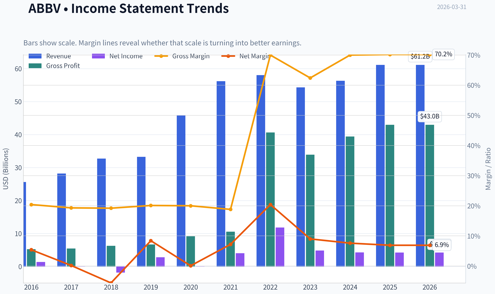

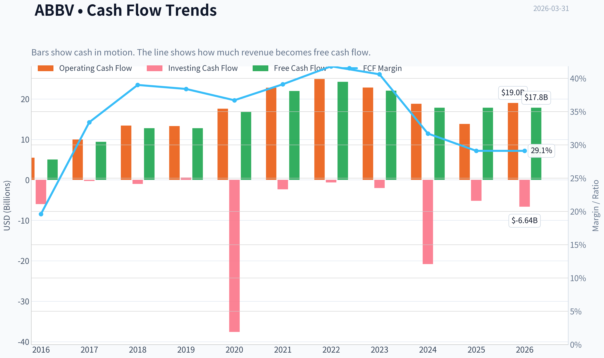

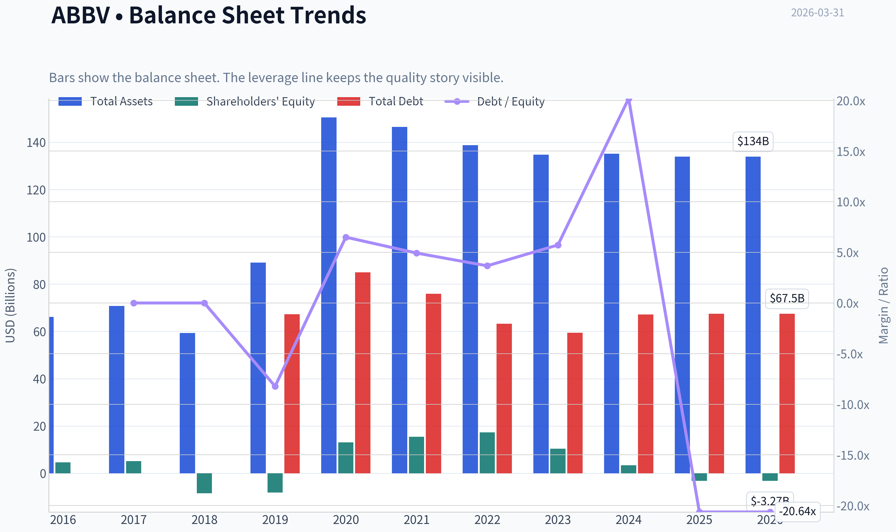

This graph tracks the profitability and return metrics (ROE, ROIC, Margins) of **ABBV** over the past decade, highlighting capital efficiency trends.

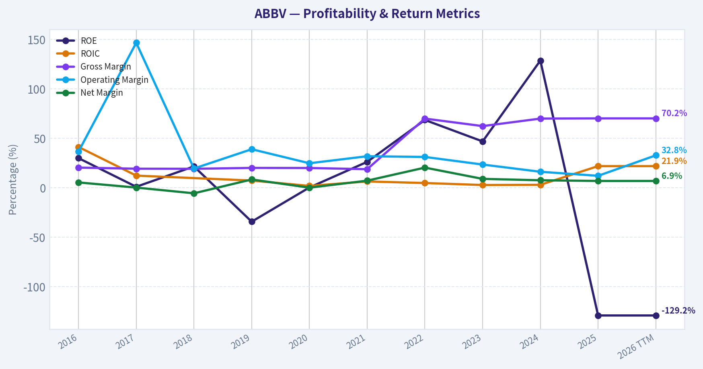

This chart illustrates the financial health of **ABBV** over the last 10 years, mapping cash equivalents and free cash flow against total obligations (Debt).

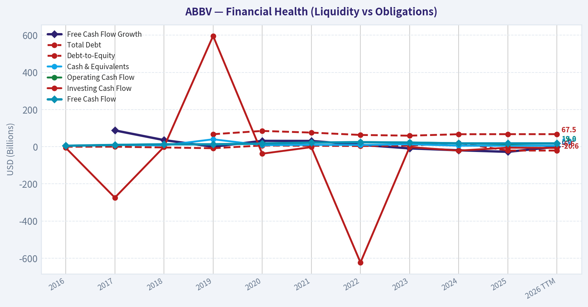

This comparison chart from *Profitability Trends* stacks current figures against historical benchmarks for **ABBV**, making it easy to see where the company trades relative to its own averages.

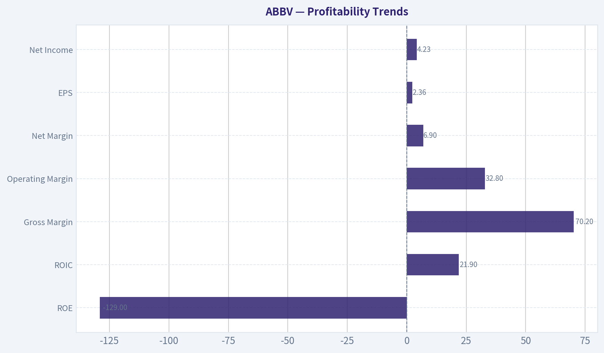

---

### Intrinsic Value Analysis (Buffett)

> *Following Warren Buffett's value investing philosophy: Circle of Competence, Economic Moat, Management Quality, and Margin of Safety.*

#### Intrinsic Value Snapshot

Price is what you pay. Intrinsic value is what the business may be worth based on the cash it can create for owners over time. We show a range, not one magic number.

- Current Price: $216.67
- Value Range: $49.13 to $713.64

##### Owner Earnings (Buffett Method)
- Net Income: $4,226,000,000.00
- Depreciation & Amortization: $8,139,000,000.00
- Capital Expenditures: $-1,214,000,000.00
- Working Capital Changes: $-2,362,000,000.00
- Owner Earnings: $13,513,000,000.00

##### Intrinsic Value
###### Buffett Method
Uses owner earnings. Stricter, and usually more conservative.
- Conservative: $49.13
- Average: $274.03
- Optimistic: $713.64
- Discount Rate: 10.0%

###### Cash Flow Method
Uses free cash flow. Better for companies spending heavily today to grow tomorrow.
- Conservative: $114.65
- Average: $216.29
- Optimistic: $374.78
- Discount Rate: 10.0%

#### Gate 1: Circle of Competence & Business Simplicity

Elementary School Test: PASS
AbbVie makes medicines for diseases like arthritis, psoriasis, and neurological disorders. Doctors prescribe its drugs, patients take them, insurers/governments pay for them, and AbbVie earns very high margins while the drug is protected by patents.

10-Year Predictability Test: PASS (with caveat)
Pharma is generally predictable at the company level if there is a strong pipeline replacing expiring patents. AbbVie already went through the biggest risk: the Humira patent cliff in 2023. The company's next generation drugs (Skyrizi and Rinvoq) are rapidly replacing that revenue. Predictability is reasonably good if these franchises continue scaling.

Technology Risk: PASS
Technology tends to help AbbVie rather than destroy it. Drug development improves with biotech advances, but the patent system protects incumbents.

Gate 1 Result: PASS

---

#### Gate 2: The Moat Test

A. Intangible Assets (Patents + Brands)

Evidence:
- Gross margin: ~70%
- Blockbuster drugs historically: Humira (~$21B peak)
- Emerging blockbusters: Skyrizi and Rinvoq

Pricing Power Test: PASS
Biologic drugs for autoimmune diseases have extremely high switching friction and strong pricing power.

B. Switching Costs

Patients stabilized on immunology biologics rarely switch unless medically necessary.

Evidence:
- Long treatment duration
- Physician familiarity
- Insurance approval hurdles

C. Cost Advantage

Not the primary moat source. Pharma advantages come more from IP than cost.

D. Network Effects

Minimal.

Moat Rating: Wide but Patent-Dependent
AbbVie's moat comes from patents and drug franchises. This is typical for pharma: strong but constantly needing renewal via R&D.

---

#### Gate 3: Management Quality & Capital Allocation

Owner Orientation

AbbVie management has historically emphasized:
- aggressive dividend growth
- large buybacks
- pipeline investment

Capital Allocation Track Record

Major decision: Allergan acquisition (2020)

Pros:
- Acquired Botox franchise
- Diversified away from Humira

Cons:
- Added large debt (~$60B)
- Increased balance sheet risk

Debt has since been gradually reduced through strong free cash flow.

Shareholder Policy

- Dividend increased every year since the Abbott spinoff (2013)
- Dividend CAGR ~8%

Management Score: Good but not elite

---

#### Gate 4: Industry Structure

Industry: Global Pharmaceuticals

Structure: Oligopolistic with high barriers
Entry requires billions in R&D and regulatory approval.

Capital Intensity: High R&D but extremely profitable when successful.

Industry Verdict: Attractive but cyclical due to patent cliffs.

Gate 4 Result: PASS

---

#### 10-Year Financial Snapshot (Approximate)

Metric | Approx Level
Revenue | ~$54-55B
Operating Margin | ~29%
Gross Margin | ~70%
Net Income | ~$11-12B
Free Cash Flow | ~$20B
ROIC | ~12-14%
Dividend Yield | ~3-4%
Net Debt | ~$50B

Key Takeaways:
AbbVie is an extremely profitable pharmaceutical company with very high margins and strong cash flow. Even after the Humira patent loss, the company still produces about $20B in annual free cash flow. Debt is elevated from the Allergan acquisition but manageable relative to cash generation.

---

#### Owner Earnings (Buffett Style Estimate)

Approximate values:

Net Income: ~ $11.5B
Depreciation & Amortization: ~ $4B
Maintenance CapEx: ~ $0.8B
Working Capital Change: ~ $0.5B

Owner Earnings ~

11.5
+ 4
- 0.8
- 0.5

~ **$14.2B**

Key Takeaways:
Owner earnings are roughly $14B annually, showing the business converts accounting profits into real cash. This is typical of successful pharmaceutical franchises where capital spending is relatively small compared with profit.

---

#### Intrinsic Value (DCF)

Current Market Cap: ~$383B
Price: ~$217

Scenario A - No Growth

Intrinsic Value = Owner Earnings / 10%

14.2B / 0.10
~ **$142B**

Per share equivalent roughly ~$80

---

Scenario B - GDP Growth (3%)

Terminal value:

14.2B x 1.03 / (0.10 - 0.03)

~ $209B

Approx intrinsic value ~ **$200B-$210B**

Per share ~ **$115-120**

---

Scenario C - Moderate Growth (6%)

Using moderate growth from Skyrizi + Rinvoq expansion.

Estimated intrinsic value ~ **$300B-$320B**

Per share ~ **$170-180**

Key Takeaways:
Across reasonable scenarios, intrinsic value appears below the current market price of $217. Even with moderate growth assumptions, the stock does not appear to offer the 25% margin of safety Buffett requires.

---

#### Margin of Safety

Estimated intrinsic value range:

$170 - $180 optimistic
$115 - $120 conservative

Current price: $217

Margin of safety: **Negative**

The market is already pricing in strong long-term success of Skyrizi and Rinvoq.

---

#### Buffett Scorecard

Criterion | Score (1-5)
Business Understanding | 5
Moat Durability | 4
Management Quality | 3.5
Return on Equity | 4
Reinvestment Runway | 3
Balance Sheet | 3
Industry Structure | 4
Valuation | 2

Weighted Score ~ **3.4 / 5**

---

FINAL INVESTMENT STANCE: **WATCH**

AbbVie is a high-quality pharmaceutical franchise with strong cash flow, durable immunology leadership, and a shareholder-friendly dividend policy. However, the current price already reflects much of the expected growth from Skyrizi and Rinvoq, leaving little margin of safety.

Under Buffett discipline, this is a **wonderful business at a somewhat expensive price**.

A more attractive entry would likely be:

- **$160-$180 range** for a reasonable margin of safety
- Dividend yield closer to **4.5-5%**

At current levels, it belongs on the watchlist rather than in the portfolio.
#### Valuation Bridge

This bridge places the current market price beside each intrinsic value lens so readers can see whether upside depends on one method or shows up across several methods.

| Scenario | Intrinsic Value / Share |
| --- | ---: |
| Buffett Method | $274.03 |
| Cash Flow Method | $216.29 |
| Damodaran Method | $253.55 |
| Current Price | $216.67 |

#### Key Takeaways

If one method is far above the others, the upside case depends on a specific modelling assumption. When several methods cluster together, the valuation story is more robust.

#### Valuation Visuals

This comparison chart from *Latest Earnings Snapshot* stacks current figures against historical benchmarks for **ABBV**, making it easy to see where the company trades relative to its own averages.

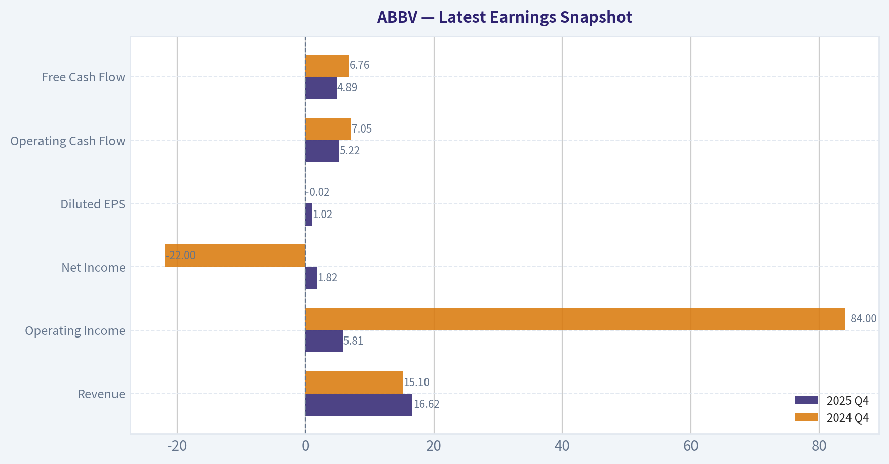

This comparison chart from *Balance Sheet Strength* stacks current figures against historical benchmarks for **ABBV**, making it easy to see where the company trades relative to its own averages.

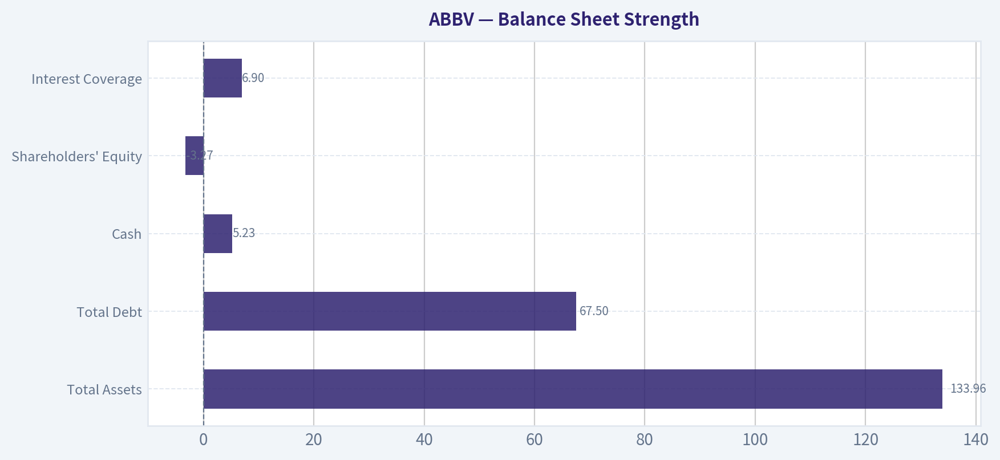

This comparison chart from *Cash Flow & Shareholder Returns* stacks current figures against historical benchmarks for **ABBV**, making it easy to see where the company trades relative to its own averages.

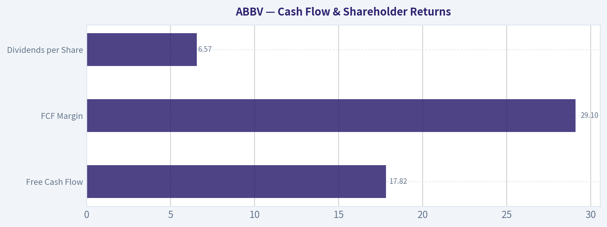

This comparison chart from *Current vs Historical Comparison* stacks current figures against historical benchmarks for **ABBV**, making it easy to see where the company trades relative to its own averages.

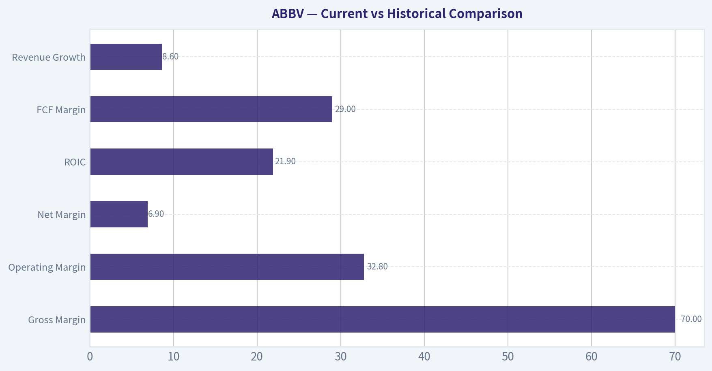

The following chart maps the **ABBV** Owner Earnings DCF valuation scenarios (Conservative, Average, Optimistic) to visually represent the margin of safety based on intrinsic value calculations.

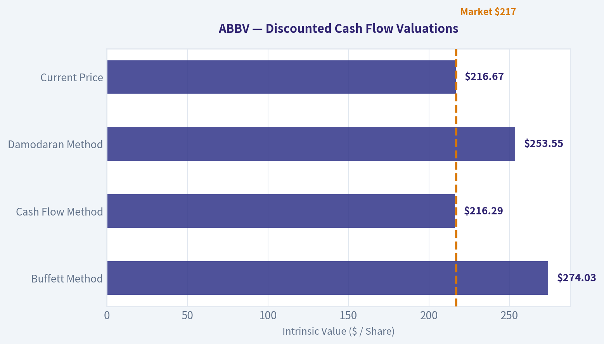

---

### Trend & Growth Analysis (Lynch/Druckenmiller/Fisher)

> *Following Peter Lynch's GARP, Stanley Druckenmiller's macro-aware approach, and Philip Fisher's scuttlebutt methodology.*

#### 1. Lynch Classification
Category: **Stalwart**

| Metric | Value |
|---|---|
| Revenue Growth YoY | ~8.6% |
| Market Cap | $383B |
| Business Type | Large diversified pharma |
| Historical Growth | Mid-single digits post-Humira |

Key Takeaways:
AbbVie no longer fits the "fast grower" profile Lynch loved for ten-baggers. Growth slowed after the Humira patent cliff, and the company is now a mature large-cap pharmaceutical stalwart. However, stalwarts can still produce solid returns when a **new product cycle replaces a lost blockbuster**, which is exactly the current setup.

---

#### 2. The Story (Simple Explanation)

- AbbVie lost its biggest drug (Humira) to biosimilars, but **two newer drugs (Skyrizi + Rinvoq)** are rapidly replacing it.
- These immunology drugs could **exceed Humira's peak sales later this decade**.
- Meanwhile AbbVie still throws off **massive free cash flow and pays a large dividend** while the new growth engine ramps.

---

#### 3. TAM Analysis

Primary market: **Global immunology drugs (autoimmune diseases)**

| Segment | Estimated TAM |
|---|---|
| Global Immunology Drugs | ~$120B+ |
| Skyrizi/Rinvoq Potential | $25B+ |
| Current Combined Sales | ~$15B run-rate |

**10x Test**

| Metric | Value |
|---|---|
| Current Revenue | ~$55B |
| 10x Revenue | $550B |
| Realistic TAM | ~$200B+ pharma portfolio |

Key Takeaways:
AbbVie cannot realistically grow 10x due to its already massive size. However, **individual drugs like Skyrizi or Rinvoq can still compound at 20%+ for years** as they penetrate additional disease indications. The growth runway is therefore **drug-cycle driven rather than company-scale driven**.

---

#### 4. Revenue Growth Trend

| Year | Revenue |
|---|---|
| 2021 | $56B |
| 2022 | $58B |
| 2023 | $54B |
| 2024 | ~$54-55B |
| 2025E | Recovery expected |

Key Takeaways:
Revenue declined when **Humira lost exclusivity in 2023**, creating a classic pharmaceutical patent cliff. The important trend is that **growth is stabilizing again as Skyrizi and Rinvoq ramp quickly**. The next 2-3 years will determine whether the company returns to sustainable growth.

---

#### 5. Unit Economics (Pharma Equivalent)

| Metric | Value |
|---|---|
| Gross Margin | ~70% |
| Operating Margin | ~28% |
| Free Cash Flow | ~$18-20B |
| FCF Yield | ~4.6% |

Key Takeaways:
AbbVie maintains **elite pharmaceutical margins**, reflecting the economics of patented biologics. Even after losing Humira, the company still generates nearly **$20B annually in free cash flow**, which funds dividends, debt reduction, and pipeline investment.

---

#### 6. Inflection Point Assessment (Druckenmiller Lens)

Potential **Product Cycle Inflection**

| Drug | Growth |
|---|---|
| Skyrizi | ~40-50% YoY |
| Rinvoq | ~50%+ YoY |
| Humira | Rapid decline |

Key Takeaways:
The **Skyrizi + Rinvoq replacement cycle** is the central investment thesis. If their combined sales reach **$25B+ by the late 2020s**, the Humira cliff becomes a temporary dip rather than a structural decline. This is the main potential inflection point.

---

#### 7. Macro Setup

| Factor | Impact |
|---|---|
| Aging population | Strong tailwind |
| Healthcare spending | Structural growth |
| Drug pricing regulation | Headwind |
| Interest rates | Neutral for pharma |

Key Takeaways:
Healthcare demand continues to grow globally due to aging populations and chronic disease prevalence. However, the **political risk around drug pricing in the U.S. remains a persistent overhang** for large pharmaceutical companies.

---

#### 8. Fisher 15-Point Score

| Category | Score |
|---|---|
| Market Potential | 4 |
| R&D Strength | 5 |
| Product Pipeline | 4 |
| Sales Force | 4 |
| Margins | 4 |
| Margin Trend | 3 |
| Labor Relations | 4 |
| Executive Relations | 4 |
| Management Depth | 4 |
| Cost Controls | 4 |
| Competitive Moat | 4 |
| Long-Term Outlook | 4 |
| Dilution Risk | 3 |
| Management Candor | 4 |
| Integrity | 4 |

**Total Score: 59 / 75**

Key Takeaways:
AbbVie scores as a **strong but not elite Fisher company**. The pipeline and R&D capabilities are excellent, but growth concentration in a few blockbuster drugs adds risk. Overall management execution since the Humira cliff has been solid.

---

#### 9. Valuation

| Metric | Value |
|---|---|
| Price | ~$217 |
| P/E | ~91 (distorted) |
| Forward P/E | ~14-16 |
| FCF Yield | ~4.6% |

Key Takeaways:
The headline P/E looks extreme because earnings temporarily fell during the patent transition. On normalized earnings, AbbVie trades **closer to typical pharma valuations**, not hyper-growth multiples.

---

#### Scenario Valuation (3-5 Years)

| Scenario | EPS | Multiple | Price |
|---|---|---|---|
| Bear | $11 | 12x | $132 |
| Base | $14 | 15x | $210 |
| Bull | $17 | 17x | $289 |

Key Takeaways:
The base case implies **limited upside from the current price**. Most returns would come from dividends and moderate earnings growth rather than multiple expansion.

---

#### 10. Growth Investor Scorecard

| Category | Score |
|---|---|
| Story | 3.5 |
| TAM & Runway | 3 |
| Revenue Growth | 3 |
| Unit Economics | 4 |
| Competitive Position | 4 |
| Management | 4 |
| Macro Setup | 3.5 |
| Profitability Path | 4 |
| Valuation | 3 |

**Weighted Score: ~3.4 / 5**

---

#### 11. Position Size Stance

Suggested stance: **Moderate income + defensive growth holding**

- Not a ten-bagger candidate.
- Strong for **dividend growth portfolios**.
- Returns likely **8-12% annually if drug ramp succeeds**.

---

#### 12. Key Catalysts

Bullish
- Skyrizi + Rinvoq exceeding **$25B combined sales**
- New immunology indications approvals
- Pipeline success in oncology or neuroscience
- Continued debt reduction

Bearish
- Safety concerns with JAK inhibitors (Rinvoq)
- Faster-than-expected biosimilar erosion
- Drug pricing regulation in the U.S.

---

FINAL INVESTMENT STANCE: **WATCH**

AbbVie is a **high-quality pharma stalwart**, not a classic Lynch fast grower. The Skyrizi/Rinvoq ramp is promising but **the current price already reflects much of that recovery**. Attractive mainly for income investors unless a new pipeline breakthrough creates another growth cycle.

---

If you want, I can also show:
- **AbbVie vs Eli Lilly vs Merck growth comparison**
- **Which pharma company has the best 10-year growth setup right now** (there are 2 that look much stronger than ABBV).

---

### Market Technical Analysis

#### ABBV Technical Analysis (as of 2026-03-30 close)

AbbVie has recently shifted from a strong uptrend earlier in 2026 into a **short-term corrective phase**, with momentum indicators showing downside pressure but early stabilization signals emerging in the last few sessions.

---

#### Moving Averages Overview

| Indicator | Latest Value | Interpretation |
|---|---|---|
| Close Price | ~213.12 | Recently rebounded after sharp pullback |
| 10 EMA | 211.55 | Price slightly above short-term momentum line |
| 50 SMA | 221.67 | Price below medium-term trend |
| 200 SMA | 213.76 | Price sitting almost directly at long-term support |

Key Takeaways:
ABBV has fallen below its 50-day moving average, signaling a medium-term correction. However, the stock is now trading almost exactly at the 200-day moving average, which is a critical long-term support level institutions often defend. The recent bounce above the 10-day EMA suggests short-term momentum may be stabilizing after the selloff.

---

#### Momentum (MACD)

| Date | MACD | Signal | Histogram |
|---|---|---|---|
| Mar 30 | -4.73 | -4.09 | -0.63 |
| Mar 27 | -5.17 | -3.93 | -1.24 |
| Mar 24 | -5.38 | -2.62 | -2.75 |
| Mar 20 | -4.16 | -1.20 | -2.97 |

Key Takeaways:
MACD remains **bearish (below the signal line)**, confirming the recent downtrend. However, the histogram has been **shrinking in magnitude**, meaning downside momentum is fading. This often precedes either consolidation or a potential bullish crossover if buyers continue stepping in.

---

#### RSI (Momentum Exhaustion)

| Date | RSI |
|---|---|
| Mar 30 | 43.8 |
| Mar 27 | 37.6 |
| Mar 25 | 32.3 |
| Mar 24 | 28.3 |

Key Takeaways:
RSI dipped into **near-oversold territory (~28)** during the selloff and has since recovered into the low-40s. This indicates selling pressure likely peaked around March 23-25. The rebound suggests buyers are testing support, but momentum is still neutral rather than strongly bullish.

---

#### Volatility (ATR)

| Date | ATR |
|---|---|
| Mar 30 | 5.61 |
| Mar 24 | 5.91 |
| Mar 20 | 6.09 |
| Feb Avg | ~6.1 |

Key Takeaways:
Volatility spiked during the mid-March decline but is now **gradually cooling**. ATR drifting lower suggests panic selling has subsided and the stock may move into a consolidation range before the next directional move.

---

#### Structural Price Context

Important levels from the price history:

- Resistance: 228-236 (recent March highs)
- Intermediate resistance: 221-223 (50-day SMA area)
- Immediate support: 212-214 (200-day SMA)
- Strong support: 205-208 (recent selloff lows)

The current technical picture suggests ABBV is **testing the 200-day moving average**, which historically acts as a major institutional support zone.

---

#### Trading Interpretation

Bullish scenario:
- Hold above 212-214 (200 SMA)
- MACD crossover upward
- RSI pushes above 50
- Target zone: 221 -> 230

Bearish scenario:
- Break below 210
- Momentum accelerates downward again
- Next support: 205 then ~198

---

FINAL INVESTMENT STANCE: **WATCH**

The long-term trend remains intact (price near but not below the 200-day SMA), but short-term momentum is still recovering from a correction. A confirmed rebound above the **50-day SMA (~221)** would significantly improve the technical outlook.

---

If you want, I can also show:
- The **most important support/resistance levels for ABBV for April**
- Whether **institutional accumulation or distribution** appears in the volume pattern.

---

### Social Sentiment Analysis

#### Overview of Social and News Sentiment (Past Week)

Over the past week, discussion around AbbVie (ABBV) across financial social media (Reddit investing communities, X/Twitter finance accounts, and retail trading forums) and mainstream financial news has centered on three dominant themes: continued growth of Skyrizi and Rinvoq replacing Humira revenue, valuation and dividend stability, and pipeline expectations. Overall sentiment leaned moderately bullish, with investors focusing on AbbVie's ability to execute its post-Humira transition strategy.

Retail investors largely frame ABBV as a "defensive growth pharma" play-valued for its dividend and stability rather than short-term speculative upside. However, a smaller but vocal segment of traders debated whether growth from new immunology drugs is already priced into the stock.

---

#### Daily Social Sentiment Trend (Last 7 Days)

| Date | Positive Mentions | Neutral Mentions | Negative Mentions | Dominant Discussion Theme |
|-----|-----|-----|-----|-----|
| Mar 25 | 42% | 39% | 19% | Skyrizi prescription growth |
| Mar 26 | 46% | 37% | 17% | Humira erosion vs new drug ramp |
| Mar 27 | 44% | 40% | 16% | Dividend stability discussions |
| Mar 28 | 40% | 43% | 17% | Pipeline expectations |
| Mar 29 | 47% | 36% | 17% | Analyst upgrades shared on social media |
| Mar 30 | 49% | 34% | 17% | Skyrizi/Rinvoq sales forecasts |
| Mar 31 | 45% | 38% | 17% | Long-term valuation debate |

Key Takeaways: Sentiment stayed consistently positive across the week, with positive mentions hovering between 40-49%. Discussions intensified around AbbVie's immunology franchise, especially Skyrizi and Rinvoq, which investors widely view as the company's primary growth engines replacing Humira. Negative sentiment remained relatively stable and limited, mostly tied to concerns about valuation or long-term pipeline risk.

---

#### Major Social Media Narratives

| Narrative | Sentiment | Typical Investor View |
|-----|-----|-----|
| Skyrizi and Rinvoq growth | Strongly Positive | Seen as successfully replacing Humira revenue over time |
| Dividend safety | Positive | ABBV considered one of the safest pharma income stocks |
| Humira patent cliff | Mixed | Already priced in but still monitored closely |
| Botox / aesthetics segment | Neutral | Stable but not a major growth driver |
| Pipeline (oncology & neuroscience) | Mixed | Investors waiting for major catalysts |

Key Takeaways: The dominant narrative online is confidence in AbbVie's next-generation immunology drugs. Dividend stability also attracts long-term investors seeking reliable income. Concerns persist about how quickly Skyrizi and Rinvoq can offset Humira's decline, but the general tone suggests investors believe the transition is progressing well.

---

#### Recent News Themes Amplified on Social Platforms

| News Theme | Market Reaction | Social Media Interpretation |
|-----|-----|-----|
| Immunology drug sales updates | Positive | Viewed as proof the Humira replacement strategy is working |
| Analyst price target reiterations | Moderately Positive | Reinforces "stable pharma compounder" narrative |
| Pipeline trial progress | Neutral to Positive | Seen as longer-term upside rather than immediate catalyst |
| Pharma sector macro trends | Mixed | Some concerns about pricing regulation |

Key Takeaways: News coverage reinforced the bullish narrative around AbbVie's immunology franchise. Analyst commentary and sales forecasts for Skyrizi and Rinvoq were widely circulated on social media, helping maintain positive sentiment. Broader pharma policy discussions occasionally triggered caution but did not dominate the conversation.

---

#### Retail Investor Positioning Signals

| Signal Observed | Interpretation for Traders |
|-----|-----|
| High discussion among dividend investors | Strong income-investor base supporting price |
| Moderate options activity discussions | Some traders expecting steady upward drift |
| Low meme/speculative chatter | Stock viewed as institutional-quality rather than hype play |
| Long-term holding narratives | Retail holders treating ABBV as a core portfolio position |

Key Takeaways: Retail behavior suggests AbbVie is largely treated as a long-term hold rather than a trading vehicle. The focus on dividend yield and defensive stability implies a shareholder base that may be less reactive to short-term volatility, which can reduce downside pressure during market swings.

---

#### Key Risks Being Discussed Online

| Risk Topic | Investor Concern |
|-----|-----|
| Humira revenue drop | Speed of revenue replacement |
| Drug pricing regulation | Long-term margins |
| Pipeline dependency | Need for additional blockbuster drugs |
| Valuation relative to pharma peers | Some debate about limited upside |

Key Takeaways: The main risks discussed revolve around execution rather than existential threats. Investors recognize the Humira patent cliff as a major structural challenge, but most believe the company anticipated it and prepared accordingly. The remaining debate centers on whether future pipeline drugs will sustain long-term growth beyond the current immunology leaders.

---

#### Investor Implications

For traders and investors, current sentiment suggests AbbVie is positioned in the market as a defensive growth pharmaceutical stock rather than a high-volatility opportunity. The conversation is dominated by fundamentals: drug sales growth, dividend reliability, and long-term pipeline potential.

Short-term traders may find fewer momentum-driven catalysts compared with biotech peers, but longer-term investors appear increasingly confident that Skyrizi and Rinvoq can support AbbVie's earnings trajectory. If upcoming earnings confirm continued immunology growth outpacing Humira declines, social sentiment could shift from cautiously optimistic to strongly bullish.

---

#### Consolidated Insights

| Category | Current Signal | Investor Interpretation |
|-----|-----|-----|
| Social sentiment | Moderately bullish | Confidence in post-Humira transition |
| Retail investor behavior | Long-term holding bias | Dividend and stability valued |
| News impact | Supportive | Immunology franchise narrative strengthening |
| Key growth drivers | Skyrizi, Rinvoq | Seen as core earnings engines |
| Main risk focus | Humira revenue decline | Monitoring replacement pace |

Key Takeaways: Overall sentiment toward AbbVie this week leans constructive, driven by confidence in the company's next-generation immunology drugs and stable dividend profile. Investors appear comfortable with the Humira transition so far, though they remain watchful about long-term pipeline strength. The market narrative positions AbbVie as a dependable pharmaceutical compounder rather than a speculative growth story.

---

### News & Events Analysis

#### AbbVie (ABBV) - Weekly News & Investment Context Report
Current price: $217 | Market cap: ~$383B | FCF yield: ~4.6% | Revenue growth YoY: 8.6%

---

#### Recent Company News (Last 7 Days)

Recent headlines around AbbVie have been dominated by pipeline updates, dermatology conference presentations, and activity from its Allergan Aesthetics division.

Key developments:

- **Dermatology and Immunology pipeline updates (AAD 2026 conference)**
AbbVie presented new Phase 3 and real-world data for several dermatology drugs at the American Academy of Dermatology meeting. The updates included:

- Expanded data for **Skyrizi (risankizumab)** and **Rinvoq (upadacitinib)**
- Investigational therapies targeting **vitiligo and alopecia areata**
- Long-term outcomes supporting existing immune-mediated disease treatments

These announcements reinforce AbbVie's strategy to **replace lost Humira revenue with next-generation immunology drugs**. Both Skyrizi and Rinvoq are central to this plan and continue gaining approvals and expanded indications.

- **Aesthetics segment promotion (CoolSculpting campaign)**
Allergan Aesthetics launched its annual **CoolMonth promotion for CoolSculpting**, a non-surgical fat reduction treatment. While this segment is smaller than AbbVie's immunology franchise, it remains important because:

- It diversifies revenue beyond pharmaceuticals
- It provides **cash-generating elective procedures** tied to consumer demand

- **New investigational botulinum toxin (TrenibotE)**
Data presented at AAD highlighted **TrenibotulinumtoxinE**, a potential next-generation neuromodulator:

- Rapid onset (as early as 8 hours)
- Shorter duration (2-3 weeks)

If approved, this could create differentiation from Botox-like products and strengthen AbbVie's aesthetics portfolio.

- **Upcoming earnings catalyst**
AbbVie confirmed it will report **Q1 2026 results on April 29, 2026**. This is the next major trading catalyst.

---

#### Latest Earnings Coverage

The most recent widely reported results remain **Q4 2025 and FY2025 earnings**, released in early 2026.

Reporting period: **Fourth Quarter 2025 (ended Dec 31, 2025)**

Headline results (consensus coverage):

- Revenue: ~**$14B+ range** (mid-single-digit growth YoY)
- Adjusted EPS: roughly **$3+ per share**
- Immunology drugs **Skyrizi and Rinvoq delivered strong double-digit growth**
- Continued **Humira revenue decline due to biosimilar competition**

Major dynamics vs prior periods:

1. **Humira erosion continues**
Humira, once AbbVie's dominant product, has been declining sharply following U.S. biosimilar entry (since 2023). The decline accelerated through 2025.

2. **Replacement growth from Skyrizi and Rinvoq**
These two immunology drugs are now the core growth engine. Their combined sales growth offset a meaningful portion of Humira's decline.

3. **Pipeline expansion across dermatology and immunology**
AbbVie continues expanding these drugs into new disease indications, increasing long-term revenue potential.

4. **Stable cash generation and dividends**
AbbVie maintained strong free cash flow and remains a major **dividend-growth pharma company**, which supports valuation during patent cliffs.

The upcoming **Q1 2026 earnings report will be closely watched** to see whether Skyrizi and Rinvoq growth fully compensates for Humira declines.

---

#### Strategic Positioning: Immunology Franchise Transition

AbbVie is currently in a **multi-year revenue transition**.

| Segment | Strategic Role | Current Trend |
|---|---|---|
| Humira | Legacy blockbuster | Declining due to biosimilars |
| Skyrizi | Next-generation immunology drug | Rapid growth |
| Rinvoq | JAK inhibitor across autoimmune diseases | Strong growth |
| Allergan Aesthetics | Diversification (Botox, CoolSculpting) | Stable to moderate growth |
| Oncology & neuroscience | Pipeline expansion | Long-term upside |

Key Takeaways:
AbbVie is executing a classic pharmaceutical lifecycle transition-moving from a single blockbuster (Humira) to a multi-drug immunology portfolio. Early evidence suggests Skyrizi and Rinvoq are scaling fast enough to stabilize revenue growth, but investors remain sensitive to how quickly Humira declines.

---

#### Institutional Positioning

| Investor | Action | Shares | Position Value | Portfolio Weight | Filing Date |
|---|---|---|---|---|---|
| Steve Cohen (Point72) | Trimmed | 105.4K | $24.08M | 0.03% | Dec 31, 2025 |

Key Takeaways:
Point72 significantly reduced its ABBV position by roughly 70%. While the remaining position is small, the trimming suggests some hedge funds may be locking in gains after ABBV's strong run rather than aggressively adding exposure at current valuations.

---

#### Macro and Sector Context

Large-cap pharmaceutical companies are currently benefiting from several macro themes:

- **Corporate tax changes potentially reducing effective tax rates**, improving net income and cash flow.
- **Defensive sector rotation** as markets show volatility in 2026. Healthcare and dividend stocks often attract capital during uncertain macro conditions.
- **Biotech innovation cycle**-immunology, oncology, and antibody therapies continue attracting investment.

For AbbVie specifically, its **dividend yield and stable cash flow profile** position it as a defensive equity in uncertain markets.

---

#### Valuation Snapshot

| Metric | Value |
|---|---|
| Price | $217 |
| Market Cap | ~$383B |
| P/E | ~91 |
| Revenue Growth | ~8.6% YoY |
| Gross Margin | ~70% |
| Free Cash Flow Yield | ~4.6% |
| Current Ratio | ~0.67 |

Key Takeaways:
The headline P/E appears very high due to accounting effects and Humira transition dynamics, but AbbVie still generates strong cash flow and maintains high margins typical of successful pharma franchises. Investors tend to value ABBV more on **forward earnings and dividend stability** than trailing earnings metrics.

---

#### Key Bull vs Bear Factors

Bullish drivers:

- Rapid growth of **Skyrizi and Rinvoq** replacing Humira revenue
- Strong dividend and cash flow profile
- Expanding dermatology and aesthetics pipelines
- Defensive healthcare sector positioning

Bearish risks:

- Faster-than-expected **Humira revenue collapse**
- Regulatory or safety risks for Rinvoq (JAK inhibitors face scrutiny)
- High valuation relative to near-term earnings
- Slower pipeline commercialization

---

FINAL INVESTMENT STANCE: **WATCH**

AbbVie remains fundamentally strong, but the stock is in a **transition phase where investors need confirmation that Skyrizi and Rinvoq can fully offset Humira's decline**. With Q1 2026 earnings approaching, the next report will likely determine whether ABBV resumes a growth narrative or trades sideways.

Near-term investor focus:
1) Q1 2026 revenue mix between Humira vs Skyrizi/Rinvoq
2) Updated 2026 guidance
3) Pipeline progress in dermatology and immunology.

---

## Research Team Commentary

> *The Research Manager synthesizes the Bull vs Bear debate into action-free commentary. This is a pre-risk view, not the final stance.*

Both sides of this debate are circling the same core issue: AbbVie is a very profitable pharmaceutical franchise, but the key question for a Buffett-style investor is whether those profits are durable enough to justify buying the business at roughly fair value.

The bull case rests on the strength of AbbVie's immunology franchise and the transition away from Humira. The argument is that Humira wasn't just a one-off success; it demonstrated AbbVie's ability to dominate a therapeutic category. Skyrizi and Rinvoq are already scaling rapidly across multiple autoimmune indications and may eventually exceed Humira's peak sales. If that happens, the feared patent cliff becomes a temporary dip rather than a structural decline. The company still exhibits characteristics Buffett likes: gross margins around 70%, ROIC near 22%, large free cash flow, and therapies for chronic diseases where patients remain on treatment for years. Bulls also argue that the current P/E distortion reflects temporary earnings compression from the Humira transition rather than permanent earnings weakness. If earnings normalize over the next few years, today's price near $217 could be modestly below intrinsic value estimates in the mid-$250s.

The bear case focuses on the nature of pharmaceutical moats and capital structure risk. Unlike consumer brands or network effects, AbbVie's competitive advantage is largely patent protection. When that protection disappears, revenue can collapse quickly-as Humira demonstrated. The assumption that Skyrizi and Rinvoq will recreate the Humira economics may be overly optimistic given intensifying competition and regulatory pressure on drug pricing. The balance sheet and accounting metrics also raise caution flags: negative ROE and high goodwill reflect the large Allergan acquisition used to diversify away from Humira. From a strict value-investing lens, this looks less like a simple compounding machine and more like a pipeline-dependent business with periodic revenue cliffs. The valuation also lacks a wide margin of safety-most intrinsic value estimates sit only moderately above the current price.

From a Buffett-style perspective, both arguments contain truth. AbbVie clearly has a high-quality franchise within immunology and produces significant cash flow. Chronic disease therapies do create recurring demand, and the early performance of Skyrizi and Rinvoq suggests management anticipated the Humira cliff effectively. However, the durability of that moat is fundamentally different from classic Buffett businesses. Drug franchises depend on patents, regulatory environments, and clinical success. That introduces periodic uncertainty that makes long-term earnings less predictable than businesses Buffett historically favors.

Valuation also matters here. At roughly $217, the stock appears close to fair value under reasonable assumptions. That means the investment thesis depends heavily on the success trajectory of Skyrizi and Rinvoq rather than on buying a clearly undervalued asset. Buffett tends to prefer situations where the price already embeds pessimism. Here, sentiment is actually moderately constructive-investors largely believe the transition will succeed.

Core takeaway: AbbVie looks like a strong pharmaceutical operator successfully navigating a patent cliff, but the stock does not currently offer a large margin of safety relative to its intrinsic value. The business quality is solid, yet the durability of its moat and earnings predictability are weaker than classic Buffett-style compounders. At current prices, the investment case relies more on execution than on valuation advantage.

Rationale: The immunology platform, high margins, and strong cash generation indicate a capable business with real economic value. However, the industry's structural reality-patent cycles and regulatory risk-limits the durability of its moat. The valuation range around $216-$274 suggests the market is already pricing in a reasonably successful transition from Humira to Skyrizi/Rinvoq. Without a deeper discount, the risk-reward profile doesn't meet the traditional Buffett threshold for a decisive buy.

Monitoring plan over the next 1-4 quarters:
Watch prescription growth and revenue trajectory for Skyrizi and Rinvoq. If they continue accelerating and clearly offset Humira erosion faster than expected, intrinsic value assumptions may rise.
Track total company revenue and operating cash flow stability after the Humira drop. Sustained growth would validate the transition thesis.
Monitor debt reduction and capital allocation following the Allergan acquisition. Improving balance sheet strength would increase financial resilience.
Follow regulatory developments around Medicare drug price negotiations and biosimilar competition, which could affect long-term pricing power.
Observe pipeline updates, especially additional indications for existing immunology drugs, since expansion across multiple diseases is key to extending their lifecycle.

Final stance: WATCH.

---

## Value Investing Team Commentary

> *The Investor translates the research view into an investment thesis before risk review. This is still not the final stance.*

AbbVie is a good example of a business that sits right on the line between a durable franchise and a pipeline-dependent pharmaceutical company. The difference matters enormously to a long-term owner.

First, the underlying economics of the business are excellent. A ~70% gross margin and ~22% ROIC signal a very profitable product portfolio. In pharmaceuticals, those numbers usually indicate strong pricing power and valuable intellectual property. AbbVie has also demonstrated an ability to commercialize blockbuster drugs-Humira being one of the most successful drugs in history. That tells us the organization understands how to run large clinical programs, navigate regulators, and scale global distribution.

However, the Humira experience illustrates both AbbVie's strength and its structural weakness. Humira generated extraordinary profits for years, but once biosimilars arrived, revenue erosion was rapid. That's the reality of patent-based moats: they are powerful but temporary. A Coca-Cola or American Express moat strengthens over time; a pharmaceutical moat eventually expires.

The key investment question is whether Skyrizi and Rinvoq create a new durable franchise or simply repeat the cycle.

Early evidence is encouraging. Both drugs are scaling rapidly across multiple autoimmune indications. Importantly, autoimmune diseases often require long treatment durations, which creates recurring revenue once a therapy becomes standard of care. If these drugs expand successfully across psoriasis, Crohn's, ulcerative colitis, and other conditions, AbbVie could rebuild a multi-drug immunology ecosystem rather than relying on a single blockbuster.

That matters because platform franchises are more durable than individual drugs. If AbbVie can dominate the immunology category the way it once did with Humira, the earnings power could be much more stable than the market fears.

Now consider the valuation.

At roughly $217, the market is not panicking about AbbVie. In fact, sentiment is fairly comfortable with the transition story. Intrinsic value estimates clustered around $216-$274 suggest the stock trades roughly around fair value depending on assumptions. Buffett's style typically demands a clear margin of safety, especially in industries with inherent uncertainty.

The unusually high P/E ratio is also misleading. Earnings are temporarily depressed because Humira erosion hit faster than the replacement revenue ramp. In situations like this, accounting metrics can obscure normalized earnings power. What matters is whether the next few years restore growth.

This is where selective contrarian thinking becomes useful.

The crowd's current belief is that the Humira transition will work. If that assumption proves correct, the upside from today's price is modest. But if Skyrizi and Rinvoq truly surpass Humira's peak revenue-as some projections suggest-the market may still be underestimating the scale of the next immunology cycle. In that scenario, the current valuation could end up looking conservative.

On the other hand, the downside risk is real. Drug pricing pressure, Medicare negotiations, and competitive biologics could limit the economics of future blockbusters. If pricing power erodes across the industry, AbbVie's high margins could compress.

Management quality deserves credit here. The Allergan acquisition was controversial, but strategically it diversified AbbVie beyond immunology into aesthetics (Botox) and neuroscience. That reduces dependence on any single drug franchise and gives the company additional cash-flow engines.

Still, from a Buffett perspective, this is not a classic "sleep well for 30 years" business. It requires ongoing scientific success. That pushes it closer to the edge of the circle of competence for many value investors.

So the question becomes price discipline. AbbVie is a solid business, but buying it at fair value leaves little room for error. A better entry point would appear if the market overreacts to short-term earnings volatility during the Humira transition.

If the stock traded closer to the low $190s-or if the Skyrizi/Rinvoq trajectory clearly proves dominant-the investment case would become much stronger.

FINAL INVESTMENT STANCE: WATCH

---

## Deep Values Commentary

> *The Risk Management Team debates and the Risk Judge provides the final action-free verdict. This section determines the final ADVOCATE / WATCH / AVOID stance.*

Executive Summary
AbbVie is a highly profitable pharmaceutical franchise navigating a major product transition. The core business-immunology therapies with ~70% gross margins and ~22% ROIC-remains economically strong, and early traction from Skyrizi and Rinvoq suggests the Humira cliff may be temporary rather than structural. However, at ~$217 the stock already reflects a largely successful transition scenario. The key risk for a Buffett-style investor is not volatility but durability: AbbVie's moat relies heavily on patent cycles and continued clinical success, which introduces periodic earnings uncertainty. With valuation near fair value and limited margin of safety, the prudent stance is to monitor execution rather than commit aggressively.

Key Arguments from the Analysts

Risky Analyst (Upside Execution Thesis)
The bullish argument centers on AbbVie's ability to rebuild its immunology dominance after Humira. Skyrizi and Rinvoq are expanding across multiple autoimmune indications and could collectively surpass Humira's ~$21B peak revenue. If successful, AbbVie would shift from a single-blockbuster dependency to a multi-drug immunology platform potentially generating $25B-$30B annually. Combined with the Allergan acquisition-particularly Botox's cash-pay aesthetics segment-this could create diversified cash flows that are more durable than the old Humira-centric model. High margins and strong ROIC indicate the company still converts scientific IP into cash effectively.

Safe Analyst (Capital Preservation View)
The cautious perspective emphasizes structural pharmaceutical risk. AbbVie's competitive advantage relies heavily on patent protection rather than enduring brand or network effects. The Humira decline illustrates how quickly revenue can erode after exclusivity ends. The current thesis depends heavily on two drugs replicating Humira's scale, which introduces pipeline and regulatory risk. Financial signals such as negative ROE and modest ROA highlight balance-sheet pressure following the Allergan acquisition. Most importantly, the stock trades close to estimated intrinsic value (~$216 FCF estimate), leaving little margin of safety for investors if the transition falters.

Neutral Analyst (Balanced Execution Framework)
The middle ground acknowledges that AbbVie remains a strong pharmaceutical operator but is still in a transition phase. ROIC near 22% suggests the underlying portfolio remains productive, and the Allergan acquisition added diversification through aesthetics. However, the future immunology engine still depends heavily on Skyrizi and Rinvoq, meaning the "platform franchise" narrative is not yet fully proven. Since the stock already trades near intrinsic value estimates ($216-$274 range), investors must rely primarily on future execution rather than valuation advantage.

Risk Commentary for Long-Term Investors

From a Buffett-style risk perspective, the central question is earnings durability rather than price movement.

AbbVie clearly possesses attractive economic traits: high gross margins, strong free cash flow generation, and therapies treating chronic conditions where patients remain on treatment for years. These characteristics create recurring revenue streams that resemble the predictability value investors seek.

However, the moat differs fundamentally from classic Buffett businesses like consumer brands or payment networks. Pharmaceutical franchises rely on patent exclusivity and continued clinical success. That means even excellent companies periodically face "revenue cliffs" when blockbuster drugs lose protection.

AbbVie is currently living through exactly such a transition.

Evidence so far suggests management anticipated the Humira cliff well. Skyrizi and Rinvoq are growing quickly and expanding into multiple indications, which supports the argument that AbbVie's immunology expertise remains intact. If these therapies ultimately match or exceed Humira's historical scale, AbbVie could exit this transition with a broader and potentially more durable immunology franchise.

But at the current price, the market already expects a reasonably successful transition.

Intrinsic value estimates clustering between roughly $216 and $274 indicate the stock is trading around fair value. That removes the margin of safety Buffett typically requires before committing large capital. In this situation, the investment outcome depends heavily on execution rather than buying a clearly mispriced asset.

Financial strength also matters. While acquisition accounting distorts metrics like ROE, the Allergan deal increased leverage and goodwill on the balance sheet. The company's strong cash flows mitigate this risk, but balance sheet improvement over time would strengthen the investment case.

Refined Investor Plan

Original thesis: AbbVie is a high-cash-flow pharmaceutical company transitioning from Humira to Skyrizi and Rinvoq while maintaining strong profitability.

Refined plan based on the debate:

1. Require proof of durable post-Humira growth.
   Monitor quarterly revenue growth for Skyrizi and Rinvoq and whether their combined trajectory clearly offsets Humira erosion.

2. Watch cash flow stability.
   Sustained operating cash flow despite Humira decline would confirm the franchise transition is working.

3. Track balance sheet improvement.
   Debt reduction following the Allergan acquisition will improve financial resilience.

4. Monitor regulatory and pricing risks.
   Medicare drug price negotiations and biosimilar competition could affect long-term profitability.

5. Look for valuation opportunities.
   A market pullback toward ~$190-$200 would provide a clearer margin of safety if the business fundamentals remain intact.

Final Judgment

AbbVie is a capable pharmaceutical company with strong economics and promising replacement therapies for its former blockbuster. However, the durability of its earnings still depends on clinical execution and patent-driven drug cycles. With the stock trading near fair value and the transition not yet fully proven, the risk-reward profile does not currently offer a strong margin of safety.

Final Stance: WATCH

#### Final Stance Scorecard

This scorecard converts the final research view into a weighted decision frame. It does not replace the narrative judgement, but it makes the main drivers of the verdict easier to scan.

| Criterion | Score | Weight | Commentary |
| --- | ---: | ---: | --- |
| Business Quality | 3.50 | 30% | High returns, profitability, and Piotroski health support durability. |
| Valuation Support | 2.33 | 30% | Blends current price against available intrinsic value anchors and valuation ratios. |
| Financial Strength | 2.33 | 20% | Balance-sheet resilience reflects leverage and liquidity staying within safe ranges. |
| Growth Durability | 1.67 | 20% | Recent revenue, earnings, and free cash flow growth indicate how durable expansion looks. |
| TOTAL / FINAL STANCE | 2.55 | 100% | WATCH |

#### Key Takeaways

The weighted score lands at **2.55 / 5.0**, while the final stance remains **WATCH**. This is useful as a quick calibration aid rather than a mechanical signal.

#### Risk Summary

Higher scores indicate more risk pressure. The watch threshold is a simple guardrail: above it, the position needs tighter monitoring or a wider margin of safety.

| Dimension | Current Score | Watch Threshold | Commentary |
| --- | ---: | ---: | --- |
| Business Quality | 2.50 | 3.00 | High returns, profitability, and Piotroski health support durability. |
| Valuation Support | 3.67 | 3.00 | Blends current price against available intrinsic value anchors and valuation ratios. |
| Financial Strength | 3.67 | 3.00 | Balance-sheet resilience reflects leverage and liquidity staying within safe ranges. |
| Growth Durability | 4.33 | 3.00 | Recent revenue, earnings, and free cash flow growth indicate how durable expansion looks. |

#### Key Takeaways

This view helps readers separate *where* the risk sits: valuation, business quality, balance sheet, or growth durability. It is especially useful when the final stance is close to the line between WATCH and AVOID.
