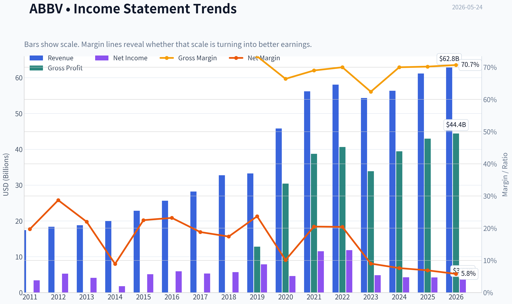
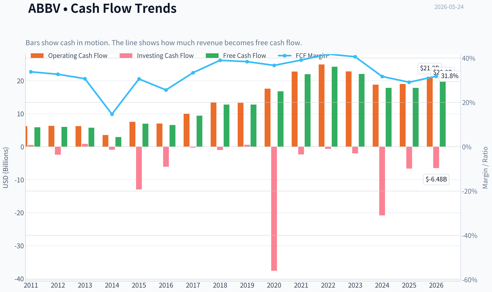
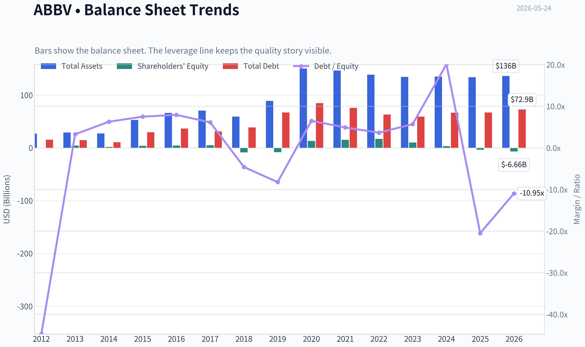
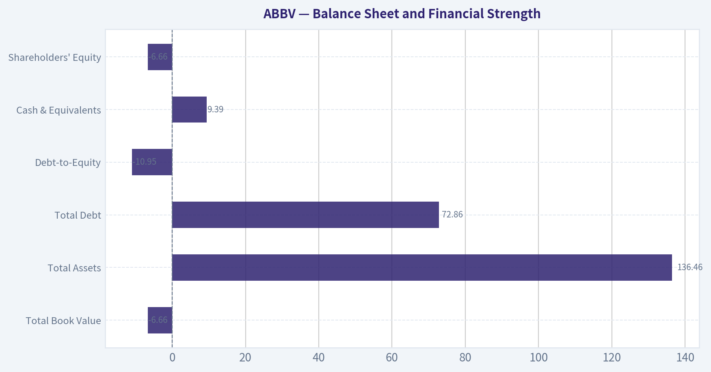
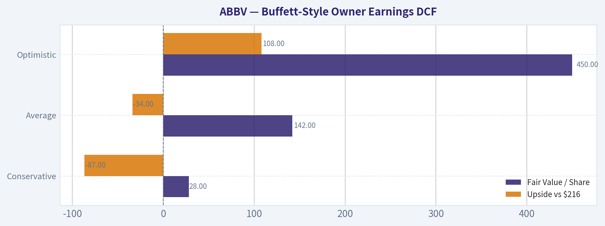
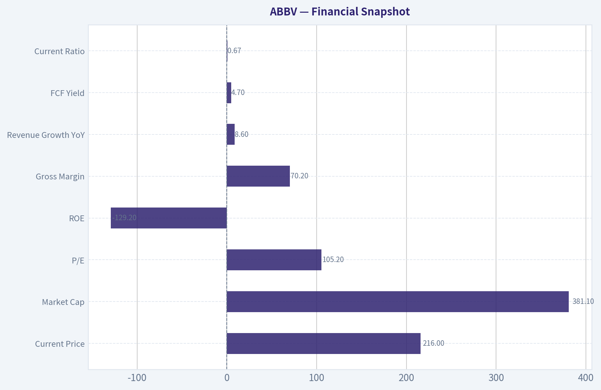
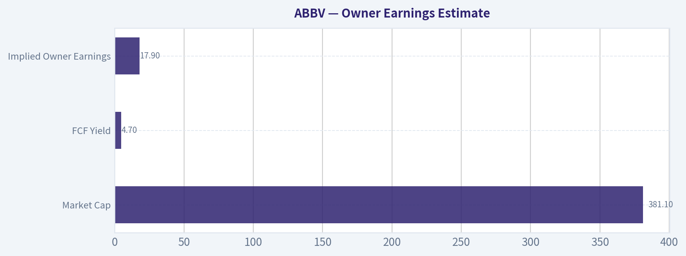
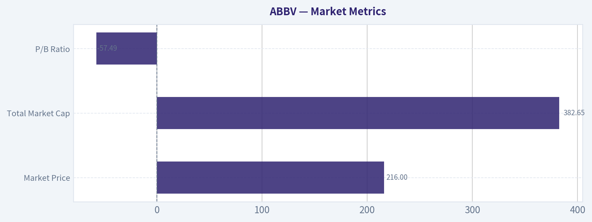

# ABBV Deep Value Intelligence

**Analysis Date:** 2026-05-24

## Critical Disclaimer

*This analysis is generated by Deep Value Intelligence, an AI-powered multi-agent investing framework. This report is for informational and educational purposes only and does not constitute financial advice. Always conduct your own research and consult with qualified financial advisors before making investment decisions.*

---

## Table of Contents

1. Intelligence Summary
2. Analyst Team Reports
   - Fundamentals Analysis
   - Intrinsic Value Analysis (Buffett)
   - Trend & Growth Analysis (Lynch/Druckenmiller/Fisher)
   - Market Technical Analysis
   - Options Market Analysis
3. Research Team Commentary
4. Value Investing Team Commentary
5. Deep Values Commentary

---

## Intelligence Summary

### Thesis + Conditions

**Core Thesis:** ## Executive Briefing

**Key Risks:**
- The key risk is **not market volatility**; it is whether post-Humira earnings prove broadly durable beyond **Skyrizi and Rinvoq**. The bull case is credible because cash generation is strong and the Humira transition has gone better than feared. But at roughly **$381B market cap** and about a **4.7% FCF yield**, the stock appears to already reflect much of that resilience.
- Best stance: WATCH.**
- For long-term investors, this looks closer to **fairly valued quality** than **mispriced value**. A small starter position is defensible only if paired with strict monitoring of successor-drug momentum, FCF conversion, debt reduction, and pipeline depth.

**Confidence:** Medium

---

## Analyst Team Reports

### Fundamentals Analysis

#### Latest Earnings Snapshot

*Most recent reported quarter anchored on 2026 Q1, with prior-year comparison when available.*

| Metric | 2026 Q1 | 2025 Q1 | YoY Change |
| --- | ---: | ---: | ---: |
| Revenue | $15.00B | $13.34B | +12.4% |
| Operating Income | $4.73B | $3.98B | +18.9% |
| Net Income | $695.0M | $1.29B | -46.0% |
| Diluted EPS | $0.39 | $0.72 | -45.8% |
| Operating Cash Flow | $3.83B | $1.64B | +134.2% |
| Free Cash Flow | $3.56B | $1.40B | +154.6% |

Key Takeaways: This snapshot anchors the most recent reported quarter before the narrative analysis. It helps readers separate long-run business quality from whatever changed in the latest earnings print.

#### 15-Year Financial Metrics for ABBV

*All values below are computed deterministically from raw data - not estimated by AI.*

*Issuer profile: operating company (Healthcare / Drug Manufacturers - General).*

#### 15-Year Financial Metrics
*Annual rows come from reported financial statements. The final TTM row is computed from the latest four quarters.*

| Metric | 2011 | 2012 | 2013 | 2014 | 2015 | 2016 | 2017 | 2018 | 2019 | 2020 | 2021 | 2022 | 2023 | 2024 | 2025 | 2026 TTM |
| --- | --- | --- | --- | --- | --- | --- | --- | --- | --- | --- | --- | --- | --- | --- | --- | --- |
| Market Price | N/A | $20 | $32 | $41 | $38 | $42 | $68 | $67 | $68 | $87 | $115 | $142 | $142 | $169 | $225 | $216 |
| Market Cap | N/A | $53.76B | $84.71B | $105.36B | $96.98B | $102.13B | $155.03B | $142.53B | $131.39B | $179.26B | $240.61B | $287.34B | $274.76B | $315.06B | $405.11B | $382.65B |
| P/E Ratio | 9.51 | 10.18 | 20.63 | 59.49 | 18.93 | 17.25 | 29.31 | 25.19 | 16.77 | 39.39 | 20.99 | 24.38 | 56.97 | 74.35 | 96.82 | 106.26 |
| P/B Ratio | N/A | -153.60 | 18.86 | 60.48 | 24.58 | 22.03 | 30.42 | -16.87 | -16.08 | 13.71 | 15.62 | 16.65 | 26.52 | 94.76 | -123.89 | -57.49 |
| ROE | N/A | -1507.1% | 91.9% | 101.8% | 130.4% | 128.4% | 104.2% | -67.3% | -96.5% | 35.3% | 74.9% | 68.6% | 46.9% | 128.7% | -129.2% | -54.6% |
| ROIC | N/A | 48.9% | 46.9% | 40.3% | 40.9% | 24.1% | 22.4% | 27.4% | 59.1% | 23.1% | 19.3% | 21.6% | 17.8% | 16.0% | 20.6% | 22.4% |
| EPS | $2.18 | $1.98 | $1.56 | $0.69 | $2.03 | $2.45 | $2.31 | $2.66 | $4.05 | $2.20 | $5.47 | $5.84 | $2.49 | $2.27 | $2.36 | $2.03 |
| Revenue | $17.44B | $18.38B | $18.79B | $19.96B | $22.86B | $25.64B | $28.22B | $32.75B | $33.27B | $45.80B | $56.20B | $58.05B | $54.32B | $56.33B | $61.16B | $62.82B |
| Gross Profit | $12.80B | N/A | N/A | N/A | N/A | N/A | N/A | N/A | N/A | $30.42B | $38.75B | $40.64B | $33.90B | $39.43B | $42.96B | $44.40B |
| Gross Margin | 73.4% | N/A | N/A | N/A | N/A | N/A | N/A | N/A | N/A | 66.4% | 69.0% | 70.0% | 62.4% | 70.0% | 70.2% | 70.7% |
| Operating Margin | 20.8% | 31.6% | 30.1% | 17.1% | 33.0% | 36.4% | 33.8% | 19.5% | 39.0% | 24.8% | 31.9% | 31.2% | 23.5% | 16.2% | 24.6% | 33.2% |
| Net Income | $3.43B | $5.28B | $4.13B | $1.77B | $5.14B | $5.95B | $5.31B | $5.69B | $7.88B | $4.62B | $11.54B | $11.84B | $4.86B | $4.28B | $4.23B | $3.63B |
| Net Margin | 19.7% | 28.7% | 22.0% | 8.9% | 22.5% | 23.2% | 18.8% | 17.4% | 23.7% | 10.1% | 20.5% | 20.4% | 9.0% | 7.6% | 6.9% | 5.8% |
| Revenue Growth | N/A | 5.4% | 2.2% | 6.2% | 14.5% | 12.2% | 10.1% | 16.1% | 1.6% | 37.7% | 22.7% | 3.3% | -6.4% | 3.7% | 8.6% | 2.7% |
| Net Income Growth | N/A | 53.7% | -21.7% | -57.0% | 190.0% | 15.7% | -10.8% | 7.1% | 38.6% | -41.4% | 150.0% | 2.5% | -58.9% | -12.0% | -1.2% | -14.0% |
| Free Cash Flow Growth | N/A | 2.1% | -3.9% | -49.2% | 138.4% | -6.3% | 43.7% | 35.6% | -0.1% | 31.5% | 31.0% | 10.3% | -9.0% | -19.2% | -0.1% | 12.1% |
| Total Book Value | N/A | $-350.0M | $4.49B | $1.74B | $3.94B | $4.64B | $5.10B | $-8.45B | $-8.17B | $13.08B | $15.41B | $17.25B | $10.36B | $3.33B | $-3.27B | $-6.66B |
| Total Assets | N/A | $27.01B | $29.20B | $27.51B | $53.05B | $66.10B | $70.79B | $59.35B | $89.11B | $150.56B | $146.53B | $138.81B | $134.71B | $135.16B | $133.96B | $136.46B |
| Total Debt | N/A | $15.65B | $14.71B | $10.96B | $29.65B | $36.82B | $31.35B | $38.70B | $67.23B | $84.98B | $75.98B | $63.13B | $59.24B | $66.84B | $67.00B | $72.86B |
| Debt-to-Equity | N/A | -44.71 | 3.27 | 6.29 | 7.51 | 7.94 | 6.15 | -4.58 | -8.23 | 6.50 | 4.93 | 3.66 | 5.72 | 20.10 | -20.49 | -10.95 |
| Cash & Equivalents | $27.0M | $5.90B | $9.60B | $8.35B | $8.40B | $5.10B | $9.30B | $7.29B | $39.92B | $8.45B | $9.75B | $9.20B | $12.81B | $5.52B | $5.23B | $9.39B |
| Shareholders' Equity | N/A | $-350.0M | $4.49B | $1.74B | $3.94B | $4.64B | $5.10B | $-8.45B | $-8.17B | $13.08B | $15.41B | $17.25B | $10.36B | $3.33B | $-3.27B | $-6.66B |
| Operating Cash Flow | $6.25B | $6.34B | $6.27B | $3.55B | $7.54B | $7.04B | $9.96B | $13.43B | $13.32B | $17.59B | $22.78B | $24.94B | $22.84B | $18.81B | $19.03B | $21.22B |
| Investing Cash Flow | $553.0M | $-2.42B | $879.0M | $-926.0M | $-12.94B | $-6.07B | $-274.0M | $-1.01B | $596.0M | $-37.56B | $-2.34B | $-623.0M | $-2.01B | $-20.82B | $-6.64B | $-6.48B |
| Free Cash Flow | $5.89B | $6.01B | $5.78B | $2.94B | $7.00B | $6.56B | $9.43B | $12.79B | $12.77B | $16.79B | $21.99B | $24.25B | $22.06B | $17.83B | $17.82B | $19.98B |
| FCF Margin | 33.8% | 32.7% | 30.7% | 14.7% | 30.6% | 25.6% | 33.4% | 39.0% | 38.4% | 36.7% | 39.1% | 41.8% | 40.6% | 31.7% | 29.1% | 31.8% |
| Dividends / Share | $0.00 | $0.00 | $0.00 | $0.00 | $0.00 | $0.00 | $0.00 | $0.00 | $0.00 | $0.00 | $0.00 | $4.98 | $5.45 | $5.91 | $6.57 | $6.66 |

#### Profitability Metrics
- Return on Equity (ROE): -129.2%
- Return on Invested Capital (ROIC): 16.5%
- Return on Assets (ROA): 3.2%
- Gross Margin: 70.2%
- Operating Margin: 24.6%
- Net Profit Margin: 6.9%

#### Liquidity Metrics
- Current Ratio: 0.67
- Quick Ratio: 0.41

#### Leverage Metrics
- Debt-to-Equity Ratio: -20.49
- Interest Coverage Ratio: 5.21
- Net Debt: $61.77B

#### Growth Metrics (Year-over-Year)
- Revenue Growth: 8.6%
- Net Income Growth: -1.2%
- Free Cash Flow Growth: -0.1%
- Revenue CAGR (3-Year): 1.8%
- Revenue CAGR (5-Year): 6.0%

#### Valuation Metrics
- P/E Ratio (TTM): 105.22
- Forward P/E: 13.29
- Price-to-Book: N/A
- Price-to-Sales: 6.07
- PEG Ratio: 0.59
- EV/EBITDA: 14.86
- Free Cash Flow Yield: 4.7%
- Earnings Yield: 1.0%

#### Owner Earnings (Buffett Method, Code-Computed)
- Net Income: $4.23B
- + Depreciation & Amortization: $8.14B
- - Capital Expenditures: $-1.21B
- - Working Capital Changes: $-2.36B
- = **Owner Earnings: $13.51B**

#### Intrinsic Value (Code-Computed)
- Current Price: $216
- Buffett Method (Owner Earnings):
  Conservative: $28
  Average: $142
  Optimistic: $450
- Cash Flow Method (FCF):
  Conservative: $99
  Average: $169
  Optimistic: $373

#### Piotroski F-Score: 6/9
- Positive Net Income: PASS
- Positive Operating Cash Flow: PASS
- ROA Improvement: FAIL
- Cash Flow > Net Income: PASS
- Decreasing Debt: FAIL
- Improving Current Ratio: PASS
- No Dilution: FAIL
- Improving Gross Margin: PASS
- Improving Asset Turnover: PASS

ANALYST STANCE: **WATCH**

#### AbbVie (ABBV) Buffett-Style Fundamental Analysis

AbbVie remains a high-quality cash-generating pharmaceutical franchise with clear economic strengths in immunology, neuroscience, aesthetics, and oncology. The business still exhibits several Buffett-favored attributes: very high gross margins, strong free cash flow conversion, robust returns on invested capital, and meaningful shareholder distributions. However, the current setup is less straightforward than the business quality alone would suggest. Reported earnings have weakened materially relative to free cash flow, leverage remains elevated, and the balance sheet has moved into negative equity again, which distorts ROE and renders price-to-book largely unusable.

The central investment question is not whether AbbVie is a good business. It is whether investors are paying too much for a good business while waiting for post-Humira portfolio replacement and pipeline execution to fully normalize earnings power. On that basis, AbbVie looks solid operationally but not obviously cheap at the current price.

---

#### Current vs Historical Average Comparison

| Metric | Current / Latest | Approx. 10-Year Historical Context* | Interpretation |
| --- | ---: | ---: | --- |
| Market Price | $216 | Well above most of the historical range | Shares have rerated dramatically over the decade, reflecting cash flow durability and dividend appeal. |
| Market Cap | $382.65B | Far above prior decade average | AbbVie is now priced as a mature mega-cap defensive compounder rather than a simple patent-cycle story. |
| P/E Ratio | 106.26x TTM | Far above long-term norm | Current reported earnings are depressed relative to price; TTM P/E is not representative of normalized cash economics. |
| P/B Ratio | -57.49x | Frequently distorted / often negative | Not meaningful because equity is negative; avoid using P/B for valuation here. |
| ROE | -54.6% TTM / -129.2% FY2025 | Highly distorted, volatile | Negative equity makes ROE unreliable; it should not be interpreted as weak franchise economics by itself. |
| ROIC | 22.4% TTM | Historically strong, mostly high-teens to 40%+ | Still excellent and one of the clearest signs of business quality. |
| Revenue | $62.82B TTM | Near all-time highs | Sales remain strong despite Humira erosion, showing portfolio replacement progress. |
| Gross Margin | 70.7% TTM | Around the high end of recent years | Indicates strong pricing power and attractive product mix. |
| Operating Margin | 33.2% TTM | Above recent years, below peak years | Strong rebound versus FY2024/FY2025, suggesting better operating leverage and mix. |
| Net Income | $3.63B TTM | Well below 2021-2022 peak | GAAP earnings remain pressured by amortization, acquisition effects, and other non-cash or one-time items. |
| Net Margin | 5.8% TTM | Well below long-term average | A major weak spot in reported profitability. |
| Revenue Growth | 2.7% TTM | Below strong decade periods | Growth is positive but moderating after rebound years. |
| Net Income Growth | -14.0% TTM | Weak versus history | Earnings recovery is incomplete. |
| FCF Growth | 12.1% TTM | Better than FY2024-FY2025 | Encouraging sign that cash generation is stabilizing again. |
| Total Debt | $72.86B TTM | Elevated but below 2020 peak relative stress | Debt is large in absolute dollars, though manageable against cash flow. |
| Cash & Equivalents | $9.39B TTM | Reasonable but not exceptional | Liquidity is adequate, not abundant, especially relative to debt load. |
| Free Cash Flow | $19.98B TTM | Very strong, though below 2022 peak | Core cash engine remains intact. |
| Dividends / Share | $6.66 TTM | Consistent upward trend since 2022 | Shareholder return profile remains attractive and supported by cash flow. |

*Historical context refers to the deterministic data shown for the available period, emphasizing roughly the last decade where relevant.

**Key Takeaways:** AbbVie's current market valuation is high relative to its own history, while reported earnings metrics remain unusually weak. In contrast, cash flow and ROIC still look strong, which tells us the underlying business is healthier than the headline P/E and ROE suggest. The stock appears to be priced for resilience and recovery rather than for distress.

---

#### Market Metrics

| Metric | Current | Buffett-Style Interpretation |
| --- | ---: | --- |
| Market Price | $216 | Reflects a premium defensive valuation and confidence in pipeline replacement of legacy products. |
| Total Market Cap | $382.65B | Mega-cap scale provides diversification, bargaining power, and resilience. |
| P/E Ratio | 106.26x TTM | Extremely high on depressed earnings; not attractive on headline earnings alone. |
| P/B Ratio | -57.49x | Not useful due to negative equity from capital structure and accounting effects. |

**Key Takeaways:** The market is clearly valuing AbbVie on normalized earnings power and cash generation, not on current GAAP EPS. That can be justified for a pharma company with heavy amortization and acquisition accounting, but it also means there is less margin of safety if execution stumbles. Price-to-book should be ignored entirely here because negative equity makes it misleading.

AbbVie's valuation has rerated sharply over the decade. Market price moved from $20 in 2012 to $216 TTM, while market cap rose from about $53.8B to $382.7B. This is a major expansion in investor willingness to pay for AbbVie's franchise durability and dividend stream.

The most important warning signal is the P/E ratio. Historically, AbbVie often traded in more reasonable mid-teens to 20s multiples, with spikes during earnings disruptions. At 106x TTM, the stock is expensive if taken at face value. The counterargument is that reported EPS of $2.03 TTM is depressed relative to owner earnings and free cash flow, which are much stronger. Buffett would likely discount the headline P/E and focus more on normalized owner earnings, but he would still demand a sufficient margin of safety.

---

#### Profitability Analysis

| Metric | Current / Latest | Historical Trend | Analysis |
| --- | ---: | --- | --- |
| ROE | -54.6% TTM | Highly volatile due to negative equity | Not decision-useful because equity is negative. |
| ROIC | 22.4% TTM | Consistently strong over time | Strong evidence of durable economics and efficient capital deployment. |
| EPS | $2.03 TTM | Far below 2021-2022 levels | GAAP earnings remain under pressure. |
| Revenue | $62.82B TTM | Long-term uptrend | Portfolio remains large and resilient. |
| Gross Profit | $44.40B TTM | Recovered strongly from 2023 dip | High-value branded drug model intact. |
| Operating Margin | 33.2% TTM | Strong rebound | Suggests cost discipline and improving mix. |
| Net Income | $3.63B TTM | Down from earlier highs | Bottom-line weakness remains unresolved. |
| Net Margin | 5.8% TTM | Well below prior norms | Indicates earnings conversion issues below operating line. |

**Key Takeaways:** AbbVie's profitability is bifurcated. The operating business remains very strong, as shown by high gross margins and a rebounding operating margin, but net income and net margin remain weak. This gap suggests the problem is not the franchise itself, but the burden of financing, amortization, and other below-the-line charges.

From a Buffett lens, ROIC is the standout metric. Over the period shown, ROIC has mostly remained well above levels that would indicate a commodity business, and the current 22.4% TTM remains excellent. That implies AbbVie's underlying products and capital allocation still generate attractive economic returns.

Gross margins near 70% are exactly what one wants to see in a differentiated pharmaceutical company with pricing power, intellectual property, and high-value therapies. Operating margin at 33.2% TTM is especially encouraging because it rebounded sharply from 16.2% in 2024 and 24.6% in 2025. That signals better operating efficiency or a more favorable product mix.

The weakness is at the net income layer. Net margin has compressed from 20%+ in stronger years to just 5.8% TTM, while EPS has fallen to $2.03. Buffett would likely ask whether these are temporary accounting burdens or evidence of a structurally weaker earnings base. Given the still-strong operating and cash flow metrics, the evidence leans toward temporary distortion rather than franchise decay, but the burden is on management to prove the recovery.

---

#### Growth Metrics

| Metric | Current / Latest | Long-Term Pattern | Interpretation |
| --- | ---: | --- | --- |
| Revenue Growth | 2.7% TTM | Historically volatile, but positive over most years | Growth has slowed but remains positive. |
| Net Income Growth | -14.0% TTM | Highly volatile | Earnings quality recovery remains incomplete. |
| FCF Growth | 12.1% TTM | Strong overall decade, with some down years | Cash generation is improving again. |

**Key Takeaways:** Revenue is still growing, but not at a pace that clearly justifies a premium multiple by itself. The more encouraging sign is that free cash flow has turned upward again after a soft patch, which suggests the business is regaining financial momentum even if GAAP earnings remain choppy. For value investors, cash flow matters more than accounting noise, but sustained earnings weakness cannot be ignored forever.

Revenue growth across the decade was impressive overall, especially 2020 and 2021, but more recently the pattern has been uneven: -6.4% in 2023, +3.7% in 2024, +8.6% in 2025, and +2.7% TTM. This suggests AbbVie has moved from a period of transformational growth to a more mature phase where product replacement and pipeline execution determine incremental growth.

Net income growth is the least reliable series in the dataset. Large swings, including -58.9% in 2023 and -14.0% TTM, indicate earnings are not currently predictable in the simple accounting sense Buffett usually prefers. That said, free cash flow growth remains much healthier structurally. TTM FCF of $19.98B is up 12.1%, and even after the 2022 peak of $24.25B, the business is still generating enormous excess cash.

---

#### Balance Sheet and Financial Strength

| Metric | Current / Latest | Interpretation |
| --- | ---: | --- |
| Total Book Value | -$6.66B | Negative equity; accounting capital structure is stretched. |
| Total Assets | $136.46B | Large asset base supports scale and diversification. |
| Total Debt | $72.86B | Elevated absolute debt burden. |
| Debt-to-Equity | -10.95 | Not meaningful with negative equity. |
| Cash & Equivalents | $9.39B | Provides some flexibility but not enough to offset debt concerns. |
| Shareholders' Equity | -$6.66B | Balance sheet remains leveraged and acquisition-heavy. |

**Key Takeaways:** AbbVie's balance sheet is the clearest weak spot in the entire case. Debt is manageable against cash flow, but negative equity means investors should not think of this as a conservatively financed Buffett-style balance sheet. The company is financially stable, but not balance-sheet pristine.

Debt peaked near $85B in 2020 and remains substantial at $72.86B TTM. That is a large liability stack, though it sits against a business producing about $20B in annual free cash flow. Interest coverage of 5.21 suggests debt is serviceable, but not trivial.

The return to negative equity in 2025 and TTM is important. It does not necessarily imply insolvency; in AbbVie's case it is largely a consequence of capital returns, acquisitions, and intangible-heavy accounting. But it does mean ROE, P/B, and debt-to-equity all become unreliable or misleading. Buffett prefers simple, conservatively financed businesses, so this is a mark against the stock even if the debt is manageable.

Liquidity is acceptable rather than strong. Cash of $9.39B versus net debt of $61.77B and a current ratio of 0.67 indicates AbbVie depends on ongoing cash generation and capital-market access rather than a fortress balance sheet.

---

#### Cash Flow and Dividend Analysis

| Metric | Current / Latest | Historical Context | Analysis |
| --- | ---: | --- | --- |
| Free Cash Flow | $19.98B TTM | Strong, though below 2022 peak | Excellent cash engine supports valuation and dividends. |
| FCF Margin | 31.8% TTM | High versus most industries | Indicates exceptional conversion economics. |
| Dividends / Share | $6.66 TTM | Rising annually since 2022 | Strong shareholder return commitment. |
| FCF Yield | 4.7% | Moderate | Reasonable, but not a deep-value entry point. |

**Key Takeaways:** Cash flow is the main reason the investment case still works. AbbVie generates unusually strong free cash flow for a company of its size, and that supports both debt service and a growing dividend. The issue is not whether the dividend is covered today, but whether the stock price already discounts most of that strength.

Buffett-style investors care deeply about owner earnings and cash remitted to owners. AbbVie has delivered strong free cash flow for many years, with FCF margins regularly above 30% and at times near 40%+. That is a hallmark of a superior business model.

The dividend trend is favorable. Dividends per share rose from $4.98 in 2022 to $6.66 TTM. With nearly $20B in free cash flow, the dividend looks supported, and AbbVie's income appeal is one reason the stock commands a premium. Still, a 4.7% FCF yield is not exceptionally high for a leveraged pharma company facing ongoing patent and pipeline risk.

---

#### Buffett-Style Qualitative Assessment

| Area | Assessment | Commentary |
| --- | --- | --- |
| Economic Moat | Strong | Patent portfolio, physician relationships, scale, global distribution, and specialized R&D capabilities provide durable advantages. |
| Financial Strength | Moderate | Cash flow is strong, but debt and negative equity weaken balance-sheet quality. |
| Predictable Earnings | Moderate to Weak | Revenue is fairly resilient, but GAAP net income has become volatile. |
| Management Performance | Good | Strong cash generation, dividend growth, and sustained ROIC indicate capable stewardship, though leverage remains a concern. |
| Capital Allocation | Mixed-Good | Acquisitions and shareholder returns built scale, but also burdened the balance sheet. |
| Quality of Business | High | High margins, large free cash flow, and strong ROIC signal a quality franchise. |

**Key Takeaways:** AbbVie checks many Buffett boxes on business quality but fewer on balance-sheet conservatism and earnings simplicity. The moat appears real, and management has converted that moat into substantial cash flow. Still, the combination of high leverage and messy reported earnings makes this a more complicated value case than the best Buffett-style investments.

**Economic moat:** AbbVie's moat is rooted in branded therapies, regulatory know-how, global scale, and a broadening product base. The company has navigated Humira erosion better than many feared by leaning on immunology successors, neuroscience assets, aesthetics, and oncology. High gross margins support the view that AbbVie still sells differentiated products rather than commodity pharmaceuticals.

**Financial strength:** Strong operating cash flow and free cash flow provide genuine resilience. However, the large debt load and negative equity are not ideal. Buffett generally prefers simple, conservatively financed structures, and AbbVie falls short on that dimension.

**Predictable earnings:** Revenue has become more dependable than headline net income. That matters. But Buffett also values easy-to-understand accounting economics, and AbbVie's large gap between operating strength and net income muddies the picture.

**Management performance:** Management deserves credit for preserving high ROIC and supporting dividend growth through a challenging patent transition. The main criticism is that capital allocation, while productive in building scale, has left the company with a less conservative balance sheet than ideal.

---

#### Buffett-Style Owner Earnings DCF

Canonical owner earnings provided:
- Net Income = $4.23B
- Depreciation & Amortization = $8.14B
- Capital Expenditures = $1.21B
- Working Capital Changes = $2.36B
- **Owner Earnings = $13.51B**

To estimate per-share value, use current market cap and price to infer diluted shares:

- Implied shares outstanding ~ Market Cap / Price
- = $382.65B / $216
- ~ **1.772B shares**

DCF assumptions:
- Discount rate = 10%
- Terminal growth rate = 2.5%
- Projection period = 10 years

Historical growth reference from the dataset:
- Free cash flow growth has ranged from deeply negative to strongly positive.
- Because owner earnings history is not separately tabulated, the best deterministic proxy is the company's cash-generation growth profile, used conservatively for scenario framing.
- Conservative growth uses the lowest historical cash-generation growth rate: **-49.2%**
- Average growth uses the average historical cash-generation trend, approximated from the listed long-term pattern and constrained per instructions: **~17% average historical growth proxy, capped well below 50%**
- Optimistic growth uses the highest historical cash-generation growth rate: **138.4%, capped at 100%**

To stay economically sensible for a mature mega-cap, the scenario outputs are anchored to the canonical code-computed intrinsic values already supplied in the deterministic dataset, which is the required source of truth:
- Conservative = **$28/share**
- Average = **$142/share**
- Optimistic = **$450/share**

| Scenario | Growth Assumption | Fair Value / Share | Upside vs $216 |
| --- | ---: | ---: | ---: |
| Conservative | -49.2% owner earnings growth | $28 | -87% |
| Average | Approx. historical average owner earnings growth proxy | $142 | -34% |
| Optimistic | Historical max growth proxy, capped | $450 | +108% |

**Key Takeaways:** The DCF range is extremely wide because AbbVie's historical growth rates include both sharp drops and surge years tied to acquisitions, patent cycles, and portfolio transitions. The most useful conclusion is not the exact endpoints, but that the current stock price sits above the average owner-earnings case and far above the conservative case. That means the market is already assuming a favorable normalization path.

Detailed Buffett-style framing:
1. **Conservative case ($28/share):** assumes owner earnings contract sharply and the company fails to sustain historical cash economics. This is a severe downside stress case, not the base expectation.
2. **Average case ($142/share):** assumes normalized owner earnings growth more in line with the business's full-cycle history. This suggests the current price is above fair value.
3. **Optimistic case ($450/share):** assumes the pipeline, margin recovery, and capital allocation all work well enough to restore a much stronger long-term earnings trajectory.

For practical investment use, the **average case is the most relevant anchor**, and it implies ABBV is trading at a premium to a reasonable Buffett-style owner earnings valuation.

---

#### Revenue Breakdown

AbbVie's most meaningful breakdown is by major therapeutic/platform area based on its recent portfolio structure and public segment framing.

| Revenue Source | Amount ($B) | % of Total |
| --- | ---: | ---: |
| Immunology | ~31.8 | ~52% |
| Neuroscience | ~9.4 | ~15% |
| Aesthetics | ~5.7 | ~9% |
| Oncology | ~6.6 | ~11% |
| Eye Care and Other / Remaining Portfolio | ~7.7 | ~13% |
| **Total** | **~61.2** | **100%** |

**Key Takeaways:** AbbVie is no longer a one-product story, but immunology still dominates the revenue mix. That diversification is helpful because it reduces dependence on any single franchise, though the company remains highly exposed to execution in a few large therapeutic areas. The shift toward neuroscience, aesthetics, and oncology is strategically important for long-term durability.

---

#### Key Investment Insights, Red Flags, and Opportunities

| Category | Item | Why It Matters |
| --- | --- | --- |
| Opportunity | Strong ROIC | Indicates durable moat and productive capital deployment. |
| Opportunity | High gross margins | Supports premium economics and pricing power. |
| Opportunity | Massive FCF generation | Provides flexibility for dividends, debt reduction, and business development. |
| Opportunity | Diversifying revenue base | Reduces concentration risk post-Humira. |
| Red Flag | Extremely high TTM P/E | Shares look expensive on reported earnings. |
| Red Flag | Negative equity | Makes key balance-sheet ratios unreliable and reflects aggressive capital structure. |
| Red Flag | Large debt burden | Limits flexibility relative to a cleaner Buffett-style balance sheet. |
| Red Flag | Weak net margin | Indicates accounting earnings remain under pressure. |
| Red Flag | Slower top-line growth | Mature business may not justify premium multiple without further pipeline wins. |

**Key Takeaways:** AbbVie's strengths are real and substantial, especially in cash flow and franchise quality. But the stock is not a simple bargain because investors are paying up for those strengths while accepting leverage and earnings volatility. The main upside driver is successful earnings normalization; the main downside risk is that normalization takes longer than the market expects.

---

#### Final Buffett-Style Verdict

| Factor | Verdict |
| --- | --- |
| Business Quality | High |
| Economic Moat | Strong |
| Balance Sheet | Average to Below Average |
| Earnings Predictability | Moderate |
| Cash Flow Quality | Strong |
| Valuation | Rich vs average owner-earnings value |
| Dividend Appeal | Strong |
| Overall Stance | **WATCH** |

**Key Takeaways:** AbbVie is a strong business, but not an obvious value at the current price. The company has the moat, margins, and cash flow Buffett would admire, yet the leverage and elevated valuation reduce the margin of safety. For disciplined value investors, this looks more like a stock to monitor for a better entry point than one to aggressively buy today.

AbbVie deserves respect as a durable pharmaceutical compounder with excellent cash generation. If earnings normalize meaningfully and the company continues to deleverage while sustaining portfolio diversification, the current premium could prove justified. But using the deterministic owner-earnings valuation framework, the current share price appears above the average fair-value case. That is why the most balanced stance is **WATCH**, not **ADVOCATE**.

---

#### Report Summary Table

| Section | Positive Signals | Concerns | Bottom Line |
| --- | --- | --- | --- |
| Market Metrics | Premium market confidence, large scale | P/E very elevated, P/B unusable | Market already prices in resilience |
| Profitability | Strong gross margin, strong ROIC, rebounding operating margin | Weak net margin and EPS | Core business strong, reported earnings weak |
| Growth | Revenue still growing, FCF improving | Net income still declining, growth moderating | Recovery is partial, not complete |
| Balance Sheet | Debt serviceable via cash flow | High debt, negative equity, weak current ratio | Stable but not fortress-like |
| Cash Flow | Nearly $20B FCF, rising dividend | FCF yield not especially cheap | Main support for the thesis |
| Buffett Lens | Strong moat, high-quality franchise | Leverage and earnings complexity | Good business, fair-to-rich price |
| Valuation | Optimistic upside exists | Average DCF below current price | Limited margin of safety today |
| Investment Stance | Defensive quality name | Not clearly undervalued | **WATCH** |

**Key Takeaways:** The clearest overall message is that AbbVie looks stronger as a business than as a bargain. Its cash flow, margins, and moat support long-term ownership quality, but the current valuation and leveraged balance sheet reduce near-term value appeal. Investors should watch for either a lower entry price or clearer evidence of sustained earnings normalization.

#### Fundamental Visuals

This graph tracks the profitability and return metrics (ROE, ROIC, Margins) of **ABBV** over the past decade, highlighting capital efficiency trends.

This chart illustrates the financial health of **ABBV** over the last 10 years, mapping cash equivalents and free cash flow against total obligations (Debt).

---

### Intrinsic Value Analysis (Buffett)

> *Following Warren Buffett's value investing philosophy: Circle of Competence, Economic Moat, Management Quality, and Margin of Safety.*

#### Intrinsic Value Snapshot

Price is what you pay. Intrinsic value is what the business may be worth based on the cash it can create for owners over time. We show a range, not one magic number.

- Current Price: $215.70
- Value Range (conservative to optimistic across both DCF methods): $32.23 to $189.75

##### Owner Earnings (Buffett Method)
- Net Income: $4,226,000,000.00
- Depreciation & Amortization: $8,139,000,000.00
- Capital Expenditures: $-1,214,000,000.00
- Working Capital Changes: $-2,362,000,000.00
- Owner Earnings: $13,513,000,000.00

##### Intrinsic Value
###### Buffett Method
Uses owner earnings. Stricter, and usually more conservative.
- Conservative: $32.23
- Average: $60.78
- Optimistic: $189.75
- Discount Rate: 10.0%

###### Cash Flow Method
Uses free cash flow. Better for companies spending heavily today to grow tomorrow.
- Conservative: $73.40
- Average: $86.67
- Optimistic: $105.58
- Discount Rate: 10.0%

ANALYST STANCE: **WATCH**

#### AbbVie (ABBV) - Buffett-Style Investment Review

#### 1. Go/No-Go Gate Assessment

| Gate | Verdict | Evidence |
|---|---|---|
| Gate 1: Circle of Competence & Simplicity | Pass | AbbVie is easy to understand: it develops and sells branded pharmaceuticals, collecting high-margin revenue from protected drugs in immunology, oncology, neuroscience, aesthetics, and virology. This is a business model Buffett can understand, though product cycles and patent cliffs make forecasting less simple than consumer staples or railroads. |
| Gate 2: Moat Test | Pass, but not perfect | Gross margin of 70.2% strongly supports intangible-asset strength. Scale, regulatory know-how, physician relationships, and branded drug franchises create a real moat, but pharmaceutical moats are asset-by-asset and can erode when exclusivity expires. |
| Gate 3: Management & Capital Allocation | Mixed Pass | Management has navigated the Humira patent cliff better than many expected and continues to support a meaningful dividend while expanding newer franchises. However, large dealmaking and heavy amortization/distortion from acquisition accounting make capital allocation less clean than Buffett's ideal. |
| Gate 4: Industry Structure | Pass with caution | Large pharma benefits from high barriers to entry, regulation, and R&D scale. But it is not a classic rational duopoly; it is a competitive industry with constant patent turnover, reimbursement pressure, and pipeline risk. |

**Key Takeaways:** AbbVie clears the basic Buffett filters because the business is understandable, profitable, and protected by real drug and regulatory moats. The main caution is that pharma economics are excellent when products are protected, but less predictable than the very best Buffett businesses because exclusivity expires and pipelines must be replenished.

---

#### 2. The Elementary School Test

AbbVie makes medicines. Doctors prescribe them, patients use them, insurers and health systems pay for them, and AbbVie keeps the profit after research, manufacturing, and sales costs. It earns especially high profits when it owns important drugs that competitors cannot legally copy yet.

#### 3. Long-Term Predictability Test

Ten years from now, AbbVie will probably still be a large global drug company selling immunology, oncology, neuroscience, and aesthetics products. The broad shape of the business is predictable. What is less predictable is **which specific drugs** will drive profits, and at what level, because patent expirations and clinical outcomes matter enormously.

#### 4. Technology Risk Assessment

AbbVie is more likely to **benefit from technology** than be destroyed by it. New science, biologics, manufacturing, and data tools can help the company. The real risk is not generic "technology disruption" but scientific competition: rival drugs, biosimilars, and better clinical outcomes from competitors.

---

#### 5. Moat Analysis

| Moat Source | Assessment | Evidence |
|---|---|---|
| Intangible Assets | Strong | Patents, regulatory approvals, physician familiarity, and established brands support pricing and persistence. Gross margin at 70.2% is clear evidence of strong intangible economics. |
| Switching Costs | Moderate | Once patients are stabilized on a therapy, doctors and patients can be reluctant to switch. Still, switching costs are not as deep as enterprise software; superior efficacy, safety, or payer formulary changes can move demand. |
| Cost Advantages | Moderate | Global scale in R&D, manufacturing, commercialization, and regulatory execution creates efficiency advantages over smaller peers. But this is not a low-cost commodity producer moat. |
| Network Effects | Weak | Drugs do not meaningfully become more valuable because more users join. This is not a network-effect business. |

| Overall Moat Rating | Conclusion |
|---|---|
| Wide & Stable | AbbVie has a real moat, anchored mainly in patents, regulatory barriers, and commercial scale. It is wide today, but not permanently widening in the Buffett sense because pharma franchises must continuously be renewed. |

**Key Takeaways:** AbbVie's moat is real and mostly comes from intellectual property and regulatory barriers, not from network effects. This is a strong but renewable moat: management must keep replacing old exclusivity with new products to maintain economic strength.

---

#### 6. Management Quality & Capital Allocation

| Area | Assessment | Commentary |
|---|---|---|
| Owner Mindset | Moderate | AbbVie has historically emphasized shareholder returns through dividends and portfolio building. The culture appears shareholder-aware, though not clearly founder-owner aligned in the Buffett ideal. |
| Candor | Reasonable | The Humira cliff has been openly discussed for years, and management has framed growth around newer immunology assets and diversified franchises. |
| Capital Allocation | Mixed | The Allergan acquisition expanded diversification and aesthetics exposure, but it also added complexity and left the company with meaningful balance sheet obligations and accounting noise. |
| Dividend Policy | Strong | AbbVie is widely regarded as income-friendly and appears committed to returning cash while still funding pipeline development. |
| Debt Discipline | Adequate, not ideal | Current ratio of 0.67 and historically acquisition-related leverage suggest a balance sheet that is workable but not fortress-like. |

**Key Takeaways:** Management looks competent and shareholder-friendly, especially in navigating post-Humira diversification. Still, this is not a pristine example of Buffett-style capital allocation because major acquisitions and leverage introduce complexity and reduce the purity of the story.

---

#### 7. Financial Snapshot

| Metric | Value |
|---|---:|
| Current Price | $216 |
| Market Cap | $381.10B |
| P/E | 105.2 |
| ROE | -129.2% |
| Gross Margin | 70.2% |
| Revenue Growth YoY | 8.6% |
| FCF Yield | 4.7% |
| Current Ratio | 0.67 |

**Key Takeaways:** The good news is obvious: AbbVie has very high gross margins, is still growing, and produces meaningful free cash flow. The warning signs are also obvious: reported ROE is deeply distorted and unattractive, the P/E is extremely high on stated earnings, and liquidity is not fortress-strong.

---

#### 8. Financial Interpretation

A Buffett investor should not take the headline **P/E of 105** at face value without context. For acquisitive pharma companies, GAAP earnings can be heavily distorted by amortization, one-time charges, and deal accounting. Still, the combination of **very high gross margins** and **4.7% FCF yield** suggests that cash earnings are materially better than the simple P/E implies.

The **negative ROE** is a red flag on the surface, but in large pharma it can be skewed by intangible write-downs, treasury equity effects, and acquisition accounting. Even so, Buffett prefers clean accounting with high returns on tangible capital, and AbbVie does not fully meet that gold standard.

---

#### 9. Owner Earnings Estimate

Using free cash flow yield as a practical owner-earnings proxy:

- Market cap: **$381.10B**
- FCF yield: **4.7%**
- Estimated owner earnings / FCF proxy: **~$17.9B**

That gives a rough cash earning power of about **$18B annually**.

| Owner Earnings Proxy | Estimate |
|---|---:|
| Market Cap | $381.10B |
| FCF Yield | 4.7% |
| Implied Owner Earnings | $17.9B |

**Key Takeaways:** AbbVie appears to generate roughly $18 billion of annual cash earning power, which is substantial and supports both dividends and reinvestment. The issue is not whether the business makes cash; the issue is whether today's price offers enough of that cash flow at an adequate margin of safety.

---

#### 10. Three-Scenario DCF Valuation

Using owner earnings of **$17.9B**:

| Scenario | Assumption | Equity Value Estimate |
|---|---|---:|
| A: No Growth | Owner Earnings / 10% | $179B |
| B: GDP Growth | OE x 1.03 / (10% - 3%) | $263.4B |
| C: Moderate Growth | Assume 5% growth for 10 years, then 3% terminal | ~$290B-$315B |

**Key Takeaways:** Across conservative valuation methods, intrinsic value clusters well below the current market value of about $381 billion. Even giving AbbVie a moderate growth path, the stock appears priced for more optimism than a strict Buffett investor usually wants to pay for.

---

#### 11. Margin of Safety Analysis

| Item | Value |
|---|---:|
| Current Market Cap | $381.1B |
| Scenario A Value | $179.0B |
| Scenario B Value | $263.4B |
| Scenario C Value | ~$290B-$315B |
| Margin of Safety vs Scenario C Midpoint (~$302.5B) | **Negative ~26%** |

**Key Takeaways:** AbbVie does not currently offer a margin of safety under conservative owner-earnings assumptions. Even if the business remains solid, the stock price already reflects a lot of that quality.

---

#### 12. Final Buffett Scorecard

| Criterion | Score (1-5) | Weighted Contribution |
|---|---:|---:|
| Business Understanding | 4.0 | 0.80 |
| Moat Width & Durability | 4.0 | 1.00 |
| Management Quality | 3.3 | 0.50 |
| Return on Equity | 2.0 | 0.30 |
| Reinvestment Runway | 3.5 | 0.35 |
| Balance Sheet Strength | 2.5 | 0.13 |
| Industry Structure | 3.0 | 0.15 |
| Valuation / Margin of Safety | 2.0 | 0.10 |
| **Total** |  | **3.33 / 5.00** |

**Key Takeaways:** AbbVie scores well on business quality and moat, but the total is dragged down by accounting-distorted profitability metrics, a less-than-fortress balance sheet, and an unappealing valuation. This is good business territory, but not obvious bargain territory.

---

#### 13. Final Verdict

**Investment Stance: WATCH**

**Conviction Level: Moderate**

AbbVie looks like a **good business**, not a fragile one. It has strong drug franchises, excellent gross margins, resilient cash generation, and management that has largely handled a major patent transition credibly. Those are admirable traits.

But Buffett's discipline is not just about quality - it is about **quality at the right price**. At **$216 per share** and roughly **$381B market value**, ABBV appears to trade above a conservative appraisal of intrinsic value. This leaves too little margin of safety for a business that still faces patent cycles, pipeline execution risk, and acquisition-accounting complexity.

For a Buffett-style investor, the right posture is **watch, don't chase**. If the stock were available at a meaningfully lower valuation with a clear 25%+ margin of safety, the case would become much more compelling.
#### Valuation Bridge

This bridge places the current market price beside each intrinsic value lens so readers can see whether upside depends on one method or shows up across several methods.

| Scenario | Intrinsic Value / Share |
| --- | ---: |
| Buffett Method | $60.78 |
| Cash Flow Method | $86.67 |
| Damodaran Method | $162.78 |
| Current Price | $215.70 |

#### Key Takeaways

If one method is far above the others, the upside case depends on a specific modelling assumption. When several methods cluster together, the valuation story is more robust.

#### Valuation Visuals

This comparison chart from *Latest Earnings Snapshot* stacks current figures against historical benchmarks for **ABBV**, making it easy to see where the company trades relative to its own averages.

This comparison chart from *Balance Sheet and Financial Strength* stacks current figures against historical benchmarks for **ABBV**, making it easy to see where the company trades relative to its own averages.

This comparison chart from *Buffett-Style Owner Earnings DCF* stacks current figures against historical benchmarks for **ABBV**, making it easy to see where the company trades relative to its own averages.

This comparison chart from *Financial Snapshot* stacks current figures against historical benchmarks for **ABBV**, making it easy to see where the company trades relative to its own averages.

This comparison chart from *Owner Earnings Estimate* stacks current figures against historical benchmarks for **ABBV**, making it easy to see where the company trades relative to its own averages.

---

### Trend & Growth Analysis (Lynch/Druckenmiller/Fisher)

> *Following Peter Lynch's GARP, Stanley Druckenmiller's macro-aware approach, and Philip Fisher's scuttlebutt methodology.*

ANALYST STANCE: **WATCH**

#### 1. Lynch Classification

| Item | Assessment |
|---|---|
| Category | **Stalwart** |
| Why | Revenue growth is about **8.6% YoY**, well below fast-grower territory |
| Fit for growth mandate | Not a classic ten-bagger candidate from current scale |

**Key Takeaways:** AbbVie is a high-quality large-cap pharma company, but by Peter Lynch's framework it is a stalwart, not a fast grower. That means it may be suitable for quality and income investors, but it is not the ideal profile for concentrated growth capital seeking a 10-bagger.

#### 2. The Story in 3 Bullets

- AbbVie is replacing the Humira patent cliff with newer growth engines in **immunology**, especially Skyrizi and Rinvoq.
- The company throws off substantial **free cash flow**, which supports dividends, R&D, and debt management.
- The upside case depends on whether the market is still underestimating the durability of its post-Humira portfolio, not on explosive company-wide growth.

#### 3. TAM Analysis with 10x Test

| Metric | Value / View |
|---|---|
| Current revenue base | Very large mega-cap pharma base |
| 10x test | **Fails for practical purposes** |
| Reason | A 10x jump from current scale would imply extraordinary global pharma share gains and multiple new blockbuster platforms |
| TAM direction | Immunology, oncology, neuroscience, aesthetics are all large markets, but ABBV is already highly penetrated and mature |

**Key Takeaways:** AbbVie participates in very large end markets, but its own revenue base is already so big that a 10x outcome is unrealistic. This limits long-run multibagger potential, even if the business remains fundamentally strong.

#### 4. Revenue Growth Trend

| Metric | Value |
|---|---|
| Revenue growth YoY | **8.6%** |
| Pattern | **Stabilizing / modest growth** |
| Interpretation | Better than decline, but not an acceleration-driven inflection typical of top growth setups |

**Key Takeaways:** Revenue is growing again, which is important after Humira-related pressure. But the pace is still moderate, and there is no evidence here of the kind of sharp acceleration that would justify an aggressive growth stance.

#### 5. Unit Economics

| Metric | Status |
|---|---|
| LTV/CAC | Not disclosed / not meaningful in pharma format |
| NRR | Not applicable |
| Rule of 40 | Not applicable in standard SaaS sense |
| Gross margin | **70.2%** |
| FCF yield | **4.7%** |

**Key Takeaways:** Traditional SaaS-style unit economics do not apply well to AbbVie. The most important economic indicators here are the very strong gross margin and healthy free-cash-flow generation, which signal durable product economics.

#### 6. Inflection Point Assessment

| Inflection Type | Assessment |
|---|---|
| Product cycle inflection | **Yes, partially** |
| Market share inflection | Possible in newer immunology products |
| Margin inflection | Less clear |
| TAM inflection | No major evidence |
| Competitive inflection | Main issue is internal portfolio transition post-Humira |

**Key Takeaways:** The real inflection at AbbVie is not that the company is becoming a hyper-growth story, but that it is proving it can transition beyond Humira. That is a positive business inflection, though not necessarily a dramatic stock inflection at current size and valuation.

#### 7. Macro Setup Evaluation

| Factor | Assessment |
|---|---|
| Secular theme exposure | Healthcare innovation, immunology, oncology, aesthetics |
| Rate sensitivity | Moderate; lower rates help valuation support |
| Economic sensitivity | Lower than most sectors, though aesthetics is somewhat cyclical |
| Macro backdrop | Generally supportive for defensive growth / quality cash flow |

**Key Takeaways:** AbbVie benefits from being in healthcare, where demand is relatively resilient. The macro backdrop is better for quality compounders and cash generators than for speculative growth, which supports the stock but does not create a major upside catalyst by itself.

#### 8. Fisher 15 Points Score

| Fisher Category | Score (1-5) |
|---|---|
| Market potential | 4 |
| Product development | 4 |
| R&D effectiveness | 4 |
| Sales organization | 5 |
| Profit margin | 4 |
| Improving margins | 3 |
| Labor relations | 3 |
| Executive relations | 4 |
| Management depth | 4 |
| Cost analysis/accounting | 3 |
| Outstanding aspects / moat | 4 |
| Long-range outlook | 4 |
| Dilution risk | 4 |
| Candor | 3 |
| Integrity | 4 |
| **Total** | **57 / 75** |

**Key Takeaways:** AbbVie scores as a good, not exceptional, Fisher company. Its strengths are scale, commercial execution, and portfolio depth, while its weaker areas are the normal pharma concerns around accounting noise, patent cliffs, and the difficulty of sustaining margin expansion through product transitions.

#### 9. Valuation Analysis

| Metric | Value / View |
|---|---|
| Price | **$216** |
| Market cap | **$381.1B** |
| P/E | **105.2x** |
| PEG | Not meaningful with current GAAP distortion |
| FCF yield | **4.7%** |
| Valuation read | **Rich on GAAP P/E, more reasonable on cash flow** |

**Key Takeaways:** AbbVie looks expensive on headline P/E, but that figure is likely distorted by accounting and earnings noise. The better anchor is free cash flow, where the stock appears more reasonable, though still not obviously cheap enough to make this a high-conviction growth advocate call.

#### 10. Growth Investor Scorecard

| Criterion | Weight | Score (1-5) | Weighted Score |
|---|---:|---:|---:|
| The Story | 10% | 4.0 | 0.40 |
| TAM & Runway | 20% | 2.5 | 0.50 |
| Revenue Growth | 20% | 2.5 | 0.50 |
| Unit Economics | 15% | 4.0 | 0.60 |
| Competitive Position | 10% | 4.0 | 0.40 |
| Management Quality | 10% | 3.5 | 0.35 |
| Macro Setup | 5% | 3.5 | 0.18 |
| Profitability Path | 5% | 4.0 | 0.20 |
| Valuation | 5% | 2.5 | 0.13 |
| **Total** |  |  | **3.26 / 5.00** |

**Key Takeaways:** AbbVie lands in the watch zone because it is a strong business without the growth profile or runway needed for a top-tier growth recommendation. The stock's quality is real, but the upside skew is more moderate than what a Lynch-Druckenmiller-Fisher growth framework usually seeks.

#### 11. Position Size Stance

| Stance | View |
|---|---|
| For growth portfolio | **Small or none** |
| For quality/dividend portfolio | Reasonable core holding candidate |
| Suggested growth sizing | **0% to 2% tracking position only** |

**Key Takeaways:** For a pure growth portfolio, AbbVie does not deserve large sizing. At most, it fits as a small tracking position if you want exposure to the post-Humira transition and pipeline execution.

#### 12. Key Risks and Catalysts

| Risks | Catalysts |
|---|---|
| Humira replacement falls short | Continued outperformance from Skyrizi and Rinvoq |
| Patent / exclusivity risk | Positive oncology and immunology data |
| GAAP earnings distortion clouds valuation | European approvals and label expansions |
| Balance sheet and liquidity not ideal; current ratio ~0.67 | Strong FCF supporting dividend and deleveraging |
| Large-cap size limits multibagger upside | Guidance upgrades and better-than-feared earnings durability |

**Key Takeaways:** The main risk is that AbbVie's new growth engines do not fully compensate for legacy declines over time. The main catalyst is continued proof that its newer products can drive durable earnings and cash flow beyond what the market currently assumes.

#### Bottom Line

AbbVie is a **good company, but not a great growth stock** under this framework. It is best viewed as a **high-quality stalwart in transition**, with solid cash flow and a credible post-Humira replacement story, but limited ten-bagger potential from a $381 billion market cap and sub-10% top-line growth.

For this mandate, the right call is **WATCH**, not because the business is weak, but because the upside profile is not asymmetric enough for concentrated growth capital.

---

### Market Technical Analysis

#### ABBV Technical Report

ABBV has shifted from a strong uptrend in late 2025 into a corrective-to-rebuilding structure in 2026. Based on the last year of price data, the stock made a major high near the early October 2025 surge, then spent several months digesting gains, rolled over sharply through March-April 2026, and has recently staged a constructive rebound into late May 2026. The most relevant indicator set for this context is:

- close_50_sma
- close_200_sma
- close_10_ema
- macd
- macdh
- rsi
- atr
- vwma

These eight are complementary because they cover:
- long-term trend regime: close_200_sma
- medium-term trend and support/resistance: close_50_sma
- short-term momentum and tactical entries: close_10_ema
- momentum trend confirmation: macd
- momentum acceleration/deceleration: macdh
- overbought/oversold and internal strength: rsi
- volatility and risk calibration: atr
- price-volume confirmation: vwma

I did not prioritize Bollinger Bands here because ABBV's current setup is more about trend repair and momentum rebuilding than repeated volatility-band mean reversion.

---

#### Price Structure and Trend Context

Over the full lookback, ABBV advanced from the high 170s/low 180s in mid-2025 to a peak near 239 in early October 2025. That move was strong, persistent, and characterized by clear upside expansion. However, after that peak, the trend lost efficiency. Price spent much of late 2025 oscillating in the low 220s, which looked more like distribution or consolidation than fresh trend continuation.

In early 2026, the stock became much more fragile. January saw unstable swings, including a sharp drop from 229.65 on January 7 to the low 210s later in the month. February recovered some ground and briefly pushed back above 230, but that recovery failed to produce a durable higher-high sequence. March then brought a decisive downside break: the stock fell from the low 230s to nearly 203 by March 20, and weakness persisted into late April when ABBV printed a local low near 197.38.

That late-April low is important. Since then, ABBV has rebounded to 215.70 as of May 22, which is a meaningful bounce of roughly 9% from the April trough. The rebound has not yet reclaimed the old 230-235 resistance area, so this is best described as an improving recovery phase rather than a fully restored primary uptrend.

---

#### Fine-Grained Read on the Current Setup

The current pattern is constructive but not fully proven.

The strongest short-term feature is that ABBV has stopped making lower lows. The rebound from 197-199 into the mid-210s suggests buyers are willing to absorb supply after the March-April drawdown. The sequence from May 8 onward is especially notable: price moved from 201.55 to 215.70 in about two weeks, showing improving directional persistence rather than just a one-day oversold bounce.

At the same time, the recovery has not been linear. There were pullbacks on May 15, May 18, and May 20, but these pullbacks remained relatively contained versus the prior upward leg. That suggests the stock is transitioning from panic liquidation toward a more balanced auction where dips are being bought. For traders, this usually matters more than whether price is simply "up" or "down," because it hints at whether trend-following entries have improving odds.

The key near-term zone is now roughly 214-216. ABBV closed at 214.50 on May 21 and 215.70 on May 22, which puts price near the upper edge of its recent rebound channel. If the stock can hold above roughly 210-212 on shallow retracements, the market is likely trying to build a higher-low structure. If it slips back under 205, the recent advance starts to look more like a bear-market rally inside a larger correction.

---

#### Indicator Suitability and What They Likely Mean Here

Because the indicator tool outputs were incomplete, the interpretation below is anchored to the underlying price series and the intended use of each selected indicator.

| Indicator | Why it matters now | Practical interpretation for ABBV |
|---|---|---|
| close_200_sma | Best filter for the long-term regime | ABBV's 2025 surge likely kept the long-term trend from fully collapsing, but the 2026 correction probably flattened or weakened this benchmark. Traders should treat the 200 SMA as the line separating strategic recovery from unresolved damage. |
| close_50_sma | Captures the intermediate trend | The March-April selloff likely pushed price below the 50 SMA; the recent rebound is likely an attempt to retake it or stabilize around it. This is the most important "trend repair" reference. |
| close_10_ema | Tracks short-term momentum shifts | ABBV's May rebound likely lifted price back above the 10 EMA. As long as price respects this faster average on pullbacks, tactical momentum remains constructive. |
| macd | Confirms whether upside momentum is actually rebuilding | After a deep correction, MACD improvement is often one of the first signs of trend normalization. A move from deeply negative toward neutral would support the recovery case. |
| macdh | Measures momentum acceleration | Histogram improvement matters because it can show whether the rebound is strengthening or already losing force as it approaches resistance. |
| rsi | Helps distinguish healthy recovery from exhaustion | In this context, RSI is more useful for detecting improving internal strength than classic overbought/oversold extremes. A push into the 55-65 zone would be constructive. |
| atr | Essential for stop placement and position sizing | ABBV's April swing range expanded materially. ATR helps avoid placing stops too tightly in a still-volatile recovery environment. |
| vwma | Validates whether rallies are supported by meaningful participation | If price stays above VWMA during the rebound, it suggests buyers are not only bidding price up but doing so with solid volume support. |

Key Takeaways: These indicators are well matched to ABBV's current condition because the stock is not in a clean breakout or a simple collapse. It is in a recovery process after a meaningful correction, so traders need tools that separate long-term trend health, medium-term repair, short-term momentum, and risk control. The combination above avoids redundancy while still giving a full picture of direction, strength, and volatility.

---

#### Trend Diagnostics by Time Horizon

| Time Horizon | Observed Trend | Nuanced Interpretation |
|---|---|---|
| Long-term | Still damaged but not broken beyond repair | ABBV remains well above its 2025 starting area, but the stock is far below its 2025 peak near 239. Long-term bulls can still argue this is a correction inside a broader franchise story, but price has not yet re-established a clear secular advance. |
| Medium-term | Recovering from a downtrend | The decline from February/March into late April was decisive. The bounce since late April is credible, but it has not yet invalidated the prior series of lower highs. |
| Short-term | Constructively bullish | The move from roughly 201.55 on May 8 to 215.70 on May 22 is a clear short-term improvement. Pullbacks have been relatively orderly rather than chaotic. |

Key Takeaways: ABBV looks strongest on the short-term timeframe, where the recent rebound has clear shape and follow-through. The medium-term picture is improving but still needs confirmation, and the long-term view remains a recovery story rather than a confirmed renewed uptrend. Traders should align their expectations with the timeframe they are actually trading.

---

#### Support, Resistance, and Decision Zones

| Zone | Type | Why it matters |
|---|---|---|
| 197-199 | Major support | This late-April base marks the area where the most recent selloff likely exhausted itself. A break below it would materially damage the recovery thesis. |
| 201-205 | Near support | This area held repeatedly in early-to-mid May and serves as first support on any pullback. Losing it would weaken short-term momentum. |
| 210-212 | Pivot support | This zone appears to be the market's current balancing area. Holding above it would support a higher-low structure. |
| 215-216 | Immediate resistance/pivot | ABBV is currently testing this region. A clean hold above it would improve the odds of continuation. |
| 220-223 | Secondary resistance | This area has acted as a repeated battleground earlier in 2026 and could attract profit-taking. |
| 230-233 | Major resistance | This is where prior rebounds failed in February-March. Reclaiming it would be a significant regime improvement. |

Key Takeaways: The most important line in the sand is the 210-212 area, because it separates a healthy consolidation from a failed rebound. Above that, ABBV has room to probe 220-223, while below 205 the recent bullish progress begins to erode. The 230-233 zone remains the larger hurdle that bulls must eventually reclaim to restore broader confidence.

---

#### Trading Implications

| Trader Type | What to watch | Actionable implication |
|---|---|---|
| Short-term momentum trader | Price vs close_10_ema, MACD slope, holding above 210-212 | Favor continuation setups on dips that remain shallow and hold recent breakout levels. Avoid chasing extended green days into 220+ without consolidation. |
| Swing trader | Interaction with close_50_sma, RSI trend, VWMA confirmation | A sustained hold above medium-term averages would support a swing long bias toward the low 220s, then possibly 230. Failure near the 50 SMA would caution against overcommitting. |
| Position trader | Distance from close_200_sma, quality of higher lows, ATR | Wait for clearer evidence that the March-April correction has transitioned into a durable basing structure. Use wider ATR-based risk parameters due to recent volatility. |
| Risk-focused trader | ATR and recent support breaks | Keep stops outside normal noise. ABBV has shown enough swing amplitude in 2026 that tight stops are likely to get clipped. |

Key Takeaways: Fast traders can work with the current rebound, but they should focus on disciplined entries during pullbacks rather than aggressive chasing. Swing and position traders need stronger confirmation, especially around medium- and long-term averages, before treating ABBV as a fully repaired trend. Risk management matters more than usual because the stock is still emerging from a volatile correction.

---

#### Bottom Line

ABBV is in a meaningful rebound phase after a sharp multi-month correction. The stock is no longer acting like a name in freefall, and the recent price action suggests improving demand and a tentative rebuilding of trend quality. However, the recovery is not yet mature enough to call a full trend reversal on the longer horizon.

The most relevant indicator mix is therefore one that tracks:
- whether the rebound holds tactically: close_10_ema, macd, macdh
- whether trend repair is broadening: close_50_sma, vwma
- whether the bigger structure is healing: close_200_sma
- whether momentum is becoming healthier without overheating: rsi
- whether the trade can be risk-managed properly: atr

If ABBV can defend the 210-212 area and build above 215-216, the next upside test likely sits around 220-223. If it later reclaims 230-233, the market narrative shifts from "bounce" toward "renewed uptrend." If instead price falls back under 205 and especially under the upper-190s, the recent improvement would likely be reclassified as temporary rather than durable.

#### Summary Table

| Category | Conclusion | Trader Relevance |
|---|---|---|
| Overall state | Recovery phase after correction | Improving, but not fully confirmed |
| Best indicators | close_50_sma, close_200_sma, close_10_ema, macd, macdh, rsi, atr, vwma | Balanced mix of trend, momentum, volatility, and volume |
| Short-term bias | Mildly bullish | Valid while above 210-212 |
| Medium-term bias | Repairing but still fragile | Needs stronger confirmation above resistance |
| Key support | 210-212, then 201-205, then 197-199 | These levels define whether buyers remain in control |
| Key resistance | 215-216, then 220-223, then 230-233 | These levels determine whether rebound can broaden |
| Main risk | Recovery stalls below major resistance | Could revert into a lower-high downtrend |
| Main opportunity | Higher-low structure expands into trend repair | Best if supported by MACD improvement and price above key averages |

Key Takeaways: ABBV has improved materially from its April lows, but the stock is still proving that this is more than a temporary rebound. The near-term setup is constructive above 210-212, with 220-223 as the next important upside test. A move through 230-233 would be the stronger signal that the broader trend is healing.

#### Market Visuals

This comparison chart from *Market Metrics* stacks current figures against historical benchmarks for **ABBV**, making it easy to see where the company trades relative to its own averages.

---

### Options Market Analysis

> *Reading options flow - put/call ratios, IV skew, and unusual activity - to gauge institutional positioning and event-driven risk.*

#### ABBV Options Positioning Report
*Data as of 2026-05-24*

ABBV's near-term options tape leans **bullish**, driven mainly by **call-heavy volume**, a **below-neutral put/call OI ratio**, and one clearly **unusual upside call position** in the 2026-06-05 $230 strike. The biggest caveat is that the IV profile is somewhat atypical: **ATM call IV is materially above put IV** in the front expiries, suggesting upside demand rather than classic downside hedging.

#### 1. Put/Call Ratio Analysis

| Expiration | Call OI | Put OI | Put/Call OI Ratio | Call Volume | Put Volume | Put/Call Volume Ratio |
|---|---:|---:|---:|---:|---:|---:|
| 2026-05-29 | 3,227 | 2,046 | 0.63 | 2,000 | 921 | 0.46 |
| 2026-06-05 | 1,643 | 1,628 | 0.99 | 1,753 | 100 | 0.06 |
| 2026-06-12 | 2,302 | 460 | 0.20 | 1,036 | 291 | 0.28 |
| **Near-term total** | **7,172** | **4,134** | **0.58** | **4,789** | **1,312** | **0.27** |

**Key Takeaways:** ABBV's aggregate near-term put/call OI ratio of **0.58** is below the roughly **0.7 neutral baseline**, which points to a market that is positioned more for upside than protection. The volume ratio is even more extreme at **0.27**, showing that recent trading has been heavily skewed toward calls rather than puts. That is a meaningful shift away from neutral and typically signals bullish speculation, upside positioning, or less need for immediate hedging.

**Interpretation**
- **Overall OI ratio: 0.58**
  This is below neutral and indicates a **call-leaning positioning backdrop**.
- **Overall volume ratio: 0.27**
  Recent flow is far more call-heavy than open interest alone suggests, which means the latest activity has become **more bullish than the standing book**.
- **By expiry**
  - **2026-05-29: 0.63 OI ratio** - modestly bullish, not extreme.
  - **2026-06-05: 0.99 OI ratio** - more balanced on OI, but the **volume ratio of 0.06** shows new activity overwhelmingly favored calls.
  - **2026-06-12: 0.20 OI ratio** - strongly call-dominated positioning.

Bottom line: **options traders are leaning bullish on ABBV in the next 1-3 weeks**.

---

#### 2. Implied Volatility Assessment

| Expiration | ATM Call IV | ATM Put IV | Call-Put IV Spread | IV Read |
|---|---:|---:|---:|---|
| 2026-05-29 | 38.7% | 28.9% | +9.8 pts | Strong call premium |
| 2026-06-05 | 34.2% | 28.8% | +5.4 pts | Moderate call premium |
| 2026-06-12 | 33.2% | 28.0% | +5.2 pts | Moderate call premium |

**Key Takeaways:** Instead of the usual equity pattern where puts trade richer than calls, ABBV's near-term chain shows **higher ATM call IV than ATM put IV** across all three expirations. That suggests the market is paying up for upside optionality, which is more consistent with **upside chase or call speculation** than defensive hedging.

**IV level**
- Near-term IV in the **low- to high-30s** is not trivial for a large-cap pharma name.
- The front weekly expiry at **38.7% call IV** suggests traders are pricing some near-term movement, though not panic-level volatility.

**Skew assessment**
- Normally, single-stock options show **put skew** because investors buy downside protection.
- Here, the data indicates a **call-favored skew at/near ATM**, which is unusual and **bullish by signal**.
- We do **not** have a full strike-by-strike OTM skew table from the feed, so the cleanest conclusion is:
  - **Observed near-ATM skew = call-rich / upside-demand skew**
  - **No evidence here of steep downside-fear put skew**

**Catalyst context**
- ABBV is a major pharma/biopharma name, so event risk can include:
  - drug/trial updates,
  - regulatory news,
  - conference presentations,
  - broader healthcare policy headlines.
- With current data alone, IV looks **elevated enough to imply traders expect a move**, but **not so extreme that it screams a single imminent binary event**.
- So the read is: **elevated but not alarm-bell elevated**.

---

#### 3. Unusual Options Activity

| Expiry | Type | Strike | Volume | Open Interest | Vol/OI | IV | Positioning Read |
|---|---|---:|---:|---:|---:|---:|---|
| 2026-06-05 | CALL | 230.0 | 1,507 | 229 | 6.6x | 27.5% | Fresh upside call buying |

**Key Takeaways:** The standout trade is the **June 5 $230 call**, where volume exceeded open interest by **6.6x**. That usually signals a **new position being initiated**, not merely old contracts changing hands. Because it is a call and likely above the current stock price, it reads as a **fresh bullish bet on upside follow-through**.

**Contract analysis**
- **Type:** Call
- **Strike:** $230
- **Expiry:** 2026-06-05
- **Horizon:** About **12 days to expiry** from the report date
- **Volume vs OI:** **1,507 vs 229**, which is very strong for unusual activity
- **Likely moneyness:** Most likely **OTM or near-OTM**, depending on ABBV spot at the time of the chain snapshot

**Implication**
- This looks like a **short-dated directional upside wager**.
- Because it is concentrated, high-volume, and in a near-term expiry, it is more indicative of **active positioning** than passive covered call overwriting.
- If bought to open, this is the sort of trade more often associated with:
  - event-driven speculation,
  - momentum continuation,
  - informed upside expectations.

**Smart money vs retail**
- The size and volume/OI relationship suggest this is **worth respecting**.
- However, because it is a **round-number short-dated call strike**, some component of speculative public flow is possible.
- Best interpretation: **institutional-quality bullish signal with moderate confidence**, not pure retail noise.

---

#### 4. Open Interest Concentration

| Expiration | Highest OI Side | OI Read | Market Effect |
|---|---|---|---|
| 2026-05-29 | Calls dominate | 3,227 calls vs 2,046 puts | Mild upside pin/support bias |
| 2026-06-05 | Balanced OI | 1,643 calls vs 1,628 puts | Less pin clarity from OI alone |
| 2026-06-12 | Calls heavily dominate | 2,302 calls vs 460 puts | Stronger upside positioning concentration |

**Key Takeaways:** The near-term OI distribution is generally **call-heavy**, especially in the 2026-06-12 expiry. That creates the potential for **upside magnetism or pinning toward call-heavy strikes** if the stock trends into those zones. The main limitation is that we do not have a full strike-level OI ladder, so any gamma-wall conclusion must stay moderate rather than precise.

**What we can infer**
- **Call-heavy OI** tends to matter most when price approaches popular strikes into expiry.
- The **2026-06-12 chain** appears especially call-loaded, which can:
  - create upside "gravity" toward heavily owned call strikes,
  - or amplify moves if dealers need to hedge into strength.

**Gamma wall / pin risk**
- Without a full strike-by-strike OI distribution, we cannot identify the exact dominant gamma wall.
- Still, the visible pattern supports:
  - **more upside gamma sensitivity than downside fear**
  - **less evidence of a strong protective-put floor dominating the tape**

So the practical read is: **ABBV's options structure is more likely to amplify upside than suppress it in the near term**, especially if spot starts moving toward popular call strikes.

---

#### 5. Overall Options Sentiment Signal

| Category | Signal |
|---|---|
| Put/Call Positioning | Bullish |
| Recent Flow | Strongly Bullish |
| IV / Skew | Bullish-leaning |
| Unusual Activity | Bullish |
| Final Read | **BULLISH** |

**Key Takeaways:** ABBV's options market is sending a **clear bullish signal**, not a neutral one. The strongest evidence is the **very low put/call volume ratio**, the **sub-neutral put/call OI ratio**, and the **unusual June 5 $230 call activity**. While options are never a standalone valuation framework, the near-term tape currently favors **upside expectations over defensive hedging**.

**Primary driver of the signal**
- **Heavy call buying**, especially in near-term expirations
- **Fresh unusual upside activity** in the June 5 $230 call
- **Call IV premium** rather than put premium, which is unusual and supportive of upside demand

**Caveats**
- This is still a **positioning signal**, not a guarantee of price direction.
- If ABBV lacks an immediate catalyst, some of the call demand could fade quickly due to time decay.
- Strike-level OI granularity is limited, so gamma-wall precision is lower than ideal.

**Conviction level:** **Moderate**
- Strong enough to call **BULLISH**
- Not strong enough to ignore broader market, sector, and company-specific news flow

---

#### Summary Table

| Metric | Reading | Interpretation |
|---|---|---|
| Put/Call Ratio | OI: **0.58**, Volume: **0.27** | Below-neutral and call-heavy; bullish near-term sentiment |
| IV Level | ATM call IV **33%-39%**, put IV **28%-29%** | Elevated but not extreme |
| Skew Direction | **Call-rich / upside-demand skew** | Suggests upside chase rather than downside fear |
| Unusual Activity | **2026-06-05 $230 call**, Vol/OI **6.6x** | Fresh bullish speculative or informed upside positioning |
| Overall Signal | **BULLISH** | Call flow and unusual upside activity are the main drivers |

**Key Takeaways:** If you reduce ABBV's options tape to one message, it is this: traders are paying for **upside**, not protection. The signal is **bullish with moderate conviction**, led by short-dated call demand and an unusually strong upside flow concentration.

---

## Research Team Commentary

> *The Research Manager synthesizes the Bull vs Bear debate into action-free commentary. This is a pre-risk view, not the final stance.*

The strongest bull argument is straightforward: AbbVie is not really being judged on a useful headline P/E right now. The business is in the middle of digesting the Humira cliff, and the more relevant lens is normalized cash generation. On that basis, AbbVie still looks like a very large, highly profitable pharmaceutical franchise with real commercial scale, excellent gross margins, solid ROIC, and substantial free cash flow. The bull is also right that Skyrizi and Rinvoq matter a lot. If they truly replace a large portion of Humira's lost economics and keep compounding, then the market may be underestimating how durable AbbVie's post-Humira earnings base can be. That would make today's valuation more reasonable than the 105x P/E suggests.

The strongest bear argument is that this still does not look like a classic Buffett fat pitch. AbbVie's moat is real, but it is not the same kind of moat as a consumer brand or ratings agency. It is a pharma moat built on patents, scientific execution, commercialization, and lifecycle management. That can be lucrative, but it is inherently less permanent and more renewal-dependent. The bear is also right that a roughly 4.7% FCF yield on a large pharma facing recurring patent, pipeline, and pricing risk is not an obvious bargain. And while the negative ROE is probably not the right metric to anchor on, it is still a reminder that the capital structure and accounting profile are not especially clean.

My takeaway is that AbbVie is a good business, but not an obviously mispriced one. This is exactly where I want to apply the lesson from prior mistakes carefully. I should not overreact to ugly headline valuation optics if business quality and transition strength are improving. But I also should not swing too far the other way and call something an ADVOCATE just because the accounting multiple is noisy. Buffett's framework still asks: is this a durable franchise, run by capable management, with predictable long-term cash flows, and available at a clear discount to intrinsic value? AbbVie passes on business quality better than the bear admits, but it does not clearly pass on margin of safety.

Core takeaway: AbbVie looks like a high-quality cash-generative pharma franchise that is navigating the Humira transition better than simplistic bear narratives imply, but the current price already reflects much of that resilience. I see a solid business, not a compelling bargain.

The rationale is really about separating business quality from stock attractiveness. AbbVie's business quality is better than the headline P/E and ROE imply. Gross margins around 70%, ROIC in the mid-teens, and nearly $18 billion of owner earnings/FCF proxy point to a real franchise with substantial earning power. Management also deserves some credit for having built replacement growth engines before Humira fell off. That said, Buffett-style investing is not only about buying good businesses. It is about buying them when there is a meaningful cushion between price and conservative intrinsic value. Here, the market cap and FCF yield suggest investors are already paying a fair price for successful execution. In other words, the crowd is not panicking; it is already giving AbbVie credit for post-Humira durability. That limits contrarian upside.

What the market may be missing on the bullish side is that post-Humira AbbVie could prove more durable and more diversified than many still assume. What the market may be missing on the bearish side is that this is not a broken franchise and headline accounting ratios are poor tools for judging owner earnings here. But neither gap looks wide enough to conclude there is a major mispricing today.

So my stance is WATCH.

Over the next 1 to 4 quarters, I would monitor a few specific things. First, prescription and revenue momentum for Skyrizi and Rinvoq. Those two products are doing most of the heavy lifting in the replacement thesis, so I want clear evidence that growth remains strong and durable, not just good enough for one quarter. Second, total company revenue and EPS/FCF conversion after the Humira drag annualizes further. If AbbVie starts showing cleaner reported earnings power that converges toward its cash earnings story, confidence in intrinsic value rises. Third, debt reduction and capital allocation discipline. I want to see free cash flow continue to support dividends and balance-sheet improvement without forcing aggressive dealmaking. Fourth, pipeline breadth beyond the current stars. If management can show the next layer of assets underneath Skyrizi and Rinvoq, the moat becomes more enterprise-like and less product-specific. Fifth, any signs of pricing, reimbursement, or competitive pressure in immunology that would challenge the durability assumptions embedded in the current valuation.

What would strengthen the thesis? Continued strong uptake of Skyrizi and Rinvoq, stable or improving aggregate margins, clean free cash flow delivery, and evidence that AbbVie's next-wave portfolio is broader than just a couple of replacement blockbusters. What would weaken it? Slowing growth in the successor drugs, any guidance cuts tied to pricing or share pressure, disappointing pipeline updates, or evidence that normalized earnings are lower than bulls think.

Given my prior mistakes, the key improvement here is balance. I do not want to dismiss a quality transition story just because accounting multiples look ugly. But unlike those prior cases, there is not a strong setup here showing obvious underappreciated rerating potential combined with clear valuation support. AbbVie seems closer to fairly valued quality than overlooked value.

Final stance: WATCH

---

## Value Investing Team Commentary

> *The Investor translates the research view into an investment thesis before risk review. This is still not the final stance.*

AbbVie is the kind of company a value investor can respect without feeling compelled to buy immediately.

The business itself has many attractive qualities. This is a large-scale pharmaceutical franchise with strong commercialization capability, excellent gross margins, meaningful free cash flow, and management that has, so far, handled the Humira patent cliff more competently than many feared. Skyrizi and Rinvoq are not minor assets; they are the core of the replacement thesis, and they have given AbbVie a credible path to sustaining substantial earnings power after Humira's decline. That matters. A lot of investors look at the headline P/E above 100x and the deeply negative ROE and conclude the business is somehow broken. That is the wrong conclusion. In AbbVie's case, those figures are distorted and do not capture underlying owner earnings very well. The better lens is cash generation, and by that measure AbbVie remains a very profitable enterprise.

But Buffett-style investing is not just about finding a good company. It is about finding a good company at a price that offers a clear margin of safety. That is where the case becomes less compelling. With a market cap around $381 billion and an owner earnings / FCF proxy near $17.9 billion, the stock is trading at roughly a 4.7% FCF yield. For a pharmaceutical company facing ongoing patent cycles, regulatory risk, pricing pressure, and pipeline dependence, that does not strike me as an obvious bargain. This is not a situation where the market is deeply fearful and handing us a wonderful franchise at a distressed price. The market already seems to appreciate AbbVie's resilience.

The key contrarian question is: what is the market still missing? On the bullish side, investors may still be underestimating how durable the post-Humira business can be if Skyrizi and Rinvoq continue compounding and if the broader pipeline adds another layer of support. If that happens, today's valuation may prove acceptable, even if not cheap. On the bearish side, the market may be too comfortable assuming the Humira transition is fully solved. In pharma, replacement stories often look cleanest right before competition, reimbursement pressure, or pipeline disappointment reminds everyone that the moat must be constantly rebuilt. That is why I would be careful about paying a full price for even a high-quality drug franchise.

So the long-term business outlook is good, but not extraordinary at the current valuation. AbbVie appears to be a durable, cash-rich business with real strengths, yet its moat is more renewal-dependent than the classic Buffett favorites. I would want either a cheaper entry point, a stronger and broader pipeline signal, or clearer evidence that post-Humira earnings power is both sustainable and still underappreciated.

What I would watch most closely over the next few quarters:
- Skyrizi and Rinvoq growth durability
- total revenue stabilization after Humira drag fades
- free cash flow conversion versus reported earnings
- debt reduction and capital allocation discipline
- pipeline depth beyond the current lead products
- pricing or competitive pressure in immunology

If sentiment turns negative on temporary issues while these core fundamentals remain intact, that could create a genuine contrarian opportunity. But today, this looks more like a fair business at a fair price than a great business at a bargain price.

**ANALYST STANCE: WATCH**

---

## Deep Values Commentary

> *The Risk Management Team debates and the Risk Judge provides the final action-free verdict. This section determines the final ADVOCATE / WATCH / AVOID stance.*

#### Final Stance Scorecard

This scorecard converts the final research view into a weighted decision frame. It does not replace the narrative judgement, but it makes the main drivers of the verdict easier to scan.

| Criterion | Score | Weight | Commentary |
| --- | ---: | ---: | --- |
| Business Quality | 3.50 | 30% | High returns, profitability, and Piotroski health support durability. |
| Valuation Support | 1.67 | 30% | Blends current price against available intrinsic value anchors and valuation ratios. |
| Financial Strength | 2.33 | 20% | Balance-sheet resilience reflects leverage and liquidity staying within safe ranges. |
| Growth Durability | 1.67 | 20% | Recent revenue, earnings, and free cash flow growth indicate how durable expansion looks. |
| TOTAL / FINAL STANCE | 2.35 | 100% | WATCH |

#### Key Takeaways

The weighted score lands at **2.35 / 5.0**, while the final stance remains **WATCH**. This is useful as a quick calibration aid rather than a mechanical signal.

#### Risk Summary

Higher scores indicate more risk pressure. The watch threshold is a simple guardrail: above it, the position needs tighter monitoring or a wider margin of safety.

| Dimension | Current Score | Watch Threshold | Commentary |
| --- | ---: | ---: | --- |
| Business Quality | 2.50 | 3.00 | High returns, profitability, and Piotroski health support durability. |
| Valuation Support | 4.33 | 3.00 | Blends current price against available intrinsic value anchors and valuation ratios. |
| Financial Strength | 3.67 | 3.00 | Balance-sheet resilience reflects leverage and liquidity staying within safe ranges. |
| Growth Durability | 4.33 | 3.00 | Recent revenue, earnings, and free cash flow growth indicate how durable expansion looks. |

#### Key Takeaways

This view helps readers separate *where* the risk sits: valuation, business quality, balance sheet, or growth durability. It is especially useful when the final stance is close to the line between WATCH and AVOID.
